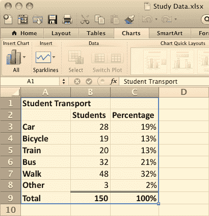
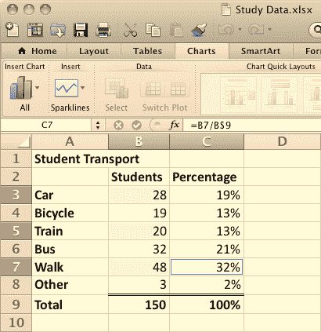
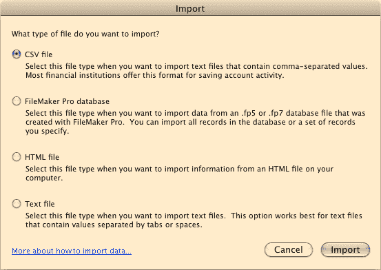
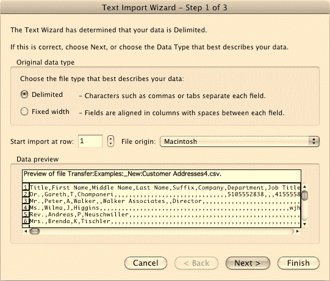
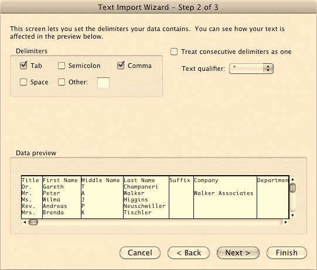

# Excel 中单元格区域的选择与操作

Excel 将选中的一组单元格称为**区域（range）**。一个区域可以由一个连续的矩形单元格组成，也可以由两个或多个不相邻的单元格组成。图 1-12 左侧的插图显示了一个连续单元格区域，而右侧的插图则显示了一个非连续单元格区域。

[www.it-ebooks.info](http://www.it-ebooks.info/)

**第 1 章：探索 Excel:Mac 界面的秘密**

**图 1-12.** *您可以选择连续单元格区域（左），也可以选择非连续单元格区域（右）。Excel 会加深包含该区域的行和列的标题颜色，使该区域更易于查看。*

您可以通过以下三种方式之一选择连续单元格区域：

- **点击并拖动。** 点击区域中的第一个单元格，然后拖动以选择所有其他单元格。例如，如果您点击单元格`B2`，然后拖动到单元格`E7`，您将选择一个宽度为四列、深度为六行的区域。Excel 使用符号`B2:E7`来描述此区域——起始单元格地址、冒号，然后是结束单元格地址。

- **点击，然后 Shift+点击。** 点击区域中的第一个单元格，然后`Shift`+点击最后一个单元格。Excel 会选择两者之间的所有单元格。此方法可随时使用，但在第一个单元格和最后一个单元格相距甚远时最为有用；例如，当第一个单元格和最后一个单元格不同时出现在 Excel 窗口中时。

- **按住 Shift 并使用方向键。** 使用方向键将活动单元格移动到您想要开始区域的位置；然后按住`Shift`键并使用方向键将选择扩展到该区域的其余部分。如果您更喜欢使用键盘而非鼠标，此方法非常合适。

您可以通过点击第一个单元格（或拖动选择一组连续单元格），然后按住`Cmd`键，同时点击其他单个单元格或拖动选择其他连续单元格区域，来选择非连续单元格区域。Excel 使用逗号来分隔此类区域中的各个单元格。例如，区域`D3,E5,F7,G1:G13`由三个单个单元格（`D3`、`E5`和`F7`）和一个连续单元格区域（`G1`到`G13`）组成。

[www.it-ebooks.info](http://www.it-ebooks.info/)

**第 1 章：探索 Excel:Mac 界面的秘密**

**注意：** 您可以通过点击行标题或当活动单元格在该行时按`Shift+spacebar`来快速选择一行。同样，您可以通过点击列标题或按`Ctrl+spacebar`来选择一列。要选择活动工作表中的所有单元格，请点击“全选”按钮（行标题和列标题的交叉点）。您也可以按`Cmd+A`，或者依次按`Shift+spacebar`和`Ctrl+spacebar`（或相反顺序）。

要取消选择已选中的区域，请点击该区域外部的任意位置。

## 快速输入文本和公式的工具

在工作簿中输入文本和公式最直接的方法就是手动键入。但无论您打字多快，了解将数据和公式输入工作簿的所有替代方法都是值得的。这些方法包括：从现有文件导入数据、连接到外部数据源、通过最大化利用自动更正来加快数据输入、利用强大的自动填充功能，以及使用各种形式的复制和粘贴。您甚至可以使用“替换”功能来输入文本。

### 导入数据

如果您需要的数据存在于某个文件中，通常可以将其导入到 Excel 中。

Excel 可以导入以下五种格式的文件：

- **逗号分隔值 (CSV)。** CSV 文件使用逗号分隔单元格的内容。

- **制表符分隔值 (TSV)。** TSV 文件使用制表符分隔单元格的内容。

**注意：** 大多数电子表格应用程序和数据库应用程序都能以`CSV`格式或`TSV`格式导出数据。如有必要，您也可以手动创建这些文件。例如，如果您需要在没有电子表格应用程序的移动设备上创建一些数据，您可以将其创建为一个文本文件，并使用逗号分隔每个字段。

- **空格分隔值。** 空格分隔值文件（通常不称为`SSV`）使用空格分隔单元格的内容。

- **FileMaker Pro 数据库。** FileMaker Pro 是一个运行在 Mac OS X 和 Windows 上的强大数据库应用程序。FileMaker Pro 文件使用`.fp7`文件扩展名。

- **HTML。** HTML（超文本标记语言）是用于网页的标记语言。

[www.it-ebooks.info](http://www.it-ebooks.info/)

**第 1 章：探索 Excel:Mac 界面的秘密**

**注意：** 当您需要文件中的所有数据时，导入功能效果最佳。当您只需要部分数据时，复制和粘贴通常更有效。或者，您可以先导入所有数据，然后删除不需要的部分。

要从现有文件导入数据，请按照以下步骤操作：

1.  打开您要导入数据的工作簿。如果要将数据放入新工作簿，请按`Cmd+N`创建一个。

2.  选择 `文件` > `导入` 以显示“导入”对话框（见图 1-13）。

**图 1-13.** *在“导入”对话框中，根据要导入的文件类型，选择相应的选项按钮。*

3.  选择 `CSV 文件` 选项按钮、`FileMaker Pro 数据库` 选项按钮、`HTML 文件` 选项按钮或 `文本文件` 选项按钮（用于制表符分隔文件或空格分隔文件）。

**注意：** 要从 FileMaker Pro 数据库导入数据，您的 Mac 上必须安装 FileMaker Pro。如果没有 FileMaker Pro，Excel 无法读取 FileMaker Pro 数据库。

4.  点击“导入”按钮，以显示用于识别文件的对话框。此对话框的名称因您在步骤 3 中的选择而异：对于 CSV 文件或文本文件，它是“选取一个文件”对话框；对于 FileMaker Pro，它是“选取一个数据库”对话框；对于 HTML 文件，它是“打开：Microsoft Excel”对话框。

[www.it-ebooks.info](http://www.it-ebooks.info/)

**第 1 章：探索 Excel:Mac 界面的秘密**

5.  选择包含数据的文件，然后点击“获取数据”按钮、“选取”按钮或“打开”按钮（取决于对话框）。

6.  按照打开的“导入向导”中的步骤操作。以下部分将解释主要注意事项。

#### 从逗号分隔值文件或文本文件导入数据

当您从逗号分隔值文件（CSV）或文本文件导入数据时，“文本导入向导”会引导您完成导入过程。

在向导的第一个屏幕上（见图 1-14），首先确保如果您的文件使用逗号、制表符或其他字符作为分隔符，Excel 已选择“分隔符号”选项按钮。如果它是一个使用空格来创建固定宽度列的文本文件，请选择“固定宽度”选项按钮。

**图 1-14.** *确保“文本导入向导”在“分隔符号”选项按钮和“固定宽度”选项按钮之间做出了正确选择。您还可以决定从哪一行开始导入。*

如果您需要跳过文件开头的几行，请增加“导入起始行”框中的值。要从开头开始，请确保此框设置为`1`。

如果“数据预览”框中的预览看起来不正确，请打开“文件原始格式”弹出菜单，然后选择文件使用的编码。例如，如果文件是在 Windows PC 上创建的，您可能需要选择“Windows (ANSI)”项，以使文本正确显示。如果文件是在 Mac 上创建的，则在“文件原始格式”弹出菜单中选择“Macintosh”即可解决问题。

[www.it-ebooks.info](http://www.it-ebooks.info/)

**第 1 章：探索 Excel:Mac 界面的秘密**

当预览效果符合要求时，单击`Next`（下一步）按钮进入第二个屏幕（参见图 1-15）。

**图 1-15.** *在 CSV 或 TSV 文件的文本导入向导的第二个屏幕上，请确保 Excel 已识别出正确的分隔符。*

**注意：** 对于按固定宽度列排列的文本文件，文本导入向导的第二个屏幕允许您创建、删除和移动分隔线，使各字段宽度合适。对于按固定宽度列排列的文本文件，文本导入向导第三个屏幕上的选项与分隔符文本文件相同。

在`Delimiters`（分隔符）框中，请确保 Excel 已选中文件所使用的分隔符对应的复选框，例如`Tab`（制表符）复选框。

如果您希望 Excel 将两个或多个连续的分隔符视为单个分隔符，请选中`Treat consecutive delimiters as one`（将连续分隔符视为单个分隔符）复选框。使用此设置会合并数据中的空白字段。通常情况下，您不需要使用此设置。

如果您的数据文件使用单引号或双引号来标记文本字符串，请确保 Excel 在`Text qualifier`（文本识别符号）弹出菜单中选择了正确的引号类型。如果没有，请自行选择。

检查`Data preview`（数据预览）框中的数据是否显示正确，然后单击`Next`（下一步）按钮显示文本导入向导的第三个也是最后一个屏幕（参见图 1-16）。在此屏幕上，您可以通过单击`Data preview`框中的列，然后在`Column data format`（列数据格式）框中选择相应的选项按钮，来设置任意列的数据格式：

-   **General（常规）。** 文本导入向导会为大多数列建议此格式。`General`（常规）格式会使 Excel 将数值转换为数字，将日期值转换为日期，并将任何其他类型的数据视为文本。这种设置对大多数字段效果良好，因此您可能只需保留此设置即可。否则，您可以将每个字段设置为所需的类型。

-   **Text（文本）。** 对于您希望 Excel 视为文本的任何数据，请选择此格式。有时，对于 Excel 可能会转换为数字的数据，您可能需要设置此格式。

-   **Date（日期）。** 选择此格式可确保 Excel 知道某列包含日期。在弹出菜单中，选择月份 (M)、日期 (D) 和年份 (Y) 的显示顺序：`MDY`、`DMY`、`YMD`、`MYD`、`DYM` 或 `YDM`。如果您使用的是美国本地化版本，Excel 默认使用`MDY`格式，因此除非文件来自日期处理方式不同的地区，否则您无需更改。

-   **Do not import column (Skip)（不导入此列（跳过））。** 对于要跳过的任何列，请选择此按钮。如果您确定不需要某些数据，此选项非常有用，不过您可能会发现导入所有列，然后在导入后删除不需要的列更为简单。

**图 1-16.** *在 CSV 或 TSV 文件的文本导入向导的第三个屏幕上，您可以为每一列设置数据格式。您还可以告诉 Excel 不要导入不需要的特定列。*

**注意：** 如果您需要将 Excel 设置为使用其他字符（而非句点）作为小数点分隔符，或使用其他字符（而非逗号）作为千位分隔符，请单击文本导入向导第三个屏幕上的`Advanced`（高级）按钮。在打开的`Advanced Text Import Settings`（高级文本导入设置）对话框中，在`Decimal separator`（小数点分隔符）弹出菜单和`Thousands separator`（千位分隔符）弹出菜单中选择适当的设置，然后单击`OK`（确定）按钮。

完成选择文本导入设置后，单击`Finish`（完成）按钮。文本导入向导会将数据导入到活动工作表中。

### 从 FileMaker Pro 数据库导入数据

当您从 FileMaker Pro 数据库导入数据时，FileMaker Pro 导入向导（参见图 1-17）会引导您完成选择正确字段的过程。

**图 1-17.** *在 FileMaker Pro 导入向导的第一个屏幕上，选择要导入的布局或表，选取字段，然后按照您偏好的顺序排列它们。*

在 FileMaker Pro 导入向导的第一个屏幕上，请按照以下步骤操作：

1.  如果您想使用布局，请单击`Layouts`（布局）选项按钮。如果您想使用表，请单击`Tables`（表）选项按钮。

2.  打开`Layouts`（布局）选项按钮或`Tables`（表）选项按钮下方的弹出菜单（取决于您的选择），然后单击您要使用的布局或表。Excel 会在`Available fields`（可用字段）列表框中显示该布局或表中的字段。

3.  将您需要的字段添加到`Import these fields`（导入这些字段）列表框：

    -   **添加单个字段：** 单击`Available fields`（可用字段）列表框中的字段，然后单击`Add`（添加）按钮。根据需要重复此操作。

    -   **添加所有字段：** 单击`Add All`（全部添加）按钮。通常，您会希望添加所有字段，然后再删除其中几个。

    -   **删除字段：** 单击`Import these fields`（导入这些字段）列表框中的字段，然后单击`Remove`（删除）按钮。

    -   **删除所有字段：** 单击`Remove All`（全部删除）按钮。

4.  在`Import these fields`（导入这些字段）列表框中，按照您偏好的顺序排列字段。要向上或向下移动字段，请单击它，然后单击`Move Up`（上移）按钮（带有向上箭头的按钮）或`Move Down`（下移）按钮（带有向下箭头的按钮）。

当您选择好所需的字段并按偏好顺序排列后，单击`Next`（下一步）按钮显示 FileMaker Pro 导入向导的第二个也是最后一个屏幕（参见图 1-18）。在此屏幕上，您可以设置条件，仅从您选择的表或布局中选取所需的记录。

**图 1-18.** *在 FileMaker Pro 导入向导的第二个屏幕上，设置所需条件，将导入范围限制为仅包含您想要的记录。*

如果您需要表或布局中的所有记录，只需单击`Finish`（完成）按钮即可。

但是，如果您想要将表或布局精简为仅包含符合特定条件的记录，请遵循以下步骤：

1.  在`Criteria 1`（条件 1）区域，设置您的第一个条件：

    -   打开左侧的弹出菜单，单击用于该条件的字段。

    -   打开中间的弹出菜单，单击比较运算符：`=`、`<=`、`>=`、`<`、`>`、`begins with`（开头是）、`ends with`（结尾是）或`contains`（包含）。

    -   在文本框中，指定比较的值。

2.  如果您需要第二个条件，请选择适当的选项按钮：

    -   选择`And`（且）选项按钮，使记录同时满足第一个条件**且**第二个条件——例如，`Ship To State = CA`且`Ship To City = San Francisco`。

    -   选择`Or`（或）选项按钮，使记录满足第一个条件**或**第二个条件——例如，`Ship To State = CA`或`Ship To State = AZ`。

3.  使用与设置第一个条件相同的技术在`Criterion 2`（条件 2）框中设置第二个条件。

4.  如果您需要第三个条件，请选择`And`（且）选项按钮或`Or`（或）选项按钮（视情况而定），然后使用第三行控件指定条件。

当您最终确定条件后，单击`Finish`（完成）按钮关闭 FileMaker Pro 导入向导。向导会显示`Returning External Data to Microsoft Excel`（将外部数据返回给 Microsoft Excel）对话框（参见图 1-19）。

**图 1-19.** *在此对话框中，根据情况选择`Existing sheet`（现有工作表）选项按钮或`New sheet`（新建工作表）选项按钮。然后单击`OK`（确定）按钮。*