# 第 1 章：探索 Excel：Mac 界面的秘诀

### 从 HTML 文件导入数据

从 HTML 文件导入数据时，Excel 会直接打开该文件，而不会显示任何导入向导屏幕。之后，您可以根据需要操作文件内容。

### 将工作表连接到外部数据源

如果您有包含 Excel 工作表所需数据的外部数据源，可以将工作表连接到该数据源并拉取数据，以便在 Excel 中进行处理。

要将数据获取到工作表中，您需要使用我们刚刚讨论的用于导入数据的相同工具——例如，使用 FileMaker Pro 导入向导从 FileMaker Pro 数据库中导入数据。导入数据后，您可以根据需要刷新部分或全部数据，从而使用数据源中的最新数据更新工作表。

第 11 章将介绍如何使用外部数据。

## 使用自动更正输入文本

在工作表中工作时，自动更正功能会分析您输入的字符，并在检测到可以修复的错误或可以应用的格式时立即启动。

此功能可以节省大量时间和精力，并显著提高您的输入速度，因此非常值得使用——但您需要对其进行设置以满足您的需求。

自动更正还具有一些可能带来意外的功能，因此您需要选择适合自己工作方式的设置。

### 打开自动更正偏好设置窗格

要设置自动更正，请从菜单栏中选择**工具** → **自动更正**，以在 **Excel 偏好设置**对话框中显示 **自动更正** 偏好设置窗格（见图 1-20）。

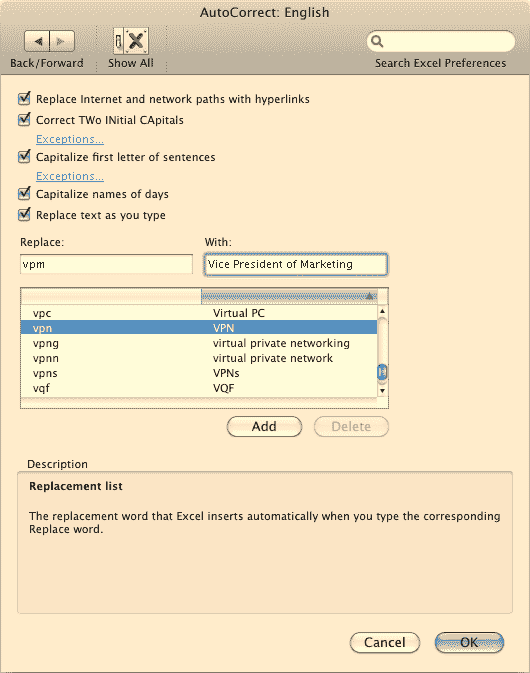

**图 1-20.** 您可以使用自动更正功能在工作表中快速输入文本，以及更正拼写错误和创建超链接。

### 选择选项以让自动更正按您的方式工作

显示 **自动更正** 偏好设置窗格后，请选中要使用的每个选项的复选框：

- **将 Internet 和网络路径替换为超链接。** 选中此复选框，以便在您输入 URL（例如 `www.apress.com`）或网络路径（例如 `\\server1\users`）时，自动更正插入超链接。如果您希望工作簿中包含可点击的超链接，此选项很有帮助——例如，当您制作包含 URL 的产品列表，并希望点击链接即可在浏览器中打开网页时。

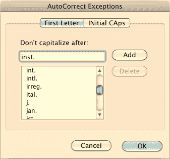
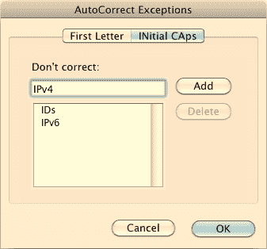

- **更正两个大写首字母。** 选中此复选框，以便自动更正将第二个大写首字母应用为小写——例如，将“THree”更改为“Three”。

- **将句子的首字母大写。** 如果您希望自动更正自动将单元格中每个新句子的开头字母设为大写，请选中此复选框。自动更正不会将单元格中的第一个句子大写，因为此选项仅在您输入了一些文本后跟句点时才生效。如果您想自己控制大小写，请清除此复选框。

- **将日期名称大写。** 选中此复选框，以便自动更正自动将星期名称的首字母大写（例如，`Sunday`）。此选项通常很有帮助，除非您在 Excel 中创作极简主义诗歌。

- **键入时替换文本。** 选中此复选框以使用自动更正的主要功能，即用指定的替换文本来替换拼写错误和缩写。您应该使用此功能来充分利用自动更正。

### 创建自动更正例外项

如果您选中了**更正两个大写首字母**复选框或**将句子的首字母大写**复选框，则可以创建例外项，告知自动更正不要修复特定实例中的两个大写首字母或句子。

要创建例外项，请单击**更正两个大写首字母**复选框或**将句子的首字母大写**复选框下的**例外项**链接。Excel 将显示**自动更正例外项**对话框；图 1-21 左侧屏幕显示**首字母**选项卡，右侧屏幕显示**大写首字母**选项卡。

**图 1-21.** 使用**自动更正例外项**对话框中的**首字母**选项卡和**大写首字母**选项卡来设置句子首字母大写或单词第二个字母小写规则的例外项。

在**首字母**选项卡上，列出以句点结尾但您不希望其后单词以大写字母开头的术语。Office 为您提供了一个内置术语列表，例如 `vol.` 和 `wk.`。要添加术语，请在**不将之后的大写**文本框中输入该术语，然后单击**添加**按钮。

在**大写首字母**选项卡上，列出以两个大写首字母开头且您不希望自动更正将其缩减为单个大写字母的术语——例如 `IPv6`。在**不更正**文本框中输入一个术语，然后单击**添加**按钮将其添加到列表中。

在两个选项卡上，您都可以通过单击列表框中的现有术语，然后单击**删除**按钮将其移除。

完成例外项设置后，单击**确定**按钮关闭**自动更正例外项**对话框。

### 创建键入时替换条目

自动插入遗漏的大写字母和创建超链接会有所帮助，但自动更正的主要功能是更正输入错误。

自动更正附带一个标准错误列表，例如“abbout”对应“about”，您可能希望它自动更正这些错误。但真正可以利用自动更正的地方是，创建非错误条目，而是您特意输入的缩写，并让自动更正为您展开。例如，您可以创建一个条目，将“vpm”更改为“Vice President of Marketing”，或将“ssf”更改为“Second Storage Facility, Virginia (Security Grade II)”。

**注意：** Excel 与 Word、PowerPoint 和 Outlook 共享其自动更正条目，因此无论您在哪个应用程序中创建条目，都可以在其他应用程序中使用它。每个条目必须是唯一的——您不能在 Word 中使用“vpm”表示“Vice President of Marketing”，而在 Excel 中表示“virtual processor module”。在 Word 中，您还可以创建包含格式、段落标记和其他对象（如图形或表格）的格式化自动更正条目；这些条目仅适用于 Word。

## 创建自动更正条目

要创建自动更正条目，请执行以下步骤：

1.  在**替换**框中输入条目名称（触发替换的文本）。名称最长可达 32 个字符，但较短的条目能为您节省更多时间。

    ---
    [www.it-ebooks.info](http://www.it-ebooks.info/)

    **提示：** 在命名自动更正条目时，通常应避免使用工作簿中可能需要输入的任何单词或名称。例外情况是当你总是想更改某个特定单词时。例如，如果你的老板特别讨厌“purchase”这个单词，你可以设置自动更正条目，将“purchase”改为“buy”，将“purchased”改为“bought”，以此类推。

2.  在 `With` 框中键入或粘贴替换文本。替换文本长度最多可达 255 个字符（包括空格和标点符号）。

    **注意：** 你只能将自动更正条目输入到单个单元格中。即使你选择了多个单元格并将其粘贴到“自动更正”窗格的 `With` 框中，`AutoCorrect` 也会去除单元格分隔。

3.  单击 `Add` 按钮。

如果需要删除现有条目，请通过在 `Replace` 框中单击并键入其名称，或向下滚动并单击来选中它。然后单击 `Delete` 按钮。

## 使用自动更正条目

设置好自动更正条目后，Excel 会在你键入条目并按空格键、标点键或移动到另一个单元格后自动替换该条目。

## 使用自动填充和自定义列表输入文本

在许多工作簿中，你需要输入一系列数据，例如月份或年份列表、数字序列或日期序列（如每个星期一）。在很多情况下，使用 Excel 的自动填充功能可以节省时间和精力。

`AutoFill` 通过分析你选定的一个或多个单元格的内容，然后在通过拖拽扩展选定区域所指定的单元格中输入相关数据系列来工作。`AutoFill` 会即时计算数学序列或日期序列，并使用内置的自定义列表来填充星期几或月份。你也可以为你希望 Excel 学会填充的数据创建自己的自定义列表。

### 使用自动填充的内置功能

要掌握 `AutoFill` 的功能，最好的方法就是尝试它。因此，请打开一个你愿意进行实验的工作簿，并尝试本节中的示例。

首先，让 `AutoFill` 填充星期几。请执行以下步骤：

[www.it-ebooks.info](http://www.it-ebooks.info/)

**34** **第 1 章：学习 Excel:Mac 界面的秘密**

1.  在单元格 `A1` 中键入 `Monday`，然后单击编辑栏上的 `Enter` 按钮以输入数据。（如果你更愿意按 `Return` 键输入数据，请再次单击单元格 `A1` 以重新选中它。）
2.  向下拖拽 `AutoFill` 手柄——即出现在选定区域右下角的蓝色方块——到单元格 `A7`。当你拖过每个单元格时，`AutoFill` 会显示一个 `ScreenTip`，指示它将在此单元格中填充的数据（参见图 1-22）。

    **图 1-22.** *向下或横向拖拽自动填充手柄，以根据一个或多个现有条目填充数据系列。在此例中，自动填充会填充星期几，如果你拖得更远，它会重复该系列。*
3.  在单元格 `A7` 上释放鼠标按钮。`AutoFill` 会填充星期一到星期日。

# Excel:Mac 界面操作指南

**注意：** 如果 `AutoFill` 不起作用，你需要将其打开。选择 `Excel 偏好设置` 以显示 `Excel 偏好设置` 对话框，然后在 `创作` 区域中单击 `编辑` 图标以显示 `编辑` 窗格。选中 `启用填充柄和单元格拖放` 复选框，然后单击 `确定` 按钮关闭 `Excel 偏好设置` 对话框。

现在，拖过该区域以将其选中，然后按 `Delete` 键清除数据。然后执行以下步骤以输入月份序列：

**4.** 单击单元格 `B2`，并在其中键入一个日期，例如 `5-15-11`。

**5.** 单击编辑栏上的 `Enter` 按钮。Excel 会将日期值更改为完整日期——例如 `5/15/2011`。

**6.** 按住 Ctrl 键并单击或右键单击 `AutoFill` 手柄，然后将其拖拽至单元格 `G2`。拖拽时，`AutoFill` 会显示每列递增一天的日期（`5/16/2011`、`5/17/2011` 等），但当你释放鼠标按钮时，`AutoFill` 会显示一个上下文菜单（参见图 1-23）。

[www.it-ebooks.info](http://www.it-ebooks.info/)
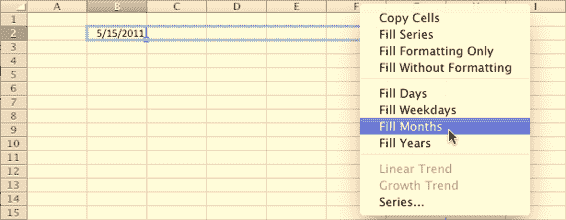

**35** **第 1 章：学习 Excel:Mac 界面的秘密**

**图 1-23.** *要获取更多自动填充选项，请按住 Ctrl 键并拖拽或右键拖拽自动填充手柄，然后在上下文菜单中单击所需的填充选项。*

**7.** 单击 `填充月` 选项，Excel 将为每列填充一个单独的月份：`6/15/2011`、`7/15/2011` 等。

现在，再次清除你的数据，然后创建一个数字序列。请执行以下步骤：

**1.** 单击单元格 `A1`，并在其中键入 `5`。

**2.** 按 `Return` 键移动到单元格 `A2`，在其中键入 `25`，然后按向上箭头键移回单元格 `A1`。

**3.** 按 `Shift+向下箭头` 键选中单元格 `A1` 和 `A2`。

**4.** 单击 `AutoFill` 手柄并向下拖拽。`AutoFill` 会使用线性趋势填充一个间隔为 20 的系列——单元格 `A3` 得到 45，单元格 `A4` 得到 65，以此类推。

删除 `AutoFill` 输入的数据，只在单元格 `A1` 中保留 `5`，在单元格 `A2` 中保留 `25`。然后执行以下步骤：

**1.** 选中单元格 `A1` 和 `A2`。

**2.** 按住 Ctrl 键并单击或右键单击 `AutoFill` 手柄并向下拖拽。拖拽时，你会看到与前一个列表相同值的 `ScreenTips`。

**3.** 释放鼠标按钮，然后在上下文菜单中单击 `增长趋势`。`AutoFill` 会输入一个增长趋势而非线性趋势：因为第二个值 (`25`) 是第一个值 (`5`) 的 5 倍，Excel 会将每个值乘以 5，从而产生序列 `5`、`25`、`125`、`625`、`3125`，以此类推。

**注意：** `AutoFill` 上下文菜单还包含仅填充单元格格式（从第一个单元格复制格式）、不填充格式地填充单元格（忽略第一个单元格的格式）以及填充天、工作日、月和年的选项。

这些是 `AutoFill` 的基础知识。但你也可以创建自定义的 `AutoFill` 列表，以快速输入你确切需要的数据。

[www.it-ebooks.info](http://www.it-ebooks.info/)
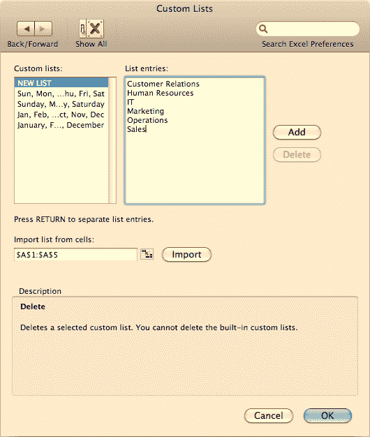

**36** **第 1 章：学习 Excel:Mac 界面的秘密**

## 创建你自己的自定义自动填充列表

如果你需要频繁输入相同的数据系列，请执行以下步骤来创建你自己的 `AutoFill` 列表：

**1.** 如果该系列的数据已存在于工作表中，请选中包含这些数据的单元格。

**2.** 选择 `Excel 偏好设置` 或按 `Cmd+,`（Cmd 键和逗号键）以显示 `Excel 偏好设置` 对话框。

**3.** 在 `公式和列表` 区域中，单击 `自定义列表` 选项以显示 `自定义列表` 窗格（图 1-24 显示了已选好设置的状态）。如果你在步骤 1 中选中了单元格，则引用会出现在 `从单元格导入列表` 文本框中；请直接跳到步骤 6。

**图 1-24.** *你可以通过创建自己的数据系列来补充 Excel 的内置自动填充列表。*

**4.** 在 `自定义列表` 框中，单击 `新建列表` 选项。

**5.** 在 `列表条目` 框中单击，然后键入你的列表，每行放置一个条目。

[www.it-ebooks.info](http://www.it-ebooks.info/)

**37** **第 1 章：学习 Excel:Mac 界面的秘密**

**6.** 如果你刚刚输入了一个列表，请单击 `添加` 按钮将列表添加到 `自定义列表` 框中。如果你从工作表导入了一个列表，请单击 `导入` 按钮。

**提示：** 如果此时需要从工作表数据创建另一个列表，则无需关闭 `Excel 偏好设置` 对话框。相反，请单击 `导入` 按钮左侧的 `折叠对话框` 按钮，将 `自定义列表` 对话框折叠成一个窄对话框，然后拖过工作表上的列表。再次单击 `折叠对话框` 按钮以恢复 `Excel 偏好设置` 对话框，此时该区域会显示在 `从单元格导入列表` 文本框中。然后单击 `导入` 按钮以导入数据。

**7.** 单击 `确定` 按钮关闭 `Excel 偏好设置` 对话框。

### 使用粘贴和粘贴选项输入文本

在工作表中，你常常可以通过从其他来源粘贴文本来更快地输入内容。例如，如果你在电子邮件中收到了销售数据，可以将其复制并粘贴到工作表中。要进行粘贴，请选中要粘贴数据区域左上角的单元格，然后执行`粘贴`命令——例如，点击标准工具栏上的`粘贴`按钮，或按下`Cmd+V`组合键。

`Excel`允许你选择性地粘贴数据，可以带格式，也可以不带格式。通常，最简便的方法是先直接进行粘贴操作，然后如果结果不符合预期，再使用`粘贴选项`操作按钮（见图 1–25）来更改结果。

**图 1–25.** *使用`粘贴选项`操作按钮，可将粘贴的文本从其原始格式切换为匹配目标位置的格式。*

如果你粘贴的是从其他应用程序复制来的数据，并且明确不想粘贴其格式，请按如下方式使用`选择性粘贴`命令：

**1.** 在其他应用程序中复制数据。

**2.** 切换到`Excel`。

**3.** 点击你要粘贴数据区域左上角的单元格。

**4.** 从菜单栏中选择`编辑` > `选择性粘贴`，或从功能区选择`开始` > `编辑` > `粘贴` > `选择性粘贴`（点击`粘贴`弹出按钮，而非按钮的主要部分），以显示`选择性粘贴`对话框（见图 1–26）。

[www.it-ebooks.info](http://www.it-ebooks.info/)
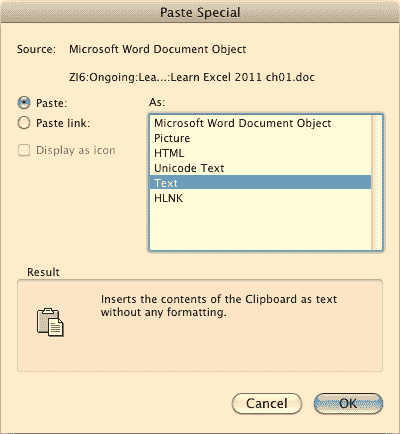

**38**
**第 1 章：掌握 Excel:Mac 界面的秘诀**

**图 1–26.** *在`选择性粘贴`对话框的`方式`框中选中`文本`项，可在不粘贴格式的情况下粘贴来自其他应用程序的数据。*

**5.** 在`方式`框中，点击`文本`项。

**提示：** 如果在`选择性粘贴`对话框中使用`文本`项进行粘贴会将所有文本放入一个单元格而非多个单元格，请尝试改用`Unicode 文本`项。

**6.** 点击`确定`按钮。

**注意：** `选择性粘贴`对话框中的选项会根据你复制的数据而变化。正如你将在第 4 章中看到的，当粘贴从`Excel`复制的数据时，`选择性粘贴`对话框会提供更多选项。

### 将数据从行转换为列

在规划工作表时，通常一开始并不清楚数据的哪种排列方式最好——因此你可能会发现，当列排列效果更好时，你却将数据按行排列了。

无需花费数小时重新输入数据或使用拖放来移动数据，你可以使用`Excel`的`转置`命令在片刻间解决问题。请按以下步骤操作：

**1.** 为转置后的数据腾出空间。通常，最简单的做法是将其放在一个单独的工作表上；如果是这样，请点击`插入工作表`按钮添加一个。

[www.it-ebooks.info](http://www.it-ebooks.info/)
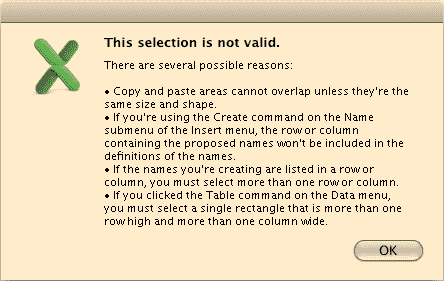

**第 1 章：掌握 Excel:Mac 界面的秘诀**
**39**

**2.** 选择要转换（从行到列）的数据。

**3.** 以任意常规方式执行`复制`命令：按下`Cmd+C`，点击标准工具栏上的`复制`按钮，或从菜单栏中选择`编辑` > `复制`。

**4.** 点击要粘贴转置数据区域左上角的单元格。

**5.** 从功能区选择`开始` > `编辑` > `粘贴` > `转置`，点击`粘贴`弹出按钮（而非按钮的主要部分）。`Excel`粘贴数据时，会同时转置其行和列。

**注意：** 如果执行`转置`命令时，`Excel`显示了`此选择无效`对话框（见图 1–27），请确保你没有试图将数据粘贴回其原始位置。尽管该对话框暗示，只要选择了正确的行列数，就可以将数据粘贴回原始位置或重叠位置，但截至目前，像这样粘贴回数据是行不通的。

**图 1–27.** `此选择无效`对话框可能表示你正试图将转置数据粘贴回其原始位置、重叠位置或形状不匹配的位置。

## 从 Word 粘贴表格

如果你在`Word`的表格中有数据，可以直接将其粘贴到`Excel`的工作表中。

如你所愿，`Excel`会将表格中的每个单元格放置到不同的工作表单元格中。

布局规整的表格（每行具有相同数量的单元格）能获得最佳的粘贴效果。如果某些行的单元格数量多于其他行，你可能需要在粘贴后于`Excel`中移动一些单元格。大多数情况下，在粘贴到`Excel`之前，先在`Word`中使表格变得规整（例如，在备用文档中制作一个副本，然后修改该副本）是最简单的方法。

[www.it-ebooks.info](http://www.it-ebooks.info/)

**40**

**第 1 章：掌握 Excel:Mac 界面的秘诀**

## 将逗号分隔数据导入工作表

如果你有逗号分隔格式的数据，可以通过三种方式将其导入`Excel`工作表：

*使用文本导入向导。* 如本章前面所述，选择`文件` > `导入`，然后使用`文本导入向导`精确控制`Excel`导入文本的方式。

*在 Excel 中打开文件。* 你可以直接使用`文件` > `打开`命令和`打开`对话框在`Excel`中打开逗号分隔文件。`Excel`会自动将每个逗号分隔的项目放入单独的单元格。然后你可以根据需要复制和粘贴数据。

*将逗号分隔数据转换为 Word 表格，然后粘贴。* 如果数据以逗号分隔格式存在于文档或电子邮件中，请按照以下步骤操作：

1.  将数据粘贴到`Word`文档中。

2.  在`Word`中，选中粘贴的数据。

3.  从菜单栏中选择`表格` > `转换` > `文本转换成表格`，以显示`将文字转换成表格`对话框。

4.  在`文字分隔位置`区域，确保选中了`逗号`选项按钮。

5.  点击`确定`按钮。`Word`将文本转换为表格。

6.  选中表格。

7.  复制表格。

8.  切换到`Excel`并粘贴表格。

## 使用剪贴簿粘贴多个项目

如你所知，Mac OS X 的剪贴板一次只能存储一个项目，因此每次复制内容到剪贴板时，都会覆盖其先前的内容。但你可能经常需要存储多个复制项，以便随时粘贴。例如，你可能需要存储包含公司徽标的图形文件，或你在多个工作表中都需要的样板文本片段。

`Office:Mac`提供了`剪贴簿`，让你可以将剪报和文件存储在一个方便的位置，并可以从该位置粘贴到任何地方。`Office`应用程序共享该`剪贴簿`，因此你可以在一个应用程序中收集项目，并在另一个应用程序中使用它们。

### 打开剪贴簿

要打开`剪贴簿`，请从菜单栏中选择`视图` > `剪贴簿`，或点击标准工具栏上的`工具箱`按钮，然后点击`剪贴簿`按钮。图 1–28 显示了

[www.it-ebooks.info](http://www.it-ebooks.info/)

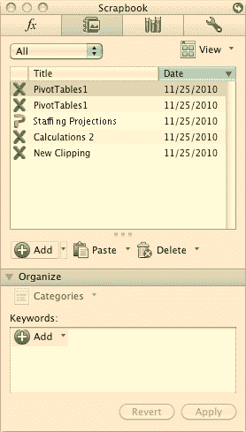

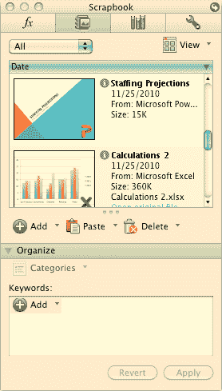

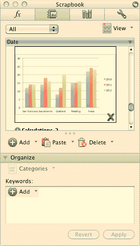

**第 1 章：掌握 Excel:Mac 界面的秘诀**

**41**

存储了多个项目的`剪贴簿`。左侧屏幕显示`剪贴簿`的列表视图，中间屏幕显示详细信息视图，右侧屏幕显示大预览图。

**图 1–28.** `剪贴簿`可以将其内容显示为列表（左）、详细信息（中）或大预览图（右）。使用`视图`弹出菜单切换视图，以便轻松识别要粘贴的项目。

### 向剪贴簿添加项目

你可以通过以下任一方式将项目添加到`剪贴簿`：

*添加选取内容。* 选中要添加到`剪贴簿`的文本或其他项目。然后点击`剪贴簿`面板中间的`添加`按钮。

*添加图形文件。* 点击`添加`下拉按钮，然后点击`添加文件`以显示`选取文件`对话框。选择所需的文件，然后点击`选取`按钮。

*将复制的内容添加到剪贴板。* 像往常一样将项目复制到剪贴板——例如，在应用程序中选中它，然后按下`Cmd+C`。接着，点击剪贴板面板中的`添加`下拉按钮，然后点击`从剪贴板添加`。

*添加你复制到剪贴板的所有内容。* 如果你频繁使用剪贴板，可以让 Office 在剪贴板面板打开时，为你复制到 Mac OS X 剪贴板中的所有内容创建一个剪辑。操作方法如下：点击剪贴板面板中的`添加`下拉按钮，然后点击`始终添加副本`，在该项旁边放置一个复选标记。应用程序会显示“已选定始终添加剪辑”对话框，警告你此功能可能会降低 Mac 运行速度或占用磁盘空间。点击`确定`按钮。

**提示：** 为了让你的剪辑更容易找到，可以为它们添加关键词。点击一个剪辑，在`关键词`窗格中键入一个或多个关键词，然后点击`应用`按钮。接着，你可以打开剪贴板面板左上角的弹出菜单，选择`关键词包含`，并键入要搜索的关键词。

### 从剪贴板插入项目

要从剪贴板插入项目，请选择要粘贴到的单元格或区域。然后点击剪贴板面板中的该项目，再点击`粘贴`按钮。

如果你希望将项目粘贴为纯文本（不带格式）或图片，请点击该项目，然后点击`粘贴`弹出按钮。在菜单中，根据需要点击`粘贴为纯文本`或`粘贴为图片`。

### 从剪贴板删除项目

你很可能希望将某些项目永久保留在剪贴板中，但不再需要其他项目时则需要将其删除。以下是删除项目的方法：

*删除单个项目。* 点击该项目，然后点击`删除`按钮。

*删除当前显示的所有项目。* 显示要删除的项目，点击`删除`下拉按钮，然后点击`删除可见项`。

*从剪贴板删除所有项目。* 点击`删除`下拉按钮，然后点击`全部删除`。

## 使用查找和替换输入文本

`Excel`包含一个强大的`替换`功能，可用于替换活动工作表或活动工作簿中每个工作表上的文本项。您可以将搜索范围限制为匹配指定的大小写，或仅查找单元格的完整内容匹配项，而不是单元格内容的一部分匹配项。

要使用`替换`功能，请按照以下步骤操作：

1.  通过以下任一方式打开`替换`对话框（见图 1-29）：

    *   *鼠标。* 点击标准工具栏上`搜索`字段的弹出按钮，然后在弹出菜单中点击`替换`。

    *   *菜单。* 选择`编辑` → `替换`。

    *   *键盘。* 按下`Cmd+F`显示`查找`对话框，然后点击`替换`按钮。

    **图 1-29.** 您可以使用`替换`对话框快速更改工作表或工作簿中所有工作表的内容。

2.  在`查找内容`框中键入搜索词。

3.  在`替换为`框中键入替换文本。

4.  在`范围`弹出菜单中选择`工作表`，如果你只想替换活动工作表上的搜索词实例。选择`工作簿`，如果你想替换工作簿中所有工作表上的项目。

5.  在`搜索`弹出菜单中选择`按行`，如果你想依次搜索每一行。选择`按列`，如果你想依次向下搜索每一列。

6.  选中`区分大小写`复选框，如果你只想定位与在`查找内容`框中键入搜索词的方式相匹配的实例。

7.  选中`单元格匹配`复选框，如果你只想查找其全部内容与搜索词匹配的单元格。清除此复选框后，`Excel`还会查找仅构成单元格内容一部分的匹配项。

8.  点击相应的命令按钮：

    *   `查找下一个`。点击此按钮查找搜索词的下一个实例，以便决定是否替换它。

    *   `替换`。点击此按钮替换`Excel`已找到的实例，并查找下一个实例（如果有的话）。重复操作。

    *   `全部替换`。点击此按钮替换工作表或工作簿中的所有实例（取决于您在`范围`弹出菜单中选择的设置）。

    *   `关闭`。使用完`替换`对话框后，点击此按钮。

## 在文档中插入符号

仅通过键入，您可以轻松插入键盘上出现的任何字符——但许多文档需要其他符号，例如带有分音符的字母（例如，ë）或连接两个字符的连字（例如，Æ）。

您可以使用媒体浏览器中的`符号浏览器`窗格在工作簿中快速插入一个或多个符号。

**注意：** 当您使用`符号浏览器`插入符号时，应用程序会以您当前使用的字体插入该符号字符——如果该字体包含该字符的话。如果不包含，`符号浏览器`会替换为包含该字符的字体。相比之下，当您使用`符号`对话框时，您可以确切地看到特定字体可用的符号。

您可以使用媒体浏览器中的`符号浏览器`窗格在`Word`、`Excel`或`PowerPoint`中插入符号。要插入符号，请按照以下步骤操作：

1.  在文档中，将插入点定位到您希望符号出现的位置。

2.  从菜单栏中选择`插入` → `符号`，以显示媒体浏览器的`符号`窗格（见图 1-30）。

    **图 1-30.** 要在工作簿中插入符号，请在`符号浏览器`中点击该符号。在弹出菜单中选择`所有符号`项以浏览所有符号（左侧），或只选择您感兴趣的那组字符（右侧）。

3.  通过以下任一方式找到您想要的符号：

# 1.1.1 浏览符号

*   **浏览所有符号。** 在 `符号浏览器` 顶部的弹出菜单中选择 `所有符号`，然后向下滚动。

    **提示：** 拖动 `符号浏览器` 底部的滑块可以放大符号，或缩小以同时查看更多符号。

*   **仅显示一组符号。** 打开 `符号浏览器` 顶部的弹出菜单，然后点击您想要的那组符号。例如，点击 `希腊语` 组以显示希腊字符。

4.  点击该符号以将其插入文档中。

5.  如果您需要插入更多符号或其他媒体对象，请保持 `符号浏览器` 打开。否则，请点击媒体浏览器的 `关闭` 按钮（标题栏左端的按钮）将其关闭。

## 1.1.2 查看工作簿

Excel 提供两种视图用于处理工作簿：

*   **普通视图。** 这是工作簿通常打开的视图，也是您进行大多数数据输入、格式设置和审阅的视图。到目前为止，您在本章中看到的 Excel 都是普通视图。

*   **页面布局视图。** 此视图显示工作表打印在纸上的样子。您可以使用它来调整页面设置。您将在第 4 章的“设置页面格式”部分学习如何操作。

要切换视图，请点击状态栏左端的 `普通视图` 按钮或 `页面布局视图` 按钮（见图 1-31），或从菜单栏中选择 `视图` → `普通` 或 `视图` → `页面布局`。

**图 1-31.** 使用状态栏左端的 `视图` 按钮快速更改视图。

**提示：** 当您希望尽可能多地显示工作表时，请从菜单栏中选择 `View Full Screen`（全屏查看）。Excel 会隐藏功能区，并以全屏模式显示工作表，但不会像 Word 的全屏视图那样隐藏菜单栏或 Dock 栏。您可以在 `Normal`（普通）视图或 `Page Layout`（页面布局）视图中使用 `Full Screen`（全屏）模式。当您想要退出 `Full Screen`（全屏）视图时，请点击 `Close Full Screen`（关闭全屏）工具栏上的 `Close Full Screen`（关闭全屏）按钮（当您切换到 `Full Screen`（全屏）视图时，Excel 会自动显示该工具栏），再次选择 `View Full Screen`（全屏查看），或者直接按 `Esc` 键。

### 1.1.2.1 拆分窗口以查看工作表的不同部分

通常，能够同时看到工作表的两部分会很有用——例如，确认你的注释正确地描述了数据，或者当你将信息从一个部分复制到另一个部分时。

当您需要在同一窗口中查看工作表的两部分时，可以水平或垂直拆分窗口。为此，您可以使用水平滚动条右端的水平拆分框、垂直滚动条顶端的垂直拆分框，或者功能区 `Layout`（布局）选项卡 `Window`（窗口）组中的 `Split`（拆分）按钮（见图 1–32）。

**图 1–32.** 功能区“布局”选项卡上的“窗口”组包含几个基本命令，但大多数按钮名称只有在 Excel 窗口非常宽时才会显示。

双击水平拆分框可在活动单元格上方水平拆分窗口，或双击垂直拆分框可在活动单元格左侧垂直拆分窗口。如果活动单元格不在适合拆分的位置，请单击水平拆分框或垂直拆分框，然后将其拖到希望拆分条出现的位置。

如果您想将窗口拆分为四个窗格，还可以按另一个维度进行拆分。例如，如果您已经水平拆分窗口，现在也可以垂直拆分。图 1–33 显示了拆分为四个窗格的 Excel 窗口。

**图 1–33.** 当您需要同时在工作表的不同区域工作时，将 Excel 窗口拆分为两个或四个窗格。

拆分窗口后，每个部分都会有一个独立的滚动条，因此您可以分别滚动窗格以显示工作表中所需的任何区域。

**注**：拆分窗口时，冻结某些行和列可能会有所帮助，详见本章后续内容，这样即使滚动到工作表其他区域，这些行和列也能保持可见。

要重新定位拆分，请单击拆分条，并将其拖到所需位置。如果您已将窗口拆分为四个窗格，可以通过单击拆分条交叉处然后拖动，来同时调整所有四个窗格的大小。

要移除拆分，可以双击拆分条，或者单击并将其一直拖到屏幕左侧或顶部。您也可以选择功能区中的 `Layout Window Split`（布局 窗口 拆分）或菜单栏中的 `Window Remove Split`（窗口 移除拆分）。

### 1.1.2.2 打开额外窗口以显示工作簿的其他部分

除了拆分窗口，您还可以打开一个或多个额外窗口来显示工作簿的其他部分。

选择功能区中的 `Layout Window New`（布局 窗口 新建）或菜单栏中的 `Window New Window`（窗口 新建窗口）可在活动工作簿中打开一个新窗口。Excel 通过在第一个窗口的名称后添加 `:1`、第二个窗口的名称后添加 `:2` 来区分它们——例如，`General Data.xlsx:1` 和 `General Data.xlsx:2`。

**注**：打开额外窗口比拆分窗口有两个优势。首先，如果需要，您可以在这些窗口中显示其他工作表，而不仅仅是同一工作表的其他部分。其次，您可以按需为每个窗口设置不同的缩放比例，或在每个窗口中使用不同的视图。

### 1.1.2.3 切换窗口与排列打开的窗口

切换当前工作窗口最简单的方法是单击要使用的窗口——可以直接单击窗口本身（如果能看到），或者单击其在任务栏上的按钮。

您也可以选择打开菜单栏上的 `Window`（窗口）菜单，然后点击底部列表中的窗口。

当您打开了多个窗口时，可以使用标准的 Mac OS X 技巧来排列它们，例如通过拖动来调整其大小和位置。您也可以使用 Excel 的 `Arrange Windows`（重排窗口）对话框或 `Arrange`（排列）弹出菜单来放置窗口。

若要使用 `Arrange Windows`（重排窗口）对话框定位窗口，请按照以下步骤操作：

1.  选择菜单栏中的 `Window Arrange`（窗口 重排）或功能区中的 `Layout Window Arrange` `Arrange Windows`（布局 窗口 排列 重排窗口）以显示 `Arrange Windows`（重排窗口）对话框（见图 1–34）。

    **图 1–34.** 使用“重排窗口”对话框来平铺或以其他方式排列所有 Excel 窗口，或仅排列活动工作簿中的窗口。

2.  点击您想要排列方式的选项按钮：

    *   **平铺。** 选择此选项按钮可使 Excel 将所有未最小化的窗口调整为大致均匀的大小，使其适合 Excel 窗口。如果打开了多个窗口，平铺可能会使它们变得太小而无法工作，但很适合查看哪些窗口已打开并关闭不需要的窗口。

    *   **水平并排。** 选择此选项按钮可在 Excel 窗口中水平排列所有窗口。这种排列方式适用于数据按行而非按列布局的两个窗口。

    *   **垂直并排。** 选择此选项按钮可在 Excel 窗口中垂直排列所有窗口。这种排列方式适用于数据按列而非按行布局的两个窗口。

    *   **层叠。** 选择此选项按钮可将窗口堆叠排列，以便您能看到每个窗口的标题栏。这种排列方式有助于从多个打开的窗口中挑选所需的窗口。

3.  要仅排列活动工作簿的窗口，请选中 `Windows of active workbook`（活动工作簿的窗口）复选框。此选项对于 `Horizontal`（水平并排）和 `Vertical`（垂直并排）排列方式很有效。

4.  点击 `OK`（确定）按钮关闭 `Arrange Windows`（重排窗口）对话框。Excel 将按照您选择的方排列窗口。

**提示：** 当您不需要查看某个特定窗口时，可以将其隐藏以节省空间。点击该窗口，然后选择 `Window Hide`（窗口 隐藏）。要再次显示该窗口，请选择 `Window Unhide`（窗口 取消隐藏），在 `Unhide`（取消隐藏）对话框中点击该窗口，然后点击 `OK`（确定）按钮。

要使用 `Arrange`（排列）弹出菜单快速排列窗口，请选择 `Layout Window` `Arrange`（布局 窗口 排列），然后根据需要点击弹出菜单中的 `Vertical`（垂直并排）或 `Cascade`（层叠）。您也可以点击 `Arrange Windows`（重排窗口）项来显示 `Arrange Windows`（重排窗口）对话框。

### 1.1.2.4 缩放以显示所需的数据

为了使工作表的数据更易于阅读，您可以放大显示。或者，如果您需要同时查看更多工作表内容，则可以缩小显示。

[www.it-ebooks.info](http://www.it-ebooks.info/)
**第 1 章：学习 Excel:Mac 界面的秘密 47**
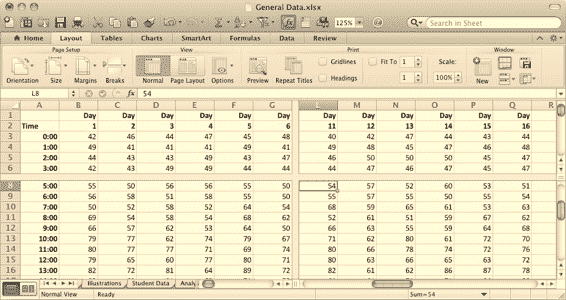
**注**：您也可以通过选择功能区中的 `Layout Window Split`（布局 窗口 拆分）或菜单栏中的 `Window Split`（窗口 拆分）来将窗口拆分为四个窗格。
[www.it-ebooks.info](http://www.it-ebooks.info/)
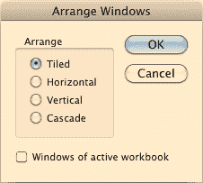
**48 第 1 章：学习 Excel:Mac 界面的秘密**
**第 1 章：学习 Excel:Mac 界面的秘密 49**

# 第 1 章：学习 Excel:Mac 界面的秘密

放大或缩小最简单的方法是打开`Standard`（标准）工具栏上的`Zoom`（缩放）弹出菜单，然后点击其中的一个项目：`200%`、`150%`、`125%`、`100%`、`75%`、`50%`、`25%`、`Selection`（选定区域）或（仅在`Page Layout`（页面布局）视图中）`One Page`（单页）。

[www.it-ebooks.info](http://www.it-ebooks.info/)

**50**

您可以通过点击`Zoom`（缩放）框或打开`Zoom`（缩放）弹出菜单，输入所需百分比，然后按`Return`键来设置自定义视图百分比。

当您需要精确缩放，以使工作表的特定区域在窗口中尽可能大时，请选中该区域，打开`Zoom`（缩放）弹出菜单，然后点击`Selection`（选定区域）。

注意：如果选择不显示标准工具栏，请使用另一种设置缩放百分比的方法——通过“缩放”对话框。从菜单栏中选择`视图` > `缩放`，选择合适的选项按钮，然后单击`确定`按钮。

## 冻结行和列以保持其在屏幕上显示

若要在滚动大型工作表时让数据标题保持在屏幕上，可以冻结标题行和列。例如，如果在 A 列和第 1 行有标题，则可以冻结 A 列和第 1 行，使其始终显示在屏幕上。

你可以快速冻结第一列、第一行或自行选择的行和列：

- *冻结第一列。* 从功能区中选择`布局` > `窗口` > `冻结窗格` > `冻结首列`。
- *冻结第一行。* 从功能区中选择`布局` > `窗口` > `冻结窗格` > `冻结首行`。
- *冻结你选择的行和列。* 单击要冻结行下方和要冻结列右侧的单元格。例如，要冻结前两行和 A 列，请选择单元格`B3`。然后从功能区中选择`布局` > `窗口` > `冻结窗格` > `冻结窗格`，或从菜单栏中选择`窗口` > `冻结窗格`。

Excel 会在冻结单元格的网格线上显示一条灰色线。应用冻结后，当你向下或向右滚动时，被冻结的列和行不会移动。

图 1–35 展示了一个冻结了第 1 行、第 2 行和 A 列的工作表。

[www.it-ebooks.info](http://www.it-ebooks.info/)

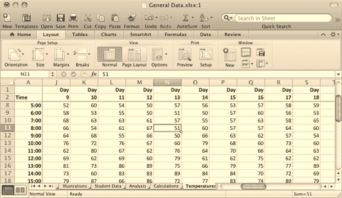

**51**

图 1–35。*冻结标题行和列，以便在向下或向右滚动工作表时它们保持不动。*

当不再需要冻结时，从功能区中选择`布局` > `窗口` > `冻结窗格` > `取消冻结`，或从菜单栏中选择`窗口` > `取消冻结窗格`来移除它。

## 使用自定义视图

当你需要以特定方式保持数据布局时，可以创建自定义视图。请按以下步骤操作：

1. 将工作簿完全按照你想要的方式设置。例如：
   - 显示你要查看的工作表。
   - 隐藏任何你不想查看的列和行。你将在第 4 章学习如何隐藏列和行。
   - 切换到所需的视图。
   - 根据需要缩放视图。
   - 设置打印区域。
   - 应用任何所需的筛选（参见第 10 章）。
2. 从菜单栏中选择`视图` > `自定义视图`，打开“自定义视图”对话框（如图 1–36 左侧所示，其中已添加了两个视图）。

[www.it-ebooks.info](http://www.it-ebooks.info/)

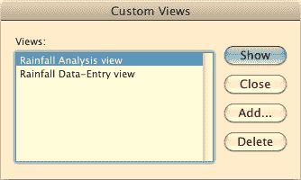

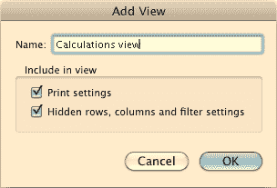

**52**

图 1–36。*使用“自定义视图”对话框（左）添加、删除和显示自定义视图。使用“添加视图”对话框（右）创建新的自定义视图。*

3. 单击`添加`按钮，打开“添加视图”对话框（如图 1–36 右侧所示）。Excel 会关闭“自定义视图”对话框。
4. 在`名称`文本框中输入视图的名称。
5. 如果你希望视图包含当前的打印设置，请选中`打印设置`复选框。
6. 如果你希望视图包含隐藏的行、隐藏的列以及任何已应用的筛选，请选中`隐藏的行、列和筛选设置`复选框。
7. 单击`确定`按钮关闭“添加视图”对话框。Excel 会创建该视图。

现在，你可以通过从菜单栏中选择`视图` > `自定义视图`来打开“自定义视图”对话框，在`视图`列表中单击该视图，然后单击`显示`按钮来切换至该视图。

## 总结

在本章中，你学习了 Excel:Mac 界面的秘密以及如何导航它。你知道了如何使用功能区、工具栏、菜单栏上的菜单和键盘快捷键来控制 Excel；如何在工作表和工作簿中移动；以及如何通过导入数据或使用自动更正、自动填充和剪贴本等工具在工作簿中输入数据。你还学习了如何通过拆分窗口、冻结窗格、打开额外窗口以及使用自定义视图来更快速高效地工作。