## 第 11 章：使用模拟分析、单变量求解和规划求解解决业务问题

在使用 Excel 的大部分工作中，你可能希望像本书前面所做的那样，处理已有的硬数据。但在其他时候，你需要向数据提问——例如，你需要将价格提高多少才能将收入提升一定数额，或者如果你将制造成本削减 10% 会发生什么？

在本章中，我们将介绍 Excel 提供的用于执行模拟分析的四种工具：

*数据表。* 当你想评估一个或两个变量对计算结果的影响时，请使用数据表。

*方案。* 当你想在工作表中使用不同数据进行试验，而不更改已有的核心数据时，请使用方案。

*单变量求解。* 当你需要通过更改一个其他值来使某个单元格的值达到特定数值时，请使用单变量求解。

*规划求解。* 当你需要通过更改两个或更多其他值来使某个单元格的值达到特定数值时，请使用规划求解加载项应用程序。

# 第 11 章：使用假设分析、单变量求解和规划求解解决业务问题

## 使用模拟运算表评估变量的影响

`模拟运算表`是一种工具，可用于计算一个或两个变量如何改变计算结果。当你想要查看工作表中的结果范围，而不是一次查看单个结果时，可以使用模拟运算表。

### 创建单变量模拟运算表

当你只需要查看一个变量如何改变计算结果时，可以快速创建一个模拟运算表。将输入值（即你想要测试的值）放在一行或一列中，然后告诉 Excel 在哪里找到它们。

创建模拟运算表起初看起来可能有些奇怪，但你会很快掌握窍门。试试这个使用一个变量创建模拟运算表的示例。

首先，创建一个新的工作表，并设置如图 11-1 所示的简单 `=FV()` 公式，用于计算一项投资的未来价值。该投资年利率为 10%，期限为 12 个月，实际分期数为 60 个月，每月从你的工资中扣除 600 美元。

请按照以下步骤操作：

1.  在以下单元格中输入数据标签：
    *   `A1`. 利率
    *   `A2`. 月份数
    *   `A3`. 付款额
    *   `A4`. 未来价值

    **图 11-1.** 模拟运算表的示例计算使用 `FV()` 函数来计算每月投资 600 美元的未来价值。

2.  在单元格 `B1` 中输入公式 `=10%/12`。对此单元格应用百分比数字格式，并使其显示两位小数，以便你看到 0.83%，而不是 Excel 通常显示的 1%（这会使计算在视觉上产生混淆）。
3.  在单元格 `B2` 中输入值 `60`。
4.  在单元格 `B3` 中输入值 `-600`。应用货币数字格式以使其含义在视觉上清晰明了。
5.  在单元格 `B4` 中输入 `FV` 函数：`=FV(B1,B2,B3)`。

[www.it-ebooks.info](http://www.it-ebooks.info/)

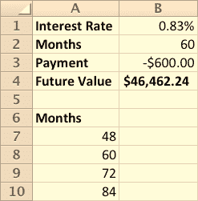

**第 11 章：使用假设分析、单变量求解和规划求解解决业务问题** **329**

到目前为止，一切顺利。现在设置模拟运算表的输入值。请按照以下步骤操作：

1.  在单元格 `A6` 中输入标签 `月份数`。
2.  在单元格 `A7:A10` 中输入模拟运算表的值：
    *   `A7`. 48
    *   `A8`. 60
    *   `A9`. 72
    *   `A10`. 84

**提示：** 对于这个小型模拟运算表，直接键入输入值很容易，但如果你想扩展序列，可以尝试在单元格 `A7` 中输入 48，在单元格 `A8` 中输入 60，选中这些单元格，然后拖动自动填充柄来填充其余单元格。

你的工作表现在应该看起来像图 11-2 中的那样。

**图 11-2.** 在单元格 `A7:A10` 中输入模拟运算表的输入值。

现在你可以输入使用模拟运算表的公式了。为了让模拟运算表正常工作，你需要将公式放在 Excel 期望找到它的单元格中：

*   **列方向的模拟运算表：** 将公式输入在第一个输入值上方的一行，且位于其右侧的下一列中。在示例中，这是单元格 `B6`。
*   **行方向的模拟运算表：** 将公式输入在第一个输入值左侧的一列，且位于其下方的下一行中。

在这种情况下，我们正在创建一个列方向的模拟运算表，因此我们需要在单元格 `B6` 中输入公式。如图 11-3 所示，输入公式 `=FV(B1,A5,B3)`——换句话说，它与单元格 `B4` 中的公式相同，但使用单元格 `A5` 而不是单元格 `B2` 来提供月份数。

[www.it-ebooks.info](http://www.it-ebooks.info/)

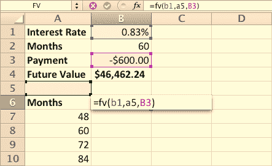

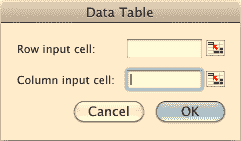

**330** **第 11 章：使用假设分析、单变量求解和规划求解解决业务问题**

**图 11-3.** 在输入值的右上方单元格中输入公式。

**注意：** 当你为模拟运算表输入公式时，Excel 通常会显示一个明显错误的值或一个错误值。在此示例中，公式单元格显示结果 $0.00，因为单元格 `A5` 是空白，因此为月份数参数提供了零值。在其他公式中，零值会产生错误值。这不是问题，稍后你会看到。

现在你可以设置模拟运算表了。请按照以下步骤操作：

1.  选择包含输入值和公式的单元格区域。在此示例中，选择区域 `A6:B10`。
2.  从功能区中选择 **数据** > **分析** > **模拟分析** > **模拟运算表**，或者从菜单栏中选择 **数据** > **模拟运算表**，以显示“模拟运算表”对话框（见图 11-4）。

    **图 11-4.** 在“模拟运算表”对话框中，为你正在创建的模拟运算表输入行引用单元格或列引用单元格。

3.  单击 **列引用单元格** 框，然后点击你用作输入值的单元格——在本例中，是单元格 `A5`。Excel 会输入绝对引用 `$A$5`。

    **注意：** 当你创建行方向的模拟运算表时，请单击“模拟运算表”对话框中的 **行引用单元格** 框，然后点击你用于输入值的单元格。

[www.it-ebooks.info](http://www.it-ebooks.info/)

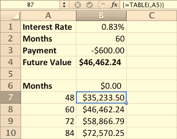

**第 11 章：使用假设分析、单变量求解和规划求解解决业务问题** **331**

4.  单击 **确定** 按钮关闭“模拟运算表”对话框。Excel 会在每个包含输入值的单元格旁边的单元格中输入数组公式 `{=TABLE(,A5)}`。
5.  对结果单元格应用货币数字格式，以便结果显示为美元金额。

图 11-5 显示了带有结果的模拟运算表。

**图 11-5.** 创建模拟运算表后，结果会显示在输入值旁边。

### 创建双变量模拟运算表

当你需要分析计算中使用的两个信息发生变化时会发生什么，请创建一个双变量模拟运算表。例如，在使用 `FV()` 函数计算投资时，你可能不仅需要考虑不同的分期月份数，还需要考虑不同的付款额。

要创建一个双变量模拟运算表，你需要将一组输入数据放在表格左侧的一列中，并将另一组输入数据放在表格上方的一行中。例如，图 11-6 显示了一个使用 `FV()` 函数计算投资未来价值的双变量模拟运算表：

*   区域 `D6:D11` 包含分期数参数（48、60、72、84、96 或 108 个月）的输入值。
*   区域 `E5:I5` 包含付款额参数（-$500.00、$550.00、–$600.00、-$650.00 或-$700.00）的输入值。这些单元格已应用货币数字格式。
*   单元格 `A7` 是行引用单元格，单元格 `A9` 是列引用单元格。当你通过从功能区中选择 **数据** > **分析** > **模拟分析** > **模拟运算表**，或从菜单栏中选择 **数据** > **模拟运算表** 来创建模拟运算表时，你需要在“模拟运算表”对话框中同时指定行引用单元格和列引用单元格。
*   单元格 `D5` 包含模拟运算表的公式：`=FV(B1,A9,A7)`。
*   每个结果单元格都包含公式 `{=TABLE(A7,A9)}`。

[www.it-ebooks.info](http://www.it-ebooks.info/)

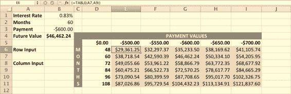

**332** **第 11 章：使用假设分析、单变量求解和规划求解解决业务问题**

**图 11-6.** 在双变量模拟运算表中，你将一组输入值输入到一列中（此处为 D 列），另一组输入值输入到一行中（此处为第 5 行）。公式位于列和行相交的单元格中（此处为单元格 D5）。

**注意：** 当你不再需要模拟运算表时，请选中该表，然后按 **Delete** 键，或选择 **开始** > **编辑** > **清除** > **全部清除**。

## 在工作表中检查不同方案

通常，当你构建了一个工作表后，你会想要尝试其中的不同数据。例如，如果你在制定预算，可能需要调整不同部门的不同数字以达到你所需的总体平衡。

你可以通过直接更改工作表中的值来尝试不同的数据。工作表——但之后你可能需要恢复原始数值。另一种方法是创建多个工作表（或工作簿）副本，然后修改副本中的值，保留原始数据不变。这种方法虽然可行，但如果之后需要修改原始工作表（例如，添加另一列数据），修改过程会很快变得混乱不堪。

与其用这些笨拙的方式操作，不如使用 Excel 的方案功能。*方案* 是一种向一组单元格输入不同值而不改变底层数值的方法。你可以根据需要从一个方案切换到另一个方案，也可以将同一工作表不同版本的方案合并到单个工作表中。

### 为方案创建工作表

首先，创建工作簿和工作表，用于后续的方案操作。如果已有包含数据的工作簿，直接将其打开即可。像往常一样在工作表中设置数据和公式。

[www.it-ebooks.info](http://www.it-ebooks.info/)

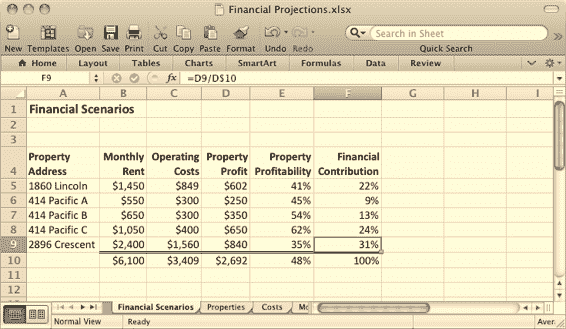

**第 11 章：使用假设分析、单变量求解和规划求解解决业务问题** **333**

# 提示：定义单元格名称以设置方案

为了便于设置和调整方案，请为方案中要更改的每个单元格定义一个名称。单击该单元格，选择`插入` -> `名称` -> `定义`，弹出`定义名称`对话框，然后按照第3章“为单元格或区域分配名称”一节所述的方法操作。例如，在`在当前工作簿中的名称`文本框中输入名称，然后点击`添加`按钮添加名称并保持对话框打开，以便您可以单击另一个单元格并为其定义名称。

## 示例工作表

图11-7展示了本节用作示例的样本工作表。该工作表汇总了来自一个规模适中的租赁物业投资组合的财务回报。

**图11-7.** 要开始使用方案，请创建一个包含现有数据和所需公式的工作表。

工作表中显示的内容如下：

### 物业地址列
`物业地址`列显示每处物业的地址。

### 月租金列
`月租金`列显示每处物业的月租金。单元格`B10`包含一个`SUM()`公式，用于计算总租金。此处的每个单元格都有名称以便识别——例如`Rent_Lincoln`、`Rent_Pacific_A`等。

### 运营成本列
`运营成本`列显示每处物业的月度运营成本，包括所有按揭成本和其他财务负担。单元格`C10`使用`SUM()`公式计算总运营成本。此列中的数字已四舍五入。每个单元格都有名称：`Costs_Lincoln`、`Costs_Pacific_A`等。同样，这样做是为了能够轻松清晰地引用这些单元格。

[www.it-ebooks.info](http://www.it-ebooks.info/)

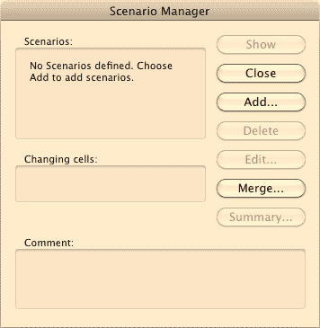

**334** **第11章：使用假设分析、单变量求解和规划求解解决业务问题**

### 物业利润列
`物业利润`列显示每处租赁单元在从租金中扣除运营成本后的利润（例如，单元格`D5`包含公式）：

```
=B5-C5
```

此列中的数字已四舍五入；这就是为什么单元格`D5`看似包含数学错误但实际上正确的缘故。单元格`D10`使用`SUM()`公式返回总利润。

### 物业盈利能力列
`物业盈利能力`列以百分比形式显示物业的盈利能力。为了计算盈利能力数值，我们将`物业利润`值除以`月租金`值——例如，单元格`E5`包含公式`=D5/B5`。在该列底部，单元格`E10`使用`AVERAGE()`公式显示各物业的平均盈利能力。

### 财务贡献列
`财务贡献`列以百分比形式显示每处物业对总利润的贡献。为了计算贡献数值，我们将每处物业的利润除以单元格`D10`中的总利润。例如，单元格`F9`包含公式`=D9/D$10`，使用混合引用确保复制公式时行号保持绝对引用。单元格`F10`包含一个`SUM()`公式，用于汇总各百分比，从而显示它们总计为100%。

# 市场不景气，总利润太低。因此，我们将通过假设分析来看如何通过提高租金和削减成本来改善状况。

## 打开方案管理器对话框

当您准备好开始使用方案时，从功能区中选择 `Data Analysis > What-If > Scenario Manager`，或从菜单栏中选择 `Tools > Scenarios`，以显示 `Scenario Manager` 对话框。起初，当工作簿不包含任何方案时，`Scenario Manager` 对话框会如图 11–8 所示。

**图 11–8.** 最初，方案管理器对话框中只有一条提示，告知您单击“添加”按钮。请照做。

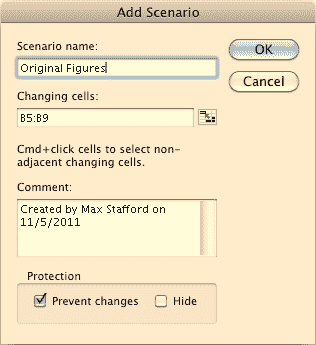

**第 11 章：使用假设分析、单变量求解和规划求解解决业务问题 335**

## 创建方案

打开 `Scenario Manager` 对话框后，您可以创建自己的方案。

**提示：** 首先，创建一个包含原始数据的方案。这样，在测试完方案后，您可以轻松地回到原始数据。

要创建一个方案，请遵循以下步骤：

**1.** 在 `Scenario Manager` 对话框中，单击 `Add` 按钮以显示 `Add Scenario` 对话框（见图 11–9）。

**图 11–9.** 使用“添加方案”对话框来设置每个方案。首先为您的原始数据创建一个方案，以便您能轻松返回。

**2.** 在 `Scenario name` 文本框中，为方案键入一个描述性名称。

**3.** 单击 `Changing Cells` 文本框，然后输入允许使用该方案的用户更改的单元格的详细信息。对于原始方案，我们不进行任何更改；但对于涉及更改租金的方案，其范围是单元格 `B5:B9`。

在工作表中单击并拖动以选择连续单元格区域。如果需要选择非连续单元格，请单击第一个单元格，然后 `Cmd+单击` 每个其他单元格。

**注意：** 当您通过在工作表中单击，在 `Changing Cells` 文本框中输入单元格或单元格区域时，Excel 会将对话框的名称从 `Add Scenario` 更改为 `Edit Scenario`。尽管这看起来很奇怪，但这是正常现象。

您也可以在 `Changing Cells` 文本框中键入区域的名称。

`Changing Cells` 文本框右侧有一个 `Collapse Dialog` 按钮，但您无需使用它，因为当您在工作表中单击时，Excel 会自动折叠 `Add Scenario` 对话框。当您选择完可变单元格后，Excel 会再次展开该对话框。

**4.** 在 `Comment` 文本框中，键入一条注释，解释该方案的用途以及如何使用它。Excel 会创建一个默认注释，格式为“创建者”，后面是您的用户名（依据 Office 应用程序中的设置）和日期，但一条描述性的注释通常更有帮助。

**5.** 根据需要在对话框底部的 `Protection` 区域中选择设置：

*   **防止更改。** 当您需要防止对方案进行更改时，选中此复选框。要使保护生效，您需要按照下一节所述保护工作表。

*   **隐藏。** 当您需要防止他人看到此方案时（例如，您希望他们用自己的数据实验，而不是查看您的数据），选中此复选框。同样，您需要保护工作表。

**6.** 单击 `OK` 按钮关闭 `Add Scenario` 或 `Edit Scenario` 对话框。Excel 会显示 `Scenario Values` 对话框（见图 11–10）。此对话框为方案中的每个可变单元格显示一个文本框。在这里您就能体会到命名可变单元格的好处——每个文本框都易于识别。如果您尚未命名可变单元格，则会显示单元格地址，您可能需要参考工作表来查看哪个单元格是哪个。

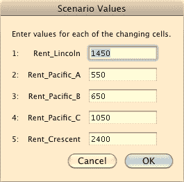


**第 11 章：使用假设分析、单变量求解和规划求解解决业务问题 337**

**图 11–10.** 在“方案变量值”对话框中，为您正在创建的新方案输入要使用的值。单元格名称会生成标签（如 `Rent_Lincoln`），这比单元格地址（例如 `B5`）更容易引用。

**7.** 根据方案的需要更改这些值。

**提示：** 您可以在 `Scenario Values` 对话框的文本框中键入公式。例如，要将图 11–10 中的 `Rent_Lincoln` 值提高 25%，您可以将 1450 值改为公式 `=1.25*1450`。输入此类公式后，当您关闭 `Scenario Values` 对话框时，Excel 会显示图 11–11 所示的对话框，告知您它已将公式的名称和结果转换为值。单击 `OK` 按钮。

**图 11–11.** 在“方案变量值”对话框中输入公式后，Excel 会自动将它们为您转换为值。

**8.** 单击 `OK` 按钮关闭 `Scenario Values` 对话框。Excel 会返回到 `Scenario Manager` 对话框，此时，该方案会出现在 `Scenarios` 列表框中。

要添加另一个方案，请在 `Scenario Manager` 对话框中单击 `Add` 按钮，然后重复上述过程。

**338 第 11 章：使用假设分析、单变量求解和规划求解解决业务问题**

## 对方案应用保护

如果您在 `Add Scenario` 或 `Edit Scenario` 对话框的 `Protection` 区域中选中了 `Prevent Changes` 或 `Hide` 复选框，您需要保护工作表才能使保护生效。

要保护工作表，请遵循以下步骤：

**1.** 如果 `Scenario Manager` 对话框是打开的，请单击 `Close` 按钮将其关闭。

**2.** 从功能区中选择 `Tools > Protection > Sheet`，或从菜单栏中选择 `Tools > Protection > Protect Sheet`，以显示 `Protect the sheet and contents of locked cells` 对话框。

**3.** 在 `Password` 文本框中键入一个密码，并在 `Verify` 文本框中再次键入该密码。

**4.** 在 `Allow users of this sheet to` 框中，确保 `Edit Scenarios` 复选框未被选中。

**5.** 单击 `OK` 按钮关闭对话框。Excel 将应用保护。

**6.** 保存工作簿。例如，按 `Cmd+S` 或单击标准工具栏上的 `Save` 按钮。

以这种方式保护工作表中的方案后，您需要先关闭保护，然后才能编辑这些方案。要关闭保护，请从功能区中选择 `Tools > Protection > Sheet`，或从菜单栏中选择 `Tools > Protection > Unprotect Sheet`，在 Excel 显示的对话框中键入密码，然后单击 `OK` 按钮。

## 编辑和删除方案

在 `Scenario Manager` 对话框中，您可以通过在 `Scenarios` 列表框中单击某个方案，然后单击 `Edit` 按钮，并在 `Edit Scenario` 对话框中进行操作，来快速编辑该方案。Excel 会自动为方案更新注释，注明修改的详细信息（例如，“由 Jack Cunningham 于 2011 年 2 月 18 日修改”），但您通常需要键入更多细节，例如您试图让该方案展示什么。

当您不再需要某个方案时，通过在 `Scenarios` 列表框中单击该方案，然后单击 `Delete` 按钮来删除它。Excel 不会确认删除操作；但如果您误删了某个方案，并且恢复它比丢失自上次保存工作簿以来所做的其他更改更重要，您可以通过不保存更改就关闭工作簿来恢复该方案（前提是该方案已保存在工作簿中）。

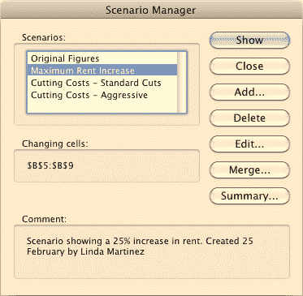

**第 11 章：使用假设分析、单变量求解和规划求解解决业务问题 339**

## 在各方案之间切换

一旦你为同一个工作表创建了多个方案，就可以通过点击“方案管理器”对话框（见图 11-12）中“方案”列表框内的所需方案，然后点击“显示”按钮来切换它们。Excel 会在工作表的单元格中显示该方案的数值。“方案管理器”对话框会保持打开状态，因此你可以快速切换到其他方案。

**图 11-12.** 要切换到其他方案，请在“方案管理器”对话框的“方案”列表框中点击该方案，然后点击“显示”按钮。

## 第 11 章：使用模拟分析、单变量求解和规划求解解决业务问题

**提示：** 如果你需要能够在不同方案之间快速切换，可以将“方案”弹出菜单添加到“标准”工具栏或其他便捷的工具栏上。要自定义工具栏，请使用第 2 章中“使用你需要的命令自定义工具栏”一节中介绍的方法。

在“自定义工具栏和菜单”对话框的“命令”选项卡上，点击“类别”列表中的“工具”项，然后在“命令”列表框中向下滚动，找到“方案”弹出菜单。

### 将方案合并到单个工作表中

如果你在同一个工作簿中创建并分享方案，可以将它们全部集中存放。但有时你可能需要在不同的工作簿中创建方案，然后再将它们合并起来。你可以通过“方案管理器”对话框中的“合并”命令轻松完成此操作。

[www.it-ebooks.info](http://www.it-ebooks.info/)

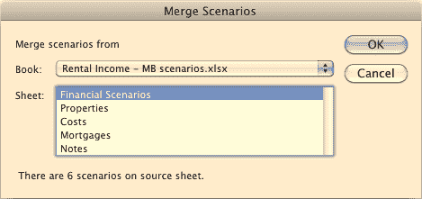

要合并方案，请按照以下步骤操作：

1. 打开所有包含要合并方案的工作簿。

2. 激活你要将方案合并到其中的工作簿和工作表。

3. 从功能区中选择“`数据分析` > `模拟分析` > `方案管理器`”，或者从菜单栏中选择“`工具` > `方案`”，以显示“方案管理器”对话框。

4. 点击“合并”按钮，显示“合并方案”对话框（见图 11-13）。

   **图 11-13.** 在“合并方案”对话框中，选择包含要合并到当前工作簿中的方案的工作簿和工作表。

5. 打开“工作簿”弹出菜单，并选择包含要合并方案的那个打开的工作簿。“工作表”列表框中会显示该工作簿中的工作表列表。

6. 在“工作表”列表框中，点击包含这些方案的工作表。“合并方案”对话框底部的读数会显示该工作表包含多少个方案，这有助于你选择正确的工作表。

7. 点击“确定”按钮。`Excel` 会关闭“合并方案”对话框，合并方案，然后再次显示“方案管理器”对话框。

**注意：** 如果任何合并到当前工作表中的方案与工作表中现有的方案同名，`Excel` 会在新导入的方案名称后添加当前日期以作区分。

[www.it-ebooks.info](http://www.it-ebooks.info/)

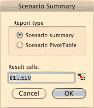

### 从方案创建报告

有时，你只需创建方案并在工作表中查看它们，就能做出所需的决策。在其他时候，从方案中创建报告以便进行比较则非常有帮助。`Excel` 提供了一种简单的方法，可以直接从“方案管理器”对话框中创建摘要报告或数据透视表报告。

要从方案创建报告，请按照以下步骤操作：

1. 从功能区中选择“`数据分析` > `模拟分析` > `方案管理器`”，或者从菜单栏中选择“`工具` > `方案`”，以显示“方案管理器”对话框。

2. 点击“摘要”按钮，显示“方案摘要”对话框（见图 11-14）。

   **图 11-14.** 在“方案摘要”对话框中，在方案摘要和方案数据透视表之间进行选择，然后为摘要选择结果单元格。

3. 在“报表类型”框中，如果你想要创建一个摘要工作表，请选择“方案摘要”选项按钮。如果你想创建一

# 方案数据透视表

选择“方案数据透视表”选项按钮。

4.  在`结果单元格`文本框中单击，然后输入你希望报告或数据透视表显示结果的单元格地址。你可以键入地址或区域名称，也可以在工作表中选择相应的单元格。
5.  单击`确定`按钮关闭`方案摘要`对话框。Excel 会创建报告或数据透视表。图 11-15 显示了一个摘要报告的示例，Excel 会将其放置在工作簿开头一个名为`方案摘要`的新工作表中。

[www.it-ebooks.info](http://www.it-ebooks.info/)

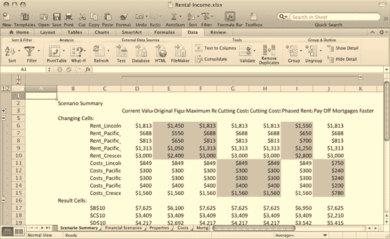

**第 11 章：使用模拟分析、单变量求解和规划求解解决业务问题**

**图 11-15.** Excel 会将摘要报告放置在工作簿开头一个名为“方案摘要”的新工作表中。

## 使用单变量求解

在进行规划或预测时，你通常需要从目标结果反向推导出所需的数据。例如，在规划下一个财务年度时，你可能需要找出需要将小部件的销售价格提高多少，才能每年多赚 30,000 美元。

要计算出这个结果，你可以尝试逐步提高小部件的单价，直到收入数字高出 30,000 美元。但使用 Excel 的`单变量求解`功能，从收入数字反向自动推导出所需的价格，可以节省时间和精力。

要使用`单变量求解`推导数值，请遵循以下步骤：

1.  打开包含数据的工作簿，并导航到包含计算过程的工作表。
2.  激活包含公式的单元格。
3.  在菜单栏中选择`工具` -> `单变量求解`，以显示`单变量求解`对话框（如图 11-16 所示，已选定设置）。

[www.it-ebooks.info](http://www.it-ebooks.info/)

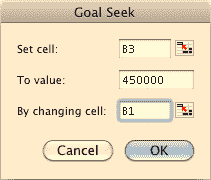

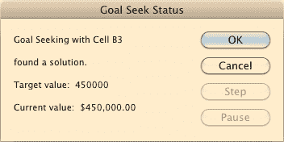

**第 11 章：使用模拟分析、单变量求解和规划求解解决业务问题**

**图 11-16.** 使用“单变量求解”对话框，从期望结果反向推导到所需的数值。

4.  确保`设置单元格`文本框包含正确的单元格。（如果你在第 2 步中已选中该单元格，则会自动包含。）如有必要，可通过键入正确的引用，或双击`设置单元格`文本框的当前内容（以选中它）然后点击工作表中的正确单元格来更改单元格。（你也可以单击`折叠对话框`按钮来折叠`单变量求解`对话框，但对话框本身已经很小，通常直接在工作表上操作会更方便。）
5.  在`目标值`文本框中，键入你想要达到的数值。
6.  在`可变单元格`文本框中，输入你想要改变数值的单元格——在这个例子中，就是包含小部件价格的单元格。同样，你可以直接键入单元格引用，或直接点击工作表中的单元格。
7.  单击`确定`按钮。`单变量求解`会计算出结果，并将其输入到工作表中，然后显示`单变量求解状态`对话框（见图 11-17）。

**图 11-17.** 当 Excel 显示“单变量求解状态”对话框时，请查看工作表中目标单元格的数值。如果你想保留该数值，请单击“确定”按钮。如果你想恢复为之前的数值，请单击“取消”按钮。

[www.it-ebooks.info](http://www.it-ebooks.info/)

**注意：**

如果计算过程比较简单，`单变量求解`会很快找到结果。但如果计算过程较为复杂，`单变量求解`可能会花费一些时间。如果发生这种情况，你可以单击`暂停`按钮来暂停计算，以查看`单变量求解`当前正在尝试的数值。如果你想追踪`单变量求解`正在尝试的各个数值，请单击`单步执行`按钮来显示下一个数值，同时保持计算暂停；根据需要继续单击`单步执行`按钮以查看后续数值。当你希望`单变量求解`以全速继续计算时，请单击`继续`按钮。

8.  查看目标单元格中的值。若想保留该值，请点击`OK`按钮；若想恢复为之前的值，请点击`Cancel`按钮。

## 用规划求解解决多变量问题

如果你觉得`Goal Seek`功能很实用，但需要更强大的功能，那么你会想要下载并使用 Excel for Mac 2011 的规划求解加载项。规划求解是一个免费的加载项，它允许你更改多个变量，从而让你能对数据提出更复杂的问题。

### 下载并安装规划求解

要下载并安装 Excel for Mac 2011 的规划求解，请按以下步骤操作：

1.  打开你的网页浏览器，访问 Macintosh Excel 2011 规划求解[网站 (http://www.solver.com/mac/)。](http://www.solver.com/mac/)
2.  点击下载规划求解的链接。你需要使用电子邮件地址进行注册。
3.  双击你下载的`Solver.pkg`文件以启动“安装规划求解”应用程序，然后按照其步骤进行操作。“安装规划求解”会使用标准的安装流程，你需要为此提供你 Mac 的管理员密码。
4.  在 Excel 中，从菜单栏选择`工具` > `加载项`，以显示“加载项”对话框（参见图 11–18）。

[www.it-ebooks.info](http://www.it-ebooks.info/)


**第 11 章：使用模拟分析、单变量求解和规划求解解决业务问题** **345**

**图 11–18.** 在“加载项”对话框中，点击`选择`按钮以显示“选择一个加载项”对话框。

5.  点击`选择`按钮以显示“选择一个加载项”对话框，该对话框是标准“打开”对话框的改名版本。
6.  导航到 `/Applications/Solver/` 文件夹，然后点击 `Solver.xlam` 项。
7.  点击`打开`按钮。Excel 会关闭“选择一个加载项”对话框并返回到“加载项”对话框，此时该对话框的`可用加载项`列表框中会显示 `Solver.Xlam` 项。
8.  确保选中 `Solver.Xlam` 项旁边的复选框。
9.  点击`确定`按钮关闭“加载项”对话框。Excel 会加载规划求解。

### 使用规划求解

现在你可以像这样使用规划求解：

1.  打开工作簿，并激活包含数据的工作表。
2.  激活包含你要分析公式的单元格。
3.  从菜单栏选择`工具` > `规划求解`，以显示“规划求解参数”对话框（参见图 11–19）。

[www.it-ebooks.info](http://www.it-ebooks.info/)

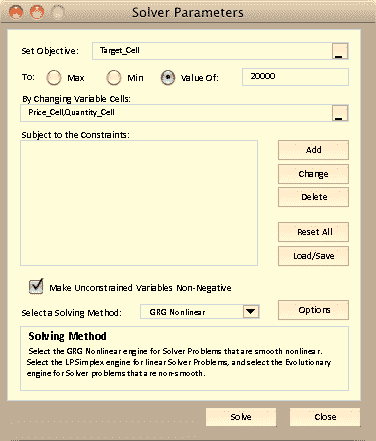

**346 第 11 章：使用模拟分析、单变量求解和规划求解解决业务问题**

**图 11–19.** 在“规划求解参数”对话框中，为你希望规划求解解决的问题设置参数。

4.  确保`设置目标`框中显示的是你要分析的单元格。（此框会显示你在步骤 2 中选择的单元格。）如果单元格错误，请点击`设置目标`框，然后点击正确的单元格。
    如果你想将“规划求解参数”对话框暂时折叠起来，可以点击`设置目标`框右侧的`折叠对话框`按钮。
    你也可以在`设置目标`框中直接键入单元格引用或单元格名称。
5.  在`到`区域中，选择`最大值`选项按钮、`最小值`选项按钮或`值为`选项按钮。如果你选择了`值为`选项按钮，请在其右侧的框中键入该值。
6.  在`通过更改可变单元格`框中，输入你希望规划求解更改的单元格的引用或名称。你可以点击工作表中的单元格（可以折叠“规划求解参数”对话框，也可以不折叠直接在表格中操作），或者直接键入引用或名称。
7.  如果你想约束规划求解对单元格值的处理方式，请使用`遵守约束`列表框右侧的控件进行操作：

#### a. 点击`添加`按钮以显示“添加约束”对话框（参见图 11–20）。

[www.it-ebooks.info](http://www.it-ebooks.info/)


**347 第 11 章：使用模拟分析、单变量求解和规划求解解决业务问题**

**图 11–20.** 使用“添加约束”对话框为计算设置所需的任何约束条件。

#### b. 在`单元格引用`框中输入单元格引用或名称。
#### c. 在中间的下拉菜单中选择比较关系。
#### d. 在`约束值`框中输入约束条件。你可以输入一个值，或者输入你将输入该值的单元格的引用或名称。
#### e. 如果你想添加另一个约束条件，请点击`添加`按钮。否则，点击`确定`按钮关闭“添加约束”对话框。你添加的约束条件会出现在`遵守约束`列表框中。
8.  如果你希望规划求解仅对未约束的变量使用非负值（正值或零），请选中`使无约束变量为非负数`复选框。
9.  在`选择求解方法`下拉菜单中，根据需要选择`GRG 非线性`、`单纯线性规划`或`演化`。如果你不熟悉不同的求解方法，请从`GRG 非线性`开始尝试。

**注意：** 规划求解使用单纯形法求解线性问题（其中两个相关量之间的变化是直接成比例的），并使用广义简约梯度 (GRG) 非线性法求解非线性问题（其中相关量之间的变化不是直接成比例的）。演化方法则使用遗传算法。

### 10. 如果你需要控制规划求解执行计算的方式，请点击`选项`按钮，然后在“选项”对话框的三个选项卡上选择相关选项（如图 11–21 所示）。

[www.it-ebooks.info](http://www.it-ebooks.info/)

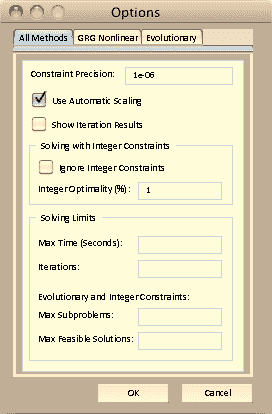

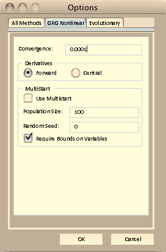

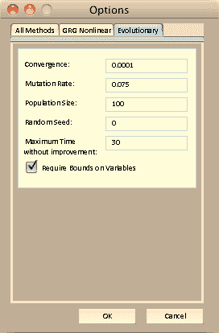

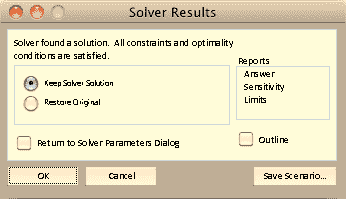

### 348 第 11 章：使用模拟分析、单变量求解和规划求解解决业务问题

**图 11–21.** 你可以在规划求解的“选项”对话框的三个选项卡中选择高级选项。

### 11. 点击`求解`按钮，让规划求解开始分析问题。如果规划求解找到了解决方案，它会显示“规划求解结果”对话框，并显示消息“规划求解找到一个解”（参见图 11–22）。

**图 11–22.** 在“规划求解结果”对话框中，你可以选择是保留规划求解的解决方案还是恢复原始值。

**注意：** 如果规划求解找不到问题的解决方案，请选中“规划求解结果”对话框中的`返回规划求解参数对话框`复选框，然后点击`确定`按钮。在“规划求解参数”对话框中更改参数，然后再次尝试求解问题。

### 12. 如果你希望保留规划求解找到的解决方案，请选择`保留规划求解的解`选项按钮。否则，请选择`还原初值`选项按钮。

### 13. 点击`确定`按钮关闭“规划求解结果”对话框。

[www.it-ebooks.info](http://www.it-ebooks.info/)

### 349 第 11 章：使用模拟分析、单变量求解和规划求解解决业务问题

## 本章小结

在本章中，你学习了如何使用模拟运算表来评估一个或两个变量对计算结果的影响，如何使用方案来试验不同的数据，以及如何使用单变量求解解决简单问题。你还学习了如何下载、安装和使用规划求解来解决更复杂的问题。

在下一章中，我将向你展示如何使用 Excel 强大的数据透视表功能。

[www.it-ebooks.info](http://www.it-ebooks.info/)

### 351

## 第 12 章


