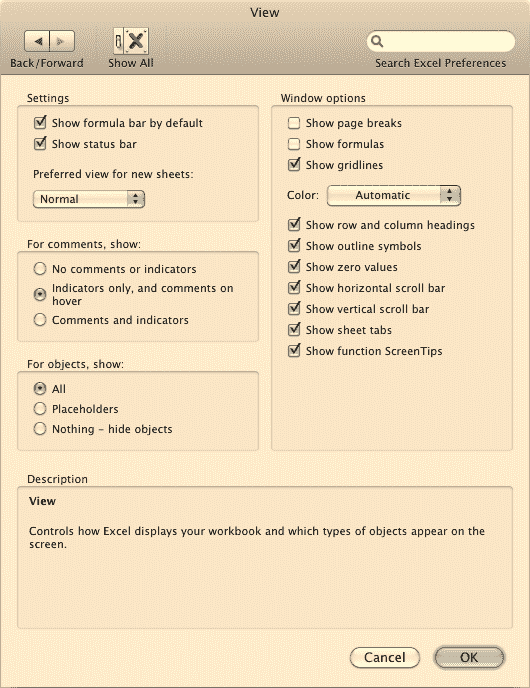

# 配置 Excel:Mac 以适应您的工作方式

在下一章中，我将向您展示如何自定义 Excel 以适合您的工作方式。

在本章中，我们将探讨如何配置 Excel:Mac 以适应您的工作方式。您可以通过多种方式更改 Excel 的外观和行为，根据个人偏好进行设置，从而节省大量时间和精力。

配置 Excel 的主要方式是在`Excel 偏好设置`对话框中设置其偏好。该对话框包含的设置项繁多，无法一一详述，因此我们重点介绍那些最影响您日常使用体验的选项——通用、视图、编辑、保存和兼容性。本书其他章节将在涉及相关主题时介绍其他偏好设置。例如，第 1 章介绍了自动更正和自定义列表偏好；第 7 章介绍了图表偏好；第 10 章介绍了表格偏好和筛选偏好；第 13 章介绍了安全偏好。

首先，我们需要打开`Excel 偏好设置`对话框。接下来，我们将了解如何控制 Excel 窗口的显示方式，然后继续选择编辑选项和保存工作簿的默认设置。

除了设置偏好，您还可以更改 Excel 的用户界面。在本章的后半部分，我将向您展示如何创建自定义键盘快捷键；如何自定义工具栏、菜单和菜单栏；以及如何在 Excel 允许的范围内对功能区进行有限修改。

最后，您将学习如何在启动 Excel 时自动打开一个或多个工作簿，以及如何将多个打开的工作簿的布局保存为工作区，以便在需要时立即恢复。

## 打开 Excel 偏好设置对话框

要完成本章内容，请通过菜单栏选择`Excel` → `偏好设置`，或按下`Cmd+,`（Command 键和逗号键）来打开`Excel 偏好设置`对话框。

如图 2-1 所示，`Excel 偏好设置`对话框包含三大类偏好设置——编写、公式和列表、共享和隐私。每个类别包含五到六个图标，单击这些图标即可显示相应的偏好设置面板。

**图 2-1.** *在`Excel 偏好设置`对话框的概览屏幕上，单击您想要显示的偏好设置面板的图标。*

导航`Excel 偏好设置`对话框的方式与 Mac OS X 的`系统偏好设置`窗口类似：

- 单击您想要显示的偏好设置面板的图标。例如，单击`通用`图标即可显示通用偏好设置面板。
- 单击`全部显示`图标可返回概览屏幕，以便显示其他类别的偏好设置。
- 单击`返回`按钮可返回上一屏幕。上一屏幕几乎总是概览屏幕，因此单击`返回`按钮的效果与单击`全部显示`按钮大致相同。
- 不要单击`前进`按钮——在撰写本文时，该按钮始终处于不可用状态，因此没有任何作用。
- 要搜索某个偏好设置，请单击`搜索`框，然后输入关键字。在 Excel 显示的匹配偏好设置列表中，单击您需要的项目。Excel 会短暂高亮显示相关图标以便您识别，然后显示对应的偏好设置面板。

## 控制 Excel 窗口的显示方式

在本节中，我将向您展示如何找到控制 Excel 窗口显示方式的选项。

首先显示通用偏好设置（见图 2-2），然后设置以下偏好：

### 使用 R1C1 引用样式

确保此复选框未选中，除非您希望使用 R1C1 引用（即列和行都通过数字标识）。例如，单元格 A1 的引用为`R1C1`（第 1 行第 1 列），而单元格 E2 的引用为`R2C5`。

**图 2-2.** *在“通用”偏好设置面板中，您可以选择基本设置，包括“文件”菜单中显示的最近文档数量、工作簿中的工作表数量、标准字体和字号，以及首选的文件位置。*

[www.it-ebooks.info](http://www.it-ebooks.info/)

**56** **第 2 章：配置 Excel:Mac 以符合您的工作方式**

### 标准字体

在此弹出菜单中，选择您希望用作默认字体的字体，即 Excel 在您应用其他字体之前使用的字体。如果您选择“正文字体”项，Excel 会使用工作簿主题中设置为正文字体的字体。

### 字号

在此弹出菜单中，选择默认字号。

### 用户名

使用此框确保 Excel 按您希望的方式显示您的姓名。

### 打开应用程序时显示“Excel 工作簿库”

如果您希望 Excel 在启动时显示“Excel 工作簿库”对话框，请选中此复选框。如果您不需要一开始就显示“Excel 工作簿库”，请清除此复选框。

现在，单击“全部显示”按钮返回概览屏幕，然后单击“视图”图标显示“视图”偏好设置面板（见图 2-3）。

**图 2-3.** *“视图”偏好设置面板中的设置允许您控制公式栏和状态栏的显示、选择首选视图、控制批注和对象的显示方式，并决定在窗口中显示哪些选项。*

[www.it-ebooks.info](http://www.it-ebooks.info/)

**57** **第 2 章：配置 Excel:Mac 以符合您的工作方式**

现在，您可以按照以下小节所述选择设置。

### 在“视图偏好设置”的“设置”区域中选择选项

“视图”偏好设置面板的“设置”区域包含三个偏好设置，您需要确保它们按照您喜欢的方式进行设置：

* 默认显示公式栏。* 选中此复选框可使 Excel 显示公式栏，这通常很有用。
* 显示状态栏。* 选中此复选框可使 Excel 显示状态栏。这通常也很有帮助。
* 新工作表的首选视图。* 在此弹出菜单中，如果您希望添加到工作簿的每个新工作表都使用普通视图，请单击“普通”。如果您希望 Excel 对新工作表使用页面布局视图，请单击“页面布局”。

### 选择如何显示批注

在“视图”偏好设置面板的“对于批注，显示”区域中，选择描述您希望如何显示附加到单元格的批注的选项按钮：

* 不显示批注或标识符。* 当您需要通过隐藏批注来简化工作表外观时，请选择此选项按钮。
* 仅显示标识符，悬停时显示批注。* 选择此选项按钮可为每个批注显示一个批注标识符（单元格右上角的红色三角形），并在用户将鼠标指针悬停（停留）在单元格上时，在气球中显示批注。这是默认设置，通常是常规工作的最佳选择。
* 批注和标识符。* 选择此选项按钮可始终同时显示批注标识符和批注气球。当您想确保看到工作表中的所有批注时，请使用此设置。

### 选择如何显示对象

在“视图”偏好设置面板的“对于对象，显示”区域中，选择适当的选项按钮，以控制图片和命令按钮等对象在工作表中的显示方式：

* 全部。* 选择此选项按钮可显示工作簿中的所有图形对象。此设置让您能看到工作簿中所有内容的位置，但可能会导致 Excel 显示或滚动包含许多图形对象的工作表时速度变慢。

[www.it-ebooks.info](http://www.it-ebooks.info/)

**58** **第 2 章：配置 Excel:Mac 以符合您的工作方式**

* 占位符。* 选择此选项按钮可显示空矩形占位符代替图片，但会显示命令按钮。
* 无 – 隐藏对象。* 选择此选项按钮可隐藏所有对象，以便您不受干扰地查看数据。

**注意：** “针对对象，显示”设置仅适用于当前活动工作簿，而非所有工作簿。

### 选择窗口选项

在“视图”偏好设置面板的“窗口选项”区域中，选择要显示或隐藏的窗口选项。具体如下：

- **显示分页符。** 选中此复选框可使 Excel 显示分页符的位置。通常，您只需在打印前查看分页符，因此您可能希望清除此复选框。
- **显示公式。** 选中此复选框可使 Excel 显示公式本身，而非其计算结果。在排查计算问题时，显示公式会很有帮助，但第 4 章将介绍一种更简便的方法来显示它们。通常情况下，您希望保持此复选框为清除状态。
- **显示网格线。** 选中此复选框可使 Excel 显示单元格周围的网格线。网格线通常很有帮助，但有时您可能希望关闭它们以获得特殊效果。
- **颜色。** 在此弹出式调色板中，单击您希望用于网格线的颜色（在显示网格线时）。除非您需要特定颜色（例如红色或蓝色），否则“自动”设置通常是最佳选择。
- **显示行号列标。** 选中此复选框可显示行号和列标。您几乎总是希望显示它们，除非您正在共享一个工作表，其中隐藏了某些行和列，但您不希望缺失的行号或列标引起观众对隐藏内容的注意。
- **显示分级显示符号。** 选中此复选框可显示表明您已在工作表中创建分级显示的符号（如第 3 章所述）。通常，您希望显示这些符号，以便用户可以根据需要展开或折叠分级显示——但有时您可能需要隐藏该分级显示。
- **显示零值。** 选中此复选框可在每个值为零的单元格中显示一个`0`（零）。显示零值通常很有帮助；如果您需要隐藏零值，请清除此复选框。
- **显示水平滚动条。** 选中此复选框可显示水平滚动条。这通常也很有帮助。
- **显示垂直滚动条。** 选中此复选框可显示垂直滚动条。通常您需要此界面功能。
- **显示工作表标签。** 选中此复选框可在窗口底部显示工作表标签栏，以便您和同事能轻松地在不同工作表之间导航。
- **显示函数屏幕提示。** 选中此复选框可让 Excel 显示屏幕提示，其中包含您正在输入到单元格中的函数的参数。这些屏幕提示通常很有帮助，但如果它们困扰到您，可以清除此复选框。

### 选择编辑选项

要控制编辑工作表时 Excel 的行为，请显示“编辑”偏好设置面板（见图 2-4），并选择如下选项：

- **双击允许直接在单元格中编辑。** 如果您希望双击某个单元格即可打开它进行编辑，请选中此复选框。这通常很有帮助——但如果您清除此复选框，双击某个单元格将使 `Excel` 选中该单元格中公式引用的第一个单元格。在检查公式时，此功能非常有用，因此您需要判断这两种双击行为中哪一种对您最有帮助。

- **启用填充柄和单元格拖放。** 如果您希望使用自动填充功能（在第 1 章中说明）来输入自定义列表和文本序列，并且能够使用拖放功能将一个单元格的内容移动到另一个单元格，请选中此复选框。

- 选中此复选框，您可以选择“覆盖单元格前发出警告”复选框，以便在自动填充或拖放操作将覆盖单元格现有内容时，让 `Excel` 显示警告对话框。

- **按 `RETURN` 后移动所选内容。** 选中此复选框，如果您希望在按 `Return` 键输入活动单元格内容后，让 `Excel` 自动选择另一个单元格。这种移动通常很有帮助。在“方向”弹出菜单中，选择方向：向下、向上、向右或向左。默认方向是向下。

- **扩展数据区域格式和公式。** 选中此复选框，以便当您到达当前数据区域末尾并添加另一行或列时，让 `Excel` 自动扩展格式和公式。此行为通常可以节省时间和精力。

[www.it-ebooks.info](http://www.it-ebooks.info/)

## 第 2 章：配置 Excel：Mac 以适合您的工作方式

- **显示此小数位数。** 如果您希望 `Excel` 在您输入到单元格的数字中自动插入小数点，请选中此复选框，并使用微调按钮设置小数位数。例如，如果您的数字标准格式使用两位小数，请选中此复选框，然后在框中输入 `2`。然后，当您在单元格中键入 `123` 时，`Excel` 会自动将其转换为 `1.23`，而您无需键入小数点。如果您希望 `Excel` 将该数字乘以该 10 的幂，您可以设置一个负数——例如，如果您设置 `-3`，`Excel` 会将每个数字乘以 `1000`，因此如果您输入 `9`，您将得到 `9000`。（您可以设置从 `-300` 到 `300` 的任何值，但您很少需要接近这些极限值。）

- **保留以四位数字年份输入的日期的显示。** 选中此复选框，如果您希望 `Excel` 保留您在工作表中键入的四位数字年份（例如 `2011` 或 `2012`），而不是将日期转换为两位数字年份（例如，对于您输入的日期 `10/2/2011`，显示为 `10/2/11`）。

- **使用动画提供反馈。** 选中此复选框，如果您希望 `Excel` 在插入或删除工作表中的单元格、行或列时使用动画效果。动画使每次更改更容易看到，但在性能较弱的 `Mac` 上可能会使 `Excel` 运行缓慢；如果是这种情况，请清除此复选框。

- **询问是否更新自动链接。** 选中此复选框，如果您希望 `Excel` 显示一个对话框，询问您是否允许更新自动链接。如果您需要维护对自动链接的控制，而不是让 `Excel` 在未咨询您的情况下更新它们，那么拥有此确认是好的。

- **剪切、复制和排序对象与单元格一起操作。** 选中此复选框，如果您希望 `Excel` 在剪切、复制或排序单元格时，将对象（如图形和按钮）与单元格一起包含在内。这是正常行为。

- **自动转换日期系统。** 选中此复选框，如果您希望 `Excel` 在 `Excel for Windows` 和当前版本的 `Excel:Mac` 使用的 `1900` 日期系统与大多数早期版本的 `Excel:Mac` 使用的 `1904` 日期系统之间自动转换日期。

> **注意：** `1900` 日期系统使用序列号 `1` 表示 `1900 年 1 月 1 日`；`1904` 日期系统使用序列号 `1` 表示 `1904 年 1 月 1 日`。除非您有令人信服的理由使用 `1904` 日期系统，否则为了清晰起见，请坚持使用 `1900` 日期系统。`Excel` 将日期和时间存储为序列号，以便它可以轻松地对它们执行数学运算。

[www.it-ebooks.info](http://www.it-ebooks.info/)

- **显示粘贴选项智能按钮。** 选中此复选框，如果您希望 `Excel` 在您粘贴项目后显示一个“粘贴选项”操作按钮。您可以单击“粘贴选项”操作按钮，以显示一个包含其他粘贴数据方式的弹出菜单。这通常很有帮助。

- **显示插入选项智能按钮。** 选中此复选框，如果您希望 `Excel` 在您插入单元格、行或列时显示一个“插入选项”操作按钮。您可以单击“插入选项”操作按钮，以显示用于格式化您已插入项目的选项。这也很有帮助。