# 第 12 章：使用数据透视表分析数据

在本章中，我们将探讨如何使用数据透视表来分析工作表中的数据并从中得出结论。数据透视表非常适合向数据提问，以及从不同角度查看数据，而无需在单独的工作表中多次输入数据。

我们首先来了解一下什么是数据透视表以及你能用它做什么。之后，我将向你展示如何创建数据透视表，既可以使用 Excel 的自动化工具（该工具可以为数据透视表提供一个快速起点），也可以手动将字段放置在数据透视表框架上（这可以让你完全掌控一切）。

构建数据透视表后，您通常需要对其进行调整，以显示不同的数据或以不同的方式显示相同的数据。我将通过几个示例，向您展示构建数据透视表后可以轻松进行的几种调整类型。

当数据透视表按您所需的方式排列好后，您可以设置其格式并选择选项来控制其显示效果。您还可以对数据透视表中的数据进行排序和筛选，以仅显示您需要的信息。

## 理解数据透视表是什么以及能做什么

数据透视表是一种特殊的报表，它会将数据表中的字段和记录重新排列成不同的次序，以便您检查它们之间的关系。您*透视*（即旋转）数据透视表中的列，以不同的方式对数据进行汇总显示。

例如，请看图 12–1 所示的工作表。该工作表包含一个数据表，用于跟踪一家拥有四条产品线（硬件、软件、服务和耗材）的公司的销售额。该表使用以下列：

- `Sale`。用于标识每笔销售的唯一序列号。
- `Year`、`Month` 和 `Day`。销售发生的年、月、日。将这些项目放在单独的列中，可以更轻松地按时间进行筛选——例如，比较不同月份的销售额，或查看某位销售人员在 1 月份销售了哪些产品。
- `Salesperson`。执行销售的销售代表姓名。
- `Line`。所售产品的产品线。
- `Product`。所售产品的名称。
- `Quantity`。所售产品的数量。
- `Price`。所售产品的单价。
- `Total Price`。所售产品的总价（`Quantity` 乘以 `Price`）。
- `Customer`。购买产品的公司或组织名称。

这一切都很直观，您可以使用数据输入表单向数据表添加数据或编辑现有记录。您也可以轻松查看销售总额（例如，通过汇总`Total Price`列中的数字）。但当您需要深入挖掘细节时，就需要不同的工具了。

这就是数据透视表的用武之地。通过从此类数据表创建数据透视表，您可以快速找到诸如以下问题的答案：

- 您最畅销的产品线是哪个？最畅销的产品又是哪个？
- 今年的销售额与去年相比如何？
- 您三月份的销售明星是谁？是否有另一位销售人员需要一些鼓励——或者一张解雇通知书？
- 哪些是您的关键客户？其中哪些客户需要更多的一对一关注，才能将销售额提升到去年的水平？

在接下来的章节中，我们将使用数据表中的数据创建一个数据透视表，然后对其进行操作以查看其显示结果。

> **注意：** 如果您想完成本章中的示例，您需要一个与屏幕截图中类似的数据库表。您可以自己创建一个，或者（更简单的方法）从 Apress 网站（[www.apress.com](http://www.apress.com)）上本书的页面下载示例工作簿。

## 创建和布局数据透视表

您可以从数据库表或数据区域创建数据透视表。如果已有一个像示例中那样的数据库表，您可以从它创建数据透视表。否则，请创建您将使用的数据库表，或者像往常一样在工作表中输入数据而不创建数据库表。

数据准备就绪后，您可以自动或手动创建数据透视表。哪种方法效果最佳取决于您的数据以及您想要用它做什么，但通常可以通过自动创建数据透视表然后根据需要进行调整来节省时间。如果自动创建的数据透视表不符合您的需求，您也可以从头开始手动创建数据透视表。

### 自动创建数据透视表

要自动创建数据透视表，请按照以下步骤操作：

1. 打开工作簿，并显示包含数据透视表要使用的表或数据的工作表。
2. 单击要用于数据透视表的表。如果您使用的是区域而不是命名表，请选择该区域。
3. 在功能区的`数据分析`菜单中选择`数据透视表`，并单击`数据透视表`按钮的主要部分。您也可以单击`数据透视表`弹出按钮，然后在弹出菜单中单击`创建自动数据透视表`，但这并无优势。Excel 随后将执行以下操作：
   - 在新工作表中插入一个自动数据透视表
   - 给新工作表一个默认名称，例如 `Sheet5`
   - 显示`数据透视表生成器`窗口
   - 将`数据透视表`选项卡添加到功能区并显示它
   - 在您首次创建数据透视表时显示一些关于数据透视表的信息

图 12–2 显示了从示例数据表生成的自动数据透视表，并且`数据透视表生成器`窗口位于工作表前面。

自动创建数据透视表后，您通常需要对其进行调整。这是因为 Excel 很少能准确猜测出您需要将哪些信息放在哪里。

要调整数据透视表，请使用您将在下一节中学到的技巧，该部分将向您展示如何从头开始构建数据透视表。

### 手动创建数据透视表

如果自动创建数据透视表没有给出有用的结果，或者您更倾向于手动操作，您可以使用`数据透视表生成器`手动构建数据透视表。

要手动创建数据透视表，请按照以下步骤操作：

1. 打开工作簿，并显示包含数据透视表要使用的表或数据的工作表。
2. 单击要用于数据透视表的表。如果您使用的是区域而不是命名表，请选择该区域。
3. 在功能区的`数据分析`菜单中选择`数据透视表`> `创建手动数据透视表`，或在菜单栏中选择`数据`> `数据透视表`，以显示`创建数据透视表`对话框（参见图 12–3）。如果您使用的是命名表，还可以在功能区中选择`表格工具`> `用数据透视表汇总`；如果您使用的是区域，则此命令不可用。
4. 在`创建数据透视表`对话框顶部的`选择要分析的数据`区域中，选择`使用此工作簿中的表或区域`选项按钮。

> **注意：** 除了可以通过工作表中的数据创建数据透视表之外，您还可以从外部数据源（如 FileMaker 数据库或 Access 数据库）创建数据透视表。为此，请在`创建数据透视表`对话框的`选择要分析的数据`区域中，选中`使用外部数据源`选项按钮，单击`获取数据`按钮，然后选择数据源。但在执行此操作之前，您必须安装开放数据库连接 (ODBC) 驱动程序，以使 Excel 能够连接到该数据源，具体方法详见第 10 章。

5. 确保`位置`文本框中显示的是您要使用的表格或区域。如果您在第 2 步中已点击表格或选定了区域，那么一切就绪。如果没有，请键入表格名称，或在工作表中点击并拖动以选定区域（如有必要，可先点击`折叠对话框`按钮，将`创建数据透视表`对话框移开）。
6. 在`创建数据透视表`对话框的`选择放置数据透视表的位置`区域中，选择合适的选项按钮：
    - `新工作表`。 如果您希望将数据透视表放置在新工作表中，请选中此选项按钮。这通常最为清晰，因为它为数据透视表提供了充足的空间。
    - `现有工作表`。 如果您希望将数据透视表放置在现有工作表中，请选中此选项按钮。点击`位置`文本框，点击工作表的标签，然后在工作表中点击并拖动以输入位置。
7. 点击`确定`按钮关闭`创建数据透视表`对话框。Excel 会在您选择的新工作表或现有工作表中放置一个数据透视表框架，并显示`数据透视表生成器`窗口。图 12–4 显示了一个名为`Sheet4`的新工作表上的数据透视表框架。

现在您已经插入了数据透视表的框架，接下来可以从`数据透视表生成器`窗口的`字段名称列表框`中向其添加字段。

## 理解数据透视表框架与数据透视表生成器窗口的工作原理

花点时间查看一下数据透视表框架和`数据透视表生成器`窗口。您需要使用`数据透视表生成器`窗口在数据透视表框架上排列字段。

以下是您需要了解的基本要点：

- **字段名称列表框。** `数据透视表生成器`窗口中的此列表框包含您所选数据表格或区域中 Excel 找到的每个字段的一个条目。列表中的每个项目都有一个复选框，您可以选中它以将该字段添加到数据透视表中。数据透视表框架没有与`字段名称列表框`匹配的区域，因为当您使用这些字段时，它们会进入数据透视表的各个区域。

> **注意：** Excel 会自动解析`字段名称列表框`中的字段，并决定它们属于数据透视表的哪个部分。考虑到 Excel 除了能识别日期、货币和文本等项目外，并不了解您的数据表格或区域的具体内容，它在这一点上做得相当智能。但您通常需要将一个字段从`数据透视表生成器`窗口的一个区域拖动到另一个区域，以将其移动到数据透视表的另一部分。

- **报表筛选。** 数据透视表顶部的这个区域充当整个数据透视表的筛选器，将表格的其余部分缩小到仅显示与您的筛选条件匹配的数据。例如，如果您通过将`销售人员`字段拖到`数据透视表生成器`窗口中的`报表筛选`框，将其放入`报表筛选`区域，您将获得一个销售人员下拉菜单，您可以从中选择要显示谁的数据。正如您在本章后面将看到的，您可以按一个、两个或更多字段进行筛选。

- **行区域。** 数据透视表左侧的这个区域用于显示行...

# 数据透视表布局与字段分配

`headings`（行区域）。您可以通过将相应字段拖放到`PivotTable Builder`窗口中的`Row Labels`框来指定这些行标题。

`列区域`。数据透视表顶部的这个区域显示列标题。您可以通过将相应字段拖放到`PivotTable Builder`窗口中的`Column Labels`框来选择这些列标题。

`值区域`。数据透视表正文中的这个区域（在大多数情况下是数据透视表的主要部分）包含值。您可以通过将相应字段拖放到`PivotTable Builder`窗口中的`Values`框来指定这些值。

如果觉得难以理解，别担心。您马上就会明白数据透视表是如何工作的。

## 向数据透视表框架添加字段

要创建数据透视表，您需要将字段拖放到`PivotTable Builder`窗口中的`Report Filter`框、`Row Labels`框、`Column Labels`框和`Values`框中，从而向数据透视表框架添加字段。

**注意：** 您也可以通过选中`Field name`列表框中的复选框来添加字段。当您选中一个字段时，Excel 会根据其内容自动放置它。

由于 Excel 不知道您的数据代表什么以及您想要展示什么，它通常会将字段放在错误的位置。因此，最好的做法通常是手动拖放字段。

[www.it-ebooks.info](http://www.it-ebooks.info/)

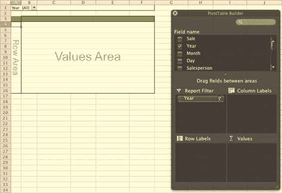

**第 12 章：使用数据透视表分析数据**

**359**

需要将哪些字段拖放到何处，取决于您的数据源以及您想要展示的内容。以下是在数据源中使用字段的逐步演示。如果您使用的是示例数据源，结果应类似；如果您的数据源不同，结果会有所不同，但数据透视表的工作方式基本相同。

在`PivotTable Builder`窗口的`Field name`列表框中，单击`Year`字段并将其拖放到`Report Filter`框中。Excel 会选中`Year`复选框，在单元格 A1 中输入`Year`，并为单元格 B1 中的年份选择创建一个弹出菜单（参见图 12-5）。

**图 12–5.** *将 Year 按钮从 PivotTable Builder 窗口的 Field name 框拖放到 Report Filter 框中，以创建此处单元格 B1 中显示的 Year 弹出菜单。Excel 最初会在弹出菜单中选择(All)项，使数据透视表显示所有年份。*

1. 在`Field name`列表框中，单击`Salesperson`字段并将其拖放到`Row Labels`框中。Excel 会选中`Salesperson`复选框，并为每个销售人员的姓名创建一个行标签（参见图 12-6）。

[www.it-ebooks.info](http://www.it-ebooks.info/)

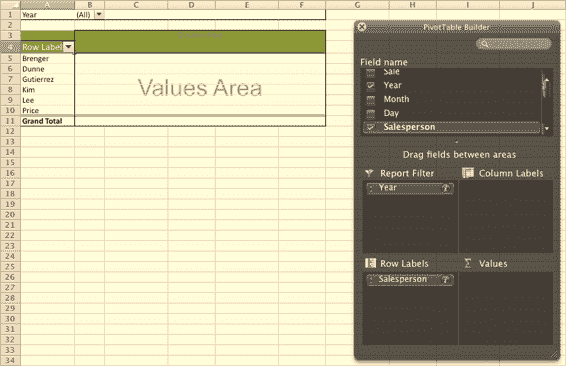

**360**

**第 12 章：使用数据透视表分析数据**

**图 12–6.** *将 Salesperson 按钮移动到 Row Labels 框会使 Excel 从每个销售人员的姓名创建行标签。*

2. 将`PivotTable Builder`窗口`Field name`列表框中的`Line`字段拖放到`Column Labels`框中。Excel 会选中`Field name`列表框中的`Line`复选框，并将产品线添加为列标签（参见图 12-7）。

[www.it-ebooks.info](http://www.it-ebooks.info/)

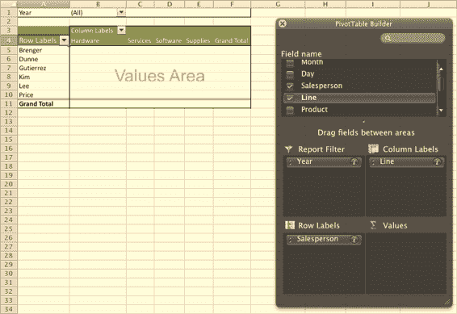

**361**

**第 12 章：使用数据透视表分析数据**

**图 12–7.** *将 Line 项从 PivotTable Builder 窗口的 Field name 列表框拖放到 Column Labels 区域。Excel 会将产品线添加为列标签，并自动为您选中 Line 复选框。*

3. 现在，单击`Field name`列表框中的`Total Price`字段，并将其拖放到`PivotTable Builder`窗口的`Values`框中。Excel 会将销售人员售出商品的价值添加到数据透视表中（参见图 12-8）。

[www.it-ebooks.info](http://www.it-ebooks.info/)

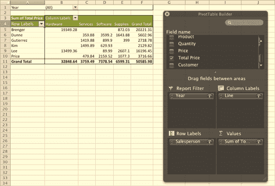

**362**

**第 12 章：使用数据透视表分析数据**

**图 12–8.** *将 Total Price 字段从 Field name 列表框拖放到 PivotTable Builder 窗口的 Values 框中，以将每位销售人员的总销售额添加到数据透视表中。*

这样我们就得到了一个数据透视表，它显示每位销售人员销售了每种产品线的多少数量。最初，数据透视表在`Report Filter`区域的`Year`弹出菜单中显示`(All)`。要按年份查看细分，请打开`Year`弹出菜单，然后单击您想要的年份。

这很有用——但这只是数据透视表功能的开始。

### 更改数据透视表以显示不同数据

数据透视表的一大优点在于，更改它们以显示不同数据非常简单。

您可以通过添加不同字段、移除当前使用的字段，或者在`PivotTable Builder`窗口的`Report Filter`框、`Column Labels`框、`Row Labels`框和`Values`框之间重新排列字段来更改数据透视表。

以下四个示例展示了如何更改本章前面创建的基本数据透视表。这些示例按顺序进行，因此如果您想逐步操作，需要依次进行每个更改。

在`Field name`列表框中，单击`Product`字段，然后将其拖放到`PivotTable Builder`窗口的`Row Labels`框中。Excel 会添加每位销售人员已售出产品的产品名称列表（参见图 12-9）。

[www.it-ebooks.info](http://www.it-ebooks.info/)

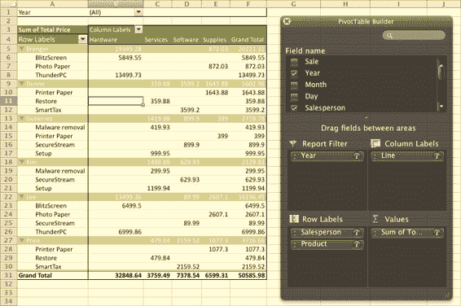

**363**

**第 12 章：使用数据透视表分析数据**

**图 12–9.** *将 Product 字段拖放到 PivotTable Builder 窗口的 Row Labels 框中，以添加每位销售人员已售出的产品列表。您可以通过单击销售人员姓名左侧的展开三角形来折叠任何列表。*

在`PivotTable Builder`窗口的`Row Labels`框中，将`Salesperson`字段拖放到`Product`字段下方。然后数据透视表会显示每种产品及其可折叠的销售人员列表（参见图 12-10）。

[www.it-ebooks.info](http://www.it-ebooks.info/)

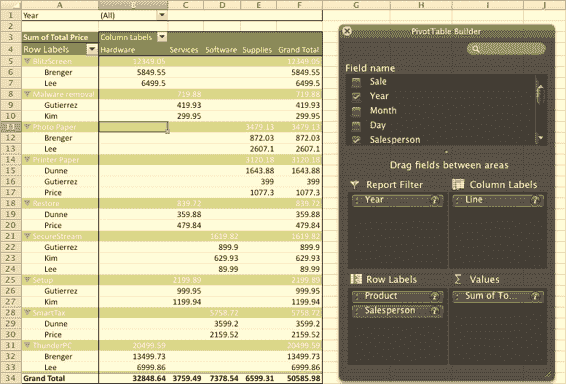

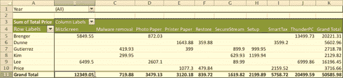

**364**

**第 12 章：使用数据透视表分析数据**

**图 12–10.** *将 Salesperson 字段拖放到 PivotTable Builder 窗口的 Row Labels 框中的 Product 字段下方，以生成显示销售这些产品的销售人员的产品列表。*

将`Row Labels`框中的`Product`字段拖放到`PivotTable Builder`窗口的`Column Labels`框中。然后将`Column Labels`框中的`Line`字段拖出`PivotTable Builder`窗口并松开，使其从数据透视表中消失。（您也可以清除`Field name`列表框中的`Line`复选框。）这些更改会生成一个数据透视表，按行显示销售人员，按列显示他们销售的产品数量（参见图 12-11）。

**图 12–11.** *移除产品线并将产品设为列标签，生成此数据透视表，显示每位销售人员销售每种产品的数量。*

进行以下更改，以查看每位客户在特定时期购买了您的哪些产品线：

[www.it-ebooks.info](http://www.it-ebooks.info/)

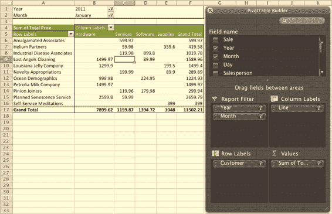

**365**

**第 12 章：使用数据透视表分析数据**

1. 将`PivotTable Builder`窗口`Field name`列表框中的`Month`字段拖放到`Report Filter`框中，将其放在`Year`字段下方。您现在可以按月份以及（之前）的字段进行筛选。例如，您可以选择`2011`作为`Year`筛选条件，然后选择`January`作为`Month`筛选条件，以仅查看 2011 年 1 月的结果。

2. 在`Field name`列表框中，清除`Salesperson`复选框，将`Salesperson`字段从`Row Labels`区域移除。然后将`Customer`字段从`Field name`列表框拖放到`Row Labels`框中，使数据透视表的每一行显示一位客户。

3. 在`Field name`列表框中，清除`Product`复选框，将`Product`字段从`Column Labels`区域移除。然后将`Line`字段拖放到`Column Labels`框中，使数据透视表的列显示产品线。

**图 12–12.** 你可以将`月份`字段添加到报表筛选框中，放在`年份`字段下方，从而先按年份（此处为 2011 年）再按月（此处为 1 月）筛选数据透视表。该数据透视表显示了 2011 年 1 月每位客户在各产品线中的购买金额。

完成数据透视表生成器窗口的操作后，可单击其标题栏左侧的关闭（×）按钮，或从功能区中选择`数据透视表视图` `生成器`来关闭该窗口。

[www.it-ebooks.info](http://www.it-ebooks.info/)

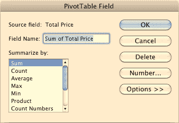

**366** **第 12 章：使用数据透视表分析数据**

若需再次打开数据透视表生成器窗口，请从功能区中选择`数据透视表视图` `生成器`。

### 更改用于汇总字段的函数

将数值添加到数据透视表时，Excel 会尝试根据数据类型自动使用适当的计算函数。例如，添加显示价格的字段时，Excel 会基于求和需求使用`SUM()`函数；若使用姓名等非数值数据，Excel 则会使用`COUNT()`函数来计算项目数量。

若需将字段更改为其他函数，请按以下步骤操作：

1. 单击该字段，或单击该字段生成数据所在的单元格。

    **提示：** 你也可以通过单击数据透视表生成器窗口中字段名称右侧的 **i** 按钮，打开该字段的`数据透视表字段`对话框。

2. 从功能区中选择`数据透视表字段设置`，打开`数据透视表字段`对话框（见图 12–13）。

3. 在`汇总方式`列表框中，单击你希望使用的函数。例如，若希望字段显示平均值而非总和，请单击`平均值`函数。Excel 会自动更新`字段名称`文本框中的内容以反映所选函数——例如，将文本从`求和项：总价`改为`平均值项：总价`。

    **图 12–13.** 在数据透视表字段对话框中，可更改用于汇总字段数据的公式。

[www.it-ebooks.info](http://www.it-ebooks.info/)

**367** **第 12 章：使用数据透视表分析数据**

**提示：** 若需以不同格式展示数据（例如以与基准值的差异量表示），请单击`数据透视表字段`对话框中的`选项`按钮，展开对话框以显示更多选项。在`值显示方式`弹出菜单中，选择所需格式——例如`差异`。然后在`基本字段`列表框中选择基础字段，在`基本项`列表框中选择基础项。

4. 若需更改字段名称，请在`字段名称`文本框中输入新名称。

5. 单击`确定`按钮关闭`数据透视表字段`对话框。

### 控制数据透视表的设计

搭建好数据透视表的框架后，可使用功能区`数据透视表`选项卡中`设计`组内的工具，选择分类汇总和总计的显示位置、选用 Excel 提供的数据透视表布局，并决定是否在项目之间插入空行以提高可读性。

`设计`组包含四个弹出菜单：

- **分类汇总。** 在此弹出菜单中，若希望将分类汇总显示在每个分组的底部（位于标记为`总计`的行上），请单击选中`在组底部显示所有分类汇总`旁的复选框。若希望分类汇总显示在分组顶部（与分组标签同行），请改为单击选中`在组顶部显示所有分类汇总`旁的复选框。选中其中一个选项会自动取消选中另一个——尽管界面未明确说明，但这两者互斥。

- **总计。** 在此弹出菜单中，若希望显示行的总计，请单击选中`对行启用`旁的复选框。若希望显示列的总计，请单击选中`对列启用`旁的复选框。若不需要总计，请单击取消选中复选框。这两个选项彼此独立——它们并非可选项。

- **布局。** 在此弹出菜单中，单击以在你想要的布局旁添加复选标记：`紧凑布局`（默认，如图 12–14 顶部所示）、`大纲布局`（如图 12–14 中部所示）或`表格布局`（如图 12–14 底部所示）。

**图 12–14。** 您可以为数据透视表选择三种布局之一。`紧凑布局`（左侧）适合在小空间内呈现数据。`大纲布局`（右侧）和`表格布局`（底部）占用更多空间，但使数据更易于阅读。

- **空白行。** 在此弹出菜单中，如果你希望在数据透视表中每个项目后显示一个空白行，请在名为`在每个项目后插入空白行`的项目旁添加复选标记。空白行会使数据透视表占用更多空间，但可使其更易于阅读。如果你不想要空白行，请单击以在名为`删除每个项目后的空白行`的项目旁添加复选标记。（这两个控件是互斥的；为一个添加复选标记会移除另一个的复选标记。）

#### 设置数据透视表的格式

为了使数据透视表外观良好并有效传达其内容，您可以对其进行格式设置。您可以在任何阶段应用格式，但通常最好先构建数据透视表的结构和字段，以便对其最终外观有一个大致的了解。

##### 应用数据透视表样式

如本章前述示例所示，创建数据透视表时，Excel 会为其应用一种样式。该样式有助于您在视觉上区分数据透视表的不同区域。

要更改数据透视表的外观，请从功能区`数据透视表`选项卡上的`数据透视表样式`组中为其应用不同的样式。您可以单击`快速样式`框中的一种样式，或者将鼠标指针悬停在`快速样式`框上，单击出现的面板按钮，然后在`快速样式`面板上单击所需的数据透视表样式。

**注意：** 您也可以创建自己的数据透视表样式。为此，请选择`数据透视表` -> `数据透视表样式` -> `快速样式` -> `新建数据透视表样式`，然后在 Excel 显示的`新建数据透视表快速样式`对话框中进行操作。简要来说，在`名称`文本框中为样式命名，然后在`表元素`列表框中单击一个元素，单击`格式`按钮，并选择该元素所需的格式。创建新样式后，您可以从`快速样式`面板顶部的`自定义`部分应用它。

##### 为数据透视表样式选择选项

应用数据透视表样式后，您可以通过选择`数据透视表` -> `数据透视表样式` -> `行与列`，然后在`行与列`弹出菜单中为所需项目添加复选标记，来为其选择选项：

- *行标题。* 为此项目添加复选标记，以在行标题上使用样式的格式。
- *列标题。* 为此项目添加复选标记，以在列标题上使用样式的格式。
- *镶边行。* 为此项目添加复选标记，以使行上显示线条或阴影带（取决于样式）。
- *镶边列。* 为此项目添加复选标记，以使列上下显示线条或阴影带（取决于样式）。

##### 命名数据透视表并为其设置选项

插入数据透视表时，Excel 会自动为其命名（例如`PivotTable1`或`PivotTable2`）并设置默认的显示选项、布局选项和数据选项。要重命名数据透视表或选择不同的选项，请选择`数据透视表` -> `数据` -> `选项`以打开`数据透视表选项`对话框，然后操作其中的控件。（如果 Excel 窗口太窄导致功能区无法完整显示，该命令为`数据透视表` -> `数据` -> `选项` -> `数据透视表选项`。）

图 12–15 展示了数据透视表选项对话框，其中“显示”选项卡位于最前方。

**图 12–15.** 在“数据透视表选项”对话框的“显示”选项卡中，你可以选择是否在数据透视表中显示展开/折叠三角形和屏幕提示等元素，以及是否打印标题和行标签。

[www.it-ebooks.info](http://www.it-ebooks.info/)

**371** **第 12 章：使用数据透视表分析数据**

##### 重命名数据透视表

若要重命名数据透视表，只需在“数据透视表选项”对话框顶部的`数据透视表名称`文本框中，用新名称替换现有名称即可。数据透视表名称可以包含空格，因此你可以将其设置得既具描述性又易读。

**注意：** 当你将数据透视表创建在单独的工作表上时，通常需要将工作表从其默认名称（例如`Sheet5`）重命名一个描述性名称（例如`销售数据透视表`）。双击工作表标签上的当前名称，输入新名称，然后按`Return`键确认。

##### 选择数据透视表的显示选项

若要控制 Excel 显示数据透视表的方式，请单击“数据透视表选项”对话框中的`显示`选项卡以显示其控件（如图 12–15 所示），然后选择你所需的选项。

你可以在`显示`区域中选择以下选项：

- **展开/折叠三角形。** 选中此复选框，可显示用于展开或折叠行标签或列标签的展开形三角按钮。通常情况下，显示这些展开形三角按钮是有用的，但如果你希望隐藏它们，防止他人更改数据透视表的显示方式，则可以取消选中此复选框。
- **打印展开/折叠三角形。** 选中此复选框，可在打印数据透视表时一并打印展开形三角按钮。对于自用的数据透视表打印件，打印这些三角形通常很有用，但如果你为他人制作的打印件，可能不希望打印这些三角形。
- **上下文屏幕提示。** 选中此复选框，可使数据透视表在你将鼠标指针悬停在某个单元格上时，显示字段和值的屏幕提示。此选项通常很有帮助。
- **字段标题和筛选器。** 选中此复选框，可在数据透视表顶部显示标题，并在列标签和行标签上显示筛选下拉按钮。这些通常也很有帮助。

# 选择数据透视表的布局选项

*   **错误值显示为。** 如果希望在有错误的单元格中显示标准文本，而不是显示错误信息，请选中此复选框，并在文本框中输入文本。
*   **空单元格显示为。** 如果希望在空单元格中显示标准文本，而不是让它们保持空白，请选中此复选框，并在文本框中输入文本。

[www.it-ebooks.info](http://www.it-ebooks.info/)

**372**

### 第 12 章：使用数据透视表分析数据

*   **表格中无字段时显示项目标签。** 此复选框通常处于选中状态，但呈灰显且不可用，因为它仅适用于在 Excel 2004 (Mac)、Excel 2003 (Windows) 或更早版本的 Excel 中创建的数据透视表。如果此复选框可用，选中它会使数据透视表即使在值区域没有任何字段的情况下，也显示项目标签。

`显示无数据项目`区域包含两个设置，仅适用于使用 OLAP（联机分析处理）数据源的数据透视表：

*   **在行上。** 选中此复选框，可显示没有数值的行项目。
*   **在列上。** 选中此复选框，可显示没有数值的列项目。

`打印`区域包含两个选项，用于控制随数据透视表一起打印的项目：

*   **每个页面上重复行标签。** 选中此复选框，可使 Excel 在数据透视表占据的每一页上都打印行标签，而不仅仅是第一页。重复行标签可使数据透视表更易于阅读，因此通常是一个好主意。
*   **页面、行和列标题。** 选中此复选框，可重复打印页面标题、行标题和列标题。这通常也很有帮助。

# 数据透视表选项中的“布局”选项卡设置

要控制数据透视表的布局，请单击“数据透视表选项”对话框中的“布局”选项卡以显示其控件（参见图 12-16），然后选择所需的设置。

您可以在“布局”选项卡的“布局”区域中选择以下设置：

- `允许每个字段使用多个筛选器。` 选中此复选框，您可以在单个字段上使用两个或多个筛选器来筛选数据透视表，而不仅仅使用一个筛选器。
- `更新时自动调整列宽。` 选中此复选框可使 `Excel` 自动调整列宽，以适应刷新数据透视表后的数据。`AutoFit` 通常很有帮助。
- `更新时保留单元格格式。` 选中此复选框可使 `Excel` 在更新数据透视表中的信息时，保留直接应用于单元格的单元格格式。此选项通常也很有帮助。
- `合并且居中排列带标签的单元格。` 选中此复选框可使 `Excel` 将标签单元格与其旁边的空白单元格合并，并将标签居中显示在合并后的单元格中。尝试这种外观，看看您是否更喜欢它而不是常规外观。
- `压缩表单中缩进行标签。` 在此弹出菜单中，选择使用数据透视表的“压缩布局”时，希望缩进行标签的空格数。

您可以在“布局”选项卡的“报表筛选器”区域中选择以下设置：

- `“排列字段”选项按钮。` 选择“向下，然后向右”选项按钮，使 `Excel` 先向下排列字段，然后向右排列。选择“向右，然后向下”选项按钮，如果您更愿意先向右排列字段，然后向下排列。
- `每列的筛选字段数。` 在此弹出菜单中，选择在移动到另一列或另一行之前，报表筛选器中要显示的字段数。

您可以在“布局”选项卡的“排序”区域中选择以下设置：

- `排序时使用自定义列表。` 选中此复选框，当 `Excel` 在数据中遇到自定义列表时，将按自定义列表进行排序。例如，如果您创建了公司办公室的自定义列表，请选中此复选框，使 `Excel` 按该列表的顺序对数据透视表进行排序，而不是按升序或其他标准排序顺序。
- `升序排序。` 如果要按升序排序，请选择此选项按钮。替代选项是“按数据源顺序排序”选项按钮。
- `按数据源顺序排序。` 如果希望数据透视表按与数据源相同的顺序排序，请选择此选项按钮。这是默认设置，如果您已按首选的顺序布置数据源，这将非常有用。如果不是，请改为选择“升序排序”选项按钮。

## 为数据透视表选择数据选项

“数据透视表选项”对话框的“数据”选项卡（参见图 12-17）允许您控制 `Excel` 如何存储来自外部连接的数据透视表数据，以及是否让 `Excel` 自动刷新数据。对于连接到外部数据源的数据透视表，您还可以选择是否在 `Excel` 工作簿中保存连接密码，以及是否在后台运行查询。

在图 12-17 中，在“数据透视表选项”对话框的“数据”选项卡上，选择如何处理数据透视表的数据和连接。

在“数据”选项卡的“数据区域”中，您可以选择以下选项：

- `将源数据与文件一起保存。` 选中此复选框，如果您希望将来自外部数据源的源数据存储到包含数据透视表的工作簿中。此设置对包含从其自身工作簿中提取数据的数据透视表没有影响，因为工作簿已包含数据。
- `启用显示详细信息。` 选中此复选框，以便能够向下钻取数据透视表，以显示数据源的详细信息。
- `保留从数据源删除的项目。` 选中此复选框，以便让 `Excel` 存储已从数据源删除的数据。当您处理正在更新的数据源中的旧数据时，存储这些数据会很有用。
- `每个字段保留的项目数。` 选择 `Automatic` 选项按钮，让 `Excel` 为每个数据字段存储默认数量的项目。选择 `Max` 选项按钮，为每个数据字段存储尽可能多的项目。
- `打开文件时刷新数据。` 选中此复选框，以便让 `Excel` 在您打开工作簿时自动刷新数据透视表中的数据。当您需要确保使用最新数据时，自动刷新会很有用。

在 `Connection` 区域，您可以选择以下两个选项：

- `将密码与文件一起保存。` 对于外部连接，选中此复选框可将连接密码保存在工作簿中。保存密码意味着您无需在每次刷新时手动输入密码，因此除非安全要求另有规定，您通常需要这样做。
- `在后台运行查询。` 对于外部连接，选中此复选框可在后台而不是前台运行查询。在后台运行查询通常会使查询花费更长时间，但允许 `Excel` 在查询运行时保持更高的响应性。

在 `PivotTable Options` 对话框中完成选项选择后，单击 `OK` 按钮关闭对话框。

### 刷新数据透视表中的数据

即使您从同一工作簿中的数据源创建数据透视表，数据透视表中的数据也保持静态，而不会像大多数其他 `Excel` 对象那样自动更新。

当您需要确保数据透视表包含来自数据源的最新数据时，请选择 `PivotTable` > `Data` > `Refresh` > `Refresh`。

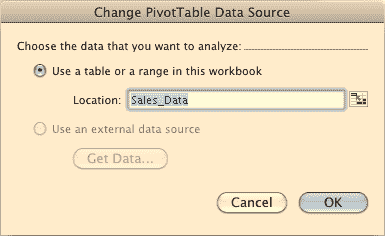

**376**

**第 12 章：使用数据透视表分析数据**

要刷新工作簿中的所有数据透视表，请选择 `PivotTable` > `Data` > `Refresh` > `Refresh All`。

如果您的数据透视表使用外部数据源，并且您发现刷新操作耗时过长，请选择 `PivotTable` > `Data` > `Refresh` > `Cancel Refresh` 以取消操作。

### 更改数据透视表的数据源

有时，在构建数据透视表后，您可能会发现需要更改其源数据。您可以做到这一点，而无需删除数据透视表并重新开始，这是个好消息。

要更改数据透视表的源数据，请按照以下步骤操作：

**1.** 从功能区中，选择 `PivotTable` > `Data` > `Change Source` 以显示 `Change PivotTable Data Source` 对话框（参见图 12-18）。如果功能区被压缩，您需要选择 `PivotTable` > `Data` > `Options` > `Change Source`。

**图 12-18.** *当需要将数据透视表切换到不同数据源时，请使用 `Change PivotTable Data Source` 对话框。*

**2.** 在 `Location` 文本框中，输入您想要用来替代当前范围的区域。您可以输入表名或区域名称；输入区域引用；或者单击 `Collapse Dialog` 按钮，在工作表中选择区域，然后再次单击 `Collapse Dialog` 按钮。

**3.** 单击 `OK` 按钮关闭 `Change PivotTable Data Source` 对话框。

`Excel` 使用来自新数据源的数据更新数据透视表。

### 对数据透视表进行排序和筛选

为了使数据透视表显示您需要的数据，您可能需要对其进行排序或筛选。

要对数据透视表进行排序，请点击您要排序的字段的弹出按钮。`Excel` 会显示该字段的排序和筛选窗口。该窗口标题为字段名称，正如图 12-19 所示，该图显示了排序和筛选窗口打开 `Product` 字段的排序和筛选窗口。然后可以单击升序按钮进行升序排序（从 A 到 Z、从小数字到大数字、从早期日期时间到较晚日期时间），或单击降序按钮进行降序排序（反之亦然）。

**图 12–19.** *要对数据透视表排序或筛选，打开该字段的排序和筛选窗口，然后在排序区域或筛选区域中选择选项。排序和筛选窗口的标题栏显示字段名称（此处为 Product）。*

**注意：** 要控制 `Excel` 对数据透视表进行排序的方式，请在“数据透视表选项”对话框的“布局”选项卡的“排序”区域中选择排序选项，如本章前面所述。

对字段应用排序后，字段名称弹出按钮会发生变化，显示一个箭头指示排序方向。例如，在图 12–20 中，可以看到一个向上箭头指示 `Salesperson` 字段上的降序排序，以及一个向下箭头指示 `Product` 字段上的升序排序。`Line` 字段显示常规弹出按钮。

**图 12–20.** *对数据透视表排序时，字段的弹出按钮会显示向上箭头表示降序排序（如这里的 Salesperson 字段），或向下箭头表示升序排序（如这里的 Product 字段）。*

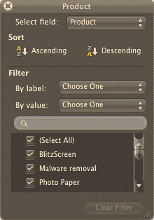
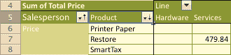

**378**

**第 12 章：使用数据透视表分析数据**

要筛选数据透视表，请单击字段名称旁边的弹出按钮以显示排序和筛选窗口，然后在筛选区域中选择筛选条件。以下是一些示例：

- `按标签筛选。` 要按标签筛选，打开“按标签”弹出菜单，选择比较类型，然后指定所需数据。例如，选择 `Contains` 比较来查找与您在其后出现的文本框中输入的文本字符串匹配的标签，如图 12–21 左侧所示。

# 第 12 章：使用数据透视表分析数据

**图 12–21.** *您可以按标签（如左图所示）或按值筛选字段。还可以在搜索框中搜索，或清除要排除项的复选框。*

*按值筛选。* 要按值筛选，打开按值弹出菜单，然后选择所需的比较。例如，选择`Top 10`项创建一个“前多少项”筛选，然后设置该项数量（在按值弹出菜单下方的两个弹出菜单的左侧中）。在右侧弹出菜单中，根据需要选择`Item`、`Percentage`或`Sum`进行筛选。

*按单个值筛选。* 要按单个值筛选，清除筛选区域下部的`(Select All)`复选框，然后为要在筛选中使用的每个项选中复选框。要只查找特定项以便选中或清除其复选框，请单击搜索框，然后键入搜索词。

应用筛选后，字段的弹出按钮会显示一个漏斗形状的筛选符号，如图 12–22 中`Line`字段所示。

[www.it-ebooks.info](http://www.it-ebooks.info/)

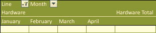

**379**

**图 12–22.** *Excel 在字段的弹出按钮上显示漏斗形状的筛选符号，表示已对该字段应用了筛选。*

要移除筛选，请再次打开排序和筛选窗口，然后单击底部的清除筛选按钮。

## 总结

在本章中，您了解了什么是数据透视表，以及如何从现有表格或其他数据源创建它们。您知道如何自动启动数据透视表或手动构建它，如何重新排列其字段以更改其显示的信息及其显示方式，以及如何设计和格式化数据透视表。最后，您学习了如何排序和筛选数据透视表，使其显示所需的信息。

在下一章中，我将向您展示如何与同事共享您的工作簿。

[www.it-ebooks.info](http://www.it-ebooks.info/)

# 381
## 13

# 章节

