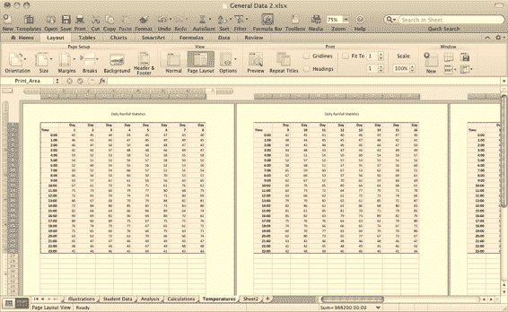
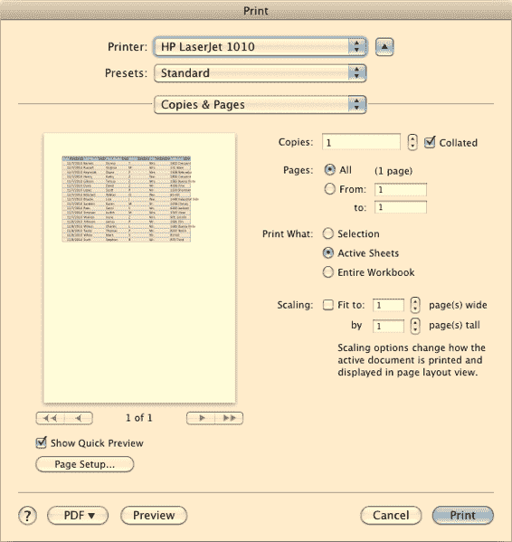
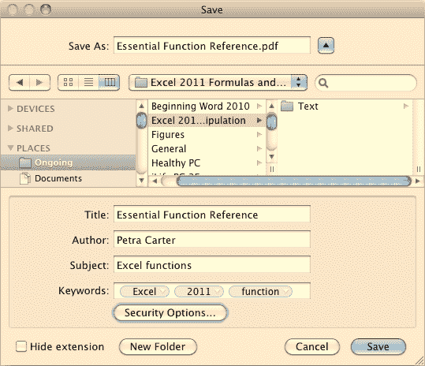
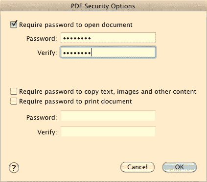
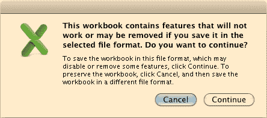
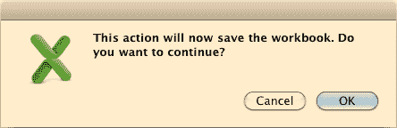
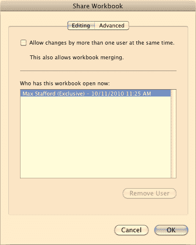
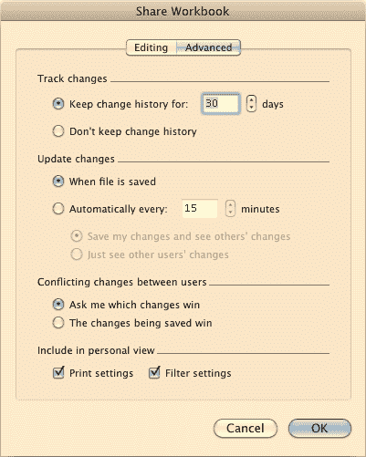
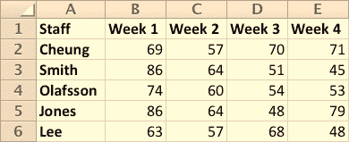
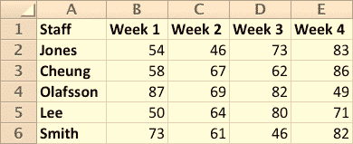

# 第 13 章：与 Mac 和 Windows PC 协作和共享

在本章中，我将向您展示如何与他人协作处理工作簿。

您可以通过传统方式——打印工作表并分发纸质版——将工作簿交给他人，也可以采用更现代的方式，创建 PDF 文件并通过网络或互联网共享。您还可以将数据导出为逗号分隔值格式，使其与许多程序兼容。

您可以与同事共享工作簿，以便两人或更多人同时处理同一工作簿，并且可以跟踪他人对工作簿所做的更改，以便仔细审阅。这些功能在 Mac OS X 和 Windows 上均可使用，因此您的同事使用哪种平台并不重要。

更棒的是，Excel 提供了一个自动化工具，用于合并同一工作簿不同副本中的更改，让您能够轻松整理、追踪和审阅这些更改。

在本章结尾，我将向您展示如何将多个工作表合并为一个工作表。当您需要快速从相关工作表中汇总信息时，这非常有用。

### 确保工作表正确打印

要从 Excel 打印，您需要使用“打印”对话框。但在打印之前，您需要告诉 Excel 要打印工作簿的哪一部分。您可能还需要检查页面设置，以确保分页符位于您期望的位置。

[www.it-ebooks.info](http://www.it-ebooks.info/)

## 382

## 第 13 章：与 Mac 和 Windows PC 协作和共享

### 告诉 Excel 要打印工作表的哪一部分

鉴于每个工作表包含数十亿个单元格，您很少需要打印整个工作表——通常只需打印已使用的单元格区域，或者可能只是该区域的一小部分。因此，在打印时，首先要做的就是告诉 Excel 您想要打印工作表的哪一部分。Excel 将此设置称为“打印区域”。您可以为每个工作表设置独立的打印区域。

**注意：** 在设置打印区域之前，Excel 会默认打印工作表中所有已使用的单元格——即使它们之间存在大量空白区域。因此，建议在打印前始终设置打印区域。

要设置打印区域，请按照以下步骤操作：

1. 单击要设置打印区域的工作表。

2. 选择要打印的单元格区域。

3. 选择 `文件` → `打印区域` → `设置打印区域`。Excel 会在打印区域周围显示蓝色虚线，以表示已设置。

4. 如果需要在现有打印区域中添加新区域，请选择要添加的单元格区域，然后选择 `文件` → `打印区域` → `添加到打印区域`。

**说明：** 当您创建由多个单元格区域组成的打印区域时，这些区域不必相邻。Excel 会将每个独立的区域打印在单独的页面上。

如果需要完全更改打印区域，请选择一个新的单元格区域，然后再次执行 `文件` → `打印区域` → `设置打印区域` 命令。

如果需要清除打印区域，使工作表没有设置打印区域，请单击该工作表，然后选择 `文件` → `打印区域` → `清除打印区域`。

### 检查页面布局和分页符位置

打印大型工作表时，请检查工作表的页面布局并根据需要进行调整。请按照以下步骤操作：

1. 切换到“页面布局”视图：单击状态栏左端的“页面布局视图”按钮，从功能区选择“布局视图” → “页面布局”，或从菜单栏选择“视图” → “页面布局”。

2. 单击功能区的“布局”选项卡以显示其控件。图 13-1 显示了处于“页面布局”视图并显示“布局”选项卡的工作表。

[www.it-ebooks.info](http://www.it-ebooks.info/)

## 第 13 章：与 Mac 和 Windows PC 协作和共享

## 383

**图 13–1.** 若要查看工作表的页面布局，请切换到“页面布局”视图。然后可以使用功能区“布局”选项卡上的控件来优化布局。

**3.** 使用“页面设置”组中的控件根据需要更改页面设置：

- **更改页边距。** 打开`页边距`弹出菜单，然后单击`普通`、`宽`或`窄`。如需更精细的控制，请单击`自定义页边距`，在`页面设置`对话框的`页边距`选项卡上进行设置，然后单击`确定`按钮。

**注意：** 如果您更喜欢在普通视图中工作，仍可以调整分页符——拖动代表分页符的虚线，或使用`页面设置`组中的控件。

- **更改纸张方向。** 打开`纸张方向`弹出菜单，然后单击`纵向`或`横向`。

- **更改纸张大小。** 打开`纸张大小`弹出菜单，然后单击所需的纸张尺寸。

- **插入分页符。** 单击要插入手动分页符的列左侧。打开`分隔符`弹出菜单，然后单击`插入分页符`。

[www.it-ebooks.info](http://www.it-ebooks.info/)

**384**

**第 13 章：在 Mac 与 Windows PC 上协作与共享**

**注意：** 如果分页符位置错误，请单击其后的列，然后从功能区中选择`布局` > `页面设置` > `分隔符` > `删除分页符`。要将所有分页符恢复为 Excel 自动设置的位置，请选择`布局` > `页面设置` > `分隔符` > `重置所有分页符`。

完成页面布局后，建议保存工作簿——例如，单击标准工具栏上的`保存`按钮，或按`Cmd+S`——以存储打印设置。

**提示：** 若要查看打印输出的完整预览，请单击`预览`按钮。Excel 会创建预览并在“预览”应用程序中显示，您可以清晰地看到将要打印的内容以及页面的流动顺序。预览完毕后，单击`打印`按钮即可打印。

### 打印工作表或工作簿

为每个要打印的工作表设置好打印区域后，可按如下方式打印工作表或工作簿：

**1.** 如果要打印的内容少于整个工作簿，请选择要打印的内容：

- **打印一个工作表。** 激活该工作表。例如，单击其工作表标签。

- **打印多个工作表。** 通过选中它们的工作表标签来同时激活这些工作表。

- **打印选定的单元格区域。** 选定这些单元格。

**提示：** 当您已按所需方式精确设置好工作表的打印内容时，可以单击标准工具栏上的`打印`按钮快速打印。单击`打印`按钮会直接将打印作业发送到打印机，而不显示`打印`对话框。

**2.** 选择`文件` > `打印`或按`Cmd+P`以显示`打印`对话框。如果`打印`对话框以较小尺寸打开，请单击`打印机`弹出菜单右侧的向下箭头按钮，将对话框展开至较大尺寸。

**3.** 确保`预设`弹出菜单下方的弹出菜单中选中了`份数与页数`项目。图 13–2 显示了选中`份数与页数`项目时的`打印`对话框。

[www.it-ebooks.info](http://www.it-ebooks.info/)

**第 13 章：在 Mac 与 Windows PC 上协作与共享**

**385**

**图 13–2.** 在`打印`对话框中选择打印选项。

**4.** 在`打印内容`区域中选择要打印的内容：

- **选定区域。** 选中此单选按钮可仅打印您选定的单元格。此选项适用于打印少量内容而无需重置打印区域。

- **活动工作表。** 选中此单选按钮可打印活动的工作表（如果仅选定一个）或活动的工作表组（如果选定了多个）。

- **整个工作簿。** 选中此单选按钮可打印工作簿中的每个工作表。通常，您只会在小型工作簿中使用此选项。

**5.** 检查打印预览是否正常。如果需要调整缩放比例以使打印输出更好地适应纸张，请选中`缩放`复选框，然后在`将内容调整到` *N* 页宽和`高` *N* 页的框中设置页数。例如，您可以选择`将内容调整到` 1 页宽 × 2 页高。

**6.** 点击 `打印` 按钮以打印工作表。

[www.it-ebooks.info](http://www.it-ebooks.info/)

**386**

**第 13 章：在 Mac 与 Windows PC 之间协作与共享**

### 将工作表共享为 PDF

如果您想以电子方式共享工作表，让他人可以轻松查看但无法编辑——至少，不费些周折就无法编辑——您可以创建使用广泛的便携式文档格式（PDF）文件。

要通过工作表创建 PDF，请按以下步骤操作：

**1.** 选择您要创建 PDF 的单元格区域。

**2.** 选择`文件` > `打印`或按下`Cmd+P`组合键以显示`打印`对话框。如果`打印`对话框以较小尺寸打开，请点击`打印机`弹出菜单右侧的向下箭头按钮，将对话框展开至较大尺寸。

**3.** 点击`PDF`按钮以显示`PDF`弹出菜单，然后点击`存储为 PDF`。Excel 会显示`存储`对话框（见图 13-3）。

**图 13-3.** *在`存储`对话框中，您可以为从 Excel 工作表创建的 PDF 文件添加标题、作者、主题以及所需的关键词。*

**4.** 在`存储为`框中输入文件名。

**5.** 在`位置`弹出菜单或导航窗格中指定目标文件夹。

[www.it-ebooks.info](http://www.it-ebooks.info/)

**第 13 章：在 Mac 与 Windows PC 之间协作与共享**

**387**

# 第 13 章：在 Mac 与 Windows PC 之间协作与共享

## 将数据导出为 CSV 文件

当您只需共享 Excel 工作表中的数据时，可以将其导出为逗号分隔值（CSV）文件。CSV 是一种应用非常广泛的数据交换标准，由文本构成，其中用逗号分隔每个单元格的内容。因此，当您将工作表导出为 CSV 文件时，您只导出了文本——Excel 会移除所有格式和非文本对象，例如图表或图片。

要将工作表导出为 CSV 文件，请按以下步骤操作：

1.  如果工作簿包含任何未保存的更改，请先保存。
2.  将要导出的工作表设为活动状态。
3.  从菜单栏选择`文件` > `存储为`以显示`存储为`对话框。
4.  像往常一样指定文件名并选择文件夹。
5.  在`格式`弹出菜单中，选择`逗号分隔值 (.csv)`。
6.  点击`存储`按钮。如果工作簿包含多个工作表，Excel 会显示如图 13-5 所示的对话框，警告您由于工作簿包含多个工作表，无法以 CSV 格式保存。

    图 13-5. *点击此对话框中的`存储活动工作表`按钮，仅将活动工作表导出为 CSV 文件。*
7.  点击`存储活动工作表`按钮以继续导出活动工作表。如果工作表包含任何非文本项目，Excel 需要移除这些项目才能创建 CSV 文件，Excel 会显示如图 13-6 所示的对话框，警告您将移除某些功能。大多数工作表都包含 Excel 需要移除的项目，因此您通常会看到此对话框。

[www.it-ebooks.info](http://www.it-ebooks.info/)

图 13-6. *如果 Excel 警告您需要移除某些功能才能创建 CSV 文件，请点击`继续`按钮。*
8.  点击`继续`按钮。Excel 会停止抗议并保存工作表为 CSV 文件。

**注意：** 将工作表保存为 CSV 文件后，Excel 会将工作簿的窗口名称更改为 CSV 文件的名称，但会继续显示完整的工作簿，其中包含所有 CSV 转换已移除的非文本对象和其他工作表。不要在此工作簿中工作，因为您看到的并非 CSV 文件的实际内容。相反，请点击`关闭`按钮或选择`文件` > `关闭`来关闭工作簿。当 Excel 提示您保存对工作簿所做的更改时，请点击`不存储`按钮——在此格式中没有任何可保存的更改。然后选择`文件` > `打开最近使用`并点击`打开最近使用`子菜单中的 CSV 文件。您将看到 CSV 文件的实际内容。

## 记录工作簿

当您创建工作簿并向其中输入数据时，您可能很清楚哪些数据是什么，以及为何以所选择的方式布局数据，为何使用特定类型的图表，或以某种独特的方式构建公式。

但打开您工作簿的其他人可能无法直观地理解您的做法。因此，在创建计划与他人共享的工作簿时，或者准备用于共享的工作簿时，记录工作簿是个好主意。这可以在未来的日子、星期或月份里为您节省时间、避免困惑以及无数令人恼火的问题。

Excel 提供了三种主要工具来记录工作簿：

- 单元格中的文本
- 附加到单元格的批注
- 数据验证工具

我们将依次介绍这些工具。

### 向工作簿添加说明性文本

记录工作簿最直接的方法是在单元格中输入文本。您已经知道如何操作，因此唯一的问题是输入什么文本以及如何有力地设置格式，以确保任何人都不会错过它。

一般而言，解释得比严格必要的更详细一些，会让您省去很多麻烦。例如，名为`西部区域销售 2011`的工作表包含 2011 年西部区域的销售结果，这也许应该是显而易见的——但您可能也应该将该信息放在工作表顶部的某个单元格中，以供任何未查看工作表标签的人参考。同样，即使您使用的公式是标准且直接的，最好也能说明它们所显示的数值是如何得出的。为此，您可以在附近的单元格中使用文本，或者将批注附加到单元格本身（如下一节所述）。

**提示：** 对于包含多个工作表的大型工作簿，建议在开头添加一个`Summary`（摘要）工作表或`Introduction`（介绍）工作表。在此工作表中，说明工作簿的用途，并列出所有工作表及其内容。你还可以注明谁应该（或被允许）对该工作簿进行何种操作。例如，经理必须填写预算数字，而副总裁只需查看`Executive Overview`（执行摘要）工作表并批准其中的数字，但不得修改其他工作表。你可以在`Summary`（摘要）工作表中添加宏按钮，用于显示特定工作表，从而提供一种便捷的工作簿导航方式。（有关宏的详细内容，请参阅第 14 章。）

### 为单元格添加批注

直接在单元格中输入说明文字便于查看，但你也可以使用批注来添加信息。批注是附加到单元格上的文本。`Excel`会在单元格中显示一个批注指示符，标明有批注附加上去；当鼠标指针悬停在单元格上时，批注会以气球样式显示。你还可以显示工作表中所有的批注气球，并在它们重叠时重新排列。

#### 添加批注

要为一个单元格添加批注，请按以下步骤操作：

1.  激活你想要添加批注的单元格。
2.  在功能区中选择`审阅 > 批注 > 新建`，或从菜单栏中选择`插入 > 新建批注`。`Excel`会在该单元格的右上角显示批注标记和一个红色三角形，打开一个批注气球，并在气球中以粗体显示你的用户名。

    **提示：** `Excel`会为你自动在每个批注中输入你的用户名（该名称在`Excel`的`常规`偏好设置窗格中设定），但你可以根据需要编辑该名称，或直接将其删除。为了让批注更易读或更醒目，你可以对其应用文本格式。例如，点击`加粗`按钮或按`Cmd+B`组合键，将选定文本设置为粗体。
3.  输入批注的文本。图 13–7 展示了一个示例。

    图 13–7. *此处`Q2`单元格右上角的红色三角形就是批注标记。在批注气球中输入或粘贴批注文本。*
4.  完成批注创建后，单击工作表中的任意位置，将焦点从批注移除。

**注意：** 如果单元格中没有显示批注指示符，说明`Excel`设置为隐藏批注和指示符。在功能区中选择`审阅 > 批注 > 显示所有批注`，即可启用批注显示。

**提示：** 在处理同一工作表的多个版本时，你可能需要将批注从一个工作表粘贴到另一个工作表。通过使用`选择性粘贴`命令，可以轻松完成此操作。选择包含批注的区域，然后像往常一样将其复制到剪贴板（例如，按`Cmd+C`）。接着，单击目标区域左上角的单元格，选择`主页 > 编辑 > 粘贴 > 选择性粘贴`，在`粘贴`区域选中`批注`选项按钮，然后点击`确定`按钮。

#### 查看批注

通常，`Excel`只会在工作表中显示批注标记。要查看批注，可将鼠标指针悬停在包含批注的单元格上，`Excel`就会在气球中显示该批注。你也可以单击该单元格，然后在功能区中选择`审阅 > 批注 > 显示`，即可显示批注并使其保持显示状态，同时可以移动到工作表的其他部分。

如果你希望显示所有批注，请在功能区中选择`审阅 > 批注 > 显示所有批注`，或从菜单栏中选择`视图 > 批注`。

要选择下一个批注，请选择`审阅 > 批注 > 下一条`。要选择上一个批注，请选择`审阅 > 批注 > 上一条`。

#### 删除批注

要删除一个批注，请按以下步骤操作：

1.  选定该批注。你可以单击包含批注的单元格，或选择`审阅 > 批注 > 下一条`或`审阅 > 批注 > 上一条`来导航到该批注。

**2.** 在功能区中选择`审阅 > 批注 > 删除`，或从菜单栏中选择`编辑 > 删除 > 批注`。

**在选择评论之前。**

**2.** 执行 `Delete` 命令。按下 `Delete` 键，或选择 `Review` > `Comments` > `Delete`。

**提示：** 您可以通过按住 `Ctrl` 键并单击（或右键单击）已添加评论的单元格，然后单击 `Edit Comment` 来编辑评论。同样，您可以通过按住 `Ctrl` 键并单击（或右键单击）已添加评论的单元格，然后单击 `Delete Comment` 来删除评论。

### 使用数据验证添加信息

如您在第四章“使用数据验证检查输入”一节中所述，您可以对单元格应用数据验证格式，以确保用户在其中输入的值符合您的要求。例如，您可以使用数据验证来确保用户输入的值介于 250 到 1000（含）之间，并在不符时显示一个错误警告消息框。

您可以通过两种方式使用数据验证向工作表中添加信息：

- **显示输入信息。** 在 `Data Validation` 对话框的 `Input Message` 选项卡上，选中 `Show input message when cell is selected` 复选框，然后在 `Title` 文本框中键入标题，在 `Input message` 文本框中键入消息。当用户选中该单元格时，Excel 会显示一个包含输入信息的提示框。其作用类似于自动注释，是提供如何使用工作簿的针对性指导的好方法。

- **显示错误警告。** 在 `Data Validation` 对话框的 `Error Alert` 选项卡上，选中 `Show error alert after invalid data is entered` 复选框，然后指定要包含在对话框中的标题和错误消息。您也可以使用此功能为工作簿的用户提供详细说明。

***

## 第 13 章：与 Mac 和 Windows PC 协作与共享

**393**

### 与同事共享工作簿

您可能会自己创建一些工作簿，但对于其他工作簿，您可能需要与同事协作来收集、输入和分析数据。您可以在网络上共享一个工作簿，以便一次只能由一个人处理它，或者开启 Excel 的共享功能，使您和同事能够同时处理该工作簿。

在共享工作簿之前，您可以选择用密码保护它，或者允许您的同事仅进行某些类型的更改。

#### 保护工作簿或其部分工作表

在将工作簿共享给同事以供其在网络上单独编辑之前，您可能希望限制同事在工作簿或其某些工作表中可以进行的更改。Excel 将此称为*保护*工作簿或工作表。

#### 保护工作簿

要保护工作簿，请遵循以下步骤：

**1.** 从功能区中选择 `Review` > `Protection` > `Workbook`，或从菜单栏中选择 `Tools` > `Protection` > `Workbook`，以显示图 13-8 所示的对话框。

**图 13-8.** *在保护工作簿时，通常您只需保护结构，而无需保护窗口。*

**2.** 选中 `Protect structure` 复选框，以防止您的同事插入、删除或以其他方式更改整个工作表。

**3.** 仅当您需要防止同事更改您为工作簿使用的窗口数量或大小时，才选中 `Protect windows` 复选框。通常，如果您的同事将以常规方式处理工作簿，则不需要这样做。

**4.** 在 `Password` 文本框和 `Verify` 文本框中键入密码。

**5.** 点击 `OK` 按钮关闭对话框。

**6.** 保存工作簿。例如，点击 `Standard` 工具栏上的 `Save` 按钮或按下 `Cmd+S`。

**注意：** 要取消保护工作簿，请选择 `Review` > `Protection` > `Workbook`。Excel 会显示一个对话框，提示您输入密码。键入密码，点击 `OK` 按钮，然后保存对工作簿的更改。

#### 保护工作表

当您需要限制同事对特定工作表进行的更改时，请对其应用保护。请遵循以下步骤：

**1.** 点击工作表将其激活。

**2.** 选择 `Review` > `Protection` > `Sheet` 以显示 `Protect the sheet and contents of locked cells` 对话框（如图 13-9 所示，已选择设置）。

**图 13-9.** *当您需要防止同事对工作表进行特定类型的更改时，请保护工作表。*

**3.** 在 `Password` 文本框和 `Verify` 文本框中键入密码。

**4.** 在 `Allow users of this sheet to` 框中，为您希望同事能够执行的操作选中每个复选框。清除其他复选框。

**5.** 点击 `OK` 按钮。Excel 会关闭对话框并应用保护。

**6.** 保存工作簿。例如，按下 `Cmd+S` 或点击 `Standard` 工具栏上的 `Save` 按钮。

#### 跟踪对工作簿的更改

当您与他人共享工作簿时，您可能需要跟踪他们对工作簿所做的更改，以便您可以轻松审阅这些更改，而无需比较工作表的新旧版本。要跟踪更改，请开启 `Track Changes` 功能。

当您开启 `Track Changes` 时，Excel 会自动为您共享工作簿。

要开启 `Track Changes` 并共享工作簿，请遵循以下步骤：

**1.** 从功能区中选择 `Review` > `Share` > `Track Changes` > `Highlight Changes`，或从菜单栏中选择 `Tools` > `Track Changes` > `Highlight Changes`，以显示 `Highlight Changes` 对话框（参见图 13-10）。

**图 13-10.** *在 `Highlight Changes` 对话框中，选中 `Track changes while editing` 复选框，然后选择要保存哪些更改以及是否在屏幕上突出显示它们。*

**2.** 选中 `Track changes while editing` 复选框。Excel 随后会启用对话框中的其他控件。

**3.** 要指定跟踪更改的时间段，请选中 `When` 复选框，打开弹出菜单，然后点击相应的项目：

- `Since I last saved.` 选择此项仅跟踪自您上次保存工作簿以来的更改。如果您仅在审阅更改后才保存工作簿，这是将更改数量保持在一个可控水平的好方法。

- `All.` 选择此项可跟踪所有更改。

- `Not yet reviewed.` 选择此项仅跟踪更改，直到您审阅它们。这是减少工作簿中剩余更改数量的另一种方法。

- `Since date.` 如果您想指定开始跟踪更改的日期，请选择此项。Excel 会建议当前日期，但您可以根据需要更改它。

**4.** 要选择 Excel 跟踪谁的更改，请选中 `Who` 复选框，打开弹出菜单，然后根据需要点击 `Everyone` 项目或 `Everyone but me` 项目。（思路是您可能不需要查看自己所做的更改。）

**5.** 要指定跟踪更改的范围，请选中 `Where` 复选框，然后在工作表上拖动选择该范围以将其输入到文本框中。如果您需要将 `Highlight Changes` 对话框移开，可以点击 `Collapse Dialog` 按钮，但通常绕过它操作更容易。

**6.** 如果您希望 Excel 在屏幕上突出显示更改，请选中 `Highlight changes on screen` 复选框。这通常很有帮助。

**7.** 如果您希望 Excel 创建一个新工作表并在其中列出更改，请选中 `List changes on a new sheet` 复选框。创建此列表是审阅更改的便捷方式，因为您可以在必要时在其旁边添加注释。

**注意：** 仅当您已开启`修订`且工作簿中包含至少一处被追踪的修订时，Excel 才会使`在新工作表上列出修订`复选框可用。这意味着您需要先关闭`突出显示修订`对话框，做一些被追踪的更改，然后再次打开该对话框，才能选中`在新工作表上列出修订`复选框。

**8.** 单击`确定`按钮关闭`突出显示修订`对话框。Excel 会提示您保存工作簿（见图 13-11）。

[www.it-ebooks.info](http://www.it-ebooks.info/)

### 第 13 章：在 Mac 与 Windows PC 上协作和共享

**397**

**图 13-11.** *开启修订后，Excel 会提示您保存工作簿。单击确定按钮。*

**9.** 单击`确定`按钮。Excel 会保存工作簿并共享它。

通过开启`修订`共享工作簿后，您可能需要调整共享设置。为此，请按照下一节的说明操作。

#### 共享工作簿以便同事可以编辑

当您需要与同事协作处理工作簿时，请开启共享。请按照以下步骤操作：

**1.** 打开工作簿。

**2.** 从功能区中选择`审阅` > `共享` > `共享工作簿` > `共享工作簿`，以显示`共享工作簿`对话框。图 13-12 左侧屏幕显示了`共享工作簿`对话框的`编辑`选项卡，您在此处开始共享流程。

**图 13-12.** 在“共享工作簿”对话框的“编辑”选项卡（左侧）上，选中“允许多用户同时更改”复选框。然后您可以在“高级”选项卡（右侧）上选择选项。

[www.it-ebooks.info](http://www.it-ebooks.info/)

**398** **第 13 章：在 Mac 与 Windows PC 上协作和共享**

**3.** 在`编辑`选项卡上，选中`允许多用户同时更改`复选框。

**4.** 检查`谁现在打开了此工作簿`列表框。列表中应仅显示您的名字，并包含`独占`字样，表明您拥有对工作簿的独占访问权。

**5.** 单击`高级`选项卡以显示其内容（如图 13-12 右侧所示）。

**6.** 在`修订`区域，选择工作簿的修订历史保存时长：

- 通常，您应选中`保存修订记录`选项按钮，并在`天`框中设置天数。

- 默认设置为 30 天，但如果您的工作簿开发速度较快，可能需要将间隔缩短到 7 天或 14 天，以防止 Excel 保留大量您不需要的历史记录。

- 另一个选项是选中`不保存修订记录`按钮，但通常最好保存修订历史，以便您能追溯任何可疑的更改。

**7.** 在`更新`区域，选择何时更新对工作簿的更改：

- 默认设置为`保存文件时`选项按钮，这通常效果不错。

- 另一个选项是选中`自动更新间隔`选项按钮，并在`分钟`框中设置分钟数。默认设置为 15 分钟；如果您工作速度快，可能希望将间隔缩短到 5 或 10 分钟。

- 如果您选择了`自动更新间隔`选项按钮，可以在`保存我的更改并查看其他人的更改`（通常是更佳选择）和`仅查看其他用户的更改`选项按钮之间进行选择。

**8.** 在`用户间的冲突修订`区域，选择如何处理工作簿中的冲突更改。通常，您应选中`询问我选择谁的更改`选项按钮，以便您决定保留哪些冲突更改。另一个选项是选中名为`选用正在保存的修订`的选项按钮，该选项告诉 Excel 用最新更改覆盖冲突的更改。

[www.it-ebooks.info](http://www.it-ebooks.info/)

**第 13 章：在 Mac 与 Windows PC 上协作和共享** **399**

**9.** 在`在个人视图中包含`区域，若希望将打印设置包含在工作簿的个人视图中，请选中`打印设置`复选框。若希望包含筛选设置，请选中`筛选设置`复选框。（关于筛选 Excel 数据库表的说明，请参见第 10 章。）

**10.** 单击`确定`按钮关闭`共享工作簿`对话框。随后，Excel 将显示一个对话框，提示将保存该工作簿。

**11.** 单击`确定`按钮。Excel 会设置共享功能，并在工作簿的标题栏中添加`[共享]`标记，以便您轻松识别该工作簿已共享。

> **提示:** 将工作簿存储在共享文件夹中（无论是存储在 Mac 上还是网络中），您可能都需要为其设置密码保护，以确保只有授权人员才能打开。若要设置打开密码或修改密码，请使用第 3 章“使用自动备份和密码保护工作簿”一节中介绍的操作步骤。

### 在共享工作簿中工作

共享工作簿（无论是您自己共享的还是他人已共享的）后，您可以像往常一样在其中执行基本编辑操作。您可以在单元格中输入数据和公式，或编辑其现有内容，设置单元格格式，并使用拖放、剪切、复制和粘贴功能。此外，您还可以插入行、列，甚至整个工作表。

除这些基本操作外，Excel 会禁止您进行可能引发共享问题的更改。这些主要限制包括：

- 应用条件格式。如果工作簿需要条件格式，请在共享工作簿之前应用。

- 插入对象。您无法插入图片、SmartArt 图形、图表、超链接或其他多种对象。

- 插入或删除单元格区域。您可以插入或删除整行或整列，但不能插入或删除单元格区域。同时，您也无法合并单元格。

- 删除工作表。您无法从共享工作簿中删除工作表。

- 使用密码保护工作表。共享工作簿之前应用的任何保护仍会生效，但您无法对共享工作簿中的工作表应用保护。

- 创建大纲。您无法在共享工作簿中创建大纲。有关创建大纲的详细信息，请参见第 3 章“通过创建大纲使工作表可折叠”一节。

---

### 解决共享工作簿中的冲突

如果在共享工作簿时选择了`让我决定哪些更改生效`选项按钮，当您保存的更改与同事已保存的更改发生冲突时，Excel 会提示您处理这些冲突。`解决冲突`对话框（见图 13–13）会逐一列出每处更改，分别显示您所做的更改和存在冲突的更改。

**图 13–13.** 当您与另一位用户更改了相同单元格时，“解决冲突”对话框会逐一引导您处理每处更改。您可以接受您的所有更改、同事的所有更改，或分别接受部分更改。

对于每处更改，您可以单击`接受我的更改`按钮来接受自己的更改，或单击`接受他人的更改`按钮来接受同事的更改。若要一次性清除所有更改，请单击`全部接受我的更改`按钮或`全部接受他人的更改`按钮。完成冲突审阅后，Excel 会自动关闭`解决冲突`对话框。

### 审阅共享工作簿中的修订记录

当您在共享工作簿中跟踪了更改后，您可以审阅这些更改，接受希望保留的更改并拒绝其他更改。要审阅跟踪的更改，请按以下步骤操作：

1. 如果共享工作簿尚未打开，请先将其打开。

2. 从功能区中选择`审阅` > `共享` > `修订` > `接受或拒绝修订`，或从菜单栏中选择`工具` > `修订` > `接受或拒绝修订`，以打开`选择要接受或拒绝的修订`对话框（见图 13–14）。

### 第 13 章：在 Mac 和 Windows PC 上协作与共享

### 401

**图 13–14.** 在“选择要接受或拒绝的修订”对话框中，选择要审阅的修订，然后单击`确定`按钮。

3. 使用`修订人`区域中的控件来选择 Excel 供您审阅的修订：

    - **时间.** 选中此复选框可指定日期范围。然后打开弹出菜单，如果要审阅所有尚未审阅的修订，请选择`尚未审阅`项；或者选择`起始日期`项，并在文本框中输入日期。

    - **修订人.** 如果要指定审阅谁的修订，请选中此复选框。然后打开弹出菜单，选择`所有人`、`除我之外的所有人`或某个用户名。

    - **位置.** 如果只想查看工作簿中部分区域的修订，请选中此复选框。然后在文本框中单击，并在工作表中拖选范围。

4. 单击`确定`按钮关闭“选择要接受或拒绝的修订”对话框。Excel 将显示“接受或拒绝修订”对话框（见图 13–15），其中显示修订的数量以及第一条修订的详细信息。

**图 13–15.** 使用“接受或拒绝修订”对话框逐一处理共享工作簿中的修订。

[www.it-ebooks.info](http://www.it-ebooks.info/)

### 402

**第 13 章：在 Mac 和 Windows PC 上协作与共享**

5. 使用`接受`按钮和`拒绝`按钮逐一处理修订。如果您认为所有修订都有价值，也可以采取激进策略，单击`全部接受`按钮；如果认为它们毫无价值，则单击`全部拒绝`按钮；单击其中任一按钮后，Excel 将为您关闭“接受或拒绝修订”对话框。

6. 处理完所有修订后，单击`关闭`按钮关闭“接受或拒绝修订”对话框。

### 将多个工作簿合并到一个工作簿中

当您有多个启用了“修订”功能进行共享的工作簿版本时，可以将它们合并到一个工作簿中。

**注意：** 您必须先启用`修订`功能（如本章前面所述），然后才能合并工作簿。在`修订`功能启用之前，`合并工作簿`命令将不可用。

要合并工作簿，请按照以下步骤操作：

1. 打开要合并修订的目标工作簿。

2. 选择`工具`> `合并工作簿`，显示“选择要合并到当前工作簿中的文件”对话框。尽管名称较长，但这与“打开”对话框类似，是一个标准的文件选择对话框。

3. 导航到目标工作簿，然后将其选中。

4. 单击`确定`按钮合并工作簿。Excel 将标记有修订的单元格。

然后，您可以按照上一节所述的方法审阅这些修订。

### 将多个工作表合并到一个工作表

当处理多个工作表时，您可能需要将相同类型的工作表合并到一个工作表中。例如，如果您有一整年的周销售数据电子表格，您可能希望将它们合并起来以获取年度数据。

Excel 允许您合并具有相同布局的工作表，或者布局不同但具有相同行标签或列标签的工作表。您最多可以将 255 个源工作表合并到目标工作表中，可以选择将目标工作表链接到源工作表，也可以选择将数据从源工作表复制到目标工作表但不创建链接。

[www.it-ebooks.info](http://www.it-ebooks.info/)

### 403

**第 13 章：在 Mac 和 Windows PC 上协作与共享**

#### 准备合并工作表

要合并工作表，您需要打开目标工作表，以便在其中输入信息。

当仅合并少量工作簿时，您通常也希望打开源工作簿，以便能够轻松创建对它们的引用；虽然您可以

在不打开源工作表的情况下创建引用会更繁琐，因为你需要手动输入引用。当你需要合并几十个工作簿时，同时打开所有工作簿往往会显得笨拙，通常你会发现，先使用单个源工作簿创建引用，然后复制该引用并针对其他工作簿进行编辑会更轻松。

## 按位置合并工作表

当你要合并的工作表具有相同的布局时，你可以按位置进行合并。按位置合并实质上就是从每个源工作表的相同单元格地址中获取数据。

**注意：** 要使按位置合并生效，这些工作表必须具有完全相同的布局。如果任何一个工作表的布局不同，合并将无法工作——即使差异仅仅在于添加或删除了某一行或某一列。

要按位置合并工作表，请遵循以下步骤：

1. 打开包含源工作的工作簿。如果你要合并的源工作表位于目标工作簿中，请跳过此步骤。
2. 打开目标工作簿，并激活目标工作表。如有必要，请添加一个将成为目标工作表的工作表。
3. 激活你想要放置合并数据区域的左上角单元格。
4. 选择`数据工具` > `合并`，以显示`合并`对话框（如图 13-16 所示，已包含设置选项）。

[www.it-ebooks.info](http://www.it-ebooks.info/)

``

404

第 13 章：在 Mac 和 Windows PC 上进行协作与共享

**图 13-16.** *在“合并”对话框中，设置要合并到目标工作表中的源工作表的引用。*

5. 打开`函数`弹出菜单，选择用于合并的函数：
   - `Sum`：此函数对数字进行求和。这是合并的默认函数。
   - `Count`：此函数计算项目的数量。
   - `Average`：此函数返回数值的平均值。
   - `Max`：此函数返回最大值。
   - `Min`：此函数返回最小值。
   - `Product`：此函数返回数值相乘的乘积。
   - `Count Numbers`：此函数返回数值的计数。
   - `StdDev`：此函数返回样本的标准偏差。
   - `StdDevp`：此函数返回基于整个总体的标准偏差。
   - `Var`：此函数返回基于样本的方差。
   - `Varp`：此函数返回基于整个总体的方差。
6. 将引用添加到“所有引用”列表框中。请遵循以下步骤：
   a. 单击`引用`框以将焦点置于其中。

[www.it-ebooks.info](http://www.it-ebooks.info/)

第 13 章：在 Mac 和 Windows PC 上进行协作与共享 405

   b. 如果需要移开`合并`对话框，请单击`折叠对话框`按钮。如果你有空间在该对话框周围工作，则无需折叠它。
   c. 如果源工作表位于另一个工作簿中，则激活该工作簿。例如，单击其窗口或使用`窗口`菜单切换到该工作簿。
   **注意：** 如果需要打开一个工作簿以添加其引用，请单击`合并`对话框中的`选择`按钮以显示`选择工作簿`对话框。单击该工作簿，然后单击`确定`按钮。
   d. 单击源工作表的选项卡以显示源工作表。
   e. 选择工作表上的单元格或区域。
   f. 如果你折叠了`合并`对话框，请单击`折叠对话框`按钮以恢复它。
   g. 单击`添加`按钮，将单元格或区域地址添加到“所有引用”列表框。
   h. 重复这些步骤以添加更多引用。假设你是按位置合并工作表，Excel 会自动在每个工作表中建议相同的单元格或区域，因此你无需再选择单元格或区域。
7. 在`合并`对话框底部的“标签位置”区域中，清除`Top row`复选框和`Left column`复选框。
8. 如果您希望 Excel 创建指向源工作表的链接，请选中`Create links to source data`复选框。
9. 单击`OK`按钮关闭`Consolidate`对话框。Excel 将数据合并到该单元格中。

## 按类别合并工作表

如果您要合并的工作表不具有相同的布局，但具有相同的标签，则可以使用这些标签按类别进行合并。

例如，查看图 13-17 中所示的两个月的生产结果。`Staff`列中的名称在每个工作表中的顺序不同，因此您无法按位置合并。但由于标签相同，您可以按类别合并。实际上，您是在告诉 Excel“给我`Cheung`行的第 1 周结果，无论该行是哪一行”，而不是“给我单元格`B1`”。

[www.it-ebooks.info](http://www.it-ebooks.info/)

406

第 13 章：在 Mac 和 Windows PC 上协作与共享

**图 13-17.** *当源工作表具有一致的标签但布局不同时，您可以按类别合并工作表。*

要按类别合并工作表，请按照以下步骤操作：
1. 打开包含源工作表的工作簿。如果您要合并的源工作表位于目标工作簿中，请跳过此步骤。
2. 打开目标工作簿并激活目标工作表。如有必要，添加一个将成为目标工作表的表。
3. 激活您要放置合并数据的范围的左上角单元格。
4. 选择`Data Tools` > `Consolidate`以显示`Consolidate`对话框（如本章前面的图 13-16 所示）。
5. 在`Use labels in`区域，如果标签在顶行，请选中`Top row`复选框。如果标签在左列（如此示例所示），请选中`Left column`复选框。
6. 打开`Function`弹出菜单并选择函数。在此示例中，您可以选择`Sum`函数，这是默认函数。
7. 单击`Reference`框以将焦点置于其中。
8. 使用上一节列表的步骤 7 中说明的方法添加引用。在每个源工作表上手动选择合并范围。
9. 如果您希望 Excel 创建指向源工作表的链接，请选中`Create links to source data`复选框。
10. 单击`OK`按钮关闭`Consolidate`对话框。Excel 将数据合并到该单元格中。

**提示：** 要更新合并，请选择包含合并结果的区域，选择`Data Tools` > `Consolidate`以显示`Consolidate`对话框，然后单击`OK`按钮。Excel 将更新合并结果。

[www.it-ebooks.info](http://www.it-ebooks.info/)

第 13 章：在 Mac 和 Windows PC 上协作与共享 407

## 总结

在本章中，您学习了如何使用 Excel 的功能来共享工作簿以及与其他人协作。

您已经了解了如何通过设置打印区域、检查页面布局和分页符来使工作表正确打印，并且知道了如何将工作表共享为 PDF 文件或通过将数据导出为 CSV 文件来共享。您了解了记录工作簿的三种主要方法，并知道了如何实施共享、跟踪更改。您还学习了如何将多个工作簿合并到单个工作簿中，以及如何将多个工作表合并到单个工作表中。

[www.it-ebooks.info](http://www.it-ebooks.info/)

409

# 第 14 章：使用宏和 VBA 自动执行任务

到目前为止，在本书中，您已经了解了在手动操作时可以使用 Excel 完成的许多事情——从创建新的工作簿、在其中输入数据，到根据这些数据创建图表。

无论您在 Excel 中执行何种工作，很可能需要重复执行某些任务。您可以选择继续手动执行这些任务，但通过自动化这些任务，您可能能够节省大量时间和精力。

