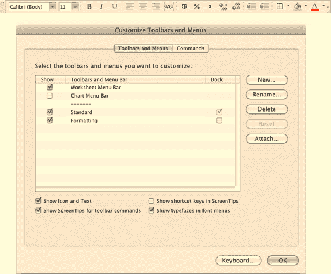
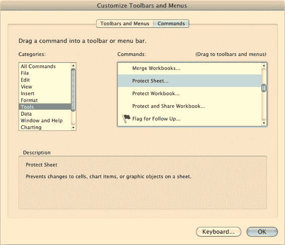
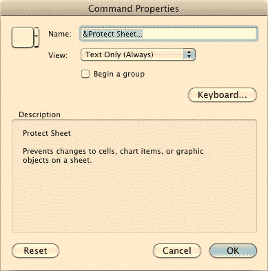
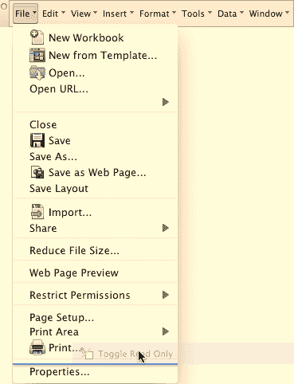

# Calc

Calc（最新版本可处理 Excel 工作簿格式）。

## 配置兼容性检查

当您在“兼容性”偏好设置窗格中时，请确保选中窗格顶部的“检查文档的兼容性”复选框。此设置可确保当您将工作簿保存为 Excel 97–2003 或其他功能少于 Excel 工作簿格式的格式时，Excel 会警告您可能无法在该格式中正常显示的信息。

**注意：** 在“兼容性”偏好设置窗格顶部的“兼容性报告”区域中，您可以单击“重置忽略的问题”按钮，以重置您在执行兼容性检查时忽略的任何兼容性问题的警告。如果您希望强制 Excel 重新检查工作簿所有方面的兼容性，可以单击“重置所有问题”按钮。

##### 设置自动恢复以安全地保留工作簿备份

接下来，决定是否保留工作簿的自动恢复文件。自动恢复是一个安全网，每几分钟自动保存每个打开的工作簿副本，以防 Excel 或您的 Mac 崩溃并丢失您所做的更改。发生此类崩溃后，当 Excel 自动重启或您手动重启时，它会为您打开最新的自动恢复文件，以便您选择要保留的版本。如果您保存工作簿后正常退出 Excel（例如，选择“Excel”>“退出”），Excel 会删除已保存的自动恢复文件。

**警告：** 切勿依赖自动恢复作为防止灾难的保护。当自动恢复正常工作时，它可以拯救您，但有时它并不能保存所有内容，尤其是在 Excel 或您的 Mac 在自动恢复保存即将进行前不久崩溃时。因此，您应在处理工作簿时经常保存它们，并且仅在灾难发生时使用自动恢复。您可以通过按 `Cmd+S`、单击标准工具栏上的“保存”按钮或从菜单栏中选择“文件”>“保存”来随时保存工作簿。

要选择自动恢复设置，请按照以下步骤操作：

1.  显示“保存”偏好设置窗格。
2.  选中或清除“保存自动恢复信息，时间间隔”复选框。
3.  如果选中了该复选框，请在文本框中输入分钟数。

您可以将间隔设置为 1 分钟到 120 分钟之间的任何值。大约 3 分钟的间隔通常效果很好，因为它足够频繁地保存信息以避免灾难，但不会因持续保存而过度中断您的工作。

如果您编辑包含许多工作表和大量数据的工作簿，保存自动恢复文件可能需要足够长的时间来中断您的工作。在这种情况下，要么增加自动恢复间隔以减少中断频率，要么关闭自动恢复并在方便时手动保存工作簿。

##### 让 Excel 提示您输入工作簿属性

在您保存的每个工作簿中，您可以存储额外的信息，以帮助您自己和您的同事识别工作簿、其用途和状态。Excel 提供了称为属性的槽来包含此类信息。

Excel 会为您填写一些属性——例如，它在“作者”属性中输入您的用户名，在“创建”属性中填入您首次保存工作簿的时间，并在您每次保存文档时更新“修改”属性。但是，其余属性的填写取决于您。开始填写属性的最佳时间是您首次保存工作簿时。

要让 Excel 在您首次保存工作簿时自动显示“属性”对话框，请选中“常规”偏好设置窗格顶部的“提示输入工作簿属性”复选框。

**注意：** 您可以通过选择“文件”>“属性”随时打开“属性”对话框。我们将在第 3 章中介绍“属性”对话框。

#### 创建自定义键盘快捷键

当您发现需要从键盘运行的命令没有预定义的键盘快捷键时，您可以创建自定义键盘快捷键。您也可以创建一个来替换或补充现有的键盘快捷键，或者运行您创建的宏（第 14 章介绍了创建宏）。

要创建自定义键盘快捷键，请按照以下步骤操作：

1.  选择“工具”>“自定义键盘”以显示“自定义键盘”对话框（如图 2-6 所示，其中已选择用于创建快捷键的设置）。
2.  在“类别”列表框中，单击您要为其创建键盘快捷键的命令的类别。

    顶部的“所有命令”项目按字母顺序为您提供对所有命令的访问。当您寻找一个不在菜单上的命令（或您忘记了其菜单的命令）时，请使用此类别。

    单击常规菜单项之一——“文件”菜单、“编辑”菜单、“视图”菜单等——以显示该菜单上的项目以及相关但未出现在菜单上的命令。

    单击“图表”类别以显示图表命令。

    **提示：** 如果您发现经常使用相同的图表命令，请使用“自定义键盘”对话框中的“图表”类别为它们创建键盘快捷键。这样，您就可以从键盘快速发出基本命令，而无需使用功能区。

3.  在“命令”列表框中，单击您要为其创建键盘快捷键的命令。Excel 会显示有关该命令的信息：

    -   *当前键盘快捷键*。“当前快捷键”列表框显示当前分配给该命令的任何键盘快捷键（某些命令有多个快捷键）。如果此命令有任何快捷键，请检查您是否知道它们，并决定是否需要创建另一个。
    -   *描述*。此区域显示命令的描述。阅读它以确保您选择了预期的命令。有些命令名称很清晰，但其他的可能会令人困惑（如有疑问，请关闭“自定义键盘”对话框，然后从功能区或菜单中尝试该命令，以确保它执行您认为的功能）。

4.  单击“请按新快捷键”文本框。
5.  按下您要分配的键盘快捷键：

    您可以创建以 `Cmd` 和 `Ctrl` 键开头的键盘快捷键：`Cmd`、`Cmd+Option`、`Cmd+Ctrl`、`Cmd+Option+Shift`、`Cmd+Option+Ctrl`、`Cmd+Option+Ctrl+Shift`、`Cmd+Ctrl+Shift`、`Ctrl`、`Ctrl+Option`、`Ctrl+Shift`、`Ctrl+Option+Shift` 都是可能的。

    您几乎可以使用键盘上的任何键——字母、数字、功能键等。

6.  检查“当前分配对象”读数，以查看该键盘快捷键是否已在使用。如果是，如果您不想覆盖它，请按另一个键盘快捷键。
7.  单击“分配”按钮。Excel 将该键盘快捷键分配给命令。
8.  完成分配键盘快捷键后，单击“关闭”按钮关闭“自定义键盘”对话框。

#### 使用您需要的命令自定义工具栏

要使工具栏按您喜欢的方式工作，您可以自定义它们。您可以更改标准工具栏和格式工具栏上显示的按钮，或者创建自己的自定义工具栏，并只为其提供所需的按钮。

**注意：** 你也可以自定义菜单和菜单栏，本章稍后会介绍。例如，你可以向菜单添加额外命令、删除不用的命令，或创建自己的自定义菜单。自定义菜单和菜单栏时，使用的方法与工具栏相同，因为从技术上讲，菜单栏与工具栏属于同一类对象（即“命令栏”），尽管其外观和操作方式有所不同。

##### 准备工作：自定义工具栏

要准备自定义工具栏，请打开“自定义工具栏和菜单”对话框，并显示要自定义的工具栏。请按以下步骤操作：

1.  打开 Excel，如果 Excel 已在运行，则将其激活。

2.  右键点击“标准”工具栏或“格式”工具栏，然后在上下文菜单中点击“自定义工具栏和菜单”项以显示该对话框。你也可以选择“视图”>“工具栏”>“自定义工具栏和菜单”。

3.  如果“工具栏和菜单”选项卡不在最前面，请点击它使其显示在最前面。图 2-7 显示了“自定义工具栏和菜单”对话框，其中“工具栏和菜单”选项卡位于最前面。“格式”工具栏处于取消停靠状态，显示在对话框上方。

[www.it-ebooks.info](http://www.it-ebooks.info/)

**第 2 章：配置 Excel:Mac 以适应你的工作方式**  
**69**

**图 2-7**。在“自定义工具栏和菜单”对话框的“工具栏和菜单”选项卡上，选中每个要显示以便自定义的工具栏或菜单对应的“显示”复选框。此处对话框上方的工具栏是已从窗口取消停靠的“格式”工具栏。

4.  在“显示”列中，选中每个要自定义的工具栏或菜单栏对应的复选框。例如，如果要自定义“格式”工具栏，请选中“格式”行中的“显示”复选框，使“格式”工具栏显示出来。

5.  在“停靠”列中，如果希望停靠工具栏，请选中“停靠”复选框；如果希望工具栏浮动，则清除此复选框。“停靠”复选框仅出现在“标准”工具栏和“格式”工具栏中，不会出现在你创建的自定义工具栏中。但由于“标准”工具栏的“停靠”复选框处于选中且不可用状态，因此“格式”工具栏是唯一可以使用此设置的工具栏。

现在，你可以按照后续章节中的讨论创建新工具栏或自定义工具栏了。

[www.it-ebooks.info](http://www.it-ebooks.info/)

**70**  
**第 2 章：配置 Excel:Mac 以适应你的工作方式**

##### 创建新工具栏

要创建新工具栏，请点击“自定义工具栏和菜单”对话框的“工具栏和菜单”选项卡中的“新建”按钮。在打开的“添加工具栏”对话框中，键入你希望为工具栏指定的名称，然后点击“确定”按钮。

新工具栏会显示为一个小的浮动窗口（其尺寸较小，因为其中尚未包含任何按钮或其他控件）。然后，你可以按照下一节所述，向新工具栏添加命令。

##### 查找要添加到工具栏或菜单的命令

要查找要添加到工具栏或菜单的命令，请按以下步骤操作：

1.  点击“自定义工具栏和菜单”对话框的“命令”选项卡以显示其内容（参见图 2-8）。

**图 2-8**。在“自定义工具栏和菜单”对话框的“命令”选项卡上，点击包含要添加到工具栏或菜单的命令的类别。

2.  在“类别”列表框中，点击你需要的命令类别。例如，点击“文件”类别以查看与应用程序“文件”菜单关联的命令。

[www.it-ebooks.info](http://www.it-ebooks.info/)

**71**  
**第 2 章：配置 Excel:Mac 以适应你的工作方式**

**注意：** 每个类别包含的命令比相应菜单中显示的命令更多。例如，如果在“类别”列表框中点击“文件”类别，你不仅会看到“文件”菜单上实际显示的命令，还会看到那些未显示但执行与文件相关操作的命令。

3.  在“命令”框中，找到要添加到工具栏或菜单的命令。

现在，你可以按照后续章节所述，将命令添加到工具栏了。

##### 向工具栏添加项目

要向工具栏添加命令，请将命令从“自定义工具栏和菜单”对话框的“命令”选项卡上的“命令”列表框拖动到工具栏。Excel 会显示一条浅蓝色线条，指示按钮将出现的位置。如果工具栏是水平放置的，蓝色线条是垂直的；如果工具栏是垂直放置的，蓝色线条是水平的。

##### 从工具栏移除项目

要从工具栏移除项目，请将该项目拖离工具栏，拖到窗口的文档区域或“自定义工具栏和菜单”对话框上方。该项目会从工具栏上消失。

##### 重新定位工具栏上的项目

要重新定位工具栏上的项目，请将其从当前位置拖拽到希望其出现的位置。如果需要，你也可以将一个项目从一个工具栏拖拽到另一个工具栏。例如，你可以将一个按钮从“标准”工具栏拖拽到“格式”工具栏，将其从一个移动到另一个，或者将其拖拽到你创建的自定义工具栏上。

##### 更改工具栏按钮的外观

当你向工具栏添加按钮时，Excel 会使用该项目的常规图标、文本或两者兼用。为了使按钮更易于识别，你可以更改图标和文本。请按以下步骤操作：

1.  按住 Ctrl 键并点击或右键点击工具栏按钮，然后在上下文菜单中点击“属性”。Excel 会显示“命令属性”对话框（参见图 2-9）。

[www.it-ebooks.info](http://www.it-ebooks.info/)

**72**  
**第 2 章：配置 Excel:Mac 以适应你的工作方式**

**图 2-9**。当你想更改工具栏按钮显示的图标、文本或两者时，请使用“命令属性”对话框。“名称”框左侧的图标显示了该命令的当前图标（如果有的话）。

2.  在“名称”文本框中，键入你希望为工具栏按钮显示的名称。

**注意：** 某些命令的“名称”文本框中会显示一个 & 符（`&`）——例如，在图 2-9 中，“保护工作表”命令显示为“`&Protect Sheet`”。该字符在 Windows 中用于控制用作命令访问键的字母——例如，当你按下 `Alt+F` 显示“文件”菜单时，`F` 就是访问键。& 符在 Mac 上不起作用，因此你在键入的名称中无需包含它。命令名称末尾的省略号（`…`）表示该命令会显示一个对话框，就像菜单上一样。

3.  在“视图”弹出菜单中，选择你希望工具栏按钮或菜单项显示的方式：

-   **默认样式。** 选择此项可使工具栏按钮使用你为工具栏设置的默认样式显示。（如果你选择显示图标和文本，按钮会显示为带文本的图标；如果你选择仅显示图标，则只显示图标。）如果命令有关联图标，菜单项会显示为带文本和图标。

-   **仅文本（始终）。** 选择此项可使工具栏按钮或菜单项显示为不带图标的文本。

-   **仅文本（在菜单中）。** 选择此项可使菜单项仅显示为文本。

-   **图像和文本。** 选择此项可使工具栏按钮或菜单项显示为带文本的图标。

[www.it-ebooks.info](http://www.it-ebooks.info/)

**73**  
**第 2 章：配置 Excel:Mac 以适应你的工作方式**

4.  如果你想更改图标，请点击“名称”框左侧的箭头按钮，然后在弹出菜单中点击你想要的图标。

**提示：** 如果你想使用另一个工具栏按钮或菜单项中的图标，请点击`取消`按钮关闭`命令属性`对话框。`Ctrl+单击`或右键单击带图标的项目，然后从上下文菜单中点击`属性`，打开该命令的`命令属性`对话框。点击`名称`框左侧的箭头按钮，然后在弹出菜单中点击`复制按钮图像`。点击`取消`按钮关闭`命令属性`对话框。

现在，打开另一个项目的`命令属性`对话框，点击`名称`框左侧的箭头按钮，然后在弹出菜单中点击`粘贴按钮图像`。这段描述略显啰嗦，但一旦你知道怎么做，就能在几秒内完成操作。

**5. ** 如果要在项目前添加分隔线，请选中`开始一个组`复选框。当你想要将不同的项目组放在菜单或工具栏的不同区域时，这非常有用。

**6. ** 点击`确定`按钮关闭`命令属性`对话框。

##### 将内置菜单添加到工具栏

一项非常实用的自定义操作是将一个或多个内置菜单添加到工具栏。如果你喜欢通过菜单来下达命令，但觉得将鼠标一路向上移动到菜单栏浪费时间——例如，在使用大显示器或多显示器设置时——你会发现这个功能很方便。

要将内置菜单添加到工具栏，请按以下步骤操作：

**1. ** 在`自定义工具栏和菜单`对话框的`命令`选项卡中，向下滚动到`类别`列表框的底部。

**2. ** 点击`内置菜单`项目，以在`命令`框中显示菜单列表。

**3. ** 将菜单拖到工具栏上，并放置在你希望它出现的位置。

#### 自定义菜单和菜单栏

Ribbon 是 Excel 2011 一个简洁的新增功能，但你会发现菜单仍然是下达许多命令最便捷的方式。如果是这样，你可能希望自定义菜单，将最常用的命令放在触手可及之处，添加你觉得有用的专用命令，并删除你很少或从不使用的命令。

要自定义菜单和菜单栏，请打开`自定义工具栏和菜单`对话框，并按如下方法为标准菜单栏显示工具栏：

[www.it-ebooks.info](http://www.it-ebooks.info/)

**第 2 章：配置 Excel:Mac 以适应你的工作方式**

**1. ** 右键点击`标准`工具栏或`格式`工具栏，然后在上下文菜单中点击`自定义工具栏和菜单`项目，以显示`自定义工具栏和菜单`对话框。你也可以选择`视图` > `工具栏` > `自定义工具栏和菜单`。

**2. ** 如果`工具栏和菜单`选项卡不在最前面，请点击它将其前置。

**3. ** 选中`工作表菜单栏`复选框（如果尚未选中）。Excel 会在屏幕上显示标准菜单栏的工具栏（即处理工作表而非图表时看到的工具栏）。

现在，你可以按照下文的说明向菜单或菜单栏添加命令。

##### 自定义菜单

要自定义菜单，请在`自定义工具栏和菜单`对话框打开且`工作表菜单栏`工具栏显示的情况下，按以下步骤操作：

**1. ** 点击`命令`选项卡，将其前置到`自定义工具栏和菜单`对话框的最前面。

**2. ** 使用本章前面介绍的技术，找到你想要添加到菜单的命令。

**3. ** 点击该命令，然后将其拖到`工作表菜单栏`工具栏上对应的菜单中。Excel 会显示该菜单。

**4. ** 在按住鼠标按钮的同时，将命令拖到菜单上你希望其出现的位置。图 2‑10 显示了将一个命令拖到菜单上的示例。

[www.it-ebooks.info](http://www.it-ebooks.info/)

**第 2 章：配置 Excel:Mac 以适应你的工作方式**

**图 2–10.** *要向菜单添加命令，请将该命令拖到代表菜单栏的工具栏上，然后将其拖到菜单上你希望的位置。*

**5.** 当你拖放该命令时，它会出现在菜单上。随后你可以通过按住`Ctrl`键并单击或右键单击该命令，然后在“命令属性”对话框中进行操作来定制菜单项，具体方法与本章前面讨论的定制工具栏相同。

**定制菜单栏**

要定制菜单栏，请打开“自定义工具栏和菜单”对话框，并显示“工作表菜单栏”工具栏。然后你可以通过以下方式定制菜单栏：

*   **添加新菜单**。操作步骤如下：
    *   在“类别”列表框的底部向下滚动，并单击“新菜单”项。“命令”列表框中会显示一个单项：“新菜单”。
    *   在“命令”列表框中，单击“新菜单”项，然后将其拖放到菜单栏上。当`Excel`在你希望放置新菜单位置的菜单之间显示一条垂直蓝线时，松开鼠标按钮。`Excel`会在菜单栏上添加一个名为“新菜单”的新菜单。

        **注意：** 如果你想将新菜单作为现有菜单上的子菜单添加，请将“新菜单”项拖到该现有菜单上。在按住鼠标按钮的同时，等待菜单打开，然后将其拖到所需位置，再松开鼠标按钮。

    *   按住`Ctrl`键并单击或右键单击“新菜单”项，然后单击“命令属性”以显示“命令属性”对话框。
    *   在“名称”框中，为新菜单键入一个名称。
    *   如果你希望在菜单名称前放置一条垂直分隔线，请选中“开始一个分组”复选框。分隔线在菜单栏上的作用通常不如在工具栏上明显，但你可能会喜欢这种外观。
    *   单击“确定”按钮关闭“命令属性”对话框。
    *   按照上一节所述的方法，将命令添加到新菜单。图 2-11 显示了一个已就位的自定义菜单，并正在添加一条新命令。

**图 2–11.** *添加新菜单并命名后，从“自定义工具栏和菜单”对话框中将命令拖放到该菜单上。*

*   **更改现有菜单**。按住`Ctrl`键并单击或右键单击“工作表菜单栏”工具栏上的菜单，然后单击“命令属性”以显示“命令属性”对话框。然后你可以更改菜单的名称，或选中“开始一个分组”复选框以在菜单前添加一条分隔线。单击“确定”按钮。

*   **删除现有菜单**。按住`Ctrl`键并单击或右键单击“工作表菜单栏”工具栏上的菜单，然后在弹出菜单上单击“删除命令”。

*   **移动现有菜单**。单击“工作表菜单栏”工具栏上的菜单，然后将菜单拖到你希望它出现的位置。

*   完成菜单和菜单栏的定制后，单击“确定”按钮关闭“自定义工具栏和菜单”对话框。你的更改随后会出现在`Excel`的主菜单栏中。

**注意：** “工作簿菜单栏”工具栏代表标准的`Excel`菜单栏，它在你处理除图表之外的任何内容时显示。当选中一个图表或图表元素时，`Excel`会显示图表菜单栏。要定制图表菜单栏，请在“自定义工具栏和菜单”对话框的“工具栏和菜单”选项卡上选中“图表菜单栏”复选框，然后操作出现的命令栏。

**关闭或定制功能区**

正如你在第 1 章中学到的，你也可以定制功能区——与你可以对工具栏和菜单栏进行彻底更改相比，仅能进行少量更改——但这仍然足以有所帮助。你可以控制功能区的外观和行为，并且可以选择显示哪些选项卡及其顺序。

你也可以完全关闭功能区。我们从这一主题开始。

**注意：** 在使用本书作为参考时，你可能会发现让功能区保持显示并显示其所有标准选项卡是最容易的。如果你隐藏或定制了功能区，找到所需的命令将更加困难。

**关闭功能区使其不显示**

