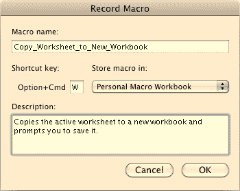
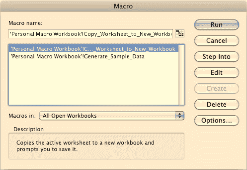
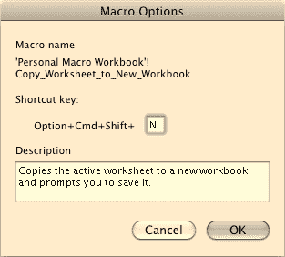
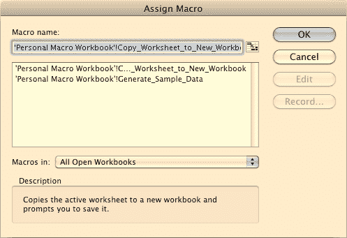
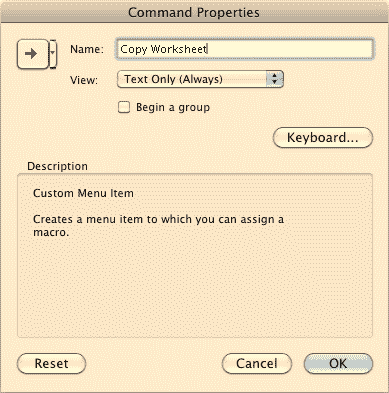
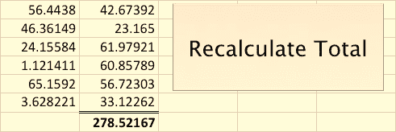
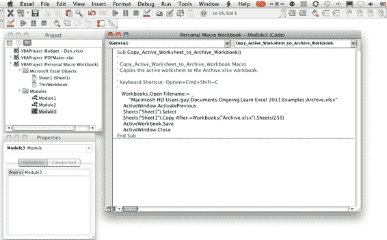

# 第 14 章：使用宏和 VBA 自动化任务

在本章中，我们将了解如何通过宏和 Visual Basic for Applications（`VBA`）来自动化任务，`VBA`是`Excel 2011`及其他`Office 2011`应用程序中包含的编程语言。我们将首先了解如何录制宏，然后通过一个录制宏的示例来讲解，你可以在`Visual Basic`编辑器中打开该宏并进行改进。我将向你展示如何运行你录制和创建的宏，以及如何在不再需要时删除它们。

宏和`VBA`是一个庞大的主题，本章我们只能浅尝辄止。如果你想尽可能节省时间和精力，可能会想找一本详细介绍宏和`VBA`的书。你会发现，宏和`VBA`让你能够自动化在`Excel`中以交互方式（即正常方式）工作时几乎可以执行的任何任务，甚至还能完成一些在交互模式下无法执行的任务。

在此过程中，我还会提及在`Excel`和`Mac OS X`中自动化任务的其他几种方法，并演示如何将“开发工具”选项卡添加到功能区，以便快速执行与`Visual Basic`相关的命令。

[www.it-ebooks.info](http://www.it-ebooks.info/)

## 了解自动化任务的选项

在`Mac OS X`上使用`Excel 2011`时，你可以通过多种方式自动化任务：

- **创建宏。** 宏是一系列可一次性运行的命令。创建宏的简单方法是打开宏录制器，执行你想要宏重复的操作，然后关闭宏录制器，你就拥有了一个可以再次运行的宏。你也可以在`Visual Basic`编辑器应用程序中从头编写宏。或者，你可以录制宏，然后使用`Visual Basic`编辑器编辑掉不需要的命令，或添加其他命令。本章将展示如何录制宏以及在`Visual Basic`编辑器中编辑它们。

- **使用自动操作。** 你可以在`应用程序`文件夹中找到自动操作应用程序，它能让你组装由操作组成的工作流程。如果你拥有`Office`家庭和企业版，则可以在工作流程中包含`Excel`操作。（如果你使用的是`Office 2011`家庭和学生版，则无法将`Excel`与自动操作结合使用。）本章不涉及自动操作。

- **使用`AppleScript`。** `AppleScript`是一种脚本语言，你可以使用`AppleScript`编辑器实用工具编写脚本，该工具位于`应用程序/实用工具`文件夹中。（脚本本质上是一个小型应用程序。）本章也不涉及`AppleScript`。

**提示：** 刚开始在`Excel`中自动化任务时，`VBA`通常是最好的起点。`VBA`在`Excel`内部运行，因此你可以从`Excel`中运行宏。相比之下，`AppleScript`在其所操作的应用程序外部运行。使用`AppleScript`的优势在于，你可以轻松地操作多个应用程序，而不仅仅是`Excel`。例如，你可以在同一个脚本中让访达执行一个操作，让`Excel`执行一个操作，然后让`iTunes`播放。你还可以与 Windows 用户共享宏，而`AppleScript`和自动操作仅在`Mac OS X`上运行。

[www.it-ebooks.info](http://www.it-ebooks.info/)

## 将“开发工具”选项卡添加到功能区

如果你需要大量使用宏，请将“开发工具”选项卡添加到功能区，以便轻松访问基本命令。

要将“开发工具”选项卡添加到功能区，请按照以下步骤操作：

1. 选择`Excel` → `偏好设置`，或按`Cmd+,`（`Cmd`键和逗号键）以显示`Excel`偏好设置对话框。

2. 在“共享和隐私”区域中，单击“功能区”图标以显示功能区偏好设置面板。

3. 向下滚动到“显示或隐藏选项卡，或将其拖至你偏好的顺序”列表底部，然后选中`开发工具`复选框。

4. 单击`确定`按钮关闭功能区偏好设置对话框。

此时将显示如下图 14-1 所示的“开发工具”选项卡，您可以使用“Visual Basic”组中的四个按钮：

- **编辑器。** 点击此按钮可启动或切换到“Visual Basic 编辑器”。

- **宏。** 点击此按钮可显示“宏”对话框。

- **录制。** 点击此按钮可显示“录制宏”对话框。

- **相对引用。** 点击此按钮可使“宏录制器”在宏中录制相对引用而非绝对引用。

**图 14-1.** 将“开发工具”选项卡添加到`Excel`的功能区，以便轻松访问处理宏和`VBA`所需的基本命令。

## 录制宏

当您需要快速自动化完成任务时，可以使用“宏录制器”录制宏。请遵循以下步骤：

1. **规划** 宏中将进行的操作。最好将它们写下来，以便在录制宏时能够按正确顺序执行。

2. **启动** `Excel`（如果尚未运行），或激活`Excel`（如果正在运行）。

[www.it-ebooks.info](http://www.it-ebooks.info/)



3. **设置** 一个工作簿，使其具备执行宏中操作所需的条件。例如，如果宏要将一些数据从一个工作表移动到另一个工作表，请输入一些要移动的示例数据，并确保工作簿中包含一个可作目标位置的工作表。

4. **选择** 功能区中的`开发工具` > `Visual Basic` > `录制`，或菜单栏中的`工具` > `宏` > `录制新宏`，以显示“录制宏”对话框（如下图 14-2 所示，其中已选择录制宏的设置）。

**图 14-2.** 在“录制宏”对话框中，为宏命名，选择存储位置，并添加有用的描述。您还可以创建用于运行宏的键盘快捷键。

5. **在“宏名”文本框中，键入宏的名称。** “宏录制器”会建议一个默认名称，如`Macro1`或`Macro2`，但最好给宏起一个描述性的名称，以帮助您识别它。请遵循以下命名规则：

    - 第一个字符必须是字母。

    - 其余字符可以是字母、数字或下划线的任意组合，以您觉得最方便为准。可以使用大写和小写字母。不能使用符号、空格或标点符号。

    - 名称最多可包含 80 个字符，但名称最好保持简短，以便它们在“宏”对话框中完整显示。否则，名称可能难以阅读。

**提示：** 为使宏名易于阅读，请将每个主要单词的首字母大写，并用下划线分隔单词。例如，`Format_Workbook`比`FormatWorkbook`更易读，而后者又比`formatworkbook`更清晰。

[www.it-ebooks.info](http://www.it-ebooks.info/)

**第 14 章：使用宏和 VBA 实现任务自动化**

**413**

6. **若要创建运行宏的键盘快捷键，请单击“快捷键”框，然后按下要使用的键。** `Excel`会使用`Cmd+Option`组合创建快捷键，因此如果您按下**w**，快捷键就是`Cmd+Option+W`。如果要在键盘快捷键中添加`Shift`，请在按键时按住`Shift`。您将在“快捷键”框中看到字符的 Shift 版本，`Excel`会使用`Cmd+Option+Shift`组合创建键盘快捷键——例如`Cmd+Option+Shift+W`。

**注意：** 如果您只打算创建少量宏，为每个需要频繁运行的宏创建键盘快捷键是很有用的。但如果您计划创建大量宏，则可能需要将它们从“宏录制器”放置的默认位置移出。移动宏会破坏其现有的键盘快捷键——因此在这种情况下，最好在录制宏时不创建键盘快捷键，而是在将宏放到打算保留的位置之后，再创建它们。

7. **在“宏保存在”弹出菜单中，选择宏的存储位置。** 您有三个选择：

    - **个人宏工作簿。** “个人宏工作簿”是一个

# 宏存储选项

`个人宏工作簿`是 Excel 用于存储宏的特殊工作簿。存储在`个人宏工作簿`中的任何宏在 Excel 运行期间始终可用，因此这是存储通用宏的最佳位置。如果你在其他计算机上打开工作簿，这些宏将不可用。

## 此工作簿

选择此项可将宏存储在活动工作簿中，使宏仅在此工作簿打开时可用。这适用于你在启用了宏的工作簿中创建的、将与同事共享的宏——即使你将工作簿转移到另一台计算机，该宏仍然可用。

## 新建工作簿

选择此项可创建一个新工作簿并将宏存储在其中。然后，你可以保存该工作簿，并根据需要使用它来分发宏。这种方法往往不如使用`个人宏工作簿`或活动工作簿实用。

**8.** 在`说明`文本框中，输入对宏功能的描述。该描述有助于你和其他人日后识别宏，因此花几秒钟编写清晰的说明是值得的。

[www.it-ebooks.info](http://www.it-ebooks.info/)


**414** **第 14 章：使用宏和 VBA 自动化任务**

**9.** 点击`确定`按钮。此时，你可能会看到如图 14-3 所示的对话框，提示你操作系统已保留了所选的键盘快捷键。如果出现这种情况，请点击`确定`按钮返回`录制宏`对话框，选择另一个键盘快捷键，然后再次点击`确定`按钮。

**图 14-3.** *如果出现此对话框，请点击“确定”按钮返回“录制宏”对话框，然后选择另一个用于运行宏的键盘快捷键。*

**10.** 关闭`录制宏`对话框后，Excel 会启动宏录制器，开始录制宏。Excel 会在状态栏显示`录制`字样，如果你已将`开发工具`选项卡添加到功能区，你会看到`录制`按钮显示为一个表示“停止”的黑色方块，而不是表示“录制”的红色圆圈。但除了这些视觉提示外，Excel 窗口看起来一切正常，很容易忘记你正在录制宏，尤其是当有人打扰你时。

**11.** 执行你想要录制到宏中的操作。我们稍后会看一个具体的例子，但以下是需要遵循的一般规则：

- 你可以像往常一样使用功能区、工具栏或菜单栏发出命令。
- 要选择单元格和区域，你可以使用鼠标或键盘。
- 要在录制绝对引用和录制相对引用之间切换，请选择`开发工具` > `Visual Basic` > `相对引用`。当`相对引用`按钮呈现按下状态时，宏录制器录制相对引用；当按钮呈现正常、无区别的外观时，宏录制器录制绝对引用。

**12.** 要停止录制宏，请从功能区中选择`开发工具` > `Visual Basic` > `录制`，或从菜单栏中选择`工具` > `宏` > `停止录制`。

[www.it-ebooks.info](http://www.it-ebooks.info/)

**第 14 章：使用宏和 VBA 自动化任务** **415**

## 录制示例宏

上一节描述了录制宏的一般步骤。本节将逐步演示如何录制一个简短的宏，我们将在本章后面的`Visual Basic 编辑器`中打开并编辑该宏。

这个宏只是将活动工作表复制到一个存档工作簿中，以便你有一份工作表的参考副本。要复制工作表，宏需要执行五个操作：

- 打开存档工作簿。
- 激活前一个工作簿。
- 将工作表复制到存档工作簿。
- 保存存档工作簿。
- 关闭存档工作簿。

要录制示例宏，请遵循以下步骤：

**1.** 创建一个名为`Archive.xlsx`的工作簿，然后将其关闭。例如：
    **a.** 按`Cmd+N`创建一个新的空白工作簿。
    **b.** 按`Cmd+S`显示`另存为`对话框。
    **c.** 选择要保存工作簿的文件夹。
    **d.** 输入名称`Archive`。
    **e.** 点击`保存`按钮。
    **f.** 按`Cmd+W`关闭工作簿。

**2.** 打开一个包含要复制到归档工作簿的工作表的工作簿，并使该工作表处于活动状态。

**3.** 从功能区中选择`开发工具` > `Visual Basic` > `录制`，或从菜单栏中选择`工具` > `宏` > `录制新宏`，以显示“录制宏”对话框。

**4.** 在“宏名称”文本框中，输入名称`Copy_Active_Worksheet_to_Archive_Workbook`。

**5.** 点击“快捷键”文本框，然后按`Shift+C`输入大写字母`C`，这将为宏创建键盘快捷键`Cmd+Option+Shift+C`。

**6.** 在“保存宏到”弹出菜单中，选择`个人宏工作簿`。

**7.** 在“说明”文本框中，为宏输入说明：**复制活动工作表到 Archive.xlsx 工作簿。**

[www.it-ebooks.info](http://www.it-ebooks.info/)

**416**

**第 14 章：使用宏和 VBA 自动化任务**

**8.** 点击“确定”按钮关闭“录制宏”对话框。宏录制器开始录制宏，状态栏中会显示“录制”状态。

**9.** 录制打开归档工作簿的操作：
    **a.** 按`Cmd+O`显示“打开：Microsoft Excel”对话框。
    **b.** 导航并选择`Archive.xlsx`工作簿。
    **c.** 点击“打开”按钮。工作簿正常打开，并成为活动工作簿。

**10.** 按键盘快捷键`Cmd+Shift+F6`切换到上一个工作簿——即包含要复制的工作表的工作簿。

**11.** 录制将工作表复制到归档工作簿的操作：
    **a.** 按住`Ctrl`键并单击或右键单击活动工作表的标签，然后在上下文菜单中点击“移动或复制”，以显示“移动或复制”对话框。
    **b.** 打开“工作簿”弹出菜单，然后点击`Archive.xlsx`。
    **c.** 在“工作簿选择”列表框中，点击“（移至最后）”项。
    **d.** 选中“建立副本”复选框。
    **e.** 点击“确定”按钮关闭“移动或复制”对话框。Excel 将工作表复制到归档工作簿，并使该工作簿成为活动工作簿。

**12.** 按`Cmd+S`保存归档工作簿。

**13.** 按`Cmd+W`关闭归档工作簿。

**14.** 从功能区中选择`开发工具` > `Visual Basic` > `录制`，或从菜单栏中选择`工具` > `宏` > `停止录制`，以停止宏录制器。

**注意：** 此时，宏录制器已忠实地记录了将您选择的特定工作表从您打开的特定工作簿中复制的命令。为了使宏适用于通用场景，您需要对其进行编辑。有关详细信息，请参阅本章末尾。

## 运行宏

录制宏（或如本章后面所述从头创建宏）后，您可以通过按键盘快捷键、将其添加到工具栏或菜单，或将其附加到工作表中的对象来按需运行它。

[www.it-ebooks.info](http://www.it-ebooks.info/)



**第 14 章：使用宏和 VBA 自动化任务**

**417**

要能够运行宏，包含宏的工作簿必须处于打开状态。如果将宏存储在`个人宏工作簿`中，您可以随时运行它，因为创建`个人宏工作簿`后，Excel 在您运行 Excel 时会始终在后台保持`个人宏工作簿`打开。如果将宏存储在工作簿中，则必须先打开该工作簿，然后才能运行宏。

### 从“宏”对话框运行宏

您可以从“宏”对话框中运行任何宏。这对于尚未指定运行方式的宏，以及忘记了键盘快捷键或菜单命令的宏非常有用。

要从“宏”对话框运行宏，请按照以下步骤操作：

**1.** 从功能区中选择`开发工具` > `Visual Basic` > `宏`，或从菜单栏中选择`工具` > `宏` > `宏`，以显示“宏”对话框（参见图 14-4）。

**图 14-4.** *从“宏”对话框中，您可以运行任何宏。您也可以打开宏进行编辑、删除它，或打开“选项”对话框。*

**2.** 打开`宏位置`弹出菜单，选择要查看哪些工作簿中的宏：

*所有打开的工作簿。* 选择此项可查看所有打开工作簿中的宏。个人宏工作簿以及您打开过的所有工作簿。当宏数量较少时，这是最佳选择。但当宏较多时，查看所有可用宏反而会让您难以找到所需宏。

`Personal Macro Workbook.` 选择此项仅可查看 `个人宏工作簿` 中的宏。

[www.it-ebooks.info](http://www.it-ebooks.info/)



**第 14 章：使用宏和 VBA 自动执行任务**

`一个打开的工作簿。` 单击您想要查看宏的已打开工作簿的名称。

**3.** 在 `宏名` 列表框中，单击您想要运行的宏。

**4.** 单击 `运行` 按钮。`Excel` 将关闭 `宏` 对话框并运行该宏。

### 使用键盘快捷键运行宏

如果您为录制的宏指定了键盘快捷键，可以通过按下该快捷键来运行宏。

如果您尚未指定快捷键，可以创建一个。请遵循以下步骤：

**1.** 如上一节所述，打开 `宏` 对话框。

**2.** 在 `宏位置` 弹出菜单中选择工作簿。

**3.** 在 `宏名` 列表框中单击该宏。

**4.** 单击 `选项` 按钮以显示 `宏选项` 对话框（见图 14-5）。

**图 14-5.** *使用 `宏选项` 对话框为宏指定键盘快捷键或编辑其说明。*

### 5. 单击`快捷键`框，然后按下您想要的字母键。

`Excel` 会使用 `Cmd+Option` 来创建快捷键，因此如果您按下 `n`，快捷键即为 `Cmd+Option+N`。

如果您想为快捷键添加 `Shift` 键，请在按键时按住 `Shift` 键。您将在 `快捷键` 框中看到字符的大写版本，而 `Excel` 会使用 `Cmd+Option+Shift` 来创建快捷键——例如 `Cmd+Option+Shift+N`。

[www.it-ebooks.info](http://www.it-ebooks.info/)

### 第 14 章：使用宏和 VBA 自动执行任务

#### 6. 如果您想编辑宏的说明，请在`说明`框中进行编辑。

#### 7. 单击`确定`按钮关闭`宏选项`对话框。

#### 8. 单击`取消`按钮关闭`宏`对话框。

## 通过工具栏按钮或菜单项运行宏

为使宏易于运行，您可以为其创建工具栏按钮或菜单项。请遵循以下步骤：

#### 1. 按住 Ctrl 键并单击或右键单击工具栏，然后在上下文菜单中单击`自定义工具栏和菜单`以显示`自定义工具栏和菜单`对话框。或者，从菜单栏中选择`视图` > `工具栏` > `自定义工具栏和菜单`。

#### 2. 如果您要创建工具栏按钮，但目标工具栏未显示，请单击`工具栏和菜单`选项卡以显示其内容。在`显示`列中选中该工具栏的复选框，使其显示出来。

**提示：** 如果您想创建一个新的工具栏来放置宏按钮，请单击`新建`按钮，在`添加工具栏`对话框中输入工具栏名称，然后单击`确定`按钮。

#### 3. 单击`命令`选项卡以显示其内容。

#### 4. 在左侧的`类别`列表框中向下滚动，然后单击`宏`项。`Excel` 不会在右侧的`命令`列表框中显示宏列表，而是显示两个项目——一个名为`自定义菜单项`，另一个名为`自定义按钮`。

#### 5. 将`自定义菜单项`对象拖至菜单，或将`自定义按钮`对象拖至工具栏。

#### 6. 如果您创建的是工具栏按钮，请单击`确定`按钮关闭`自定义工具栏和菜单`对话框。如果您创建的是菜单项，请保持对话框打开。

#### 7. 按住 Ctrl 键并单击或右键单击工具栏按钮或菜单项，然后在上下文菜单中单击`指定宏`。`Excel` 将显示`指定宏`对话框（见图 14-6）。

[www.it-ebooks.info](http://www.it-ebooks.info/)



**图 14-6.** 在`指定宏`对话框中，选择要指定给您创建的工具栏按钮或菜单项的宏。

#### 8. 在`宏名`列表框中，单击您要指定的宏。

工具栏按钮或菜单项。如有必要，请打开`Macros in`弹出菜单，并选择要查看宏的工作簿——所有打开的工作簿、个人宏工作簿或某个特定打开的工作簿。

#### 9. 点击`OK`按钮关闭`Assign Macro`对话框。

#### 10. 再次按住`Ctrl`键并点击或右键点击工具栏按钮或菜单项，然后在上下文菜单中点击`Properties`以显示`Command Properties`对话框（参见图 14-7）。

[www.it-ebooks.info](http://www.it-ebooks.info/)



**图 14-7.** 在`Command Properties`对话框中，为命令键入名称，然后选择一个图标以图形方式表示它。

#### 11. 在`Name`文本框中，键入要为菜单项或工具栏按钮显示的名称。

#### 12. 在`View`弹出菜单中，选择工具栏按钮或菜单项的显示方式：

* `Default Style`：选择此项可使工具栏按钮使用您为工具栏设置的默认样式显示。（如果您选择显示图标和文本，则按钮显示为带文本的图标；如果您选择只显示图标，则只显示图标。）如果命令有关联的图标，则菜单项显示为带图标的文本。

* `Text Only (Always)`：选择此项可使工具栏按钮或菜单项显示为不带图标的纯文本。

* `Text Only (in Menus)`：选择此项可使菜单项仅显示为文本。

* `Image and Text`：选择此项可使工具栏按钮或菜单项显示为带文本的图标。

#### 13. 如果要更改图标，请点击`Name`框左侧的箭头按钮，然后在弹出菜单中点击所需的图标。

#### 14. 如果要在项目前放置分隔线，请选中`Begin a group`复选框。当您希望将不同的项目组放在菜单或工具栏的不同部分时，这很有用。

#### 15. 点击`OK`按钮关闭`Command Properties`对话框。

[www.it-ebooks.info](http://www.it-ebooks.info/)



#### 16. 如果您刚刚创建了一个菜单项，请点击`OK`按钮关闭`Customize Toolbars and Menus`对话框，除非您还想自定义其他项目。

## 从工作表中的对象运行宏

工具栏按钮、菜单项和键盘快捷键都是运行宏的简便方法，但 Excel 还为您提供了另一种方式：您可以将宏分配给工作表对象，例如按钮或形状。当用户点击该对象时，宏就会运行。

将宏分配给对象是使宏易于被可能找不到它们的用户使用的一种极好方法。例如，如果您创建一个名为`Recalculate Total`（如图 14-8 所示）的大型友好按钮，并将其放在用户正在查看的单元格旁边，他们将很难错过它，而在工具栏或菜单上错过它则易如反掌。

**图 14-8.** 您可以将宏分配给工作表对象，例如此处显示的按钮，为用户提供一种运行宏的简便方法。

要将宏分配给工作表中的对象，请按照以下步骤操作：

#### 1. 将对象放置在工作表中。例如，选择`Developer` -> `Form Controls` -> `Button`，然后在工作表中点击并拖动以创建按钮。选择按钮的默认名称，然后键入您想要的名称（例如，`Recalculate Total`）。

#### 2. 按住`Ctrl`键并点击或右键点击该对象，然后在上下文菜单中点击`Assign Macro`以显示`Assign Macro`对话框（本章前面图 14-6 中显示）。

#### 3. 如有必要，请打开`Macros in`弹出菜单，并选择要查看宏的工作簿——所有打开的工作簿、个人宏工作簿或某个特定打开的工作簿。

#### 4. 点击您要分配的宏。

#### 5. 点击`OK`按钮。

现在，您可以点击工作表中的按钮来运行宏。

[www.it-ebooks.info](http://www.it-ebooks.info/)


# 第 14 章：使用宏和 VBA 自动执行任务

**424**

#### 删除宏

当不再需要某个宏时，请将其删除。请按以下步骤操作：

1. 从功能区选择“开发者”→“Visual Basic”→“宏”，或从菜单栏选择“工具”→“宏”→“宏”，以显示“宏”对话框。
2. 如有必要，在`宏在`弹出菜单中选择相应的工作簿或多个工作簿。
3. 在`宏名称`列表框中点击要删除的宏。
4. 点击`删除`按钮。Excel 会显示一个确认对话框（见图 14-9）。
5. 点击`是`按钮。

**图 14-9.** Excel 提示您确认是否要删除宏。

#### 在 Visual Basic 编辑器中编辑宏

按照本章前文所述录制宏后，您可以随时按需运行它。但如果需要修改宏，则可在 Visual Basic 编辑器中打开并编辑，删除或更改已录制的操作，或编写 VBA 代码来执行其他操作。在本节中，我们将简要介绍 Visual Basic 编辑器，并对录制的宏进行一处小改进。

##### 在 Visual Basic 编辑器中打开示例宏

打开宏有多种方法，但最简单的是通过“宏”对话框。但如果宏存储在个人宏工作簿中，则必须先取消隐藏个人宏工作簿，才能打开宏进行编辑。

要取消隐藏个人宏工作簿，请按以下步骤操作：

1. 从菜单栏选择“窗口”→“取消隐藏”，显示“取消隐藏”对话框。
2. 在`取消隐藏工作簿`列表框中，点击“个人宏工作簿”项。
3. 点击`确定`按钮。

[www.it-ebooks.info](http://www.it-ebooks.info/)



**425**

**第 14 章：使用宏和 VBA 自动执行任务**

现在打开“宏”对话框，点击宏，然后点击`编辑`按钮。Excel 将在 Visual Basic 编辑器中打开宏进行编辑。

##### 认识 Visual Basic 编辑器的界面

图 14-10 展示了 Visual Basic 编辑器窗口，并标注了其主要组件。

**图 14-10.** Visual Basic 编辑器由三个主要窗口组成——`工程资源管理器`、`属性窗口`和`代码窗口`（用于创建和编辑 VBA 代码）。

以下是您在图 14-10 中看到的 Visual Basic 编辑器的六个主要组件：

- `工程资源管理器`。此窗口显示每个打开项目的可折叠树——每个常规工作簿、每个加载项（例如图 14-10 中可见的`PDFMaker.xla`加载项）以及个人宏工作簿（如果已取消隐藏）。在图 14-10 中，个人宏工作簿的树已展开，并选中了名为`Module3`的代码模块。该模块的代码显示在代码窗口中。

[www.it-ebooks.info](http://www.it-ebooks.info/)

**第 14 章：使用宏和 VBA 自动执行任务**

**426**

- `属性窗口`。此窗口显示当前所选对象的属性。在图 14-10 中，该对象是名为`Module3`的代码模块，它只有一个属性——`Name`属性。您可以通过选中`(名称)`框右侧的内容并输入新名称来更改代码模块的名称。
- `代码窗口`。此窗口显示所选代码模块或附加到用户窗体（您创建的自定义对话框）的代码表的代码。必要时，您可以同时打开多个代码窗口。
- `标准工具栏`。此工具栏包含用于标准操作的命令，例如切换到 Excel、保存工作以及剪切、复制和粘贴。

**注意：** 如果 Visual Basic 编辑器的任何工具栏不可见，请从菜单栏选择“视图”→“工具栏”，然后在“工具栏”子菜单中点击该工具栏的名称。

- `编辑工具栏`。此工具栏包含用于编辑代码的命令——例如，设置断点（代码自动停止运行的点，以便您可以一次执行一个命令并观察效果）。
- `调试工具栏`。此工具栏包含用于调试代码的命令——逐步执行代码、消除错误或以其他方式改进代码。

##### 检查示例宏

现在来看示例宏的代码。它看起来应该与以下代码类似，其中的文件路径和工作表名称可能略有不同：

```
Sub Copy_Active_Worksheet_to_Archive_Workbook()
'
' Copy_Active_Worksheet_to_Archive_Workbook Macro
' 将活动工作表复制到 Archive.xlsx 工作簿。
'
' 快捷键：Option+Cmd+Shift+C
'
Workbooks.Open Filename:= _
"Macintosh HD:Users:guy:Documents:Ongoing:Learn Excel 2011:Examples:Archive.xlsx"
ActiveWindow.ActivatePrevious
Sheets("Sheet1").Select
Sheets("Sheet1").Copy After:=Workbooks("Archive.xlsx").Sheets(255)
ActiveWorkbook.Save
ActiveWindow.Close
End Sub
```

以下是快速解析：

宏以`Sub`关键字开头，表示它是一个子程序或子过程（即宏），后面跟着宏的名称和一对空括号。

接下来的六行是注释行。注释以直单引号（`'`）开头，是为人类阅读者而非计算机提供的文本。第一、第四和第六行注释是空行，作为分隔符，使代码更易于阅读。第二行给出了宏的名称；第三行给出了描述；第五行给出了快捷键。这些信息有助于你识别宏及其功能。

语句`Workbooks.Open Filename:=`打开工作簿，其路径和文件名包含在双引号内的字符串中。从技术上讲，该语句使用`Open`方法（一种命令）将工作簿添加到`Workbooks`集合中的`Workbook`对象中。

**注意：** 你可以通过在断行末尾添加一个空格后跟下划线的方式，将单条代码语句拆分为多行。你可以在`Workbooks.Open`语句中看到这样的示例。

`ActiveWindow.ActivatePrevious`语句告诉 VBA 从当前活动窗口中激活上一个窗口。

`Sheets("Sheet1").Select`语句使用`Sheets`集合的`Select`命令来选择你指定的工作表。`Sheets`集合包含代表工作表的`Sheet`对象。

`Sheets("Sheet1").Copy`语句使用`Sheets`集合的`Copy`命令来复制按名称指定的工作表。`After:=`参数告诉 VBA 将复制的工作表放置在何处——在本例中，是放置在存档工作簿的 Sheet 255 之后。

`ActiveWorkbook.Save`语句使用`ActiveWorkbook`对象的`Save`方法来保存活动工作簿。

同样，`ActiveWorkbook.Close`语句使用`ActiveWorkbook`对象的`Close`方法来关闭活动工作簿。

宏以`End Sub`行结束。

##### 编辑示例宏

查看代码及其解释后，你可能会发现我们需要解决两个问题：

- 宏通过名称指定要复制的工作表——`Sheet1`。我们需要复制的是活动工作表。
- 宏通过编号指定复制后放置的位置——`255`。我们需要将其放置在最后一个工作表之后，无论其编号是多少。

要解决第一个问题，请选中`Sheets("Sheet1")`，然后键入`activesheet`进行覆盖。按上箭头键移动到上一条语句，你会看到 Visual Basic 编辑器将大小写自动更正为`ActiveSheet`。在你输入代码时，Visual Basic 编辑器会进行检查，从而帮助你在创建代码时捕获错误，而不是等到运行代码时才发现问题。

要解决第二个问题，请选中`Sheets(255)`中的`255`，然后键入以下内容：

```
Workbooks("Archive.xlsx").Sheets.Count
```

你修改后的语句应如下所示：

```
ActiveSheet.Copy After:=Workbooks("Archive.xlsx").Sheets(Workbooks("Archive.xlsx").Sheets.Count)
```

现在这段代码的含义是“将活动工作表复制到工作簿`Archive.xlsx`中，并将其放置在现有工作表的最后一张之后。”

##### 测试宏

现在通过单步执行宏来测试它——一次执行一条语句。

点击包含要复制的工作表的工作簿，然后反复按 `Cmd+Shift+I` 单步执行宏。您将看到 Visual Basic 编辑器在执行代码时依次高亮每一行，并看到 Excel 窗口打开、切换和关闭。

##### 保存更改

保存您对宏所做的更改。您可以在 Visual Basic 编辑器中按 `Cmd+S`（与大多数 Mac 应用程序一样），或单击标准工具栏上的“保存”按钮。

##### 从 Visual Basic 编辑器返回 Excel

要从 Visual Basic 编辑器返回 Excel，请在活动 Visual Basic 编辑器的情况下，从菜单栏中选择“Excel 关闭并返回 Microsoft Excel”。或者按 `Cmd+Q`。

[www.it-ebooks.info](http://www.it-ebooks.info/)

## 第 14 章：使用宏和 VBA 自动化任务

#### 隐藏个人宏工作簿

完成宏的编辑后，再次将个人宏工作簿从视图中隐藏。在个人宏工作簿处于活动状态时，从菜单栏中选择“窗口”>“隐藏”。

## 总结

在本章中，您学习了如何使用宏录制器录制宏来自动执行重复性任务。您现在知道如何通过几种便捷的方式运行宏，以及如何在 Visual Basic 编辑器中打开宏以进行编辑。您还了解了在 Excel 中自动化任务时除 VBA 之外的其他方法。

这本书到此结束——除了索引部分，您可能已经看过了。希望您觉得本书有用，并且现在能够自信且高效地处理 Excel 中的日常工作。

[www.it-ebooks.info](http://www.it-ebooks.info/)


## 索引

### 特殊字符 &

- 全部接受我的按钮，“解决冲突”对话框，401
- 全部接受其他按钮，“解决冲突”对话框，401
- `%` 计算运算符，168, 173
- `*` 计算运算符，167, 173
- `/` 计算运算符，168, 173
- `^` 计算运算符，173
- `+` 按钮，93, 112
- `+` 计算运算符，167, 173
- `<>` 计算运算符，168, 173
- `<`（上一个）按钮，85
- `=` 计算运算符，168, 173
- `=SUM( )` 函数，179
- `>` 计算运算符，168, 173
- `>`（下一个）按钮，85
- `<` 计算运算符，168, 173
- `>=` 计算运算符，168, 173
- `<=` 计算运算符，168, 173
- 三维簇状柱形图类型，232

### 数字

- `&` 计算运算符，169, 173
- 接受按钮，“接受或拒绝更改”对话框，402
- “接受或拒绝更改”对话框，402
- 接受其他按钮，“解决冲突”对话框，400
- 会计专用数字格式，127
- `ACCRINT` 财务函数，202
- `ACCRINTM` 财务函数，202
- `ACOS` 数学与三角函数，213
- `ACOSH` 数学与三角函数，213
- 操作弹出按钮，功能区，118
- 活动单元格，更改，18–19
- 活动工作表选项按钮，“打印”对话框，385
- `ActiveWindow.ActivatePrevious` 语句，426
- `ActiveWorkbook.Close` 语句，426
- 3-D 格式类别，格式对话框
- `ActiveWorkbook.Save` 语句，426
- `box`，250
- 添加工具栏对话框，70, 419
- 3-D 旋转类别，格式对话框
- 添加别名到剪贴画库选项按钮，
- `box`，250
- 导入对话框，280
- 全部添加按钮，27
- 添加按钮，27, 41–42
- 添加约束对话框，346–347
- `ABS` 数学和三角函数
- 从剪贴板添加选项，41
- 函数，213
- 加载项可用列表，加载项
- 绝对引用，166
- 对话框，345
- 全部接受按钮，接受或拒绝
- 加载项对话框，344–345
- 更改对话框，402
- 添加选项按钮，139
- **429**
- [www.it-ebooks.info](http://www.it-ebooks.info/)
- 
- **430**
- **索引**
- 添加方案对话框，335–336, 338
- 始终添加所选剪贴内容对话框
- 添加到购物篮链接，282
- 框，42
- 添加到侧边栏复选框，95
- 始终添加副本选项，42
- 添加视图对话框，52
- 保存前始终计算
- `ADDRESS` 查找与引用
- 工作簿复选框，222
- 函数，212
- 始终创建备份复选框，88
- `AMORDEGRC` 财务函数，202
- 调整列宽复选框，315
- `AMORLINC` 财务函数，202
- 高级按钮，26
- 共享工作簿对话框的“高级”选项卡
- 打开的工作簿项，宏对话框
- 框，398
- 框，418
- 高级文本导入设置对话框
- `AND` 逻辑函数，209
- 框，26
- 并且选项按钮，28
- 按回车后移动所选内容
- 角度旋钮，格式对话框，248
- 复选框，60
- 任意弹出菜单，94
- `AGGREGATE` 数学和
- 任意值项，147
- 三角函数，213
- 外观弹出菜单，80
- 对齐组，功能区，124,
- Apple iPhoto，从
- 133–134, 150
- 工作簿中插入图片，284–285
- 对齐，单元格内容，133–134
- Apple Mac 文件系统，从
- 对齐标签，单元格格式对话框，
- 工作簿中插入图片，
- 133–134
- 285–286
- 所有类别，3, 85
- `AppleScript Editor` 实用工具，410
- 所有复选框，272
- 应用程序文件夹，410
- 所有剪辑项，导入对话框，279
- 应用程序/实用工具文件夹，410
- 所有命令项，67
- 应用于列，145
- 除边框外的所有选项按钮，139
- 应用样式按钮，110
- 所有项，突出显示更改对话框，
- 应用于区域，减小文件大小对话框，
- 396
- 框，295
- 所有打开的工作簿项，宏对话框
- `Archive.xlsx` 工作簿，415–416
- 框，417
- 面积图类别，231
- 所有选项按钮，57，139
- `AREAS` 查找与引用函数，
- 本文件中的所有图片选项按钮，
- 212
- “减小文件大小”对话框，
- 参数窗格，190
- 295
- “排列”弹出菜单，49
- “排列”子菜单，上下文菜单，301
- 所有引用列表框，“合并”
- “排列窗口”对话框，48–49
- 对话框，405
- 弹出菜单中的所有符号，45
- 排列工作簿窗口，48–49
- 所有使用来源主题选项按钮，
- “作为”框，38
- 139
- “升序”按钮，323，377
- 允许每个字段使用多个筛选复选框
- `ASIN` 数学与三角函数，
- 框，“数据透视表选项”对话框
- 函数，213
- 框，372
- `ASINH` 数学与三角函数，
- 允许在线访问复选框，15
- 函数，213
- “允许”弹出菜单，146
- 询问是否更新自动链接复选框
- 框中允许此工作表的用户，395
- 框，61
- “指定”按钮，68
- [www.it-ebooks.info](http://www.it-ebooks.info/)
- 
- **索引**
- **431**
- “指定宏”上下文菜单项，419，
- “自动操作”应用程序，410
- 422
- “指定宏”对话框，框，419–420，422
- 自动恢复，64–65
- “自动求和”按钮，187，189
- `ATAN` 数学与三角函数，
- “自动求和”弹出菜单，插入
- 函数，213
- 函数，187–188
- `ATAN2` 数学与三角函数，
- “平均值”函数，366，404
- 函数，213
- `AVERAGE` 统计函数，217
- “作者”框，91
- 坐标轴
- 从单独区域添加标签，
- 244
- 更改比例或编号，
- 240–243
- “作者”字段，91
- “编写区域”，“Excel 偏好设置”
- 对话框，84，123，252
- 对于图表，229
- “作者”属性，95
- 自动更正，29–33
- 为其创建条目，32–33
- 例外项，31–32
- 选项，29–33
- “自动更正操作”按钮，317
- “自动更正例外项”对话框，
- 31–32
- “自动更正”窗格，33
- 自动填充，33–37
- 内置功能，33–35
- 自定义列表，36–37
- 与公式一起使用，174–175
- “自动”项目，“格式”对话框，248
- “自动”选项按钮，“数据透视表选项”对话框，375
- “自动样式”复选框，110
- 自动转换日期系统
- **B**
- “背景色”弹出菜单，
- “格式”对话框，249
- `BAHTTEXT` 文本函数，218
- “镶边列”复选框，310
- “镶边列”项目，“行与列”
- 弹出菜单，370
- “镶边行”复选框，309
- “镶边行”项目，“行与列”
- 弹出菜单，370
- 复选框, 61
- 条形图类别, 230
- `自动`选项按钮,

基础框, 设置坐标轴格式对话框, 242
`共享工作簿`对话框,
前工作表列表, 100, 416
399
开始一个组复选框, 73, 76, 421
`除数据表外自动`
`BESSELI` 工程函数, 199
选项按钮, 221
`BESSELJ` 工程函数, 199
`输入时自动扩展表格`
`BESSELK` 工程函数, 199
复选框, `表格`偏好设置
`BESSELY` 工程函数, 199
窗格, 317
最适合打印 (220 ppi) 项目, 缩小
`自动`选项按钮, 221
文件大小对话框, 296
自动化任务, 409–428
`最适合通过电子邮件发送`-邮件 (96 p`pi)`项目,
宏
`缩小文件大小`对话框,
在 `Visual Basic 编辑器`工具中编辑,
295
423–428
最适合在屏幕上查看 (150 ppi)
录制, 411–414
项目, `缩小文件大小`对话框
运行, 416–422
框, 295
选项, 410–411
`BIN2DEC` 工程函数, 199
[www.it-ebooks.info](http://www.it-ebooks.info/)

**432**
**索引**
`BIN2HEX` 工程函数, 199
`计算偏好`设置窗格, 220,
`BIN2OCT` 工程函数, 199
222–223
空白弹出菜单, 功能区, 369
`取消` 按钮, 149
`书籍`弹出菜单, `合并方案`
`将每个句子的首字母大写`复选
对话框, 340
框, 31
`边框选项`项目, `边框`弹出
`将星期名称的首字母大写`复选框, 31
菜单, 137
`层叠`选项按钮, 49
边框选项卡, 137, 142
`区分大小写`复选框, 320
边框按钮, 136
`类别`按钮, `剪贴画库`
边框, 格式化, 136–137
应用程序, 283
`边框`弹出菜单, `功能区`, 124,
`类别`对话框, 283
136–137
图表中的类别, 229
底端行复选框, 105
`类别`列表框, 67, 70–71, 73, 75,
分隔符弹出菜单, 383
419
亮度, 调整, 291–292
`类别`列表, `自定义工具栏和`
`上移一层`命令, `排列`
菜单对话框, 339
子菜单, 301
`类别`选项卡, `属性`对话框,
`置于顶层`命令, `排列`
280
子菜单, 301
`类别`列表框
`气泡图`类别, 231
`剪贴画库应`用程序, 277
内置菜单项, 73
`设置单元格格式`对话框, 128
按钮, 更改外观, 71
`分类 (X) 轴标签`文本框, 244
`通过更改单元格`文本框, `单变量求解`
`CEILING` 数学和
对话框, 343
三角函数, 213
`By Changing Cells` 框，规划求解
`CEILINGPRECISE` 数学与
参数对话框, 346
三角函数, 213
`By color` 弹出菜单，自动筛选
`CELL` 信息函数, 210
窗口, 323
[单元格或区域引用] [空格][单元格或
`By label` 弹出菜单，排序与
区域引用] 计算
筛选窗口, 378
运算符, 169
`by N page(s) tall` 框，打印对话框，
`Cell Reference` 框，添加约束
385
对话框, 347
`By value` 弹出菜单，排序与
[单元格引用] [单元格引用]
筛选窗口, 378
计算运算符, 168
单元格样式面板, 151, 155
■
单元格
**C**
活动单元格，改变, 18–19
`Calc Now` 按钮, 222
删除, 119–120
`Calc Sheet` 按钮, 222
格式化, 122–138
计算工作表框, 221–222
单元格内容的对齐方式,
计算工作表选项, 220
133–134
控制工作表的计算
边框和填充, 136–137
计算时机, 221–222
`Calculation` 图标，Excel 偏好设置
字体, 135
对话框, 128, 220
数字格式, 125–132
计算运算符, 167–168, 173
保护单元格, 137–138
[单元格或区域引用] [空格][单元格或
与主题, 133
区域引用] 计算
运算符, 169
[www.it-ebooks.info](http://www.it-ebooks.info/)

**索引**
**433**
三种工具, 123–125
图表坐标轴, 229
插入, 119
图表标题和坐标轴标题, 229–230
图形对象相对于单元格的定位
数据标记、网格线和数据标签,
299–301
标签, 230
保护, 137–138
在公式中引用, 164–165
创建
选择, 19–21
更改图表类型, 234
`Cells` 组，功能区, 118](#index_split_001.html#p122)
将嵌入式图表更改为图表工作表,
Center section 框, 157
233–234
`Change Chart Type` 组，功能区, 234
更改源数据, 235–236
`Change PivotTable Data Source` 对话框
概述, 231–232
框, 376
切换行和列, 235
自定义类型, 251
`Change SmartArt Graphic` 组，
嵌入式图表, 225–227
功能区, 298
设置格式
`Change Type` 组，功能区, 272
复制到另一张图表,
`Changing Cells` 文本框，添加方案
250–251
对话框, 335–336
单个图表元素,
`CHAR` 文本函数, 218
249–250
图表区, 229
背景墙和基底, 246–249
图表坐标轴, 229
布局
`Chart data range` 框，选择数据源
从单独区域添加坐标轴标签,
对话框, 236
244
图表元素弹出菜单, 249
添加单独的数据系列,
`Chart` 图标，Excel 偏好设置对话框
237–238
方框, 252
应用样式, 238
图表布局选项卡, 6, 256, 259
轴标题, 239–240
图表（链接到 Excel 数据）选项
更改的刻度或编号
按钮, 258
坐标轴, 240–243
图表菜单栏复选框, 76
选择要显示的网格线，
图表窗格，Excel 偏好设置对话框
245–246
方框, 252
数据标签, 244–245](#index_split_003.html#p246)
图表偏好设置窗格，Excel
图例, 243–244
偏好设置对话框, 252
标题, 239
图表快速布局组，功能区，
偏好设置对话框 方框, 252–253
236
工作表, 225–227
图表屏幕提示区域，Excel
在 Word 文档和
偏好设置对话框, 253
PowerPoint 演示文稿中使用，
图表样式组，功能区, 238
254–259
图表标题占位符, 239
在内嵌工作簿中创建图表
图表标题, 229–230
255–257
图表类别, 67
从 Microsoft Excel 粘贴图表
图表, 225–259
257–259
选择类型, 230–231
图表选项卡，功能区, 231–232, 234, 236,
组件, 227–230
238, 254–256, 259, 271
类别与数据系列, 229
检查兼容性弹出菜单，
图表区域和绘图区, 229
96
[www.it-ebooks.info](http://www.it-ebooks.info/)

**434** **索引**
检查文档的兼容性
关闭按钮, 13, 44–45
复选框, 64
关闭命令, 11
检查错误按钮, 176, 180
关闭效果弹出菜单, 14
选择数据库对话框, 22
关闭全屏工具栏, 46
选择文件对话框, 22, 41
关闭方法, 426
选择文件夹，Microsoft Excel 对话框
关闭选项按钮, 14
方框, 62, 80
`CODE` 文本函数, 218
选择图片对话框, 249,](#index_split_003.html#p251)
代码窗口，Visual Basic 编辑器
285–286
应用程序, 424–425
选择工作簿对话框, 405](#index_split_005.html#p403)
齿轮按钮, 77, 79
选择加载项对话框, 345
与其他 PC 协作, 381–407
选择按钮, 3, 23, 41, 62, 80, 84–85
将数据导出到 CSV 文件, 388–389
`CHOOSE` 查找和引用工作簿
函数, 212
编写文档, 389–392

选择一个弹出菜单, 323

合并, 402

选择图片按钮，格式对话框

共享, 393–402

方框, 249

工作表

选择放置数据透视表的位置

合并计算, 403–407

区域，创建数据透视表对话框

打印, 381–385

方框, 356

折叠对话框按钮

圆形读数，状态栏, 183

“添加方案”对话框，336

`circular references`（循环引用），故障排除

更改数据透视表数据源

公式，182–183

对话框，376

`CLEAN` 文本函数，218

“合并”对话框，405

“清除”按钮，274

创建数据透视表对话框，356

`Clear Filter`（清除筛选）按钮

“单变量求解”对话框，343

“自动筛选”窗口，324

“突出显示修订”对话框，396

排序和筛选窗口，379

“选择数据源”对话框，236，

清除条件格式，145

244

剪贴画，276–283

“规划求解参数”对话框，346

“剪贴画浏览”窗格，276–277

“折叠”选项按钮，14

“剪辑库”应用程序，277–283

“折叠功能区”按钮，8

向其中添加图片，278–282

可折叠工作表，107–113

从以下位置下载剪贴画项目

更改分级显示设置，110

Microsoft Office 网站，

自动创建分级显示，

282–283

108–109

按类别，283 进行组织

手动创建分级显示

“剪辑库图像”项目，“导入”对话框

对行或列进行分组，111

框，279

取消行或列的分组，112

“剪辑库影片”项目，“导入”对话框

展开和折叠分级显示，

框，279

112

“剪辑库包”项目，“导入”

删除分级显示，113

对话框，279

在添加或删除行或列后更新分级显示，

“剪辑库声音”项目，“导入”对话框

112–113

框，279

“全部关闭”命令，11

折叠功能区，8–9

[www.it-ebooks.info](http://www.it-ebooks.info/)


`索引`

`435`

“颜色和透明度”区域，“格式”

`COLUMNS` 查找与引用

对话框，248

函数，212

“颜色”下拉面板，293

“列”选项按钮，111–112

“颜色”弹出菜单，“格式”对话框，

`COMBIN` 数学与

248

三角函数，213

“颜色”弹出调色板，58

`逗号分隔值文件`。请参阅 CSV

“色阶”面板，266

文件

色阶，261–274

“命令属性”对话框，71，

“色阶”面板，“条件”

73, 75–76, 420–421

格式”面板，141

“命令属性”项目，上下文

颜色，调整，291–292

菜单，76

“颜色”弹出菜单，133

“命令”框，71, 73

“列区域”，“数据透视表生成器”窗口，

向 Excel 下达命令的四种方式，

358

4

“列”按钮，“功能区”，232，271–272

“命令”列表框，67, 71, 75, 339,

“柱形图”类别，230

419

“列数据格式框”，25

“命令”选项卡，“自定义工具栏”

“列标题”项目，“行与列”

## 索引

和菜单对话框，第 70–71 页

弹出菜单，第 370 页

第 73、339、419 页

列标题，第 16 页

逗号选项按钮，第 40 页

`列输入单元格框`，模拟运算表

`注释文本框`，添加方案对话框

对话框，第 330 页

框，第 336 页

`列标签框`，数据透视表生成器

注释，第 390–392 页

窗口，第 358、360、364–365 页

删除，第 392 页

`列级别按钮`，第 112 页

显示，第 57 页

`COLUMN` 查找与引用

查看，第 391–392 页

函数，第 212 页

`注释和指示器`选项

`面向列的数据表`，第 329 页

按钮，第 57 页

`列弹出菜单`，第 319 页

`注释选项按钮`，第 139、391 页

列迷你图，第 270 页

`比较弹出菜单`，第 142 页

列宽度对话框，第 121–122 页

`比较类别`，第 152 页

`列宽`项，上下文菜单，兼容性首选项窗格，第 63–64 页

第 121–122 页

第 86 页

`列宽选项按钮`，第 139 页

`兼容性报告`面板，第 13、96 页

列

`COMPLEX` 工程函数，第 199 页

删除，第 119 页

压缩图片，第 295–296 页

在公式中，使某一列

`CONCATENATE` 文本函数，第 218 页

引用另一列，第 166–167 页

条件格式，第 140–145 页

应用

更改顺序，第 144–145 页

概述，第 142–143 页

清除，第 145 页

创建自定义，第 143–144 页

预设类型，第 140–141 页

`[条件格式面板，第 140、142 页]`(#index_split_001.html#p144)

冻结，第 50–51 页

隐藏，第 122 页

插入，第 118 页

设置宽度，第 121–122 页

通过粘贴将数据切换为行命令，第 38–39 页

与行切换，第 235 页

列[框，第 321 页

`确认密码`对话框，第 88 页

[www.it-ebooks.info](http://www.it-ebooks.info/)


`436`

`索引`

`用户间的冲突更改`区域，共享工作簿对话框，第 399 页

`创建按钮`，第 110 页

`创建指向源数据的链接`复选框，合并计算对话框，第 405–406 页

冲突，解决共享中的

工作表，第 400–401 页

`创建名称对话框`，第 105 页

`连接区域`，数据透视表选项对话框，第 375 页

`创建名称于框`，第 105 页

`创建数据透视表对话框`，第 355–356 页

合并计算对话框，第 404–407 页

`条件按钮`，第 312 页

`约束框`，添加约束对话框框，第 347 页

`裁剪按钮`，功能区，第 293–294 页

内容选项卡，第 90–91 页

`裁剪弹出箭头按钮`，第 294 页

`上下文屏幕提示`复选框，数据透视表选项对话框，第 371 页

`裁剪工具`，第 294 页

框，第 242–243 页

裁剪图片，第 293–294 页

`交叉选项按钮`，设置坐标轴格式对话框

## C

`contrast`（对比度），调整，291–292

CSV（逗号分隔值）文件

`controls`（控件），在功能区上，7–8

`exporting data to`（将数据导出到），388–389

`CONVERT`（换算）工程函数，199

`importing data from`（从中导入数据），23–26

`Convert Text to Table`（将文本转换为表格）对话框，40

`using paste with`（通过粘贴方式使用），40

`Copies & Pages`（副本与页面）项，`Presets`（预设）弹出菜单

`CSV file`（CSV 文件）选项按钮，22

`menu`（菜单），384

`CUMIPMT`（累计利息支付）财务函数，203

`Copy`（复制）按钮，标准`toolbar`（工具栏），39, 258

`CUMPRINC`（累计本金）财务函数，203

`Copy cell styles from an open`（从打开的工作簿复制单元格样式）

`Currency format`（货币格式），170

`workbook list box`（工作簿列表框），154

`Currency number format`（货币数字格式），127, 328, 331

`Copy`（复制）命令，39, 175, 250, 277, 426

`Current formula readout`（当前公式显示），17

`Copy into Clip Gallery`（复制到剪贴库）选项按钮，

`Current keys list box`（当前键列表框），67

`Import`（导入）对话框，279

`Current Selection`（当前选定内容）框，功能区，240

`Correct TWo INitial CApitals`（纠正两个首字母大写）复选框，

`Current Selection`（当前选定内容）组，功能区，247, 249

31

`Corrections panel`（更正面板），291

`Custom area`（自定义区域），样式面板，153

`COS`（余弦）数学与三角函数

`Custom AutoFilter`（自定义自动筛选）窗口，323

函数，213

`Custom Button`（自定义按钮），`Customize Toolbars`

`COSH`（双曲余弦）数学与三角函数

and Menus`（自定义工具栏和菜单）对话框，419

函数，213

`Custom item`（自定义项），147

`COUNT()` 函数，185, 366

`Custom List`（自定义列表）对话框，319

`Count`（计数）函数，404

`Custom Lists`（自定义列表）对话框，36–37

`Count Numbers`（数字计数）函数，404

自定义列表，用于 `AutoFill`（自动填充），36–37

`COUNT`（统计）统计函数，217

`Custom Lists`（自定义列表）项，36

`COUNTBLANK`（空白计数）统计函数，217

`Custom Menu Item`（自定义菜单项），`Customize`

`COUNTIF`（条件计数）统计函数，217

`Toolbars and Menus`（自定义工具栏和菜单）对话框

`COUPDAYBS`（期初付息日天数）财务函数，202

`box`（框），419

`COUPDAYS`（付息日周期天数）财务函数，203

`Custom number`（自定义数字）格式，127

`COUPDAYSNC`（下次付息日天数）财务函数，203

`Custom section`（自定义区域），`Quick Styles`（快速样式）面板，

`COUPNCD`（下次付息日）财务函数，203

369

`COUPNUM`（付息次数）财务函数，203

`Custom tab`（自定义选项卡）

`COUPPCD`（前期付息日）财务函数，203

`Properties`（属性）对话框，90

`Create a copy`（创建副本）复选框，100, 416

`properties for workbooks on`（工作簿属性设置），91–93

[`www.it-ebooks.info`](http://www.it-ebooks.info/)

``

## 索引

### 437

自定义视图，51–52

导入数据，21–29

`Custom Views`（自定义视图）对话框，51–52

来自逗号分隔值文件

`Customer column`（客户列），352

`file`（文件），23–26

`Customer field`（客户字段），365

来自 `FileMaker Pro Database`（FileMaker Pro 数据库），

`Customize Footer`（自定义页脚）按钮，156

26–28

`Customize Header`（自定义页眉）按钮，156

来自 HTML 文件，29

`Customize Keyboard`（自定义键盘）对话框，66–68

来自文本文件, 23–26

`自定义功能区选项卡顺序` 项，

符号, 44–45

上下文菜单, 79

使用自动更正, 29–33

`自定义工具栏和菜单` 对话框

为……创建条目, 32–33

框, 13, 68–71, 73–74, 76, 339, 419, 422

例外情况, 31–32

选项, 29–33

`自定义工具栏和菜单` 项，

使用自动填充, 33–37

上下文菜单, 68, 74

内置功能, 33–35

`剪切`、`复制`和`排序`带单元格的对象

自定义列表, 36–37

复选框, 61

使用查找和替换, 42–44

使用粘贴, 37–40

■

使用逗号分隔的数据, 40

## D

将数据从行切换为

### 数据

列, 38–39

向图表添加单独的数据系列，

从 Word 表格, 39

237–238

使用剪贴簿, 40–42

在表格中输入, 310–312

向其添加项目, 41–42

从 FileMaker Pro 数据库导入

从中删除项目, 42

317

从中插入项目, 42

标签, 230, 244–245

打开, 40–41

标记, 230

`数据标签` 弹出菜单, 244

从数据库刷新, 316

`数据布局` 框, 315

系列, 229

`数据` 弹出菜单, 147

源，更改, 235–236

`数据预览` 框, 23–24

`数据和模型` 类别, 152

`数据` 选项卡, 6, 322, 374–375

`数据` 区域，`数据透视表选项` 对话框

框, 375

数据表, 328–331

数据条, 261–274

一个变量, 328–331

创建, 262–265

两个变量, 331

在与数据不同的单元格中，

数据验证, 146–150, 392

263–265

`数据验证` 对话框, 146, 150, 392

在与数据相同的单元格中，262–263

概述, 261–262

数据库函数, 195–196

`数据条` 面板, 141, 262

数据库，使用表格创建，

数据输入表单对话框, 311

305–326

数据输入表单，使用……输入数据，

在 Microsoft Excel 中, 305–324

311–312

对表格使用函数, 324–326

数据输入, 21–45

日期和时间函数, 197–198

将工作表连接到外部

`DATE` 日期和时间函数, 197

数据源, 29

`日期` 项, 147

[www.it-ebooks.info](http://www.it-ebooks.info/)


### 438

### 索引

`日期` 数字格式, 127

`DELTA` 工程函数, 200

`日期` 选项按钮, 25

`降序` 按钮, 323, 377

`DATEVALUE` 日期和时间函数，

`描述` 区域, 67

# D 类函数

- `DAVERAGE()` 函数，196，325
- `DAYS360` 日期和时间函数，197
- `DCOUNT` 数据库函数，196
- `DCOUNTA` 数据库函数，196
- `DDB` 金融函数，204
- `DGET` 数据库函数，196
- `DMAX` 数据库函数，196
- `DMIN` 数据库函数，196
- `DPRODUCT` 数据库函数，196
- `DSTDEV` 数据库函数，196
- `DSTDEVP` 数据库函数，196
- `DSUM` 数据库函数，196
- `DVAR` 数据库函数，196
- `DVARP` 数据库函数，196

# D 类界面元素与对话框

- 描述框，宏选项对话框
- 描述此剪辑框，属性
- `DAY` 日期和时间函数，197
- 天数框，共享工作簿对话框
- 描述选项卡，属性对话框
- 描述文本框，录制宏
- `DB` 金融函数，203
- `开发者` 复选框，411
- `Debug` 工具栏，Visual Basic Editor
- `开发者` 选项卡，功能区，409，411，414
- 方向框，110
- 方向弹出菜单，60，248
- 禁用功能区，77–80
- `Decimal` 项，147
- `Decimal` 分隔符弹出菜单，26
- `Display` 区域，144，270
- 减小字体大小按钮，功能区，124
- `Display` 此数值的小数位数复选框，61
- `Display` 单位弹出菜单，格式轴对话框，242
- `Divide` 选项按钮，139
- `DE` 排序项，72，421
- `Delete` 所有选项，42
- `Delete` 按钮，32–33，42，93，118，423
- `Delete` 命令，392
- `Delete` 命令项，上下文菜单，76
- `Delete` 注释命令，392
- `Delete` 对话框，119–120
- `Delete` 下拉按钮，42
- `Delete` 项，上下文菜单，99，119
- `Delete` 弹出按钮，功能区，119
- `Delete` 可见选项，42
- 删除命名区域，106
- 工作表，99
- `Day` 列，352
- `Direction` 框，110
- `Dock` 复选框，69
- `Dock` 列，69
- `Dock` 工具栏在窗口中复选框，格式化工具栏上下文菜单，10
- 停靠格式化工具栏，10–11
- 默认文件夹，用于打开工作簿，62
- 默认格式，用于保存工作簿，63–64
- `Define Name` 对话框，102，106–107，333
- `DEGREES` 数学和三角函数，213
- `Display` 项，147
- `Display items with no data` 区域，数据透视表选项对话框，372
- `Display` 选项卡，371–372
- `Do not import column (Skip)` 选项按钮，25
- `Don't Ask Me Again` 复选框，启动浏览器对话框，282

# E 类函数

- `EFFECT` 财务函数，204
- `EVEN` 数学与三角函数，213
- `EXACT` 文本函数，218
- `EOMONTH` 日期和时间函数，198
- `ERF` 工程函数，200
- `ERFC` 工程函数，200
- `ERROR.TYPE` 信息函数，210
- `FACT` 数学与三角函数，213
- `FACTDOUBLE` 数学与三角函数，213
- `FALSE` 逻辑函数

# E 类界面元素与对话框

- 编辑按钮，257，259，338，424
- 编辑批注命令，392
- 编辑格式规则对话框，145，264–267，269–270
- 编辑组，功能区，138
- 编辑图标，34
- 编辑窗格，34
- 编辑偏好设置窗格，59
- 编辑规则按钮，145，264，266，269
- 编辑方案对话框，335–336，338
- 编辑方案复选框，保护工作表及锁定单元格内容对话框，338
- 编辑迷你图对话框，272
- 编辑，允许在共享工作表中，397–399
- `Edit` 工具栏，Visual Basic Editor 应用程序，425
- `Excel 97-2003 工作簿` 格式，64
- `Excel 97-2004 工作簿` 格式，86，96
- `Excel 二进制工作簿` 格式，64
- `Excel 启用宏的模板 (.xltm)` 选项，115
- `Excel 启用宏的工作簿` 格式，64
- `Excel 模板 (.xltx)` 选项，114
- `Excel 工作簿` 格式，63–64，95–96
- `Excel 工作簿库` 对话框，3，56，81，83–85，113，307
- `Excel 工作簿` 图标，3
- `Excel 工作簿` 项目，84
- 例外项，用于自动更正，31–32
- 例外链接，31
- 执行概览工作表，390
- 现有工作表选项按钮，314
- 结束时间框，147
- 整列选项按钮，120
- 整行选项按钮，120
- 整个工作簿选项按钮，打印对话框，385
- 错误警报选项卡，数据验证对话框框，150，392
- 错误检查图标，175
- 错误检查窗格，175
- “错误检查” 偏好设置窗格，180
- 错误对话框，149–150
- “将错误值显示为” 复选框，数据透视表“选项” 对话框，371
- [“外部数据区域属性” 对话框] 框，314，316
- 外部数据源，连接工作表至，29
- 额外参数，186
- [“除我之外的所有人” 项目]，突出显示“更改” 对话框，396
- [“所有人” 项目]，突出显示更改对话框，396

# 界面元素与功能区

**F 类**
- 淡化选项按钮，14
- [“字段标题和筛选器” 复选框]，数据透视表选项对话框，371
- [`字段名称` 列表框]，`数据透视表生成器` 窗口，357–362，365
- 字段名称文本框，366–367
- 文件类别，70
- 文件源弹出菜单，23
- [`FileMaker Pro 数据库`，导入数据] 来自，26–28，317
- [`FileMaker Pro 导入向导`，26–29，317]
- [`填充` 类别，`格式` 对话框] 249
- [`填充颜色` 弹出菜单]
- [“在数据列旁填充公式” 复选框] 315
- [`填充` 项目，`格式` 对话框]

**D 类**
- 索引
- 分隔符框，24
- 不要将之后的内容大写 r 文本框，32
- [www.it-ebooks.info](http://www.it-ebooks.info/)
- 
- 索引 439
- 不保留更改历史记录选项
- 编辑选项卡，共享工作簿对话框
- 按钮，共享工作簿对话框
- 框，398
- 编辑器按钮，411
- 不随单元格移动或调整大小选项
- 编辑器界面，424–425
- 按钮，格式对话框框，300
- 不保存按钮，389
- 效果下拉面板，功能区，288
- 不再显示项目，97
- 元素，用户界面，15–17
- 双击可直接编辑嵌入式图表
- 单元格复选框，59
- 更改为图表工作表，233–234
- 圆环图类别，231
- 概述，225–227
- 下载按钮，282
- 嵌入式工作簿，创建图表
- 下载链接，282
- 在中，255–257
- 下载文件夹，283–284
- 空单元格视为复选框，数据透视表
- 选项对话框，371
- 拖动内容，功能区，79
- 空单元格显示为框，Excel
- 偏好设置对话框，253
- 启用后台错误检查
- 复选框，176
- 重复记录，识别并删除自数据库，320–322
- 启用填充柄和单元格拖放复选框，34，60
- 启用弹出菜单，导入对话框
- 框，279
- 启用显示详细信息复选框，数据透视表选项对话框，375
- 输入按钮，编辑栏，171，173，193

# E 类工具与工程函数

- 工程函数，199–202
- `EDATE` 日期和时间函数，198
- `DEC2BIN` 工程函数，199
- `DEC2HEX()` 函数，190，200
- `DEC2OCT` 工程函数，200

# 索引图片


440

现有工作表选项按钮, 356

填充月项目, 35

[`EXP`数学与三角函数]

[`填充`窗格，`格式`对话框]

函数, 213

填充面板，功能区, 288

[“显示展开/折叠三角形”复选框]，`数据透视表选项`对话框

[`填充`选项卡，`设置单元格格式`对话框]

371

142

## 索引

`fills`, `formatting`, 136–137

`展开功能区` 按钮, 9

`筛选` 区域, 排序与筛选窗口,

工作簿打开时展开功能区

378

`复选框`, 79

`筛选` 按钮, 功能区, 322, 324

`说明` 框, 97

`每列筛选字段` 弹出菜单,

导出数据, 到 CSV 文件, 388–389

数据透视表选项对话框,

扩展数据区域格式和

373

`公式` 复选框, 60

`筛选设置` 复选框, 共享工作簿对话框, 399

[www.it-ebooks.info](http://www.it-ebooks.info/)


索引 441

筛选表格, 322–324

`字体` 弹出菜单, 133

`财务贡献` 列, 334

页脚对话框, 156–157

财务函数, 202–209

页脚弹出菜单, 156

查找命令, 42–44

页脚预览框, 157

查找对话框, 43, 322

页脚, 155–160

`仅查找整个单元格` 复选框, 43

直接在工作表上, 158

查找功能, 322

页脚格式, 155–160

查找下一个按钮, 43, 312, 322

使用页面设置对话框, 155–158

查找上一个按钮, 312

`FIND` 文本函数, 218

对于批注，视图偏好设置窗格，57

查找内容框, 43

对于对象，视图偏好设置窗格，57

查找按钮, 322

前景色弹出菜单，格式对话框, 249

查找器图标, 93

按属性查找工作簿, 93–95

完成按钮, 26, 28

表单按钮, 312

`首个` 复选框, 272

表单对话框, 312, 317

`首列` 复选框, 309

表单视图, 312

首字母选项卡, 31–32

格式坐标轴右键菜单项, 240

适应 N 页宽框，打印对话框, 385

格式坐标轴对话框, 240, 243

格式按钮

全部修复项, 97

新建数据透视表快速样式对话框, 369

修复按钮, 97

功能区, 118

修复下拉按钮, 97

格式单元格对话框, 125–126, 128–129, 133, 135, 137, 142, 150, 153

`FIXED` 文本函数, 218

固定宽度选项按钮, 23

使用此颜色标记错误弹出菜单, 177

格式单元格右键菜单项, 125

平面文件数据库, 306

格式命令, 右键菜单, 290

坐标轴相交于最小值复选框, 格式坐标轴对话框, 242

格式右键菜单项, 249

格式对话框, 247, 249, 290, 300–301

`FLOOR` 数学与三角函数, 214

格式组, 功能区, 140, 273

格式图片命令, 右键菜单, 301

`FLOOR.PRECISE` 数学与三角函数，214

`Format Picture` 对话框，300

图表堆栈，246–249

`Format Picture` 选项卡，功能区，259, 291, 293, 295

用于打开工作簿的文件夹，62

`Followed Hyperlink` 样式，152

`Font` 类别，`Format` 对话框，250

字体对话框，157, 159

`Font` 组，`Ribbon`，120, 124, 135–137, 150

`Font Size` 按钮，`Ribbon`，120

`Font` 选项卡，`Format Cells` 对话框，135, 142

字体，格式化，135

`Format` 弹出菜单，86, 96, 114–115, 388

`Format Selection` 按钮

图表元素弹出菜单，249

功能区，240, 247, 249

`Format` 选项卡，`Ribbon`，240, 288, 298–299

格式文本按钮，157, 159

`Format Title` 对话框，239

`Format Walls` 对话框，247

[www.it-ebooks.info](http://www.it-ebooks.info/)


442

索引

格式弹出菜单，142

`Formula` 选项卡，`Ribbon`，187

用于保存工作簿的格式，63–64

公式，163–183

格式选项按钮，139, 251

复杂公式，172–174

格式化，122–138, 369–370

拆分为多个步骤，174

单元格内容的对齐，133–134

嵌套公式部分，174

边框和填充，136–137

与计算顺序，172–174

条件格式化，140–145

公式的组成部分，167–169

应用条件格式，142–143

与函数的对比，163–164

更改条件格式顺序，144–145

让某行或某列引用到

清除条件格式，145

另一部分，166–167

创建自定义条件格式，143–144

错误检查首选项，175–178

预设条件格式类型，140–141

引用单元格，164–165

字体，135

引用区域，166

页眉和页脚，155–160

简单公式，169–172

直接在工作表上，158

公式故障排除，178–183

使用页面设置对话框，155–158

在工作表中显示所有公式 181

数字格式，125–132

移除循环引用，182–183

数据透视表样式

查看错误详情，180

应用，369

了解公式使用的单元格，181–182

选择选项，369–370

将公式从一个工作簿复制到另一个工作簿

保护单元格，137–138

另一个, 154

使用样式，150–155

可用样式，151–152

追踪错误源头，180

应用样式，152

使用 `自动填充` 与公式，174–175

在命名区域中使用, 105–106

创建自定义, 152–153

`Formulas and Lists` 区域, 36, 128, 175, 220, 317

删除, 155

`table formatting`（表格格式）, 150

`Formulas and number formats` 选项按钮, 139

与主题, 133

`Formulas` 选项按钮, 139

三个工具用于, 123–125

`Formulas` 选项卡, 6, 187

使用 `Paste Special` 命令, 138–140

`Fraction` 数字格式, 127

`Formatting` 工具栏, 停靠与取消停靠, 10–11

冻结行和列, 在工作簿窗口, 50–51

`Full Screen` 视图, 46

`Function` 组, `Ribbon`（功能区）, 187

`Function` 弹出菜单, `Consolidate`（合并）对话框, 404, 406

函数, 185–223

组件, 185–186

数据库函数, 195–196

日期和时间函数, 197–198

工程函数, 199–202

财务函数, 202–209

与公式对比, 163–164

信息函数, 210–211

插入, 186–194

使用 `AutoSum` 弹出菜单, 187–188

通过 `Formula Builder`, 188–192

使用 `Insert` 弹出菜单, 192–193

通过键入, 193–194

逻辑函数, 209

查找和引用函数, 212

`Glow and Soft Edges` 类别, 格式对话框, 250

`Goal Seek` 功能, 342–344

`Gradient Fill` 部分, `Data Bars` 面板, 263

`Gradient` 选项卡, `Format` 对话框, 248

图形对象

排列以控制哪些可见, 301

定位

查找和引用函数, 212

[www.it-ebooks.info](http://www.it-ebooks.info/)


索引

443

## 概述

## 数学和三角

### 相对于单元格

### 函数

### 旋转

### 嵌套

## GRG（广义简约梯度）

## 偏好设置

### `Calculation`偏好设置面板

### 网格线

#### 选择要显示哪些

## 控制迭代

### 概述

### 计算

### 何时计算工作表

## `Group`按钮

## `Group`命令

## `Group`对话框

## 统计函数

## `Growth Trend`项、`AutoFill`上下文菜单

## 文本函数

# FV 函数，204，328

`FVSCHEDULE` 金融函数，204

`fx` 按钮，187，189，193

## H

`页眉` 对话框，156–157

`页眉/页脚` 选项卡，`页面设置` 对话框，155

`页眉` 弹出菜单，156

`标题行` 复选框，309

页眉的格式设置，155–160

直接在工作表上设置页眉，158

使用 `页面设置` 对话框设置页眉，155–158

`高度` 框，`功能区`，299

行高的设置，120

`帮助` 窗口，183，191

`HEX2BIN` 工程函数，200

`HEX2DEC` 工程函数，200

`HEX2OCT()` 函数，190，200

`隐藏` 复选框，91，137

隐藏行、列及筛选设置复选框，52

`隐藏` 复选框，`添加方案` 对话框，336，338

`隐藏组标题` 复选框，80

`隐藏` 项，右键菜单，122

隐藏列与行，122

`高` 复选框，272

`高` 选项按钮，`设置坐标轴格式` 对话框，243

`突出显示单元格规则` 面板，`条件格式` 面板，141

`突出显示修订` 对话框，395–396

`在屏幕上突出显示修订` 复选框，`突出显示修订` 对话框，396

`HLOOKUP` 查找与引用函数，212

`开始` 选项卡，`功能区`，118，120，124，126，133，136–138，150，250

`水平` 选项按钮，49

水平拆分框，46

`横向标题` 项，240

## G

`GCD` 数学与三角函数，214

`常规` 区域，78–80

`常规` 图标，54，84，123

`常规` 数字格式，126

`常规` 选项按钮，25

`常规` 窗格，84，123

常规偏好设置窗格，54–55，62，65，80，90，97，391

`常规` 选项卡，`属性` 对话框，90–91

`广义梯度下降法 (GRG)`，347

`GESTEP` 工程函数，200

`获取数据` 按钮，23，356

`GETPIVOTDATA` 查找与引用函数，212

## I

`忽略` 按钮，97

`忽略` 下拉按钮，97

`IMABS` 工程函数，200

`图片和文本` 项，72，421

`IMAGINARY` 工程函数，200

`IMARGUMENT` 工程函数，200

`IMCONJUGATE` 工程函数，200

`IMCOS` 工程函数，201

`IMDIV` 工程函数，201

`IMEXP` 工程函数，201

`IMLN` 工程函数，201

`IMLOG10` 工程函数，201

`IMLOG2` 工程函数，201

`导入` 按钮，22，37，278，283

`导入单元格样式` 对话框，154

`导入` 对话框，22，278–279，283

`仅导入 HTML 表格` 复选框

`HOUR` 日期和时间函数，198

`HTML` 文件，从中导入数据，29

导入这些字段列表框，26

HTML 文件选项按钮，22

导入向导，23

`HTML`（超文本标记语言），导入数据，21–29

21

从逗号分隔值文件，23–26

`HYPERLINK` 查找和引用函数，212

从 `FileMaker Pro` 数据库，26–28

超链接样式，152

从 `HTML` 文件，29

`HTML`（超文本标记语言），21

`IMPOWER` 工程函数，201

`IMPRODUCT` 工程函数，201

`IMREAL` 工程函数，201

`IMSIN` 工程函数，201

`IMSQRT` 工程函数，201

`IMSUB` 工程函数，201

`IMSUM` 工程函数，201

图标和文本项，标准工具栏上下文菜单，10

单元格内下拉复选框，147

紧凑形式，缩进行标签弹出菜单，数据透视表选项对话框，373

菜单复选框，94

包含字段名称复选框，315

包含行号复选框，315

图标集，261–274

图标集面板，141, 268

图标和文本，在工具栏上，10

增大字号按钮，功能区，124

`IF` 逻辑函数，209

`INDEX` 查找和引用函数，212

`IFERROR` 逻辑函数，209

忽略所有项，97

仅指示器，以及悬停时注释选项按钮，57

`INDIRECT` 查找和引用函数，212

`INFO` 信息函数，210

信息函数，210–211

信息样式，150

初始大写选项卡，31–32

`IPMT` 财务函数，205

输入消息选项卡，147–148

`IRR` 财务函数，205

`IRR`（内部收益率），208

输入消息文本框，392

`ISBLANK` 信息函数，210

`ISERR` 信息函数，210

`ISERROR` 信息函数，210

`ISEVEN` 信息函数，210

`ISLOGICAL` 信息函数，210

`ISNA` 信息函数，210

`ISNONTEXT` 信息函数，210

`ISNUMBER` 信息函数，211

`ISODD` 信息函数，211

`ISPMT` 财务函数，205

`ISREF` 信息函数，211

`ISTEXT` 信息函数，211

当表格上无字段时显示项目标签复选框，数据透视表选项对话框，372

插入工作表按钮，62, 98

`Insert Sheet` 项，上下文菜单，98

`Insert SmartArt Graphic` 框，296

`Iteration` 框，计算首选项窗格，222

插入迷你图对话框，271

插入单元格，119

插入列，118

插入函数，186–194

使用 `AutoSum` 弹出菜单，187–188

使用 `Formula Builder`，188–192

使用 `Insert` 弹出菜单，192–193

通过手动输入，193–194

插入行，118

`Inside` 选项按钮，`Format Axis` 对话框，242–243

安装规划求解应用程序，344

`INT` 数学与三角函数，214

内部收益率 (IRR)，208

`Interpolated` 选项按钮，`Excel Preferences` 对话框，253

`INTRATE` 财务函数，204

简介工作表，390

`Keep Source Formatting` 选项按钮，258

Excel 中的键盘快捷键，12

首选项，66–68

使用键盘快捷键运行宏，418–419

关键词窗格，42

`Keywords` 选项卡，`Properties` 对话框，281

## L

标签，从单独区域添加到轴，244

数据，230, 244–245

大预览，41

上一个复选框，272

`Link to File` 复选框，`Choose a Picture` 对话框，285–286

`List changes on a new sheet` 复选框，`Highlight Changes` 对话框，396

列表条目框，36

列表项，147

列表视图，41

`LN` 数学与三角函数，214

`Location` 文本框，`Change PivotTable Data Source` 对话框，376

`Create PivotTable` 对话框，356

`Lock text` 复选框，`Format` 对话框，300

锁定复选框，137, 300

`LOG` 数学与三角函数

# `Last Column` 复选框，310

# `function`，214

# `Launch Browser` 对话框，282

## `LOG10` 数学与三角函数

`launching`，Excel，3

`function`，214

## `Layout` 区域，`PivotTable Options` 对话框

`Logarithmic scale` 复选框，`Format` 对话框，372

`Axis` 对话框，242

工作簿的`layout`，提示，100–101

`logical` 函数，209

`Layout` 弹出菜单，`Ribbon`，367

`lookup` 与引用函数，212

`Layout` 选项卡，5, 46, 372–374, 377, 382

`LOOKUP` 查找与引用

`Layouts` 对话框，`Ribbon`，236

函数，212

`Layouts` 选项按钮，26

`Low` 复选框，272

## `LCM` 数学与三角函数

`Low` 选项按钮，`Format Axis` 对话框，

函数，214

243

`Left column` 复选框，105, 405–406

`LOWER` 文本函数，219

`Left section` 框，157

`LEFT` 文本函数，218

图例，243–244

### ■ M

`LEN` 文本函数，219

`Mac` 文件系统，Apple。*请参阅* Apple Mac

`Limit iteration` 复选框，222

文件系统

`Line` 按钮，`Ribbon`，271–272

`Macro` 对话框，411–412, 417–419,

`Line` 类别，`Format` 对话框，250

423–424

`Line Chart Category`，230

`Macro name` 列表框

`Line` 复选框，`PivotTable Builder`

`Assign Macro` 对话框，420

窗口，360

`Macro` 对话框，418, 423

`Line` 列，352

`Macro name` 文本框，`Record Macro`

`Line` 字段，360, 365

对话框，412, 415

`Line` 面板，`Ribbon`，288

`Macro Options` 对话框，418–419

`line` 迷你图，270

`Macro Recorder`，410–414, 416

`Link to Content` 复选框，93

[www.it-ebooks.info](http://www.it-ebooks.info/)


**索引**

**447**

## 宏

`Markers` 对话框，272

在 `Visual Basic Editor` 工具中编辑，

`Markers` 组，`Ribbon`，272

423–428

`Mask to Shape` 项目，`Crop` 弹出式

`Editor` 界面，424–425

箭头按钮，294

隐藏 `Personal Macro`

`Match case` 复选框，43

`Workbook`，428

`MATCH` 查找与引用函数，

打开，423–424

212

从 `Editor` 返回到 Microsoft Excel，

### 数学与三角函数

427

函数，213–216

示例代码，425–426

`Max` 函数，404

保存更改，427

`Max` 选项按钮

测试，427

`PivotTable Options` 对话框，375

录制

`Solver Parameters` 对话框，346

示例，415–416

`MAX` 统计函数，217

概述，411–414

`Maximum` 框，147, 222, 241

运行，416–422

`Maximum` 列，267

```
删除宏，423
最大迭代次数 文本框，222
来自宏对话框，417–418
`MDETERM` 数学和三角函数，214
来自工作表中的对象，422
`MDURATION` 财务函数，205
来自工具栏按钮或菜单
媒体浏览器窗口，44，276，284–286，288
项目，419–422
`媒体`按钮，标准工具栏，284，286
使用键盘快捷键，418–419
`MEDIAN` 统计函数，217
宏按钮，411
菜单栏
弹出菜单中的宏
概述，11
指定宏对话框，420
宏项目，自定义工具栏和首选项，75–77
宏对话框，417–418，423
菜单对话框，419
菜单
`邮件 PDF` 命令，PDF 弹出菜单，添加到工具栏，73，387
首选项，74–75
主要和次要网格线项目，246
从菜单项运行宏，419–422
主要网格线项目，245
主要刻度线类型框，设置坐标轴格式对话框，242
合并及居中弹出菜单，134
主要单位复选框，设置坐标轴格式对话框，241
合并单元格并居中标签复选框，数据透视表选项对话框，373
使无约束变量为非负数复选框，规划求解参数对话框，347
合并按钮，方案管理器对话框，340
合并单元格复选框，设置单元格格式对话框，134
管理规则对话框，144–145，263，265–267，269–270
合并条件格式选项按钮，139
手动选项按钮，222
合并方案对话框，340
页边距弹出菜单，383
页边距选项卡，页面设置对话框，383
合并工作簿命令，402
```

[www.it-ebooks.info](http://www.it-ebooks.info/)

`微`按钮

消息选项卡，数据验证对话框，392

`MID` 函数

最小值复选框，设置坐标轴格式对话框，241

Microsoft Excel 在其中创建数据库，305–326
表格的能力与限制，305–306
将表格连接到外部数据源，312
连接到数据库，312–316
创建表格并输入数据，306–312
筛选表格，322–324
识别并删除重复记录，320–322
从 FileMaker 导入数据

最小值列，267

次要网格线项目，245

次要刻度线类型框，设置坐标轴格式对话框，243

次要单位复选框，设置坐标轴格式对话框，242

`MINUTE` 日期和时间函数，198

`MINVERSE` 数学和三角函数，214

`MIRR` 财务函数，205

混合引用，167

`MMULT` 数学和三角函数，214

`MOD` 数学和三角函数

`Pro databases`（专业数据库），317

`function`（函数），214

`resizing tables`（调整表格大小），317

`MODE` 统计**函数**，217

`soring tables`（排序表格），318–320

`Modify Cell Style`（修改单元格样式）对话框，153

`pasting charts from`（从...粘贴图表），257–259

`Month`（月）列，352

从`Visual Basic Editor`（Visual Basic 编辑器）返回到，

`MONTH`（月）日期和时间函数，197

427

`Month`（月）字段，365

`Microsoft Office 2011` 文件夹，3

`Monthly Rent`（月租金）列，333

`Microsoft Office Online Files`（Microsoft Office 联机文件）项，

`More Functions`（更多函数）项，187，189，309

`Import`（导入）对话框，279

`More help on this function`（关于此函数的更多帮助）链接，191

`Microsoft Office` 网站，下载

`Move And Size With Cells`（随单元格移动和调整大小）选项

来自剪贴画项目，282–283

按钮，`Format`（格式）对话框，300

`Microsoft PowerPoint` 演示文稿，

`Move But Don't Size With Cells`（随单元格移动但不调整大小）选项

在嵌入式工作簿中使用图表，254–259

按钮，`Format`（格式）对话框，300

在嵌入式工作簿中创建图表

`Move Chart`（移动图表）上下文菜单项，234

的图表，用于演示文稿，255–257

`Move Chart`（移动图表）对话框，233–234

从 Excel 粘贴图表，257–259

`Move Down`（下移）按钮，27，145

`Microsoft Word`

`Move into Clip Gallery`（移入剪贴画廊）选项按钮，

使用粘贴功能处理来自 Word 的表格，39

`Import`（导入）对话框，280

# 索引

## 图表

在文档中使用图表，254–259

在嵌入式工作簿中创建图表

从 Excel 粘贴图表，257–259

的图表，用于文档，255–257

### 新建数据透视表快速样式对话框

新建数据透视表快速样式对话框，369

## 函数、命令与对话框

`Move or Copy`（移动或复制）上下文菜单项，416

`Move or Copy`（移动或复制）对话框，99，416

`move to end`（移至末尾）项，`Move or Copy`（移动或复制）对话框，416

`Move Up`（上移）按钮，27，145

`MID` 文本函数，219

`MROUND` 数学和三角函数，214

`MULTINOMIAL` 数学和三角函数，214

`MIN` 统计函数，217

`Min` 函数，404

`Min` 选项按钮，`Solver Parameters`（规划求解参数）对话框，346

`Multiply`（相乘）选项按钮，139

`Min` 选项按钮，`Solver Parameters`（规划求解参数）对话框，346

`Midpoint`（中点）列，267

`My Data Has Headers`（我的数据包含标题）复选框，`Sort`（排序）对话框，320

`My Templates`（我的模板）文件夹，115

### New 关键项

`New Keyword`（新建关键词）按钮，`Properties`（属性）对话框，282

`New Keyword`（新建关键词）对话框，282

`New Menu`（新建菜单）项，75–76

`New PivotTable Quick Style`（新建数据透视表快速样式）对话框，369

`New sheet`（新建工作表）选项按钮，234，314

`New sheet`（新建工作表）文本框，`Move Chart`（移动图表）对话框，234

`New workbook`（新建工作簿）项，`Record Macro`（录制宏）对话框，413

`New Worksheet`（新建工作表）按钮，38，356

`Next (>)`（下一步）按钮，85

## 信息函数

`N` 信息函数，211

`NA` 信息函数，211

## Name 相关项

`Name`（名称）框，73，76，92，421

`Name`（名称）弹出菜单，`Formula`（公式）栏，308

`Name`（名称）属性，`Visual Basic Editor`（Visual Basic 编辑器）应用程序，425

`Name`（名称）文本框，`Command Properties`（命令属性）对话框，421

`Name`（名称）对话框，333

## N 开头条目

导航工作表，17–18

嵌套（`Nesting`）函数，194–195

公式，174

`NOMINAL` 财务函数，205

`NETWORKDAYS` 日期和时间函数，198

`NOW` 日期和时间函数，198

`NPER` 财务函数，205

`NPV` 财务函数，205

净现值 (NPV)，208

`NOT` 逻辑函数，209

`Excel 偏好设置` 对话框，253

`尚未审阅` 项目，`突出显示修订` 对话框，框，396

## N 开头选项与设置

`无批注或指示器` 选项

- 自动创建，104–105
- 按钮，57
- 删除，106
- 修改，106–107
- 在公式中使用，105–106

`无填充` 项目，`设置形状格式` 对话框，[x, 248]

`无网格线` 项目，[, 245]

- 否选项按钮，92

`无` 选项按钮，`设置坐标轴格式` 对话框，框，242–243

`无 - 隐藏对象` 选项按钮，58

`工作簿中的名称` 列表，[x, 106]

`工作簿中的名称` 文本框，`定义` 命令

- 命名工作表，98
- 常规样式，155
- 负数复选框，272

## New 相关功能

新建按钮

自定义工具栏和菜单（`自定义工具栏和菜单`）

- 对话框，419
- 功能区，307，312
- 新建类别按钮，281，283
- 新建类别对话框，281，283
- 新建单元格样式对话框，153
- 新建 Finder 窗口 项目，上下文菜单，93
- 新建格式规则 对话框，数字，数字格式，125–132 和 142–145

### 数字格式

`数字` 组，`功能区`，124，126，150

- 数字数字格式，126

`数字` 选项卡，`设置单元格格式` 对话框，126，128

## O 开头条目

### 操作与对象

`操作区域`，`选择性粘贴` 对话框，框，139

`对象定位` 框，`设置形状格式` 对话框，框，300

- 运算符，用于公式，167–169
- 可选参数，186
- 对象，显示，57–58
- 选项区域，143

### OCT 转换函数

`OCT2BIN` 工程函数，201

`OCT2DEC` 工程函数，201

`OCT2HEX` 工程函数，202

### ODBC 驱动程序

`ODBC（开放数据库连接）` 驱动程序，安装，313

### ODD 与其他

`ODD` 数学和三角函数

选项按钮

- 宏对话框，418
- 数据透视表字段 对话框，367
- 选项对话框，347

---

[www.it-ebooks.info](http://www.it-ebooks.info/)


# 索引条目排版

## 索引条目

选项，自动更正，29–33  
函数，214  
选项子菜单，80  
`ODDFPRICE` 财务函数，206  
`OR` 逻辑函数，209  
`ODDFYIELD` 财务函数，206  
或选项按钮，28  
`ODDLPRICE` 财务函数，206  
求值顺序，公式的，172–174  
`ODDLYIELD` 财务函数，206  
Office 网站，Microsoft，282–283  
排序弹出菜单，319  
`OFFSET` 查找与引用函数，212  
方向区域，158  
方向弹出菜单，134, 383  
`OLAP`（联机分析处理），372  
其他窗格，251  
其他弹出菜单，232  
[在列复选框，数据透视表]  
大纲。*另请参阅* 可折叠工作表  
选项对话框，372  
[在行复选框，数据透视表选项]  
更改设置，110  
对话框，372  
自动创建，108–109  
`联机分析处理`（`OLAP`），372  
手动创建  
行或列分组，111  
行或列取消分组，112  
联机按钮，282  
展开和折叠，112  
联机模板类别，Excel  
删除，113  
工作簿库对话框，113  
在添加或删除行或列后更新行或列，112–113  
联机模板项，85  
登录时打开项，80  
外部选项按钮，格式坐标轴对话框，242–243  
开放数据库连接（`ODBC`）驱动程序，安装，313  
打开对话框， 40, 62, 81, 115  
应用程序打开时显示 Excel 工作簿库复选框，56, 84  
`Open` 方法，426  
打开，Microsoft Excel 对话框，85–86, 114, 416  
打开弹出菜单，86, 114  
打开最近使用子菜单，389  
运营成本列，333  
[www.it-ebooks.info](http://www.it-ebooks.info/)  


## 索引

**451**  
页面、行和列标题复选框 数据透视表选项对话框框，372  
百分比数字格式，127, 328  
个人宏工作簿 隐藏，428  
页面设置对话框，使用其格式化宏对话框，417  
页眉和页脚，155–158  
录制宏对话框，413, 415  
页面设置组，功能区，383  
取消隐藏对话框，423  
照片浏览器窗格，284  
面板按钮，308  
照片按钮，284  
纸张大小弹出菜单，158  
`PI` 数学和三角函数
- `“密码”对话框，89`
- `函数，214`
- 工作簿密码保护
- `“图表图片（文件较小）”选项，87–90`
- `按钮，PowerPoint，258`
- `“密码”文本框，338，394–395`
- `“图片或纹理”选项卡，“格式”对话框`
- `“修改权限密码”文本框，88–89`
- `对话框，249`
- `“打开权限密码”文本框，88–89`
- `“图片质量”弹出菜单，“减小文件大小”`
- `“粘贴为图片”选项按钮，Word`
- `对话框，295`
- `258`
- `“图片样式”组，功能区，292`
- `“粘贴”按钮，“标准”工具栏，37，258`
- 图片
- `“粘贴”命令，37–40`
  - 添加到“剪贴画库”应用程序，`38–39`
  - 调整，`291–296`
  - 使用逗号分隔数据，40
  - 应用样式，292
  - 使用 Word 中的表格，39
  - 压缩，`295–296`
  - 裁剪，`293–294`
  - 清晰度、亮度、对比度和颜色，`291–292`
  - 在工作簿中插入，`284–286`
  - 从 Apple iPhoto，`284–285`
  - 从 Apple Mac 文件系统，`285–286`
- `“粘贴链接”按钮，“选择性粘贴”对话框`
  - 对话框，140
- `“粘贴列表”按钮，106`
- `“粘贴名称”对话框，106`
- `“粘贴名称”列表框，106`
- `“粘贴选项”按钮，37，258`
- `“粘贴选项”弹出菜单，138，258`
- `“粘贴”弹出按钮，37，39，42`
- `“饼图”类别，230`
- `“粘贴”弹出菜单，138`
- `“数据透视表生成器”窗口，354–357，366`
- `“选择性粘贴”命令，37，138–140，391`
- `“数据透视表”按钮，功能区，354`
- `“选择性粘贴”对话框，37–38，138–140，154，250–251`
- `“数据透视表字段”对话框，366–367`
- `“图案”框，“格式”对话框，249`
- 数据透视表框架，`356`
- `“图案”选项卡，“格式”对话框，249`
- `“数据透视表”选项按钮，314`
- `“暂停”按钮，“单变量求解状态”对话框，344`
- `“数据透视表选项”对话框，370–372，374–375，377`
- `数据透视表报表，351–379`
  - 功能概述，`351–353`
  - 创建，`353–367`
  - 自动创建，`353–355`
  - 更改用于汇总字段的函数，`366–367`
  - 以 PDF 格式共享工作表，`386–387`
  - 更改以显示不同数据，`362–366`
  - 手动创建，`355–362`
  - `“设计”组，367–369`
  - 格式，369–370
  - 为其命名和设置选项，370–376
  - 更改数据透视表的数据源，376
  - `“数据”选项卡，374–375`
  - `“显示”选项卡，371–372`
  - `“布局”选项卡，372–374`
  - 刷新数据透视表中的数据，375–376
  - 重命名数据透视表，371
  - 排序和筛选，376–379
  - 数据透视表样式 组，功能区，369
  - 数据透视表选项卡，功能区，354, 367, 369
- `“PDF”按钮，“打印”对话框，386`
- `“PDF”弹出菜单，“打印”对话框，386–387`
- `PDF（便携式文档格式）文件`
- `“百分比”样式，170`
- `www.it-ebooks.info`
- 
- **452**
- **索引**
- `“偏好设置”对话框，53–54`
  - 针对`功能区，77–80`
  - 禁用，`77–80`
  - 通过拖拽内容，`79`
  - 使用功能区偏好设置窗格，79–80
  - 用于工具栏，68–73
  - 向其中添加项目，70–71
  - 向其中添加菜单，73
  - 更改按钮外观，71–73
  - 创建新按钮，70
  - 打开“自定义工具栏和菜单”对话框，68–69
  - 从中移除项目，71
  - 重新定位其上的项目，71
  - 用于窗口，55–59
  - 显示批注，57
  - “占位符”选项按钮，58
  - 显示对象，57–58
  - 其视图选项，57–59
  - 用于工作簿，62–65
  - 打开的默认文件夹，62
  - 保存的默认格式，63–64
  - 显示“属性”对话框保存时，65
  - 新建工作簿时的工作表数量，创建时，62
  - 自动打开时，80
  - 将布局保存为工作区，81
  - 为其设置自动恢复，64–65
- `“偏好设置”对话框，252–253`
- 偏好设置，53–81
  - 编辑选项，59–62
  - 用于公式错误检查，175–178
  - 用于函数，220–223
  - 计算偏好设置窗格，223
  - 控制计算的迭代，222
  - 何时计算工作表，221–222
  - `“更新时保留单元格格式”复选框，数据透视表选项对话框，372`(#index_split_004.html#p371)
  - `“保留以四位数字年份输入的日期的显示”复选框，61`
  - 键盘快捷键，66–68
  - 用于菜单栏，75–77
  - 用于菜单，74–75
- `“首选文件位置”框，62`
- 新工作表的首选视图弹出菜单，57
- 绘图区，229
- “仅绘制可见单元格”复选框，Excel“偏好设置”对话框，253
- `PMT` 财务函数，206
- 可移植文档格式 (PDF) 文件，将其作为工作表共享，386–387
- 定位图形对象，290
- `POWER` 数学与三角函数，214
- Microsoft PowerPoint 演示文稿。*另请参阅* Microsoft PowerPoint 演示文稿
- `PPMT` 财务函数，206
- `“防止更改”复选框，“添加方案”对话框，336, 338`
- 预览应用程序，384
- “预览”按钮，7, 384
- “预设”弹出菜单，384
- “按新快捷键”文本框，67
- 将数据从行转换为列，`278–282`
  - 使用逗号分隔数据，40
  - 使用 Word 中的表格，39
- 联机按钮，282
- `“联机分析处理”（OLAP），372`
- 联机模板类别，Excel 工作簿库对话框，113
- 联机模板项，85
- 登录时打开项，80
- 外部选项按钮，格式坐标轴对话框，242–243
- 开放数据库连接（`ODBC`）驱动程序，安装，313
- 打开对话框， 40, 62, 81, 115
- 应用程序打开时显示 Excel 工作簿库复选框，56, 84
- `Open` 方法，426
- 打开，Microsoft Excel 对话框，85–86, 114, 416
- 打开弹出菜单，86, 114
- 打开最近使用子菜单，389
- 运营成本列，333
- [www.it-ebooks.info](http://www.it-ebooks.info/)
- 

# 索引

## 453

“上一个 (<)”按钮，85

“属性”命令，上下文菜单，

“价格”列，352

300

[www.it-ebooks.info](http://www.it-ebooks.info/)


# 排版后的文档

## P

- `PRICE` 财务 函数，第 206 页
- `PRICEDISC` 财务 函数，第 207 页
- `PRICEMAT` 财务 函数，第 207 页
- `打印工作表` 选项，第 384 页
- `打印区域`
- `打印按钮`
- `打印` 对话框，第 384、386–387 页
- `打印展开/折叠三角形` 复选框，`数据透视表选项` 对话框，第 371 页
- `打印组`，第 7 页
- `打印多个工作表` 选项，第 384 页
- `打印对象` 复选框，`格式` 对话框，第 300 页
- `打印设置` 复选框，第 52、399 页
- `打印设置` 对话框，第 7 页
- `打印内容` 区域，`打印` 对话框，第 385 页
- `打印机` 弹出菜单，`打印` 对话框，第 384、386 页
- `属性` 按钮，`将外部数据返回到 Microsoft Excel` 对话框，第 314 页
- `属性` 上下文菜单项，第 420 页
- `属性` 对话框，在保存工作簿时显示，第 65 页
- `属性` 项，`格式` 对话框，第 300 页
- `属性` 列表框，第 93 页
- `属性` 窗格，`格式` 对话框，第 300 页
- `属性` 窗口，`Visual Basic 编辑器` 应用程序，第 425 页
- `物业地址` 列，第 333 页
- `物业利润` 列，第 334 页
- `物业盈利能力` 列，第 334 页
- `保护工作簿结构` 复选框，第 393 页
- `保护工作表及锁定的单元格内容` 对话框，第 338 页
- `保护工作表及锁定的单元格内容` 对话框，第 394 页
- `保护窗口` 复选框，第 394 页
- `保护单元格`，第 137–138 页
- `保护` 区域，`添加方案` 对话框，第 336 页
- `保护` 选项卡，`设置单元格格式` 对话框，第 137 页
- `通过动画提供反馈` 复选框，第 61 页
- `PV` 财务函数，第 207 页

## Q

- `数量` 列，第 352 页
- `查询定义` 框，第 314 页
- `快速布局` 面板，第 236 页
- `快速查看` 按钮，第 95 页
- `快速样式` 框，第 292、298、369 页
- `快速样式` 面板，第 369 页
- `QUOTIENT` 数学与三角函数，第 215 页

## R

- `雷达图类别`，第 231 页
- `删除裁剪图片区域` 复选框，`减小文件大小`
- `刷新时提示文件名` 复选框，第 315 页
- `提示输入工作簿属性` 复选框，`常规首选项` 窗格，第 65 页
- `PROPER` 文本函数，第 219 页
- `PRODUCT` 数学与三角函数，第 214 页
- `产品` 复选框，`数据透视表生成器` 窗口，第 365 页
- `产品` 列，第 352 页
- `产品` 字段，第 362–365、377 页
- `产品` 函数，第 404 页
- `项目资源管理器` 窗口，`Visual Basic 编辑器` 应用程序，第 424 页
- `属性`，用于工作簿，第 90–93 页
  - 在`自定义`选项卡上，第 91–93 页
  - 通过属性查找工作簿，第 93–95 页
  - 设置属性，第 382 页
  - 在`摘要`选项卡上，第 91 页
- `打印工作表` 选项，第 384 页
- `打印` 按钮，`标准工具栏`，第 384 页
- `问题`，使用 `Solver` 加载项求解多变量问题，第 345–349 页
- [www.it-ebooks.info](http://www.it-ebooks.info/)
- 
- **454**
- **索引**
- `RADIANS` 数学和三角函数
- 删除依赖箭头选项
- `RAND` 数学和三角函数
- 从工作表中删除外部数据
- 在保存之前勾选复选框
- `RANDBETWEEN` 数学和三角函数
- 删除关键字按钮，属性对话框
- 范围，在公式中引用（参见第 166 页）
- 删除前置箭头选项
- `RATE` 财务函数
- 重复每页的行标签复选框，数据透视表选项对话框
- 只读按钮
- 只读复选框
- 推荐只读功能
- 重新排列工作表
- 重新计算总计按钮
- `RECEIVED` 财务函数
- 替换命令
- 最近文件子菜单
- 替换对话框
- 替换功能
- 录制按钮，功能区
- 录制宏对话框
- 替换 Internet 和网络路径为超链接复选框
- 录制读数
- 替换输入时文本复选框
- `REPLACE` 文本函数
- 减小文件大小对话框
- 替换为框
- 参考区域
- 参考框，合并计算对话框
- 报表筛选区域
- 参考工具面板
- 数据透视表生成器窗口
- 引用位置框
- 报表筛选框，数据透视表生成器窗口
- 刷新所有命令
- 刷新控制框
- 刷新数据命令
- 报表类型框，方案摘要对话框
- 在打开文件时刷新数据复选框
- 生成报告，从方案创建
- 重新定位工具栏上的选项
- 刷新打开文件时数据复选框
- `REPT` 文本函数
- 数据透视表选项对话框
- 必需参数
- 重新设置所有问题按钮
- 刷新菜单
- 重新设置按钮
- 在数据透视表中刷新数据
- 重新设置忽略的错误按钮
- 接受或拒绝更改对话框中的全部拒绝按钮
- 重新设置忽略的问题按钮
- 调整表格大小
- 接受或拒绝更改对话框中的拒绝按钮
- 解决冲突对话框
- 还原原始选项按钮，Solver
- 关系数据库
- 结果对话框，348
- 相对引用按钮，411，414
- `结果单元格`文本框，`方案管理器`
- 全部移除按钮，27
- 摘要对话框，341
- 移除箭头按钮，182
- 移除按钮，27，145
- [www.it-ebooks.info](http://www.it-ebooks.info/)
- 

## 索引

**455**

`结果读数`，`函数生成器`

`行区域`，`数据透视表生成器`窗口

窗口，192

358

结果框，96–97

`行标题`项目，`行与列`弹出菜单

`Results.xlsx` 工作簿，165

369

`恢复`按钮，`单变量求解状态`对话框

行标题，16

对话框，344

`行高`对话框，120–121

`保留从数据源中删除的项目`复选框

行高项目，上下文菜单，120

`源`复选框，`数据透视表选项`对话框

`行输入单元格`框，`模拟运算表`对话框

选项对话框，375

框，330

重试按钮，149

`行标签`框，`数据透视表生成器`窗口

`返回数据`按钮，314

窗口，358–359，362–365

`返回规划求解参数对话框`复选框

行级别按钮，112

`规划求解结果`对话框

`ROW`（行）查找与引用函数

对话框，348

212

`正在向 Microsoft Excel 返回外部数据`对话框

面向行数据表，329

28，314，316

行

反转图标顺序复选框，143，269

删除，119

`审阅`选项卡，6

在公式中，使一行引用另一行

功能区，5–9

166–167

折叠，8–9

冻结，50–51

控件，7–8

隐藏，122

偏好设置，77–80

插入，118

禁用，77–80

设置高度，120

通过拖动内容，79

使用粘贴命令将数据切换至列

使用`功能区`偏好设置窗格

38–39

79–80

与列切换，235

选项卡，5–6

`ROWS`（行数）查找与引用函数

功能区图标，78，411

212

`功能区偏好设置`项目，上下文菜单

行选项按钮，111–112

菜单，77，79

规则框，177

`功能区偏好设置`窗格，77，79–80，

`运行`按钮，`宏`对话框，418

411

`在后台运行查询`复选框

右侧列复选框，105

`数据透视表选项`对话框

右侧框，157

框，375

`RIGHT`（右侧）文本函数，219

`ROMAN`（罗马数字）数学与三角函数

215

## S

旋转标题项目，240

销售额列，352

旋转图形对象，290

`销售人员`复选框，`数据透视表生成器`窗口

`ROUND`（四舍五入）数学与三角函数

359，365

215

销售人员列，352

`ROUNDDOWN`（向下舍入）数学与三角函数

销售人员字段，359，363，365

三角函数，215

`示例框`，`设置单元格格式对话框`，

`ROUNDUP` 数学函数和

128

三角函数，215

`满意度字段`，325](#index_split_004.html#p325)

`行与列弹出菜单`，369](#index_split_004.html#p368)

`保存活动工作表按钮`，388](#index_split_005.html#p386)

[www.it-ebooks.info](http://www.it-ebooks.info/)


**456**

**索引**

`另存为框`，`保存对话框`，386](#index_split_005.html#p384)

# 索引

## S

- `方案管理器对话框`，334（链接）
- `另存为命令`，114（链接）
- `方案名称文本框`，`添加方案`
- `另存为对话框`，62, 86–87, 89, 95–96, 114, 251, 388, 415
- `方案数据透视表选项按钮`
- `另存为 PDF 项目`，`PDF 弹出菜单`
- `方案摘要对话框`，341（链接）
- `另存为文本框`，96, 251（链接）
- `方案弹出菜单`，`标准`
- `每 N 分钟保存自动恢复信息`工具栏，339
- 复选框，65
- `方案摘要对话框`，341（链接）
- `此后保存自动恢复信息`分钟数字复选框，65
- `方案摘要选项按钮`，`方案摘要对话框`，341
- `保存图表模板对话框`，251（链接）
- `方案数值对话框`，336–337（链接）
- `保存命令`，115（链接）
- `方案`创建，335–337
- 创建报表自，341
- 创建工作表用于，332–334
- 编辑和删除，338
- `保存方法`，426（链接）
- `保存我的更改并查看他人的更改`选项按钮，399
- 合并到单个工作表，339–340
- `保存选项对话框`，87, 89–90（链接）
- 保护，338
- `保存密码复选框`，314（链接）
- `方案管理器对话框`，334（链接）
- `保存时包含密码复选框`
- 在之间切换，339
- `数据透视表选项对话框`，375
- `方案列表`，`方案管理器对话框`，337–339
- `保存偏好设置面板`，65（链接）
- `科学计数法格式`，127
- `保存预览图片与此文档复选框`，91
- `剪贴簿`，40–42（链接）
- 添加项目到，41–42
- `保存查询定义复选框`，314（链接）
- 删除项目自，42
- `保存源数据与文件复选框`，`数据透视表选项对话框`，375
- 从...插入项目，42
- `随文档保存复选框`，`选择图片对话框`，285–286
- 打开，40–41
- `剪贴簿按钮`，40（链接）
- `剪贴簿面板`，13, 41–42（链接）
- `滚动按钮`，17
- `搜索栏`，93（链接）
- `已保存的搜索文件夹`，95（链接）
- `搜索框`，189, 378（链接）
- `保存模板`，114–115
- `搜索字段`，43（链接）
- 保存工作簿，86, 95–97
- `搜索列表`，95（链接）
- `搜索模式`，93（链接）
- `缩放类别`，`设置坐标轴格式对话框`
- `搜索弹出菜单`，43（链接）
- `缩放`窗格，`设置坐标轴格式对话框`，242
- `搜索结果显示`类别，剪辑库，277
- `SEARCH`文本函数，219（链接）
- `缩放`复选框，`打印对话框`，385
- `搜索`窗口，95
- `SECOND`日期与时间函数，198
- 散点图类别，231
- [www.it-ebooks.info](http://www.it-ebooks.info/)
- 
- `安全选项`按钮，`保存对话框`，387
- `以显示精度为准`复选框，223
- 安全性，保护工作簿与工作表，393–395
- 设置打印区域命令，382
- `设置功能区偏好`按钮，77，79
- `为迷你图选择数据范围`文本框，插入迷你图对话框，271
- 设置区域，57
- `设置选项卡`，`数据验证对话框`，146
- `选择求解方法`弹出菜单，`规划求解参数对话框`，347
- `阴影`类别，`设置对象格式对话框`，250
- 全选按钮，17，21
- 形状浏览器，286
- 全选复选框，321，378
- 形状样式框，288，299
- `选择`按钮，形状样式组，功能区，288，290
- 形状，添加到工作表与格式设置，286–288
- `选择要接受或拒绝的更改`对话框，401
- `形状浏览器`窗格，媒体浏览器窗口，287
- 选择命令，426
- `形状按钮`，媒体浏览器窗口，287
- 选择数据上下文菜单项，237
- `选择数据源`对话框，235–238，244
- `选择要合并到当前工作簿的文件`对话框，402
- `选择放置迷你图的位置`文本框，插入迷你图对话框，271
- `工作表列表框`，`合并方案对话框`，340
- `选定的图表区域`，Excel 偏好设置对话框，253
- 选择单元格，19–21
- `Sheets("Sheet1").Copy`语句，426
- 选择篮链接，282
- `Sheets("Sheet1").Select`语句，426
- 单元格选择选项，384
- `下方单元格上移`选项按钮，119
- `右侧单元格左移`选项按钮，119
- 框，385
- `左侧单元格右移`选项按钮，119
- `下移一层`命令，排列子菜单，301
- `上方单元格下移`选项按钮，120
- `快捷键`框，`宏选项对话框`，301
- `置于底层`命令，排列子菜单，301
- `新工作簿中的工作表数`框，通用偏好设置窗格，97

# 索引

## A

录制宏对话框，413、415

系列列表框，“选择数据源”

全部显示按钮，54、56

对话框，237

全部显示图标，54

`SERIESSUM` 数学与三角函数，216

显示区域，“数据透视表选项”对话框

三角函数，215

框，371

设置单元格文本框，“单变量求解”对话框，343

显示按钮，52、339

悬停时显示图表名称复选框

设置目标框，“规划求解参数”对话框

Excel 偏好设置对话框，253

框，346

`www.it-ebooks.info`


## S

显示复选框，69

大小组，功能区，299

显示列，69、419

大小弹出菜单，56、123、383

仅显示数据条复选框，265

跳过空单元格复选框，140

将空单元格显示为弹出菜单，“选择数据源”对话框，236

`SLN` 财务函数，207

智能文件夹，95

`SmartArt` 图表，296–298

输入无效数据后显示错误警报复选框，392

`SmartArt` 图形样式组，功能区，298

显示“列”项目，功能区，367

`SmartArt` 选项卡，功能区，296、298

显示格式规则弹出菜单，144

纯色填充部分，数据条面板，263

默认情况下显示编辑栏复选框，57

纯色选项卡，“设置单元格格式”对话框，248

求解按钮，“规划求解参数”对话框，348

`SIGN` 数学和三角函数

`规划求解` 加载项，344–349

按行排序，319

下载和安装，344–345

`SIN` 数学和三角函数

使用规划求解解决多变量问题，345–349

从左到右排序选项按钮，320

“规划求解参数”对话框，345–346、348

排序弹出菜单，319

“规划求解结果”对话框，348

函数，215

`Solver.pkg` 文件，344

排序选项对话框，320

`Solver.Xlam` 项目

排序弹出菜单，318

“可用加载项”列表框，345

排序和筛选窗口，378

“选择加载项”对话框，345

排序表，318–320

排序和筛选组，功能区，322、324

按多个字段，318–320

排序 A 到 Z 选项按钮，“数据透视表选项”对话框，374

按单个字段，318

排序区域

源框，147

自动筛选窗口，323

`SINH` 数学和三角函数

“数据透视表选项”对话框，374、377

函数，215

排序按钮，318

`Stretch` 选项按钮，格式对话框框，249

按数据源顺序排序选项按钮，“数据透视表选项”对话框

空格功能，15

迷你图面板，273

缩小以适应复选框，“设置单元格格式”对话框

迷你图，261–274

概述，261–269

使用趋势显示数据，270–274

格式化迷你图，271–274

插入迷你图，271

迷你图组，功能区，271

迷你图选项卡，功能区，271–273

特殊数字格式，127

`Split` 框，17

`Split` 按钮，46

拆分工作簿窗口，46–47

`SQRT` 数学和三角函数

函数，215

`SQRTPI` 数学和三角函数，215

`Stack and scale with N Units/Picture` 选项按钮，格式对话框框，249

`Stack` 选项按钮，格式对话框框，249

`Staff` 列，325

标准字体菜单，123

标准字体弹出菜单，56

标准工具栏，4、10、43、50、74、114、126、187、192、425

`Sub` 关键字，426

遵守约束框，规划求解参数对话框，346

遵守约束列表框，规划求解参数对话框，347

`SUBSTITUTE` 文本函数，219

`SUBTOTAL` 数学和三角函数，215

分类汇总弹出菜单，功能区，367

`Subtract` 选项按钮，139

`SUM()` 函数，185–186、366

`SUM` 数学与三角函数

函数，216

`SUMIF` 数学与三角函数

函数，216

`SUMIFS` 数学与三角函数，216

统计函数，217

统计部分，公式生成器列表，217

统计选项卡，90–91

`StdDev` 函数，404

`StdDevp` 函数，405

单步按钮，单变量求解状态对话框，344

股票图表类别，231

如果条件为真则停止列，145

将宏保存在弹出菜单中，录制宏对话框，413、415

汇总按钮，方案管理器对话框，341

将汇总列放在明细右侧复选框，110

将汇总行放在明细下方复选框，110

汇总选项卡

属性对话框，90

工作簿属性，91

摘要工作表，390

`SUMPRODUCT` 数学与三角函数，216

`SUMSQ` 数学与三角函数，216

`SUMX2MY2` 数学与三角函数，216

`SUMX2PY2` 数学与三角函数，216

`SUMXMY2` 数学与三角函数，216

曲面图表类别，231

切换引用按钮，167

切换行/列按钮，“选择数据源对话框”，236

`SYD` 财务函数，207

符号浏览器窗格，媒体浏览器，44

符号对话框，44

符号，数据输入，44–45

`Tab` 颜色项，98

工作表标签颜色，98

标签颜色窗口，98

`Tab` 键顺序按钮，77、79

`开始日期框`，147

`从第...行开始导入`，23

`开始时间框`，147

`启动文件夹`，`Excel`，81

按...汇总列表框，366

`文本文件选项按钮`，22

`文本函数`，218–220

`文本导入向导`，23–26、40

`文本长度项`，147

`文本数字格式`，127

`纯文本（始终）项`，72、421

`纯文本（仅菜单）项`，72、421

`T 文本函数`，219

`文本选项按钮`，25

`文本窗格`，297

`文本样式组`，功能区，299

`TEXT 文本函数`，219

纹理弹出调色板，格式对话框，249

`如果条件为真则停止列`，145

`选项卡`，功能区上，5–6

`TAN` 数学与三角函数

函数，216

`TANH` 数学与三角函数

函数，216

`TBILLEQ` 财务函数，207

`TBILLPRICE` 财务函数，208

`TBILLYIELD` 财务函数，208

`模板`，113–115

基于现有工作簿创建，114

从模板创建新工作簿，85

保存，114–115

模板区域，251


**459**

**索引**

源数据，更改，235–236

源弹出菜单，93


**460**

# 索引

制表符分隔值(TSV)，第 21 页

正在保存更改的选项

## 表格自动扩展功能，第 317、325 页

- `按钮`，“共享工作簿”对话框
- `表格元素列表框`，“新建数据透视表”
- `框`，第 399 页
- `快速样式对话框`，第 369 页
选中的样式具有表格格式的格式设置，第 150 页
- `以下属性区域`，第 153 页
- `表格选项组`，`功能区`，第 309 页
- `“选定内容无效”对话框`
- `表格样式框`，`功能区`，第 308 页
- `105`
- `表格样式面板`，第 308 页
- `主题单元格样式类别`，第 152 页

## 表格

- `主题`，第 133 页
- `使用创建数据库`，第 305–326 页
- `主题组`，`功能区`，第 133 页
- `在 Microsoft Excel 中`，第 305–324 页
- `主题面板`，第 133 页
- `配合表格使用函数`，第 324 页起
- `“然后按”行`，第 320 页
- `326`
`“此选定内容无效”对话框`来自 Word，使用粘贴，第 39 页 39
`表格图标`，公式和列表区域，`此工作簿项目`，“录制宏”317
- `对话框`，第 413 页
- `表格选项按钮`，第 26 页
- `千位分隔符弹出菜单`，第 26 页
- `表格首选项窗格`，第 317 页
- `刻度线窗格`，“格式坐标轴”对话框，第 242 页
- `表格选项卡`，第 5、308–309 页
- `平铺选项按钮`，第 49 页

[www.it-ebooks.info](http://www.it-ebooks.info/)


## 索引

461

- `TIME 日期和时间函数`，第 197 页
- `工具项`，“自定义工具栏和”
- `时间项`，第 147 页
- `菜单”对话框`，第 339 页
- `时间数字格式`，第 127 页
- `“最前/最后规则”面板`，“条件”
- `TIMEVALUE 日期和时间函数`，`格式”面板`，第 141 页 197
- `顶部行复选框`，第 105、405–406 页
- `图表上方标题项`，第 239 页
- `总价 列，第 352 页
- `标题属性`，第 94 页
- `总价字段`，第 361 页
- `标题文本框`，第 392 页
- `总计行复选框`，第 309 页

## 标题

- `总计弹出菜单，功能区，第 367 页
- `坐标轴`，第 229–230、239–240 页
- `追踪从属命令`，第 182 页
- `图表`，第 229–230、239 页
- `追踪引用按钮`，第 181 页
- `标题和标题类别`，第 152 页
- `追踪引用命令`，第 182 页
`“目标”区域`，“规划求解参数”对话框，`“追踪修订”区域`，“共享工作簿”346
- `对话框`，第 398 页
- `目标工作簿弹出菜单`，第 100、416 页
- `追踪修订功能`，第 395、402 页
- `目标值文本框`，“单变量求解”对话框，`“编辑时追踪修订”复选框`，
`框`，第 343 页，`“突出显示修订”对话框`，
`TODAY 日期和时间函数`，198395
- `TODAY() 函数`，第 185、190 页

## 追踪修订，在共享工作表中

- `概述`，第 395–397 页
- `审阅`，第 401–402 页
- `工具栏`，第 9–11 页
- `工具栏按钮`，从中运行宏，
`更改其外观，在`，第 419–422 页
- `透明度滑块`，“格式”对话框，第 248 页

## 索引

## T

- `toolbars, 73`
- `Transpose check box, 140`
- `choosing which to display, 9`
- `Transpose command, 38–39`
- `displaying icons and text on, 10`
- `TRANSPOSE` `查找与引用函数`
- `Formatting` `工具栏`，停靠与
- `function, 212`
- `undocking, 10–11`
- `Treat consecutive delimiters as one`（将连续分隔符视为一个）
- `preferences for, 68–73`
- `check box, 24`
- `adding items to, 70–71`
- `Treat picture layers as separate objects`（将图片图层视为独立对象）
- `adding menus to, 73`
- `check box`，`Choose a Picture`
- 更改按钮外观，
- `dialog box, 286`
- `71–73`
- `TRIM` `文本函数`, 219`
- `creating new, 70`
- `troubleshooting, 178–183`
- 打开 `Customize Toolbars` 和
- 显示工作表中的所有公式，
- `Menus` `对话框`, 68–69`
- `181`
- `removing items from, 71`
- `formulas, 178–183`
- `repositioning items on, 71`
- 删除循环引用，
- `Toolbars and Menus` `选项卡`, 68, 70, 74, 77,` `#index_split_000.html#p74)`
- `[182–183`
- `419`
- `seeing details of error, 180`
- `Toolbars` `子菜单`, `View` `菜单`, 9`
- 查看公式使用了哪些单元格，
- `Toolbox, 13–15`
- `181–182`
- `Toolbox` `按钮`, 13, 40, 192`
- `tracing error to its source, 180`
- `Toolbox Settings` `按钮`, 14`
- `TRUE` `逻辑`函数, 209`
- `Toolbox Settings` `面板`, 14–15`
- `TRUNC` `数学与三角函数`
- `function, 216`
- [www.it-ebooks.info](http://www.it-ebooks.info/)
- 

462

## 索引

- `TSV (制表符分隔值), 21`
- `VALUE` `文本函数`, 220`
- `Turn on the ribbon` `复选框`, 78`
- `Values and number formats` `选项`
- `TYPE` `信息函数`, 211`
- `button, 139`
- `Type` `弹出菜单`, 92, 267`
- `Values Area`, `PivotTable Builder`
- `Type` `文本框`, 129`
- `window, 358`
- `Values` `框`, `PivotTable Builder` `窗口`,
- ■
- `358, 361`
- `Values in reverse order` `复选框`,
- ## U
- 取消停靠 `Formatting` `toolbar, 10–11`
- `Format Axis` `对话框`, 242`
- `Ungroup` `按钮`, 112`
- `Values` `选项按钮`, 139`
- `Ungroup` `对话框`, 111–112`
- `Var` `函数`, 405`
- `Unhide` `对话框`, 49, 423`
- `Varp` `函数`, 405`
- `Unhide` `项`, `ext` `菜单`, 122`
- `VBA (Visual Basic for Applications), 80,` `#index_split_001.html#p86)`
- `[409`
- `VDB` `财务`function, 208`
- `Unhide workbook` `列表框中`, `Unhide`
- `dialog box, 423`
- `Verify` `文本框`, 338, 394–395`
- `Unicode Text` `it`em`, 38`
- `Vertical` `选项按钮`, 49`
- `untitled` `对话框`, 112`
- `vertical split box, 46`

# 索引

## V

- `Update changes` 区域，`Share Workbook`
- `dialog box, 399`
- `Vertical Title` 项`, 240`
- `UPPER` 文本函数`, 220`
- `View` 按钮`, 17`
- `Use a table or a range in this workbook`（使用此工作簿中的表或区域）
- 视图图标, 56
- 选项按钮, 355
- 视图菜单, 9
- 使用外部数据源选项
- 视图选项，适用于 窗口, 57–59
- 按钮, 356
- 视图弹出菜单, 41, 72, 421
- 排序时使用自定义列表复选框
- 视图偏好设置窗格, 56–58
- 框，数据透视表选项对话框
- Visual Basic 编辑器工具，编辑宏
- 框, 374
- 位置, 423–428
- 使用目标主题选项按钮,
- 编辑器界面, 424–425
- 258
- 隐藏个人宏工作簿,
- 在区域中使用标签，合并计算对话框
- 428
- 框, 405–406
- 打开, 423–424
- 使用 R1C1 引用样式选项, 55
- 从 Visual Basic 编辑器返回到 Microsoft Excel
- 使用表格复选框, 315
- 编辑器, 427
- 使用 1904 日期系统复选框,
- 示例代码, 425–426
- 128, 223
- 保存更改, 427
- 用户界面元素, 15–17
- 测试, 427
- 用户名框, 56
- Visual Basic for Applications (VBA), 80, 409
- Visual Basic 组，功能区, 411
- VLOOKUP 查找与引用
- 验证选项按钮, 139
- 函数, 212
- 值轴刻度区域，设置坐标轴格式
- 对话框, 241
- 值为选项按钮，规划求解
- 参数对话框, 346
- 图表的背景墙, 246–249
- 值文本框, 92
- 警告样式, 150

## W

- WEEKDAY 日期和时间函数, 198
- 偏好设置, 55–59
- `WEEKDAY()` 函数, 190
- 显示批注, 57
- WEEKNUM 日期和时间函数, 198
- 显示对象, 57–58
- 假设分析, 327–349
- 视图选项, 57–59
- 数据表, 328–331
- 用于工作簿
- 含一个变量, 328–331
- 排列, 48–49
- 含两个变量, 331
- 冻结窗格（行和列）,
- 单变量求解功能, 342–344
- 50–51
- 规划求解加载项, 344–349
- 在工作簿中显示部分内容, 48
- 下载和安装,
- 拆分, 46–47
- 344–345
- 活动工作簿复选框的窗口
- 解决多变量问题,
- 框, 49
- 345–349
- 位于框, 33
- 工作表, 332–341
- Within 弹出菜单, 43
- 条件复选框
- Microsoft Word 文档。请参阅
- 突出显示修订对话框, 395
- Microsoft Word
- WordArt 功能, 298–299
- Excel 工作簿格式, 63–64, 95–96
- 文件保存时选项按钮，共享工作簿
- Workbook Gallery 对话框, Excel, 3,
- Workbook 对话框, 399
- 56, 81, 83–85, 113, 307
- 当非活动状态时复选框, 14
- `Workbook`图标，Excel，3
- `Where`复选框
- `Workbook options`框
- `Highlight Changes`对话框，396
- `Calculation preferences`窗格，223
- `Select Changes to Accept or Reject`
- `Excel Preferences`对话框，128
- 对话框，401
- 工作簿，45–51。*另请参阅*工作表
- `Where`弹出菜单，`Save`对话框，
- 可折叠工作表于，107–113
- 386
- 更改大纲设置，
- `Which changes`区域，`Select Changes to`
- 110
- `Accept or Reject`对话框，
- 自动创建大纲，
- 401
- 108–109
- `Who`复选框
- 手动创建大纲，
- `Highlight Changes`对话框，396
- 111–112
- `Select Changes to Accept or Reject`
- 展开和折叠大纲，
- 对话框，401
- 112
- `Who has this workbook open now`列表
- 删除大纲，113
- `Share Workbook`对话框中的框，
- 添加或删除行/列后更新大纲，
- 398
- 112–113
- `Whole number`项，147
- 在嵌入式中创建图表，
- `Width`框，`Ribbon`，299
- 255–257
- 设置列宽，121–122
- 创建新图表，83–95
- `Win/Loss`按钮，`Ribbon`，271–272
- 基于现有工作簿，
- 赢/亏迷你图，270，273
- 85–86
- `Window`组，46
- 空白，84
- `Window options`区域，`View preferences`
- 从模板，85
- 窗格，58
- 文档化，389–392
- 注释，390–392
- 基于现有工作簿创建，
- 数据验证格式，392
- 工作簿，114
- 说明文本，390
- 保存，114–115
- 同时在多个工作表输入数据，
- 工作簿窗口，
- 101–102
- 排列窗口，48–49
- 插入图片，284–286
- 来自 Apple iPhoto，284–285
- 冻结窗格（行和列），
- 来自 Apple Mac 文件系统，
- 50–51
- 285–286
- 在工作簿中显示部分内容，48
- 布局提示，100–101
- 拆分窗口，46–47
- 合并，402
- 缩放窗口，49
- 命名区域，102–107
- `Workbooks.Open Filename:=`
- 为区域分配名称，102–104
- 语句，426
- 自动创建区域，104–105
- `Workbooks.Open`语句，426
- 删除区域，106
- `WORKDAY`日期和时间函数，198
- 修改区域，106–107
- `Worksheet Menu Bar`工具栏，74–76
- 在公式中使用区域，105–106
- 工作表标签栏，18
- 密码保护，87–90
- `Worksheet tabs`，17
- 偏好设置，62–65
- 工作表，97–100, 332–341。*另请参阅*工作簿
- 打开文件的默认文件夹，62
- 更改工作表标签颜色，98
- 保存时的默认格式，63–64
- 连接到外部数据源，显示“属性”对话框 29
- 保存时，65
- 合并，403–407
- 创建时，62
- 工作表数量：在 按类别合并时，406–407
- 按位置合并，403–405
- 自动打开，80
- 准备合并，403
- 将工作簿布局保存为工作区，删除，99 81
- 图解说明，275–301
- 设置自动恢复，64–65
- 添加和设置形状格式，打印，384–385 286–288
- 属性，90–93
- 使用艺术字功能添加装饰性文字，在“自定义”选项卡上，91–93 298–299 通过属性查找工作簿，93–95 调整图片，291–296 在“摘要”选项卡上，91
- 剪贴画，276–283
- 保存图形对象，290, 299–301 概述，86
- 在工作簿中插入图片，284–286 用于与旧版 Excel 兼容，95–97
- SmartArt 图表，296–298 共享，393–402
- 插入新工作表，98 允许编辑，397–399
- 命名，98 保护工作簿和
- 导航，17–18 工作表，393–395
- 偏好设置，创建工作簿时的默认数量，62 解决冲突，400–401
- 跟踪更改，395–397 打印，381–385
- 模板，113–115 检查页面布局和分页符，382–384
- 设置打印区域，382
- `.xltx`（Excel 模板）选项，114
- 将工作表共享为 PDF，XNPV 财务函数，208
- 386–387 工作表或工作簿，384–385

# 索引

**465**

保护，394–395 年份复选框，数据透视表生成器 重新排列，99–100 窗口，359 从工作表中的对象运行宏，422 年份列，352 方案 YEAR 日期和时间函数，197 创建方案，335–337 年份字段，359, 365 从方案创建报告，341 年份弹出菜单，数据透视表生成器 为方案创建工作表，332–334 窗口，362 编辑和删除方案，338 `YEARFRAC` 日期和时间函数，197 合并到单个工作表中，是按钮，92, 149 339–340 `YIELD` 财务函数，208 保护方案，338 `YIELDDISC` 财务函数，208 方案管理器对话框，`YIELDMAT` 财务函数，208 334 在方案间切换，339

工作区，将工作簿布局保存为，81

■ Z

零选项按钮，Excel 偏好设置 对话框，253

## 索引

缩放框, 50

缩放对话框, 50

`XIRR` 财务函数, 208

缩放弹出菜单, 50

`.xltm`（Excel 启用宏的模板）选项, 115

[www.it-ebooks.info](http://www.it-ebooks.info/)


## 学习 Mac 版 Excel 2011

**盖伊·哈特-戴维斯**

i

[www.it-ebooks.info](http://www.it-ebooks.info/)

## 学习 Mac 版 Excel 2011

版权所有 © 2011 盖伊·哈特-戴维斯

保留所有权利。未经版权所有者及出版人事先书面许可，不得以任何形式或任何方式（电子或机械，包括影印、录制或通过任何信息存储或检索系统）复制或传播本作品的任何部分。

ISBN-13（平装版）：978-1-4302-3521-7

ISBN-13（电子版）：978-1-4302-3522-4

在美国印刷并装订（按需印刷）

本书中可能出现商标名称、徽标和图像。我们仅在编辑风格中使用这些名称、徽标和图像，以维护商标所有者的利益，并无意侵犯商标权，因此不会在每个商标名称、徽标或图像出现时都附带商标符号。

本书中使用的商品名称、商标、服务标志及类似术语，即使未被明确标识，也不应视为对其是否受专有权利保护的表述。

总裁兼出版人：保罗·曼宁

首席编辑：米歇尔·洛曼

开发编辑：道格拉斯·庞迪克

技术审阅：詹妮弗·凯特尔

编辑委员会：史蒂夫·安格林、马克·贝克纳、尤安·白金汉、加里·康奈尔、乔纳森·根尼克、乔纳森·哈塞尔、米歇尔·洛曼、马修·穆迪、杰夫·奥尔森、杰弗里·佩珀、弗兰克·波尔曼、道格拉斯·庞迪克、本·雷诺-克拉克、多米尼克·谢克沙夫特、马特·韦德、汤姆·韦尔什

协调编辑：亚当·希思

文字编辑：莎伦·特德曼

排版：MacPS, LLC

索引编制：BIM Indexing & Proofreading Services

插画师：艾普丽尔·米尔恩

封面设计：安娜·伊什琴科

全球图书贸易由 Springer Science+Business Media, LLC 发行，地址：233 Spring Street, 6th Floor, New York, NY 10013。电话：1-800-SPRINGER，传真：(201) 348-4505，电子邮件：orders-ny@springer-sbm.com，或访问 [www.springeronline.com](http://www.springeronline.com)。

有关翻译事宜，请发送电子邮件至 rights@apress.com，或访问 [www.apress.com](http://www.apress.com)。

Apress 及 friends of ED 图书可批量购买用于学术、企业或推广用途。大多数图书也提供电子版及许可证。如需更多信息，请参阅我们的特殊批量销售–电子书许可网页：[www.apress.com/info/bulksales](http://www.apress.com/info/bulksales)。

本书中的信息按“原样”提供，不附带任何保证。尽管在编写本书时已采取一切预防措施，但作者及 Apress 对因本书所含信息直接或间接导致的任何损失或损害，不对任何个人或实体承担任何责任。

[www.it-ebooks.info](http://www.it-ebooks.info/)

本书谨献给朗达和泰迪。

[www.it-ebooks.info](http://www.it-ebooks.info/)

# 目录

- **内容一览** - iv
- **关于作者** - xiii
- **关于技术审阅** - xiv
- **致谢** - xv
- **引言** - xvi

## 第一部分：熟练使用 Excel:Mac

### 第 1 章：探索 Excel:Mac 界面的奥秘

- 准备学习 Excel 的奥秘 - 3
- 控制 Excel 的四种方式 - 4
- 功能区奥秘 - 5
  - 理解功能区选项卡的工作原理 - 5
  - 理解功能区组和控件的工作原理 - 7
  - 折叠功能区 - 8
- 工具栏奥秘 - 9
  - 选择显示哪些工具栏 - 9
  - 在标准工具栏的图标加文字与仅图标之间切换 - 10
  - 取消停靠与停靠格式工具栏 - 10
- 菜单栏奥秘 - 11
- 使用键盘快捷键操控 Excel - 12
- 让工具箱按你的方式工作 - 13
- 快速浏览工作表和活页簿 - 15
- Excel 用户界面元素 - 15
- 在工作表之间导航 - 17
- 更改活动单元格 - 18
- 选择与操作单元格 - 19
- 快速输入文本和公式的工具 - 21
  - 导入数据
  - 将工作表连接到外部数据源
  - 使用自动更正输入文本
  - 使用自动填充和自定义列表输入文本
  - 使用粘贴和粘贴选项输入文本

v

[www.it-ebooks.info](http://www.it-ebooks.info/)

# 目录

## 第 1 章：使用 Excel 工作窗口

1.  使用剪贴簿粘贴多个项目
2.  使用查找和替换输入文本
3.  在文档中插入符号
4.  查看工作簿
5.  拆分窗口以查看工作表的不同部分
6.  打开额外窗口以显示工作簿的其他部分
7.  更改窗口并排列打开的窗口
8.  缩放以显示所需数据
9.  冻结行和列使其保持屏幕可见
10. 使用自定义视图
11. 总结

## 第 2 章：配置 Excel：Mac 以适应你的工作方式

1.  打开 Excel 偏好设置对话框
2.  控制 Excel 窗口的显示方式
3.  在视图偏好设置的区域中选择选项
4.  选择注释的显示方式
5.  选择对象的显示方式
6.  选择窗口选项
7.  选择编辑选项
8.  设置创建和保存工作簿的偏好
9.  按所需工作表数量创建工作簿
10. 选择打开和保存工作簿的默认文件夹
11. 选择保存工作簿的默认格式
12. 设置自动恢复以安全保存工作簿备份
13. 让 Excel 提示你输入工作簿属性
14. 创建自定义键盘快捷键
15. 使用所需命令自定义工具栏
16. 准备自定义工具栏
17. 创建新工具栏
18. 查找要添加到工具栏或菜单的命令
19. 将项目添加到工具栏
20. 从工具栏中移除项目
21. 重新定位工具栏上的项目
22. 更改工具栏按钮的外观
23. 将内置菜单添加到工具栏
24. 自定义菜单和菜单栏
25. 自定义菜单
26. 自定义菜单栏
27. 关闭或自定义功能区

# 关闭功能区使其不显示

## 自定义功能区

## 使用 Excel 自动打开一个或多个工作簿

## 将打开的工作簿布局保存为工作区

# 第3章：创建高效的工作簿与模板

### 从头开始创建工作簿或基于模板创建

#### 创建新的空白工作簿

#### 基于模板创建新工作簿

#### 基于现有工作簿创建新工作簿

#### 保存工作簿

#### 通过自动备份和密码保护工作簿

#### 输入工作簿属性

#### 利用属性查找工作簿

#### 保存工作簿以便与旧版 Excel 兼容

#### 管理工作簿中的工作表

##### 插入新工作表

##### 命名工作表

##### 更改工作表的标签颜色

##### 删除工作表

##### 重新排列工作簿中的工作表

#### 规划工作表的四条简易规则

#### 同时在多个工作表中输入数据

#### 使用命名区域标识各部分

##### 为单元格或区域分配名称

##### 自动创建区域名称

##### 在公式中使用区域名称

##### 删除区域名称

##### 更改名称引用的单元格或区域

#### 通过创建分级显示实现可折叠工作表

##### 让 Excel 自动创建分级显示

##### 更改分级显示的设置

##### 手动创建分级显示

##### 展开和折叠分级显示

##### 添加或删除行/列后更新分级显示

##### 删除分级显示

#### 充分利用模板

##### 基于现有工作簿创建模板

##### 保存模板

#### 本章摘要

# 第4章：快速高效地设置工作表格式

### 处理行和列

#### 插入和删除行、列及单元格

#### 设置行高

#### 设置列宽

#### 隐藏行与列

### 设置单元格和区域的格式

#### 了解应用格式设置的三种主要工具

#### 通过应用数字格式控制数据的显示方式

##### 通过应用主题设置工作簿的整体外观

##### 选择如何对齐单元格内容

##### 选择字体格式

##### 应用边框和填充

##### 对单元格应用保护

##### 使用“选择性粘贴”来粘贴格式并执行操作

#### 使用条件格式识别异常值

##### 了解 Excel 预设的条件格式类型

##### 应用预设的条件格式形式

##### 创建自定义条件格式

##### 更改 Excel 应用条件格式规则的顺序

##### 清除单元格、区域或工作表中的条件格式

#### 使用数据验证检查输入

#### 使用表格格式和样式快速设置格式

##### 使用表格格式进行格式设置

##### 使用样式进行格式设置

#### 为工作表添加页眉和页脚

##### 使用“页面设置”对话框添加页眉和页脚

##### 直接在工作表上添加页眉和页脚

#### 总结

# 第二部分：执行计算与呈现数据

# 第5章：使用公式执行自定义计算

### 了解公式与函数之间的区别

#### 在公式和函数中引用单元格和区域

##### 引用单元格

##### 引用区域

#### 使一行或一列引用另一行或另一列

#### 引用已命名的单元格和区域

### 了解公式的组成部分

#### 认识 Excel 的计算运算符

### 创建简单公式

### 创建复杂公式

#### 了解 Excel 计算运算符的顺序

#### 嵌套公式的各个部分以控制运算符优先级

##### 将复杂公式分解为多个步骤

### 通过复制和使用自动填充功能快速输入公式

### 选择错误检查的首选项

### 排查公式中的常见问题

#### 总结

# 第6章：使用 Excel 的内置函数

# 理解函数的组成部分

在工作表中输入函数：
- 使用自动求和弹出菜单插入函数
- 使用公式生成器插入函数
- 使用插入弹出菜单插入函数
- 通过在工作表中直接键入插入函数

在一个函数中嵌套另一个函数。

## 认识 Excel 的内置函数

- 数据库函数
- 日期与时间函数
- 工程函数
- 财务函数
- 逻辑函数
- 信息函数
- 查找与引用函数
- 数学与三角函数
- 统计函数
- 文本函数

## 根据需求选择合适的计算偏好

- 选择何时计算工作表
- 控制计算的迭代
- 选择工作簿选项

## 总结

# 第 7 章：创建清晰且有说服力的图表

- 学习 Excel 中图表的基本要点
- 理解嵌入式图表与图表工作表
- 理解图表的组成部分
- 为数据选择最佳的图表类型
- 创建、布局及格式化图表
    - 创建图表
    - 将嵌入式图表更改为图表工作表
    - 更改图表类型
    - 切换图表中的行与列
    - 更改图表的源数据
    - 选择图表的布局
    - 向图表添加单独的数据系列
    - 为图表应用样式
    - 为图表添加标题
    - 为图表添加坐标轴标题
    - 更改坐标轴的刻度或编号
    - 为图表添加图例
    - 从图表数据之外的区域添加坐标轴标签
    - 为图表添加数据标签

# 选择要显示的网格线

# 设置图表背景墙和图表基底格式

# 设置单个图表元素的格式

# 将图表的格式复制到另一个图表

# 通过创建自定义图表类型重复使用自己的设计

## 选择图表偏好设置

## 在 Word 文档和 PowerPoint 演示文稿中使用图表

### 了解如何将图表添加到文档或幻灯片


# 总结

## 第 8 章：使用数据条、色阶、图标集和迷你图

使用数据条

创建数据条

使用色阶

使用图标集以图形方式表示数据

使用迷你图显示数据趋势

插入迷你图

设置迷你图格式

总结

---

## 第 9 章：使用图片、SmartArt 等来美化工作表

插入剪贴画

使用剪贴画浏览器插入剪贴画图片

使用剪辑库插入剪贴画图片

使用剪辑库管理剪贴画项目

在工作簿中插入图片

从 iPhoto 插入图片

从 Mac 文件系统插入图片

添加形状并设置其格式

为形状应用样式

旋转图形对象

定位图形对象

使图片呈现所需外观

调整图片的锐度、亮度、对比度和颜色

应用图片样式

裁剪图片

通过压缩图片节省空间

插入 SmartArt 图表

使用艺术字添加装饰性文字

将图形对象相对于单元格进行定位

排列图形对象以控制其可见性

总结

---

## 第三部分：分析数据、共享和自动化工作簿

### 第 10 章：使用表格创建数据库

在 Excel 中创建数据库


# 理解 Excel 表格的能与之不能
- 创建表格并输入数据
- 将表格连接到外部数据源
- 连接到数据库
- 从 `FileMaker Pro` 数据库导入数据
- 调整表格大小
- 按一个或多个字段对表格排序
- 识别并删除表格中的重复记录
- 筛选表格
- 对表格使用数据库函数
- 总结

## 第 11 章：利用`模拟运算表`、`单变量求解`和`规划求解`解决业务问题
- 使用`数据表`评估变量的影响
- 创建单变量`数据表`
- 创建双变量`数据表`
- 在工作表中检查不同方案
- 为方案创建工作表
- 打开`方案管理器`对话框
- 创建方案
- 为方案应用保护
- 编辑和删除方案
- 在方案间切换
- 将方案合并到单个工作表
- 根据方案创建报表
- 使用`单变量求解`
- 使用`规划求解`解决多变量问题
- 下载并安装`规划求解`
- 使用`规划求解`
- 总结

### 第 12 章：使用`数据透视表`分析数据
- 了解`数据透视表`及其用途
- 创建并布局`数据透视表`
- 自动创建`数据透视表`
- 手动创建`数据透视表`
- 更改`数据透视表`以显示不同数据
- 更改用于汇总字段的函数
- 控制`数据透视表`的设计
- 设置`数据透视表`格式
- 应用`数据透视表`样式
- 为`数据透视表`样式选择选项
- 命名`数据透视表`并设置其选项
- 重命名`数据透视表`
- 为`数据透视表`选择显示选项

# 为数据透视表选择布局选项 ................................................................................................................................ ..... 372

# 为数据透视表选择数据选项 374

# 刷新数据透视表中的数据 375

# 更改数据透视表的数据源

# 对数据透视表进行排序和筛选

# 本章小结

## 第 13 章：在 Mac 和 Windows 电脑上协作与共享

### 使工作表正确打印

### 指定 Excel 打印工作表的哪部分

### 检查页面布局和分页符位置

### 打印工作表或工作簿

### 将工作表共享为 PDF 文件

### 将数据导出为 CSV 文件

### 记录工作簿

#### 向工作簿添加说明文字

#### 向单元格添加批注

#### 通过数据验证添加信息

### 与同事共享工作簿

#### 保护工作簿或其部分工作表

#### 跟踪工作簿的更改

#### 共享工作簿以便同事能够编辑

#### 在共享工作簿中工作

#### 解决共享工作簿中的冲突

#### 审查共享工作簿中的跟踪更改

#### 将多个工作簿合并为一个工作簿

### 将多个工作表合并到单个工作表

#### 准备合并工作表

#### 按位置合并工作表

#### 按类别合并工作表

## 本章小结

# 第 14 章：使用宏和 VBA 实现任务自动化

## 了解任务自动化的选项

## 录制宏

### 录制一个示例宏

## 运行宏

### 从宏对话框运行宏

### 使用键盘快捷键运行宏

### 从工具栏按钮或菜单项运行宏

### 从工作表中的对象运行宏

## 删除宏

## 在 Visual Basic 编辑器中编辑宏

### 在 Visual Basic 编辑器中打开示例宏

### 认识 Visual Basic 编辑器的界面

### 检查示例宏

# 文档大纲

- 封面

  - 内容概览

  - 目录

  - 关于作者

  - 关于技术审校

  - 致谢

  - 引言

    - 本书面向哪些读者？

    - 本书涵盖哪些内容？

      - 本书使用的约定

## 第一部分：精通 Excel：Mac

### 学习 Excel：Mac 界面的秘诀

- 准备学习 Excel 的秘诀
- 控制 Excel 的四种方式
- 功能区秘诀
  - 了解功能区选项卡的工作方式
  - 了解功能区组和控件的工作方式
  - 折叠功能区
- 工具栏秘诀
  - 选择显示哪些工具栏
  - 在“图标与文本”和“仅图标”之间切换标准工具栏
  - 取消停靠与停靠格式工具栏
- 菜单栏秘诀
- 使用键盘快捷键操作 Excel
- 让工具箱按你的方式工作
- 在多个工作表和活页簿间快速导航
  - Excel 用户界面的组成要素
  - 在工作表之间导航
  - 更改活动单元格
  - 选择与操作单元格
- 快速输入文本和公式的工具
  - 导入数据
  - 将工作表连接到外部数据源
  - 使用自动更正输入文本
  - 使用自动填充和自定义列表输入文本
  - 使用“粘贴”和“粘贴选项”输入文本
  - 使用剪贴簿粘贴多个项目
  - 使用“查找与替换”输入文本
  - 在文档中插入符号
- 查看你的活页簿
  - 拆分窗口以查看工作表的独立部分
  - 打开额外窗口以显示活页簿的其他部分
  - 更改窗口并排列已打开的窗口
  - 缩放以显示所需数据
  - 冻结行和列使其保持显示在屏幕上
- 使用自定义视图
- 本章小结

### 配置 Excel：Mac 以适合你的工作方式

- 打开“Excel 偏好设置”对话框
- 控制 Excel 窗口的显示方式
  - 在“视图”偏好设置的“设置”区域中选择选项
  - 选择批注的显示方式
  - 选择对象的显示方式
  - 选择窗口选项
  - 选择编辑选项
- 设置创建和保存工作簿的偏好
  - 创建工作簿时指定所需工作表数量
  - 选择打开和保存工作簿的默认文件夹
  - 选择保存工作簿的默认格式
  - 设置自动恢复以安全备份工作簿
  - 让 Excel 提示你输入工作簿属性
- 创建自定义键盘快捷键

### 使用所需命令自定义工具栏

- 准备自定义工具栏
- 新建工具栏
  - 查找要添加到工具栏或菜单的命令
  - 向工具栏添加项目
  - 从工具栏移除项目
- 重新调整工具栏上的项目位置
  - 更改工具栏按钮的外观
- 向工具栏添加内置菜单
- 自定义菜单和菜单栏
  - 自定义菜单
  - 自定义菜单栏

### 关闭或自定义功能区

- 关闭功能区使其不显示
- 自定义功能区

### 随 Excel 自动打开一个或多个工作簿

- 将打开的工作簿布局保存为工作区

## 关于作者

**盖伊·哈特-戴维斯** 是 60 多本计算机书籍的作者，包括《学习 Microsoft Office 2011 for Mac OS X》和《Beginning Microsoft Office 2010》。

## 关于技术审校

**詹妮弗·阿克曼·凯特尔** 参与编写或合著了数十本关于软件应用、网页设计和数码摄影的书籍。她曾为微软及其他顶级公司工作，并从事过自由职业的网页设计和在线社区管理。珍妮弗曾居住在美国各地，但目前将纽约州北部称为家。

## 致谢

我要感谢许多为本书的创作做出贡献的人：

- 感谢 **Dominic Shakeshaft** 与我签约撰写本书。
- 感谢 **Michelle Lowman** 和 **Tom Welsh** 负责书稿的编辑开发。
- 感谢 **Jenn Kettell** 对书稿进行技术准确性审校并提供有益建议。
- 感谢 **Sharon Terdeman** 对书稿的细心编辑。
- 感谢 **Adam Heath** 协调本书项目并保持各项工作顺利进行。
- 感谢 **MacPS, LLC** 负责本书各章节的排版。
- 感谢 **BIM Indexing & Proofreading Services** 创建索引。

## 总结

# 创建高效的工作簿和模板

## 从零开始或基于模板创建工作簿

### 创建新的空白工作簿

### 基于模板创建新工作簿

### 基于现有工作簿创建新工作簿

### 保存工作簿

### 通过自动备份和密码保护工作簿

### 输入工作簿属性

### 使用属性查找工作簿

### 保存工作簿以便与旧版 Excel 兼容

## 管理工作簿中的工作表

### 插入新工作表

### 命名工作表

### 更改工作表的标签颜色

### 删除工作表

### 重新排列工作簿中的工作表

## 布置工作表的四条简易规则

## 同时在多个工作表中输入数据

## 使用命名区域标识部分内容

### 为单元格或区域指定名称

### 自动创建区域名称

### 在公式中使用区域名称

### 删除区域名称

### 更改名称引用的单元格或区域

## 通过分级显示创建可折叠的工作表

### 让 Excel 自动创建分级显示

### 更改分级显示的设置

### 手动创建分级显示

### 展开和折叠分级显示

### 添加或删除行或列后更新分级显示

### 删除分级显示

## 充分利用模板

### 基于现有工作簿创建模板

### 保存模板

## 总结

```
if (condVar > someVal) {console.log("xxx")}
```

# 快速高效地设置工作表格式

## 处理行和列

### 插入和删除行、列及单元格
### 设置行高
### 设置列宽
### 隐藏行和列

## 设置单元格和区域的格式

### 了解应用格式的三种主要工具
### 通过应用数字格式控制数据外观
### 通过应用主题设置工作簿的整体外观
### 选择单元格内容的对齐方式
### 选择字体格式
### 应用边框和填充
### 对单元格应用保护

## 使用选择性粘贴来粘贴格式并执行操作

## 使用条件格式标识异常值

### 了解 Excel 预设的条件格式类型
### 应用预设的条件格式
### 创建自定义条件格式
### 更改 Excel 应用条件格式规则的顺序
### 清除单元格、区域或工作表中的条件格式

## 使用数据验证检查输入

## 使用表格格式和样式快速设置格式

### 使用表格格式设置格式
### 使用样式设置格式

## 为工作表添加页眉和页脚

### 使用页面设置对话框添加页眉和页脚
### 直接在工作表上添加页眉和页脚

## 总结

## 第二部分：执行计算与呈现数据

## 使用公式执行自定义计算

### 了解公式与函数之间的区别

# 第一部分：构建公式与函数

## 在公式和函数中引用单元格和区域

- 引用单元格
- 引用区域
- 使一行或一列引用另一行或另一列
- 引用命名的单元格和区域

## 理解公式的组成部分

- 了解 Excel 的计算运算符

## 创建简单公式

## 创建复杂公式

- 理解 Excel 的运算符求值顺序
- 嵌套公式部分以控制运算符优先级
- 将复杂公式分解为多个步骤

## 通过复制和使用自动填充快速输入公式

## 选择错误检查的首选项

## 排查公式常见问题

## 小结

## 使用 Excel 的内置函数

- 理解函数的组成部分
- 在工作表中输入函数
    - 使用自动求和弹出菜单插入函数
    - 使用公式生成器插入函数
    - 使用插入弹出菜单插入函数
    - 通过在工作表中直接键入来插入函数
- 将一个函数嵌套在另一个函数中
- 了解 Excel 的内置函数
    - 数据库函数
    - 日期和时间函数
    - 工程函数
    - 财务函数
    - 逻辑函数
    - 信息函数
    - 查找与引用函数
    - 数学与三角函数
    - 统计函数
    - 文本函数
- 根据需求选择合适的计算首选项
    - 选择何时计算工作表
    - 控制计算的迭代
    - 选择工作簿选项
- 小结

# 第二部分：可视化与增强工作表

## 创建清晰且有说服力的图表

- 学习 Excel 图表的基本知识
    - 理解嵌入式图表和图表工作表
    - 理解图表的组成部分
- 为数据选择最佳图表类型
- 创建、布局和格式化图表
    - 创建图表
    - 将嵌入式图表更改为图表工作表
    - 更改图表类型
    - 切换图表中的行和列
    - 更改图表的源数据
    - 选择图表布局
    - 向图表添加单独的数据系列
    - 为图表应用样式
    - 为图表添加标题
    - 为图表添加轴标题
    - 更改轴的刻度或编号
    - 为图表添加图例
    - 从图表数据之外的区域添加轴标签
    - 为图表添加数据标签
    - 选择要显示的网格线
    - 格式化图表背景墙和图表基底
    - 格式化单个图表元素
- 将一个图表的格式复制到另一个图表
- 通过创建自定义图表类型重复使用自己的设计
- 选择图表首选项
- 在 Word 文档和 PowerPoint 演示文稿中使用图表
    - 了解如何将图表添加到文档或幻灯片
- 小结

## 使用数据条、色阶、图标集和迷你图

- 使用数据条
    - 创建数据条
- 使用色阶
- 使用图标集以图形方式表示数据
- 使用迷你图显示数据趋势
    - 插入迷你图
    - 格式化迷你图
- 小结

## 用图片、SmartArt 等丰富你的工作表

- 插入剪贴画
    - 使用剪贴画浏览器插入剪贴画图片
    - 使用剪贴画廊插入剪贴画图片
    - 使用剪贴画廊管理剪贴画项目
- 在工作簿中插入图片
    - 从 iPhoto 插入图片
    - 从 Mac 文件系统插入图片
- 添加和格式化形状
    - 为形状应用样式
- 旋转图形对象
- 定位图形对象
- 让图片达到你想要的效果
    - 调整图片的清晰度、亮度、对比度和颜色
    - 应用图片样式
    - 裁剪图片
    - 通过压缩图片节省空间
- 插入 SmartArt 图表
- 使用艺术字添加装饰性文本
- 将图形对象相对于单元格进行定位
- 排列图形对象以控制其可见性
- 小结

# 第三部分：分析数据、共享和实现工作簿自动化

## 使用表格创建数据库

- 在 Excel 中创建数据库
    - 了解 Excel 表格的能与不能
    - 创建表格并输入数据
    - 将表格连接到外部数据源
    - 连接到数据库
    - 从 FileMaker Pro 数据库导入数据
    - 调整表格大小
    - 按一个或多个字段对表格排序
    - 识别并删除表格中的重复记录
    - 筛选表格
- 在表格中使用数据库函数
- 小结

## 使用模拟分析、单变量求解和规划求解解决业务问题

- 使用数据表评估变量的影响
    - 创建单变量数据表
    - 创建双变量数据表
- 在工作表中审阅不同方案
    - 为方案创建工作表
    - 打开方案管理器对话框
    - 创建方案
    - 为方案应用保护
    - 编辑与删除方案
    - 在方案之间切换
    - 将方案合并到单个工作表中
    - 从方案创建报表
- 使用单变量求解
- 使用规划求解解决多变量问题
    - 下载并安装规划求解
    - 使用规划求解
- 小结

## 使用数据透视表分析数据

- 了解什么是数据透视表及其用途
- 创建和布局数据透视表
    - 自动创建数据透视表
    - 手动创建数据透视表
    - 更改数据透视表以显示不同数据
    - 更改用于汇总字段的函数
- 控制数据透视表的设计
- 格式化数据透视表
    - 应用数据透视表样式
    - 为数据透视表样式选择选项
- 命名数据透视表并为其设置选项
    - 重命名数据透视表
    - 选择数据透视表的显示选项
    - 选择数据透视表的布局选项
    - 选择数据透视表的数据选项
    - 刷新数据透视表中的数据
    - 更改数据透视表的源
- 排序和筛选数据透视表
- 小结

## 在 Mac 和 Windows PC 上协作与共享

- 确保工作表正确打印
    - 告诉 Excel 要打印工作表的哪部分
    - 检查页面布局及分页符位置
    - 打印工作表或工作簿
- 以 PDF 格式共享工作表
- 将数据导出为 CSV 文件
- 记录工作簿
    - 向工作簿添加说明性文本
    - 向单元格添加批注
    - 使用数据验证添加信息
- 与同事共享工作簿
    - 保护工作簿或部分工作表
    - 追踪工作簿的更改
    - 共享工作簿以便同事编辑
    - 在共享工作簿中工作
    - 解决共享工作簿中的冲突
    - 审阅共享工作簿中追踪的更改
- 将多个工作簿合并为单个工作簿
- 将多个工作表合并为单个工作表
    - 准备合并工作表
    - 按位置合并工作表
    - 按类别合并工作表
- 小结

## 使用宏和 VBA 实现任务自动化

- 了解任务自动化选项
- 录制宏
- 录制示例宏
- 运行宏
    - 从宏对话框运行宏
    - 使用快捷键运行宏
    - 从工具栏按钮或菜单项运行宏
    - 从工作表中的对象运行宏
- 删除宏
- 在 Visual Basic 编辑器中编辑宏
    - 在 Visual Basic 编辑器中打开示例宏
    - 初识 Visual Basic 编辑器界面
    - 查看示例宏
    - 编辑示例宏
    - 测试宏
    - 保存更改
    - 从 Visual Basic 编辑器返回 Excel
    - 隐藏个人宏工作簿

* 总结
* 索引
* 特殊字符与数字
* A
* B
* C
* D
* E
* F
* G
* H
* I
* J
* K
* L
* M
* N
* O
* P
* Q
* R
* S
* T
* U
* V
* W
* X
* Y
* Z