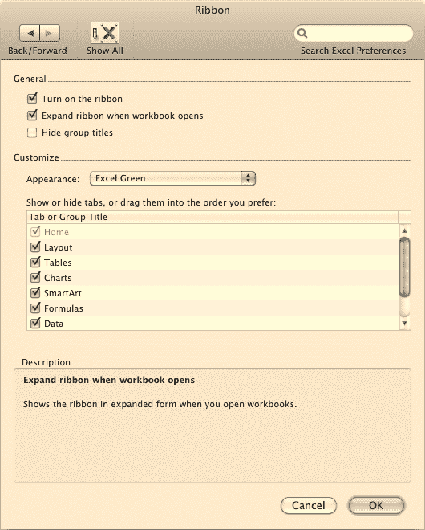
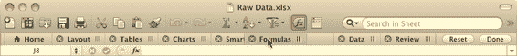

# 折叠与自定义功能区

折叠功能区可以为你腾出更多屏幕空间，但你或许想尝试完全关闭功能区，看看能否不用它。若要操作，请按以下步骤进行：

1. 单击功能区右端的**设置功能区首选项或标签页顺序**按钮（齿轮按钮），然后单击**功能区首选项**。Excel 将显示功能区首选项窗格（见图 2–12）。
   

   **图 2–12.** *在功能区首选项窗格中，你可以完全关闭功能区、隐藏功能区组名称，或自定义始终显示在功能区中的标签页。*

2. 在**通用**区域中，取消选中**启用功能区**复选框。

3. 单击**确定**按钮关闭**Excel 偏好设置**对话框。

**注意：** 当你想再次启用功能区时，请选择**Excel 偏好设置**或按 `Cmd+,`（Cmd 和逗号键）以显示**Excel 偏好设置**对话框，然后单击**共享与隐私**类别中的**功能区**图标。接着选中**启用功能区**复选框，再单击**确定**按钮。

## 自定义功能区

你可以通过选择要显示的标签页及其显示顺序来自定义功能区。你无法移除“开始”标签页或更改其位置，但可以隐藏或移动其他任何标签页。

### 快速自定义功能区

快速自定义功能区的方法是：单击功能区右端的**设置功能区首选项或标签页顺序**按钮（齿轮按钮），然后在弹出菜单中单击**自定义功能区标签页顺序**。除“开始”标签页外，Excel 会在每个标签页上显示一个 × 按钮和一个手柄（三条竖线）（见图 2–13）。

**图 2–13.** *你可以通过将功能区标签页拖拽到偏好的顺序，或移除不需要的标签页来自定义功能区。完成后单击**完成**按钮。*

接着你可以单击某个标签页并将其拖拽到所需位置，或单击标签页的 × 按钮将其移除。自定义完成后，单击**完成**按钮。如果操作失误，单击**重置**按钮即可将标签页恢复为默认设置。

### 使用功能区首选项窗格自定义功能区

自定义功能区的另一种方法是使用功能区首选项窗格。当你希望控制 Excel 在打开工作簿时是否自动展开功能区、想要隐藏功能区组名称，或想重新显示已隐藏的标签页（无需重置整个功能区）时，请使用此方法。

若要使用功能区首选项窗格自定义功能区，请按以下步骤操作：

1. 单击功能区右端的**设置功能区首选项或标签页顺序**按钮（齿轮按钮），然后单击**功能区首选项**。Excel 将显示功能区首选项窗格（如图 2–12 所示）。

2. 在顶部的**通用**区域中，如果你不希望 Excel 在打开每个工作簿时自动展开功能区，请取消选中**打开工作簿时展开功能区**复选框。

3. 同样在**通用**区域中，如果你希望阻止显示组名称，请选中**隐藏组标题**复选框。隐藏组标题会使功能区略浅一些，因此如果空间紧张，不妨尝试一下。

4. 在**外观**弹出菜单中，如果你希望将功能区标签页设为灰色而非默认的 Excel 绿色，请选择**石墨色**。

5. 在**“显示或隐藏标签页，或将其拖拽至偏好的顺序”**列表框中，按你需要的方式设置标签页：
   - 清除不想显示的任何选项卡的复选框。
   - 将选项卡拖拽至你希望的顺序。

6. 单击**确定**按钮关闭**Excel 偏好设置**对话框。

**注意：** 在列表框底部，你可以找到**开发工具**选项卡。此选项卡包含用于处理 Visual Basic for Applications（`VBA`，Office 应用程序内置的编程语言）、运行加载项以及构建带有复选框、列表框和命令按钮等控件的表单的控件。

## 随 Excel 自动打开工作簿

如果您愿意，可以让 Excel 在启动应用程序时自动打开一个或多个工作簿。当您通常需要在每次使用 Excel 时处理相同的工作簿时，这非常方便。

要让 Excel 自动打开一个或多个工作簿，请创建一个仅包含这些工作簿的文件夹。然后转到**常规**偏好设置面板，点击**启动时打开所有文件**框右侧的**选择**按钮，在**选择文件夹: Microsoft Excel**对话框中选择该文件夹，然后点击**选择**按钮。

**提示：** 如果您希望在登录时自动启动 Excel，请按住 `Ctrl` 键并点击或右键点击 Dock 上的 Excel 图标。点击或高亮**选项**以显示**选项**子菜单，然后点击**登录时打开**项，在其旁边放置一个复选标记。

您也可以通过将工作簿放入 `/Applications/Microsoft Office 2011/Office/Startup/Excel/` 文件夹，使其在启动时打开。但这会影响您 Mac 上 Excel 的所有用户，而不仅仅是创建工作簿的用户。

## 保存工作簿布局为工作区

如果您需要同时处理多个工作簿，可以利用 Excel 的工作区功能。*工作区*是一种保存打开工作簿布局的方式，以便下次能以相同方式打开它们。

要保存工作区，请按照以下步骤操作：

1. 打开工作簿并按您希望的方式排列它们。
2. 选择**文件** > **保存布局**以显示**保存: Microsoft Excel**对话框。
3. 为工作区输入一个名称。
4. 点击**保存**按钮。

要使用已保存的工作区，请像打开任何其他文件一样打开它。通常，从**Excel 工作簿库**对话框的**最近的工作簿**列表或**文件** > **最近的文件**子菜单中打开是最快途径。

**提示：** 您可以将工作区布局文件保存在 Excel 启动文件夹中，以自动打开工作区中的所有工作簿，并按您保存的布局排列它们。

如果您最近未使用该工作区，请点击**打开**按钮（或按 `Cmd+O` 或从菜单栏选择**文件** > **打开**），然后使用**打开**对话框打开工作区。

您也可以在 Finder 中双击工作区文件以打开工作区，如果 Excel 尚未运行，则会启动它。例如，您可以将经常使用的工作区放在 Dock 上，以便于访问。

## 总结

在本章中，您学习了如何通过设置基本偏好设置（包括**常规**、**视图**、**编辑**、**保存**和**兼容性**偏好设置）来配置 Excel:Mac 以适应您的工作方式。您现在还知道如何自定义键盘快捷键、菜单、菜单栏和工具栏；如何更改功能区的外观和工作方式；以及如何在启动 Excel 时自动打开工作簿，或将多个工作簿恢复到您偏好的布局。

将 Excel 设置成您想要的样子后，您就可以开始工作了。我们将在下一章从如何创建有效的工作簿和模板开始。