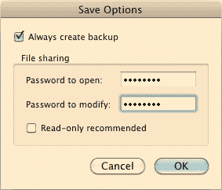
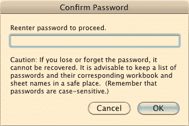
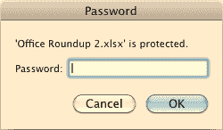
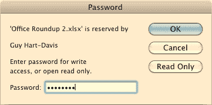
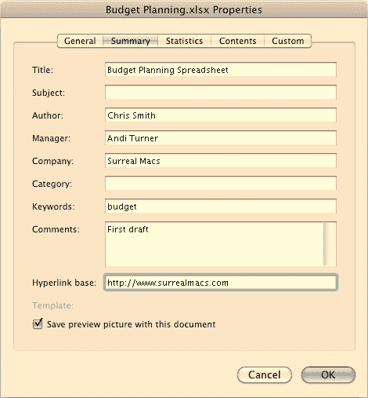

# 密码

对于任何包含珍贵数据、不容有失的工作簿，最好设置 Excel 创建自动备份。

`提示：`设置 Excel 创建自动备份是一项很好的安全措施，但你仍应将重要工作簿备份到 Mac 之外的介质上，以防 Mac 硬盘崩溃。例如，将工作簿副本保存到 U 盘或在线存储服务（如 Apple 的 MobileMe 服务）。

同样，你可能需要用密码保护重要或机密的工作簿。

Excel 允许你使用两种不同类型的密码：

- `打开密码`。任何想要打开该工作簿的人都必须提供此密码。没有正确的密码，Excel 将不会打开该工作簿。当你希望确保只有授权人员才能打开工作簿时，请使用`打开密码`。

- `修改密码`。任何想要打开工作簿原始副本的人都必须提供此密码。没有正确的密码，Excel 允许你打开工作簿的副本，但无法打开原始文件。当你需要保护特定工作簿免遭修改，但又希望允许自由访问工作簿中的信息时，请使用`修改密码`。

设置这些安全措施的最佳时机是在首次保存工作簿时。

请按照以下步骤操作：

1. 在`另存为`对话框中，单击`选项`按钮以显示`保存选项`对话框（见图 3-2）。
   [www.it-ebooks.info](http://www.it-ebooks.info/)
   
   **第 3 章：创建高效工作簿和模板**
   `图 3-2.`在`保存选项`对话框中，可以应用`打开密码`、`修改密码`或两者。还可以设置 Excel 自动备份工作簿，或建议他人以只读方式打开。

2. 如果希望 Excel 在每次保存时自动创建此工作簿的备份，请选中`始终创建备份`复选框。
   `注意：`Excel 创建自动备份的方法是将现有已保存的工作簿版本重命名为“Backup of”加上原始文件名（例如“Backup of Office Performance.xlsx”），然后将当前版本的工作簿保存为一个新文件。这意味着备份的是工作簿的上一个保存版本，而非最新版本，但只要频繁保存，你几乎可以恢复所有工作成果。
   Excel 会将备份文件保存在与原始文件相同的文件夹中。

3. 要应用`打开密码`，请在`打开密码`文本框中输入密码。

4. 要应用`修改密码`，请在`修改密码`文本框中输入密码。

5. 如果你想建议他人以只读状态打开工作簿，使其无法保存更改，请选中`建议只读`复选框。
   `警告：`请避免使用`建议只读`功能。除非你的同事格外配合，否则它无法阻止他们编辑工作簿。要想强制他们以只读方式打开工作簿，请为工作簿设置`修改密码`，并且不要与同事共享。

6. 单击`确定`按钮。如果你设置了任一类型的密码，Excel 会显示`确认密码`对话框（见图 3-3），提示你再次输入密码（以确保输入正确）。输入密码，然后单击`确定`按钮。
   [www.it-ebooks.info](http://www.it-ebooks.info/)
   
   
   
   **第 3 章：创建高效工作簿和模板**
   `图 3-3.`在`确认密码`对话框中再次输入密码。如果你同时设置了`打开密码`和`修改密码`，`确认密码`对话框会打开两次——第一次用于`打开密码`（此处称为“继续密码”），第二次用于`修改密码`。

7. 当 Excel 返回`另存为`对话框后，像往常一样完成工作簿的保存。

当你打开一个受密码保护的工作簿时，Excel 会显示`密码`对话框。
对话框。图 3-4 左侧屏幕显示了"打开密码"的"密码"对话框；要么提供密码，要么无法打开工作簿。图 3-4 右侧屏幕显示了"修改权限密码"的"密码"对话框；这里，你可以提供密码并单击"确定"按钮以打开工作簿进行编辑，或者不提供密码直接单击"只读"按钮以打开工作簿，但无法保存对其所做的更改。
`图 3-4.`当你尝试打开一个受"打开密码"保护的工作簿时，"密码"对话框会要求输入密码（左图）。如果工作簿设置了"修改权限密码"，"密码"对话框会包含"只读"按钮（右图），允许你在不提供密码的情况下打开工作簿。

要从工作簿中删除密码，请执行以下步骤：

1. 打开工作簿，当`Excel`要求时提供密码。
2. 选择"文件" -> "另存为"以显示"另存为"对话框。
3. 单击"选项"按钮以显示"保存选项"对话框。
4. 根据需要，删除"打开权限密码"文本框或"修改权限密码"文本框中的密码。
   [www.it-ebooks.info](http://www.it-ebooks.info/)
   
   **第 90 页**
   **第 3 章：创建有效的工作簿和模板**

5. 单击"确定"按钮关闭"保存选项"对话框。`Excel`会返回"另存为"对话框。
6. 单击"保存"按钮，使用原始名称和位置保存工作簿。
   `Excel`会显示一个对话框，确认你要覆盖该文件。
7. 单击"替换"按钮。`Excel`会保存没有密码的工作簿。

# 输入工作簿属性

如果你在"常规"偏好设置窗格中选中了"提示输入工作簿属性"复选框，则当你首次保存工作簿时，`Excel`会自动显示"属性"对话框。如图 3-5 所示，"属性"对话框包含五个选项卡："常规"、"摘要"、"统计"、"内容"和"自定义"。你只能在"摘要"选项卡和"自定义"选项卡中输入数据，因此首先单击"摘要"选项卡将其置于前端。

`图 3-5.`在"属性"对话框的"摘要"选项卡的字段中输入工作簿的详细信息。
[www.it-ebooks.info](http://www.it-ebooks.info/)
**第 3 章：创建有效的工作簿和模板**
**第 91 页**

`注意：`"属性"对话框的"常规"选项卡包含文件名称、类型（例如，`Microsoft Excel`工作簿）、位置（包含工作簿的文件夹）、创建日期（首次保存工作簿的日期）和上次修改日期（上次保存工作簿的日期）的只读信息。`Excel`在你首次保存工作簿之前不会编译这些信息，因此当你在首次保存文件时`Excel`自动显示"属性"对话框，这些字段将是空白的。"常规"选项卡还包含一个"只读"复选框和一个"隐藏"复选框。"统计"选项卡包含文件创建时间、上次修改时间、上次打印时间、上次保存文件的用户名、修订号以及总编辑时间的只读信息。
"内容"选项卡包含文档的工作表、图表工作表、宏工作表以及对话框工作表的列表。

## 在"摘要"选项卡上输入标准属性

在"摘要"选项卡的字段中输入相关详细信息——工作簿的标题和主题、你的姓名、经理的姓名等。`Excel`会将你的用户名填入"作者"框中，但其他字段需要你自己填写。即使`Excel`正确地输入了你的姓名（而不是像"授权用户"这样的内容，这可能被设置为你的用户名），你可能也希望更改"作者"字段以包含同事或业务团队——或者将责任推给你的经理。

`注意：`在"超链接基础"框中，你可以输入构成工作簿中超链接基础的`URL`。例如，如果所有`URL`都以`http://www.surrealmacs.com`开头，请输入该地址`http://www.surrealmacs.com`。