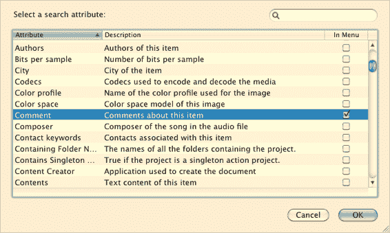
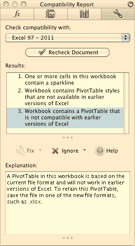

# 超链接基础框中的 URL

随后，你只需在工作表中输入每个 URL 的剩余部分。（对于不使用超链接基础的 URL，在工作表中输入完整的 URL。）如果你希望 Excel 在工作簿中包含预览，请选中`使用此文档保存预览图片`复选框。保存预览可以让工作簿在“快速查看”中更易识别，而且只会让工作簿文件略微变大，因此通常是个好主意。

**提示：** 你可以使用“聚焦”搜索，通过`标题`、`主题`、`作者`、`关键词`和`批注`字段进行查找——因此，你可能希望在工作簿中填写这些字段。

## 在“自定义”选项卡上输入额外数据

“摘要”选项卡上的字段足以存储基本的元数据，但如果你需要严格管理工作簿，则希望在其中存储更多属性信息。为此，请点击`自定义`选项卡以将其显示出来（参见图 3–6）。在此你将看到一系列内置属性，包括`客户`、`部门`、`完成日期`和`项目`。你也可以创建自己的属性。

**图 3–6.** *在“属性”对话框的“自定义”选项卡上，你可以为多种内置属性输入数据，或创建你自己的额外属性。你还可以将属性链接到工作簿中的内容。*

若要创建自定义属性，请在`名称`文本框中输入其名称。你也可以将工作簿中命名区域第一个单元格的内容分配给一个属性。这一功能使你能够自动将特定单元格的内容存储到属性中，从而使其与其他属性信息一起被建立索引。

若要添加属性信息，请遵循以下步骤：

1.  **选择属性：**
    -   如果属性是内置的，请在`名称`列表框中点击其名称。
    -   若要创建自定义属性，请在`名称`框中输入一个新名称。

2.  **在“类型”弹出菜单列表中**，为属性选择适当的类型：`文本`、`日期`、`数字`或`是或否`。如果你正在将属性链接到工作簿中的某个区域，则此选择不相关。

3.  **视情况输入属性数据：**
    -   *文本、日期或数字值。* 在`值`文本框中输入该值。
    -   *是或否。* 选择`是`选项按钮或`否`选项按钮。
    -   *工作表中命名区域包含的信息。* 选中`链接到内容`复选框。Excel 会显示一个`源`弹出菜单，其中包含工作簿中的命名区域。从此列表中选择区域。

4.  **点击`添加`按钮。** Excel 会将属性和数据添加到`属性`列表框中。

若要删除某个字段，请在`属性`列表框中将其选中，然后点击`删除`按钮。

##### 使用属性查找工作簿

当你在工作簿中输入了属性后，你可以使用属性信息在使用“聚焦”搜索时更轻松地识别工作簿。当你有很多工作簿并且需要快速找到正确的那一个时，这非常有用。

若要使用“聚焦”中的属性信息进行搜索，请遵循以下步骤：

1.  `Ctrl+单击`或右键点击程序坞上的`访达`图标，然后在上下文菜单中点击`新建访达窗口`，以打开一个新的访达窗口。如果你没有打开任何其他访达窗口，也可以直接点击程序坞上的`访达`图标来打开一个新窗口。

2.  导航至你想开始搜索的文件夹。例如，如果你将所有工作簿都存放在同一个文件夹中，则选择该文件夹，而不是搜索整个 Mac 及其连接的驱动器。

3.  选择`文件` > `查找`或按`Cmd+F`切换到搜索模式。

4.  在窗口顶部的搜索栏中，点击你在步骤 2 中选择的文件夹。

5.  点击搜索栏右端的`+`按钮，显示一行用于设置搜索的控件。图 3–7 显示了一个带有搜索条件的搜索窗口……

进行中。

**图 3–7.** *将属性信息添加到工作簿后，您可以使用其属性来定位工作簿。*

[www.it-ebooks.info](http://www.it-ebooks.info/)

**94**

**第 3 章：创建高效的工作簿和模板**

6. 在搜索控件所在行，打开`任意`弹出菜单，然后点击`其他`。

7. 在弹出菜单中选择`其他`后，在 Finder 显示的文本框中输入`Microsoft Excel 工作簿`。

8. 点击第一行搜索控件末尾的`+`按钮，以显示另一行。

9. 打开左侧弹出菜单，然后点击`其他`以显示`选择搜索属性`对话框（参见图 3–8）。

**图 3–8.** *在`选择搜索属性`对话框中，点击您要搜索的属性。如果您希望该属性在搜索中更易于使用，请选中`在菜单中`复选框。*

10. 点击您要用于搜索的属性（即，特性）。

使用`标题`、`主题`、`作者`、`关键词`或`备注`属性通常是查找已设置属性的 Excel 工作簿的最佳方式。

**提示：** 如果您需要频繁地按某个特定属性进行搜索，请在该属性所在行选中`在菜单中`复选框，以便 Mac OS X 将该属性包含在弹出菜单中。这样，您就无需打开`选择搜索属性`对话框来访问该属性了。

11. 点击`确定`按钮关闭`选择搜索属性`对话框。您选择的属性将出现在弹出菜单中。

12. 使用该行上的其余控件来指定比较条件。例如，使用`标题 包含 budget`来搜索其`标题`属性包含单词`budget`的工作簿。

[www.it-ebooks.info](http://www.it-ebooks.info/)

**第 3 章：创建高效的工作簿和模板**

**95**

13. 添加所需的任何其他搜索条件。例如，您可能只想查找过去两周内修改过的工作簿，或者其`作者`属性包含您上司名字的工作簿。

每完成一个条件，Finder 窗口就会显示匹配工作簿的列表。一旦找到您想要的工作簿，您可以通过双击将其打开。或者，如果您需要在不打开的情况下快速查看其内容，请按`空格键`或点击工具栏上的`快速查看`按钮。

**提示：** 当您创建了这样的搜索后，可以点击搜索窗口右上角的`存储`按钮，将其保存为智能文件夹。*智能文件夹*是 Mac OS X 对已保存搜索的称呼。在打开的`存储为`对话框中，为智能文件夹键入名称，并选择存储该文件夹的位置；除非有更好的位置，否则默认的`已存储的搜索`文件夹就很合适。如果您希望将智能文件夹添加到边栏中的`搜索范围`列表中以便随时访问，请选中`添加到边栏`复选框。

**保存工作簿以供旧版 Excel 使用**

多年来，微软为 Excel 添加了许多功能，并多次更改了其文件格式。因此，出现了两个问题：

- 旧版 Excel 可能无法打开您在 Excel 2011 中创建的工作簿。如果旧版能够打开该工作簿，也可能无法正确显示。
- 旧版 Excel 无法支持后续版本中添加的功能。例如，微软在 Excel 2011 中添加了迷你图（单元格内图表）；早期版本（如 Excel 2008 和 Excel 2004）则没有迷你图。

与旧版 Excel 共享工作簿的首要条件是选择合适的文件格式：

- **Excel 工作簿格式。** 使用此格式与 Excel 2011、Mac 版 Excel 2008、Windows 版 Excel 2010 或 Windows 版 Excel 2007 共享。只要计算机安装了能够读取此文件格式（微软在 Excel 2007 中引入）的筛选器，也可以与 Mac 版 Excel 2004 或 Windows 版 Excel 2003 共享。此格式使用`.xlsx`文件扩展名。

[www.it-ebooks.info](http://www.it-ebooks.info/)

## 第 3 章：创建高效的工作簿和模板

**注意：** 你可以从 Microsoft 网站（[www.microsoft.com/downloads/](http://www.microsoft.com/downloads/)）免费下载这些筛选器。对于 Windows，请查找 `Microsoft Office Compatibility Pack for Word, Excel, and PowerPoint File Formats` 的下载。对于 Mac，请查找 `Open XML File Format Converter for Mac` 的下载。

- `Excel 97–2004 Workbook 格式`。此格式用于与 `Excel 2004 for Mac`、`Excel 2003 for Windows` 或更旧版本的 `Excel` 共享。此格式使用 `.xls` 文件扩展名，也适用于与其他电子表格应用程序共享。

要将工作簿文件保存为与当前格式不同的格式，请按以下步骤操作：

1. 从菜单栏中选择 `File > Save As`，或按下 `Cmd+Option+S` 以显示 `Save As` 对话框。
2. 在 `Format` 弹出菜单中，选择你希望使用的格式。
3. （可选）在 `Save As` 文本框中更改文件名，或选择不同的文件夹。由于 `Excel Workbook` 格式和 `Excel 97–2004 Workbook` 格式使用不同的文件扩展名，你通常无需更改名称——但拥有两个名称几乎相同的工作簿可能会造成混淆。
4. 点击 `Save` 按钮。`Excel` 会关闭 `Save As` 对话框并保存工作簿。

第二个要点是确保保存的文件尽可能与早期版本的 `Excel` 兼容。为了帮助你识别潜在问题并（如果需要的话）排除它们，`Excel` 的工具箱中包含了 `Compatibility Report` 面板。你可以这样使用它：

1. 打开工作簿（如果尚未打开）。
2. 选择 `View > Compatibility Report`，打开工具箱，并将 `Compatibility Report` 面板置于前端。
3. 打开 `Check compatibility with` 弹出菜单，然后点击你希望确保工作簿兼容的应用程序版本。`Results` 框中会显示一系列可能存在的问题（参见图 3–9）。

[www.it-ebooks.info](http://www.it-ebooks.info/)

**图 3–9.** *在 `Compatibility Report` 面板中，选择用于检查工作簿兼容性的 `Excel` 版本。然后你可以选择修复哪些问题以及忽略哪些问题。*

4. 要查看某个问题的详细信息，请在 `Results` 框中点击它。`Explanation` 框会显示该问题的描述。
5. 要修复某个问题，请在 `Results` 框中点击它。如果 `Fix` 按钮可用，请点击它来修复此问题的当前实例。要修复所有实例，请点击 `Fix` 下拉按钮，然后点击菜单中的 `Fix All`。
6. 要忽略某个问题，请在 `Results` 框中点击它，然后点击 `Ignore` 按钮。要忽略所有实例，请点击 `Ignore` 下拉按钮，然后点击菜单中的 `Ignore All`。要指示应用程序不再用此问题打扰你，请点击 `Ignore` 下拉按钮，然后点击菜单中的 `Don’t Show Again`。

#### 组织工作簿中的工作表

当你创建一个空白工作簿时，`Excel` 会为其分配在 `General` 偏好设置面板的 `Sheets in new workbook` 框中设置的工作表数量——默认情况下，是一个单独的工作表。如果你需要更多工作表，可以轻松插入它们。并且你可以删除任何不再需要的工作表。

[www.it-ebooks.info](http://www.it-ebooks.info/)

`Excel` 最初会为每个工作表指定一个默认名称——`Sheet1`、`Sheet2`，以此类推。通常，你会希望给工作表起一些描述性名称，以便轻松识别它们。你可能还需要以不同的顺序重新排列工作表。

##### 插入新工作表

要插入一个新工作表，请执行以下任一操作：

- *在最后一个现有工作表之后插入一个新工作表。* 点击最后一个工作表标签后出现在标签栏上的 `Insert Sheet` 按钮。

