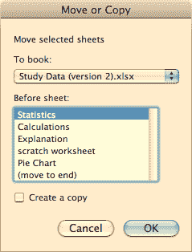
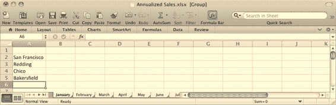

# 插入、命名和管理工作表

## 插入新工作表

`Ctrl+单击`或右键单击现有工作表，然后在上下文菜单中单击`插入工作表`。

**提示：** Excel 在活动工作表后插入新工作表的默认键盘快捷键是`Shift+F11`。只有当 Mac OS X 未将`F11`用于其他目的（例如 Exposé 中的“显示桌面”功能）时，此快捷键才有效。如果 Mac OS X 已在使用`F11`，则需要使用第 2 章“创建自定义键盘快捷键”一节中介绍的方法，将`插入工作表`命令映射到其他快捷键。或者，你也可以更改使用`F11`的 Mac OS X 功能。

## 命名工作表

为了让工作表更易于识别，请为其指定一个描述性名称。双击工作表的标签以选中默认名称，输入所需名称，然后按`Return`键应用该名称。名称最多可使用 31 个字符——足以容纳几个单词。

## 更改工作表的标签颜色

如果你想让工作表的标签更醒目，可以`Ctrl+单击`或右键单击该标签，单击`标签颜色`以显示`标签颜色`窗口，然后单击标签的颜色。单击`关闭`按钮（标题栏左端的按钮）关闭`标签颜色`窗口。

**注意：** 如果复制工作表，副本将获得与原工作表相同的标签颜色——因此你可能需要更改颜色以使副本更容易区分。

[www.it-ebooks.info](http://www.it-ebooks.info/)

## 删除工作表

要删除工作表，请`Ctrl+单击`或右键单击其标签，然后在上下文菜单中单击`删除`。Excel 将显示一个对话框（见图 3-10）以再次确认你已准备好将其删除；单击`删除`按钮继续。

**图 3-10.** *单击“确定”按钮以确认要删除该工作表。*

## 重新排列工作簿中的工作表

要使工作簿中的工作表按你需要的顺序排列，你可以重新排列它们。移动工作表的快捷方式是单击其标签，将其向左或向右拖动，直到 Excel 在你想要放置的位置的工作表之间显示一个向下箭头，然后释放鼠标。

**提示：** 要移动两个或多个工作表，请先选择它们。要选择相邻显示的一系列工作表，请单击第一个工作表的标签，然后`Shift+单击`该系列另一端的工作表标签。要选择不相邻的工作表，请单击第一个工作表的标签，然后依次`Cmd+单击`其他每个工作表的标签。

拖动工作表标签对于短距离移动很方便，但当需要将工作表移动更远距离时，请改用`移动或复制`对话框。你还可以使用`移动或复制`对话框将工作表移动或复制到不同的工作簿。请按照以下步骤操作：

**1.** 如果要将工作表移动或复制到其他工作簿，请打开该工作簿。

**2.** 在源工作簿中，`Ctrl+单击`或右键单击工作表标签以显示上下文菜单。要移动多个工作表，请先选中它们，然后`Ctrl+单击`或右键单击其中一个选中的标签。

**3.** 在上下文菜单中，单击`移动或复制`项目以显示`移动或复制`对话框（见图 3-11）。

[www.it-ebooks.info](http://www.it-ebooks.info/)

**图 3-11.** *使用“移动或复制”对话框，将单个或多个工作表移动到在单个工作簿内拖动不便的更远位置，或者将工作表移动或复制到另一个打开的工作簿。*

**4.** 在`工作簿`弹出菜单中，确保选中当前工作簿，除非你要将工作表移动到另一个工作簿——这种情况下，请选择该工作簿。

**5.** 在`工作表之前`列表框中，单击你想要放置所移动工作表之前的那张工作表。如果想将工作表放在工作簿的末尾，请选择`(移至最后)`项。

**6.** 如果要复制工作表到目标位置而非移动，请选中`建立副本`复选框。当目标位置是另一个工作簿时，复制最为有用，但你也可以在同一工作簿内复制。

**7.** 单击`确定`按钮关闭对话框。Excel 会将工作表移动或复制到你选择的目标位置。

## 工作表布局的四条简单规则

Excel 为你布局工作表提供了极大的灵活性。每个工作表包含超过 160 亿个单元格，并且你可以在一个工作簿中放置几乎任意数量的工作表。

**注意：** 如果你在一个工作簿中塞入大量工作表并为其填充全部数据，你可能会发现 Excel 拖慢了你的 Mac。如果出现这种情况，请将一些工作表移到另一个工作簿以提高性能。

以下是布局工作表时应遵循的四条规则，以使它们尽可能易于使用。

[www.it-ebooks.info](http://www.it-ebooks.info/)

**将不同主题放在不同工作表上。** 鉴于 Excel 的工作表可以包含大量信息，你可能倾向于将所有数据放在一个工作表中。但通常最好是将数据拆分，将不同的主题放在不同的工作表中。

**提示：** 为工作表标签赋予描述性标签，以便轻松选择所需的工作表。如果工作簿中的工作表太多，导致使用工作表标签导航不便，可以在前面创建一个摘要工作表，其中包含其他工作表及其内容的列表——以及可直接单击跳转到每个工作表的超链接。

**按列划分数据。** 布局数据时，应确保任何给定列中的单元格包含相同类型的数据。这样做可以让你按行对区域进行排序和筛选。

**将重要数据放在区域上方而不是旁边。** 当需要包含注释或其他解释性数据时，请将这些数据放在其相关区域的上方。不要将数据放在区域的左侧或右侧，因为如果你筛选区域仅显示某些值，Excel 可能会隐藏这些数据。

**将数据区域相互分隔开。** 如果在同一工作表中包含几种不同类型的数据，请将每种类型放在一个单独的区域中，并在各区域之间留出一个或多个空白列以及一个或多个空白行。这种额外的空间有助于 Excel 和你更容易地分别识别和选择各个区域。

## 同时在多个工作表上输入数据

有时，同时在多个工作表上输入数据可以节省时间。例如，如果某个工作簿需要为每个月的销售额创建一个单独的工作表，你可能需要创建 12 个结构相似的工作表。

输入数据，请按以下步骤操作：

**1.** 选择每个要接收数据的工作表的标签。例如，单击第一个标签，然后`Shift+单击`最后一个标签。选中的标签显示为白色而非灰色，如图 3-12 所示。Excel 会在标题栏中工作簿名称后显示`[工作组]`作为提醒。

[www.it-ebooks.info](http://www.it-ebooks.info/)

**图 3-12.** *要同时在多个工作表上输入数据，请选择每个工作表的标签，以便 Excel 在标题栏中添加 [工作组]。然后，你可以像往常一样在显示的工作表中输入数据。*

**2.** 现在，你可以在显示的工作表的单元格中输入数据。Excel 会将相同的数据输入到其他每个选中的工作表中。

**3.** 完成工作组操作后，单击一个未选中的标签以取消分组。

## 使用命名区域标识部分

在设置工作簿中的公式时，你通常需要引用