# 创建高效的工作簿和模板

特定单元格和区域。你可以始终使用地址引用单元格和区域，但这可能难以记忆——尤其是当你通过添加单元格、行或列来更改其位置时。

为了使引用更易于输入和识别，你可以为任何单元格或区域指定一个名称。之后，你可以通过该名称引用该单元格或区域。Excel 会跟踪每个名称的当前位置，因此即使你添加或删除单元格（或行或列），你也可以使用该名称，而无需担心其确切位置。

你还可以使用已命名区域来轻松导航工作表：要转到已命名区域，请打开引用区域中的弹出菜单，然后点击该区域的名称。

### 为单元格或区域指定名称

你可以快速使用引用区域或更正式地使用“定义名称”对话框为单元格或区域指定名称。使用“定义名称”对话框的优势在于，你也可以从此处管理现有的区域名称。

以下是创建名称的规则：
- 名称必须以字母或下划线开头。
- 名称只能包含字母、数字和下划线。不能包含空格或符号。
- 名称在工作簿中必须是唯一的。

### 快速为单元格或区域指定名称

要使用引用区域快速为单元格或区域指定名称，请执行以下步骤：
1. 选择要命名的单元格或区域。
2. 点击引用区域。Excel 会选择其当前内容，即活动单元格的引用（例如，`B5`）。
3. 键入单元格或区域的名称，然后按 `Return` 键应用它。

**注意**：如果你在引用区域中键入现有名称，Excel 会在你按 `Return` 键时选择该单元格或区域——就像你打开引用区域中的弹出菜单并点击了该名称一样。

### 使用“定义名称”对话框为单元格或区域指定名称

要使用“定义名称”对话框为单元格或区域指定名称，请执行以下步骤：
1. 选择要命名的单元格或区域。
2. 从菜单栏选择 `“插入”` > `“名称”` > `“定义”`，以显示“定义名称”对话框（如图 3–13 所示，已包含设置选择）。
3. 在“名称”文本框中，键入你要分配给单元格或区域的名称，以便于引用。
4. 确保“引用位置”框显示正确的单元格或区域。如果不是，请点击“折叠对话框”按钮，在工作表中选择正确的单元格或区域，然后再次点击“折叠对话框”按钮以恢复对话框。
5. 如果只想创建这一个名称，请点击“确定”按钮将名称应用于区域并关闭“定义名称”对话框。如果你想在关闭“定义名称”对话框之前创建更多名称，请点击“添加”按钮。

### 自动创建区域名称

如果你的工作表在某个区域的第一列或最后一列，或第一行或最后一行包含标题，你可以让 Excel 自动为你创建区域名称。此功能可以节省你的时间和精力。

当 Excel 创建已命名区域时，它会将你选择的区域分成大小相等的部分。例如，如果你使用图 3–14 所示的选择区域（`A1:F5`）的顶行创建已命名区域，Excel 会为单元格 `B2:B5` 创建一个名为 `Stockton` 的区域，为单元格 `C2:C5` 创建一个名为 `Modesto` 的区域，依此类推。Excel 会将标题中不允许出现在名称中的空格、标点、符号和其他字符替换为下划线——例如，标题 `City of Industry` 会生成名称 `City_of_Industry`。

> **图 3–14.** *利用所选区域中的标题创建命名区域，会生成名称为 `Stockton`（对应区域 `B2:B5`）、`Modesto`（对应区域 `C2:C5`）以及 `City_of_Industry`（对应区域 `F2:F5`）的命名区域。*

要自动创建名称，请按照以下步骤操作：
1.  在工作表中输入标题。为了创建名称，每个标题必须以字母开头，而不是数字。因此，如果你需要为包含（例如）年份的单元格创建名称，则需要在数字前添加一个或多个字母——例如使用 `Year 2011` 而不是单纯的 `2011`。
2.  选择包含标题的区域。标题必须位于所选区域的顶行、底行、最左列或最右列。
3.  选择 `“插入”` > `“名称”` > `“创建”` 以显示 `“创建名称”` 对话框（参见图 3–15）。

> **图 3–15.** *在 `“创建名称”` 对话框中，为你想要转换为区域名称的每个包含标题的行和列选中相应的复选框。*

4.  在 `“创建名称位于”` 框中，根据需要选中 `“顶行”` 复选框、`“最左列”` 复选框、`“底行”` 复选框和 `“最右列”` 复选框。
5.  单击 `“确定”` 按钮。Excel 会关闭 `“创建名称”` 对话框并创建名称。

Excel 不会显示对话框或以其他方式确认它已创建名称。如果你想检查名称是否存在，请打开 `“引用”` 区域上的弹出菜单，你会看到它们按字母顺序排列。

**注意：** 选择用于创建标签的区域时，你必须选择多行（如果标题在行中）或多列（如果标题在列中）。否则，Excel 会显示 `“所选区域无效”` 对话框。如果出现这种情况，请单击 `“确定”` 按钮并更改你的选择。

### 在公式中使用区域名称

命名区域后，你可以在公式中使用该名称，而不是单元格引用或区域引用。命名区域可以极大地节省时间，因为名称比单元格引用或区域引用更容易记忆和输入。

例如，如果你给某个单元格命名为 `Interest_Rate`，你可以像这样在公式中使用它：
```
=B1*Interest_Rate
```

当你的区域名称像这样直截了当时，你可能只想直接输入它们。

在其他时候，你可能会发现像这样粘贴名称会更方便：
1.  将活动单元格移动到你想放置公式的位置。
2.  像往常一样开始输入公式。例如，输入 `=`。
3.  当你输入到公式中需要该名称的部分时，选择 `“插入”` > `“名称”` > `“粘贴”` 以显示 `“粘贴名称”` 对话框（参见图 3–16）。

> **图 3–16.** *使用 `“粘贴名称”` 对话框将区域名称粘贴到公式中。你也可以粘贴所有区域名称及其位置的完整列表以供参考。*

4.  在 `“粘贴名称”` 列表框中，单击你想要粘贴的区域名称。
5.  单击 `“确定”` 按钮。Excel 会关闭 `“粘贴名称”` 对话框并粘贴该名称。

**提示：** 如果你想创建工作表中所有区域名称及其位置的列表，请将活动单元格定位到你想让列表开始的位置，选择 `“插入”` > `“名称”` > `“粘贴”` 以显示 `“粘贴名称”` 对话框，然后单击 `“粘贴列表”` 按钮。

### 删除区域名称

要删除区域名称，请按照以下步骤操作：
1.  从菜单栏中选择 `“插入”` > `“名称”` > `“定义”` 以显示 `“定义名称”` 对话框。
2.  在 `“工作簿中的名称”` 列表框中单击区域名称。
3.  单击 `“删除”` 按钮。
4.  根据需要删除其他区域名称，然后单击 `“关闭”` 按钮关闭 `“定义名称”` 对话框。

### 更改名称引用的单元格或区域

如果你需要更改名称引用的单元格或区域，请按照以下步骤操作：
1.  从菜单栏中选择 `“插入”` > `“名称”` > `“定义”` 以显示 `“定义名称”` 对话框。
2.  单击 `工作簿中的名称` 列表框中的现有名称。
3.  在 `引用位置` 框中三击以选中当前引用。
4.  在工作表中，单击单元格或选择新区域。（如果需要缩小 `定义名称` 对话框，可以先单击 `折叠对话框` 按钮，但通常直接操作更简便。）
5.  若要进行更改并关闭 `定义名称` 对话框，请单击 `确定` 按钮。若要进行更改但保持 `定义名称` 对话框打开，请单击 `添加` 按钮。

## 通过分级显示创建可折叠工作表

包含许多列或行数据的工作表，即使你按照第 1 章学到的方法冻结了屏幕上的标题，也难以导航。为了让导航更便捷，你可以使用 Excel 的分级显示功能创建一个可折叠的工作表，然后只展开任何特定时刻需要查看的部分。图 3-17 显示了一个包含分级显示的工作表，其中某些行和列已展开，其他行和列已折叠。

> **图 3-17.** *利用 Excel 的分级显示功能，可以创建可折叠和展开的工作表，只显示所需部分。*

分级显示功能最适用于数据按结构或层次排列的工作表。你可以为行创建最多八个层级，为列创建最多八个层级，从而精细控制分级显示。

你可以让 Excel 根据在使用公式布局的工作表中检测到的结构自动创建分级显示。这通常是最好的起点。如果发现自动分级显示不符合需求，你也可以手动创建分级显示，将层级精确放在所需位置。

### 让 Excel 自动创建分级显示

要让 Excel 自动创建分级显示，必须将工作表的结构用公式设置好。Excel 会利用这些公式来确定分级显示的层次，因此如果没有公式，分级显示就无法工作。你无需输入所有行和列的数据——只需输入包含公式的行和列，以及公式所引用的足够的数据行和列即可。

图 3-18 左侧的屏幕显示了一个用公式构建结构的工作表开头部分，这些公式将生成分级显示。以下是你能看到的内容：

- 最左侧的列（A 列）包含一个庞大而邪恶的组织（我们姑且隐去其名）的部门、州和城市办事处。你可以看到西部部门（包含加利福尼亚、俄勒冈、华盛顿、爱达荷、内华达、犹他和亚利桑那州）和中部部门（包括新墨西哥、蒙大拿、科罗拉多以及一些看不到的州）。

- 每个州仅包含几个办事处以构建正确的结构。结构就绪后，你可以添加额外所需的行。

- 每个州的行都包含一个 `SUM()` 公式，用于汇总各城市办事处的结果。例如，加利福尼亚州的行在单元格 `B3` 中包含公式 `=SUM(B4:B5)`，汇总了贝克尔斯菲尔德和奇科两地的丰富收益。

- 每个部门的行都包含一个 `SUM()` 公式，用于汇总该部门各州的结果。例如，西部部门的行在单元格 `B2` 中包含公式 `=SUM(B3,B6,B9,B12,B15,B18,B22)`，汇总了加利福尼亚州、俄勒冈州等地的结果。

[www.it-ebooks.info](http://www.it-ebooks.info/)

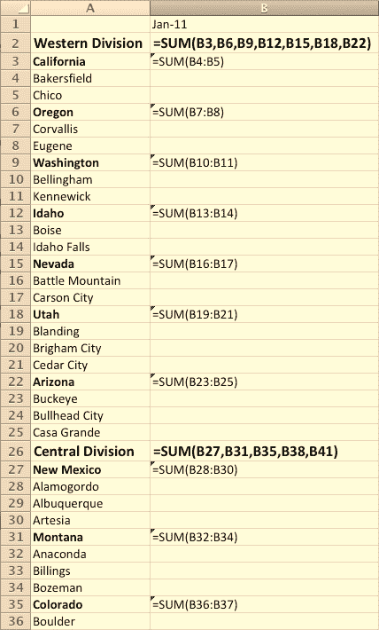

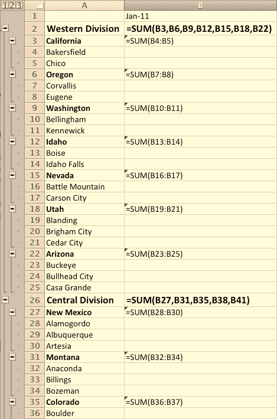

**109**

## 第 3 章：创建高效工作簿和模板

**图 3-18.** *通过设置包含公式层次结构的工作表（左图），你可以利用 Excel 的自动分级显示功能，基于这些公式创建分级显示（右图）。*

当公式就位后，从功能区选择 `数据` → `分组和分级显示` → `自动建立分级显示`，或从菜单栏选择 `数据` → `分组和分级显示` → `自动建立分级显示`，即可自动创建分级显示。图 3-18 右侧的屏幕显示了同一数据范围被转换为包含三个层级的分级显示。你可以单击左侧分级显示栏中的 `–` 号来折叠某个部分，并单击替换 `–` 号的 `+` 号再次展开该部分。

如果分级显示结果符合预期，你可以输入剩余公式和数据。在许多情况下，你可以使用 `自动填充` 功能（在第 1 章中讨论过）基于现有公式自动插入行或列中的公式。

如果自动分级显示不适合你，请尝试更改自动分级显示的设置，如下所述。或者，通过从功能区选择 `数据` → `分组和分级显示` → `取消组合` → `清除分级显示`，或从菜单栏选择 `数据` → `分组和分级显示` → `清除分级显示` 来清除分级显示。然后，你可以手动创建分级显示，详见下一节。

[www.it-ebooks.info](http://www.it-ebooks.info/)

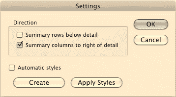

**110**

## 第 3 章：创建高效工作簿和模板

### 更改分级显示设置

要更改 Excel 用于分级显示的设置，请按以下步骤操作：

1. 选择数据范围：
    - 要更改现有分级显示，请单击分级显示中的任意单元格。
    - 要创建新分级显示，请选择数据范围。

2. 从菜单栏选择 `数据` → `分组和分级显示` → `设置`，以显示 `设置` 对话框（见图 3-19）。

**图 3-19.** *使用“设置”对话框控制 Excel 从工作表中创建自动分级显示的方式。*

3. 在 `方向` 框中，如果汇总行位于明细行下方，请选中 `明细数据的下方` 复选框。如果工作表使用了位于被汇总列右侧的汇总列，请选中 `明细数据的右侧` 复选框。

4. 如果希望 Excel 自动将样式应用于分级显示以区分不同层级，请选中 `自动设置样式` 复选框。Excel 会将 `RowLevel_1` 样式应用于第一级行，`RowLevel_2` 样式应用于第二级行，依此类推。对于列，Excel 使用名为 `ColLevel_1`、`ColLevel_2` 等的样式。

5. 单击命令按钮关闭 `设置` 对话框并执行所需操作：
    - *创建。* 单击此按钮创建新的分级显示。
    - *应用样式。* 单击此按钮将样式应用于现有分级显示。你需要先选中 `自动设置样式` 复选框。
    - *确定。* 单击此按钮将你所选的 `方向` 设置应用于现有分级显示。

[www.it-ebooks.info](http://www.it-ebooks.info/)

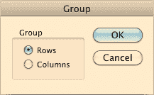

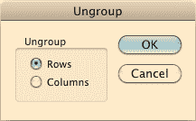

**111**

## 第 3 章：创建高效工作簿和模板

### 手动创建分级显示

很多时候，将工作表结构完整构建好以便 Excel 自动进行分级显示并不方便。在这些情况下，可以使用 `组合` 命令手动创建分级显示。你也可以使用 `组合` 命令（及其对应的 `取消组合` 命令）来调整 Excel 已为你创建的分级显示。

#### 对行或列进行分组

要对行或列进行分组，请按以下步骤操作：

1. 选择要分组的行或列中的单元格。例如：
    - 要将第 4 行和第 5 行分组到第 3 行下，请选择第 4 行和第 5 行中的单元格。
    - 要将 B 列、C 列和 D 列分组到 E 列下，请选择 B 列、C 列和 D 列中的单元格。

**提示：** 你可以通过选择整行或整列（而非仅其中的单元格）来加速对行或列进行分组或取消分组的过程。这样做时，Excel 不会显示 `组合` 对话框或 `取消组合` 对话框，因为它能根据选择判断你希望对行还是列进行分组或取消分组。

2. 从功能区选择 **数据组与大纲组**（点击组按钮的主体部分，而非弹出按钮），或从菜单栏选择 **数据组与大纲组**，以显示 **分组** 对话框（如图 3–20 左图所示）。

**图 3–20.** *在分组对话框（左图）或取消分组对话框（右图）中，根据需要选中 `行` 选项按钮或 `列` 选项按钮。*

3. 如果要按行分组，请选中 `行` 选项按钮。如果要按列分组，请选中 `列` 选项按钮。

4. 单击 `确定` 按钮关闭 **分组** 对话框。`Excel` 会应用分组。

根据需要重复此过程以创建更多组。例如，在我之前展示的工作表中，你首先应将城市分组到其所属的州下，然后将州分组到其所属的区域下。

[www.it-ebooks.info](http://www.it-ebooks.info/)


**112**

## 第 3 章：创建高效的工作簿和模板

#### 取消行或列的分组

要取消行或列的分组，请按以下步骤操作：

1. 选中要取消分组的范围。

2. 从功能区选择 **数据组与大纲组 取消分组**（点击取消分组按钮的主体部分，而非弹出按钮），或从菜单栏选择 **数据组与大纲组 取消分组**，以显示 **取消分组** 对话框（如图 3–20 右图所示）。

3. 根据需要选中 `行` 选项按钮或 `列` 选项按钮。

4. 单击 `确定` 按钮关闭 **取消分组** 对话框并移除分组。

#### 展开和折叠大纲

创建大纲后，你可以展开或折叠它，以便仅显示所需内容。

点击要查看的列级别的 **列级别** 按钮。例如，点击 **列级别 2** 按钮以显示所有第二级列。

点击要查看的行级别的 **行级别** 按钮。例如，点击 **行级别 3** 按钮以显示所有第三级行。

点击 `+` 按钮展开已折叠的行或列部分，或点击 `–` 按钮折叠已展开的部分。

#### 添加或删除行或列后更新大纲

在工作表大纲区域内添加或删除行或列后，你需要更新大纲。请按以下步骤操作：

1. 将活动单元格放置在大纲区域内的任意位置。

2. 从功能区选择 **数据组与大纲组 组 自动建立分级显示**，或从菜单栏选择 **数据组与大纲组 自动建立分级显示**。`Excel` 会显示如图 3–21 所示的无标题对话框。

**图 3–21.** *单击此对话框中的 `确定` 按钮，以使用你所添加或删除的行或列的详细信息来更新大纲。*

[www.it-ebooks.info](http://www.it-ebooks.info/)

**第 3 章：创建高效的工作簿和模板**

**113**

3. 单击 `确定` 按钮。`Excel` 会更新大纲。

#### 移除大纲

要从工作表中移除大纲，请选择 **数据组与大纲组 取消分组 清除分级显示**。

### 充分利用模板

如你所知，你在 `Excel` 中创建的每个工作簿都基于一个模板。如果你创建一个空白工作簿，`Excel` 会使用一个骨架工作簿模板，该模板给予你完全的自由度，但不会为你节省任何时间。相比之下，如果你使用一个附带完整内容和格式的模板，你可能只需填写少量信息即可生成一个完整的工作簿。

正如你在本章前面所见，`Excel` 带有多种多样的模板，并且你可以通过打开 **Excel 工作簿库** 对话框中的 **在线模板** 类别，在网络上访问更多模板。但要最大程度地节省时间，你几乎肯定需要创建自己的模板，无论是从零开始创建，还是通过自定义现有模板。

为充分利用模板，请遵循以下建议：

第 3 章：创建高效的工作簿和模板

## 仔细评估你的需求

检查你和同事最常创建的工作簿——销售分析、项目规划、预算、发票、考勤表或其他任何类型。弄清楚哪些是。

在这些工作簿中，您和同事可以使用模板更快速、更轻松地创建。

## 将模板基于现有工作簿或模板

如果您有现有工作簿，其中包含模板所需的大部分（甚至部分）信息，请打开该工作簿的副本，然后将其另存为模板。（您将在本节后面学习这两个操作。）通过从其他现有工作簿或模板中复制并粘贴项目到新模板中，您可以节省更多时间和精力。

## 使模板尽可能完整

需求会有所不同，但通常需要执行以下操作：

- 插入基于模板的大多数工作簿所需的工作表数量。
- 为工作表命名。如果这有助于快速识别关键选项卡，则对工作表选项卡进行着色。
- 使用标准文本和公式设置每个工作表。
- 使用验证格式化单元格，以确保用户输入合适的值。
- 应用条件格式使极值突出显示。
- 向单元格添加批注，说明哪些信息是必需的，哪些是可选的。

## 使用宏自动执行模板

为了帮助用户快速准确地输入和操作数据，您可能需要向模板添加宏。有关创建和使用宏的信息，请参见第 14 章。

## 基于现有工作簿创建模板

要根据现有工作簿创建模板，请执行以下步骤：

1. 如果 Excel 尚未运行，请打开它。
2. 单击标准工具栏上的“打开”按钮（或按 `Cmd+O`）以显示“打开：Microsoft Excel”对话框。
3. 导航到包含现有工作簿的文件夹，然后单击该工作簿。
4. 单击“打开”弹出菜单，然后选择“副本”，而不是默认选择“原始”。

> **注意：** 打开现有工作簿的副本有助于避免在忘记使用“另存为”命令以不同名称保存时意外覆盖它。使用“另存为”命令几乎不能再简单了——但在执行该命令之前，您也很容易分心。

5. 单击“打开”按钮以打开该工作簿的副本。
   您现在可以按照下一节所述保存模板。

## 保存模板

要保存模板，请照常使用“保存”命令，但您需要选择最适合您需求的模板格式，并选择正确的文件夹来保存模板。

要将活动工作簿另存为模板，请执行以下步骤：

1. 选择“文件”>“保存”或按 `Cmd+S` 以显示“另存为”对话框。
2. 打开“格式”弹出菜单，然后选择“Excel 模板 (.xltx)”。

> **注意：** 如果需要在模板中存储宏，请选择“Excel 启用宏的模板 (.xltm)”。如果使用 Excel 2004（Mac）或 Excel 2003（Windows）及更早版本的同事需要使用该模板，请在“格式”弹出菜单中选择“Excel 97–2004 (.xlt)”；此模板格式在必要时可以包含宏。

3. 选择存储模板的文件夹：
   - 当您在“格式”弹出菜单中选择一种模板格式时，Excel 会自动将文件夹更改为您的“我的模板”文件夹。
   - 如果您打算与同事共享模板，您可能希望将其存储在网络上的文件夹中。
4. 单击“保存”按钮。

> **注意：** 要基于存储在 Excel 检查的模板文件夹之外的其他文件夹中的模板创建工作簿，请显示“打开”对话框并导航到该文件夹。单击该模板，在“打开”弹出菜单中选择“副本”，然后单击“打开”按钮。然后您可以使用“保存”命令保存新的工作簿。

## 总结

在本章中，您学习了如何创建可以流畅高效地工作的工作簿和模板。您现在知道如何基于模板创建工作簿，如何选择保存它们的最佳文件格式，以及如何添加属性信息以使工作簿更易于识别。您还可以创建自己的模板——如有需要，可基于现有工作簿或模板创建。

我们还研究了如何组织工作簿中的工作表，如何逻辑地布局数据，以及如何同时在多个工作表上快速输入数据。您了解了如何通过创建命名范围来快速识别工作表的各个部分，以及如何通过创建大纲使大型工作表易于管理。

在下一章中，我将向您展示如何快速有效地格式化工作簿。

# 第 4 章：快速高效地格式化工作表

要使工作表显示所需信息并以易于理解的方式呈现，您需要对其进行格式化。本章介绍如何使用 Excel 提供的各种工具快速有效地格式化工作表。

首先必须格式化工作表的行和列。您可能需要插入或删除行、列或单元格块；经常需要隐藏某些行或列以将其移开或使其免受窥视；并且几乎肯定需要更改某些列宽和行高。我们将首先介绍这些内容。

之后，我将向您展示如何格式化单元格和区域，如何应用条件格式以快速标记需要关注的值，以及如何使用数据验证来检查无效条目。

在本章末尾，我们将了解如何使用表格格式或 Excel 样式快速格式化工作表，以及如何向工作表添加页眉和页脚，以便轻松识别它们及其内容。

## 处理行和列

在本节中，您将学习如何插入和删除行、列和单元格；更改列宽和行高；以及在不需要查看行或列时隐藏它们。

### 插入和删除行、列和单元格

在布置工作表时，您通常需要插入或删除整个列或行。有时您可能还需要删除一个单元格块，而无需删除整个列或行。

#### 插入列和行

插入列或行最简单的方法是按住 `Ctrl` 键单击或右键单击要在其前插入新列的现有列或行的标题，然后在上下文菜单中单击“插入”。

要插入多列或多行，请先选择相同数量的列或行。例如，要在 F 列之前插入三列，请拖动以选择 F、G 和 H 列的标题；然后按住 `Ctrl` 键单击或右键单击所选标题中的任意位置，并在上下文菜单中单击“插入”。

您也可以通过选择要在其前添加新列的列中的单元格，然后执行以下任一命令来插入列：

- **功能区：** 选择 `开始` > `单元格` > `插入` > `插入工作表列`。
- **菜单栏：** 选择 `插入` > `列`。

> **注意：** 如果 Excel 窗口宽度不足以使“插入”按钮、“删除”按钮和“格式”按钮出现在“单元格”组中，则会显示一个“操作”弹出按钮。单击此按钮可显示一个弹出菜单，其中包含“插入”子菜单、“删除”子菜单和“格式”子菜单。单击相应的菜单，然后从中做出选择。

类似地，您可以通过选择要在其前添加新行的行中的单元格，然后执行以下任一命令来插入行：

- **功能区：** 选择 `开始` > `单元格` > `插入` > `插入工作表行`。
- **菜单栏：** 选择 `插入` > `行`。

如前所述，如果要插入多列或多行，请先选择相应数量的列或行中的单元格。

> **注意：** 功能区 `开始` 选项卡上 `单元格` 组中 `插入` 按钮的具体插入内容取决于您所选定的对象。选择一列或多列可使 `插入` 按钮插入列；选择一行或多行可使 `插入` 按钮插入行；或者选择一个或多个单元格可使 `插入` 按钮插入单元格。如果您尚未选择合适的项目，请单击 `插入` 弹出按钮（而非主 `插入` 按钮），然后从弹出菜单中选择所需项目。

### 插入部分单元格

若要仅插入部分单元格，请遵循以下步骤：

1. 选择要在其之前插入单元格的区域。
2. 选择 `开始` > `单元格` > `插入` > `插入单元格` 以显示 `插入` 对话框（见图 4–1）。
   > **图 4–1.** *插入单元格块时，点击 `插入` 对话框中的 `活动单元格右移` 或 `活动单元格下移` 选项按钮，告知 Excel 现有单元格的移动方向。*
3. 选择 `活动单元格右移` 选项按钮将现有单元格向右移动。选择 `活动单元格下移` 选项按钮将现有单元格在工作表中向下移动。您也可以选择 `整行` 选项按钮来插入整行，或选择 `整列` 选项按钮来插入整列，但通常使用前述方法插入行或列更为简便。
4. 点击 `确定` 按钮关闭 `插入` 对话框。Excel 将插入单元格。

### 删除列或行

删除列或行最简单的方法是按住 `Ctrl` 键单击或右键单击其列标或行号，然后在上下文菜单中点击 `删除`。或者，您也可以选中行或列，然后从菜单栏中选择 `编辑` > `删除`，或从功能区选择 `开始` > `单元格` > `删除`（点击 `删除` 按钮的主体部分）。

您无需选中整列或整行，只需点击其中的一个单元格，选择 `开始` > `单元格` > `删除`（点击 `删除` 弹出按钮），然后根据需求点击 `删除列` 或 `删除行`。通常，先选中行或列会更方便。

#### 删除部分单元格

若要仅删除部分单元格，请选中它们，然后选择 `开始` > `单元格` > `删除` > `删除单元格`。在 Excel 显示的 `删除` 对话框（见图 4–2）中，根据需要选择 `活动单元格左移` 或 `活动单元格上移` 选项按钮，然后点击 `确定` 按钮。

**图 4–2.** `删除单元格块时，点击`删除`对话框中的`活动单元格左移`或`活动单元格上移`选项按钮，告知 Excel 如何填补工作表中的空缺。`

**注意：** 在`删除`对话框中，您可以选择`整行`选项按钮以删除所选单元格所在的行，或选择`整列`选项按钮以删除所在的列。当您意识到需要删除整行或整列，而不仅仅是单元格块时，此功能非常有用。否则，您无需打开`删除`对话框即可删除行或列。

### 设置行高

Excel 通常会根据行中最高的字符或对象自动设置行高。例如，如果您在单元格中输入内容，选中该单元格，然后在`开始`选项卡的`字体`组中多次点击`增大字号`按钮，Excel 会自动增加行高，以便为最高的字符留出足够空间。

如果 Excel 未能自动设置行高，请选择`开始`>`单元格`>`格式`>`自动调整行高`以强制执行自动匹配。

对于许多工作表来说，自动行高效果不错，但有时您可能需要手动设置行高。请使用以下任一方法：

- 拖动行号的下边框。将鼠标指针移至行号的下边框，待指针变为上下双向箭头后，点击并拖动边框。
- `up`（使行变浅）或 `down`（使行变深）。
- 使用“行高”对话框。`Ctrl+click` 或右键单击行标题，然后在上下文菜单中单击“行高”，以显示“行高”对话框（见图 4-3）。键入所需的行高，然后单击“确定”按钮。

[www.it-ebooks.info](http://www.it-ebooks.info/)
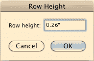

## 第 4 章：快速高效地格式化工作表

**图 4-3.** *当需要精确设置行高时，请使用“行高”对话框。*

**注意：** 你也可以通过从功能区选择“开始” → “单元格” → “格式” → “行高”，或从菜单栏选择“格式” → “行” → “行高”，来显示“行高”对话框。

### 设置列宽

与行高不同，当你向工作表中输入数据时，Excel 不会自动调整列宽。这是因为许多工作表需要单元格中有较长的条目，因此自动调整会妨碍工作。

你可以通过以下任一方式快速设置列宽：

- 自动调整列宽。双击列标题的右边框。Excel 会自动更改列的宽度，使其足以容纳该列中最宽的条目。
- 自动调整多列宽度。选择所有你要调整的列中的单元格，然后双击任意一个选定列标题的右边框。Excel 会自动调整每列的宽度以适合其内容。你也可以选择这些单元格，然后从功能区选择“开始” → “单元格” → “格式” → “自动调整列宽”，或从菜单栏选择“格式” → “列” → “自动调整列宽”。

**提示：** 自动调整列宽通常是调整工作表列宽的最佳方法。但如果某些单元格的内容过长，导致自动调整会产生巨大的列宽，请手动设置列宽并隐藏最长内容的部分。你也可以在单元格内自动换行，使其占用所需的多行；稍后将在本章的“设置对齐方式”部分学习如何操作。

- 手动调整列宽。将列标题的右边框拖到所需宽度。
- 精确调整列宽。`Ctrl+click` 或右键单击列标题，然后在上下文菜单中单击“列宽”，以显示“列宽”对话框（见图 4-4）。键入单元格宽度，然后单击“确定”按钮。

[www.it-ebooks.info](http://www.it-ebooks.info/)
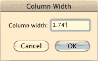

**图 4-4.** *当需要精确设置列宽时，请使用“列宽”对话框。*

- 将多个列精确调整为相同宽度。通过拖动列标题或选择每列中的单元格来选中这些列。`Ctrl+click` 或右键单击选定的列标题，然后在上下文菜单中单击“列宽”，以显示“列宽”对话框。键入列宽，然后单击“确定”按钮。

### 隐藏行和列

有时，隐藏特定的列和行，使其在工作表中不可见，会很有帮助。你可能想这样做，以防止敏感数据显示出来，或者只是为了让你实际使用的部分工作表能一次性完整显示在屏幕上。

要隐藏某列或某行，请 `Ctrl+click` 或右键单击其列标题或行标题，然后在上下文菜单中单击“隐藏”。你也可以单击行或列中的一个单元格，然后从功能区选择“开始” → “单元格” → “格式” → “隐藏行”或“隐藏列”，或从菜单栏选择“格式” → “行” → “隐藏”或“格式” → “列” → “隐藏”。

**提示：** 要快速隐藏活动行或选定的行，请按 `Ctrl+9`。要隐藏活动列或选定的列，请按 `Ctrl+0`。

要取消隐藏某行或某列，请选中其上下方的行或左右两侧的列。然后 `Ctrl+click` 或右键单击选定的行标题或列标题，并在上下文菜单中单击“取消隐藏”。

**注意：** 你也可以通过从功能区选择“开始” → “单元格” → “格式” → “取消隐藏行”或“取消隐藏列”，或从菜单栏选择“格式” → “行” → “取消隐藏”或“格式” → “列” → “取消隐藏”，来隐藏和取消隐藏项目。

### 格式化单元格和区域

在 Excel 中，你可以以多种方式格式化单元格——从选择如何显示边框和背景，到控制 Excel 如何表示你在单元格中输入的文本。本节将向你展示最实用的格式化类型及其应用方法。

[www.it-ebooks.info](http://www.it-ebooks.info/)
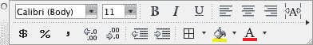

每个单元格都应用了基本格式——使用的字体和字号，以及通常的“常规”数字格式（稍后会介绍）。因此，当你创建新工作簿并开始输入数据时，Excel 会以正常大小的字体显示数据。

**提示：** 要控制新工作簿使用的字体和字号，请选择“Excel” → “偏好设置”或按 `Cmd+,`（`Cmd` 键和逗号键）。在“Excel 偏好设置”对话框的“创作”区域中单击“常规”图标，以显示“常规”面板。打开“标准字体”菜单，然后单击你想要的字体；列表顶部的“正文字体”选项会为你提供工作簿模板中设置的正文字体；如果你更改此字体，则会更改除“标题”样式（使用“标题字体”）之外的所有样式中使用的字体。然后，在“字号”弹出菜单中选择字号。单击“确定”按钮关闭“Excel 偏好设置”对话框。

#### 了解应用格式化的三种主要工具

Excel 提供了三种主要工具来对单元格和区域应用格式：

- “格式”工具栏。如果你显示此工具栏（从菜单栏选择“视图” → “工具栏” → “格式”），可以快速应用一些最常用的格式。图 4-5 显示了带有标签控件的“格式”工具栏（以浮动形式显示，以便更容易查看）。

**注意：** 功能区的“开始”选项卡也提供了你在“格式”工具栏上找到的格式化命令，因此你可以使用更方便的那个。

**图 4-5.** *“格式”工具栏通常是应用常用格式的最简单方法。*

[www.it-ebooks.info](http://www.it-ebooks.info/)
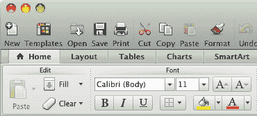

- 功能区的“开始”选项卡。“字体”组提供了广泛使用的字体格式；“对齐”组提供了水平与垂直对齐、方向、缩进、自动换行和合并；“数字”组则为你提供了一种快速应用基本数字格式的方法。图 4-6 显示了带有标签控件的“字体”组。图 4-7 显示了带有标签控件的“对齐”组和“数字”组。

**图 4-6.** *你可以从功能区“开始”选项卡上的“字体”组中快速应用基本的字体格式、边框和填充。*

**注意：** “增大字号”按钮、“减小字号”按钮和“边框”弹出菜单仅当 Excel 窗口足够宽以容纳它们时，才会出现在功能区“开始”选项卡上的“字体”组中。

[www.it-ebooks.info](http://www.it-ebooks.info/)
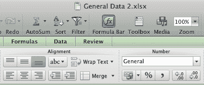

**图 4-7.** *从功能区“开始”选项卡上的“对齐”组中，你可以设置水平和垂直对齐、方向以及自动换行。从“数字”组中，你可以应用数字格式。*

- “设置单元格格式”对话框。当你需要应用“标准”工具栏或功能区“开始”选项卡上未出现的格式化类型时，请打开“设置单元格格式”对话框，并操作其六个选项卡（本章稍后会介绍）。显示“设置单元格格式”对话框的最简单方法是 `Ctrl+click` 或右键单击某个单元格或选定区域，然后在上下文菜单中单击“设置单元格格式”。你也可以通过按 `Cmd+1` 或从菜单栏选择“格式” → “单元格”来打开“设置单元格格式”对话框。

#### 通过应用数字格式控制数据的外观

当你在单元格中输入数字时，Excel 会根据应用于该单元格的数字格式进行显示。例如，如果你在格式为“常规”的单元格中输入 `39250`，Excel 会将其显示为 39250。如果该单元格采用“货币”格式，Excel 会显示类似 `$39,250.00` 这样的值（具体取决于格式的细节）。如果该单元格采用“日期”格式，Excel 会显示类似“2011 年 6 月 18 日”这样的日期（同样取决于格式的细节）。无论哪种情况，单元格中存储的数字保持不变——因此，如果你将单元格的格式更改为不同类型，Excel 显示数据的方式也会随之改变。

表 4-1 解释了 Excel 的数字格式，并说明了应用这些格式的键盘快捷键。你还可以通过使用标准工具栏上的按钮、功能区“开始”选项卡“数字”组中的“数字格式”下拉菜单和按钮，以及“设置单元格格式”对话框的“数字”选项卡（参见图 4-8）来应用数字格式。

**图 4-8.** 当你需要访问完整的数字格式选项时，请使用“设置单元格格式”对话框的“数字”选项卡。

**表 4-1.** Excel 的数字格式

| 数字格式 | 键盘快捷键 | 说明 | 示例 |
| :--- | :--- | :--- | :--- |
| `常规` | `Ctrl+Shift+~` (波浪号) | Excel 对新工作表中所有单元格的默认格式。无特定格式，但每个单元格最多显示 11 位数字，且不使用千位分隔符。对于超过 11 位的任何输入，“常规”格式会使用科学记数法（参见本表后面的“科学记数”条目）。 | `1234567` |
| `数值` | `Ctrl+Shift+!` | 显示您选择的小数位数。您可以选择是否使用千位分隔符以及如何显示负数。 | `1000`, `1,000`, `1,000.00` |
| `货币` | `Ctrl+Shift+$` | 显示您选择的小数位数，并使用千位分隔符。您可以选择显示哪种货币符号（例如 $）以及如何显示负数。 | `$2,345.67`, `–$2,345.67` |
| `会计专用` | — | 显示您选择的小数位数，并使用千位分隔符。您可以选择使用哪种货币符号。符号在单元格的左边缘对齐。负数用括号括起来显示。 | `$ 1,000,000`, `$ (99.999.00)` |
| `日期` | `Ctrl+Shift+#` | 显示多种日期格式中的任何一种。 | `6/24/2011`, `2011 年 6 月 24 日星期四` |
| `时间` | `Ctrl+Shift+@` | 显示多种时间格式中的任何一种。 | `11:59:59 PM`, `23:59:59` |
| `百分比` | `Ctrl+Shift+%` | 显示百分号以及您选择的小数位数。 | `78.79%`, `200%` |
| `分数` | — | 将数字显示为分数。分数在视觉上容易造成混淆，因此仅在必要时使用——例如，用于投注图表。 | `1/2`, `1 1/4` |
| `科学记数` | `Ctrl+Shift+^` | 以指数形式显示数字，带有 `E` 和要乘的幂次。您可以选择使用几位小数。 | `1.2346E+08`, `–9.8765E+07` |
| `文本` | — | 即使数据看起来是其他类型（例如数字或日期），也将其显示并视为文本。 | `产品列表 18` |
| `特殊` | — | 以您选择的格式显示数据：`邮政编码`、`邮政编码+4`、`电话号码`或`社会保险号码`。 | `10013-8295`, `(212) 555-9753`, `722-86-8261` |
| `自定义` | — | 以您选择的自定义格式显示数据。Excel 提供了数十种自定义格式，但您也可以创建自己的格式。 | `[各种]` |

## 理解 Excel 如何存储日期和时间

Excel 将日期存储为从 `1`（1900 年 1 月 1 日，星期日）开始并延续到未来的序列号。作为几个参考点：`40544` 代表 2011 年 1 月 1 日星期六，而 `40909` 代表 2012 年 1 月 1 日星期日。

您可以通过输入序列号（如果您知道或愿意计算）来输入日期，但更简单的方法是使用常规格式输入日期，因为 Excel 能识别大部分格式。例如，如果您输入 `1/1/2011`，Excel 会将其转换为 `40544`，并以您选择的任何格式显示该日期。

Excel 将时间存储为一天的小数部分。例如，`40544.25` 表示 2011 年 1 月 1 日早上 6 点（一天的四分之一处）。

旧版 Excel 默认使用 1904 年 1 月 2 日作为工作簿的起始日期。Excel 2011 不会自动执行此操作，但如有必要（例如，您正在使用一个基于 1904 日期系统的旧工作簿），您可以手动设置 1904 起始日期。要切换到基于 1904 的日期，请选择 `Excel Preferences` 或按 `Cmd+,`（`Cmd` 和逗号键）。在 `Excel Preferences` 对话框中，点击 `Formulas and Lists` 区域中的 `Calculation` 图标以显示 `Calculation` 窗格。在 `Workbook options` 框中，选中 `Use the 1904 date system` 复选框，然后点击 `OK` 按钮。

## 要创建自己的自定义数字格式

请按照以下步骤操作：

1.  选择一个包含正确数据类型单元格。例如，如果您想创建自定义日期格式，请选择一个应用了 `Date formatting` 并已输入日期的单元格。

2.  按 `Cmd+1` 打开 `Format Cells` 对话框。

3.  如果初始未显示，请单击 `Number` 选项卡。

4.  在 `Category` 列表框中，单击 `Custom` 项。Excel 将显示用于创建自定义格式的控件（参见图 4-9）。您的示例数据会显示在顶部的 `Sample` 框中。

    [www.it-ebooks.info](http://www.it-ebooks.info/)
    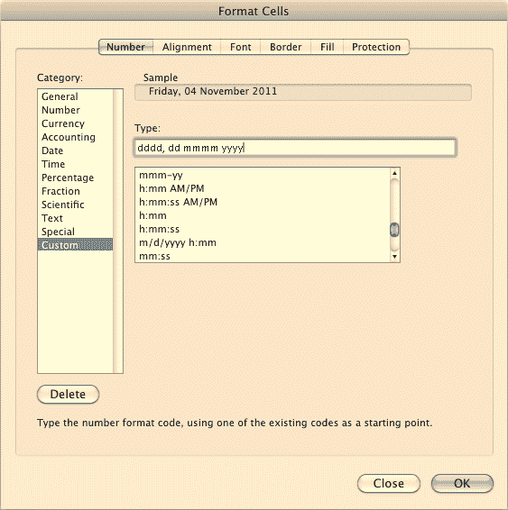
    **第 4 章：快速高效地格式化工作表**
    **129**
    **图 4-9.** *您可以通过在“格式单元格”对话框的“数字”选项卡上的“类型”文本框中输入代码来创建自定义数字格式。在列表框中点击最接近您想创建格式的格式，可为您提供一个起点。*

5.  向下滚动列表框，找到最接近您想要创建格式的格式，然后点击该格式。Excel 会将该格式的代码添加到 `Type` 文本框中，并以该格式显示示例数据。

6.  编辑格式，使示例数据按照您想要的方式显示（请参阅此列表后的说明）。

7.  点击 `OK` 按钮关闭 `Format Cells` 对话框。

要创建自定义格式，您需要输入格式代码来指示 Excel 如何显示信息。自定义格式可以包含单个格式，如图 4-9 中所示的日期格式，但您最多可以包含四种不同的格式，用分号隔开：*第一种格式。* 如何显示正数。*第二种格式。* 如何显示负数。*第三种格式。* 如何显示零值。*第四种格式。* 如何显示文本。

[www.it-ebooks.info](http://www.it-ebooks.info/)
**130**
**第 4 章：快速高效地格式化工作表**

表 4-2 解释了创建自定义数字格式的代码。

**表 4-2.** *创建自定义数字格式的代码*

| 代码 | 效果 | 示例 |
| :--- | :--- | :--- |
| `[color name]` | 显示指定的颜色。将相应颜色放在方括号中，作为该部分的第一项：`[Black]`、`[Red]`、`[Blue]`、`[Green]`、`[White]`、`[Cyan]`、`[Magenta]` 或 `[Yellow]`。例如，`#,##0_);Red` 以红色显示负数。 | |
| `#` | 显示一个有效数字。 | `###.#` 在小数点前显示三位有效数字，小数点后显示一位有效数字。（有效数字是指非零的数字。） |
| `0` | 如果此位置没有其他数字，则显示零。 | `000` 显示三位数字，必要时用前导零填充。例如，如果您输入 `7`，Excel 显示 `007`。 |
| `%` | 显示百分比。 | `#%` 将数字乘以 100 并显示百分号。例如，`8` 显示为 `800%`。 |
| `?` | 显示为分数。 | `# ???/???` 显示一个数字和三位数字的分数——例如，`9 107/112`。 |
| `.` | 显示小数点。 | `###.##` 在小数点前显示三位有效数字 |