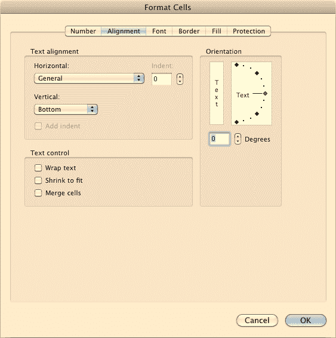
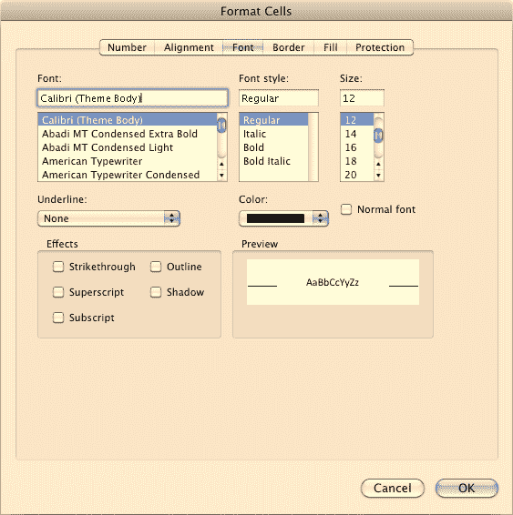
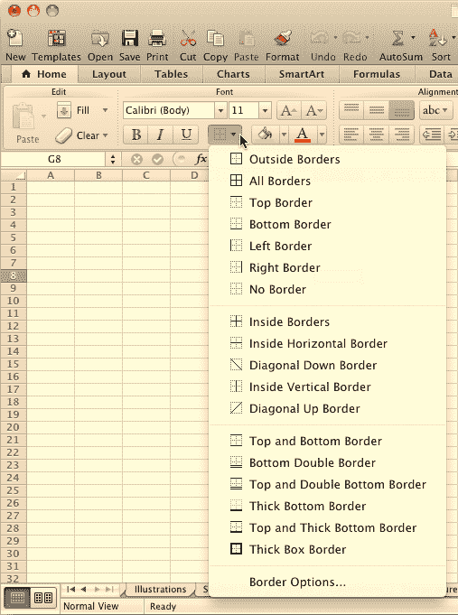
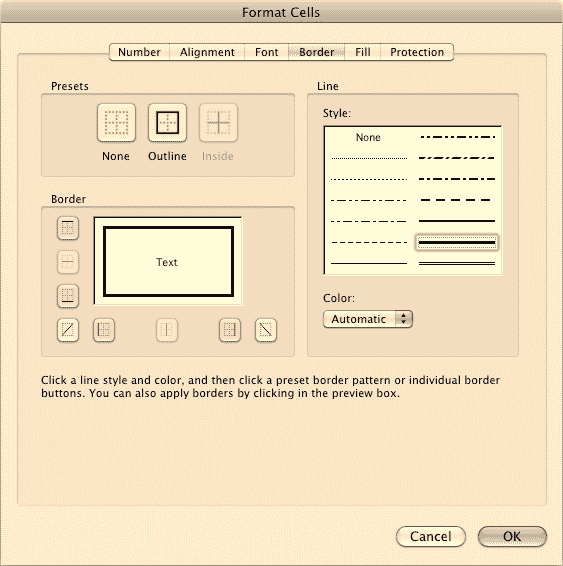
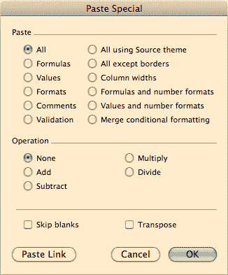
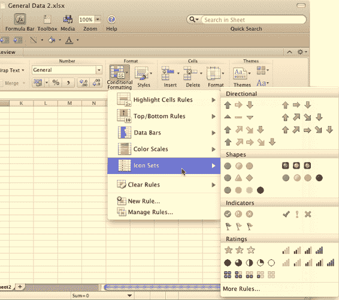
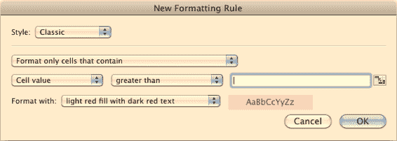
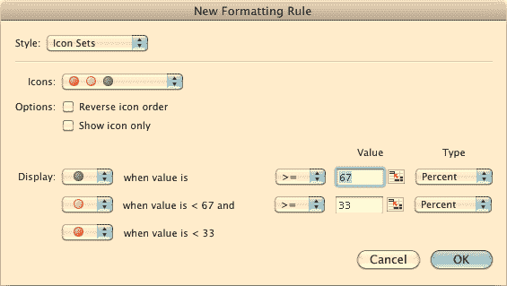

# 数字格式代码

小数点后保留一位和两位有效数字。

## 千位分隔符

**千位分隔符**：`$#,###,###` 显示美元符号、七个有效数字和千位分隔符，并将数字缩小 1000 倍。

**按 1000 缩放**：`#.##,,, " million"` 显示欧元符号、小数点前一位有效数字和小数点后两位，数字缩小一百万倍，并在后面显示单词 `million`（带一个空格）。例如，如果输入 `12345689`，Excel 会显示 `1.23 million`。

## 日期和时间格式代码

| 代码 | 效果 | 示例 |
|------|------|------|
| `d` | 以数字格式显示日 | `d-mmm-yyyy` 将 `6/1/11` 显示为 `1-Jun-2011`。 |
| `dd` | 以数字格式显示日，并加前导零 | `dd/mmm/yy` 将 `6/1/11` 显示为 `01/Jun/11`。前导零有助于标准化两位数的日期和对齐日期条目。 |
| `ddd` | 以三个字母的缩写显示日 | `ddd dd/mm/yyyy` 将 `6/1/11` 显示为 `Wed 01/06/2011`。 |
| `dddd` | 以全称显示日 | `dddd, dd/mm/yyyy` 将 `6/1/11` 显示为 `Wednesday, 01/06/2011`。 |
| `m` | 以数字格式显示月 | `d/m/yy` 将 `6/1/11` 显示为 `6/1/11`。 |
| `mm` | 以数字格式显示月，并加前导零 | `mm/dd/yy` 将 `6/1/11` 显示为 `06/01/11`。 |
| `mmm` | 以三个字母的缩写显示月 | `dd-mmm-yy` 将 `6/1/11` 显示为 `01-Jun-2011`。 |
| `mmmm` | 以全称显示月 | `dd mmmm, yyyy` 将 `6/1/11` 显示为 `01 June, 2011`。 |
| `mmmmm` | 以单个字母的缩写显示月 | 一月、六月和七月显示为 `J`；四月和八月显示为 `A`；依此类推。此代码在空间不足且包含所有月份的序列时有效；如果只使用部分月份，则会产生混淆。 |
| `yy` | 以两位数显示年 | `m/d/yy` 将 `6/1/11` 显示为 `6/1/11`。 |
| `yyyy` | 以四位数显示年 | `dd-mmm-yyyy` 将 `6/1/11` 显示为 `01-Jun-2011`。 |
| `h` | 显示小时 | `h:m` 将 `2:22` 显示为 `2:22`。 |
| `hh` | 显示小时，并加前导零 | `hh:mm` 将 `2:22` 显示为 `02:22`。 |
| `m` | 显示分钟 | `h:m` 将 `2:01` 显示为 `2:1`。 |
| `mm` | 显示分钟，并加前导零 | `hh:mm` 将 `2:22` 显示为 `02:22`。要将 `mm` 与月份代码（也是 `mm`）区分开来，请将其紧跟在 `hh` 之后或紧接在 `ss` 之前使用。 |
| `s` | 显示秒 | `h:m:s` 将 `2:22:01` 显示为 `2:22:1`。 |
| `ss` | 显示秒，并加前导零 | `hh:mm:ss` 将 `2:22:01` 显示为 `02:22:01`。 |
| `.0`, `.00`, `.000` | 显示秒的十分位、百分位或千分位 | `h:mm:ss.000` 将 `2:22:01.11` 显示为 `2:22:01.110`。 |
| `A/P` | 显示 `A` 表示上午，`P` 表示下午 | `h:mm A/P` 将 `2:22` 显示为 `2:22 A`。可以使用大写 `A/P` 或小写 `a/p` 来指定显示的大小写。 |
| `AM/PM` | 显示 `AM` 表示上午，`PM` 表示下午 | `h:mm am/pm` 将 `14:22` 显示为 `2:22 PM`。Excel 会使用大写，无论你使用哪种大小写。 |
| `[]` | 以指定单位显示经过的时间 | `[h]:mm:ss` 以小时、分钟和秒显示经过的时间——例如，`55:38:43`。 |

## 文本格式代码

| 代码 | 效果 | 示例 |
|------|------|------|
| `_` | 显示一个指定字符宽度的空格 | `_)` 让 Excel 输入一个与右括号宽度相同的空格。你可以用它来对齐正数和用括号括起来的负数。 |
| `*` | 重复指定字符以填充单元格 | `*0` 让 Excel 用 `0`（零）字符填充单元格。此格式较为特殊，但当你需要吸引查看者对特定单元格的注意时可能会用到。 |
| `\` | 显示后面的字符 | `[Blue]$#,###.00 \*;[Green]$#,###.00 \D` 正数以蓝色显示，后跟一个星号；负数以绿色显示，后跟一个 `D`。 |
| `"string"` | 显示字符串文本 | `$#,##0.00" Net"` 在条目后显示单词 `Net`。注意引号和单词之间的前导空格。 |
| `@` | 将指定字符串与用户输入的文本连接起来 | `"Value: "@` 在用户输入的文本前输入 `Value:` 和一个空格。此代码仅能在自定义格式的第四部分（文本部分）中使用。 |
| `N/A` | 显示指定的内容 | — |

`$` `-` `+` `=` `/` `(` `)` `{` `}` `:` `!` `^` `&` `'` `'` `~` `<` `>` `[空格]`

`字符`。

[www.it-ebooks.info](http://www.it-ebooks.info/)

### 第 4 章：快速高效地设置工作表格式

**133**

#### 通过应用主题设置工作簿的整体外观

若要控制工作簿的整体外观，请为其应用合适的主题：选择“开始”>“主题”>“主题”，然后在“主题”面板中单击所需的主题。

该主题会为工作簿应用一组颜色和一对字体。应用主题后，你可以通过使用功能区“开始”选项卡上“主题”组中的“颜色”弹出菜单或“字体”弹出菜单来更改颜色或字体。

#### 选择如何对齐单元格内容

你可以通过使用功能区“开始”选项卡上“对齐方式”组中的按钮，或“设置单元格格式”对话框的“对齐”选项卡（见图 4-10）中的控件，快速对齐单元格内容：

- **水平对齐。** 你可以将文本左对齐、居中、右对齐或两端对齐；应用 `常规` 对齐方式（这取决于数据类型，文本靠左，数字靠右）；选择 `跨列居中` 以跨多列居中文本；或选择 `分散对齐（缩进）` 以在单元格内分散文本（增加字间距）。

**注释：** `填充` 水平对齐方式会用你指定的字符填满单元格。

**图 4-10。** *“设置单元格格式”对话框的“对齐”选项卡允许你在需要时将文本旋转到精确角度。*

[www.it-ebooks.info](http://www.it-ebooks.info/)

**134**

**第 4 章：快速高效地设置工作表格式**

- **垂直对齐。** 你可以将文本 `顶端对齐`、`垂直居中`、`底端对齐` 或 `两端对齐`。你还可以选择 `分散对齐` 以垂直分散文本，这在旋转文本使其垂直排列时非常有用。

- **旋转文本。** 使用“设置单元格格式”对话框“对齐”选项卡上的“方向”框，或“对齐方式”组中的“方向”弹出菜单。

- **缩进。** 你可以根据需要对文本进行缩进。

- **自动换行。** 你可以对文本进行 `自动换行`，使较长的条目在单元格中显示为多行，而不是在下一个单元格内容开始处消失。当 `自动换行` 文本时，Excel 会自动增加行高以适应换行后的文本。（如果你设置了小于显示所有换行文本所需高度的特定行高，则单元格中只会显示能容纳下的文本。）

- **缩小字体填充。** 在“设置单元格格式”对话框的“对齐”选项卡中选中此复选框，可 `缩小字体填充` 以使其适应单元格。当文本仅比单元格稍大时，缩小效果良好。如果文本过大，缩小后的文本会变得太小而无法阅读。

- **合并单元格。** 使用“对齐方式”组中的 `合并后居中` 弹出菜单，可将选中的多个单元格合并为一个单元格。你也可以在合并后的单元格中将条目居中。在“设置单元格格式”对话框中，你可以通过选中“对齐”选项卡上的 `合并单元格` 复选框来合并单元格。

[www.it-ebooks.info](http://www.it-ebooks.info/)

**第 4 章：快速高效地设置工作表格式**

**135**

#### 选择字体格式

你可以通过使用“标准”工具栏上的控件、功能区“开始”选项卡上“字体”组中的控件，或“设置单元格格式”对话框的“字体”选项卡（见图 4-11），快速设置单元格内容（或单元格内容中的选定部分）的格式。

**图 4-11。** *当你需要比“标准”工具栏和功能区“字体”组提供的更全面的字体格式时，请使用“设置单元格格式”对话框的“字体”选项卡。*

[www.it-ebooks.info](http://www.it-ebooks.info/)

# 第 4 章：快速高效地设置工作表格式

## 应用边框和填充

若要为单元格应用边框，请打开功能区“开始”选项卡上“字体”组中的“边框”弹出菜单，然后单击所需的边框类型（见图 4-12）。

**图 4-12。** `你可以从“开始”选项卡“字体”组中的“边框”弹出菜单快速应用边框。`

**提示：** 如果你已显示“格式”工具栏，可以通过单击其“边框”弹出按钮，然后在面板上单击边框类型来应用边框。按此方式选择边框类型后，你可以通过单击“边框”按钮的主体部分（而非弹出按钮）快速将其应用到另一个单元格。你也可以拖出“边框”调色板使其保持可见，这样就不必反复打开它。单击“边框”弹出按钮，然后单击调色板顶部的双线并将其拖离工具栏。使用完拖出的调色板后，单击其标题栏左端的“关闭”按钮将其关闭。

[www.it-ebooks.info](http://www.it-ebooks.info/)

如需更多边框选项，请单击“边框”弹出菜单底部的“边框选项”项，以显示“设置单元格格式”对话框的“边框”选项卡（见图 4-13）。

你也可以从菜单栏中选择“设置单元格格式”（或按 `Cmd+1`），然后单击“边框”选项卡。使用“边框”选项卡上的控件来设置你想要的边框。例如，要应用粗底边框，请在“样式”框中单击一条深色线条，然后在“边框”框中单击“下边框”按钮，最后单击“确定”按钮。

**图 4-13.** `当需要更改边框的线条样式或颜色时，请使用“设置单元格格式”对话框的“边框”选项卡。`

要应用填充，请使用功能区“开始”选项卡“字体”组中的“填充颜色”弹出菜单，或“格式”工具栏上的“填充颜色”弹出菜单，也可以在“设置单元格格式”对话框的“填充”选项卡上进行操作。

## 为单元格应用保护

“设置单元格格式”对话框的“保护”选项卡仅包含两个控件：

`Locked`（锁定）。选中此复选框可锁定单元格以防止更改。

`Hidden`（隐藏）。选中此复选框可隐藏单元格中的公式（公式的结果仍然可见）。

[www.it-ebooks.info](http://www.it-ebooks.info/)

选中这两个复选框中的任意一个后，你必须先保护工作表，锁定或隐藏才会生效。你将在第 13 章的“保护工作表或工作簿”一节中了解如何保护工作表。

## 使用“选择性粘贴”来粘贴格式和执行操作

如果工作表的某一部分包含你需要应用到另一部分的格式类型，那么使用“选择性粘贴”命令并在“选择性粘贴”对话框中选择选项通常可以节省时间。例如，你可以仅粘贴格式或列宽，而不是粘贴已复制单元格中的所有数据和格式。“选择性粘贴”命令还允许你转置数据，并对粘贴到的单元格执行数学运算。

你可以从功能区“开始”选项卡“编辑”组中的“粘贴”弹出菜单或“粘贴选项”弹出菜单访问大多数“选择性粘贴”选项，但在大多数情况下，使用“选择性粘贴”对话框最为清晰。

要显示“选择性粘贴”对话框（见图 4-14），请使用以下命令之一：

*功能区。* 选择“开始”>“编辑”>“粘贴”>“选择性粘贴”。

*菜单栏。* 选择“编辑”>“选择性粘贴”。

*上下文菜单。* `Ctrl+单击`或右键单击目标单元格，然后单击“选择性粘贴”。

*键盘。* 按 `Cmd+Shift+V`。

**图 4-14.** `当你需要仅粘贴部分数据、需要对数据执行操作或需要转置其行列时，请使用“选择性粘贴”对话框。`

[www.it-ebooks.info](http://www.it-ebooks.info/)

然后在“粘贴”区域选择你想要的选项按钮：

`All`（全部）。选择此选项按钮可粘贴所有数据及其所有格式。通常，仅当你使用“跳过空单元”复选框、“转置”复选框或“粘贴链接”按钮时才需要这样做——否则，使用“粘贴”命令更简单。

*公式。* 选中此单选按钮可粘贴所有公式和常量，而不带格式。

*数值。* 选中此单选按钮可粘贴公式计算出的值，而不是公式本身。Excel 会移除数值中的格式。

*格式。* 选中此单选按钮可仅粘贴格式，不粘贴数据。此选项非常适合用于使一个工作表的格式与另一个工作表相似。

*批注。* 选中此单选按钮可仅粘贴批注。当您需要整合不同同事对同一工作表的意见时，此选项非常方便。

*数据验证。* 选中此单选按钮可粘贴数据验证条件。

*使用源主题。* 选中此单选按钮可使用数据来源工作簿的主题粘贴所有数据。

*边框除外。* 选中此单选按钮可粘贴所有数据和格式，但会移除单元格边框。

*列宽。* 选中此单选按钮可仅粘贴列宽——不粘贴数据或其他任何格式。当您需要将一个工作表的布局设置为与另一个现有工作表相同，但放入完全不同的数据时，此选项非常有用。

*公式和数字格式。* 选中此单选按钮可粘贴公式和数字格式，但不粘贴其他格式。

*值和数字格式。* 选中此单选按钮可粘贴数值（而非公式）和数字格式。

*合并条件格式。* 选中此单选按钮可复制所有数据和格式，并合并任何条件格式。有关条件格式的详细信息，请参阅下一节。

如果您需要对粘贴的数据执行数学运算，请转到`选择性粘贴`对话框的`运算`区域，并根据需要选择`加`、`减`、`乘`或`除`单选按钮。例如，如果要将单元格中的当前值乘以您粘贴的值，请选择`乘`单选按钮。否则，保持选中`无`单选按钮以在不进行数学运算的情况下粘贴数据。

在`选择性粘贴`对话框的底部区域，您可以根据需要选中或清除这两个复选框：

*跳过空单元。* 选中此复选框可防止 Excel 粘贴空白单元格。

*转置。* 选中此复选框可将列转置为行，将行转置为列。此选项比重新输入布局错误的数据要快得多。

选择好所需选项后，单击`确定`按钮。Excel 会关闭`选择性粘贴`对话框并粘贴您选择的数据或格式。

**注意：** 如果您需要将粘贴的数据链接回其源数据，请单击`选择性粘贴`对话框中的`粘贴链接`按钮，而不是`确定`按钮。这将使 Excel 创建一个指向源数据的链接，以便当源数据更改时，链接的数据也随之更改。如果源数据位于同一工作簿中，Excel 会自动更新链接。如果源数据位于另一个工作簿中，Excel 会在您打开包含该链接的工作簿时更新数据。

## 使用条件格式标识异常值

在许多工作表中，能够监视单元格中的值并挑出以特定方式突出的值是非常有用的。例如，您可能希望查看哪十种产品带来了最高的收入，或者可能需要一种简单的方法让异常高或异常低的值在其它值中突出显示。

要监视一个单元格或区域中的值，您可以应用*条件格式*——即仅当满足条件时，Excel 才会显示的格式。例如，如果您正在监测华氏温度，可以应用条件格式来突出显示低温（例如，低于 20°F）和高温（例如，高于 100°F）。正常范围内的温度不会获得任何条件格式，因此低温和高温会在工作表中一目了然。

### 了解 Excel 的预设条件格式类型

Excel 提供了五种预设的条件格式，您可以从功能区`开始`选项卡的`样式`组中的`条件格式`面板应用它们。图 4-15 显示了显示了`图标集`面板的`条件格式`面板。

**图 4-15.** `条件格式`面板包含可用于指示数据趋势的图标集。

*突出显示单元格规则。* 此面板为您提供了一种简单的方法，使用`大于`、`小于`、`介于`、`等于`、`文本包含`、`发生日期`或`重复值`条件来设置条件格式。

*最前/最后规则。* 此面板允许您为`前 10 项`、`前 10%`、`后 10 项`、`后 10%`、`高于平均值`和`低于平均值`条件应用条件格式。

*数据条。* 此面板允许您应用不同的渐变填充和实心填充。

*色阶。* 此面板允许您使用两种或三种颜色设置色阶——例如，使用绿色、琥珀色和红色来指示与活动相关的不同风险级别。

*图标集。* 此面板提供不同的图标集，例如方向箭头（向上、平行、向下）或对勾-感叹号-叉号集，用于指示数据趋势。

### 应用预设的条件格式

要应用预设的条件格式之一，请打开`条件格式`面板，从中显示相应的子面板，单击格式类型，然后指定详细信息。例如：

1. 选择要影响的单元格或区域。

2. 选择`开始` > `样式` > `条件格式` > `突出显示单元格规则` > `大于`，以显示`新建格式规则`对话框（参见图 4-16）。

**图 4-16.** `Excel 的预设条件格式类型使您可以轻松地将条件格式快速应用于单元格。`

3. 在`样式`弹出菜单中，您可以根据需要为条件格式选择不同的样式。Excel 会自动选择适合您选择的条件格式类型的样式——在此示例中，为`经典`。

4. `样式`弹出菜单下方的`比较`弹出菜单显示了条件格式类型的比较方式——在此示例中，为`仅对包含以下内容的单元格设置格式`。如有必要，您可以选择不同的比较方式，但通常不需要这样做。

5. 在下一行控件中，设置比较条件。在此示例中，第一个弹出菜单设置为`单元格值`，第二个弹出菜单设置为`大于`，因为这是一个`大于`规则。在第三个框中，您输入比较值。您可以手动输入值，也可以折叠对话框，单击包含该值的单元格，然后恢复对话框。

6. 在`设置为`弹出菜单中，选择您想要的格式。Excel 提供了各种预设选项，但您也可以通过单击列表底部的“自定义格式”项，并在打开的`设置单元格格式`对话框中进行设置，来创建自定义格式。（这是您在本章前面遇到的`设置单元格格式`对话框的简化版本——它只有`字体`、`边框`和`填充`选项卡。）

7. 单击`确定`按钮关闭`新建格式规则`对话框。Excel 将应用条件格式。

##### 创建自定义条件格式