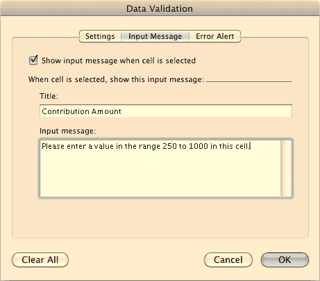
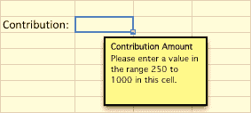
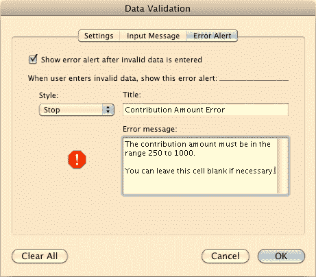
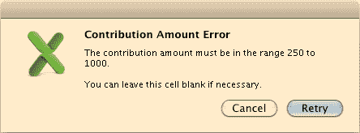
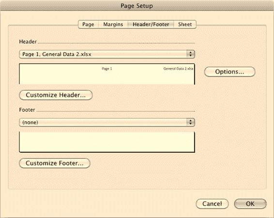
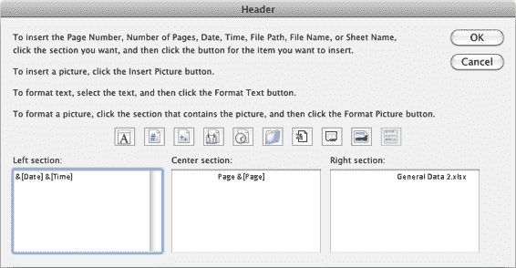

# 快速高效地设置工作表格式

## 清除单元格、区域或工作表中的条件格式

如果单元格、区域、工作表、表格或`PivotTable`不再需要条件格式，可按以下步骤将其清除：

1.  选择对象：
    -   选择单元格或区域
    -   点击表格或`PivotTable`内部
    -   激活工作表

2.  选择`开始` → `格式` → `条件格式` → `清除规则`，然后从子菜单中点击相应的项目：`清除所选单元格的规则`、`清除整个工作表的规则`、`清除此表格的规则`或`清除此数据透视表的规则`。

> **注意：** 若要折叠`管理规则`对话框，请单击`折叠对话框`按钮。选择相应的区域，然后再次单击`折叠对话框`按钮以恢复`管理规则`对话框。
>
> 在`如果为真则停止`列中，如果你希望在某个规则为`true`时停止评估其他规则，请选中该规则的复选框。
>
> 单击`确定`按钮关闭`管理规则`对话框。Excel 会将你的选择应用到所选内容上。

## 使用数据验证检查输入

当输入大量数据时，很容易误键入不正确的值。为了帮助避免数据中的错误，你可以使用 Excel 的`数据验证`功能自动检查条目并标记可能有误的条目。例如，如果某个单元格区域中的每个条目都应在 250 到 1000（含）之间，则可以验证数据以标记任何不在此范围内的条目。

> **警告：** 数据验证仅在用户键入值时有效。如果用户粘贴一个值，Excel 不会对其进行验证。

要将验证应用于单元格，请遵循以下步骤：

1.  单击要验证的单元格或选择要验证的区域。

2.  从功能区中选择`数据` → `工具` → `验证`（单击`验证`按钮的主要部分），或从菜单栏中选择`数据验证`，以显示`数据验证`对话框。

3.  单击`设置`选项卡（如图 4–19 所示，已选择设置）以将其置于对话框的前端（如果尚未显示）。

    **图 4–19.** *在“数据验证”对话框的“设置”选项卡上设置验证条件。显示的控件取决于你在“允许”弹出菜单中选择的数据类型。*

4.  在`允许`弹出菜单中，选择要验证的数据类型，然后使用出现的控件设置详细信息。
    -   **任何值。** 当你想关闭单元格或区域的验证时选择此项。即使使用此设置，你也可以使用`输入信息`选项卡（稍后在本列表中提到）来显示关于单元格或区域的消息。
    -   **整数。** 选择此项可为整数（不带小数位的数字）设置条件。例如，在`数据`弹出菜单中，点击`介于`项，然后在`最小值`框中设置最小值，在`最大值`框中设置最大值。
    -   **小数。** 选择此项可为带小数位的数字设置条件。例如，在`数据`弹出菜单中，点击`大于或等于`项，然后在`最小值`框中设置最小值。
    -   **序列。** 当需要将单元格限制为你指定的有效条目列表时选择此项。你可以通过两种方式输入此列表：在`来源`框中键入，用逗号分隔每个条目；或单击`来源`框右端的`折叠对话框`按钮，选择包含数据的工作表区域，然后再次单击`折叠对话框`按钮恢复对话框。选中`提供下拉箭头`复选框，使 Excel 在单元格中显示一个包含有效条目的弹出菜单。

> **提示：** 在设置数据验证条件时，你可以键入一个值，也可以单击`折叠对话框`按钮，然后单击包含该值的单元格。使用单元格中的值可以让你无需编辑数据验证即可轻松更改该值。

---

[www.it-ebooks.info](http://www.it-ebooks.info/)

以便用户能够轻松输入。

-   **日期。** 选择此项可设置日期的条件。例如，在`数据`弹出菜单中单击“大于”项，然后在`开始日期`框中输入起始日期。
-   **时间。** 选择此项可设置时间的条件。例如，在`数据`弹出菜单中单击“介于”项，然后在`开始时间`框中输入起始时间，在`结束时间`框中输入结束时间。
-   **文本长度。** 选择此项可设置文本条目或公式的条件。例如，在`数据`弹出菜单中单击“小于或等于”项，然后在`最大值`框中输入最大长度。
-   **自定义。** 当您需要输入一个返回逻辑值为`TRUE`或`FALSE`的公式时，选择此项。

[www.it-ebooks.info](http://www.it-ebooks.info/)

**148** **第 4 章：快速高效地格式化工作表**

5.  如果您希望允许用户将单元格留空，请选中`忽略空值`复选框。清除此复选框可强制用户使用有效数据填充单元格。
6.  单击`输入信息`选项卡以将其显示出来。图 4–20 左侧屏幕显示了已设置选项的`输入信息`选项卡。

**图 4–20.** *在“数据验证”对话框的“输入信息”选项卡上（左图），输入当单元格被激活时希望用户看到的信息（右图）。*

7.  若要在用户激活单元格时显示一条信息，请选中`选定单元格时显示输入信息`复选框。在`标题`框中键入标题，在`输入信息`框中键入信息。图 4–20 右侧屏幕显示了信息的显示效果。
8.  单击`出错警告`选项卡将其置于前端。图 4–21 左侧屏幕显示了已设置选项的`出错警告`选项卡；图 4–21 右侧屏幕显示了错误信息的显示效果。

[www.it-ebooks.info](http://www.it-ebooks.info/)

**第 4 章：快速高效地格式化工作表** **149**

**图 4–21.** *在“数据验证”对话框的“出错警告”选项卡上（左图），设置在用户向单元格输入无效数据时显示的错误提示（右图）。*

9.  如果您希望在用户输入无效数据时 Excel 显示一个错误消息框，请选中`输入无效数据时显示出错警告`复选框。通常，这会很有帮助。
10. 在`样式`弹出菜单中，为您想要的行为选择图标类型：
    -   **停止。** 错误对话框包含一个`重试`按钮和一个`取消`按钮。如果用户单击`重试`按钮，Excel 将选中未通过验证的条目，以便用户进行更改。如果用户单击`取消`按钮，Excel 将恢复单元格之前输入的内容。
    -   **警告。** 错误对话框在您的信息末尾显示一个“是否继续？”提示，并包含`是`按钮、`否`按钮和`取消`按钮。如果用户单击`是`按钮，即使未通过验证，Excel 也会接受该值。如果用户单击`否`按钮，Excel 将选中未通过验证的条目，以便用户进行更改。如果用户单击`取消`按钮，Excel 将恢复单元格之前输入的内容。
    -   **信息。** 错误对话框包含一个`确定`按钮和一个`取消`按钮。如果用户单击`确定`按钮，即使未通过验证，Excel 也会接受该值。如果用户单击`取消`按钮，Excel 将恢复单元格之前输入的内容。

> **注意：** 在 Windows 上，`样式`弹出菜单中的`停止`、`警告`和`信息`设置会使错误消息框显示不同的图标，这些图标与您在`样式`弹出菜单中做出选择时其下方显示的图标一致。例如，`停止`样式会显示一个带有白色感叹号的红色八边形，如图 4–21 左侧所示。在 Mac OS X 上，对于每种样式，错误消息框都会显示相同的 Excel 图标（如图 4–21 右侧所示），但带有不同的命令按钮和行为。
>
> **提示：** 要强制用户输入有效数据，请在“数据验证”对话框的“出错警告”选项卡中，从“样式”弹出菜单中选择`Stop`项。`Warning`样式和`Information`样式在您需要对工作表的使用提供更温和的指导，且数据不必严格符合要求时非常有用。

[www.it-ebooks.info](http://www.it-ebooks.info/)

**150** **第 4 章：快速高效地格式化工作表**

11. 输入消息框的标题和错误信息。
12. 点击`OK`按钮关闭“数据验证”对话框。Excel 将应用该验证。

## 使用表格格式和样式快速设置格式

为了节省您设置格式的时间，Excel 提供了预设格式，您可以将其应用于表格以赋予其整体外观。并且，为了省去您反复对不同单元格应用多种不同类型格式的麻烦，Excel 包含了样式——即可一次性应用的格式化集合。

### 使用表格格式进行格式化

当您需要快速设置表格格式时，请查看 Excel 的预设表格格式是否能满足需求。选择表格，选择`表格` -> `表格样式` -> `表格样式`，然后点击您想要的样式。

> **注意：** 有关创建和使用 Excel 表格的说明，请参阅第 10 章。

### 使用样式进行格式化

正如您在本章前面所见，您可以通过使用功能区“开始”选项卡中的“字体”组、“对齐方式”组和“数字”组中的控件，使用“格式”工具栏上的控件，或打开“设置单元格格式”对话框并操作其六个选项卡，来为任何单元格设置精确所需的格式。但是一次只设置一个方面的格式（字体、字号、对齐方式等）效率很低，并且很容易导致格式应用不一致。

为了节省时间并确保格式一致，您可以使用 Excel 的样式。每个样式都是可以应用于一个或多个单元格的格式集合。该样式包含六种类型的格式，分别对应“设置单元格格式”对话框的每个选项卡：

- **数字。** 例如，`常规`、`货币` 或 `百分比`。
- **对齐。** 水平对齐（例如，`常规`、`居中` 或 `两端对齐`）、垂直对齐（例如，`靠上`、`居中` 或 `靠下`）以及任何修饰（例如文本自动换行）。
- **字体。** 字体、字号、字体颜色等。
- **边框。** 已应用于该样式的任何边框，如果没有边框则为`无边框`。
- **填充。** 已应用于该样式的任何填充，如果是纯色则为`无颜色`。
- **保护。** `锁定`、`隐藏`、两者都选或`不保护`。

大多数 Excel 模板都包含大量样式供您入门，但如果需要，您也可以创建自己的自定义样式。

### 了解 Excel 的样式

要查看工作簿中可用的样式，请选择`开始` -> `格式` -> `样式`，然后查看“单元格样式”面板（见图 4–22）。该面板按以下类别列出样式：

- **自定义。** 仅当您在工作簿中创建了一个或多个自定义样式时，此类别才会出现。
- **好、差和一般。** 此类别包含`好`、`差`和`一般`样式，您可以用它们对单元格应用颜色编码。此处还可以找到应用于未使用其他样式单元格的`常规`样式。
- **数据和模型。** 此类别包含`计算`、`检查单元格`、`解释性`、`后续超链接`、`超链接`、`输入`、`链接单元格`、`注释`、`输出`和`警告文本`样式。这些样式大多用于数据建模。Excel 会自动将`超链接`样式应用于包含尚未点击的超链接的单元格，一旦您点击它们，其样式将更改为`后续超链接`。
  注意：仅当工作簿包含超链接时，`超链接`样式才会出现在“样式”面板的“数据和模型”类别中。同样，仅当工作簿包含您点击过的超链接时，`后续超链接`样式才会出现。
- **标题和表头。** 此类别包含四种用于递减标题级别的样式（`标题 1`、`标题 2`、`标题 3` 和 `标题 4`），用于为工作表添加标题的`标题`样式，以及用于轻松设置包含总计单元格格式的`汇总`样式。
- **主题单元格样式。** 此类别包含六种`强调`样式（`强调 1` 到 `强调 6`），以六种主题色为特色，每种颜色有四个色度级别。仅当工作簿的模板包含主题单元格样式时，此类别才会出现。

### 应用样式

要应用样式，请选择`开始` -> `格式` -> `样式`，然后在“样式”面板上点击该样式。您也可以从功能区“开始”选项卡的“数字”组中应用各种`数字`样式（例如`货币`样式、`百分比`样式和`千位分隔`样式）。

### 创建自定义样式

如果 Excel 的样式都不符合您的需求，您可以自行创建。要创建样式，请按照以下步骤操作：

1.  设置单元格格式，使其具有您希望样式包含的格式。
    提示：要快速开始设置格式，请先应用最接近您所需外观和格式的现有样式。然后更改格式，使其符合您的要求。
2.  选择已设置格式的单元格。
3.  选择`开始` -> `格式` -> `样式` -> `新建单元格样式`，以显示“新建单元格样式”对话框（图 4–23 显示了已选择设置的对话框）。
4.  在`样式名`框中，键入您想给该样式命名的名称。
5.  在`所选样式包含以下属性的格式`区域中，清除您想从样式中排除的单元格格式的复选框。例如，清除`保护`复选框以排除`锁定`或`隐藏`格式。
    注意：如果需要更改格式，请点击`格式`按钮以显示“设置单元格格式”对话框。进行所需的更改，然后点击`确定`按钮返回“新建单元格样式”对话框。
6.  点击`确定`按钮关闭“新建单元格样式”对话框并创建该样式。Excel 会将此样式添加到“样式”面板顶部的`自定义`区域。

提示：除了创建新样式，您还可以修改内置样式。选择`开始` -> `格式` -> `样式`以显示“样式”面板，按住 `Ctrl` 键并点击或右键点击要更改的样式，然后点击上下文菜单中的`修改`项。在“修改单元格样式”对话框中，选中或清除`所选样式包含以下属性的格式`区域中的复选框，或者点击`格式`按钮显示“设置单元格格式”对话框并进行所需更改。完成后，点击`确定`按钮返回“修改单元格样式”对话框，然后点击`确定`按钮。

### 将样式从一个工作簿复制到另一个工作簿

如果您在一个工作簿中有想用于另一个工作簿的样式，您可以复制这些样式。Excel 将此称为导入样式。导入样式时，目标工作簿会接收源工作簿中的所有样式——您无法挑选（但请参阅附近的提示）。

要导入样式，请按照以下步骤操作：

1.  打开源工作簿（包含样式的工作簿）和目标工作簿。
2.  通过点击目标工作簿切换到该工作簿。
3.  选择 `开始` -> `格式` -> `样式` -> `导入单元格样式`，打开 `导入单元格样式` 对话框（参见图 4–24）。
    图 4–24. 使用 `导入单元格样式` 对话框可将一个工作簿中的所有样式复制到另一个工作簿中。
4.  在 `从打开的工作簿中复制单元格样式` 列表框里，单击源工作簿。
5.  单击 `确定` 按钮关闭 `导入单元格样式` 对话框。Excel 会将样式复制到目标工作簿中，之后你就可以开始使用这些样式了。

提示：如果只需将一个样式从某个工作簿复制到另一个工作簿，请先在源工作簿中将该样式应用于某个单元格。然后复制该单元格，切换回目标工作簿。`Ctrl`+单击或右键单击一个你愿意修改的单元格，再单击 `选择性粘贴`，打开 `选择性粘贴` 对话框。在 `粘贴` 区域中选择 `格式` 选项按钮，然后单击 `确定` 按钮。Excel 会将样式粘贴到该单元格上，之后你就可以在该工作簿中使用这个样式了。

### 删除不需要的样式

如果你不再需要某个样式，可以将其删除。选择 `开始` -> `格式` -> `样式`，`Ctrl`+单击或右键单击 `单元格样式` 面板中的样式，然后在上下文菜单中单击 `删除`。
注意：Excel 会阻止你删除 `普通` 样式，因为对于未应用其他样式的任何单元格，Excel 都会使用该样式。

## 为工作表添加页眉和页脚

在通过屏幕、纸张或 PDF 文件分发工作表供他人查看之前，你很可能需要添加页眉、页脚或两者，以便标识页面。Excel 为每个工作表提供了独立的页眉和页脚，你可以用预设文本或自定义文本填充。每个页眉和页脚区域都包含左侧部分、中间部分和右侧部分，因此你可以轻松添加若干条不同的信息。

你可以通过使用 `页面设置` 对话框中的 `页眉/页脚` 选项卡，或切换到 `页面布局` 视图并直接在页眉和页脚区域中操作，来向页眉和页脚添加信息。我们先介绍 `页面设置` 对话框，这是添加预设文本最简单的方法。

### 使用“页面设置”对话框添加页眉和页脚

要通过 `页面设置` 对话框为活动工作表添加页眉和页脚，请按照以下步骤操作：

1.  从功能区选择 `布局` -> `页面设置` -> `页眉和页脚`，或从菜单栏选择 `视图` -> `页眉和页脚`，以显示 `页面设置` 对话框中的 `页眉/页脚` 选项卡。图 4–25 显示了 `页面设置` 对话框的 `页眉/页脚` 选项卡，其中已选择了一个预设页眉。

图 4–25. 通过“页面设置”对话框的“页眉/页脚”选项卡，你可以快速为活动工作表添加预设或自定义的页眉和页脚。

2.  如果要添加预设的页眉或页脚，请打开 `页眉` 弹出菜单或 `页脚` 弹出菜单，然后单击所需的预设项。每个弹出菜单都有多种选项，范围从仅显示页码到显示你的姓名、页码和日期。你选择的预设项将显示在预览框中。
3.  如果要创建自定义页眉或页脚，请单击 `自定义页眉` 按钮以显示 `页眉` 对话框（参见图 4–26），或单击 `自定义页脚` 按钮以显示 `页脚` 对话框（两者除名称外完全相同）。

图 4–26. 使用“页眉”对话框或“页脚”对话框，在页眉或页脚的左侧部分、中间部分和右侧部分中输入所需的文本、域代码或图片。

**4.** 单击 `左侧部分` 框，然后设置所需的页眉或页脚：单击 `页眉` 对话框或 `页脚` 对话框工具栏上的按钮。