# 值大于或等于 15000。

否则，返回 `FALSE`。

## `<` - 小于

`=B2<15000` 如果单元格 `B2` 包含一个小于 15000 的值，则返回 `TRUE`。否则，返回 `FALSE`。

## `<=` - 小于或等于

`=B2<=15000` 如果单元格 `B2` 包含一个小于或等于 15000 的值，则返回 `TRUE`。否则，返回 `FALSE`。

## 引用运算符

| 运算符 | 运算 | 说明或示例 |
|----------|-----------|------------------------|
| `[单元格引用]:[单元格引用]` | 两个单元格引用之间的单元格区域 | `A1:G5` 返回左上角为单元格 `A1`、右下角为单元格 `G5` 的单元格区域。 |
| `[单元格引用],[单元格引用]` | 列出的单元格区域 | `A1,C3,E5` 返回三个单元格：`A1`、`C3` 和 `E5`。 |
| `[单元格或区域引用] [空格][单元格或区域引用]` | 出现在两个给定单元格或区域中的区域（或单元格） | `=A7:G10 B10:B12` 返回单元格 `B10`，因为这是唯一出现在两个给定区域中的单元格。如果该区域中出现多个单元格，则返回 `#VALUE!` 错误。 |

## 文本运算符

| 运算符 | 运算 | 说明或示例 |
|----------|-----------|------------------------|
| `&` | 连接（将值作为文本拼接） | `=A1&B1` 将单元格 `A1` 和 `B1` 中的值连接成一个文本字符串并返回。例如，如果 `A1` 包含“New York ”（含尾随空格），`B1` 包含“Sales”，则此公式返回“New York Sales”。如果 `A1` 包含 100，`B1` 包含 50，则此公式返回 10050。 |

#### 创建直观的公式

既然您已经了解了计算运算符，请尝试以下示例，创建一个包含使用四种最直观运算符（加法、减法、乘法和除法）的直观公式的工作表（见图 5-1）。

**图 5-1.** *创建此简单工作表，尝试使用 Excel 的加法、减法、乘法和除法运算符。*

要创建工作表，请按以下步骤操作：

1.  **创建新的工作簿。** 最快的方法是按 `Cmd+N`。

2.  **在单元格 A1 到 A7 中键入以下文本：**
    - A1. 总收入
    - A2. 支出
    - A3. 税率
    - A4. 税额
    - A5. 净收入
    - A6. 月份数
    - A7. 月均净收入

3.  **对 A 列应用加粗**，方法是单击列标，然后选择 `开始 > 字体 > 加粗`。

4.  **对 B 列应用货币格式**，方法是单击列标，然后选择 `开始 > 数字 > 数字格式 > 货币`。

5.  **在单元格 B1 到 B3 中键入以下文本：**
    - B1. 84000
    - B2. 30000
    - B3. 0.18

6.  **对单元格 B3 应用百分比样式**，方法是单击该单元格，然后选择 `开始 > 数字 > 数字样式 > 百分比样式`。
    **注意：** 您也可以在步骤 6 中通过键入 `18%` 并按回车键来输入百分比。Excel 会自动将数字格式更改为百分比。

7.  **现在在单元格 B4 中输入公式 `=B1*B3`**，具体操作如下：
    - **a.** 单击单元格 B4 将其选中。
    - **b.** 键入 `=` 开始在单元格中创建公式。
    - **c.** 单击单元格 B1 将其输入到公式中。Excel 会在该单元格周围显示一个闪烁的蓝色虚线轮廓，并将其添加到单元格和编辑栏的公式中（见图 5-2）。
      **图 5-2.** *单击单元格 B1 时，Excel 会将其添加到单元格和编辑栏的公式中，并显示一个蓝色的虚线轮廓。*
    - **d.** 键入 `*` 告知 Excel 您想要将单元格 B1 中的值相乘。Excel 在公式中输入星号，并将单元格 B1 周围的轮廓更改为实线蓝色。
    - **e.** 单击单元格 B3 将其输入到公式中。Excel 会在此单元格周围显示一个闪烁的虚线轮廓（这次是绿色），并将其添加到单元格和编辑栏的公式中（见图 5-3）。
      **图 5-3.** *单击单元格 B3 将其添加到公式中。*
    - **f.** 按 `Return` 键或单击 `输入` 按钮（编辑栏中的复选标记按钮）。


在公式栏中完成输入后，按下回车键即可在单元格`B4`中输入公式。

**8.** 在单元格`B5`中输入公式`=B1-(B2+B4)`。请按照以下步骤操作：

**a.** 点击单元格`B5`将其选中。如果您按下回车键输入了上一步的公式，Excel 可能已经自动选中了此单元格。

**b.** 输入`=`开始在该单元格中创建公式。

**c.** 点击单元格`B1`将其添加到公式中。

**d.** 输入`-`以输入减法运算符。

**e.** 输入`(`开始一个嵌套表达式。（关于此内容稍后详述。）

**f.** 点击单元格`B2`将其添加到公式中。

**g.** 输入`+`以输入加法运算符。

**h.** 点击单元格`B4`将其添加到公式中。

**i.** 输入`)`以结束嵌套表达式。

**j.** 点击“输入”按钮完成公式的输入。

**9.** 在单元格`B6`中输入`12`并对其应用常规格式。请按照以下步骤操作：

**a.** 点击单元格`B6`。

**b.** 选择“开始” > “数字” > “数字格式” > “常规”。

**c.** 输入`12`。

**d.** 按下向下箭头键以输入该值并将活动单元格移动到`B7`。

[www.it-ebooks.info](http://www.it-ebooks.info/)

**172**

**第 5 章：使用公式执行自定义计算**

**10.** 在单元格`B7`中输入公式`=B5/B6`。这次，直接在单元格中键入公式（使用小写字母即可），然后按下回车键。您会注意到，当您输入`B5`时，Excel 会高亮选中单元格`B5`，以便您直观地检查所选单元格是否正确。

现在您已经创建了工作表，尝试更改单元格`B1`、`B2`和`B3`中的数值。您会看到单元格`B4`、`B5`和`B7`中的公式结果随之发生变化。每次更改单元格中的值时，Excel 都会重新计算公式，因此公式结果始终保持最新。

**为大型工作簿关闭自动重新计算**

如果您创建了包含大量数据的工作簿，自动重新计算可能会使 Excel 运行缓慢，尤其是当一个重新计算的值导致许多其他值也需要重新计算时。

如果您发现 Excel 在重新计算工作簿时运行吃力，可以通过选择“公式” > “计算选项” > “手动”来关闭自动计算。如果问题是由重新计算引起的，您会立即感受到差异。

当需要时，您可以通过选择“公式” > “计算工作表”来手动重新计算当前活动工作表，或选择“公式” > “重新计算所有”来重新计算整个工作簿。

**创建复杂公式**

正如您在上一节中所见，您可以快速创建包含单一运算符的简单公式。但通常您需要创建使用多个运算符的公式，就像您在上节中所做的那样。此时，您必须理解 Excel 评估运算符的顺序，以确保计算正确。您还需要知道如何指示 Excel 以不同的顺序评估运算符。此外，您可能希望将一个复杂公式分解为多个步骤，以便清楚地了解每一步的操作。

**理解 Excel 评估运算符的顺序**

在之前的示例中，您在单元格`B5`中输入了公式`=B1-(B2+B4)`。括号是必需的，因为该计算包含两个独立的阶段——一个是减法阶段，一个是加法阶段——因此您需要控制它们的执行顺序。

尝试将单元格`B5`中的公式改为`=B1-B2+B4`，看看会发生什么。请按照以下步骤操作：

[www.it-ebooks.info](http://www.it-ebooks.info/)

**第 5 章：使用公式执行自定义计算**

**173**

**1.** 点击单元格`B5`。

**2.** 点击公式栏开始在其中编辑公式。（您也可以通过双击单元格或按`Ctrl+U`在单元格内进行编辑，但在公式栏中编辑提供了更大的空间，因此通常更简单。）

**3.** 删除左括号和右括号。

**4.** 点击公式栏上的“输入”按钮。

您会注意到“净额”（单元格`B5`）大幅增加。这是因为您更改了公式的含义：

`=B1-(B2+B4)`。这个公式的意思是“将单元格`B2`中的值与`B4`中的值相加，


`对 B4 单元格中的值，然后从 B1 单元格的值中减去该结果。`

`=B1-B2+B4`。此公式的意思是“从`B1`单元格的值中减去`B2`单元格的值，然后将`B4`单元格的值加到结果上。”

单击单元格`B5`，按`Ctrl+U`打开单元格进行编辑。将插入点定位到`B2`之前，输入`(`；然后将插入点定位到`B4`之后，输入`)`。然后按回车键在单元格中输入公式。

**注意：** 在公式中输入右括号时，你会看到左括号会短暂变暗，以便清晰地显示配对关系。当单元格内容复杂且包含其他嵌套项时，相应括号像这样变暗有助于您识别它们。

Excel 评估运算符的顺序称为*运算符优先级*，它对公式的结果影响巨大——因此，了解其工作方式以及如何覆盖它至关重要。表 5-2 显示了 Excel 评估公式中运算符的顺序。

**表 5-2.** *Excel 运算符优先级（降序排列）*

| **优先级** | **运算符**                        | **说明**          |
|------------|----------------------------------|-------------------|
| 1          | `-`                              | 取反              |
| 2          | `%`                              | 百分比            |
| 3          | `^`                              | 乘幂              |
| 4          | `*` 和 `/`                       | 乘法和除法        |
| 5          | `+` 和 `-`                       | 加法和减法        |
| 6          | `&`                              | 连接              |
| 7          | `=`, `<>`, `<`, `<=`, `>`, `>=` | 比较运算符        |

当两个运算符处于同一优先级时，Excel 会先计算公式中出现在前面的运算符。

##### 嵌套公式部分以控制运算符优先级

您可以通过将公式的一个或多个部分嵌套在括号中来控制任何公式中的运算符优先级。例如，正如您刚才所见，使用`=B1-(B2+B4)` 会让 Excel 在减法之前先计算 `B2+B4`。

如果需要，您可以将公式部分嵌套多层。例如，以下公式使用了三层嵌套，并返回 180：

```
=10*(5*(4/(1+1))+8)
```

##### 将复杂公式分解为多个步骤

单元格可以接受几乎任意复杂的公式——有些人喜欢创建复杂到需要专家才能理解的公式。

除非您喜欢这种工作方式，否则在需要创建复杂公式时，可以考虑将其分解为多个步骤，将每一步放在单独的单元格或行中。例如，你可以将公式`=10*(5*(4/(1+1))+8)` 分解如下：

- 单元格 `B1`：`=1+1`
- 单元格 `B2`：`=4/B1`
- 单元格 `B3`：`=5*B2`
- 单元格 `B4`：`=B3+8`
- 单元格 `B5`：`=10*B4`

像这样分解后，每个公式都易于阅读，并且您可以轻松查看是否有任何步骤给出了错误结果。您可以在下一个单元格中为每个步骤输入文本说明以供参考，或者（更隐蔽地）插入一条注释来描述该步骤。

检查公式无误后，您可以选择创建一个新的、归入单个单元格的公式版本。但如果您希望保持工作表易于阅读和审计，请将公式保留在其分步形式中。

##### 通过复制和使用自动填充快速输入公式

在许多工作表中，您需要将相关公式输入到多个单元格中。例如，假设您有如图 5-4 所示的工作表，其中列出了多种产品及其价格和销量。D 列需要显示通过将“数量”乘以“价格”值得到的总收入。

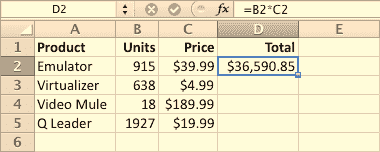

**图 5-4.** *当工作表的列或行中需要相似的公式时，您可以手动输入一个公式，然后使用自动填充或复制粘贴功能将其快速输入到其他单元格中。*

D 列中的每个单元格都需要不同的公式：单元格 `D2` 需要 `=B2*C2`，单元格 `D3` 需要 `=B3*C3`，依此类推。由于除了行号外公式相同，您可以使用自动填充或复制粘贴功能将单元格 `D2` 中的公式输入到其他单元格中。


要使用自动填充输入公式，请单击包含公式的单元格（此处为单元格 `D2`），然后将自动填充手柄（活动单元格右下角的蓝色方块）向下拖过单元格 `D5`。Excel 会自动填充公式，并根据行的变化调整每个公式。

要使用复制和粘贴输入公式，请单击包含公式的单元格，然后执行复制命令（例如按 `Cmd+C`）。选择目标单元格，然后执行粘贴命令（例如按 `Cmd+V`）。

**注意：** 如果需要将公式复制到不同的行或列，但希望它引用原始列或行，请使用混合引用创建公式。如果需要保持列不变，请将列设为绝对引用（例如 `=$B2`）；如果需要保持行不变，请将行设为绝对引用（例如 `=B$2`）。如果需要公式始终引用同一个单元格或区域，请将其创建为绝对引用。

#### 选择错误检查首选项

Excel 可以自动识别公式中的各种错误。要选择 Excel 标记哪些错误，您可以设置错误检查首选项。选择“Excel 首选项”或按 `Cmd+,`（Cmd 和逗号键）以显示“Excel 首选项”对话框，然后在“公式和列表”区域中单击“错误检查”图标，即可显示“错误检查”窗格（参见图 5-5）。

[www.it-ebooks.info](http://www.it-ebooks.info/)

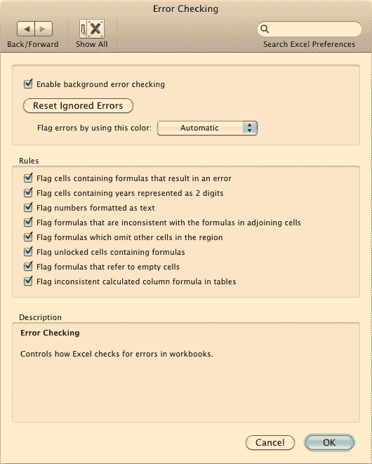

**176**

**第 5 章：使用公式执行自定义计算**

**图 5-5.** *在“Excel 首选项”对话框的“错误检查”窗格中，选择是否启用后台错误检查，并决定使用哪些规则。*

然后，您可以在上方框中选择以下设置：

- **启用后台错误检查。** 选中此复选框可开启后台错误检查。对于中小型工作簿，后台错误检查是一个好主意，但对于大型工作簿，您可能希望关闭它，因为它会拖慢 Excel 的速度。如果关闭了后台错误检查，请务必手动检查错误（选择“公式”>“审核公式”>“检查错误”，单击 `检查错误` 按钮的主要部分）。
- **重置忽略的错误。** 单击此按钮可重置活动工作簿中您已告知 Excel 忽略的所有错误。在构建工作表且因数据未就位而出现错误时，忽略错误可能会有所帮助。工作表完成后，您可以单击 `重置忽略的错误` 按钮来查看任何剩余的错误。

[www.it-ebooks.info](http://www.it-ebooks.info/)

**第 5 章：使用公式执行自定义计算**

**177**

- **使用此颜色标记错误。** 在此弹出菜单中，选择用于标记错误的颜色。默认设置为“自动”，由 Excel 选择颜色。

在“规则”框中，您可以选中或清除以下复选框，以控制 Excel 通过在单元格左上角放置绿色三角形来标记哪些错误（或看似错误）：

- **标记包含导致错误的公式的单元格。** 选中此复选框可使 Excel 标记其公式产生错误的单元格。这通常很有帮助。
- **标记表示为 2 位数的年份的单元格。** 选中此复选框可使 Excel 标记包含用两位数而非四位数表示的年份的单元格（例如 `11` 而不是 `2011`）。使用四位数年份有助于避免电子表格中的混淆。
- **标记格式化为文本的数字。** 选中此复选框可使 Excel 标记具有文本格式而非数字格式的数字，或者您在前面加了撇号以强制 Excel 将其视为文本的数字。此选项可能有所帮助，但它很容易标记您故意格式化为文本的单元格。
- **标记与相邻单元格中的公式不一致的公式。** 选中此复选框可使 Excel 标记那些因与相邻单元格中的公式不同而看似错误的公式。例如，


如果你有一行包含八个单元格，其中六个包含`SUM()`公式（对上方单元格求和），而另外两个包含`SUM()`公式（对左侧三个单元格求和），此设置会使 Excel 标记那两个单元格，因为它们所包含的公式与相邻单元格不同。这可能会有所帮助，但如果那两个异常单元格是对财年季度进行汇总，你或许希望公式保持差异。

**标记公式中遗漏区域其他单元格的公式。** 选中此复选框可使 Excel 标记那些本意是覆盖工作表整个区域但遗漏了特定单元格的公式。如果这些遗漏是有意的，你可以禁止显示这些标记。

**标记包含公式的未锁定单元格。** 选中此复选框可使 Excel 标记包含公式的未锁定单元格。此设置有助于你追踪那些需要锁定以防止同事随意修改计算的单元格。

**标记引用空单元格的公式。** 选中此复选框可使 Excel 标记尝试使用空单元格的公式。空单元格会在公式中引发许多问题，包括除零错误，因此让 Excel 识别使用了空单元格的公式通常是个好主意。

*[www.it-ebooks.info](http://www.it-ebooks.info/)*

**178**

**第 5 章：使用公式执行自定义计算**

*标记表中不一致的计算列公式。* 选中此复选框可使 Excel 标记表中与列内其他公式不一致的公式。（第 10 章将介绍如何创建表格。）

完成选择错误检查偏好设置后，单击“确定”按钮关闭“偏好设置”对话框。

**排查公式常见问题**

公式在正常工作时非常强大，但一个字母的拼写错误或错误的引用可能导致公式无法正确运行。本节将展示如何处理公式的常见问题，首先从你最可能遇到的错误信息的解决方案开始。

**注意：** 本节展示如何排查 Excel 能够识别的问题，因为它们会阻止计算运行。但更危险的是那些*不*导致错误却给出错误结果的公式错误；因为公式能正常运行，Excel 无法检测到错误，因此不会提出异议，但你得到的数值并非你所预期。如果计算结果的正确性对你很重要（通常如此），请让一位有能力的同事检查你的工作表。

你也可以参考类似《Spreadsheet Check and Control》（O’Beirne, Systems Publishing）这样的书籍，该书教您如何审计 Excel 工作表。

**理解常见错误——并解决它们**

Excel 包含一系列令人印象深刻的错误信息，但其中一些出现的频率远高于其他。表 5–3 展示了八种你可能会遇到的错误，解释它们的含义，并告诉你如何解决。

[www.it-ebooks.info](http://www.it-ebooks.info/)

**第 5 章：使用公式执行自定义计算**

**179**

**表 5–3.** *如何解决 Excel 八种最常出现的错误*

**错误**

**问题是什么**

**如何解决**

`######`

公式结果太宽而无法在单元格中显示。

加宽列——例如，双击列标题的右边界以自动调整列宽。

`#NAME?`

函数名称拼写错误，或公式引用了不存在的区域。

检查所有函数的拼写；修正任何错误。如果公式使用了命名区域，请检查名称是否正确，并且尚未删除该区域。

`#NUM!`

函数尝试使用对其无效的值——例如，返回负数的平方根。

为函数提供一个合适的值。

`#VALUE!`

函数使用了无效的参数——例如，使用`=FACT()`返回文本的阶乘而非数字。

为函数提供正确的数据类型。

`#N/A`

函数没有有效值。


确保函数参数可用。提供正确类型的值。

`#DIV/0`

函数尝试除以零，这在数学上是不可能的。请将除数从零改为其他值。通常，你会发现函数使用了空白单元格（其值为零）作为除数参数；在这种情况下，请在单元格中输入一个值。

`#REF!`

公式使用了无效的单元格引用或范围——例如，因为你删除了一个工作表。请编辑公式并提供有效的引用。

`#NULL!`

指定的两个范围之间没有交集。请更改范围以产生交集。

**警告：** `=SUM()` 函数足够智能，会忽略你提供给它的文本值。例如，如果单元格 `A1` 包含数值 `1`，而单元格 `A2` 包含文本 `Dog`，那么函数 `=SUM(A1:A2)` 会返回 `1`，即使公式 `=A1+A2` 会返回一个 `#VALUE!` 错误。`=SUM()` 函数在此处的智能性可谓利弊参半：你得到了一个可用的结果，这大概是你想要的——但这却隐藏了你试图将文本而非数值相加所犯的错误。

[www.it-ebooks.info](http://www.it-ebooks.info/)

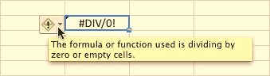 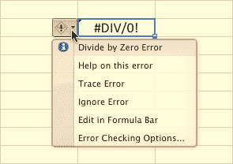 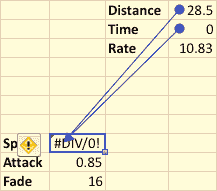 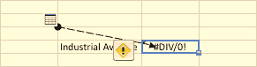

**180 第 5 章：使用公式执行自定义计算**

##### 查看公式中的错误详情

当 Excel 识别出公式中的错误时，它会在包含该公式的单元格左上角显示一个绿色三角形。点击该单元格会显示一个操作按钮，你可以将鼠标悬停在其上以显示解释该问题的屏幕提示（如图 5-6 左侧所示），或点击以显示一个操作菜单，供你选择解决问题的措施（如图 5-6 右侧所示）。

**图 5-6.** *将鼠标指针悬停在错误单元格的操作按钮上，以显示解释错误原因的屏幕提示。*

##### 回溯错误源

要查看是哪个单元格导致了错误，请点击错误单元格，然后选择 `公式` -> `审核公式` -> `检查错误` -> `追踪错误`。Excel 会从导致错误的单元格或单元格区域显示一个箭头指向错误单元格。图 5-7 的左侧屏幕显示了一个追踪错误的简单示例；工作表越复杂，此功能就越有用。

如果单元格引用位于另一个工作表或另一个工作簿中，Excel 会显示一个工作表符号（见图 5-7 右侧屏幕）。

**图 5-7.** *使用 `公式` -> `审核公式` -> `检查错误` -> `追踪错误` 命令来确定导致错误的单元格。如果单元格引用在另一个工作表或另一个工作簿中，Excel 会显示一个工作表符号，如右侧所示。*

**注意：** 如果你已在错误检查首选项窗格中关闭了后台错误检查，可以从功能区选择 `公式` -> `审核公式` -> `检查错误`（点击 `检查错误` 按钮的主要部分）或从菜单栏选择 `工具` -> `错误检查` 来检查错误。

[www.it-ebooks.info](http://www.it-ebooks.info/)

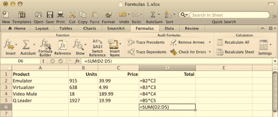 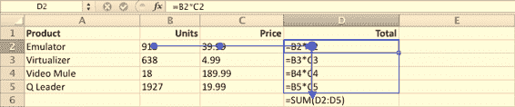

**第 5 章：使用公式执行自定义计算**

**181**

##### 显示工作表中的所有公式

当需要审查或检查工作表中的所有公式时，请选择 `公式` -> `函数` -> `显示` -> `显示公式`，在 `显示` 弹出菜单中的 `显示公式` 项旁边打上勾。Excel 会显示所有公式并自动加宽工作表列以提供更多空间（见图 5-8）。

**图 5-8.** *当需要查看工作表中的所有公式时，请选择 `公式` -> `函数` -> `显示` -> `显示公式`。*

查看完公式后，再次选择 `公式` -> `函数` -> `显示` -> `显示公式`，取消勾选 `显示公式` 菜单项。Excel 会自动将列宽恢复为原先的宽度。

##### 查看公式使用了哪些单元格

要查看公式使用了哪些单元格，或要追踪错误，请点击包含该公式的单元格，然后选择 `公式` -> `审核公式` -> `追踪引用单元格`。Excel 会显示一个箭头，将公式追溯至其源头。如果公式使用的某个单元格本身也包含公式，你可以点击该单元格并再次点击 `追踪引用单元格` 按钮，依次显示其引用单元格。图 5-9 显示了单元格 `D6` 的引用单元格，以及它所使用的其中一个单元格 `D2`。

**图 5-9.** *使用 `追踪引用单元格` 命令查看你在生成公式结果时使用了哪些单元格。在此示例中，单元格 `B2` 和 `C2` 构成了单元格 `D2` 中的公式，而该公式又出现在单元格 `D6` 的 `=SUM(D2:D5)` 公式中。*

[www.it-ebooks.info](http://www.it-ebooks.info/)

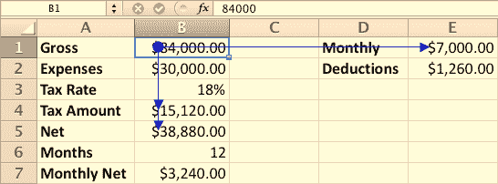

**182 第 5 章：使用公式执行自定义计算**

当你需要反过来查看问题，即哪些公式使用了特定单元格时，请点击该单元格，然后选择 `公式` -> `审核公式` -> `追踪从属单元格`。再次地，Excel 会显示箭头，这次是从该单元格指向使用它的每个公式。图 5-10 显示了一个追踪从属单元格的示例。

**图 5-10.** *使用 `追踪从属单元格` 命令查看哪些公式使用了特定单元格的值来生成结果。*

**注意：** 无论公式是显示出来还是显示结果，你都可以使用 `追踪引用单元格` 命令和 `追踪从属单元格` 命令，选择你认为最方便的一种方式。

完成追踪引用单元格、从属单元格（或错误）后，请选择 `公式` -> `审核公式` -> `移去箭头`（点击 `移去箭头` 按钮的主要部分）以从屏幕上移除箭头。如果你只想移除引用单元格箭头或从属单元格箭头，请点击 `移去箭头` 弹出按钮，然后点击弹出菜单中的 `移去引用单元格箭头` 项或 `移去从属单元格箭头` 项。

##### 消除循环引用

即使你很小心，也容易创建出*循环引用*——即引用自身的引用。当你输入的公式引用了一个单元格，而该单元格本身又引用了你正在输入公式的单元格时，通常会产生循环引用。例如，假设单元格 `A1` 包含公式 `=B1`。如果你在单元格 `B1` 中输入公式 `=A1`，你就创建了一个循环引用：单元格 `B1` 从单元格 `A1` 获取值，而单元格 `A1` 又从单元格 `B1` 获取值，依此类推。

你也可以通过让单元格引用自身来创建循环引用。例如，如果你在单元格 `A1` 中输入 `=A1/B1`，那么你就创建了一个该单元格的循环引用，因为单元格 `A1` 引用了自身。这种类型的循环引用通常比前一种更容易避免。

循环引用在某些特定情况下可能很有用，例如当你需要对计算进行迭代时，但通常你不希望它们出现在工作表中，因此 Excel 会帮你消除它们。

当你创建了一个 Excel 无法计算的循环引用时，Excel 会显示如图 5-11 所示的“Excel 无法计算公式”对话框。如果你想打开一个帮助窗口，其中包含有关如何处理循环引用的信息，请点击 `确定` 按钮；如果你想继续在单元格中输入循环引用（例如，因为你能判断出问题所在并能轻松修复它），请点击 `取消` 按钮。

[www.it-ebooks.info](http://www.it-ebooks.info/)

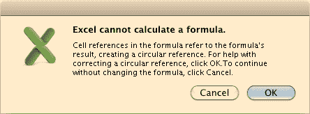

**第 5 章：使用公式执行自定义计算**

**183**

**图 5-11.** *循环引用可能导致工作表中的问题，因此当你输入循环引用时，Excel 会发出警告。如果你确定要创建该循环引用，可以点击 `取消` 按钮。*


**注意：** 如果在工作表中留有循环引用，可以使用状态栏上的“循环引用”读数来识别它们。该读数会显示 Excel 已识别的最新循环引用的位置。处理完该循环引用后，“循环引用”读数会显示下一个，依此类推，直到没有剩余循环引用为止。

**摘要**

在本章中，你学习了如何使用公式在工作表中执行计算。你知道了公式是计算的配方，并了解了如何由各种组成部分（等号、单元格或区域引用、运算符等）来构建它。你学会了如何创建所需的公式，以及当公式出错时如何排错。

在下一章中，我将介绍如何使用 Excel 的内置函数，无论是单独使用还是在公式中使用。

[www.it-ebooks.info](http://www.it-ebooks.info/)

### 第 6 章：使用 Excel 的内置函数

正如你在前一章所见，函数是用于执行标准计算的预定义公式。Excel 包含数百个内置函数，你可以直接将其插入单元格，并提供它们所需的数据来得出答案。

函数省去了你从头创建复杂公式以及公式出错的麻烦，因此当需要执行标准计算时，请先检查 Excel 是否有对应的函数。没必要重复造轮子，尤其当造出的轮子还不圆时。

在本章中，你将学习如何使用 Excel 提供的各种工具将函数插入工作表，如何找到所需的函数，以及如何为函数指向计算所需的数据。

当你熟悉了函数的工作原理后，我们将回顾 Excel 提供的不同函数类别，例如数据库函数、逻辑函数以及数学和三角函数。我将解释你最可能用到的函数，并在有帮助的地方给出示例。

#### 了解函数的组成部分

在 Excel 中，函数有一个用大写字母书写的名称，后跟一对括号，括号内包含函数所需的数据片段（如果有的话）。以下是三个示例：

- `SUM()`。这个广泛使用的函数将你指定的两个或多个数值相加。
- `COUNT()`。此函数计算指定区域中包含数字（而非文本、空白或其他数据类型）的单元格数量。
- `TODAY()`。此函数在单元格中输入当前日期。

大多数函数都带有*参数*，这些信息告诉函数你想要它处理什么。Excel 会提示你提供每个函数所需的参数。例如，当你在单元格中输入函数时，Excel 会显示一个“屏幕提示”，显示所需的参数。图 6-1 展示了使用 `SUM()` 函数的示例。

**图 6-1。** *在单元格中输入函数时，Excel 会提示你提供所需的参数。*

屏幕提示显示 `SUM()` 函数有一个必需参数和一个可选参数，并且你可以根据需要添加更多参数：

- **必需参数。** 每个必需参数不带方括号，例如屏幕提示中的 `number1` 参数。参数之间用逗号分隔，如下一段示例所示。例如，你可以使用 `SUM()` 将某个区域内的单元格值相加：`SUM(C1:C10)`。这里，`C1:C10` 是一个单独的参数，即必需参数。
- **可选参数。** 每个可选参数都出现在方括号中，例如屏幕提示中的 `[number2]` 参数。例如，你可以使用 `SUM()` 将两个单元格的值相加：`SUM(C1,C3)`。这里，`C1` 是必需参数，`C3` 是第一个可选参数。
- **额外参数。** 省略号 (…) 表示你可以输入更多相同类型的参数。例如，你可以使用 `SUM()` 将多个单元格的值相加：`SUM(C1,C3,D4,D8,E1,XF202)`。这里，`C1` 是必需参数，所有其他单元格引用都是可选参数。

**注意：** 少数函数不带任何参数。例如，你不需要告诉 `TODAY()` 函数今天是哪一天。同样，`NOW()` 函数无需任何参数即可返回当前日期和时间，而 `NA()` 函数仅在单元格中输入 `#(N/A)` 以指示信息不可用。即使函数不带参数，你仍然需要包含括号以便 Excel 识别该函数。

#### 在工作表中输入函数

Excel 将最常用的功能放在你的指尖，即使是最高度专业化的函数，你也能快速轻松地输入。

以下是插入函数的四种方法：

- **使用“自动求和”按钮或“自动求和”弹出菜单。** “自动求和”按钮位于标准工具栏和功能区“公式”选项卡的“函数”组中，可快速访问五个常用函数。
- **使用“插入”弹出菜单和“公式生成器”。** “插入”弹出菜单位于功能区“公式”选项卡的“函数”组中。当你从“插入”弹出菜单及其子菜单中选择所需的功能时，Excel 会在工具箱中显示“公式生成器”窗格，引导你完成函数插入。
- **使用工具箱中的“公式生成器”窗格。** 你也可以不先使用“插入”弹出菜单，直接开始在工具箱中的“公式生成器”窗格中操作。打开“公式生成器”窗格最简单的方法是单击编辑栏中的 `fx` 按钮。
- **手动输入函数。** 当你知道需要哪个函数时，可以直接在单元格中键入它。

我们将在以下各节详细讨论。

##### 使用“自动求和”弹出菜单插入函数

在工作表中输入五个常用函数（`SUM()`、`AVERAGE()`、`COUNT()`、`MAX()` 或 `MIN()`）中的任何一个，最快、最简单的方法是使用标准工具栏上的“自动求和”弹出菜单。请遵循以下步骤：

1. 单击要输入函数的单元格。
2. 如果你想为所选单元格上方或左侧的单元格创建 `SUM()` 函数，请直接单击“自动求和”按钮本身。否则，单击“自动求和”弹出按钮，然后单击该函数（参见图 6-2）。

**注意：** 你也可以使用标准工具栏上的“自动求和”弹出菜单打开工具箱中的“公式生成器”窗格。只需单击弹出菜单底部的“其他函数”项即可。

**图 6-2。** *当需要快速插入 `SUM()`、`AVERAGE()`、`COUNT()`、`MAX()` 或 `MIN()` 函数时，请使用标准工具栏上的“自动求和”弹出菜单。*

3. Excel 将函数插入你选择的单元格，并选择它认为你可能想用作参数的区域。图 6-3 展示了使用 `AVERAGE()` 函数的示例。

**图 6-3。** *当你从“自动求和”弹出菜单插入函数时，Excel 会选择一个它认为可能合适的数据区域。*

4. 如果需要更改区域，请使用以下方法之一：
   - 单击并拖动以选择正确的区域。
   - 在括号内，将区域覆盖为键入的新区域。
5. 如有必要，向公式添加另一个参数。例如，键入一个逗号，然后单击并拖动以选择另一个区域。
6. 当公式符合要求时，按 Return 键将其输入到单元格中。Excel 会显示公式的结果。

##### 使用公式生成器插入函数


当您需要查找合适的函数插入，或需要了解某个函数的参数时，请使用 `公式生成器` 插入函数。`公式生成器` 是一个显示在工具箱中的窗格，它提供 Excel 函数的完整列表，并附有相关描述以及它们所用参数的详细信息。

若要使用 `公式生成器` 插入函数，请按照以下步骤操作：

**1.** 选择您要在其中输入函数的单元格。

[www.it-ebooks.info](http://www.it-ebooks.info/)

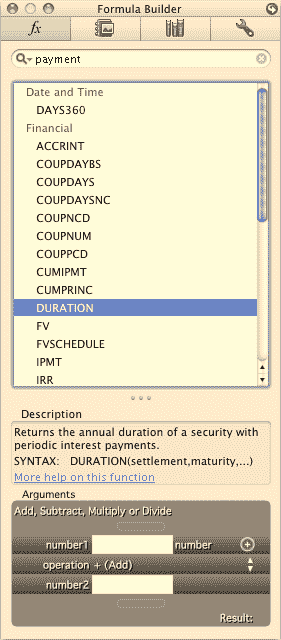

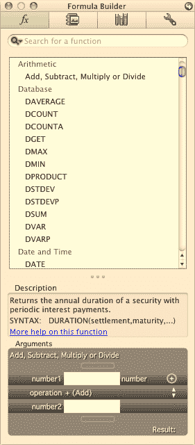

**第 6 章：使用 Excel 的内置函数**

**189**

**2.** 通过以下任一方式打开 `公式生成器`：

- *编辑栏。* 单击 `fx` 按钮。
- *常用工具栏。* 单击 `自动求和` 弹出按钮，然后在弹出菜单中单击 `其他函数` 项。
- *菜单栏。* 选择 `视图` > `公式生成器`。
- *功能区。* 选择 `公式` > `函数` > `公式生成器`。
- *工具箱。* 如果工具箱已打开，请单击 `公式生成器` 选项卡。

**3.** 如果您想搜索函数，请单击顶部的搜索框，输入要搜索的关键词，然后按 `Return` 键。`公式生成器` 会显示结果列表，如图 6-4 左侧所示。

**图 6-4.** *要查找函数，请在“公式生成器”的搜索窗格中输入搜索词并按 Return 键；“公式生成器”会显示结果列表（左侧）。或者，浏览完整的函数列表，并单击您想查看其信息的函数（右侧）。*

[www.it-ebooks.info](http://www.it-ebooks.info/)

**190**

**第 6 章：使用 Excel 的内置函数**

**4.** 否则，浏览函数列表以找到您需要的函数，如图 6-4 右侧所示。`公式生成器` 将函数分为以下几类，本章后面将深入介绍其中的大部分类别：

- **最近使用。** 此类别可让您快速访问最近使用过的函数——因此，如果您正在寻找以前用过的函数，请先从这儿开始。

**提示：** 您可以通过向上或向下拖动大小调整手柄（列表下方由三个点组成的线条）来使 `公式生成器` 窗口中的公式列表更高或更矮。`公式生成器` 窗口会随之增大或缩小以适应列表。

- **算术。** 此类别实际上不显示函数，只有一个名为“加、减、乘或除”的条目。当您双击此项时，`公式生成器` 底部的 `参数` 窗格（参见图 6-4 右侧屏幕）会显示帮助您设置算术公式的控件。

- **数据库。** 此类别包含用于处理数据库的函数——例如，返回列或列表中值的平均值，或者返回一个字段中包含数字的单元格的计数。

- **日期和时间。** 此类别包含各种函数，从使用 `TODAY()` 函数返回当前日期，到使用 `WEEKDAY()` 函数返回特定日期是星期几。

- **工程。** 此类别包含函数，包括 `DEC2HEX()` 函数（用于将十进制数转换为十六进制数，基数为 16）和 `HEX2OCT()` 函数（用于将十六进制数转换为八进制数，基数为 8）。

- **财务。** 此类别包含用于财务计算的函数——例如，计算抵押贷款的还款额或资产的折旧。

- **信息。** 此类别包含用于返回数据信息（例如数据是文本还是数字）的函数。

- **逻辑。** 此类别包含用于执行逻辑测试的函数——例如，测试特定单元格是否包含错误。

- **查找和引用。** 此类别包含用于从工作表其他部分查找数据或引用其中其他单元格的函数。

[www.it-ebooks.info](http://www.it-ebooks.info/)

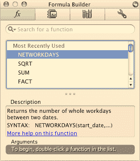

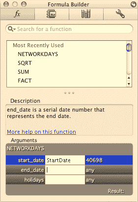

**第 6 章：使用 Excel 的内置函数**

**191**

- **数学和三角函数。** 此类别包含数学函数，例如用于返回平方根的 `SQRT()` 函数。


根，以及三角函数，例如用于计算余弦的`COS()`函数。

**统计类**。此类别包含用于执行统计计算的函数，例如基于总体或样本计算标准差。

**文本类**。此类别包含用于操作文本的函数，例如`TRIM()`函数（用于修剪前导和尾随空格）以及返回值最左侧部分的`LEFT()`函数。

**兼容性类**。此类别包含用于与 Excel 2008 (Mac)、Excel 2007 (Windows) 及更早版本兼容的函数。最好仅在与这些旧版本兼容时才使用这些函数；如果您正在为 Excel 2011 或 Excel 2010 (Windows) 开发工作表，请使用这些版本支持的较新函数——例如，使用新的`POISSON.DIST()`函数而不是旧的`POISSON()`函数。

**5.** 要了解有关某个函数的更多信息，请单击它。公式生成器会在窗口底部显示其详细信息，如左侧的图 6–5 所示。

在这里，您可以单击“此功能的更多帮助”链接，打开一个帮助窗口，其中显示有关该函数及其参数的详细信息。

**图 6–5。** *使用公式生成器底部的“说明”区域来识别您需要的函数（左侧）。*

*当您双击该函数以插入它时，公式生成器会显示“参数”窗格（右侧）。*

[www.it-ebooks.info](http://www.it-ebooks.info/)

**192**

**第 6 章：使用 Excel 的内置函数**

**6.** 当您找到要插入的函数后，双击它。公式生成器会显示该函数的“参数”窗格，如右侧的图 6–5 所示（已输入一个参数）。

**7.** 单击第一个参数的框，然后输入数据。您可以键入一个值或区域名称，键入单元格引用或区域，或使用鼠标在工作表（或另一个工作表或工作簿）中选择一个单元格引用或区域。

**8.** 填写函数的每个其他参数。当您输入完所有必需参数后，函数生成器窗口右下角的“结果”读数会显示该函数的结果。

**9.** 按 `Return` 键在工作表中输入函数。

如果您已完成使用函数生成器，请通过单击其“关闭”按钮（其标题栏左端的按钮）、从菜单栏选择“查看”>“公式生成器”，或单击标准工具栏上的“工具箱”按钮来关闭它。

**使用“插入”弹出菜单插入函数**

当您知道要插入哪个函数时，最简单的插入方法（除非它是“自动求和”弹出菜单上的五个函数之一）是使用“插入”弹出菜单。“插入”弹出菜单帮助您按类别选择函数，并将其直接插入单元格。

要使用“插入”弹出菜单插入函数，请按照以下步骤操作：

**1.** 选择要输入函数的单元格。

**2.** 选择“公式”>“函数”>“插入”以显示“插入”弹出菜单。

此弹出菜单将函数分为十个类别：数据库、日期和时间、工程、财务、信息、逻辑、查找与引用、数学与三角函数、统计和文本。这些类别与公式生成器中显示的类别相似，如本章前面所述。每个类别都有一个子菜单。

**3.** 单击要插入的函数类别。Excel 会显示一个包含这些函数的子菜单。图 6–6 显示了打开的“日期和时间”子菜单。

[www.it-ebooks.info](http://www.it-ebooks.info/)

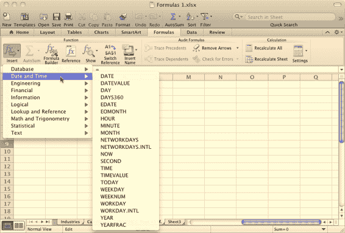

**第 6 章：使用 Excel 的内置函数**

**193**

**图 6–6。** *当您希望按类别插入函数时，请使用“Ribbon”上“公式”选项卡的“函数”组中的“插入”弹出菜单。*

**4.** 单击要插入的函数。Excel 会将其插入到单元格中。

**5.** 照常输入函数的参数。


**提示：** 如果需要帮助提供函数的参数，请单击编辑栏上的 `fx` 按钮，或从功能区选择 `公式 > 函数 > 公式生成器` 以显示公式生成器。公式生成器会显示刚插入函数的详细信息。

**6.** 按 `Return` 键或单击编辑栏上的“输入”按钮，将公式输入到单元格中。

##### 通过在工作表中键入函数来插入函数

你也可以通过直接在单元格中键入函数来将其输入工作表。当你熟悉所需函数并知道其参数时，可能更倾向于使用这种方法。请遵循以下一般步骤：

**1.** 单击单元格将其选中。

**2.** 键入 `=` 告诉 Excel 你正在创建公式。

[www.it-ebooks.info](http://www.it-ebooks.info/)

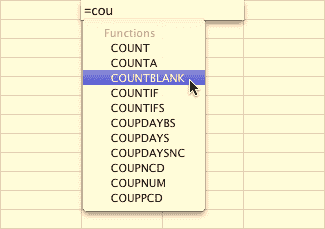

**194**

**第 6 章：使用 Excel 的内置函数**

**3.** 开始键入函数名称。Excel 会显示匹配的函数列表（参见图 6-7）。

**图 6-7.** *当你开始在单元格中键入函数名称时，Excel 会列出匹配的函数。单击要插入的函数，或按下箭头键（必要时按上箭头键）选择函数，然后按* `Return`*。*

**注意：** 你也可以继续键入，直到输入足够字符以唯一标识函数——或者如果愿意，也可以直接键入完整的函数名称。

**4.** 要输入函数，请双击它，或通过按向下箭头或向上箭头将高亮移动到该函数，然后按 `Return`。

**5.** 指定函数的参数。你可以键入一个值或引用，也可以使用鼠标选择单元格或区域。

**注意：** 在单元格中输入函数后，可以通过双击该单元格，或使单元格处于活动状态并按 `Ctrl+U` 来打开函数进行编辑。你可以直接在单元格中或编辑栏中编辑函数。

##### 将一个函数嵌套在另一个函数内部

刚开始使用函数时，你可能只会在单元格中使用单个函数。但随着对函数的使用经验逐渐丰富，你会发现有时需要使用多个函数来执行所需的计算。

当需要同时使用两个或更多函数时，你可以将一个函数嵌套在另一个函数内部。例如，如果需要返回当前小时数，可以将 `NOW()` 函数（返回当前日期和时间）嵌套在 `HOUR()` 函数（以 24 小时格式返回给定时间的小时数；如果需要以 AM/PM 格式显示小时，请更改单元格格式）中：

```
=HOUR(NOW())
```

[www.it-ebooks.info](http://www.it-ebooks.info/)

**第 6 章：使用 Excel 的内置函数**

**195**

与公式类似，如果需要，你可以将函数嵌套很多层。这是一个三层嵌套的示例：

```
=INT(AVERAGE(ROUND(SUM(C1:C6),2),ROUND(SUM(D1:D6),2)))
```

具体运算过程如下：

- `SUM(C1:C6)`：此 `SUM` 函数将范围 `C1:C6` 中的值相加。类似地，`SUM(D1:D6)` 将范围 `D1:D6` 中的值相加。
- `ROUND(SUM(C1:C6),2)`：此 `ROUND` 函数将 `SUM(C1:C6)` 公式的结果四舍五入到两位小数。类似地，`ROUND(SUM(D1:D6),2)` 将 `SUM(D1:D6)` 公式的结果四舍五入到两位小数。
- `AVERAGE`：此函数返回两个 `ROUND` 函数返回结果的平均值。
- `INT`：此函数返回 `AVERAGE` 函数结果的整数部分。

**提示：** 嵌套函数可以使电子表格更紧凑，并给同事留下深刻印象。但在确定使用哪些函数时，你可能发现将每个函数放在单独的单元格中更容易，这样可以看到每个函数返回的结果——也许还可以添加注释说明每个步骤的作用。一旦各函数在单独单元格中正常工作，再在单个单元格中创建嵌套版本，并确保其给出与逐步版本相同的结果。同样，你可能希望添加注释解释嵌套公式的工作原理。

#### 了解 Excel 的内置函数


