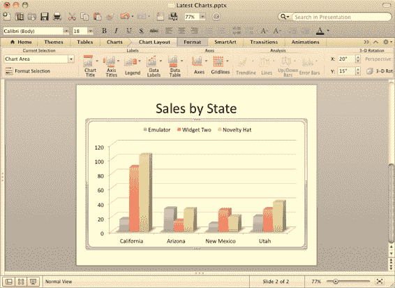
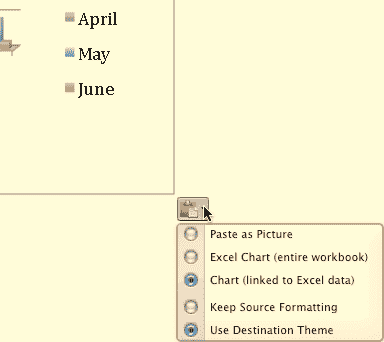
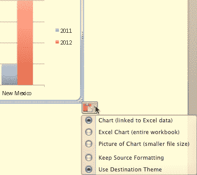

# 创建清晰且有说服力的图表

要基于模板创建图表，请按以下步骤操作：

1. 选择图表的源数据。
2. 选择`图表` > `插入图表` > `其他`以显示“其他”窗格，然后向下滚动到窗格底部的“模板”区域。
3. 点击该模板。

#### 选择图表偏好设置

要使图表按您期望的方式显示，可能需要更改“Excel 偏好设置”对话框“图表”窗格中的设置。“图表”窗格包含一些仅影响所选图表的设置，以及其他影响所有图表的设置。

要打开“图表”窗格，请按以下步骤操作：

1. 点击要更改其特定图表设置的图表。
2. 选择`Excel` > `偏好设置`或按`Cmd+,`（Cmd 键和逗号键）以显示“Excel 偏好设置”对话框。
3. 点击“创作”区域中的“图表”图标。Excel 将显示图表偏好设置窗格（见图 7-15）。

**图 7-15.** 在“Excel 偏好设置”对话框的“图表”窗格中，您可以为当前图表和所有图表选择设置。

在“所选图表”区域内的“将空单元格绘制为”框中，选择如何表示图表中的空单元格：

- **不绘制（留空）。** 选中此选项按钮可使图表在每个空单元格处显示空白。这是常规用途的最佳选择。
- **零值。** 选中此选项按钮可使图表将空单元格显示为零值。在某些图表类型中，这有助于您关注需要补充的缺失值。在其他图表类型中，显示这些零值在视觉上会造成混乱。
- **插值。** 如果您希望 Excel 基于周围可用值自动填充缺失值，请选中此选项按钮。此选项按钮仅适用于某些图表类型。

**注意：** 在处理可识别的趋势时，对图表缺失值进行插值非常有用。例如，如果缺少某一小时的温度测量值，而前一小时温度较高、后一小时温度也较高，则插值会出现在这两个值之间。另一方面，如果缺少某一天的降雨量数据，插值就不合理，因为一天的降雨量与下一天之间通常不存在线性关系。

如果您希望从图表中忽略图表数据源中的任何隐藏行或列，请选中`仅绘制可见单元格`复选框。这通常是您希望做的。清除此复选框可使所有数据显示出来，即使数据源中已将其隐藏。

在“图表屏幕提示”区域中，选中您想要查看的屏幕提示复选框：

- **悬停时显示图表名称。** 选中此复选框可使 Excel 在您将鼠标指针悬停在某个项目上时显示包含该项目名称的屏幕提示。例如，当您将鼠标指针悬停在数据系列上时，屏幕提示会显示该数据系列的名称和详细信息。
- **悬停时显示数据标记值。** 选中此复选框可使 Excel 在您将鼠标指针悬停在数据标记上时显示该数据标记的值。

完成选择图表偏好设置后，点击`确定`按钮关闭“Excel 偏好设置”对话框。

#### 在 Word 文档和 PowerPoint 演示文稿中使用图表

Excel 是 Office 中用于创建图表的应用程序，但您可能也希望使用图表来为 Word 文档和 PowerPoint 演示文稿做说明。您可以重复使用已在 Excel 中创建的图表，也可以专门为该文档或演示文稿创建新图表。

##### 了解如何将图表添加到文档或幻灯片

图表可以极好地以一目了然的方式在文档或幻灯片中呈现复杂或详细的信息。您可以通过以下任一方式将图表添加到 Word 文档或 PowerPoint 演示文稿中：

- **在嵌入式工作表上创建图表。** 单击功能区中的`图表`选项卡，然后使用`插入图表`组中的弹出按钮和面板选择图表类型。Word 或 PowerPoint 随后会为您打开`Excel`并创建一个新工作簿，以便您输入图表数据并创建图表。该工作簿将嵌入到 Word 文档或 PowerPoint 演示文稿中，从而成为该文件的一部分。
    **注意：** 在 PowerPoint 中，您也可以单击内容占位符中的`插入图表`图标，开始在嵌入式工作表上创建图表。

- **从 Excel 工作簿复制图表。** 使用本章前面介绍的技术在`Excel`中创建图表，然后复制完成的图表并将其粘贴到 Word 文档或 PowerPoint 幻灯片中。您可以选择将图表数据嵌入到 Word 文档或 PowerPoint 演示文稿中，或者仅将图表作为图片或 PDF 文件插入。

以下是选择何时创建新的嵌入式工作簿、嵌入现有工作簿、链接回工作簿或插入图片的方法：

- **创建新的嵌入式工作簿。** 当您尚未在`Excel`中准备好图表数据，并且需要将图表数据随 Word 文档或 PowerPoint 演示文稿一起保存时，请执行此操作。例如，您将把演示文稿发送给也需要处理图表数据的其他人。

- **嵌入现有图表及其数据。** 当您在`Excel`工作簿中已有图表数据或图表本身，并且需要在 Word 文档或 PowerPoint 演示文稿中保留图表数据时，请执行此操作。嵌入图表及其数据后，您可以从`Word`中打开图表并在`Excel`中进行编辑。

- **链接回工作簿。** 当您希望能够更改`Excel`中的图表或其源数据，然后通过更新图表自动将这些更改带入`Word`或`PowerPoint`时，请执行此操作。链接要求工作簿相对于文档或演示文稿在计算机文件系统中保持相同的相对位置，以便`Word`或`PowerPoint`能够找到更新的数据。将文档或演示文稿移动到另一台计算机会中断链接。
    **警告：** 链接图表在正常工作时可能非常有用，但链接可能会在最尴尬的时候失效。在提供包含链接图表的演示文稿之前，请仔细检查链接是否正常工作。这样，您将有机会修复任何问题，而不是在观众看到它们时才发现问题。

- **插入图片。** 当您不需要保持图表与其源数据之间的连接，并且不需要在文档或演示文稿中编辑图表时，请执行此操作。

##### 在新的嵌入式工作簿中创建图表

要在一个嵌入到 Word 文档或 PowerPoint 演示文稿的新工作簿中的工作表上创建图表，请按照以下步骤操作：

1. 在 Word 中打开文档，或在 PowerPoint 中打开演示文稿。

2. 在您要创建图表的文档页面或幻灯片上，单击功能区中的`图表`选项卡。Word 或 PowerPoint 会显示功能区中的`图表`选项卡。

3. 在`插入图表`组中，单击您要创建的图表类别的弹出按钮。例如，单击`柱形图`弹出按钮以显示`柱形图`面板。

4. 在弹出面板上，单击图表类型。Word 或 PowerPoint 会在幻灯片上创建该类型的图表，并启动`Excel`，后者会创建一个新工作簿，将其嵌入到文档或演示文稿中，并为其命名，例如`Microsoft Office Word 中的图表`或`Microsoft Office PowerPoint 中的图表`。

5. 更改图表范围和示例数据（图 7-16 显示了一个）

以`PowerPoint`为例）将示例数据替换为图表所需的数据。`Word`或`PowerPoint`会自动更新图表，使其与`Excel`工作表中的数据保持一致。

**图 7–16.** *Excel 在嵌入工作簿的第一个工作表中输入示例数据。修改这些数据以创建你的图表。*

**6.** 完成数据修改后，关闭`Excel`。例如，点击`关闭`按钮（标题栏左端的红色按钮）或选择`Excel` > `退出 Excel`。

**注意：** `Excel`会自动将数据保存在嵌入的工作簿中，因此你在`Excel`窗口中工作时无需另行保存。

**7.** 使用功能区上`图表`选项卡和`图表布局`选项卡中的控件，按你希望的方式设置图表格式。图 7–17 展示了一个正在格式化的图表所在的`PowerPoint`幻灯片。

[www.it-ebooks.info](http://www.it-ebooks.info/)

**第 7 章：创建清晰且有说服力的图表** **257**

**图 7–17.** *使用嵌入工作簿插入图表后，在`Word`或`PowerPoint`（此处所示）中，利用功能区上`图表`选项卡和`图表布局`选项卡中的控件来设置图表格式。*

**8.** 保存你的`Word`文档或`PowerPoint`演示文稿。

**注意：** 如需再次编辑图表数据，请从功能区中选择`图表` > `数据` > `编辑`，点击`编辑`按钮的主体部分。`Word`或`PowerPoint`将打开`Excel`，并显示嵌入的工作表。

##### 将图表从 Excel 粘贴到 Word 文档或 PowerPoint 幻灯片

如果你已在`Excel`中创建了图表，或者已有一个包含将用于创建图表的数据的工作簿，则可以将该图表粘贴到`Word`或`PowerPoint`中。请遵循以下一般步骤：

**1.** 使用本章前面介绍的技术创建图表。

**2.** 点击图表以将其选中。

[www.it-ebooks.info](http://www.it-ebooks.info/)

**258** **第 7 章：创建清晰且有说服力的图表**

**3.** 将图表复制到剪贴板。例如，点击标准工具栏上的`复制`按钮，或按`Cmd+C`。

**4.** 切换到`Word`或`PowerPoint`，然后导航到要插入图表的文档或幻灯片。

**5.** 从剪贴板粘贴图表。例如，点击标准工具栏上的`粘贴`按钮，或按`Cmd+V`。

**6.** 点击图表右下角的`粘贴选项`按钮，然后在`粘贴选项`弹出菜单的上方组中点击相应的选项按钮（见图 7–18）：

- **图表（链接到 Excel 数据）。** 选择此选项按钮可将图表链接回其来源的`Excel`工作簿。

**图 7–18.** *将图表从`Excel`粘贴到`Word`文档（左）或`PowerPoint`幻灯片（右）时，点击`粘贴选项`按钮，并使用弹出菜单中的选项按钮选择粘贴图表的方式。*

- **Excel 图表（整个工作簿）。** 选择此选项按钮可将整个`Excel`工作簿嵌入到`PowerPoint`演示文稿中。
- **粘贴为图片（Word）或图表图片（文件大小更小）（PowerPoint）。** 选择此选项按钮可插入图表的图片。正如`PowerPoint`名称所示，插入图片有助于减小演示文稿文件大小，但无法编辑该图片。

**7.** 如果你希望幻灯片或文档中的图表使用你在`Excel`中设置的原始格式，请再次点击`粘贴选项`按钮，然后选择`保留源格式`选项按钮。否则，保持选中`使用目标主题`选项按钮，图表将采用文档或演示文稿的格式。

[www.it-ebooks.info](http://www.it-ebooks.info/)

**第 7 章：创建清晰且有说服力的图表** **259**

**8.** 使用功能区上`图表`选项卡或`图表布局`选项卡中的控件，按你希望的方式设置图表格式。（如果你将图表以图片形式插入，请使用功能区上`格式图片`选项卡中的控件。）

**9.** 保存文档或演示文稿。

