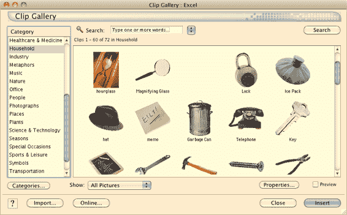
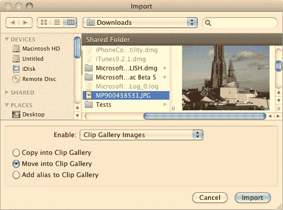
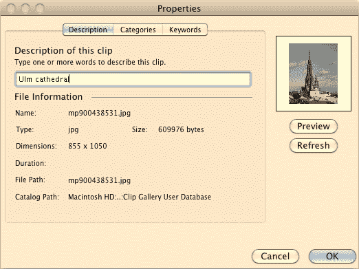
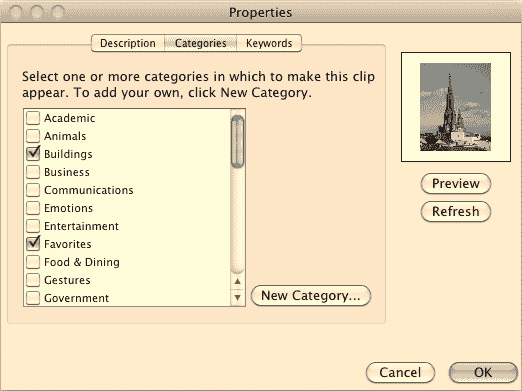
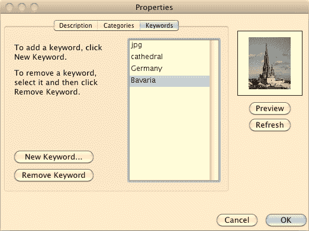

# 6. 单击“插入”按钮。Excel 会插入剪贴画项目，并自动关闭“剪辑库”。

[www.it-ebooks.info](http://www.it-ebooks.info/)

## 第 278 章：使用图片、SmartArt 等美化工作表

**图 9–2**。剪辑库是用于管理工作簿中的剪贴画并插入剪贴画项目的工具。要一次查看更多图片，请将右下角的尺寸调整手柄向下或向右拖动。

### 使用剪辑库管理剪贴画项目

为了充分利用剪辑库，您可以向其中添加自己的图片、动态剪辑和声音。您还可以从 Microsoft Office 网站下载剪贴画项目并添加到剪辑库。为了使剪辑库项目井井有条并便于查找所需项目，您可以更改剪辑库中的类别，并为项目添加关键字标签。

#### 向剪辑库添加自己的图片

要向剪辑库添加自己的图片，请按照以下步骤操作：

1. 从菜单栏中选择 `插入剪贴画 剪辑库` 以打开剪辑库。

2. 单击 `导入` 按钮以显示 `导入` 对话框（见图 9–3）。

[www.it-ebooks.info](http://www.it-ebooks.info/)

## 第 279 章：使用图片、SmartArt 等美化工作表

**图 9–3**。使用 `导入` 对话框将您自己的图片或下载的图片添加到剪辑库。

3. 在 `启用` 弹出菜单中，选择要添加的项目类型：

   - `所有剪辑`。选择此项可导入剪辑库能处理的任何类型项目。

   - `剪辑库图片`。选择此项可将图片文件添加到剪辑库。

   - `剪辑库影片`。选择此项可添加影片。

   - `剪辑库声音`。选择此项可添加声音文件。

   - `剪辑库包`。选择此项可添加您下载的库包。

   - `Microsoft Office 在线文件`。选择此项可从 Microsoft Office 网站添加以 `.cil` 文件格式下载的库包。

4. 单击要添加到库中的文件。

5. 在 `导入` 对话框的左下角，选择相应的选项按钮以确定如何将项目添加到剪辑库：

   - `复制到剪辑库`。选择此选项按钮可制作剪辑的副本并将该副本添加到剪辑库。当剪贴画项目位于可移动驱动器或网络驱动器上时，请采用此方法。

[www.it-ebooks.info](http://www.it-ebooks.info/)

## 第 280 章：使用图片、SmartArt 等美化工作表

   - `移动到剪辑库`。选择此选项按钮可将剪辑从其当前文件夹移动到剪辑库。当您下载了文件但不想移动已整理到文件夹中的素材时，请使用此选项。

   - `添加到剪辑库别名`。选择此选项按钮可向剪辑库添加别名。别名是一个文件快捷方式；它指向文件当前所在位置。对于已整理到文件夹中但希望添加到剪辑库的素材，请使用此选项。

6. 单击 `导入` 按钮。剪辑库会关闭 `导入` 对话框，并显示该项目（如果是导入多个项目，则显示第一个项目）的 `属性` 对话框。图 9–4 显示了一张图片的 `属性` 对话框中的 `描述` 选项卡。

**图 9–4**。在剪贴画项目的 `属性` 对话框的 `描述` 选项卡上，输入有用的描述以替换文件名。

7. 在 `此剪辑的描述` 框中，键入对剪辑内容的描述。剪辑库会建议使用文件名的第一部分作为描述，但您通常需要对此进行改进。

8. 单击 `类别` 选项卡以显示其内容（见图 9–5）。

[www.it-ebooks.info](http://www.it-ebooks.info/)

## 第 281 章：使用图片、SmartArt 等美化工作表