# 第 9 章：使用图片、SmartArt 等美化工作表

**图 9-5** *. 在`属性`对话框的`类别`选项卡中，为要分配项目的每个类别选中对应的复选框。要添加类别，请单击`新建类别`按钮。*

**9.** 为希望图片显示的每个类别选中复选框。如果没有合适的类别，请通过单击`新建类别`按钮，在`新建类别`对话框中键入名称，然后单击`确定`按钮来创建一个。

**10.** 单击`关键字`选项卡以显示其内容（见图 9-6）。

**图 9-6** *. 在`属性`对话框的`关键字`选项卡中，为剪贴画项目添加关键字，以便你将来能够搜索到它。*

[www.it-ebooks.info](http://www.it-ebooks.info/)

**282**

**11.** 为剪贴画项目标记所需的关键字。使用以下技巧：

*添加关键字。* 单击`新建关键字`按钮以打开`新建关键字`对话框。键入关键字，然后按下`返回`键或单击`确定`按钮。

*删除关键字。* 在列表框中单击该关键字，然后单击`删除关键字`按钮。在打开的确认对话框中，单击`确定`按钮。

**12.** 单击`确定`按钮关闭`属性`对话框。`剪贴画库`将导入图片，并将其添加到你所选的类别中。

### 从 Microsoft Office 网站下载剪贴画项目

`剪贴画库`包含足够多的项目供你入门使用，但如果你需要在工作簿中大量使用剪贴画，则可能需要从 Microsoft Office 网站下载其他项目并将其添加到库中。为此，请按以下步骤操作：

**1.** 从菜单栏中选择`插入` `剪贴画` `剪贴画库`以打开`剪贴画库`。

**2.** 单击`联机`按钮以启动或激活默认浏览器，并显示 Microsoft Office 网站上的`图像`页面。

`注意：` 首次在`剪贴画库`中单击`联机`按钮时，会弹出`启动浏览器`对话框，请求你允许其启动默认浏览器。选中`不再询问我`复选框，然后单击`是`按钮。

**3.** 浏览以查找你想要的图片。

**4.** 将鼠标指针移至图片上，等待详细信息面板弹出，然后单击其上的`添加到购物篮`链接，将每张图片添加到你的购物篮中。

**5.** 准备下载图片时，将鼠标移至右上角的`选择购物篮`链接上，然后单击`下载`链接。

**6.** 在出现的网页上，单击`下载`按钮以在存档文件中下载剪贴画项目。

**7.** 单击程序坞上的`下载`文件夹，然后点击该存档文件。其文件名以`ClipArt`开头，且文件扩展名为`.cil`，因此应易于识别。`剪贴画库`会自动导入这些文件。

[www.it-ebooks.info](http://www.it-ebooks.info/)

`注意：` 如果你的程序坞中没有`下载`文件夹，请打开一个 Finder 窗口，进入你用户账户下的`下载`文件夹。然后双击该存档文件。或者，单击`剪贴画库`窗口中的`导入`按钮，在`导入`对话框中点击该文件，然后单击`导入`按钮。

导入文件后，你或许希望按照上一节所述设置其属性和关键字，以便更容易找到它们。

### 使用类别整理剪贴画库

正如你在本章前面所见，在向`剪贴画库`导入项目时，你可以根据需要创建新类别。你也可以通过单击`剪贴画库`中的`类别`按钮，并在`类别`对话框（见图 9-7）中进行操作来创建或删除类别：

*创建类别。* 单击`新建类别`按钮以显示`新建类别`对话框。为类别键入名称，然后单击`确定`按钮。

`注意：` 这些类别仅出现在`剪贴画库`中，不会出现在`剪贴画浏览器`中。

*删除类别。* 在列表框中单击该类别，然后点击`Delete`按钮。在确认对话框中，点击`OK`按钮。

**图 9–7**。使用剪贴画库中的“类别”对话框删除现有类别或创建新类别。

[www.it-ebooks.info](http://www.it-ebooks.info/)

### 在工作簿中插入图片

剪贴画适合用作基础插图，但所有人都能访问到相同的图片集。为使你的工作簿独一无二，你也可以插入自己的照片和其他图片。

你可以插入已添加到 iPhoto 中的图片，也可以插入位于 Mac 文件系统中但不在 iPhoto 里的图片。由于 iPhoto 是 macOS 中用于从数码相机导入照片并对其进行编辑的标准应用程序，你大部分时间可能都会用到它。

#### 从 iPhoto 插入图片

要从 iPhoto 插入图片，请按以下步骤操作：

**1.** 点击标准工具栏上的`Media`按钮，或从菜单栏中选择`View > Media Browser`，以打开媒体浏览器。

**2.** 点击工具栏上的`Photos`按钮，显示“照片浏览”窗格（请参见图 9–8）。

**图 9–8**。使用媒体浏览器中的“照片浏览”窗格，将 iPhoto 中的图片添加到工作簿中。

**3.** 在弹出的菜单中选择图片的来源。例如，选择`iPhoto`可查看 iPhoto 中的所有图片；选择`Events`可查看在 iPhoto 中创建的事件列表；或选择`Last Import`可查看最近导入的照片。

[www.it-ebooks.info](http://www.it-ebooks.info/)

**4.** 点击所需的照片，然后将其拖到工作簿窗口中，并拖放到希望它出现的位置。

**5.** 如果你需要继续使用媒体浏览器窗口，请保持其打开状态。否则，点击`Close`按钮（窗口左上角的红色按钮）将其关闭。

#### 从 Mac 文件系统插入图片

要插入一张不在 iPhoto 中，但存储在 Mac 文件系统或网络驱动器上的图片，请按以下步骤操作：

**1.** 将插入点或选择区定位到希望图片出现的位置。

**2.** 从菜单栏中选择`Insert > Photo > Picture from File`，以显示“选取图片”对话框（请参见图 9–9）。

**图 9–9**。在“选取图片”对话框中，你可以选择是否将图片链接到工作簿。

对于某些类型的图片，你还可以选择将图片图层视为独立对象，以便对它们进行单独操作。

**3.** 导航到包含该文件的文件夹，然后点击该文件。

**4.** 如果你希望将图片文件链接到工作簿而非嵌入，请选中`Link to File`复选框。执行此操作后，你可以选中`Save with Document`复选框，以在工作簿中保存图片文件的最新版本。有关链接的建议，请参阅边栏“将图片链接到工作簿”。

[www.it-ebooks.info](http://www.it-ebooks.info/)

**5.** 如果你希望能够单独操作图片的每一层，请选中`Treat picture layers as separate objects`复选框。此功能仅适用于某些类型的图片，例如 JPEG 格式。

**6.** 点击`Insert`按钮。Excel 会关闭“选取图片”对话框，并将图片插入到工作簿中。

`提示：` 你也可以通过将图片文件从 Finder 窗口拖放到工作簿中来插入图片。

#### 将图片链接到工作簿

当你从 Mac 文件系统向工作簿添加图片时，你可以选择嵌入图片或链接图片。

嵌入图片会将图片的一个副本添加到工作簿中。Excel 会将图片保存在工作簿中，因此即使你移动工作簿，图片仍保留在其中。

如果你需要控制工作簿的文件大小，或者需要能够轻松更新图片，则可以选择链接图片。链接意味着 Excel 会在工作簿中添加一个指向图片文件的链接。当你打开工作簿时，Excel 会从该文件中加载图片的当前版本。但是，如果你将工作簿移动到另一台计算机，则该链接将不再起作用，因为 Excel 无法找到该图片文件。

为解决链接失效的问题，你可以链接图片但同时保存其最新版本。为此，请在“选取图片”对话框中选中`Link to File`复选框和`Save with Document`复选框。当你打开工作簿时，Excel 会检查链接版本是否可用。如果可用，Excel 会加载链接的图片；如果不可用，则会显示工作簿中保存的版本。

### 添加和设置形状格式

如果工作簿需要绘制图形，你可以使用形状从头开始创建。Excel 提供了多种多样的形状，从箭头和基本形状到星形、横幅和标注。

要插入形状，请按以下步骤操作：

**1.** 显示工作簿中要添加形状的区域。添加形状时，你无需定位插入点或进行选择。

`注意：` 你也可以通过从功能区选择`Home > Insert > Shape`来显示形状面板，点击形状类别（例如，线条和连接符），然后点击形状类型来插入形状。但通常，使用形状浏览器可以更方便地访问形状。

### 第 9 章：使用图片、SmartArt 图形等来美化工作表

**2.** 点击标准工具栏上的 `Media` 按钮，或从菜单栏中选择 `View > Media Browser`，以显示媒体浏览器。

[www.it-ebooks.info](http://www.it-ebooks.info/)

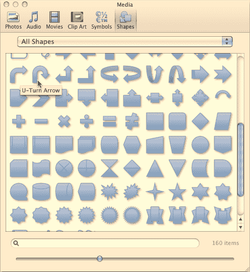

**3.** 点击工具栏上的 `Shapes` 按钮，显示“形状浏览”窗格（请参见图 9–10）。

**图 9–10.** 从媒体浏览器的“形状浏览”窗格中选择形状类型。将鼠标指针悬停在一个形状上，可以看到显示其说明的屏幕提示。

**4.** 在“形状浏览”窗口顶部的弹出菜单中，点击要查看的形状类别：所有形状、矩形、基本形状、线条和连接符、块状箭头、公式形状、流程图、星与旗帜，或标注。

**5.** 点击你想要的形状。Excel 会将鼠标指针变为十字准线。

**6.** 使用此十字准线，点击要放置形状的一个角的位置，然后拖动到对角（请参见图 9–11）。先放置哪个角无关紧要，因为你可以在任何方向上拖动，但通常先放置左上角最为容易。

[www.it-ebooks.info](http://www.it-ebooks.info/)

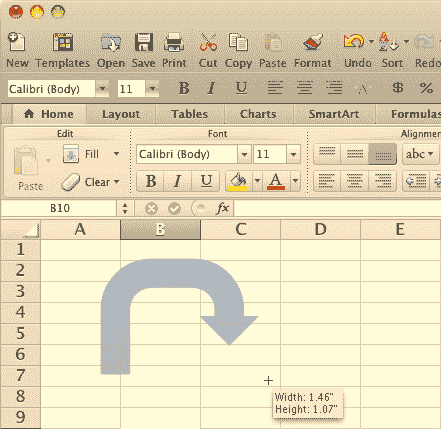

**图 9–11.** 使用十字准线点击并拖动，以放置并调整正在插入的形状的大小。

释放鼠标按钮后，形状会显示出来，周围带有选择手柄，以便你可以按照后续章节所述对其进行操作。当形状被选中时，功能区会添加 `Format` 选项卡，其中提供了用于设置形状格式的控件。

除非你需要插入更多形状或其他对象，否则请点击媒体浏览器窗口的 `Close` 按钮（左上角的红色按钮）将其关闭。

### 为形状应用样式

插入形状后，你可以从功能区 `Format` 选项卡上 `Shape Styles` 组中的“形状样式”框或面板为其应用样式。如果所需的样式显示在“形状样式”框中，直接点击即可；否则，将鼠标指针移动到“形状样式”框上方，使面板按钮出现，然后点击该按钮以显示面板（参见图 9–12）。然后，你可以点击所需的样式。

要优化形状，请打开“形状样式”组中的“填充”面板、“线条”面板或“效果”下拉面板，然后点击所需选项。例如，选择 `格式` > `形状样式` > `形状效果` > `三维旋转`，然后点击其中一个三维旋转效果（参见图 9-13）。

[www.it-ebooks.info](http://www.it-ebooks.info/)

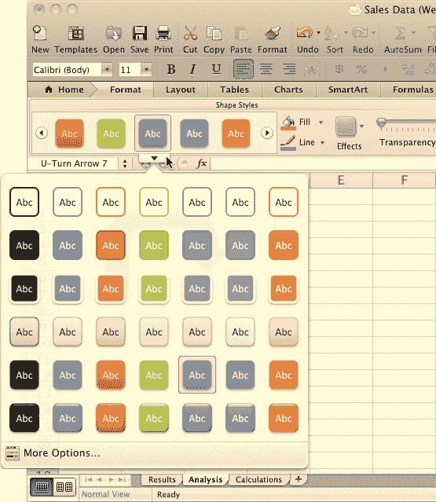

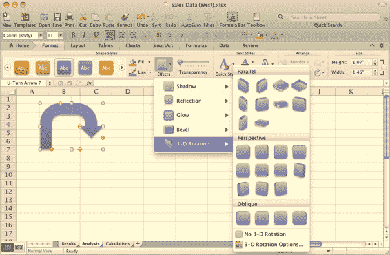

**图 9-12.** *要更改形状的样式，请打开功能区“格式”选项卡上的“形状样式”面板，然后点击所需的样式。*

**图 9-13.** *使用“填充”面板、“线条”面板或“效果”面板（此处所示）使形状达到你想要的效果。*

[www.it-ebooks.info](http://www.it-ebooks.info/)

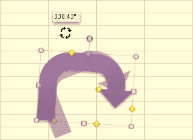

### 旋转图形对象

插入图形对象后，你可以根据需要旋转它。点击选择该对象，然后向左拖动绿色手柄进行逆时针旋转（参见图 9-14），或向右拖动进行顺时针旋转。

**图 9-14.** *向左或向右拖动绿色旋转手柄可旋转图形对象。*

### 定位图形对象

如果在插入图形对象时未能将其精确定位到正确位置，你之后可以轻松移动它。

重新定位图形对象的快速方法是点击它，然后将其拖拽到所需位置。这在大多数情况下效果良好，但如需更精确，你也可以点击选中该对象，然后按方向键（例如， `向左` 方向键）沿箭头方向微移一小段距离。

当需要精确控制对象的显示位置时，请按住 `Ctrl` 键并点击或右键点击该对象，然后点击上下文菜单中的 `格式` 命令以显示该对象的格式对话框（例如，点击 `设置图片格式` 命令以显示 `设置图片格式` 对话框）。在左侧窗格中，点击 `大小` 项以显示用于调整对象大小和控制其位置的控件。图 9-15 显示了 `设置图片格式` 对话框中的 `大小` 类别。

[www.it-ebooks.info](http://www.it-ebooks.info/)

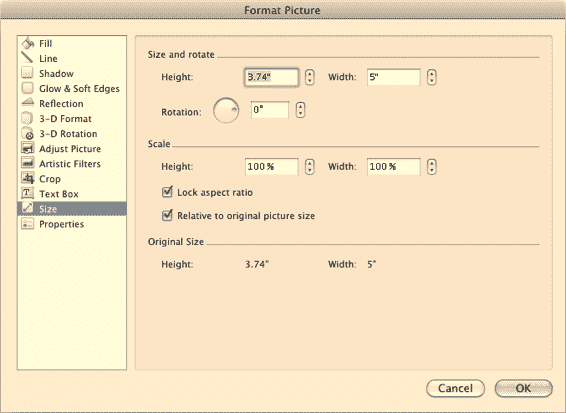

**图 9-15.** *使用对象格式对话框中“大小”类别的控件可以精确调整对象的大小和位置。*

### 让图片呈现你想要的样式

插入图片后，你可以使用功能区 `设置图片格式` 选项卡上出现的控件来使图片达到你想要的效果。你可以调整图片的颜色、为图片应用图片样式或裁剪图片，使其只显示部分内容。

#### 调整图片的清晰度、亮度、对比度和颜色

要调整图片的清晰度、亮度或对比度，请点击图片将其选中，然后选择 `格式` > `图片` > `调整` > `更正` 以打开 `更正` 面板（参见图 9-16）。点击你需要的颜色校正选项。

[www.it-ebooks.info](http://www.it-ebooks.info/)

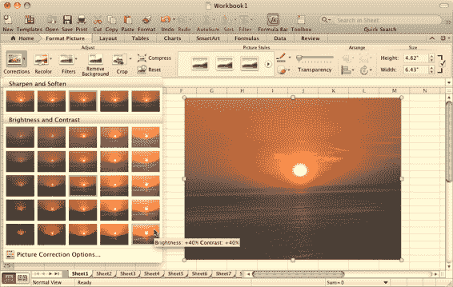

**图 9-16.** *要修复图片的清晰度、亮度或对比度问题，请打开“更正”面板并选择所需的外观。*

要更改图片中的颜色，请点击图片，选择 `格式` > `图片` > `调整` > `重新着色`，然后点击你需要的效果。`颜色` 下拉面板包含不同的部分，如 `饱和度`、`色调` 和 `重新着色`（例如，`灰度` 或 `棕褐色`）。

要应用诸如绘画笔触或柔光屏等效果到图片，请点击图片，选择 `格式` > `图片` > `调整` > `滤镜`，然后点击你需要的效果。

要将图片重置为原始外观，请选择 `格式` > `图片` > `调整` > `重设`。

#### 应用图片样式

若要为图片应用图片样式，请单击图片，然后点击功能区的 `Format Picture` 选项卡将其显示出来，再点击所需的图片样式。如果该图片样式出现在 `Picture Styles` 组的 `Quick Styles` 框中，直接点击即可；否则，将鼠标指针移至 `Quick Styles` 框上，待面板按钮出现后点击该按钮，然后在面板上点击所需的图片样式（参见图 9–17）。

[www.it-ebooks.info](http://www.it-ebooks.info/)

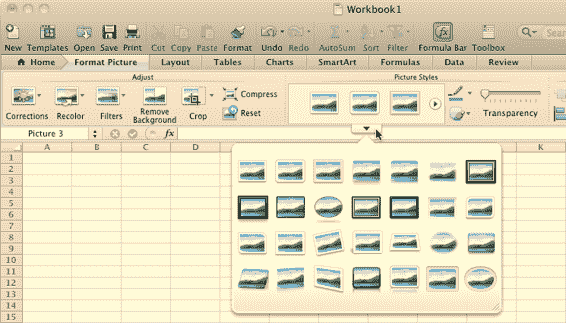

**图 9–17.** *从功能区 `Format Picture` 选项卡的 `Picture Styles` 组中的 `Quick Styles` 框或面板中选择图片样式。*

#### 裁剪图片

如果你只需要在工作表中显示图片的一部分而非整张图片，可以裁剪掉不需要的部分。

Excel 提供了多种裁剪图片的方式，但通常以下方法最为简单：

1.  单击图片以将其选中。Excel 会在功能区添加 `Format Picture` 选项卡。

2.  如果 Excel 未自动显示该选项卡，请点击 `Format Picture` 选项卡。

3.  选择 `Format Picture` > `Adjust` > `Crop`，注意点击 `Crop` 按钮的上半部分，而非下拉按钮。Excel 会在图片上显示裁剪手柄（参见图 9–18）。

[www.it-ebooks.info](http://www.it-ebooks.info/)

**图 9–18.** *裁剪的快捷方式是拖动裁剪手柄，使其包围住你想保留的图片部分。*

4.  拖动裁剪手柄，使裁剪区域包含你想要显示的图片部分：
    *   按住 `Shift` 并拖动，可等比例裁剪图像。
    *   按住 `Option` 并拖动，可围绕图像中心点均匀裁剪。
    *   按住 `Option`+`Shift` 并拖动，可围绕图像中心点等比例裁剪。
    *   按住 `Cmd` 并拖动，可按照工作表格线的增量进行裁剪。

**提示：** 如果你已将裁剪区域调整为所需大小，可以点击并拖动裁剪区域内的图片，使图片的不同部分显示在该区域中。你移动的是图片，而非裁剪区域——这就像你透过窗户移动风景，直到窗口显示你希望看到的部分。

5.  再次点击 `Crop` 按钮以关闭 `Crop` 工具，或点击工作表中的其他位置以取消选中图片。Excel 即会将裁剪效果应用到图片上。

**注意：** 你也可以将图片裁剪成特定形状。操作方法为：选择`Format Picture` > `Adjust` > `Crop`，点击`Crop`的弹出箭头按钮（而非按钮上半部分）。在出现的弹出菜单中，选择`Mask to Shape`，然后点击你想要的形状。

[www.it-ebooks.info](http://www.it-ebooks.info/)

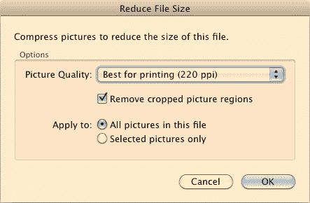

# 第 9 章：使用图片、SmartArt 等工具为工作表增添视觉效果

295

## 通过压缩图片节省空间

当你在工作表中插入图片时（而非如本章前面所述链接图片），Excel 会在工作簿中保存每张图片的副本。这可能会大幅增加工作簿的文件大小。

为了控制工作簿的文件大小，你可以压缩图片并删除其被裁剪掉的部分。具体操作步骤如下：

1. 单击一张图片，使 Excel 在功能区添加`Format Picture`选项卡。

2. 选择`Format Picture` > `Adjust` > `Compress`，打开`Reduce File Size`对话框（参见图 9–19）。

**图 9–19.** *当你需要减小一张或多张图片的文件大小，或删除图片中被裁剪掉的部分时，可以使用 Reduce File Size 对话框。*

3. 在`Picture Quality`弹出菜单中，选择所需的图片质量：

   - **最佳打印效果 (220 ppi).** 仅对图片进行少量压缩，使其保留足够高的质量以满足大多数用途。

   - **最佳屏幕显示效果 (150 ppi).** 对图片进行稍多的压缩，但仍保持适合屏幕观看的良好效果。

   - **最佳电子邮件发送效果 (96 ppi).** 将图片压缩至…

`保持当前分辨率`。保持图片的当前分辨率。当你需要在不改变分辨率的情况下移除图片裁剪部分时，可使用此设置。

4. 在`应用于`区域中，若只想影响已选中的图片，请选中`仅所选图片`选项按钮。通常情况下，你会更倾向于选中`此文件中的所有图片`选项按钮，让 Excel 压缩工作簿中的所有图片。

[www.it-ebooks.info](http://www.it-ebooks.info/)

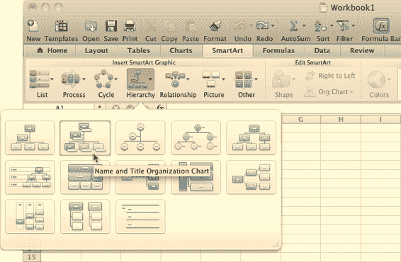

296

# 第 9 章：用图片、SmartArt 等图形美化工作表

5. 若想移除已裁剪的区域，请勾选`删除裁剪区域`复选框。当你确认不再需要调整工作簿中任何图片的裁剪以显示更多内容后，勾选此项是个好主意。

**注意：** 删除裁剪区域不仅能减小文件大小，还能防止裁剪区域包含敏感信息时造成尴尬。

6. 点击`确定`按钮。Excel 会关闭`减小文件大小`对话框，并按照你的指定更改图片质量或裁剪设置。

### 插入 SmartArt 图形

当需要创建组织结构图、流程图或维恩图等图示时，请使用 SmartArt 功能。请按以下步骤操作：

1. 将插入点或选区定位到要插入 SmartArt 对象的位置。

2. 点击功能区上的`SmartArt`选项卡以显示其内容。你也可以通过从菜单栏中选择`插入 SmartArt 图形`来显示此选项卡。

3. 在`插入 SmartArt 图形`框中，点击你想要创建的 SmartArt 图形类别按钮：`列表`、`流程`、`循环`、`层次结构`、`关系`、`图片`或`其他`。此时会打开一个面板，显示可用的类型。图 9-20 显示了`层次结构`面板，其中包含多种组织结构图。

**图 9-20.** *打开所需 SmartArt 图形类别的面板，然后单击所需的图形类型。*

[www.it-ebooks.info](http://www.it-ebooks.info/)

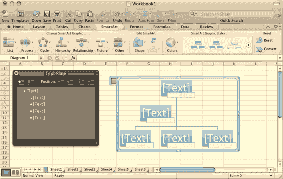

# 第 9 章：用图片、SmartArt 等图形美化工作表

4. 点击你想要的图形类型。Excel 会将其插入工作簿，并显示文本窗格（参见图 9-21）。

**图 9-21.** *插入 SmartArt 图形时，Excel 会在其旁边显示文本窗格，以便你输入文本。*

**注意：** 如果 Excel 未显示文本窗格，请点击 SmartArt 图形左上角的`文本窗格`按钮以显示它。当你不需要时，也可以点击此按钮隐藏文本窗格。

5. 在文本窗格中，为每个项目输入文本。输入时，Excel 会将文本添加到 SmartArt 图形中（参见图 9-22）。

[www.it-ebooks.info](http://www.it-ebooks.info/)

298

# 第 9 章：用图片、SmartArt 等图形美化工作表

**图 9-22.** *通过在文本窗格中输入文本来向 SmartArt 图形添加文本。*

6. 添加 SmartArt 图形所需的任何其他项目。例如，要在显示的组织结构图中添加标题，请点击每个标题占位符，然后输入标题。

7. 调整 SmartArt 图形的大小，使其最适合工作簿。例如，你可能需要将其调整为合适的尺寸，以与相关数据并排放置。

8. 如果需要更改 SmartArt 图形的布局，请从功能区`SmartArt`选项卡上的`更改 SmartArt 图形`组中选择其他布局。

9. 通过从`SmartArt`选项卡上`SmartArt 图形样式`组中的`快速样式`框或面板中选择样式，将样式应用于 SmartArt 图形。

完成 SmartArt 图形的创建后，像往常一样保存工作簿。

### 使用艺术字添加装饰性文字

如果需要为工作簿增添设计感，可以添加艺术字项目。艺术字为你提供了一种将文本转化为图形元素的便捷方式——例如，用于制作公司徽标。

要创建一个艺术字项，请按照以下步骤操作：

1. 从菜单栏选择插入艺术字以添加一个艺术字项，并将格式选项卡添加到功能区。

2. 在艺术字框中，将占位文本（“Your Text Here”）替换为你的文本（见图 9–23）。

**图 9–23.** *在艺术字容器中键入文本，然后将其拖动到工作表中的所需位置。*

3. 将艺术字项拖动到所需位置。将鼠标指针悬停在该项的边框上，然后拖动。

4. 根据需要调整艺术字项的大小。你可以拖动侧边或角部的手柄，或者在`格式`选项卡的`大小`组中的`高度`框和`宽度`框中更改数值。选中`大小`组右侧的复选框以保持艺术字项的纵横比（这样当更改高度时，Excel 会自动调整宽度，反之亦然）。

5. 格式化艺术字项，使其外观符合你的要求：

   - 将鼠标指针悬停在`形状样式`框上，单击出现的面板按钮，然后单击所需的样式。

   - 要更改艺术字项的填充，选择`格式` > `形状样式` > `填充`，然后单击所需的填充。

   - 要更改艺术字项的线条颜色、粗细或类型，选择`格式` > `形状样式` > `线条`，然后选择适当的选项。

   - 要应用效果，选择`格式` > `形状样式` > `效果`，然后选择所需的效果。例如，单击`三维旋转`子菜单，然后选择一个旋转效果。

   - 要更改文本样式，使用`格式`选项卡上`文本样式`组中的控件。

### 使图形对象相对于单元格定位

如本章前面所述，你可以将图形对象拖到工作表中需要其出现的任何位置。但你也可以将图形对象与其上方的单元格关联起来，这样当你移动单元格时，对象也会随之移动。当你需要将图形对象与特定单元格保持在一起时，此设置非常方便。你也可以让 Excel 在调整单元格大小时自动调整对象大小。

要控制图形对象是否随单元格移动和调整大小，请按照以下步骤操作：

1. 按住`Ctrl`键点击或右键点击图形对象，然后在上下文菜单中点击`属性`命令以显示`格式`对话框。例如，按住`Ctrl`键点击或右键点击一张图片，然后点击`设置图片格式`命令以显示`设置图片格式`对话框。

2. 在左侧窗格中，点击`属性`项以显示`属性`窗格（见图 9–24）。

**图 9–24.** *在`格式`对话框的`属性`窗格中，选择是否移动图形对象并随单元格调整其大小。你还可以选择是否打印该对象、锁定它或锁定其文本。*

3. 在`对象位置`框中，根据情况选择`大小和位置随单元格而变`选项按钮、`大小固定，位置随单元格而变`选项按钮，或`大小和位置均固定`选项按钮。

**注意：** 在`格式`对话框的`属性`窗格中，如果你希望避免打印图形对象，你也可以清除`打印对象`复选框。你还可以选中`锁定`复选框以锁定对象，或选中`锁定文本`复选框以锁定对象的文本；这些设置仅在你保护工作表以防止更改时才生效。

4. 点击`确定`按钮关闭`格式`对话框。Excel 会将你的选择应用于该图形对象。

## 排列图形对象以控制其可见性

当你在工作簿的同一区域放置了多个图形对象时，你可能需要安排它们在工作簿图层中的显示顺序，以控制它们彼此之间的相对外观。例如，你可能需要将某个特定对象移到图层堆栈的最前面，使其显示在其他对象之上，或者将另一个对象向后移动，使其显示在其伴随对象之一的后方。

要更改对象在图层中的位置，请按住`Ctrl`键点击或右键点击该对象，点击或高亮`排列`子菜单，然后点击相应的命令：

*   **置于顶层**：点击此命令可将项目移动到堆栈的最前面。

*   **置于底层**：点击此命令可将项目移动到堆栈的最底部。

*   **上移一层**：点击此命令可将对象向前移动一层。根据需要多次重复此命令，将对象在堆栈中向上移动到所需位置。

*   **下移一层**：点击此命令可将对象向后移动一层。与`上移一层`命令类似，你可能需要多次执行此命令才能将对象移动到所需位置。

## 总结

在本章中，你学习了如何在 Excel 中处理图形对象。你现在知道如何插入剪贴画以及如何使用 Office 的剪辑库应用程序管理剪贴画项。你了解了如何从 iPhoto 或 Mac 的文件系统中插入自己的图片，如何插入形状并设置其格式，以及如何将图形对象定位到所需位置。你还学习了如何重新着色、裁剪和压缩图片；如何创建 SmartArt 图形和艺术字项来丰富你的工作簿；以及如何使图形对象相对于单元格定位并排列图形对象以控制其可见性。

这是本书第二部分的内容。在第三部分中，我将向你展示如何分析数据、如何与同事共享工作簿以及如何实现工作簿自动化。

## 第三部分

### 分析数据及共享和自动化工作簿

在本部分中，你将学习分析、操作和共享你已构建的工作簿。

在第 10 章中，我们将探讨如何使用 Excel 的表格创建数据库，以存储信息、排序信息并筛选信息以找到你需要的记录。你还将学习如何将 Excel 的数据库函数与表格结合使用。

在第 11 章中，我们将介绍如何使用四种强大的工具分析数据。你将学习使用数据表来评估一个或两个变量对计算结果的影响，以及使用方案来试验不同的值集而无需更改核心数据。你还将学习使用单变量求解来解决单变量问题，以及使用规划求解来解决多变量问题。

在第 12 章中，我们将介绍什么是数据透视表，以及如何使用它们来检查工作表中的数据并发现其中隐藏的秘密。你将学习如何使用 Excel 的自动化工具或通过手动将字段放置在所需位置来创建数据透视表，如何在创建后更改数据透视表，以及如何排序和筛选其中包含的数据。

在第 13 章中，我们将讨论与他人共享工作簿的方法。我们首先介绍如何打印工作表、从中创建 PDF 文件以及将数据导出为逗号分隔值文件。然后，我们将讨论共享工作簿以便多人可以同时对其进行操作，以及如何在必要时跟踪更改以便稍后审阅。最后，我们将探讨如何将同一工作簿不同副本中的更改合并到一个工作簿中，以及如何将多个工作表合并到单个工作表中。

### 第 10 章：使用表格创建数据库

每个 Excel 工作表都拥有超过 16,000 列和超过 100 万行的空间，足以容纳大量数据——因此非常适合创建数据库来存储信息并快速查找所需内容。

在本章中，你将学习如何使用 Excel 表格创建数据库，以存储信息、对信息进行排序，并筛选出所需的信息。你还将学习如何将 Excel 的数据库函数与表格结合使用。

#### 在 Excel 中创建数据库

当需要在工作表中存储大量同类信息时，你可以在表格中创建数据库。例如，如果你经营一家企业，可以为客户及其订单创建数据库。

第一步是设置表格，并告诉 Excel 你正在创建一个表格，而非普通的工作表。接下来，将数据添加到表格中，可以像往常一样在单元格中键入数据，或使用数据输入表单。

一旦数据进入表格，就可以对表格进行排序，以呈现其内容的不同方面，或者进行筛选，以识别符合指定条件的项。

#### 了解 Excel 表格能做什么、不能做什么

在 Excel 中开始创建表格之前，务必清楚 Excel 表格能做什么、不能做什么。

如你所知，Excel 工作表由行和列组成。要在工作表上创建表格，需将每一行设置为一条*记录*——即包含单个条目所有详细信息的项目。例如，在记录客户销售的表格中，一条记录将包含一次购买的详细信息。将每一列设置为表格中的一个*字段*——一列用于购买编号，一列用于日期，一列用于客户姓氏，以此类推。图 10-1 显示了用于跟踪客户销售的 Excel 表格的一部分。

**图 10-1.** *Excel 数据库由一个表格组成，每一行构成一条记录，每一列包含一个字段。*

这种数据库被称为*平面文件*数据库：数据库中的所有数据都存储在单个表格中，而非存储在相互关联的多个独立表格中。

这意味着，只要你能将一条记录的所有数据存储在一行中，就可以使用 Excel 创建任何数据库。由于你拥有 100 万行可用空间，因此必要时可以创建大型数据库，但这可能会使 Excel 运行缓慢。

Excel 无法创建*关系型数据库*——即数据存储在关联表格中的数据库。关系型数据库是使用功能强大的数据库应用程序（如 FileMaker、Microsoft Access（Windows 系统）、Oracle（多种操作系统）或 `SQL Server`（Windows 系统））创建的数据库类型。在关系型数据库中，每条记录都有一个唯一的 ID 编号或字段，应用程序使用该标识符来关联不同表格中的数据。

#### 创建表格并输入数据

在本节中，你将了解如何创建表格，并使用标准 Excel 方法或数据输入表单来输入数据。

##### 创建表格

要创建表格，请按照以下步骤操作：

1.  像往常一样创建工作簿。例如，你可以：

    *   创建一个新的空白工作簿。按 `Cmd+N` 或从菜单栏中选择 `文件 > 新建工作簿`。

    *   基于模板或现有工作簿创建工作簿。

---

[www.it-ebooks.info](http://www.it-ebooks.info/)

---

**注释：** 在第 14 章中，我们将探讨如何录制宏，以消除重复执行相同任务的繁琐。你将学习如何使用菜单或工具栏、通过创建键盘快捷键，甚至通过将宏分配给命令按钮等工作表对象来运行宏。你还将了解 Visual Basic 编辑器，并学习如何编辑宏以更改其功能。

---

*页码参考：* 305、306、307

2.  按 `Cmd+Shift+P` 或选择 `File` > `New from Template`，然后在 `Excel Workbook Gallery` 对话框中做出选择。

3.  命名你将用来创建表格的工作表。双击工作表标签，输入所需的名称（最多 31 个字符，包括空格），然后按 `Return` 键应用该名称。

4.  输入表格的标题。例如，如果表格包含客户姓名和地址，你可以输入诸如 `Last Name`、`First Name`、`Middle Initial`、`Title`、`Address 1` 等字段。尽量在此处将所有字段都设置好；你可以在之后向表格添加列，但随后需要向现有记录添加额外的数据。

**注意：** 通常，将标题放在工作表的首行最简单，但如果需要在表格上方显示信息，请为其留出空行。

5.  将标题的格式设置为与下方行不同。例如，单击标题行的行号，然后按 `Cmd+B` 应用粗体。

6.  选中标题以及标题下方的至少一行。

7.  从功能区中选择 `Tables` > `Table Options` > `New`，单击“新建”按钮的主要部分（而非弹出按钮）。Excel 会进行以下更改：

    *   创建表格。

    *   为表格指定一个默认名称，例如 `Table1` 或 `Table2`。

    *   将标题行转换为带有弹出按钮的标题。

**注意：** 如果你的标题与数据行格式相同，请选择 `Tables` > `Table Options` > `New` > `Insert Table with Headers`，而不是 `Tables` > `Table Options` > `New`。否则，Excel 会在你的标题行上方插入一个包含标题的新行。如果你的表格没有标题，请选择 `Tables` > `Table Options` > `New` > `Insert Table without Headers`。

[www.it-ebooks.info](http://www.it-ebooks.info/)

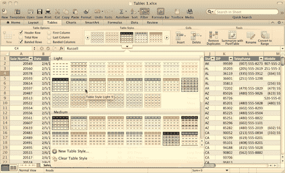

**308**

**第 10 章：使用表格创建数据库**

*   基于工作簿的主题应用带有底纹的表格样式。你可以在之后根据需要更改样式。

8.  按照以下步骤重命名表格：

    **a.** 单击公式栏左端的名称弹出菜单，然后单击表格名称。如果表格尚未被选中，Excel 会将其选中。

    **b.** 单击名称文本框以选中表格名称。

    **c.** 为表格输入新名称。与图表名称一样，表格名称在工作簿中必须唯一，必须以字母或下划线开头，并且不能包含空格或符号。

    **d.** 按 `Return` 键应用表格名称。

##### 自定义表格外观

此时，你可以开始向表格输入数据（如下所述）。但在做之前，你可能想要更改表格的外观。为此，请按照以下步骤操作：

1.  单击表格中的任意位置。

# 第10章：使用表格创建数据库

**2.** 如果功能区上的“表格”选项卡未显示，请单击它。

**3.** 如果功能区上的“表格样式”框中出现合适的样式，请单击它。如果没有，请将鼠标指针停留在“表格样式”框上以显示面板按钮，然后单击该面板按钮以显示“表格样式”面板（参见图 10–2）。单击你想要应用的样式。

**图 10–2.** *通过从功能区“表格”选项卡上的“表格样式”面板中应用 Excel 的表格样式之一，可以快速格式化表格。向下滚动面板以查看其他样式。*

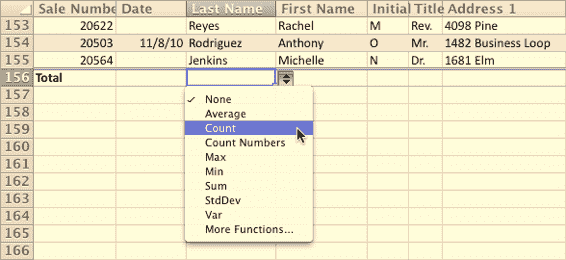

**4.** 在功能区“表格”选项卡上的“表格选项”组中，选中你想要使用的每个表格样式选项对应的复选框：

- **标题行。** 选中此复选框以显示标题行。这几乎总是有用的。

- **汇总行。** 选中此复选框以在表格的最后一行之后立即添加一个标记为“汇总”的行。当需要在最后一行添加一个汇总公式或其他公式时，这很有用。要添加公式，请单击汇总行中的某个单元格，单击出现的弹出按钮，然后在弹出菜单中单击所需的公式（参见图 10–3）。

**图 10–3.** *为表格添加汇总行可以快速在行的单元格中插入函数。当你向下滚动工作表时，Excel 会将标题行更改为列标签。*

**提示：** 表格汇总行中的弹出菜单让您可以即时访问数据库中最常用的函数——`Average`、`Count`、`Count Numbers`、`Max`、`Min`、`Sum`、`StdDev`（标准偏差）或 `Var`（基于样本计算方差）。您还可以单击弹出菜单底部的 `More Functions` 项以显示“公式构建器”，从中可以访问 Excel 的全部函数。例如，您可以插入 `COUNTBLANK()` 函数来计算一列中空白单元格的数量。您可能这样做是为了确保关键数据列不包含空白。

- **镶点行。** 选中此复选框以每隔一行应用带状颜色。这有助于您阅读数据行，而不会让视线飘到另一行。某些表格样式会自动对行应用带状效果。

- **第一列。** 如果您希望第一列具有不同的格式，请选中此复选框。如果第一列包含用于标识每个记录的主要字段（例如，唯一编号），您可能需要这样做。

**310**

- **最后一列：** 如果您希望最后一列具有不同的格式，请选中此复选框。通常，仅当最后一列包含某种方式上比其他列数据更重要的数据时，您才需要这样做。

- **镶点列。** 选中此复选框以每隔一列应用带状颜色。这有时有帮助，但通常不如镶点行有帮助（不要同时使用两者——效果很少是有用的）。

当您完成为表格选择样式和选项后，像往常一样保存您的工作。

## 在表格中输入数据

您可以通过直接键入或使用数据输入窗体两种方式在表格中输入数据。大多数情况下，数据输入窗体是更简单的选项，您稍后会看到。您还可以将表格连接到外部数据源，如以下部分所述。

### 直接在表格中输入数据

表格本质上还是一个 Excel 工作表，因此您可以使用前几章学到的标准技术在表格中输入数据。例如，单击一个单元格，然后向其中输入数据；或者，如果您在其他工作表中已有数据，可以复制并粘贴进去。

当您在表格最后一行之后的行中输入数据时，Excel 会自动扩展表格以包含该行。要在表格内部添加一行，请单击要在其上方添加新行的行中的单元格，然后从菜单栏中选择 `Insert` > `Rows`。同样，Excel 会自动扩展表格以包含新行。

要在表格中插入一列，请单击要在其前面添加新列的列中的单元格，然后从菜单栏中选择 `Insert` > `Columns`。同样，Excel 会自动扩展表格。

**提示：** 您可以使用鼠标快速选择一行、一列或整个表格。要选择一行，请将鼠标指针移动到表格最左列某个单元格的左侧部分，然后在出现水平箭头时单击。要选择一列，请将鼠标指针移动到列标题上，然后在出现向下箭头时单击。要选择整个表格，请将鼠标指针移动到表格的左上角单元格上，然后在出现对角箭头时单击。

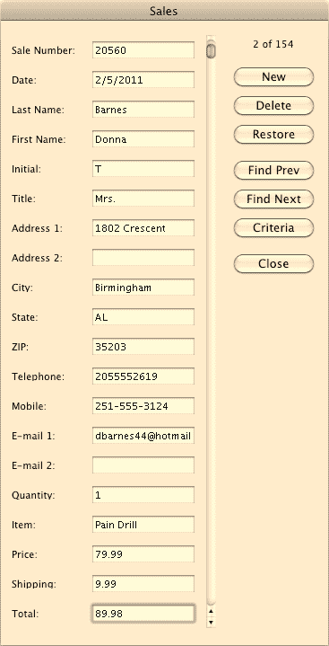

**311**

### 使用数据输入窗体输入数据

直接在表格中键入数据往往比较笨拙，尤其是当表格包含太多列，无法在 Excel 窗口中显示每一列的完整内容时。当您的数据库增长到超过几行时，通常可以使用数据输入窗体输入数据。

通过使用数据录入表单（即 Excel 自动根据你的表格定制的对话框），可以更轻松地处理数据。

选择“数据表单”（`Data Form`）以显示数据录入表单对话框。图 10–4 展示了该对话框，其标题栏显示的是你正在使用的工作表名称（此处为 `Sales`），而不是“表单”（`Form`）这个词。

**图 10–4.** “表单”（`Form`）对话框会显示表格所在的工作表名称（此处为 `Sales`），并按照表头行的顺序列出所有字段。

**312**

若要使用数据表单，请通过以下任一方式移动到所需记录：

- **创建新记录。** 单击“新建”（`New`）按钮以在数据库中创建新记录。在字段中输入数据后，Excel 会将新记录添加到数据库中当前最后一条记录之后。

- **在记录间向前或向后移动。** 单击“查找下一个”（`Find Next`）按钮显示下一条记录，或单击“查找上一个”（`Find Prev`）按钮显示上一条记录。

- **滚动浏览记录。** 上下拖动滚动条中的滚动块以快速浏览记录。单击滚动箭头可逐条移动记录。

- **搜索记录。** 按照以下步骤操作：
1. 单击“条件”（`Criteria`）按钮切换至表单的条件视图。Excel 会清空字段中的所有数据。
2. 在要搜索的字段中输入搜索词。例如，要搜索亚利桑那州的客户，请在“州/省”（`State`）字段中输入 `AZ`（假设你的数据库包含此字段）。
3. 单击“查找下一个”（`Find Next`）按钮查找下一条匹配记录，或单击“查找上一个”（`Find Prev`）按钮查找上一条匹配记录。

搜索时，Excel 会自动将对话框切换回表单视图。如果你决定不再需要搜索，请单击“表单”（`Form`）按钮（该按钮会替代“条件”按钮）返回表单视图。

创建或定位到要修改的记录后，在数据录入表单对话框的字段中键入或编辑数据。Excel 会自动将其录入到相应的列中。

使用完“表单”（`Form`）对话框后，单击“关闭”（`Close`）按钮将其关闭。

### 将表格连接到外部数据源

如果你的数据位于外部数据源（例如关系数据库）中，可以将其导入到 Excel 表格中进行处理。之后，你可以使用数据库中的最新数据刷新 Excel 表格。

#### 连接到数据库

若要连接到关系数据库（例如 Microsoft Access 数据库或 Oracle 数据库），你需要为 Excel 安装开放数据库连接（ODBC）驱动程序。

然后，你可以建立连接、导入数据，并根据需要刷新数据。

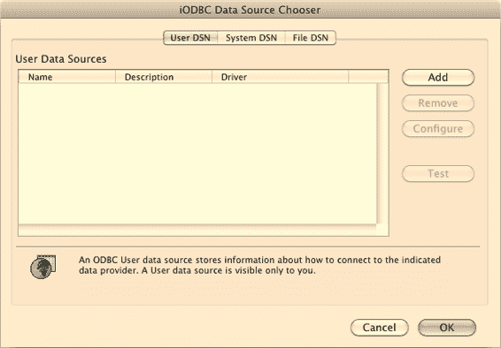

**313**

#### 获取并安装 ODBC 驱动程序

在将数据导入到 Excel 表格之前，你必须安装开放数据库连接（ODBC）驱动程序。这是一种软件，能够使 Excel 连接到数据库并从中提取数据。

Microsoft 不提供适用于 Mac 的 Excel ODBC 驱动程序，因此你需要从第三方供应商处获取。要查找最新兼容的 ODBC 驱动程序列表，请打开你的网页浏览器，访问 [`www.microsoft.com/mac/`](http://www.microsoft.com/mac/)，然后搜索 `ODBC Excel`。截至撰写本文时，共有两家提供商：

- OpenLink Software ([`www.openlinksw.com/`](http://www.openlinksw.com/))

- actualtechnologies LLC ([`www.actualtech.com/`](http://www.actualtech.com/))

每家公司都为不同类型的数据库提供了多个不同的 ODBC 驱动程序，因此请确保选择正确的版本。通常情况下，建议先获取试用版以确认其满足需求，然后购买完整版。某些试用版有时间限制；另一些则对能返回的数据量有限制。无论哪种情况，你最终都需要购买完整版。

#### 建立与数据库的连接

# 第 10 章：使用表格创建数据库

若要建立与数据库的连接，请将活动单元格定位到所需工作簿中合适的表格上，然后选择 `数据` > `外部数据源` > `数据库`，以打开用于设置连接的对话框。图 10.5 展示了 `iODBC 数据源选择器` 对话框，您可以通过它使用 OpenLink Software 的 ODBC 驱动程序建立连接。

**图 10–5.** *在已安装 ODBC 驱动程序的对话框中选择数据库。此屏幕显示的是* `iODBC 数据源选择器` *对话框。*

[www.it-ebooks.info](http://www.it-ebooks.info/)

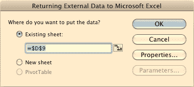

使用对话框中的控件来指定与数据源的连接。具体细节取决于您所使用的 ODBC 驱动程序。

设置好连接后，单击 `返回数据` 按钮。Excel 会显示 `将外部数据返回至 Microsoft Excel` 对话框（见图 10–6）。在此对话框中，您可以选择放置连接返回数据的位置：

- **现有工作表。** 要将数据放在现有工作表上，请选中此选项按钮，然后单击要作为区域左上角单元格的单元格。必要时可以单击 `折叠对话框` 按钮来移开 `将外部数据返回至 Microsoft Excel` 对话框，但通常绕过它操作也很简单。
- **新建工作表。** 如果要将数据放在新工作表上，请选中此选项按钮。Excel 会为您创建此工作表，并从单元格 `A1` 开始插入数据。
- **数据透视表。** 如果要根据数据创建数据透视表，请选中此选项按钮。此选项按钮仅适用于某些类型的数据库连接。（数据透视表将在第 12 章讨论。）

**图 10–6.** *在* `将外部数据返回至 Microsoft Excel` *对话框中，选择是将数据放在现有工作表、新工作表还是数据透视表中。您可以单击* `属性` *按钮来设置从数据库返回数据的属性。*

如果需要选择 Excel 返回数据的方式选项，请在 `将外部数据返回至 Microsoft Excel` 对话框中单击 `属性` 按钮，以显示 `外部数据区域属性` 对话框（见图 10–7）。在此处可以选择以下选项：

- **名称。** 在此文本框中，键入您想赋予外部数据区域的名称。此名称有助于您识别数据区域；当使用多个数据区域时，它变得更加重要。
- **查询定义。** 在此框中，如果要保存查询，请选中 `保存查询定义` 复选框；通常您会希望这样做，以免再次设置。如果查询使用密码，您也可以选中 `保存密码` 复选框来存储密码；出于安全考虑，您可能更愿意（或被迫）每次手动输入密码。
- **刷新控制。** 在此框中，如果希望 Excel 在刷新数据时提示您输入文件名，请选中 `刷新时提示输入文件名` 复选框。如果希望每次打开工作簿时 Excel 自动刷新数据，请选中 `打开文件时刷新数据` 复选框；如果您通常希望使用最新数据，这通常很有帮助。如果希望在保存时让 Excel 移除工作簿中的外部数据，请选中 `保存前从工作表中删除外部数据` 复选框——例如，当您使用工作簿处理数据且不希望其他人看到这些数据时。
- **数据布局。** 在此框的顶部部分，如果希望包含（通常有帮助的）字段名和行号，请分别选中 `包含字段名称` 复选框和 `包含行号` 复选框。如果希望 Excel 调整列宽以适应数据，请选中 `调整列宽` 复选框。如果仅希望从 HTML 数据源导入表格，请选中 `仅导入 HTML 表格` 复选框。
- **如果刷新时数据区域的行数发生变化。** 在 `数据布局` 框的此区域中，选择合适的选项按钮：`为新数据插入单元格，删除未使用的单元格`、`为新数据插入整行，清除未使用的单元格` 或 `用新数据覆盖现有单元格，清除未使用的单元格`。通常，`为新数据插入单元格，删除未使用的单元格` 选项按钮是最佳选择。
- **填充数据相邻列中的公式。** 如果希望 Excel 自动在数据相邻列的单元格中向下填充公式（例如，延续您输入的 `SUM` 公式），请选中此复选框。
- **使用表格。** 选中此复选框可让 Excel 将外部数据放入表格中。这通常是您想要的。

[www.it-ebooks.info](http://www.it-ebooks.info/)

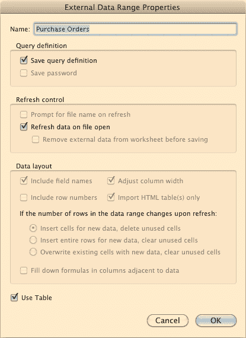

**图 10–7.** *在* `外部数据区域属性` *对话框中，命名连接，选择是否保存查询定义，决定何时刷新数据，并选择要使用的布局。*

**注意：** `外部数据区域属性` 对话框中的某些选项仅适用于特定类型的连接。

在 `外部数据区域属性` 对话框中完成选项选择后，单击 `确定` 按钮将其关闭并返回到 `将外部数据返回至 Microsoft Excel` 对话框。然后单击 `确定` 按钮关闭此对话框。Excel 会从数据源中导入数据。

## 刷新数据库中的数据

如果您已将表格设置为按时间间隔或在打开工作簿时自动更新数据库中的数据，Excel 会负责刷新。如果您将表格设置为手动刷新，或者需要立即将最新数据拉入表格，您可以通过 `数据` > `外部数据源` > `刷新` 菜单上的命令手动刷新表格。单击 `全部刷新` 命令可刷新所有表格，或单击 `刷新数据` 命令仅刷新当前表格中的数据。

如果刷新似乎耗时过长，请选择 `数据` > `外部数据源` > `刷新` > `取消刷新` 来取消操作。

[www.it-ebooks.info](http://www.it-ebooks.info/)

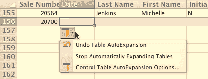

## 从 FileMaker Pro 数据库导入数据

如果需要从 FileMaker Pro 数据库中将数据拉到表格中，请选择 `数据` > `外部数据源` > `FileMaker` 以启动 `FileMaker Pro 导入向导`。按照第 1 章“从 FileMaker Pro 数据库导入数据”一节中讨论的向导步骤进行操作。

**注意：** 要从 FileMaker Pro 数据库导入数据，您必须已在运行 Excel 的 Mac 上安装了 FileMaker Pro。

## 调整表格大小

创建表格后，当您添加或删除行或列时，Excel 通常会自动为您调整其大小。例如，当您使用 `表单` 对话框添加记录时，Excel 会扩展表格以将其包含在内。

如果向没有 `汇总` 行的表格的当前最后一行之后的行添加数据，Excel 也会自动扩展该表格。Excel 将此功能称为 `表格自动扩展`。如果您不希望 Excel 执行此操作，请单击出现在所添加行第一个单元格下方和右侧的 `自动更正选项` 按钮，然后单击 `撤销表格自动扩展`（见图 10–8）。再次单击操作按钮，然后单击 `停止自动扩展表格`。

**注意：** 当您使用 `表格自动扩展` 向表格添加新行时，Excel 仅当您开始在该行键入数据时才会进行更改。当您开始键入时，Excel 会将该行的样式应用到该行，此时您可以看到它是表格的一部分。但在您开始键入之前，它只是另一行普通行。

**图 10–8.** *您可以使用* `自动更正选项` *按钮来撤销* `表格自动扩展` *和关闭此功能。*

**注意：** 如需重新启用表格自动扩展功能，请选择 Excel 偏好设置或按下 `Cmd+,`（Cmd 键和逗号键）。在 Excel 偏好设置对话框中，点击“公式与列表”区域中的 `表格` 图标，以显示表格偏好设置面板。选中 `自动扩展表格为我输入的数据` 复选框，然后点击 `确定` 按钮。

[www.it-ebooks.info](http://www.it-ebooks.info/)

## 按一个或多个字段排序表格

当需要检查表格中的数据时，对其进行排序通常很有用。Excel 允许你快速按单个字段或多个字段对表格进行排序。

**提示：** 如果你希望能够将表格恢复到原始顺序，请在其中包含一个包含连续数字的列。这些数字可能是记录的一部分（例如，交易的连续销售编号），或仅是记录的 ID 编号。无论哪种情况，你都可以使用 `AutoFill` 快速输入它们。要恢复表格的原始顺序，你可以按此列对其进行排序。

### 按单个字段快速排序

要按单个字段对表格排序，请单击要排序的列中的任意单元格，然后选择 `数据` > `排序与筛选` > `排序`，单击 `排序` 按钮的主要部分。这将产生升序排序（A 到 Z、低值到高值、早期日期到后期日期等）。要反转排序为降序，请再次单击 `排序` 按钮的主要部分。

**注意：** 你也可以通过选择 `数据` > `排序与筛选` > `升序排序`、`数据` > `排序与筛选` > `降序排序`，或通过 `排序` 弹出菜单中的其他项进行排序：`将单元格颜色置于顶端`、`将字体颜色置于顶端` 或 `将图标置于顶端`。通常，升序和降序是对表格最有用的一种排序方式。（你通常使用 `将单元格颜色置于顶端`、`将字体颜色置于顶端` 或 `将图标置于顶端` 对应用了条件格式的单元格进行排序。）

# 排序后，表格将保持该排序方式，直到你更改它。

## 按多个字段排序表格

同时按两个或多个字段对表格进行排序通常很有用。例如，在客户数据库中，你可能需要首先按州对客户进行排序，然后在州内按城市排序。

要按多个字段排序，请执行以下步骤：

1. 选择 `数据 > 排序与筛选 > 自定义排序` 以显示 `排序` 对话框。图 10–9 显示了已输入两个条件且正在输入第三个条件的 `排序` 对话框。

   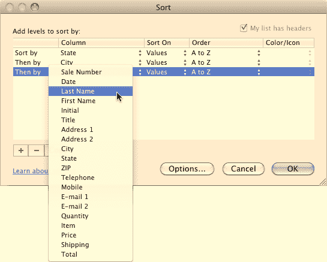

   **图 10–9.** 在“排序”对话框中，你可以精确设置识别数据库中数据所需的排序条件。

2. 使用 `排序` 对话框主体部分第一行上的控件设置你的第一个排序条件。请执行以下步骤：

   a. 打开 `排序依据` 行中的 `列` 弹出菜单，然后点击要首先排序的列。例如，点击 `州` 列。

   b. 打开同一行中的 `排序依据` 弹出菜单，然后点击要排序的依据：`值`、`单元格颜色`、`字体颜色` 或 `单元格图标`。大多数情况下，你会使用 `值`，但其他三项对于应用了条件格式的表格很有用。

   c. 打开同一行中的 `次序` 弹出菜单，然后点击所需的排序顺序。如果你在 `排序依据` 弹出菜单中选择 `值`，则可以选择 `A 到 Z` 进行升序排序、`Z 到 A` 进行降序排序，或 `自定义序列`。选择 `自定义序列` 会打开 `自定义序列` 对话框，你可以使用它来选择用于排序结果的自定义序列。例如，你可以使用公司产品或办公室的自定义序列将数据库排序为自定义顺序，而不是仅限于升序或降序。

   

   d. 如果你需要排序区分大小写（以便“smith”出现在“Smith”之前等），请点击 `选项` 按钮。在 `排序选项` 对话框中（见图 10–10），选中 `区分大小写` 复选框，然后点击 `确定` 按钮。

   **图 10–10.** 如果你想区分小写字母及其大写版本，请在“排序选项”对话框中选择“区分大小写”复选框。

3. 点击 `添加 (+)` 按钮，在 `排序` 对话框主体部分添加第二行控件。

4. 使用相同方法在 `然后依据` 行上设置第二级排序的条件。例如，使用数据库中的 `城市` 列设置第二级排序。

5. 通过重复步骤 3 和 4 设置任何其他必需的条件。

6. 点击 `确定` 按钮关闭 `排序` 对话框。Excel 将使用你指定的条件对数据进行排序。

> **注意：** 当对不在表格中的数据排序时，有两个主要区别。首先，`排序` 对话框中的 `数据包含标题` 复选框可用，如果你要排序的数据范围包含标题行，则必须选中它。（否则，Excel 会将标题排序到数据范围中。）其次，你可以在 `排序选项` 对话框中选择 `按行排序` 选项按钮来排序列而不是行，这种选择在数据表格中不可用。

## 识别和删除表格中的重复记录

当你创建了一个大型表格后，可能需要检查其中是否存在重复记录并删除找到的重复项。Excel 提供了一个 `删除重复项` 功能，免去了手动梳理记录的麻烦。

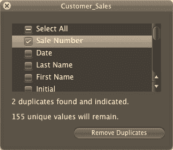

> **警告：** 删除重复值前有两个警告：首先，确保你有一份数据库工作簿的备份副本——例如，使用访达将当前版本的文件复制到安全位置。其次，确保你清楚表格中的哪些字段应包含唯一值，哪些字段可以包含重复值。例如，客户 ID 号字段必须是唯一的，因为每个客户都有不同的 ID 号；但客户姓氏字段不能合理地要求唯一，因为许多客户可能共享姓氏。大多数数据库都需要一个唯一的 ID 号或此类代码。

要从表格中删除重复记录，请执行以下步骤：

1. 单击表格中的任意单元格。

2. 从功能区选择 `表格工具 > 删除重复项`，或从菜单栏选择 `数据 > 表格工具 > 删除重复项`，以显示图 10–11 所示的窗口。

   **图 10–11.** 使用此窗口在应仅包含唯一值的列中定位重复值。窗口的标题栏显示数据表的名称。

3. 如果 `全选` 复选框包含选中标记，请单击该复选框以取消选中标记，并清除 `列` 框中的所有复选框。

4. 为你想要检查重复项的每一列选中其复选框。对话框底部的读数显示重复项的数量。

   > **提示：** 通常，最好一次只检查单个列的重复值。确保该列必须包含唯一值。

5. 如果你想要删除重复项，请点击 `删除重复项` 按钮。

6. 如有必要，重复该过程处理另一个字段。

7. 完成删除重复项后，点击标题栏左端的 `×` 按钮关闭窗口。

## 筛选表格

当你需要在表中查找与指定条件匹配的记录时，可以对其进行*筛选*。筛选会使 Excel 仅显示与搜索条件匹配的记录，同时隐藏所有其他记录。

> **注意：** 你也可以使用 Excel 的“`查找`”功能搜索记录。在菜单栏中选择“`编辑`” > “`查找`”，或按 `Cmd+F` 组合键显示“`查找`”对话框，在“`查找内容`”框中输入搜索词，然后单击“`查找下一个`”按钮。筛选功能会将所有匹配的记录集中显示，而不是分散在表格中，因此通常比使用“`查找`”更方便。

为了简化筛选操作，Excel 提供了一个名为“`自动筛选`”的功能。要使用“`自动筛选`”，请按以下步骤操作：

1. 单击表格中的一个单元格。

2. 单击功能区中的“`数据`”选项卡以显示其内容。

3. 在“`排序和筛选`”组中，确保“`筛选`”按钮处于选中状态（即看起来是按下状态）；如果没有，请单击该按钮的主要部分。Excel 在创建表格时通常会默认选中“`筛选`”按钮，因此除非你已关闭筛选功能，否则此按钮应处于按下状态。选中此按钮后，Excel 会在表格的每个列标题上显示一个弹出按钮。

4. 在你希望用于筛选的列上，单击弹出按钮以显示“`自动筛选`”窗口（如图 10–12 左侧所示）。“`自动筛选`”窗口的标题栏会显示你单击的字段名称。

   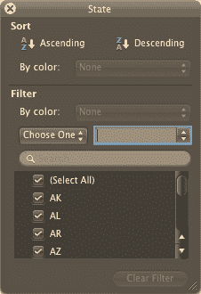
   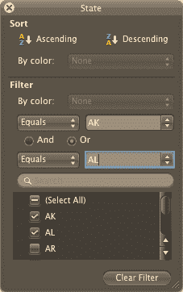

   **图 10–12.** 要应用筛选，请单击列标题上的弹出箭头以显示“`自动筛选`”窗口（左图）。在“`筛选`”区域中，打开第一个弹出菜单，并选择所需的比较条件（右图）。然后可以根据需要添加进一步的比较条件。

5. 单击要应用的排序或筛选类型：

   *排序。* 单击要应用的排序类型。通常，你需要单击“`升序`”按钮或“`降序`”按钮。但如果数据表使用了颜色，你也可以按颜色排序——只需在“`排序`”区域的“`按颜色`”弹出菜单中选择相应的颜色即可。

   *筛选。* 如果希望按颜色筛选表格，请在“`按颜色`”弹出菜单中选择颜色。否则，请打开图 10–12 左侧显示为“`选择一个`”的弹出菜单，然后从中选择比较条件。例如，选择“`等于`”可设置筛选以选取特定州；或选择“`开头是`”可设置筛选以选取以指定文本开头的城市。使用“`自定义自动筛选方式`”窗口中的字段来设置比较条件的其余部分；图 10–12 右侧的屏幕显示了一个示例，该示例按“`等于 AK`”或“`等于 AL`”进行筛选，返回州为“`AK`”或“`AL`”的记录。

   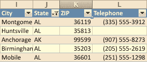

> **注意：** 筛选比较条件取决于你在表格中选择的列的内容。例如，如果列中包含数字，则比较条件包括数学比较项“`大于`”、“`大于或等于`”、“`小于`”、“`小于或等于`”、“`介于`”、“`前 10 项`”、“`后 10 项`”、“`高于平均值`”和“`低于平均值`”。如果列中包含日期，则比较条件包括“`之前`”、“`之后`”、“`介于`”、“`明天`”、“`下周`”、“`下月`”和“`明年`”。

指定筛选的详细信息后，Excel 会将其应用于表格，并将显示范围缩小到与筛选条件匹配的那些行。Excel 会在包含筛选条件的列上显示一个筛选符号，替代原有的下拉按钮（如图 10–13 中“`State`”列标题所示）。

**图 10–13.** 筛选符号（此处显示在“`State`”列标题上）表示你正在按该列筛选表格。

# 第 10 章：使用表创建数据库

## 将数据库函数用于表格

如第 6 章所述，Excel 包含 12 个用于表格的数据库函数。每个函数都需要三个参数：

`database`。此参数告诉函数要使用哪个数据库或表。您可以将 `database` 指定为一个范围（例如，`A1:F4`），或者通过表的名称来指定（例如，`"Customer_Sales"`）。

`field`。此参数告诉函数您对数据库中的哪个字段感兴趣。例如，您可以指定 `"State"` 来使用名为 `State` 的字段。

`criteria`。此参数告诉函数在哪里查找比较条件所在的范围。该范围必须至少包含一个列标签以及该列标签下的至少一个单元格；您在此指定条件。

### 注意

通常最好将条件区域放在表的上方，而不是下方，因为将条件区域放在表下方可能会阻止“表自动扩展”功能正常工作。将条件区域放在表的上方也有助于确保它不会与表自身的范围重叠。将条件区域放在表的侧面也可以，但除非表相对较窄，否则会使该区域难以查看。

图 10-14 展示了一个使用数据库函数的示例。正如你在第 6 章中记得的，`DAVERAGE()` 函数返回指定字段中符合你条件的单元格的平均值。这里，单元格 C9 中的 `DAVERAGE(A4:C8,"Satisfaction",A1:C2)` 函数的工作原理如下：`A4:C8` 指定了表所在的区域。（是的，这个表小的不切实际。）

`"Satisfaction"` 告诉函数使用 `Satisfaction` 字段（位于 C 列）。

`A1:C2` 告诉函数在 `A1:C2` 这个区域中查找条件。单元格 B2 给出了要使用的条件：`Staff` 列中的数字必须小于 20（`Staff>20`）。

根据这些信息，`DAVERAGE()` 函数会选取 `Staff>20` 为真的两行（旧金山和奥克兰）的 `Satisfaction` 值，并计算它们的平均值，返回结果为 8.4。

**图 10–14.** 要使用类似 `DAVERAGE()` 这样的数据库函数，你必须在工作表中设置一个条件区域。放置条件区域的最佳位置是表的上方。

### 本章小结

在本章中，你学习了如何使用 Excel 的表来创建一个数据库，你可以在其中存储信息、排序，并应用筛选来查找所需的记录。你还学习了如何将 Excel 的数据库函数与表一起使用。

## 第 11 章：使用模拟分析、单变量求解和规划求解解决业务问题

在使用 Excel 的大部分工作中，你可能希望像本书前面所做的那样，处理已有的硬数据。但在其他时候，你需要向数据提问——例如，你需要将价格提高多少才能将收入提升一定数额，或者如果你将制造成本削减 10% 会发生什么？

在本章中，我们将介绍 Excel 提供的用于执行模拟分析的四种工具：

*数据表。* 当你想评估一个或两个变量对计算结果的影响时，请使用数据表。

*方案。* 当你想在工作表中使用不同数据进行试验，而不更改已有的核心数据时，请使用方案。

*单变量求解。* 当你需要通过更改一个其他值来使某个单元格的值达到特定数值时，请使用单变量求解。

*规划求解。* 当你需要通过更改两个或更多其他值来使某个单元格的值达到特定数值时，请使用规划求解加载项应用程序。