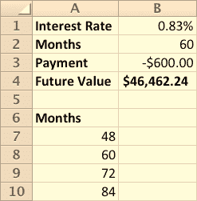
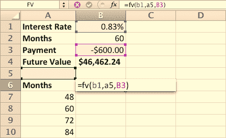
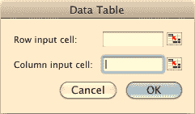
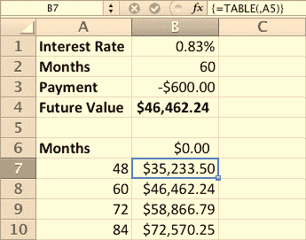
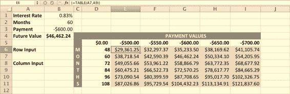
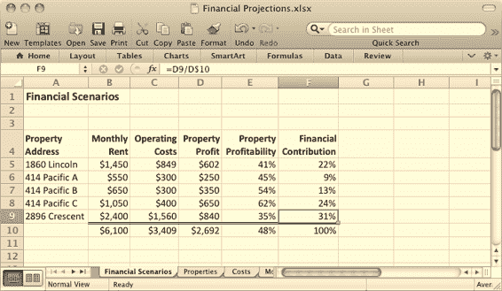
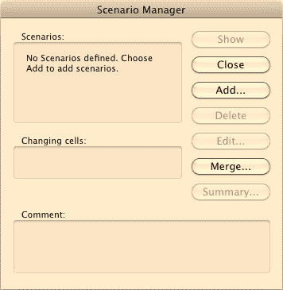

# 第 11 章：使用假设分析、单变量求解和规划求解解决业务问题

#### 使用模拟运算表评估变量的影响

`模拟运算表`是一种工具，可用于计算一个或两个变量如何改变计算结果。当你想要查看工作表中的结果范围，而不是一次查看单个结果时，可以使用模拟运算表。

##### 创建单变量模拟运算表

当你只需要查看一个变量如何改变计算结果时，可以快速创建一个模拟运算表。将输入值（即你想要测试的值）放在一行或一列中，然后告诉 Excel 在哪里找到它们。

创建模拟运算表起初看起来可能有些奇怪，但你会很快掌握窍门。试试这个使用一个变量创建模拟运算表的示例。

首先，创建一个新的工作表，并设置如图 11-1 所示的简单`=FV()`公式，用于计算一项投资的未来价值。该投资年利率为 10%，期限为 12 个月，实际分期数为 60 个月，每月从你的工资中扣除 600 美元。

请按照以下步骤操作：

1. 在以下单元格中输入数据标签：

   `A1`. 利率

   `A2`. 月份数

   `A3`. 付款额

   `A4`. 未来价值

**图 11-1.** *模拟运算表的示例计算使用`FV()`函数来计算每月投资 600 美元的未来价值。*

2. 在单元格`B1`中输入公式`=10%/12`。对此单元格应用百分比数字格式，并使其显示两位小数，以便你看到 0.83%，而不是 Excel 通常显示的 1%（这会使计算在视觉上产生混淆）。

3. 在单元格`B2`中输入值`60`。

4. 在单元格`B3`中输入值`-600`。应用货币数字格式以使其含义在视觉上清晰明了。

5. 在单元格`B4`中输入`FV`函数：`=FV(B1,B2,B3)`。

[www.it-ebooks.info](http://www.it-ebooks.info/)

**第 11 章：使用假设分析、单变量求解和规划求解解决业务问题** **329**

到目前为止，一切顺利。现在设置模拟运算表的输入值。请按照以下步骤操作：

1. 在单元格`A6`中输入标签`月份数`。

2. 在单元格`A7:A10`中输入模拟运算表的值：

   `A7`. 48

   `A8`. 60

   `A9`. 72

   `A10`. 84

**提示：** 对于这个小型模拟运算表，直接键入输入值很容易，但如果你想扩展序列，可以尝试在单元格`A7`中输入 48，在单元格`A8`中输入 60，选中这些单元格，然后拖动自动填充柄来填充其余单元格。

你的工作表现在应该看起来像图 11-2 中的那样。

**图 11-2.** *在单元格`A7:A10`中输入模拟运算表的输入值。*

现在你可以输入使用模拟运算表的公式了。为了让模拟运算表正常工作，你需要将公式放在 Excel 期望找到它的单元格中：

- **列方向的模拟运算表：** 将公式输入在第一个输入值上方的一行，且位于其右侧的下一列中。在示例中，这是单元格`B6`。
- **行方向的模拟运算表：** 将公式输入在第一个输入值左侧的一列，且位于其下方的下一行中。

在这种情况下，我们正在创建一个列方向的模拟运算表，因此我们需要在单元格`B6`中输入公式。如图 11-3 所示，输入公式`=FV(B1,A5,B3)`——换句话说，它与单元格`B4`中的公式相同，但使用单元格`A5`而不是单元格`B2`来提供月份数。

[www.it-ebooks.info](http://www.it-ebooks.info/)

**330** **第 11 章：使用假设分析、单变量求解和规划求解解决业务问题**

**图 11-3.** *在输入值的右上方单元格中输入公式。*

**注意：** 当你为模拟运算表输入公式时，Excel 通常会显示一个明显错误的值或一个错误值。在此示例中，公式单元格显示结果$0.00，因为单元格`A5`是空白，因此为月份数参数提供了零值。在其他公式中，零值会产生错误值。这不是问题，稍后你会看到。

现在你可以设置模拟运算表了。请按照以下步骤操作：

1. 选择包含输入值和公式的单元格区域。在此示例中，选择区域`A6:B10`。

2. 从功能区中选择**数据** > **分析** > **模拟分析** > **模拟运算表**，或者从菜单栏中选择**数据** > **模拟运算表**，以显示“模拟运算表”对话框（见图 11-4）。

**图 11-4.** *在“模拟运算表”对话框中，为你正在创建的模拟运算表输入行引用单元格或列引用单元格。*

3. 单击**列引用单元格**框，然后点击你用作输入值的单元格——在本例中，是单元格`A5`。Excel 会输入绝对引用`$A$5`。

**注意：** 当你创建行方向的模拟运算表时，请单击“模拟运算表”对话框中的**行引用单元格**框，然后点击你用于输入值的单元格。

[www.it-ebooks.info](http://www.it-ebooks.info/)

**第 11 章：使用假设分析、单变量求解和规划求解解决业务问题** **331**

4. 单击**确定**按钮关闭“模拟运算表”对话框。Excel 会在每个包含输入值的单元格旁边的单元格中输入数组公式`{=TABLE(,A5)}`。

5. 对结果单元格应用货币数字格式，以便结果显示为美元金额。

图 11-5 显示了带有结果的模拟运算表。

**图 11-5.** *创建模拟运算表后，结果会显示在输入值旁边。*

##### 创建双变量模拟运算表

当你需要分析计算中使用的两个信息发生变化时会发生什么，请创建一个双变量模拟运算表。例如，在使用`FV()`函数计算投资时，你可能不仅需要考虑不同的分期月份数，还需要考虑不同的付款额。

要创建一个双变量模拟运算表，你需要将一组输入数据放在表格左侧的一列中，并将另一组输入数据放在表格上方的一行中。例如，图 11-6 显示了一个使用`FV()`函数计算投资未来价值的双变量模拟运算表：

- 区域`D6:D11`包含分期数参数（48、60、72、84、96 或 108 个月）的输入值。
- 区域`E5:I5`包含付款额参数（-$500.00、$550.00、–$600.00、-$650.00 或-$700.00）的输入值。这些单元格已应用货币数字格式。
- 单元格`A7`是行引用单元格，单元格`A9`是列引用单元格。当你通过从功能区中选择**数据** > **分析** > **模拟分析** > **模拟运算表**，或从菜单栏中选择**数据** > **模拟运算表**来创建模拟运算表时，你需要在“模拟运算表”对话框中同时指定行引用单元格和列引用单元格。
- 单元格`D5`包含模拟运算表的公式：`=FV(B1,A9,A7)`。
- 每个结果单元格都包含公式`{=TABLE(A7,A9)}`。

[www.it-ebooks.info](http://www.it-ebooks.info/)

**332** **第 11 章：使用假设分析、单变量求解和规划求解解决业务问题**

**图 11-6.** *在双变量模拟运算表中，你将一组输入值输入到一列中（此处为 D 列），另一组输入值输入到一行中（此处为第 5 行）。公式位于列和行相交的单元格中（此处为单元格 D5）。*

**注意：** 当你不再需要模拟运算表时，请选中该表，然后按**Delete**键，或选择**开始** > **编辑** > **清除** > **全部清除**。

#### 在工作表中检查不同方案

通常，当你构建了一个工作表后，你会想要尝试其中的不同数据。例如，如果你在制定预算，可能需要调整不同部门的不同数字以达到你所需的总体平衡。

你可以通过直接更改工作表中的值来尝试不同的数据。

工作表——但之后你可能需要恢复原始数值。另一种方法是创建多个工作表（或工作簿）副本，然后修改副本中的值，保留原始数据不变。这种方法虽然可行，但如果之后需要修改原始工作表（例如，添加另一列数据），修改过程会很快变得混乱不堪。

与其用这些笨拙的方式操作，不如使用 Excel 的方案功能。*方案*是一种向一组单元格输入不同值而不改变底层数值的方法。你可以根据需要从一个方案切换到另一个方案，也可以将同一工作表不同版本的方案合并到单个工作表中。

##### 为方案创建工作表

首先，创建工作簿和工作表，用于后续的方案操作。如果已有包含数据的工作簿，直接将其打开即可。像往常一样在工作表中设置数据和公式。

[www.it-ebooks.info](http://www.it-ebooks.info/)

**第 11 章：使用假设分析、单变量求解和规划求解解决业务问题** **333**

**提示：** 为了便于设置和调整方案，请为方案中要更改的每个单元格定义一个名称。单击该单元格，选择`插入` `名称` `定义`，弹出`定义名称`对话框，然后按照第 3 章“为单元格或区域分配名称”一节所述的方法操作。例如，在`在当前工作簿中的名称`文本框中输入名称，然后点击`添加`按钮添加名称并保持对话框打开，以便您可以单击另一个单元格并为其定义名称。

图 11-7 展示了本节用作示例的样本工作表。该工作表汇总了来自一个规模适中的租赁物业投资组合的财务回报。

**图 11-7.** *要开始使用方案，请创建一个包含现有数据和所需公式的工作表。*

工作表中显示的内容如下：

`物业地址`列显示每处物业的地址。

`月租金`列显示每处物业的月租金。单元格`B10`包含一个`SUM()`公式，用于计算总租金。此处的每个单元格都有名称以便识别——例如`Rent_Lincoln`、`Rent_Pacific_A`等。

`运营成本`列显示每处物业的月度运营成本，包括所有按揭成本和其他财务负担。单元格`C10`使用`SUM()`公式计算总运营成本。此列中的数字已四舍五入。每个单元格都有名称：`Costs_Lincoln`、`Costs_Pacific_A`等。同样，这样做是为了能够轻松清晰地引用这些单元格。

[www.it-ebooks.info](http://www.it-ebooks.info/)

**334** **第 11 章：使用假设分析、单变量求解和规划求解解决业务问题**

`物业利润`列显示每处租赁单元在从租金中扣除运营成本后的利润（例如，单元格`D5`包含公式`=B5-C5`）。此列中的数字已四舍五入；这就是为什么单元格`D5`看似包含数学错误但实际上正确的缘故。单元格`D10`使用`SUM()`公式返回总利润。

`物业盈利能力`列以百分比形式显示物业的盈利能力。为了计算盈利能力数值，我们将`物业利润`值除以`月租金`值——例如，单元格`E5`包含公式`=D5/B5`。在该列底部，单元格`E10`使用`AVERAGE()`公式显示各物业的平均盈利能力。

`财务贡献`列以百分比形式显示每处物业对总利润的贡献。为了计算贡献数值，我们将每处物业的利润除以单元格`D10`中的总利润。例如，单元格`F9`包含公式`=D9/D$10`，使用混合引用确保复制公式时行号保持绝对引用。单元格`F10`包含一个`SUM()`公式，用于汇总各百分比，从而显示它们总计为 100%。

