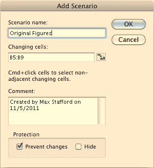
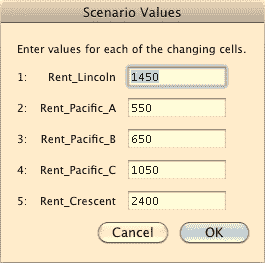
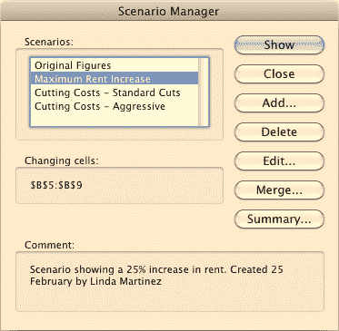
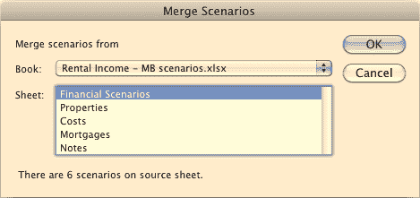
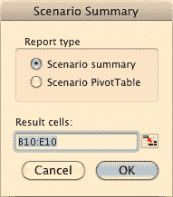

# 市场不景气，总利润太低。因此，我们将通过假设分析来看如何通过提高租金和削减成本来改善状况。

## 打开方案管理器对话框

当您准备好开始使用方案时，从功能区中选择 `Data Analysis > What-If > Scenario Manager`，或从菜单栏中选择 `Tools > Scenarios`，以显示 `Scenario Manager` 对话框。起初，当工作簿不包含任何方案时，`Scenario Manager` 对话框会如图 11–8 所示。

**图 11–8.** 最初，方案管理器对话框中只有一条提示，告知您单击“添加”按钮。请照做。

**第 11 章：使用假设分析、单变量求解和规划求解解决业务问题 335**

## 创建方案

打开 `Scenario Manager` 对话框后，您可以创建自己的方案。

**提示：** 首先，创建一个包含原始数据的方案。这样，在测试完方案后，您可以轻松地回到原始数据。

要创建一个方案，请遵循以下步骤：

**1.** 在 `Scenario Manager` 对话框中，单击 `Add` 按钮以显示 `Add Scenario` 对话框（见图 11–9）。

**图 11–9.** 使用“添加方案”对话框来设置每个方案。首先为您的原始数据创建一个方案，以便您能轻松返回。

**2.** 在 `Scenario name` 文本框中，为方案键入一个描述性名称。

**3.** 单击 `Changing Cells` 文本框，然后输入允许使用该方案的用户更改的单元格的详细信息。对于原始方案，我们不进行任何更改；但对于涉及更改租金的方案，其范围是单元格 `B5:B9`。

在工作表中单击并拖动以选择连续单元格区域。如果需要选择非连续单元格，请单击第一个单元格，然后 `Cmd+单击` 每个其他单元格。

**注意：** 当您通过在工作表中单击，在 `Changing Cells` 文本框中输入单元格或单元格区域时，Excel 会将对话框的名称从 `Add Scenario` 更改为 `Edit Scenario`。尽管这看起来很奇怪，但这是正常现象。

您也可以在 `Changing Cells` 文本框中键入区域的名称。

`Changing Cells` 文本框右侧有一个 `Collapse Dialog` 按钮，但您无需使用它，因为当您在工作表中单击时，Excel 会自动折叠 `Add Scenario` 对话框。当您选择完可变单元格后，Excel 会再次展开该对话框。

**4.** 在 `Comment` 文本框中，键入一条注释，解释该方案的用途以及如何使用它。Excel 会创建一个默认注释，格式为“创建者”，后面是您的用户名（依据 Office 应用程序中的设置）和日期，但一条描述性的注释通常更有帮助。

**5.** 根据需要在对话框底部的 `Protection` 区域中选择设置：

*   **防止更改。** 当您需要防止对方案进行更改时，选中此复选框。要使保护生效，您需要按照下一节所述保护工作表。

*   **隐藏。** 当您需要防止他人看到此方案时（例如，您希望他们用自己的数据实验，而不是查看您的数据），选中此复选框。同样，您需要保护工作表。

**6.** 单击 `OK` 按钮关闭 `Add Scenario` 或 `Edit Scenario` 对话框。Excel 会显示 `Scenario Values` 对话框（见图 11–10）。此对话框为方案中的每个可变单元格显示一个文本框。在这里您就能体会到命名可变单元格的好处——每个文本框都易于识别。如果您尚未命名可变单元格，则会显示单元格地址，您可能需要参考工作表来查看哪个单元格是哪个。

**第 11 章：使用假设分析、单变量求解和规划求解解决业务问题 337**

**图 11–10.** 在“方案变量值”对话框中，为您正在创建的新方案输入要使用的值。单元格名称会生成标签（如 `Rent_Lincoln`），这比单元格地址（例如 `B5`）更容易引用。

**7.** 根据方案的需要更改这些值。

**提示：** 您可以在 `Scenario Values` 对话框的文本框中键入公式。例如，要将图 11–10 中的 `Rent_Lincoln` 值提高 25%，您可以将 1450 值改为公式 `=1.25*1450`。输入此类公式后，当您关闭 `Scenario Values` 对话框时，Excel 会显示图 11–11 所示的对话框，告知您它已将公式的名称和结果转换为值。单击 `OK` 按钮。

**图 11–11.** 在“方案变量值”对话框中输入公式后，Excel 会自动将它们为您转换为值。

**8.** 单击 `OK` 按钮关闭 `Scenario Values` 对话框。Excel 会返回到 `Scenario Manager` 对话框，此时，该方案会出现在 `Scenarios` 列表框中。

要添加另一个方案，请在 `Scenario Manager` 对话框中单击 `Add` 按钮，然后重复上述过程。

**338 第 11 章：使用假设分析、单变量求解和规划求解解决业务问题**

## 对方案应用保护

如果您在 `Add Scenario` 或 `Edit Scenario` 对话框的 `Protection` 区域中选中了 `Prevent Changes` 或 `Hide` 复选框，您需要保护工作表才能使保护生效。

要保护工作表，请遵循以下步骤：

**1.** 如果 `Scenario Manager` 对话框是打开的，请单击 `Close` 按钮将其关闭。

**2.** 从功能区中选择 `Tools > Protection > Sheet`，或从菜单栏中选择 `Tools > Protection > Protect Sheet`，以显示 `Protect the sheet and contents of locked cells` 对话框。

**3.** 在 `Password` 文本框中键入一个密码，并在 `Verify` 文本框中再次键入该密码。

**4.** 在 `Allow users of this sheet to` 框中，确保 `Edit Scenarios` 复选框未被选中。

**5.** 单击 `OK` 按钮关闭对话框。Excel 将应用保护。

**6.** 保存工作簿。例如，按 `Cmd+S` 或单击标准工具栏上的 `Save` 按钮。

以这种方式保护工作表中的方案后，您需要先关闭保护，然后才能编辑这些方案。要关闭保护，请从功能区中选择 `Tools > Protection > Sheet`，或从菜单栏中选择 `Tools > Protection > Unprotect Sheet`，在 Excel 显示的对话框中键入密码，然后单击 `OK` 按钮。

## 编辑和删除方案

在 `Scenario Manager` 对话框中，您可以通过在 `Scenarios` 列表框中单击某个方案，然后单击 `Edit` 按钮，并在 `Edit Scenario` 对话框中进行操作，来快速编辑该方案。Excel 会自动为方案更新注释，注明修改的详细信息（例如，“由 Jack Cunningham 于 2011 年 2 月 18 日修改”），但您通常需要键入更多细节，例如您试图让该方案展示什么。

当您不再需要某个方案时，通过在 `Scenarios` 列表框中单击该方案，然后单击 `Delete` 按钮来删除它。Excel 不会确认删除操作；但如果您误删了某个方案，并且恢复它比丢失自上次保存工作簿以来所做的其他更改更重要，您可以通过不保存更改就关闭工作簿来恢复该方案（前提是该方案已保存在工作簿中）。

**第 11 章：使用假设分析、单变量求解和规划求解解决业务问题 339**

## 在各方案之间切换

一旦你为同一个工作表创建了多个方案，就可以通过点击“方案管理器”对话框（见图 11-12）中“方案”列表框内的所需方案，然后点击“显示”按钮来切换它们。Excel 会在工作表的单元格中显示该方案的数值。“方案管理器”对话框会保持打开状态，因此你可以快速切换到其他方案。

**图 11-12.** 要切换到其他方案，请在“方案管理器”对话框的“方案”列表框中点击该方案，然后点击“显示”按钮。

## 第 11 章：使用模拟分析、单变量求解和规划求解解决业务问题

**提示：** 如果你需要能够在不同方案之间快速切换，可以将“方案”弹出菜单添加到“标准”工具栏或其他便捷的工具栏上。要自定义工具栏，请使用第 2 章中“使用你需要的命令自定义工具栏”一节中介绍的方法。

在“自定义工具栏和菜单”对话框的“命令”选项卡上，点击“类别”列表中的“工具”项，然后在“命令”列表框中向下滚动，找到“方案”弹出菜单。

### 将方案合并到单个工作表中

如果你在同一个工作簿中创建并分享方案，可以将它们全部集中存放。但有时你可能需要在不同的工作簿中创建方案，然后再将它们合并起来。你可以通过“方案管理器”对话框中的“合并”命令轻松完成此操作。

[www.it-ebooks.info](http://www.it-ebooks.info/)

要合并方案，请按照以下步骤操作：

1. 打开所有包含要合并方案的工作簿。

2. 激活你要将方案合并到其中的工作簿和工作表。

3. 从功能区中选择“`数据分析` > `模拟分析` > `方案管理器`”，或者从菜单栏中选择“`工具` > `方案`”，以显示“方案管理器”对话框。

4. 点击“合并”按钮，显示“合并方案”对话框（见图 11-13）。

   **图 11-13.** 在“合并方案”对话框中，选择包含要合并到当前工作簿中的方案的工作簿和工作表。

5. 打开“工作簿”弹出菜单，并选择包含要合并方案的那个打开的工作簿。“工作表”列表框中会显示该工作簿中的工作表列表。

6. 在“工作表”列表框中，点击包含这些方案的工作表。“合并方案”对话框底部的读数会显示该工作表包含多少个方案，这有助于你选择正确的工作表。

7. 点击“确定”按钮。`Excel` 会关闭“合并方案”对话框，合并方案，然后再次显示“方案管理器”对话框。

**注意：** 如果任何合并到当前工作表中的方案与工作表中现有的方案同名，`Excel` 会在新导入的方案名称后添加当前日期以作区分。

[www.it-ebooks.info](http://www.it-ebooks.info/)

### 从方案创建报告

有时，你只需创建方案并在工作表中查看它们，就能做出所需的决策。在其他时候，从方案中创建报告以便进行比较则非常有帮助。`Excel` 提供了一种简单的方法，可以直接从“方案管理器”对话框中创建摘要报告或数据透视表报告。

要从方案创建报告，请按照以下步骤操作：

1. 从功能区中选择“`数据分析` > `模拟分析` > `方案管理器`”，或者从菜单栏中选择“`工具` > `方案`”，以显示“方案管理器”对话框。

2. 点击“摘要”按钮，显示“方案摘要”对话框（见图 11-14）。

   **图 11-14.** 在“方案摘要”对话框中，在方案摘要和方案数据透视表之间进行选择，然后为摘要选择结果单元格。

3. 在“报表类型”框中，如果你想要创建一个摘要工作表，请选择“方案摘要”选项按钮。如果你想创建一