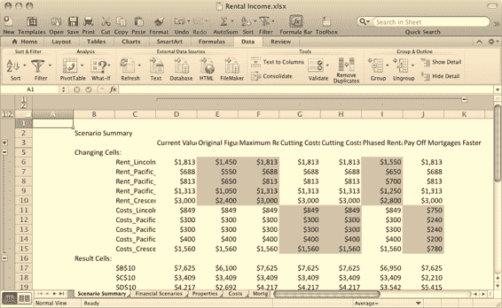
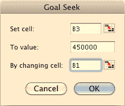
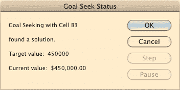
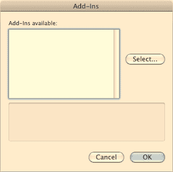
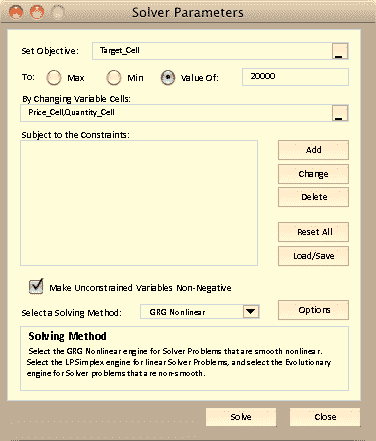
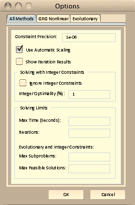
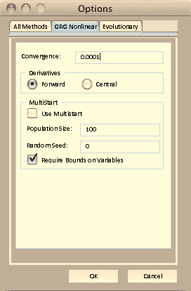
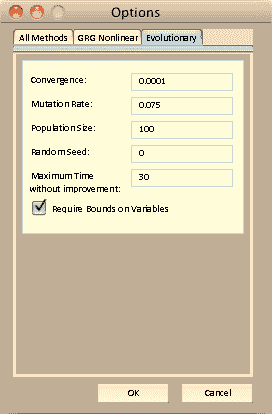
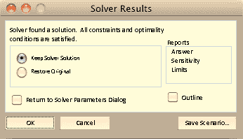

# 方案数据透视表

选择“方案数据透视表”选项按钮。

4.  在`结果单元格`文本框中单击，然后输入你希望报告或数据透视表显示结果的单元格地址。你可以键入地址或区域名称，也可以在工作表中选择相应的单元格。
5.  单击`确定`按钮关闭`方案摘要`对话框。Excel 会创建报告或数据透视表。图 11-15 显示了一个摘要报告的示例，Excel 会将其放置在工作簿开头一个名为`方案摘要`的新工作表中。

[www.it-ebooks.info](http://www.it-ebooks.info/)

**第 11 章：使用模拟分析、单变量求解和规划求解解决业务问题**

**图 11-15.** Excel 会将摘要报告放置在工作簿开头一个名为“方案摘要”的新工作表中。

## 使用单变量求解

在进行规划或预测时，你通常需要从目标结果反向推导出所需的数据。例如，在规划下一个财务年度时，你可能需要找出需要将小部件的销售价格提高多少，才能每年多赚 30,000 美元。

要计算出这个结果，你可以尝试逐步提高小部件的单价，直到收入数字高出 30,000 美元。但使用 Excel 的`单变量求解`功能，从收入数字反向自动推导出所需的价格，可以节省时间和精力。

要使用`单变量求解`推导数值，请遵循以下步骤：

1.  打开包含数据的工作簿，并导航到包含计算过程的工作表。
2.  激活包含公式的单元格。
3.  在菜单栏中选择`工具` -> `单变量求解`，以显示`单变量求解`对话框（如图 11-16 所示，已选定设置）。

[www.it-ebooks.info](http://www.it-ebooks.info/)

**第 11 章：使用模拟分析、单变量求解和规划求解解决业务问题**

**图 11-16.** 使用“单变量求解”对话框，从期望结果反向推导到所需的数值。

4.  确保`设置单元格`文本框包含正确的单元格。（如果你在第 2 步中已选中该单元格，则会自动包含。）如有必要，可通过键入正确的引用，或双击`设置单元格`文本框的当前内容（以选中它）然后点击工作表中的正确单元格来更改单元格。（你也可以单击`折叠对话框`按钮来折叠`单变量求解`对话框，但对话框本身已经很小，通常直接在工作表上操作会更方便。）
5.  在`目标值`文本框中，键入你想要达到的数值。
6.  在`可变单元格`文本框中，输入你想要改变数值的单元格——在这个例子中，就是包含小部件价格的单元格。同样，你可以直接键入单元格引用，或直接点击工作表中的单元格。
7.  单击`确定`按钮。`单变量求解`会计算出结果，并将其输入到工作表中，然后显示`单变量求解状态`对话框（见图 11-17）。

**图 11-17.** 当 Excel 显示“单变量求解状态”对话框时，请查看工作表中目标单元格的数值。如果你想保留该数值，请单击“确定”按钮。如果你想恢复为之前的数值，请单击“取消”按钮。

[www.it-ebooks.info](http://www.it-ebooks.info/)

**注意：**

如果计算过程比较简单，`单变量求解`会很快找到结果。但如果计算过程较为复杂，`单变量求解`可能会花费一些时间。如果发生这种情况，你可以单击`暂停`按钮来暂停计算，以查看`单变量求解`当前正在尝试的数值。如果你想追踪`单变量求解`正在尝试的各个数值，请单击`单步执行`按钮来显示下一个数值，同时保持计算暂停；根据需要继续单击`单步执行`按钮以查看后续数值。当你希望`单变量求解`以全速继续计算时，请单击`继续`按钮。

8.  查看目标单元格中的值。若想保留该值，请点击`OK`按钮；若想恢复为之前的值，请点击`Cancel`按钮。

## 用规划求解解决多变量问题

如果你觉得`Goal Seek`功能很实用，但需要更强大的功能，那么你会想要下载并使用 Excel for Mac 2011 的规划求解加载项。规划求解是一个免费的加载项，它允许你更改多个变量，从而让你能对数据提出更复杂的问题。

### 下载并安装规划求解

要下载并安装 Excel for Mac 2011 的规划求解，请按以下步骤操作：

1.  打开你的网页浏览器，访问 Macintosh Excel 2011 规划求解[网站 (http://www.solver.com/mac/)。](http://www.solver.com/mac/)
2.  点击下载规划求解的链接。你需要使用电子邮件地址进行注册。
3.  双击你下载的`Solver.pkg`文件以启动“安装规划求解”应用程序，然后按照其步骤进行操作。“安装规划求解”会使用标准的安装流程，你需要为此提供你 Mac 的管理员密码。
4.  在 Excel 中，从菜单栏选择`工具` > `加载项`，以显示“加载项”对话框（参见图 11–18）。

[www.it-ebooks.info](http://www.it-ebooks.info/)

**第 11 章：使用模拟分析、单变量求解和规划求解解决业务问题** **345**

**图 11–18.** 在“加载项”对话框中，点击`选择`按钮以显示“选择一个加载项”对话框。

5.  点击`选择`按钮以显示“选择一个加载项”对话框，该对话框是标准“打开”对话框的改名版本。
6.  导航到 `/Applications/Solver/` 文件夹，然后点击 `Solver.xlam` 项。
7.  点击`打开`按钮。Excel 会关闭“选择一个加载项”对话框并返回到“加载项”对话框，此时该对话框的`可用加载项`列表框中会显示 `Solver.Xlam` 项。
8.  确保选中 `Solver.Xlam` 项旁边的复选框。
9.  点击`确定`按钮关闭“加载项”对话框。Excel 会加载规划求解。

### 使用规划求解

现在你可以像这样使用规划求解：

1.  打开工作簿，并激活包含数据的工作表。
2.  激活包含你要分析公式的单元格。
3.  从菜单栏选择`工具` > `规划求解`，以显示“规划求解参数”对话框（参见图 11–19）。

[www.it-ebooks.info](http://www.it-ebooks.info/)

**346 第 11 章：使用模拟分析、单变量求解和规划求解解决业务问题**

**图 11–19.** 在“规划求解参数”对话框中，为你希望规划求解解决的问题设置参数。

4.  确保`设置目标`框中显示的是你要分析的单元格。（此框会显示你在步骤 2 中选择的单元格。）如果单元格错误，请点击`设置目标`框，然后点击正确的单元格。
    如果你想将“规划求解参数”对话框暂时折叠起来，可以点击`设置目标`框右侧的`折叠对话框`按钮。
    你也可以在`设置目标`框中直接键入单元格引用或单元格名称。
5.  在`到`区域中，选择`最大值`选项按钮、`最小值`选项按钮或`值为`选项按钮。如果你选择了`值为`选项按钮，请在其右侧的框中键入该值。
6.  在`通过更改可变单元格`框中，输入你希望规划求解更改的单元格的引用或名称。你可以点击工作表中的单元格（可以折叠“规划求解参数”对话框，也可以不折叠直接在表格中操作），或者直接键入引用或名称。
7.  如果你想约束规划求解对单元格值的处理方式，请使用`遵守约束`列表框右侧的控件进行操作：

#### a. 点击`添加`按钮以显示“添加约束”对话框（参见图 11–20）。

[www.it-ebooks.info](http://www.it-ebooks.info/)

**347 第 11 章：使用模拟分析、单变量求解和规划求解解决业务问题**

**图 11–20.** 使用“添加约束”对话框为计算设置所需的任何约束条件。

#### b. 在`单元格引用`框中输入单元格引用或名称。
#### c. 在中间的下拉菜单中选择比较关系。
#### d. 在`约束值`框中输入约束条件。你可以输入一个值，或者输入你将输入该值的单元格的引用或名称。
#### e. 如果你想添加另一个约束条件，请点击`添加`按钮。否则，点击`确定`按钮关闭“添加约束”对话框。你添加的约束条件会出现在`遵守约束`列表框中。
8.  如果你希望规划求解仅对未约束的变量使用非负值（正值或零），请选中`使无约束变量为非负数`复选框。
9.  在`选择求解方法`下拉菜单中，根据需要选择`GRG 非线性`、`单纯线性规划`或`演化`。如果你不熟悉不同的求解方法，请从`GRG 非线性`开始尝试。

**注意：** 规划求解使用单纯形法求解线性问题（其中两个相关量之间的变化是直接成比例的），并使用广义简约梯度 (GRG) 非线性法求解非线性问题（其中相关量之间的变化不是直接成比例的）。演化方法则使用遗传算法。

### 10. 如果你需要控制规划求解执行计算的方式，请点击`选项`按钮，然后在“选项”对话框的三个选项卡上选择相关选项（如图 11–21 所示）。

[www.it-ebooks.info](http://www.it-ebooks.info/)

### 348 第 11 章：使用模拟分析、单变量求解和规划求解解决业务问题

**图 11–21.** 你可以在规划求解的“选项”对话框的三个选项卡中选择高级选项。

### 11. 点击`求解`按钮，让规划求解开始分析问题。如果规划求解找到了解决方案，它会显示“规划求解结果”对话框，并显示消息“规划求解找到一个解”（参见图 11–22）。

**图 11–22.** 在“规划求解结果”对话框中，你可以选择是保留规划求解的解决方案还是恢复原始值。

**注意：** 如果规划求解找不到问题的解决方案，请选中“规划求解结果”对话框中的`返回规划求解参数对话框`复选框，然后点击`确定`按钮。在“规划求解参数”对话框中更改参数，然后再次尝试求解问题。

### 12. 如果你希望保留规划求解找到的解决方案，请选择`保留规划求解的解`选项按钮。否则，请选择`还原初值`选项按钮。

### 13. 点击`确定`按钮关闭“规划求解结果”对话框。

[www.it-ebooks.info](http://www.it-ebooks.info/)

### 349 第 11 章：使用模拟分析、单变量求解和规划求解解决业务问题

## 本章小结

在本章中，你学习了如何使用模拟运算表来评估一个或两个变量对计算结果的影响，如何使用方案来试验不同的数据，以及如何使用单变量求解解决简单问题。你还学习了如何下载、安装和使用规划求解来解决更复杂的问题。

在下一章中，我将向你展示如何使用 Excel 强大的数据透视表功能。

[www.it-ebooks.info](http://www.it-ebooks.info/)

### 351

## 第 12 章