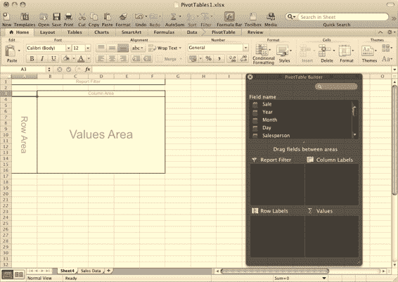

# 使用数据透视表分析数据

在本章中，我们将探讨如何使用数据透视表来分析工作表中的数据并从中得出结论。数据透视表非常适合向数据提问，以及从不同角度查看数据，而无需在单独的工作表中多次输入数据。

我们首先来了解一下什么是数据透视表以及你能用它做什么。之后，我将向你展示如何创建数据透视表，既可以使用 Excel 的自动化工具（该工具可以为数据透视表提供一个快速起点），也可以手动将字段放置在数据透视表框架上（这可以让你完全掌控一切）。

构建数据透视表后，您通常需要对其进行调整，以显示不同的数据或以不同的方式显示相同的数据。我将通过几个示例，向您展示构建数据透视表后可以轻松进行的几种调整类型。

当数据透视表按您所需的方式排列好后，您可以设置其格式并选择选项来控制其显示效果。您还可以对数据透视表中的数据进行排序和筛选，以仅显示您需要的信息。

#### 理解数据透视表是什么以及能做什么

数据透视表是一种特殊的报表，它会将数据表中的字段和记录重新排列成不同的次序，以便您检查它们之间的关系。您*透视*（即旋转）数据透视表中的列，以不同的方式对数据进行汇总显示。

例如，请看图 12–1 所示的工作表。该工作表包含一个数据表，用于跟踪一家拥有四条产品线（硬件、软件、服务和耗材）的公司的销售额。该表使用以下列：

- `Sale`。用于标识每笔销售的唯一序列号。
- `Year`、`Month` 和 `Day`。销售发生的年、月、日。将这些项目放在单独的列中，可以更轻松地按时间进行筛选——例如，比较不同月份的销售额，或查看某位销售人员在 1 月份销售了哪些产品。
- `Salesperson`。执行销售的销售代表姓名。
- `Line`。所售产品的产品线。
- `Product`。所售产品的名称。
- `Quantity`。所售产品的数量。
- `Price`。所售产品的单价。
- `Total Price`。所售产品的总价（`Quantity` 乘以 `Price`）。
- `Customer`。购买产品的公司或组织名称。

这一切都很直观，您可以使用数据输入表单向数据表添加数据或编辑现有记录。您也可以轻松查看销售总额（例如，通过汇总 `Total Price` 列中的数字）。但当您需要深入挖掘细节时，就需要不同的工具了。

这就是数据透视表的用武之地。通过从此类数据表创建数据透视表，您可以快速找到诸如以下问题的答案：

- 您最畅销的产品线是哪个？最畅销的产品又是哪个？
- 今年的销售额与去年相比如何？
- 您三月份的销售明星是谁？是否有另一位销售人员需要一些鼓励——或者一张解雇通知书？
- 哪些是您的关键客户？其中哪些客户需要更多的一对一关注，才能将销售额提升到去年的水平？

在接下来的章节中，我们将使用数据表中的数据创建一个数据透视表，然后对其进行操作以查看其显示结果。

**注意：** 如果您想完成本章中的示例，您需要一个与屏幕截图中类似的数据库表。您可以自己创建一个，或者（更简单的方法）从 Apress 网站（[www.apress.com](http://www.apress.com)）上本书的页面下载示例工作簿。

#### 创建和布局数据透视表

您可以从数据库表或数据区域创建数据透视表。如果已有一个像示例中那样的数据库表，您可以从它创建数据透视表。否则，请创建您将使用的数据库表，或者像往常一样在工作表中输入数据而不创建数据库表。

数据准备就绪后，您可以自动或手动创建数据透视表。哪种方法效果最佳取决于您的数据以及您想要用它做什么，但通常可以通过自动创建数据透视表然后根据需要进行调整来节省时间。如果自动创建的数据透视表不符合您的需求，您也可以从头开始手动创建数据透视表。

##### 自动创建数据透视表

要自动创建数据透视表，请按照以下步骤操作：

1. 打开工作簿，并显示包含数据透视表要使用的表或数据的工作表。
2. 单击要用于数据透视表的表。如果您使用的是区域而不是命名表，请选择该区域。
3. 在功能区的“`数据分析`”菜单中选择“`数据透视表`”，并单击“`数据透视表`”按钮的主要部分。您也可以单击“`数据透视表`”弹出按钮，然后在弹出菜单中单击“`创建自动数据透视表`”，但这并无优势。Excel 随后将执行以下操作：
   - 在新工作表中插入一个自动数据透视表
   - 给新工作表一个默认名称，例如 `Sheet5`
   - 显示“`数据透视表生成器`”窗口
   - 将“`数据透视表`”选项卡添加到功能区并显示它
   - 在您首次创建数据透视表时显示一些关于数据透视表的信息

图 12–2 显示了从示例数据表生成的自动数据透视表，并且“`数据透视表生成器`”窗口位于工作表前面。

自动创建数据透视表后，您通常需要对其进行调整。这是因为 Excel 很少能准确猜测出您需要将哪些信息放在哪里。

要调整数据透视表，请使用您将在下一节中学到的技巧，该部分将向您展示如何从头开始构建数据透视表。

##### 手动创建数据透视表

如果自动创建数据透视表没有给出有用的结果，或者您更倾向于手动操作，您可以使用“`数据透视表生成器`”手动构建数据透视表。

要手动创建数据透视表，请按照以下步骤操作：

1. 打开工作簿，并显示包含数据透视表要使用的表或数据的工作表。
2. 单击要用于数据透视表的表。如果您使用的是区域而不是命名表，请选择该区域。
3. 在功能区的“`数据分析`”菜单中选择“`数据透视表`”>“`创建手动数据透视表`”，或在菜单栏中选择“`数据`”>“`数据透视表`”，以显示“`创建数据透视表`”对话框（参见图 12–3）。如果您使用的是命名表，还可以在功能区中选择“`表格工具`”>“`用数据透视表汇总`”；如果您使用的是区域，则此命令不可用。
4. 在“`创建数据透视表`”对话框顶部的“`选择要分析的数据`”区域中，选择“`使用此工作簿中的表或区域`”选项按钮。

**注意：**除了可以通过工作表中的数据创建数据透视表之外，您还可以从外部数据源（如 FileMaker 数据库或 Access 数据库）创建数据透视表。为此，请在`创建数据透视表`对话框的`选择要分析的数据`区域中，选中`使用外部数据源`选项按钮，单击`获取数据`按钮，然后选择数据源。但在执行此操作之前，您必须安装开放数据库连接 (ODBC) 驱动程序，以使 Excel 能够连接到该数据源，具体方法详见第 10 章。

5. 确保`位置`文本框中显示的是您要使用的表格或区域。如果您在第 2 步中已点击表格或选定了区域，那么一切就绪。如果没有，请键入表格名称，或在工作表中点击并拖动以选定区域（如有必要，可先点击`折叠对话框`按钮，将`创建数据透视表`对话框移开）。

6. 在`创建数据透视表`对话框的`选择放置数据透视表的位置`区域中，选择合适的选项按钮：

    - **新工作表。** 如果您希望将数据透视表放置在新工作表中，请选中此选项按钮。这通常最为清晰，因为它为数据透视表提供了充足的空间。
    - **现有工作表。** 如果您希望将数据透视表放置在现有工作表中，请选中此选项按钮。点击`位置`文本框，点击工作表的标签，然后在工作表中点击并拖动以输入位置。

7. 点击`确定`按钮关闭`创建数据透视表`对话框。Excel 会在您选择的新工作表或现有工作表中放置一个数据透视表框架，并显示`数据透视表生成器`窗口。图 12–4 显示了一个名为`Sheet4`的新工作表上的数据透视表框架。

[www.it-ebooks.info](http://www.it-ebooks.info/)

**第 12 章：使用数据透视表分析数据**

**357**

**图 12–4.** *当您手动插入数据透视表时，Excel 会创建一个空的框架，您可以在该框架上按照需要的方式布置数据透视表。*

现在您已经插入了数据透视表的框架，接下来可以从`数据透视表生成器`窗口的`字段名称列表框`中向其添加字段。

#### 理解数据透视表框架与数据透视表生成器窗口的工作原理

花点时间查看一下数据透视表框架和`数据透视表生成器`窗口。您需要使用`数据透视表生成器`窗口在数据透视表框架上排列字段。

以下是您需要了解的基本要点：

- **字段名称列表框。** `数据透视表生成器`窗口中的此列表框包含您所选数据表格或区域中 Excel 找到的每个字段的一个条目。列表中的每个项目都有一个复选框，您可以选中它以将该字段添加到数据透视表中。数据透视表框架没有与`字段名称列表框`匹配的区域，因为当您使用这些字段时，它们会进入数据透视表的各个区域。

[www.it-ebooks.info](http://www.it-ebooks.info/)

**358**

**第 12 章：使用数据透视表分析数据**

**注意：** Excel 会自动解析`字段名称列表框`中的字段，并决定它们属于数据透视表的哪个部分。考虑到 Excel 除了能识别日期、货币和文本等项目外，并不了解您的数据表格或区域的具体内容，它在这一点上做得相当智能。但您通常需要将一个字段从`数据透视表生成器`窗口的一个区域拖动到另一个区域，以将其移动到数据透视表的另一部分。

- **报表筛选。** 数据透视表顶部的这个区域充当整个数据透视表的筛选器，将表格的其余部分缩小到仅显示与您的筛选条件匹配的数据。例如，如果您通过将`销售人员`字段拖到`数据透视表生成器`窗口中的`报表筛选`框，将其放入`报表筛选`区域，您将获得一个销售人员下拉菜单，您可以从中选择要显示谁的数据。正如您在本章后面将看到的，您可以按一个、两个或更多字段进行筛选。

- **行区域。** 数据透视表左侧的这个区域用于显示行...

