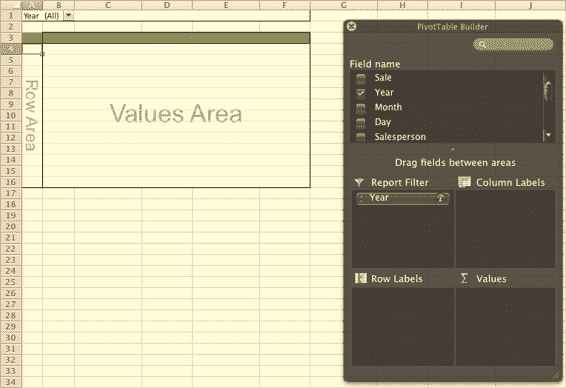
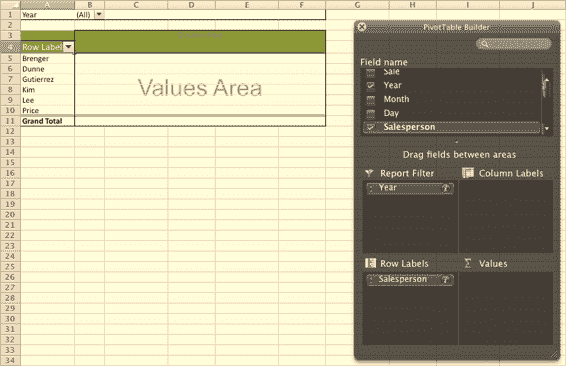
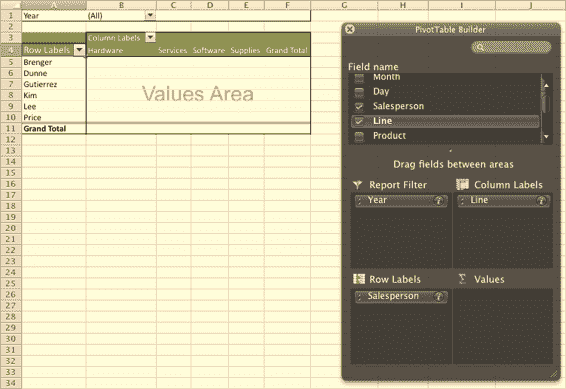
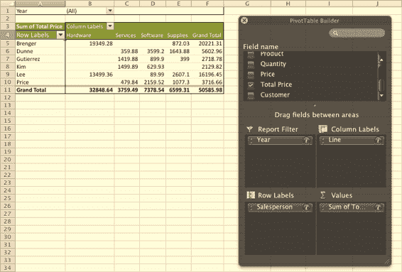
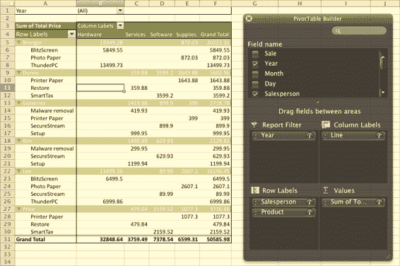
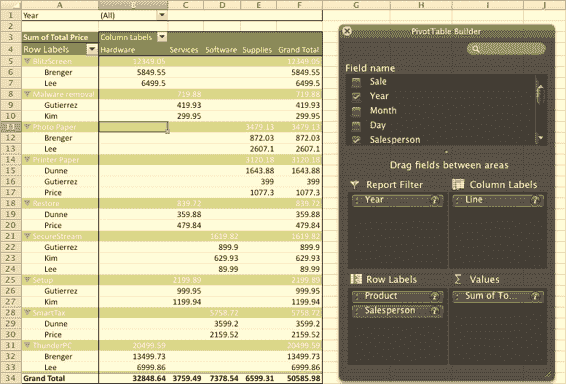
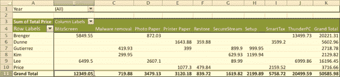
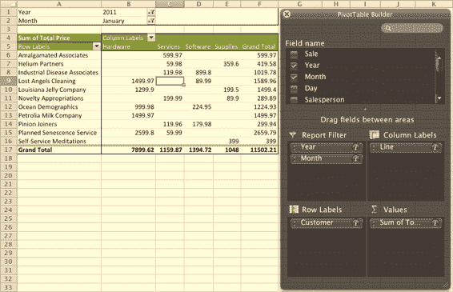
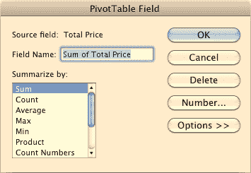

# 数据透视表布局与字段分配

`headings`（行区域）。您可以通过将相应字段拖放到`PivotTable Builder`窗口中的`Row Labels`框来指定这些行标题。

*列区域。* 数据透视表顶部的这个区域显示列标题。您可以通过将相应字段拖放到`PivotTable Builder`窗口中的`Column Labels`框来选择这些列标题。

*值区域。* 数据透视表正文中的这个区域（在大多数情况下是数据透视表的主要部分）包含值。您可以通过将相应字段拖放到`PivotTable Builder`窗口中的`Values`框来指定这些值。

如果觉得难以理解，别担心。您马上就会明白数据透视表是如何工作的。

##### 向数据透视表框架添加字段

要创建数据透视表，您需要将字段拖放到`PivotTable Builder`窗口中的`Report Filter`框、`Row Labels`框、`Column Labels`框和`Values`框中，从而向数据透视表框架添加字段。

**注意：** 您也可以通过选中`Field name`列表框中的复选框来添加字段。当您选中一个字段时，Excel 会根据其内容自动放置它。

由于 Excel 不知道您的数据代表什么以及您想要展示什么，它通常会将字段放在错误的位置。因此，最好的做法通常是手动拖放字段。

[www.it-ebooks.info](http://www.it-ebooks.info/)

**第 12 章：使用数据透视表分析数据**

**359**

需要将哪些字段拖放到何处，取决于您的数据源以及您想要展示的内容。以下是在数据源中使用字段的逐步演示。如果您使用的是示例数据源，结果应类似；如果您的数据源不同，结果会有所不同，但数据透视表的工作方式基本相同。

在`PivotTable Builder`窗口的`Field name`列表框中，单击`Year`字段并将其拖放到`Report Filter`框中。Excel 会选中`Year`复选框，在单元格 A1 中输入`Year`，并为单元格 B1 中的年份选择创建一个弹出菜单（参见图 12-5）。

**图 12–5.** *将 Year 按钮从 PivotTable Builder 窗口的 Field name 框拖放到 Report Filter 框中，以创建此处单元格 B1 中显示的 Year 弹出菜单。Excel 最初会在弹出菜单中选择(All)项，使数据透视表显示所有年份。*

1. 在`Field name`列表框中，单击`Salesperson`字段并将其拖放到`Row Labels`框中。Excel 会选中`Salesperson`复选框，并为每个销售人员的姓名创建一个行标签（参见图 12-6）。

[www.it-ebooks.info](http://www.it-ebooks.info/)

**360**

**第 12 章：使用数据透视表分析数据**

**图 12–6.** *将 Salesperson 按钮移动到 Row Labels 框会使 Excel 从每个销售人员的姓名创建行标签。*

2. 将`PivotTable Builder`窗口`Field name`列表框中的`Line`字段拖放到`Column Labels`框中。Excel 会选中`Field name`列表框中的`Line`复选框，并将产品线添加为列标签（参见图 12-7）。

[www.it-ebooks.info](http://www.it-ebooks.info/)

**361**

**第 12 章：使用数据透视表分析数据**

**图 12–7.** *将 Line 项从 PivotTable Builder 窗口的 Field name 列表框拖放到 Column Labels 区域。Excel 会将产品线添加为列标签，并自动为您选中 Line 复选框。*

3. 现在，单击`Field name`列表框中的`Total Price`字段，并将其拖放到`PivotTable Builder`窗口的`Values`框中。Excel 会将销售人员售出商品的价值添加到数据透视表中（参见图 12-8）。

[www.it-ebooks.info](http://www.it-ebooks.info/)

**362**

**第 12 章：使用数据透视表分析数据**

**图 12–8.** *将 Total Price 字段从 Field name 列表框拖放到 PivotTable Builder 窗口的 Values 框中，以将每位销售人员的总销售额添加到数据透视表中。*

这样我们就得到了一个数据透视表，它显示每位销售人员销售了每种产品线的多少数量。最初，数据透视表在`Report Filter`区域的`Year`弹出菜单中显示`(All)`。要按年份查看细分，请打开`Year`弹出菜单，然后单击您想要的年份。

这很有用——但这只是数据透视表功能的开始。

#### 更改数据透视表以显示不同数据

数据透视表的一大优点在于，更改它们以显示不同数据非常简单。

您可以通过添加不同字段、移除当前使用的字段，或者在`PivotTable Builder`窗口的`Report Filter`框、`Column Labels`框、`Row Labels`框和`Values`框之间重新排列字段来更改数据透视表。

以下四个示例展示了如何更改本章前面创建的基本数据透视表。这些示例按顺序进行，因此如果您想逐步操作，需要依次进行每个更改。

在`Field name`列表框中，单击`Product`字段，然后将其拖放到`PivotTable Builder`窗口的`Row Labels`框中。Excel 会添加每位销售人员已售出产品的产品名称列表（参见图 12-9）。

[www.it-ebooks.info](http://www.it-ebooks.info/)

**363**

**第 12 章：使用数据透视表分析数据**

**图 12–9.** *将 Product 字段拖放到 PivotTable Builder 窗口的 Row Labels 框中，以添加每位销售人员已售出的产品列表。您可以通过单击销售人员姓名左侧的展开三角形来折叠任何列表。*

在`PivotTable Builder`窗口的`Row Labels`框中，将`Salesperson`字段拖放到`Product`字段下方。然后数据透视表会显示每种产品及其可折叠的销售人员列表（参见图 12-10）。

[www.it-ebooks.info](http://www.it-ebooks.info/)

**364**

**第 12 章：使用数据透视表分析数据**

**图 12–10.** *将 Salesperson 字段拖放到 PivotTable Builder 窗口的 Row Labels 框中的 Product 字段下方，以生成显示销售这些产品的销售人员的产品列表。*

将`Row Labels`框中的`Product`字段拖放到`PivotTable Builder`窗口的`Column Labels`框中。然后将`Column Labels`框中的`Line`字段拖出`PivotTable Builder`窗口并松开，使其从数据透视表中消失。（您也可以清除`Field name`列表框中的`Line`复选框。）这些更改会生成一个数据透视表，按行显示销售人员，按列显示他们销售的产品数量（参见图 12-11）。

**图 12–11.** *移除产品线并将产品设为列标签，生成此数据透视表，显示每位销售人员销售每种产品的数量。*

进行以下更改，以查看每位客户在特定时期购买了您的哪些产品线：

[www.it-ebooks.info](http://www.it-ebooks.info/)

**365**

**第 12 章：使用数据透视表分析数据**

1. 将`PivotTable Builder`窗口`Field name`列表框中的`Month`字段拖放到`Report Filter`框中，将其放在`Year`字段下方。您现在可以按月份以及（之前）的字段进行筛选。例如，您可以选择`2011`作为`Year`筛选条件，然后选择`January`作为`Month`筛选条件，以仅查看 2011 年 1 月的结果。

2. 在`Field name`列表框中，清除`Salesperson`复选框，将`Salesperson`字段从`Row Labels`区域移除。然后将`Customer`字段从`Field name`列表框拖放到`Row Labels`框中，使数据透视表的每一行显示一位客户。

3. 在`Field name`列表框中，清除`Product`复选框，将`Product`字段从`Column Labels`区域移除。然后将`Line`字段拖放到`Column Labels`框中，使数据透视表的列显示产品线。图 12-12 显示了结果数据透视表。

  
**图 12–12.** *你可以将`月份`字段添加到报表筛选框中，放在`年份`字段下方，从而先按年份（此处为 2011 年）再按月（此处为 1 月）筛选数据透视表。该数据透视表显示了 2011 年 1 月每位客户在各产品线中的购买金额。*  

完成数据透视表生成器窗口的操作后，可单击其标题栏左侧的关闭（×）按钮，或从功能区中选择`数据透视表视图` `生成器`来关闭该窗口。  

[www.it-ebooks.info](http://www.it-ebooks.info/)  

  

**366** **第 12 章：使用数据透视表分析数据**  

若需再次打开数据透视表生成器窗口，请从功能区中选择`数据透视表视图` `生成器`。  

### 更改用于汇总字段的函数  

将数值添加到数据透视表时，Excel 会尝试根据数据类型自动使用适当的计算函数。例如，添加显示价格的字段时，Excel 会基于求和需求使用`SUM()`函数；若使用姓名等非数值数据，Excel 则会使用`COUNT()`函数来计算项目数量。  

若需将字段更改为其他函数，请按以下步骤操作：  

1.  单击该字段，或单击该字段生成数据所在的单元格。  

    **提示：** 你也可以通过单击数据透视表生成器窗口中字段名称右侧的 **i** 按钮，打开该字段的`数据透视表字段`对话框。  

2.  从功能区中选择`数据透视表字段设置`，打开`数据透视表字段`对话框（见图 12–13）。  

3.  在`汇总方式`列表框中，单击你希望使用的函数。例如，若希望字段显示平均值而非总和，请单击`平均值`函数。Excel 会自动更新`字段名称`文本框中的内容以反映所选函数——例如，将文本从`求和项：总价`改为`平均值项：总价`。  

    **图 12–13.** *在数据透视表字段对话框中，可更改用于汇总字段数据的公式。*  

[www.it-ebooks.info](http://www.it-ebooks.info/)  

**367** **第 12 章：使用数据透视表分析数据**  

**提示：** 若需以不同格式展示数据（例如以与基准值的差异量表示），请单击`数据透视表字段`对话框中的`选项`按钮，展开对话框以显示更多选项。在`值显示方式`弹出菜单中，选择所需格式——例如`差异`。然后在`基本字段`列表框中选择基础字段，在`基本项`列表框中选择基础项。  

4.  若需更改字段名称，请在`字段名称`文本框中输入新名称。  
5.  单击`确定`按钮关闭`数据透视表字段`对话框。  

### 控制数据透视表的设计  

搭建好数据透视表的框架后，可使用功能区`数据透视表`选项卡中`设计`组内的工具，选择分类汇总和总计的显示位置、选用 Excel 提供的数据透视表布局，并决定是否在项目之间插入空行以提高可读性。  

`设计`组包含四个弹出菜单：  

- **分类汇总。** 在此弹出菜单中，若希望将分类汇总显示在每个分组的底部（位于标记为`总计`的行上），请单击选中`在组底部显示所有分类汇总`旁的复选框。若希望分类汇总显示在分组顶部（与分组标签同行），请改为单击选中`在组顶部显示所有分类汇总`旁的复选框。选中其中一个选项会自动取消选中另一个——尽管界面未明确说明，但这两者互斥。  

- **总计。** 在此弹出菜单中，若希望显示行的总计，请单击选中`对行启用`旁的复选框。若希望显示列的总计，请单击选中`对列启用`旁的复选框。若不需要总计，请单击取消选中复选框。这两个选项彼此独立——  

它们并非可选项。

*布局。* 在此弹出菜单中，单击以在你想要的布局旁添加复选标记：`紧凑布局`（默认，如图 12–14 顶部所示）、`大纲布局`（如图 12–14 中部所示）或`表格布局`（如图 12–14 底部所示）。

**图 12–14。** *您可以为数据透视表选择三种布局之一。`紧凑布局`（左侧）适合在小空间内呈现数据。`大纲布局`（右侧）和`表格布局`（底部）占用更多空间，但使数据更易于阅读。*

*空白行。* 在此弹出菜单中，如果你希望在数据透视表中每个项目后显示一个空白行，请在名为`在每个项目后插入空白行`的项目旁添加复选标记。空白行会使数据透视表占用更多空间，但可使其更易于阅读。如果你不想要空白行，请单击以在名为`删除每个项目后的空白行`的项目旁添加复选标记。（这两个控件是互斥的；为一个添加复选标记会移除另一个的复选标记。）

##### 设置数据透视表的格式

为了使数据透视表外观良好并有效传达其内容，您可以对其进行格式设置。您可以在任何阶段应用格式，但通常最好先构建数据透视表的结构和字段，以便对其最终外观有一个大致的了解。

###### 应用数据透视表样式

如本章前述示例所示，创建数据透视表时，Excel 会为其应用一种样式。该样式有助于您在视觉上区分数据透视表的不同区域。

要更改数据透视表的外观，请从功能区`数据透视表`选项卡上的`数据透视表样式`组中为其应用不同的样式。您可以单击`快速样式`框中的一种样式，或者将鼠标指针悬停在`快速样式`框上，单击出现的面板按钮，然后在`快速样式`面板上单击所需的数据透视表样式。

**注意：** 您也可以创建自己的数据透视表样式。为此，请选择`数据透视表` → `数据透视表样式` → `快速样式` → `新建数据透视表样式`，然后在 Excel 显示的`新建数据透视表快速样式`对话框中进行操作。简要来说，在`名称`文本框中为样式命名，然后在`表元素`列表框中单击一个元素，单击`格式`按钮，并选择该元素所需的格式。创建新样式后，您可以从`快速样式`面板顶部的`自定义`部分应用它。

###### 为数据透视表样式选择选项

应用数据透视表样式后，您可以通过选择`数据透视表` → `数据透视表样式` → `行与列`，然后在`行与列`弹出菜单中为所需项目添加复选标记，来为其选择选项：

*行标题。* 为此项目添加复选标记，以在行标题上使用样式的格式。

*列标题。* 为此项目添加复选标记，以在列标题上使用样式的格式。

*镶边行。* 为此项目添加复选标记，以使行上显示线条或阴影带（取决于样式）。

*镶边列。* 为此项目添加复选标记，以使列上下显示线条或阴影带（取决于样式）。

###### 命名数据透视表并为其设置选项

插入数据透视表时，Excel 会自动为其命名（例如`PivotTable1`或`PivotTable2`）并设置默认的显示选项、布局选项和数据选项。要重命名数据透视表或选择不同的选项，请选择`数据透视表` → `数据` → `选项`以打开`数据透视表选项`对话框，然后操作其中的控件。（如果 Excel 窗口太窄导致功能区无法完整显示，该命令为`数据透视表` → `数据` → `选项` → `数据透视表选项`。）

图 12–15 展示了数据透视表选项对话框，其中“显示”选项卡位于最前方。

**图 12–15.** *在“数据透视表选项”对话框的“显示”选项卡中，你可以选择是否在数据透视表中显示展开/折叠三角形和屏幕提示等元素，以及是否打印标题和行标签。*

[www.it-ebooks.info](http://www.it-ebooks.info/)

### 第 12 章：使用数据透视表分析数据

**371**

##### 重命名数据透视表

若要重命名数据透视表，只需在“数据透视表选项”对话框顶部的`数据透视表名称`文本框中，用新名称替换现有名称即可。数据透视表名称可以包含空格，因此你可以将其设置得既具描述性又易读。

**注意：** 当你将数据透视表创建在单独的工作表上时，通常需要将工作表从其默认名称（例如`Sheet5`）重命名一个描述性名称（例如`销售数据透视表`）。双击工作表标签上的当前名称，输入新名称，然后按`Return`键确认。

##### 选择数据透视表的显示选项

若要控制 Excel 显示数据透视表的方式，请单击“数据透视表选项”对话框中的`显示`选项卡以显示其控件（如图 12–15 所示），然后选择你所需的选项。

你可以在`显示`区域中选择以下选项：

*   **展开/折叠三角形。** 选中此复选框，可显示用于展开或折叠行标签或列标签的展开形三角按钮。通常情况下，显示这些展开形三角按钮是有用的，但如果你希望隐藏它们，防止他人更改数据透视表的显示方式，则可以取消选中此复选框。

*   **打印展开/折叠三角形。** 选中此复选框，可在打印数据透视表时一并打印展开形三角按钮。对于自用的数据透视表打印件，打印这些三角形通常很有用，但如果你为他人制作的打印件，可能不希望打印这些三角形。

*   **上下文屏幕提示。** 选中此复选框，可使数据透视表在你将鼠标指针悬停在某个单元格上时，显示字段和值的屏幕提示。此选项通常很有帮助。

*   **字段标题和筛选器。** 选中此复选框，可在数据透视表顶部显示标题，并在列标签和行标签上显示筛选下拉按钮。这些通常也很有帮助。

*   **错误值显示为。** 如果希望在有错误的单元格中显示标准文本，而不是显示错误信息，请选中此复选框，并在文本框中输入文本。

*   **空单元格显示为。** 如果希望在空单元格中显示标准文本，而不是让它们保持空白，请选中此复选框，并在文本框中输入文本。

[www.it-ebooks.info](http://www.it-ebooks.info/)

**372**

### 第 12 章：使用数据透视表分析数据

*   **表格中无字段时显示项目标签。** 此复选框通常处于选中状态，但呈灰显且不可用，因为它仅适用于在 Excel 2004 (Mac)、Excel 2003 (Windows) 或更早版本的 Excel 中创建的数据透视表。如果此复选框可用，选中它会使数据透视表即使在值区域没有任何字段的情况下，也显示项目标签。

`显示无数据项目`区域包含两个设置，仅适用于使用 OLAP（联机分析处理）数据源的数据透视表：

*   **在行上。** 选中此复选框，可显示没有数值的行项目。
*   **在列上。** 选中此复选框，可显示没有数值的列项目。

`打印`区域包含两个选项，用于控制随数据透视表一起打印的项目：

*   **每个页面上重复行标签。** 选中此复选框，可使 Excel 在数据透视表占据的每一页上都打印行标签，而不仅仅是第一页。重复行标签可使数据透视表更易于阅读，因此通常是一个好主意。

*   **页面、行和列标题。** 选中此复选框，可重复打印页面标题、行标题和列标题。这通常也很有帮助。

##### 选择数据透视表的布局选项

