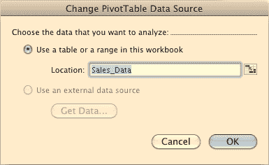
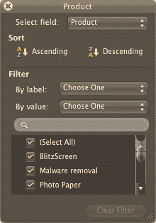
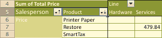
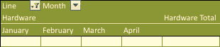

# 数据透视表选项中的“布局”选项卡设置

要控制数据透视表的布局，请单击“数据透视表选项”对话框中的“布局”选项卡以显示其控件（参见图 12-16），然后选择所需的设置。

您可以在“布局”选项卡的“布局”区域中选择以下设置：

- `允许每个字段使用多个筛选器。` 选中此复选框，您可以在单个字段上使用两个或多个筛选器来筛选数据透视表，而不仅仅使用一个筛选器。
- `更新时自动调整列宽。` 选中此复选框可使 `Excel` 自动调整列宽，以适应刷新数据透视表后的数据。`AutoFit` 通常很有帮助。
- `更新时保留单元格格式。` 选中此复选框可使 `Excel` 在更新数据透视表中的信息时，保留直接应用于单元格的单元格格式。此选项通常也很有帮助。
- `合并且居中排列带标签的单元格。` 选中此复选框可使 `Excel` 将标签单元格与其旁边的空白单元格合并，并将标签居中显示在合并后的单元格中。尝试这种外观，看看您是否更喜欢它而不是常规外观。
- `压缩表单中缩进行标签。` 在此弹出菜单中，选择使用数据透视表的“压缩布局”时，希望缩进行标签的空格数。

您可以在“布局”选项卡的“报表筛选器”区域中选择以下设置：

- `“排列字段”选项按钮。` 选择“向下，然后向右”选项按钮，使 `Excel` 先向下排列字段，然后向右排列。选择“向右，然后向下”选项按钮，如果您更愿意先向右排列字段，然后向下排列。
- `每列的筛选字段数。` 在此弹出菜单中，选择在移动到另一列或另一行之前，报表筛选器中要显示的字段数。

您可以在“布局”选项卡的“排序”区域中选择以下设置：

- `排序时使用自定义列表。` 选中此复选框，当 `Excel` 在数据中遇到自定义列表时，将按自定义列表进行排序。例如，如果您创建了公司办公室的自定义列表，请选中此复选框，使 `Excel` 按该列表的顺序对数据透视表进行排序，而不是按升序或其他标准排序顺序。
- `升序排序。` 如果要按升序排序，请选择此选项按钮。替代选项是“按数据源顺序排序”选项按钮。
- `按数据源顺序排序。` 如果希望数据透视表按与数据源相同的顺序排序，请选择此选项按钮。这是默认设置，如果您已按首选的顺序布置数据源，这将非常有用。如果不是，请改为选择“升序排序”选项按钮。

## 为数据透视表选择数据选项

“数据透视表选项”对话框的“数据”选项卡（参见图 12-17）允许您控制 `Excel` 如何存储来自外部连接的数据透视表数据，以及是否让 `Excel` 自动刷新数据。对于连接到外部数据源的数据透视表，您还可以选择是否在 `Excel` 工作簿中保存连接密码，以及是否在后台运行查询。

在图 12-17 中，在“数据透视表选项”对话框的“数据”选项卡上，选择如何处理数据透视表的数据和连接。

在“数据”选项卡的“数据区域”中，您可以选择以下选项：

- `将源数据与文件一起保存。` 选中此复选框，如果您希望将来自外部数据源的源数据存储到包含数据透视表的工作簿中。此设置对包含从其自身工作簿中提取数据的数据透视表没有影响，因为工作簿已包含数据。
- `启用显示详细信息。` 选中此复选框，以便能够向下钻取数据透视表，以显示数据源的详细信息。
- `保留从数据源删除的项目。` 选中此复选框，以便让 `Excel` 存储已从数据源删除的数据。当您处理正在更新的数据源中的旧数据时，存储这些数据会很有用。
- `每个字段保留的项目数。` 选择 `Automatic` 选项按钮，让 `Excel` 为每个数据字段存储默认数量的项目。选择 `Max` 选项按钮，为每个数据字段存储尽可能多的项目。
- `打开文件时刷新数据。` 选中此复选框，以便让 `Excel` 在您打开工作簿时自动刷新数据透视表中的数据。当您需要确保使用最新数据时，自动刷新会很有用。

在 `Connection` 区域，您可以选择以下两个选项：

- `将密码与文件一起保存。` 对于外部连接，选中此复选框可将连接密码保存在工作簿中。保存密码意味着您无需在每次刷新时手动输入密码，因此除非安全要求另有规定，您通常需要这样做。
- `在后台运行查询。` 对于外部连接，选中此复选框可在后台而不是前台运行查询。在后台运行查询通常会使查询花费更长时间，但允许 `Excel` 在查询运行时保持更高的响应性。

在 `PivotTable Options` 对话框中完成选项选择后，单击 `OK` 按钮关闭对话框。

### 刷新数据透视表中的数据

即使您从同一工作簿中的数据源创建数据透视表，数据透视表中的数据也保持静态，而不会像大多数其他 `Excel` 对象那样自动更新。

当您需要确保数据透视表包含来自数据源的最新数据时，请选择 `PivotTable` > `Data` > `Refresh` > `Refresh`。

**376**

**第 12 章：使用数据透视表分析数据**

要刷新工作簿中的所有数据透视表，请选择 `PivotTable` > `Data` > `Refresh` > `Refresh All`。

如果您的数据透视表使用外部数据源，并且您发现刷新操作耗时过长，请选择 `PivotTable` > `Data` > `Refresh` > `Cancel Refresh` 以取消操作。

### 更改数据透视表的数据源

有时，在构建数据透视表后，您可能会发现需要更改其源数据。您可以做到这一点，而无需删除数据透视表并重新开始，这是个好消息。

要更改数据透视表的源数据，请按照以下步骤操作：

**1.** 从功能区中，选择 `PivotTable` > `Data` > `Change Source` 以显示 `Change PivotTable Data Source` 对话框（参见图 12-18）。如果功能区被压缩，您需要选择 `PivotTable` > `Data` > `Options` > `Change Source`。

**图 12-18.** *当需要将数据透视表切换到不同数据源时，请使用 `Change PivotTable Data Source` 对话框。*

**2.** 在 `Location` 文本框中，输入您想要用来替代当前范围的区域。您可以输入表名或区域名称；输入区域引用；或者单击 `Collapse Dialog` 按钮，在工作表中选择区域，然后再次单击 `Collapse Dialog` 按钮。

**3.** 单击 `OK` 按钮关闭 `Change PivotTable Data Source` 对话框。

`Excel` 使用来自新数据源的数据更新数据透视表。

### 对数据透视表进行排序和筛选

为了使数据透视表显示您需要的数据，您可能需要对其进行排序或筛选。

要对数据透视表进行排序，请点击您要排序的字段的弹出按钮。`Excel` 会显示该字段的排序和筛选窗口。该窗口标题为字段名称，正如图 12-19 所示，该图显示了排序和筛选窗口打开 `Product` 字段的排序和筛选窗口。然后可以单击升序按钮进行升序排序（从 A 到 Z、从小数字到大数字、从早期日期时间到较晚日期时间），或单击降序按钮进行降序排序（反之亦然）。

**图 12–19.** *要对数据透视表排序或筛选，打开该字段的排序和筛选窗口，然后在排序区域或筛选区域中选择选项。排序和筛选窗口的标题栏显示字段名称（此处为 Product）。*

**注意：** 要控制 `Excel` 对数据透视表进行排序的方式，请在“数据透视表选项”对话框的“布局”选项卡的“排序”区域中选择排序选项，如本章前面所述。

对字段应用排序后，字段名称弹出按钮会发生变化，显示一个箭头指示排序方向。例如，在图 12–20 中，可以看到一个向上箭头指示 `Salesperson` 字段上的降序排序，以及一个向下箭头指示 `Product` 字段上的升序排序。`Line` 字段显示常规弹出按钮。

**图 12–20.** *对数据透视表排序时，字段的弹出按钮会显示向上箭头表示降序排序（如这里的 Salesperson 字段），或向下箭头表示升序排序（如这里的 Product 字段）。*

**378**

**第 12 章：使用数据透视表分析数据**

要筛选数据透视表，请单击字段名称旁边的弹出按钮以显示排序和筛选窗口，然后在筛选区域中选择筛选条件。以下是一些示例：

- `按标签筛选。` 要按标签筛选，打开“按标签”弹出菜单，选择比较类型，然后指定所需数据。例如，选择 `Contains` 比较来查找与您在其后出现的文本框中输入的文本字符串匹配的标签，如图 12–21 左侧所示。

# 第 12 章：使用数据透视表分析数据

**图 12–21.** *您可以按标签（如左图所示）或按值筛选字段。还可以在搜索框中搜索，或清除要排除项的复选框。*

*按值筛选。* 要按值筛选，打开按值弹出菜单，然后选择所需的比较。例如，选择`Top 10`项创建一个“前多少项”筛选，然后设置该项数量（在按值弹出菜单下方的两个弹出菜单的左侧中）。在右侧弹出菜单中，根据需要选择`Item`、`Percentage`或`Sum`进行筛选。

*按单个值筛选。* 要按单个值筛选，清除筛选区域下部的`(Select All)`复选框，然后为要在筛选中使用的每个项选中复选框。要只查找特定项以便选中或清除其复选框，请单击搜索框，然后键入搜索词。

应用筛选后，字段的弹出按钮会显示一个漏斗形状的筛选符号，如图 12–22 中`Line`字段所示。

[www.it-ebooks.info](http://www.it-ebooks.info/)

**379**

**图 12–22.** *Excel 在字段的弹出按钮上显示漏斗形状的筛选符号，表示已对该字段应用了筛选。*

要移除筛选，请再次打开排序和筛选窗口，然后单击底部的清除筛选按钮。

## 总结

在本章中，您了解了什么是数据透视表，以及如何从现有表格或其他数据源创建它们。您知道如何自动启动数据透视表或手动构建它，如何重新排列其字段以更改其显示的信息及其显示方式，以及如何设计和格式化数据透视表。最后，您学习了如何排序和筛选数据透视表，使其显示所需的信息。

在下一章中，我将向您展示如何与同事共享您的工作簿。

[www.it-ebooks.info](http://www.it-ebooks.info/)