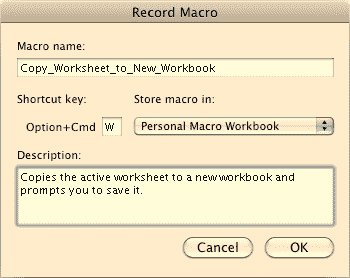

# 使用宏和 VBA 自动化任务

在本章中，我们将了解如何通过宏和 Visual Basic for Applications（VBA）来自动化任务，VBA 是 Excel 2011 及其他 Office 2011 应用程序中包含的编程语言。我们将首先了解如何录制宏，然后通过一个录制宏的示例来讲解，你可以在 Visual Basic 编辑器中打开该宏并进行改进。我将向你展示如何运行你录制和创建的宏，以及如何在不再需要时删除它们。

宏和 VBA 是一个庞大的主题，本章我们只能浅尝辄止。如果你想尽可能节省时间和精力，可能会想找一本详细介绍宏和 VBA 的书。你会发现，宏和 VBA 让你能够自动化在 Excel 中以交互方式（即正常方式）工作时几乎可以执行的任何任务，甚至还能完成一些在交互模式下无法执行的任务。

在此过程中，我还会提及在 Excel 和 Mac OS X 中自动化任务的其他几种方法，并演示如何将“开发工具”选项卡添加到功能区，以便快速执行与 Visual Basic 相关的命令。

[www.it-ebooks.info](http://www.it-ebooks.info/)

#### 了解自动化任务的选项

在 Mac OS X 上使用 Excel 2011 时，你可以通过多种方式自动化任务：

- **创建宏。** *宏*是一系列可一次性运行的命令。创建宏的简单方法是打开宏录制器，执行你想要宏重复的操作，然后关闭宏录制器，你就拥有了一个可以再次运行的宏。你也可以在 Visual Basic 编辑器应用程序中从头编写宏。或者，你可以录制宏，然后使用 Visual Basic 编辑器编辑掉不需要的命令，或添加其他命令。本章将展示如何录制宏以及在 Visual Basic 编辑器中编辑它们。

- **使用自动操作。** 你可以在`应用程序`文件夹中找到自动操作应用程序，它能让你组装由操作组成的工作流程。如果你拥有 Office 家庭和企业版，则可以在工作流程中包含 Excel 操作。（如果你使用的是 Office 2011 家庭和学生版，则无法将 Excel 与自动操作结合使用。）本章不涉及自动操作。

- **使用 AppleScript。** AppleScript 是一种脚本语言，你可以使用 AppleScript 编辑器实用工具编写脚本，该工具位于`应用程序/实用工具`文件夹中。（*脚本*本质上是一个小型应用程序。）本章也不涉及 AppleScript。

**提示：** 刚开始在 Excel 中自动化任务时，VBA 通常是最好的起点。VBA 在 Excel 内部运行，因此你可以从 Excel 中运行宏。相比之下，AppleScript 在其所操作的应用程序外部运行。使用 AppleScript 的优势在于，你可以轻松地操作多个应用程序，而不仅仅是 Excel。例如，你可以在同一个脚本中让访达执行一个操作，让 Excel 执行一个操作，然后让 iTunes 播放。你还可以与 Windows 用户共享宏，而 AppleScript 和自动操作仅在 Mac OS X 上运行。

[www.it-ebooks.info](http://www.it-ebooks.info/)

#### 将“开发工具”选项卡添加到功能区

如果你需要大量使用宏，请将“开发工具”选项卡添加到功能区，以便轻松访问基本命令。

要将“开发工具”选项卡添加到功能区，请按照以下步骤操作：

1. 选择`Excel` → `偏好设置`，或按`Cmd+,`（Cmd 键和逗号键）以显示 Excel 偏好设置对话框。
2. 在“共享和隐私”区域中，单击“功能区”图标以显示功能区偏好设置面板。
3. 向下滚动到“显示或隐藏选项卡，或将其拖至你偏好的顺序”列表底部，然后选中`开发工具`复选框。
4. 单击`确定`按钮关闭功能区偏好设置对话框。

此时将显示如下图 14-1 所示的“开发工具”选项卡，您可以使用“Visual Basic”组中的四个按钮：

- **编辑器。** 点击此按钮可启动或切换到“Visual Basic 编辑器”。
- **宏。** 点击此按钮可显示“宏”对话框。
- **录制。** 点击此按钮可显示“录制宏”对话框。
- **相对引用。** 点击此按钮可使“宏录制器”在宏中录制相对引用而非绝对引用。

**图 14-1.** *将“开发工具”选项卡添加到 Excel 的功能区，以便轻松访问处理宏和`VBA`所需的基本命令。*

#### 录制宏

当您需要快速自动化完成任务时，可以使用“宏录制器”录制宏。请遵循以下步骤：

1. **规划** 宏中将进行的操作。最好将它们写下来，以便在录制宏时能够按正确顺序执行。
2. **启动** Excel（如果尚未运行），或激活 Excel（如果正在运行）。

[www.it-ebooks.info](http://www.it-ebooks.info/)

**412**

**第 14 章：使用宏和 VBA 实现任务自动化**

3. **设置** 一个工作簿，使其具备执行宏中操作所需的条件。例如，如果宏要将一些数据从一个工作表移动到另一个工作表，请输入一些要移动的示例数据，并确保工作簿中包含一个可作目标位置的工作表。
4. **选择** 功能区中的`开发工具` > `Visual Basic` > `录制`，或菜单栏中的`工具` > `宏` > `录制新宏`，以显示“录制宏”对话框（如下图 14-2 所示，其中已选择录制宏的设置）。

**图 14-2.** *在“录制宏”对话框中，为宏命名，选择存储位置，并添加有用的描述。您还可以创建用于运行宏的键盘快捷键。*

5. **在“宏名”文本框中，键入宏的名称。** “宏录制器”会建议一个默认名称，如`Macro1`或`Macro2`，但最好给宏起一个描述性的名称，以帮助您识别它。请遵循以下命名规则：
    - 第一个字符必须是字母。
    - 其余字符可以是字母、数字或下划线的任意组合，以您觉得最方便为准。可以使用大写和小写字母。不能使用符号、空格或标点符号。
    - 名称最多可包含 80 个字符，但名称最好保持简短，以便它们在“宏”对话框中完整显示。否则，名称可能难以阅读。

**提示：** 为使宏名易于阅读，请将每个主要单词的首字母大写，并用下划线分隔单词。例如，`Format_Workbook`比`FormatWorkbook`更易读，而后者又比`formatworkbook`更清晰。

[www.it-ebooks.info](http://www.it-ebooks.info/)

**第 14 章：使用宏和 VBA 实现任务自动化**

**413**

6. **若要创建运行宏的键盘快捷键，请单击“快捷键”框，然后按下要使用的键。** Excel 会使用`Cmd+Option`组合创建快捷键，因此如果您按下**w**，快捷键就是`Cmd+Option+W`。如果要在键盘快捷键中添加`Shift`，请在按键时按住`Shift`。您将在“快捷键”框中看到字符的 Shift 版本，Excel 会使用`Cmd+Option+Shift`组合创建键盘快捷键——例如`Cmd+Option+Shift+W`。

**注意：** 如果您只打算创建少量宏，为每个需要频繁运行的宏创建键盘快捷键是很有用的。但如果您计划创建大量宏，则可能需要将它们从“宏录制器”放置的默认位置移出。移动宏会破坏其现有的键盘快捷键——因此在这种情况下，最好在录制宏时不创建键盘快捷键，而是在将宏放到打算保留的位置之后，再创建它们。

7. **在“宏保存在”弹出菜单中，选择宏的存储位置。** 您有三个选择：

    - **个人宏工作簿。** “个人宏工作簿”是一个

