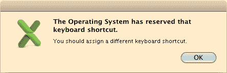
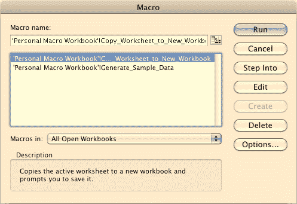
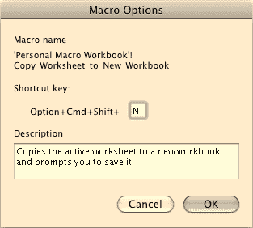
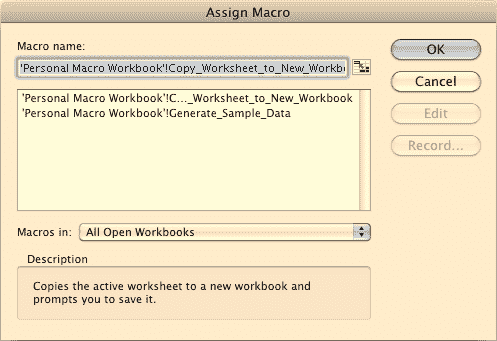
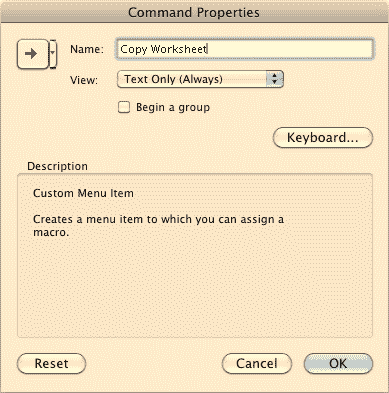
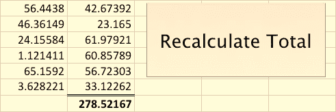
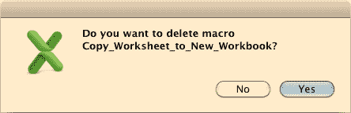

# 宏存储选项

**个人宏工作簿**是 Excel 用于存储宏的特殊工作簿。存储在**个人宏工作簿**中的任何宏在 Excel 运行期间始终可用，因此这是存储通用宏的最佳位置。如果你在其他计算机上打开工作簿，这些宏将不可用。

**此工作簿。** 选择此项可将宏存储在活动工作簿中，使宏仅在此工作簿打开时可用。这适用于你在启用了宏的工作簿中创建的、将与同事共享的宏——即使你将工作簿转移到另一台计算机，该宏仍然可用。

**新建工作簿。** 选择此项可创建一个新工作簿并将宏存储在其中。然后，你可以保存该工作簿，并根据需要使用它来分发宏。这种方法往往不如使用`个人宏工作簿`或活动工作簿实用。

**8.** 在`说明`文本框中，输入对宏功能的描述。该描述有助于你和其他人日后识别宏，因此花几秒钟编写清晰的说明是值得的。

[www.it-ebooks.info](http://www.it-ebooks.info/)

**414** **第 14 章：使用宏和 VBA 自动化任务**

**9.** 点击`确定`按钮。此时，你可能会看到如图 14-3 所示的对话框，提示你操作系统已保留了所选的键盘快捷键。如果出现这种情况，请点击`确定`按钮返回`录制宏`对话框，选择另一个键盘快捷键，然后再次点击`确定`按钮。

**图 14-3.** *如果出现此对话框，请点击“确定”按钮返回“录制宏”对话框，然后选择另一个用于运行宏的键盘快捷键。*

**10.** 关闭`录制宏`对话框后，Excel 会启动宏录制器，开始录制宏。Excel 会在状态栏显示`录制`字样，如果你已将`开发工具`选项卡添加到功能区，你会看到`录制`按钮显示为一个表示“停止”的黑色方块，而不是表示“录制”的红色圆圈。但除了这些视觉提示外，Excel 窗口看起来一切正常，很容易忘记你正在录制宏，尤其是当有人打扰你时。

**11.** 执行你想要录制到宏中的操作。我们稍后会看一个具体的例子，但以下是需要遵循的一般规则：

- 你可以像往常一样使用功能区、工具栏或菜单栏发出命令。
- 要选择单元格和区域，你可以使用鼠标或键盘。
- 要在录制绝对引用和录制相对引用之间切换，请选择`开发工具` `Visual Basic` `相对引用`。当`相对引用`按钮呈现按下状态时，宏录制器录制相对引用；当按钮呈现正常、无区别的外观时，宏录制器录制绝对引用。

**12.** 要停止录制宏，请从功能区中选择`开发工具` `Visual Basic` `录制`，或从菜单栏中选择`工具` `宏` `停止录制`。

[www.it-ebooks.info](http://www.it-ebooks.info/)

**第 14 章：使用宏和 VBA 自动化任务** **415**

##### 录制示例宏

上一节描述了录制宏的一般步骤。本节将逐步演示如何录制一个简短的宏，我们将在本章后面的`Visual Basic 编辑器`中打开并编辑该宏。

这个宏只是将活动工作表复制到一个存档工作簿中，以便你有一份工作表的参考副本。要复制工作表，宏需要执行五个操作：

- 打开存档工作簿。
- 激活前一个工作簿。
- 将工作表复制到存档工作簿。
- 保存存档工作簿。
- 关闭存档工作簿。

要录制示例宏，请遵循以下步骤：

**1.** 创建一个名为`Archive.xlsx`的工作簿，然后将其关闭。例如：

**a.** 按`Cmd+N`创建一个新的空白工作簿。
**b.** 按`Cmd+S`显示`另存为`对话框。
**c.** 选择要保存工作簿的文件夹。
**d.** 输入名称`Archive`。
**e.** 点击`保存`按钮。
**f.**

按`Cmd+W`关闭工作簿。

**2.** 打开一个包含要复制到归档工作簿的工作表的工作簿，并使该工作表处于活动状态。

**3.** 从功能区中选择“开发工具”>“Visual Basic”>“录制”，或从菜单栏中选择“工具”>“宏”>“录制新宏”，以显示“录制宏”对话框。

**4.** 在“宏名称”文本框中，输入名称`Copy_Active_Worksheet_to_Archive_Workbook`。

**5.** 点击“快捷键”文本框，然后按`Shift+C`输入大写字母`C`，这将为宏创建键盘快捷键`Cmd+Option+Shift+C`。

**6.** 在“保存宏到”弹出菜单中，选择“个人宏工作簿”。

**7.** 在“说明”文本框中，为宏输入说明：**复制活动工作表到 Archive.xlsx 工作簿。**

[www.it-ebooks.info](http://www.it-ebooks.info/)

**416**

**第 14 章：使用宏和 VBA 自动化任务**

**8.** 点击“确定”按钮关闭“录制宏”对话框。宏录制器开始录制宏，状态栏中会显示“录制”状态。

**9.** 录制打开归档工作簿的操作：

**a.** 按`Cmd+O`显示“打开：Microsoft Excel”对话框。

**b.** 导航并选择`Archive.xlsx`工作簿。

**c.** 点击“打开”按钮。工作簿正常打开，并成为活动工作簿。

**10.** 按键盘快捷键`Cmd+Shift+F6`切换到上一个工作簿——即包含要复制的工作表的工作簿。

**11.** 录制将工作表复制到归档工作簿的操作：

**a.** 按住`Ctrl`键并单击或右键单击活动工作表的标签，然后在上下文菜单中点击“移动或复制”，以显示“移动或复制”对话框。

**b.** 打开“工作簿”弹出菜单，然后点击`Archive.xlsx`。

**c.** 在“工作簿选择”列表框中，点击“（移至最后）”项。

**d.** 选中“建立副本”复选框。

**e.** 点击“确定”按钮关闭“移动或复制”对话框。Excel 将工作表复制到归档工作簿，并使该工作簿成为活动工作簿。

**12.** 按`Cmd+S`保存归档工作簿。

**13.** 按`Cmd+W`关闭归档工作簿。

**14.** 从功能区中选择“开发工具”>“Visual Basic”>“录制”，或从菜单栏中选择“工具”>“宏”>“停止录制”，以停止宏录制器。

**注意：** 此时，宏录制器已忠实地记录了将您选择的特定工作表从您打开的特定工作簿中复制的命令。为了使宏适用于通用场景，您需要对其进行编辑。有关详细信息，请参阅本章末尾。

**运行宏**

录制宏（或如本章后面所述从头创建宏）后，您可以通过按键盘快捷键、将其添加到工具栏或菜单，或将其附加到工作表中的对象来按需运行它。

[www.it-ebooks.info](http://www.it-ebooks.info/)

**第 14 章：使用宏和 VBA 自动化任务**

**417**

要能够运行宏，包含宏的工作簿必须处于打开状态。如果将宏存储在“个人宏工作簿”中，您可以随时运行它，因为创建“个人宏工作簿”后，Excel 在您运行 Excel 时会始终在后台保持“个人宏工作簿”打开。如果将宏存储在工作簿中，则必须先打开该工作簿，然后才能运行宏。

**从“宏”对话框运行宏**

您可以从“宏”对话框中运行任何宏。这对于尚未指定运行方式的宏，以及忘记了键盘快捷键或菜单命令的宏非常有用。

要从“宏”对话框运行宏，请按照以下步骤操作：

**1.** 从功能区中选择“开发工具”>“Visual Basic”>“宏”，或从菜单栏中选择“工具”>“宏”>“宏”，以显示“宏”对话框（参见图 14-4）。

**图 14-4.** *从“宏”对话框中，您可以运行任何宏。您也可以打开宏进行编辑、删除它，或打开“选项”对话框。*

**2.** 打开“宏位置”弹出菜单，选择要查看哪些工作簿中的宏：

*所有打开的工作簿。* 选择此项可查看所有打开工作簿中的宏。

个人宏工作簿以及您打开过的所有工作簿。当宏数量较少时，这是最佳选择。但当宏较多时，查看所有可用宏反而会让您难以找到所需宏。

`Personal Macro Workbook.` 选择此项仅可查看 `个人宏工作簿` 中的宏。

[www.it-ebooks.info](http://www.it-ebooks.info/)

**第 14 章：使用宏和 VBA 自动执行任务**

`一个打开的工作簿。` 单击您想要查看宏的已打开工作簿的名称。

**3.** 在 `宏名` 列表框中，单击您想要运行的宏。

**4.** 单击 `运行` 按钮。`Excel` 将关闭 `宏` 对话框并运行该宏。

##### 使用键盘快捷键运行宏

如果您为录制的宏指定了键盘快捷键，可以通过按下该快捷键来运行宏。

如果您尚未指定快捷键，可以创建一个。请遵循以下步骤：

**1.** 如上一节所述，打开 `宏` 对话框。

**2.** 在 `宏位置` 弹出菜单中选择工作簿。

**3.** 在 `宏名` 列表框中单击该宏。

**4.** 单击 `选项` 按钮以显示 `宏选项` 对话框（见图 14-5）。

**图 14-5.** *使用 `宏选项` 对话框为宏指定键盘快捷键或编辑其说明。*

**5.** 单击 `快捷键` 框，然后按下您想要的字母键。

`Excel` 会使用 `Cmd+Option` 来创建快捷键，因此如果您按下 `n`，快捷键即为 `Cmd+Option+N`。

如果您想为快捷键添加 `Shift` 键，请在按键时按住 `Shift` 键。您将在 `快捷键` 框中看到字符的大写版本，而 `Excel` 会使用 `Cmd+Option+Shift` 来创建快捷键——例如 `Cmd+Option+Shift+N`。

[www.it-ebooks.info](http://www.it-ebooks.info/)

**第 14 章：使用宏和 VBA 自动执行任务**

**6.** 如果您想编辑宏的说明，请在 `说明` 框中进行编辑。

**7.** 单击 `确定` 按钮关闭 `宏选项` 对话框。

**8.** 单击 `取消` 按钮关闭 `宏` 对话框。

##### 通过工具栏按钮或菜单项运行宏

为使宏易于运行，您可以为其创建工具栏按钮或菜单项。请遵循以下步骤：

**1.** 按住 Ctrl 键并单击或右键单击工具栏，然后在上下文菜单中单击 `自定义工具栏和菜单` 以显示 `自定义工具栏和菜单` 对话框。或者，从菜单栏中选择 `视图` > `工具栏` > `自定义工具栏和菜单`。

**2.** 如果您要创建工具栏按钮，但目标工具栏未显示，请单击 `工具栏和菜单` 选项卡以显示其内容。在 `显示` 列中选中该工具栏的复选框，使其显示出来。

**提示：** 如果您想创建一个新的工具栏来放置宏按钮，请单击 `新建` 按钮，在 `添加工具栏` 对话框中输入工具栏名称，然后单击 `确定` 按钮。

**3.** 单击 `命令` 选项卡以显示其内容。

**4.** 在左侧的 `类别` 列表框中向下滚动，然后单击 `宏` 项。`Excel` 不会在右侧的 `命令` 列表框中显示宏列表，而是显示两个项目——一个名为 `自定义菜单项`，另一个名为 `自定义按钮`。

**5.** 将 `自定义菜单项` 对象拖至菜单，或将 `自定义按钮` 对象拖至工具栏。

**6.** 如果您创建的是工具栏按钮，请单击 `确定` 按钮关闭 `自定义工具栏和菜单` 对话框。如果您创建的是菜单项，请保持对话框打开。

**7.** 按住 Ctrl 键并单击或右键单击工具栏按钮或菜单项，然后在上下文菜单中单击 `指定宏`。`Excel` 将显示 `指定宏` 对话框（见图 14-6）。

[www.it-ebooks.info](http://www.it-ebooks.info/)

**第 14 章：使用宏和 VBA 自动执行任务**

**图 14-6.** *在 `指定宏` 对话框中，选择要指定给您创建的工具栏按钮或菜单项的宏。*

**8.** 在 `宏名` 列表框中，单击您要指定的宏。

工具栏按钮或菜单项。如有必要，请打开`Macros in`弹出菜单，并选择要查看宏的工作簿——所有打开的工作簿、个人宏工作簿或某个特定打开的工作簿。

**9.** 点击`OK`按钮关闭`Assign Macro`对话框。

**10.** 再次按住`Ctrl`键并点击或右键点击工具栏按钮或菜单项，然后在上下文菜单中点击`Properties`以显示`Command Properties`对话框（参见图 14-7）。

[www.it-ebooks.info](http://www.it-ebooks.info/)

**第 14 章：使用宏和 VBA 自动执行任务**

**421**

**图 14-7.** *在`Command Properties`对话框中，为命令键入名称，然后选择一个图标以图形方式表示它。*

**11.** 在`Name`文本框中，键入要为菜单项或工具栏按钮显示的名称。

**12.** 在`View`弹出菜单中，选择工具栏按钮或菜单项的显示方式：

* `Default Style`：选择此项可使工具栏按钮使用您为工具栏设置的默认样式显示。（如果您选择显示图标和文本，则按钮显示为带文本的图标；如果您选择只显示图标，则只显示图标。）如果命令有关联的图标，则菜单项显示为带图标的文本。

* `Text Only (Always)`：选择此项可使工具栏按钮或菜单项显示为不带图标的纯文本。

* `Text Only (in Menus)`：选择此项可使菜单项仅显示为文本。

* `Image and Text`：选择此项可使工具栏按钮或菜单项显示为带文本的图标。

**13.** 如果要更改图标，请点击`Name`框左侧的箭头按钮，然后在弹出菜单中点击所需的图标。

**14.** 如果要在项目前放置分隔线，请选中`Begin a group`复选框。当您希望将不同的项目组放在菜单或工具栏的不同部分时，这很有用。

**15.** 点击`OK`按钮关闭`Command Properties`对话框。

[www.it-ebooks.info](http://www.it-ebooks.info/)

**422**

**第 14 章：使用宏和 VBA 自动执行任务**

**16.** 如果您刚刚创建了一个菜单项，请点击`OK`按钮关闭`Customize Toolbars and Menus`对话框，除非您还想自定义其他项目。

##### 从工作表中的对象运行宏

工具栏按钮、菜单项和键盘快捷键都是运行宏的简便方法，但 Excel 还为您提供了另一种方式：您可以将宏分配给工作表对象，例如按钮或形状。当用户点击该对象时，宏就会运行。

将宏分配给对象是使宏易于被可能找不到它们的用户使用的一种极好方法。例如，如果您创建一个名为`Recalculate Total`（如图 14-8 所示）的大型友好按钮，并将其放在用户正在查看的单元格旁边，他们将很难错过它，而在工具栏或菜单上错过它则易如反掌。

**图 14-8.** *您可以将宏分配给工作表对象，例如此处显示的按钮，为用户提供一种运行宏的简便方法。*

要将宏分配给工作表中的对象，请按照以下步骤操作：

**1.** 将对象放置在工作表中。例如，选择`Developer` -> `Form Controls` -> `Button`，然后在工作表中点击并拖动以创建按钮。选择按钮的默认名称，然后键入您想要的名称（例如，`Recalculate Total`）。

**2.** 按住`Ctrl`键并点击或右键点击该对象，然后在上下文菜单中点击`Assign Macro`以显示`Assign Macro`对话框（本章前面图 14-6 中显示）。

**3.** 如有必要，请打开`Macros in`弹出菜单，并选择要查看宏的工作簿——所有打开的工作簿、个人宏工作簿或某个特定打开的工作簿。

**4.** 点击您要分配的宏。

**5.** 点击`OK`按钮。

现在，您可以点击工作表中的按钮来运行宏。

[www.it-ebooks.info](http://www.it-ebooks.info/)

