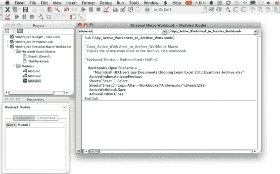

# 第 14 章：使用宏和 VBA 自动执行任务

**424**

#### 删除宏

当不再需要某个宏时，请将其删除。请按以下步骤操作：

1. 从功能区选择"开发者"→"Visual Basic"→"宏"，或从菜单栏选择"工具"→"宏"→"宏"，以显示"宏"对话框。
2. 如有必要，在`宏在`弹出菜单中选择相应的工作簿或多个工作簿。
3. 在`宏名称`列表框中点击要删除的宏。
4. 点击`删除`按钮。Excel 会显示一个确认对话框（见图 14-9）。
5. 点击`是`按钮。

**图 14-9.** *Excel 提示您确认是否要删除宏。*

#### 在 Visual Basic 编辑器中编辑宏

按照本章前文所述录制宏后，您可以随时按需运行它。但如果需要修改宏，则可在 Visual Basic 编辑器中打开并编辑，删除或更改已录制的操作，或编写 VBA 代码来执行其他操作。在本节中，我们将简要介绍 Visual Basic 编辑器，并对录制的宏进行一处小改进。

##### 在 Visual Basic 编辑器中打开示例宏

打开宏有多种方法，但最简单的是通过"宏"对话框。但如果宏存储在个人宏工作簿中，则必须先取消隐藏个人宏工作簿，才能打开宏进行编辑。

要取消隐藏个人宏工作簿，请按以下步骤操作：

1. 从菜单栏选择"窗口"→"取消隐藏"，显示"取消隐藏"对话框。
2. 在`取消隐藏工作簿`列表框中，点击"个人宏工作簿"项。
3. 点击`确定`按钮。

[www.it-ebooks.info](http://www.it-ebooks.info/)



**425**

**第 14 章：使用宏和 VBA 自动执行任务**

现在打开"宏"对话框，点击宏，然后点击`编辑`按钮。Excel 将在 Visual Basic 编辑器中打开宏进行编辑。

##### 认识 Visual Basic 编辑器的界面

图 14-10 展示了 Visual Basic 编辑器窗口，并标注了其主要组件。

**图 14-10.** *Visual Basic 编辑器由三个主要窗口组成——工程资源管理器、属性窗口和代码窗口（用于创建和编辑 VBA 代码）。*

以下是您在图 14-10 中看到的 Visual Basic 编辑器的六个主要组件：

- **工程资源管理器。** 此窗口显示每个打开项目的可折叠树——每个常规工作簿、每个加载项（例如图 14-10 中可见的`PDFMaker.xla`加载项）以及个人宏工作簿（如果已取消隐藏）。在图 14-10 中，个人宏工作簿的树已展开，并选中了名为`Module3`的代码模块。该模块的代码显示在代码窗口中。

[www.it-ebooks.info](http://www.it-ebooks.info/)

**第 14 章：使用宏和 VBA 自动执行任务**

**426**

- **属性窗口。** 此窗口显示当前所选对象的属性。在图 14-10 中，该对象是名为`Module3`的代码模块，它只有一个属性——`Name`属性。您可以通过选中`(名称)`框右侧的内容并输入新名称来更改代码模块的名称。

- **代码窗口。** 此窗口显示所选代码模块或附加到用户窗体（您创建的自定义对话框）的代码表的代码。必要时，您可以同时打开多个代码窗口。

- **标准工具栏。** 此工具栏包含用于标准操作的命令，例如切换到 Excel、保存工作以及剪切、复制和粘贴。

**注意：** 如果 Visual Basic 编辑器的任何工具栏不可见，请从菜单栏选择"视图"→"工具栏"，然后在"工具栏"子菜单中点击该工具栏的名称。

- **编辑工具栏。** 此工具栏包含用于编辑代码的命令——例如，设置断点（代码自动停止运行的点，以便您可以一次执行一个命令并观察效果）。

- **调试工具栏。** 此工具栏包含用于调试代码的命令——逐步执行代码、消除错误或以其他方式改进代码。


##### 检查示例宏

现在来看示例宏的代码。它看起来应该与以下代码类似，其中的文件路径和工作表名称可能略有不同：

```
Sub Copy_Active_Worksheet_to_Archive_Workbook()
'
' Copy_Active_Worksheet_to_Archive_Workbook Macro
' 将活动工作表复制到 Archive.xlsx 工作簿。
'
' 快捷键：Option+Cmd+Shift+C
'
Workbooks.Open Filename:= _
"Macintosh HD:Users:guy:Documents:Ongoing:Learn Excel 2011:Examples:Archive.xlsx"
ActiveWindow.ActivatePrevious
Sheets("Sheet1").Select
Sheets("Sheet1").Copy After:=Workbooks("Archive.xlsx").Sheets(255)
ActiveWorkbook.Save
ActiveWindow.Close
End Sub
```

以下是快速解析：

宏以`Sub`关键字开头，表示它是一个子程序或子过程（即宏），后面跟着宏的名称和一对空括号。

接下来的六行是注释行。注释以直单引号（`'`）开头，是为人类阅读者而非计算机提供的文本。第一、第四和第六行注释是空行，作为分隔符，使代码更易于阅读。第二行给出了宏的名称；第三行给出了描述；第五行给出了快捷键。这些信息有助于你识别宏及其功能。

语句`Workbooks.Open Filename:=`打开工作簿，其路径和文件名包含在双引号内的字符串中。从技术上讲，该语句使用`Open`方法（一种命令）将工作簿添加到`Workbooks`集合中的`Workbook`对象中。

**注意：** 你可以通过在断行末尾添加一个空格后跟下划线的方式，将单条代码语句拆分为多行。你可以在`Workbooks.Open`语句中看到这样的示例。

`ActiveWindow.ActivatePrevious`语句告诉 VBA 从当前活动窗口中激活上一个窗口。

`Sheets("Sheet1").Select`语句使用`Sheets`集合的`Select`命令来选择你指定的工作表。`Sheets`集合包含代表工作表的`Sheet`对象。

`Sheets("Sheet1").Copy`语句使用`Sheets`集合的`Copy`命令来复制按名称指定的工作表。`After:=`参数告诉 VBA 将复制的工作表放置在何处——在本例中，是放置在存档工作簿的 Sheet 255 之后。

`ActiveWorkbook.Save`语句使用`ActiveWorkbook`对象的`Save`方法来保存活动工作簿。

同样，`ActiveWorkbook.Close`语句使用`ActiveWorkbook`对象的`Close`方法来关闭活动工作簿。

宏以`End Sub`行结束。

##### 编辑示例宏

查看代码及其解释后，你可能会发现我们需要解决两个问题：

- 宏通过名称指定要复制的工作表——`Sheet1`。我们需要复制的是活动工作表。
- 宏通过编号指定复制后放置的位置——`255`。我们需要将其放置在最后一个工作表之后，无论其编号是多少。

要解决第一个问题，请选中`Sheets("Sheet1")`，然后键入`activesheet`进行覆盖。按上箭头键移动到上一条语句，你会看到 Visual Basic 编辑器将大小写自动更正为`ActiveSheet`。在你输入代码时，Visual Basic 编辑器会进行检查，从而帮助你在创建代码时捕获错误，而不是等到运行代码时才发现问题。

要解决第二个问题，请选中`Sheets(255)`中的`255`，然后键入以下内容：

```
Workbooks("Archive.xlsx").Sheets.Count
```

你修改后的语句应如下所示：

```
ActiveSheet.Copy After:=Workbooks("Archive.xlsx").Sheets(Workbooks("Archive.xlsx").Sheets.Count)
```

现在这段代码的含义是“将活动工作表复制到工作簿`Archive.xlsx`中，并将其放置在现有工作表的最后一张之后。”

##### 测试宏


现在通过单步执行宏来测试它——一次执行一条语句。

点击包含要复制的工作表的工作簿，然后反复按 `Cmd+Shift+I` 单步执行宏。您将看到 Visual Basic 编辑器在执行代码时依次高亮每一行，并看到 Excel 窗口打开、切换和关闭。

##### 保存更改

保存您对宏所做的更改。您可以在 Visual Basic 编辑器中按 `Cmd+S`（与大多数 Mac 应用程序一样），或单击标准工具栏上的“保存”按钮。

##### 从 Visual Basic 编辑器返回 Excel

要从 Visual Basic 编辑器返回 Excel，请在活动 Visual Basic 编辑器的情况下，从菜单栏中选择“Excel 关闭并返回 Microsoft Excel”。或者按 `Cmd+Q`。

[www.it-ebooks.info](http://www.it-ebooks.info/)

## 第 14 章：使用宏和 VBA 自动化任务

#### 隐藏个人宏工作簿

完成宏的编辑后，再次将个人宏工作簿从视图中隐藏。在个人宏工作簿处于活动状态时，从菜单栏中选择“窗口”>“隐藏”。

## 总结

在本章中，您学习了如何使用宏录制器录制宏来自动执行重复性任务。您现在知道如何通过几种便捷的方式运行宏，以及如何在 Visual Basic 编辑器中打开宏以进行编辑。您还了解了在 Excel 中自动化任务时除 VBA 之外的其他方法。

这本书到此结束——除了索引部分，您可能已经看过了。希望您觉得本书有用，并且现在能够自信且高效地处理 Excel 中的日常工作。

[www.it-ebooks.info](http://www.it-ebooks.info/)


## 索引

- **特殊字符 &**
  - 全部接受我的按钮，“解决冲突”对话框，401
  - 全部接受其他按钮，“解决冲突”对话框，401
  - % 计算运算符，168, 173
  - * 计算运算符，167, 173
  - / 计算运算符，168, 173
  - ^ 计算运算符，173
  - + 按钮，93, 112
  - + 计算运算符，167, 173
  - <> 计算运算符，168, 173
  - <（上一个）按钮，85
  - = 计算运算符，168, 173
  - =SUM( ) 函数，179
  - > 计算运算符，168, 173
  - >（下一个）按钮，85
  - < 计算运算符，168, 173
  - >= 计算运算符，168, 173
  - <= 计算运算符，168, 173
  - 三维簇状柱形图类型，232

- **数字**
  - & 计算运算符，169, 173
  - 接受按钮，“接受或拒绝更改”对话框，402
  - “接受或拒绝更改”对话框，402
  - 接受其他按钮，“解决冲突”对话框，400
  - 会计专用数字格式，127
  - ACCRINT 财务函数，202
  - ACCRINTM 财务函数，202
  - ACOS 数学与三角函数，213
  - ACOSH 数学与三角函数，213
  - 操作弹出按钮，功能区，118
  - 活动单元格，更改，18–19
  - 活动工作表选项按钮，“打印”对话框，385
  - `ActiveWindow.ActivatePrevious` 语句，426


ActiveWorkbook.Close 语句，426  
3-D 格式类别，格式对话框  

ActiveWorkbook.Save 语句，426  

`box`，250  

添加工具栏对话框，70, 419  
3-D 旋转类别，格式对话框  
添加别名到剪贴画库选项按钮，  
`box`，250  

导入对话框，280  
全部添加按钮，27  
添加按钮，27, 41–42  

■ **A**  
添加约束对话框，346–347  
`ABS` 数学和三角函数  
从剪贴板添加选项，41  
函数，213  
加载项可用列表，加载项  
绝对引用，166  
对话框，345  
全部接受按钮，接受或拒绝  
加载项对话框，344–345  
更改对话框，402  
添加选项按钮，139  

**429**  
[www.it-ebooks.info](http://www.it-ebooks.info/)  

  

**430**  
**索引**  
添加方案对话框，335–336, 338  
始终添加所选剪贴内容对话框  
添加到购物篮链接，282  
框，42  
添加到侧边栏复选框，95  
始终添加副本选项，42  
添加视图对话框，52  
保存前始终计算  
`ADDRESS` 查找与引用  
工作簿复选框，222  
函数，212  
始终创建备份复选框，88  
`AMORDEGRC` 财务函数，202  
调整列宽复选框，315  
`AMORLINC` 财务函数，202  
高级按钮，26  
共享工作簿对话框的“高级”选项卡  
打开的工作簿项，宏对话框  
框，398  
框，418  
高级文本导入设置对话框  
`AND` 逻辑函数，209  
框，26  
并且选项按钮，28  
按回车后移动所选内容  
角度旋钮，格式对话框，248  
复选框，60  
任意弹出菜单，94  
`AGGREGATE` 数学和  
任意值项，147  
三角函数，213  
外观弹出菜单，80  
对齐组，功能区，124,  
Apple iPhoto，从  
133–134, 150  
工作簿中插入图片，284–285  
对齐，单元格内容，133–134  
Apple Mac 文件系统，从  
对齐标签，单元格格式对话框，  
工作簿中插入图片，  
133–134  
285–286  
所有类别，3, 85  
AppleScript Editor 实用工具，410  
所有复选框，272  
应用程序文件夹，410  
所有剪辑项，导入对话框，279  
应用程序/实用工具文件夹，410  
所有命令项，67  
应用于列，145  
除边框外的所有选项按钮，139  
应用样式按钮，110  
所有项，突出显示更改对话框，  
应用于区域，减小文件大小对话框，  
396  
框，295  
所有打开的工作簿项，宏对话框  
`Archive.xlsx` 工作簿，415–416  
框，417  
面积图类别，231


所有选项按钮，57，139  
`AREAS` 查找与引用函数，  
本文件中的所有图片选项按钮，  
212  
“减小文件大小”对话框，  
参数窗格，190  
295  
“排列”弹出菜单，49  
所有引用列表框，“合并”  
“排列”子菜单，上下文菜单，301  
对话框，405  
“排列窗口”对话框，48–49](#index_split_000.html#p54)  
弹出菜单中的所有符号，45  
排列工作簿窗口，48–49  
所有使用来源主题选项按钮，  
“作为”框，38  
139  
“升序”按钮，323，377  
允许每个字段使用多个筛选复选框  
`ASIN` 数学与三角函数，  
框，“数据透视表选项”对话框  
函数，213  
框，372  
`ASINH` 数学与三角函数，  
允许在线访问复选框，15  
函数，213  
“允许”弹出菜单，146  
询问是否更新自动链接复选框  
框中允许此工作表的用户，395  
框，61  
“指定”按钮，68  

[www.it-ebooks.info](http://www.it-ebooks.info/)  

  

**索引**  
**431**  

“指定宏”上下文菜单项，419，](#index_split_005.html#p416)  
“自动操作”应用程序，410  
422  
“指定宏”对话框，框，419–420，422  
自动恢复，64–65  
“自动求和”按钮，187，189  
`ATAN` 数学与三角函数，  
“自动求和”弹出菜单，插入  
函数，213  
函数，187–188  
`ATAN2` 数学与三角函数，  
“平均值”函数，366，404  
函数，213  
`AVERAGE` 统计函数，217  
“作者”框，91  

坐标轴  
从单独区域添加标签，  
244  
更改比例或编号，  
240–243  
“作者”字段，91  
“编写区域”，“Excel 偏好设置”  
对话框，84，123，252  
对于图表，229  
“作者”属性，95  

自动更正，29–33  
为其创建条目，32–33  
例外项，31–32  
选项，29–33  
“自动更正操作”按钮，317  
“自动更正例外项”对话框，  
31–32  
“自动更正”窗格，33  

自动填充，33–37  
内置功能，33–35  
自定义列表，36–37  
与公式一起使用，174–175  
“自动”项目，“格式”对话框，248  
“自动”选项按钮，“数据透视表选项”对话框，375  
“自动样式”复选框，110  
自动转换日期系统  

■ **B**  

“背景色”弹出菜单，  
“格式”对话框，249  
`BAHTTEXT` 文本函数，218  
“镶边列”复选框，310  
“镶边列”项目，“行与列”  
弹出菜单，370  
“镶边行”复选框，309  
“镶边行”项目，“行与列”  
弹出菜单，370


复选框, 61

条形图类别, 230

`自动`选项按钮,

基础框, 设置坐标轴格式对话框, 242

`共享工作簿`对话框,

前工作表列表, 100, 416

399

开始一个组复选框, 73, 76, 421

`除数据表外自动`

`BESSELI` 工程函数, 199

选项按钮, 221

`BESSELJ` 工程函数, 199

`输入时自动扩展表格`

`BESSELK` 工程函数, 199

复选框, `表格`偏好设置

`BESSELY` 工程函数, 199

窗格, 317

最适合打印 (220 ppi) 项目, 缩小

`自动`选项按钮, 221

文件大小对话框, 296

自动化任务, 409–428

`最适合通过电子邮件发送`-邮件 (96 p`pi)`项目,

宏

`缩小文件大小`对话框,

在 `Visual Basic 编辑器`工具中编辑,

295

423–428

最适合在屏幕上查看 (150 ppi)

录制, 411–414

项目, `缩小文件大小`对话框

运行, 416–422

框, 295

选项, 410–411

`BIN2DEC` 工程函数, 199

[www.it-ebooks.info](http://www.it-ebooks.info/)


**432**

**索引**

`BIN2HEX` 工程函数, 199

`计算偏好`设置窗格, 220,

`BIN2OCT` 工程函数, 199

222–223

空白弹出菜单, 功能区, 369

`取消` 按钮, 149

`书籍`弹出菜单, `合并方案`

`将每个句子的首字母大写`复选

对话框, 340

框, 31

`边框选项`项目, `边框`弹出

`将星期名称的首字母大写`复选框, 31

菜单, 137

`层叠`选项按钮, 49

边框选项卡, 137, 142

`区分大小写`复选框, 320

边框按钮, 136

`类别`按钮, `剪贴画库`

边框, 格式化, 136–137

应用程序, 283

`边框`弹出菜单, `功能区`, 124,

`类别`对话框, 283

136–137

图表中的类别, 229

底端行复选框, 105

`类别`列表框, 67, 70–71, 73, 75,

分隔符弹出菜单, 383

419

亮度, 调整, 291–292

`类别`列表, `自定义工具栏和`

`上移一层`命令, `排列`

菜单对话框, 339

子菜单, 301

`类别`选项卡, `属性`对话框,

`置于顶层`命令, `排列`

280

子菜单, 301

`类别`列表框

`气泡图`类别, 231

`剪贴画库应`用程序, 277

内置菜单项, 73

`设置单元格格式`对话框, 128

按钮, 更改外观, 71

`分类 (X) 轴标签`文本框, 244

`通过更改单元格`文本框, `单变量求解`

`CEILING` 数学和

对话框, 343


三角函数, 213

`By Changing Cells` 框，规划求解

`CEILINGPRECISE` 数学与

参数对话框, 346

三角函数, 213

`By color` 弹出菜单，自动筛选

CELL 信息函数, 210

窗口, 323

[单元格或区域引用] [空格][单元格或

`By label` 弹出菜单，排序与

区域引用] 计算

筛选窗口, 378

运算符, 169

`by N page(s) tall` 框，打印对话框，

`Cell Reference` 框，添加约束

385

对话框, 347

`By value` 弹出菜单，排序与

[单元格引用] [单元格引用]

筛选窗口, 378

计算运算符, 168

单元格样式面板, 151, 155

■

单元格

**C**

活动单元格，改变, 18–19

`Calc Now` 按钮, 222

删除, 119–120

Calc Sheet 按钮, 222

格式化, 122–138

计算工作表框, 221–222

单元格内容的对齐方式,

计算工作表选项, 220

133–134

控制工作表的计算

边框和填充, 136–137

计算时机, 221–222

字体, 135

`Calculation` 图标，Excel 偏好设置

数字格式, 125–132

对话框, 128, 220

保护单元格, 137–138

计算运算符, 167–168, 173

与主题, 133

[www.it-ebooks.info](http://www.it-ebooks.info/)


**索引**

**433**

三种工具, 123–125

图表坐标轴, 229

插入, 119

图表标题和坐标轴标题, 229–230

图形对象相对于单元格的定位

数据标记、网格线和数据标签,

299–301

标签, 230

保护, 137–138

在公式中引用, 164–165

创建

选择, 19–21

更改图表类型, 234

`Cells` 组，功能区, 118](#index_split_001.html#p122)

将嵌入式图表更改为图表工作表,

Center section 框, 157

233–234

Change Chart Type 组，功能区, 234

更改源数据, 235–236

`Change PivotTable Data Source` 对话框

概述, 231–232

框, 376

切换行和列, 235

自定义类型, 251

`Change SmartArt Graphic` 组，

嵌入式图表, 225–227

功能区, 298

设置格式

Change Type 组，功能区, 272

复制到另一张图表,

`Changing Cells` 文本框，添加方案

250–251

对话框, 335–336

单个图表元素,

CHAR 文本函数, 218

249–250

图表区, 229

背景墙和基底, 246–249

图表坐标轴, 229

布局

`Chart data range` 框，选择数据源

从单独区域添加坐标轴标签,

对话框, 236

244

图表元素弹出菜单, 249

添加单独的数据系列,

`Chart` 图标，Excel 偏好设置对话框

237–238


方框, 252

应用样式, 238

图表布局选项卡, 6, 256, 259

轴标题, 239–240

图表（链接到 Excel 数据）选项

更改的刻度或编号

按钮, 258

坐标轴, 240–243

图表菜单栏复选框, 76

选择要显示的网格线，

图表窗格，Excel 偏好设置对话框

245–246

方框, 252

数据标签, 244–245](#index_split_003.html#p246)

图表偏好设置窗格，Excel

图例, 243–244

偏好设置对话框, 252

标题, 239

图表快速布局组，功能区，

偏好设置对话框 方框, 252–253

236

工作表, 225–227

图表屏幕提示区域，Excel

在 Word 文档和

偏好设置对话框, 253

PowerPoint 演示文稿中使用，

图表样式组，功能区, 238

254–259

图表标题占位符, 239

在内嵌工作簿中创建图表

图表标题, 229–230

255–257

图表类别, 67

从 Microsoft Excel 粘贴图表

图表, 225–259

257–259

选择类型, 230–231

图表选项卡，功能区, 231–232, 234, 236,

组件, 227–230

238, 254–256, 259, 271

类别与数据系列, 229

检查兼容性弹出菜单，

图表区域和绘图区, 229

96

[www.it-ebooks.info](http://www.it-ebooks.info/)


**434** **索引**

检查文档的兼容性

关闭按钮, 13, 44–45

复选框, 64

关闭命令, 11

检查错误按钮, 176, 180

关闭效果弹出菜单, 14

选择数据库对话框, 22

关闭全屏工具栏, 46

选择文件对话框, 22, 41

关闭方法, 426

选择文件夹，Microsoft Excel 对话框

关闭选项按钮, 14

方框, 62, 80

CODE 文本函数, 218

选择图片对话框, 249,](#index_split_003.html#p251)

代码窗口，Visual Basic 编辑器

285–286

应用程序, 424–425

选择工作簿对话框, 405](#index_split_005.html#p403)

齿轮按钮, 77, 79

选择加载项对话框, 345

与其他 PC 协作, 381–407

选择按钮, 3, 23, 41, 62, 80, 84–85

将数据导出到 CSV 文件, 388–389

CHOOSE 查找和引用工作簿

函数, 212

编写文档, 389–392

选择一个弹出菜单, 323

合并, 402

选择图片按钮，格式对话框

共享, 393–402

方框, 249

工作表

选择放置数据透视表的位置

合并计算, 403–407

区域，创建数据透视表对话框

打印, 381–385

方框, 356

折叠对话框按钮

圆形读数，状态栏, 183


“添加方案”对话框，336

`circular references`（循环引用），故障排除

更改数据透视表数据源

公式，182–183

对话框，376

CLEAN 文本函数，218

“合并”对话框，405

“清除”按钮，274

创建数据透视表对话框，356

`Clear Filter`（清除筛选）按钮

“单变量求解”对话框，343

“自动筛选”窗口，324

“突出显示修订”对话框，396

排序和筛选窗口，379

“选择数据源”对话框，236，

清除条件格式，145

244

剪贴画，276–283

“规划求解参数”对话框，346

“剪贴画浏览”窗格，276–277

“折叠”选项按钮，14

“剪辑库”应用程序，277–283

“折叠功能区”按钮，8

向其中添加图片，278–282

可折叠工作表，107–113

从以下位置下载剪贴画项目

更改分级显示设置，110

Microsoft Office 网站，

自动创建分级显示，

282–283

108–109

按类别，283 进行组织

手动创建分级显示

“剪辑库图像”项目，“导入”对话框

对行或列进行分组，111

框，279

取消行或列的分组，112

“剪辑库影片”项目，“导入”对话框

展开和折叠分级显示，

框，279

112

“剪辑库包”项目，“导入”

删除分级显示，113

对话框，279

在添加或删除行或列后更新分级显示，

“剪辑库声音”项目，“导入”对话框

112–113

框，279

“全部关闭”命令，11

折叠功能区，8–9

[www.it-ebooks.info](http://www.it-ebooks.info/)


**索引**

**435**

“颜色和透明度”区域，“格式”

`COLUMNS` 查找与引用

对话框，248

函数，212

“颜色”下拉面板，293

“列”选项按钮，111–112

“颜色”弹出菜单，“格式”对话框，

`COMBIN` 数学与

248

三角函数，213

“颜色”弹出调色板，58

`逗号分隔值文件`。请参阅 CSV

“色阶”面板，266

文件

色阶，261–274

“命令属性”对话框，71，

“色阶”面板，“条件”

73, 75–76, 420–421

格式”面板，141

“命令属性”项目，上下文

颜色，调整，291–292

菜单，76

“颜色”弹出菜单，133

“命令”框，71, 73

“列区域”，“数据透视表生成器”窗口，

向 Excel 下达命令的四种方式，

358

4

“列”按钮，“功能区”，232，271–272

“命令”列表框，67, 71, 75, 339,

“柱形图”类别，230

419

“列数据格式框”，25

“命令”选项卡，“自定义工具栏”

“列标题”项目，“行与列”


## 索引

和菜单对话框，第 70–71 页  
弹出菜单，第 370 页  
第 73、339、419 页  
列标题，第 16 页  
逗号选项按钮，第 40 页

`列输入单元格框`，模拟运算表  
`注释文本框`，添加方案对话框  
对话框，第 330 页  
框，第 336 页  
`列标签框`，数据透视表生成器  
注释，第 390–392 页  
窗口，第 358、360、364–365 页  
删除，第 392 页  
`列级别按钮`，第 112 页  
显示，第 57 页  
`COLUMN` 查找与引用  
查看，第 391–392 页  
函数，第 212 页  
`注释和指示器`选项  
`面向列的数据表`，第 329 页  
按钮，第 57 页  
`列弹出菜单`，第 319 页  
`注释选项按钮`，第 139、391 页  
列迷你图，第 270 页  
`比较弹出菜单`，第 142 页  
列宽度对话框，第 121–122 页  
`比较类别`，第 152 页  
`列宽`项，上下文菜单，  
兼容性首选项窗格，第 63–64 页  
第 121–122 页  
第 86 页  
`列宽选项按钮`，第 139 页  
`兼容性报告`面板，第 13、96 页

列  
`COMPLEX` 工程函数，第 199 页  
删除，第 119 页  
压缩图片，第 295–296 页  
在公式中，使某一列  
`CONCATENATE` 文本函数，第 218 页  
引用另一列，第 166–167 页

条件格式，第 140–145 页  
应用  
更改顺序，第 144–145 页  
概述，第 142–143 页  
清除，第 145 页  
创建自定义，第 143–144 页  
预设类型，第 140–141 页  
`[条件格式面板，第 140、142 页]`(#index_split_001.html#p144)  

冻结，第 50–51 页  
隐藏，第 122 页  
插入，第 118 页  
设置宽度，第 121–122 页  
通过粘贴将数据切换为行  
命令，第 38–39 页  
与行切换，第 235 页  
列[框，第 321 页

`确认密码`对话框，第 88 页  
[www.it-ebooks.info](http://www.it-ebooks.info/)


**436**  
**索引**

`用户间的冲突更改`区域，  
`创建按钮`，第 110 页  
共享工作簿对话框，  
`创建指向源数据的链接`复选框，  
第 399 页  
合并计算对话框，  
冲突，解决共享中的  
第 405–406 页  
工作表，第 400–401 页  
`创建名称对话框`，第 105 页  
`连接区域`，数据透视表选项  
`创建名称于框`，第 105 页  
对话框，第 375 页  
`创建数据透视表对话框`，第 355–356 页  
合并计算对话框，第 404–407 页  
`条件按钮`，第 312 页  
`约束框`，添加约束对话框  
`裁剪按钮`，功能区，第 293–294 页  
框，第 347 页  
`裁剪弹出箭头按钮`，第 294 页  
内容选项卡，第 90–91 页  
`裁剪工具`，第 294 页  
`上下文屏幕提示`复选框，  
数据透视表选项对话框，  
裁剪图片，第 293–294 页  
第 371 页  
`交叉选项按钮`，设置坐标轴格式对话框  
框，第 242–243 页


```markdown
## C

`contrast`（对比度），调整，291–292

CSV（逗号分隔值）文件

`controls`（控件），在功能区上，7–8

`exporting data to`（将数据导出到），388–389

`CONVERT`（换算）工程函数，199

`importing data from`（从中导入数据），23–26

`Convert Text to Table`（将文本转换为表格）对话框，40

`using paste with`（通过粘贴方式使用），40

`Copies & Pages`（副本与页面）项，`Presets`（预设）弹出菜单

`CSV file`（CSV 文件）选项按钮，22

`menu`（菜单），384

`CUMIPMT`（累计利息支付）财务函数，203

`Copy`（复制）按钮，标准`toolbar`（工具栏），39, 258

`CUMPRINC`（累计本金）财务函数，203

`Copy cell styles from an open`（从打开的工作簿复制单元格样式）

`Currency format`（货币格式），170

`workbook list box`（工作簿列表框），154

`Currency number format`（货币数字格式），127, 328, 331

`Copy`（复制）命令，39, 175, 250, 277, 426

`Current formula readout`（当前公式显示），17

`Copy into Clip Gallery`（复制到剪贴库）选项按钮，

`Current keys list box`（当前键列表框），67

`Import`（导入）对话框，279

`Current Selection`（当前选定内容）框，功能区，240

`Correct TWo INitial CApitals`（纠正两个首字母大写）复选框，

`Current Selection`（当前选定内容）组，功能区，247,

31

249

`Corrections panel`（更正面板），291

`Custom area`（自定义区域），样式面板，153

`COS`（余弦）数学与三角函数

`Custom AutoFilter`（自定义自动筛选）窗口，323

函数，213

`Custom Button`（自定义按钮），`Customize Toolbars`

`COSH`（双曲余弦）数学与三角函数

and Menus`（自定义工具栏和菜单）对话框，419

函数，213

`Custom item`（自定义项），147

`COUNT()` 函数，185, 366

`Custom List`（自定义列表）对话框，319

`Count`（计数）函数，404

`Custom Lists`（自定义列表）对话框，36–37

`Count Numbers`（数字计数）函数，404

自定义列表，用于 `AutoFill`（自动填充），36–37

`COUNT`（统计）统计函数，217

`Custom Lists`（自定义列表）项，36

`COUNTBLANK`（空白计数）统计函数，217

`Custom Menu Item`（自定义菜单项），`Customize`

`COUNTIF`（条件计数）统计函数，217

`Toolbars and Menus`（自定义工具栏和菜单）对话框

`COUPDAYBS`（期初付息日天数）财务函数，202

`box`（框），419

`COUPDAYS`（付息日周期天数）财务函数，203

`Custom number`（自定义数字）格式，127

`COUPDAYSNC`（下次付息日天数）财务函数，203

`Custom section`（自定义区域），`Quick Styles`（快速样式）面板，

`COUPNCD`（下次付息日）财务函数，203

369

`COUPNUM`（付息次数）财务函数，203

`Custom tab`（自定义选项卡）

`COUPPCD`（前期付息日）财务函数，203

`Properties`（属性）对话框，90

`Create a copy`（创建副本）复选框，100, 416

`properties for workbooks on`（工作簿属性设置），91–93

[`www.it-ebooks.info`](http://www.it-ebooks.info/)

``

**索引**

**437**

自定义视图，51–52

导入数据，21–29

`Custom Views`（自定义视图）对话框，51–52

来自逗号分隔值文件

`Customer column`（客户列），352

`file`（文件），23–26

`Customer field`（客户字段），365

来自 `FileMaker Pro Database`（FileMaker Pro 数据库），

`Customize Footer`（自定义页脚）按钮，156

26–28

`Customize Header`（自定义页眉）按钮，156

来自 HTML 文件，29

`Customize Keyboard`（自定义键盘）对话框，66–68
```


来自`文本文件, 23–26`

`自定义功能区选项卡顺序` 项，

符号, 44–45

上下文菜单, 79

使用自动更正, 29–33

`自定义工具栏和菜单` 对话框

为……创建条目, 32–33

框, 13, 68–71, 73–74, 76, 339,

例外情况, 31–32

419, 422

选项, 29–33

`自定义工具栏和菜单` 项，

使用自动填充, 33–37

上下文菜单, 68, 74

内置功能, 33–35

`剪切`、`复制`和`排序`带单元格的对象

自定义列表, 36–37

复选框, 61

使用查找和替换, 42–44

使用粘贴, 37–40

■

使用逗号分隔的数据, 40

**D**

将数据从行切换为

`数据`

列, 38–39

向图表添加单独的数据系列，

从 Word 表格, 39

237–238

使用剪贴簿, 40–42

在表格中输入, 310–312

向其添加项目, 41–42

从 FileMaker Pro 数据库导入

从中删除项目, 42

317

从中插入项目, 42

标签, 230, 244–245

打开, 40–41

标记, 230

`数据标签` 弹出菜单, 244

从数据库刷新, 316

`数据布局` 框, 315

系列, 229

`数据` 弹出菜单, 147

源，更改, 235–236

`数据预览` 框, 23–24

`数据和模型` 类别, 152

`数据` 选项卡, 6, 322, 374–375

`数据` 区域，`数据透视表选项` 对话框

框, 375

数据表, 328–331

数据条, 261–274

一个变量, 328–331

创建, 262–265

两个变量, 331

在与数据不同的单元格中，

数据验证, 146–150, 392

263–265

`数据验证` 对话框, 146, 150,](#index_split_001.html#p150)

在与数据相同的单元格中，262–263

392

概述, 261–262

数据库函数, 195–196

`数据条` 面板, 141, 262

数据库，使用表格创建，

数据输入表单对话框, 311

305–326

数据输入表单，使用……输入数据，

在 Microsoft Excel 中, 305–324

311–312

对表格使用函数, 324–326

数据输入, 21–45

日期和时间函数, 197–198

将工作表连接到外部

`DATE` 日期和时间函数, 197

数据源, 29

`日期` 项, 147

[www.it-ebooks.info](http://www.it-ebooks.info/)


**438**

**索引**

`日期` 数字格式, 127

`DELTA` 工程函数, 200

`日期` 选项按钮, 25

`降序` 按钮, 323, 377

`DATEVALUE` 日期和时间函数，

`描述` 区域, 67


