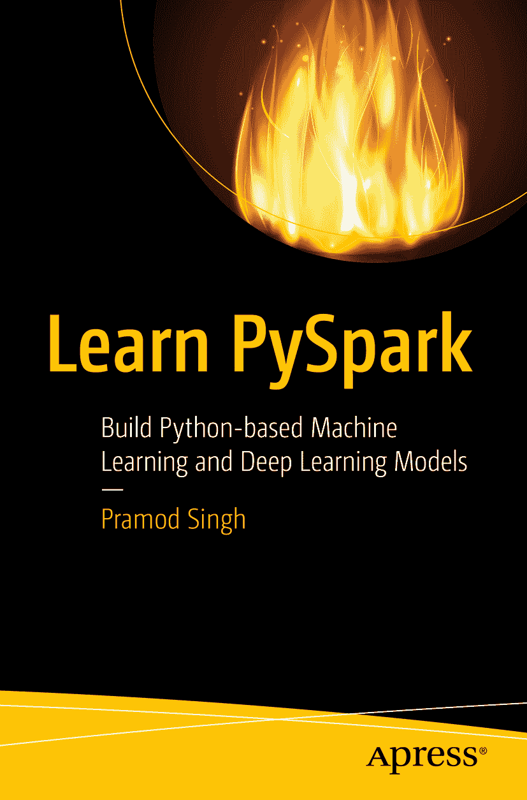

# 封面图片

ISBN `978-1-4842-4960-4` e-ISBN `978-1-4842-4961-1` [`doi.org/10.1007/978-1-4842-4961-1`](https://doi.org/10.1007/978-1-4842-4961-1) © Pramod Singh 2019

# 版权信息

Apress 标准商标名称、标识和图像可能出现在本书中。我们仅在编辑风格下使用这些名称、标识和图像，以维护商标所有者的利益，并无意侵犯商标权，而非在每次出现商标名称、标识或图像时都使用商标符号。本出版物中使用的商品名称、商标、服务标志及类似术语，即使未明确标识，也不应被视为对其是否受专有权利保护的立场表达。

尽管本书中的建议和信息在出版时被认为是真实准确的，但作者、编辑及出版商均不对可能存在的任何错误或遗漏承担法律责任。出版商对本书所载内容不作任何明示或暗示的担保。

本书通过 Springer Science+Business Media New York 在全球图书贸易中发行，地址：233 Spring Street, 6th Floor, New York, NY 10013。电话：1-800-SPRINGER，传真：(201) 348-4505，电子邮件：`orders-ny@springer-sbm.com`，或访问 www.springeronline.com。

Apress Media, LLC 是一家加利福尼亚有限责任公司，其唯一成员（所有者）是 Springer Science+Business Media Finance Inc (SSBM Finance Inc)。SSBM Finance Inc 是一家特拉华州公司。

# 献词

谨以此书献给我的妻子 Neha、我的儿子 Ziaan 以及我的父母。没有你们，这本书不可能完成。你们完整了我的世界，是我力量的源泉。