# 1. Spark 简介

由于本书是关于 Spark 的，因此第一章从探讨 Spark 的一些历史及其不同组件开始是合情合理的。本章引言部分分为三个部分。在第一部分中，我将回顾数据的演变过程以及它在规模上如何发展到今天的地步。我将触及数据的三个关键方面。在第二部分中，我将深入探讨 Spark 的内部机制，并详细介绍其不同组件，包括其架构和运作方式。本章的第三部分也是最后一部分，重点介绍如何在云环境中使用 Spark。

## 历史

Spark 项目诞生于加州大学伯克利分校的算法、机器与人类 (AMP) 实验室。该项目的启动是为了解决 Hadoop MapReduce 框架中潜在的问题。尽管 Hadoop MapReduce 是处理大数据处理的突破性框架，但实际上它在速度方面仍存在许多限制。Spark 是全新的，能够进行内存计算，这使其比任何其他大数据处理框架快近 100 倍。自那时起，全球范围内将 Spark 用于大数据应用的情况持续增加。但在深入探讨 Spark 的具体细节之前，让我们先考虑一下数据本身的几个方面。

数据可以从三个不同的角度来审视：其收集、存储和处理的方式，如图 1-1 所示。

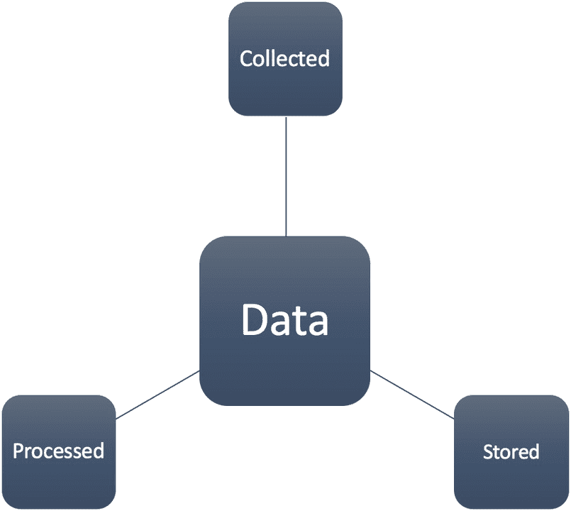

图 1-1 数据的三个方面

### 数据收集

在过去的几年里，数据收集的方式发生了巨大的转变。从在杂货店买一个苹果到在手机上删除一个应用程序，每一个数据点现在都被捕获在后端，并通过各种内置应用程序进行收集。不同的物联网 (`IoT`) 设备每毫秒都会捕获大量的视觉和感官信号。对于企业来说，从各种来源收集这些数据并在以后用于改进决策，已经变得相对方便。

### 数据存储

在早些年，没人能想象数据会存放在某个远程位置，或者存储数据的成本会变得如此低廉。企业已经接受了云存储，并开始看到它相较于本地部署方法的优势。然而，出于各种原因，一些企业仍然选择本地存储。众所周知，数据存储最初是利用磁带进行的。随后，软盘的突破性引入使得数据可以从一个地方转移到另一个地方。然而，数据的大小仍然是一个巨大的限制。闪存盘和硬盘使得以更低的成本存储和传输大量数据变得更加容易。（见图 1-2。）存储设备发展的最新趋势已经产生了能够存储高达 2TB 数据的闪存盘，且价格低廉。

图 1-2 数据存储的演变

这一趋势清楚地表明，多年来数据存储成本已显著降低，并且还在继续下降。因此，企业不再回避存储海量数据，无论其类型如何。从日志到财务和运营交易，再到简单的员工反馈，一切都被存储起来。

### 数据处理

数据的最后一个方面是使用存储的数据并进行处理，以便进行分析或运行应用程序。我们见证了在过去 20 年里计算机变得多么高效。过去需要五分钟才能执行的任务，使用当今配备先进处理单元的机器可能不到一秒钟就能完成。因此，不言而喻，机器可以更快、更容易地处理数据。尽管如此，无论单台机器的处理能力有多强，它能处理的数据量仍然存在限制。因此，Spark 背后的基本思想是使用一组（集群）机器和一个统一的处理引擎 (`Spark`) 来处理和应对海量数据，同时不影响速度和安全性。这正是促成 Spark 诞生的最终目标。

## Spark 架构

有五个核心组件使 `Spark` 如此强大且易于使用。`Spark` 的核心架构包含以下层次，如图 1-3 所示：

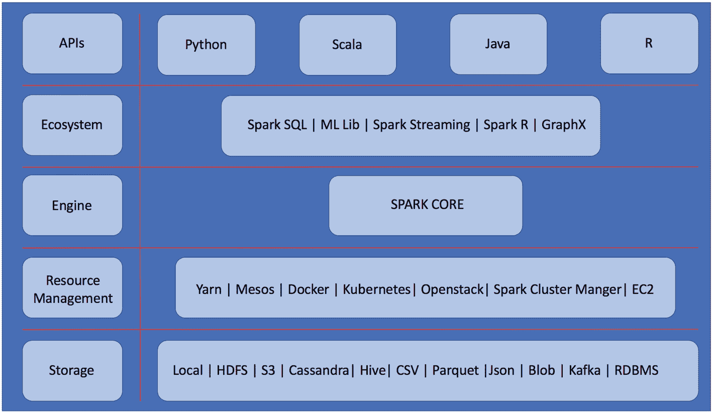

图 1-3 `Spark` 的核心组件

- 存储
- 资源管理
- 引擎
- 生态系统
- API

### 存储

在使用 `Spark` 之前，必须准备好数据才能进行处理。这些数据可以驻留在任何类型的数据库中。`Spark` 提供了多种选项来使用不同类别的数据源，以便能够大规模地处理数据。`Spark` 允许你使用传统的关系型数据库以及 `NoSQL` 数据库，例如 `Cassandra` 和 `MongoDB`。

### 资源管理

下一层由资源管理器组成。由于 `Spark` 在一组机器上工作（它也可以在具有多个核心的单台机器上工作），因此它被称为 `Spark` *集群*。通常，任何集群中都有一个资源管理器，用于高效地处理这些资源之间的工作负载。两种最广泛使用的资源管理器是 `YARN` 和 `Mesos`。资源管理器内部有两个主要组件：

1. `集群管理器`
2. `工作节点`

这有点像主从架构，其中集群管理器充当主节点，而工作节点在集群中充当从节点。集群管理器跟踪与工作节点及其当前状态相关的所有信息。集群管理器始终维护以下信息：

- 工作节点状态（忙碌/可用）
- 工作节点位置
- 工作节点内存
- 工作节点总 `CPU` 核心数

集群管理器的主要作用是根据工作节点的可用性和容量来管理工作节点并为其分配任务。另一方面，工作节点仅负责执行集群管理器分配给它的任务，如图 1-4 所示。

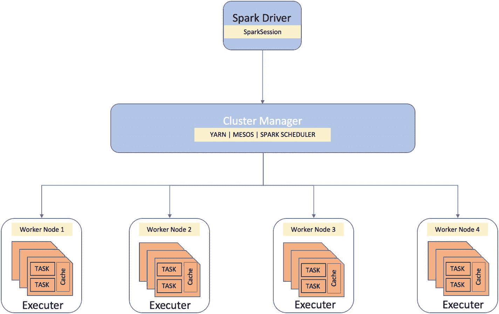

图 1-4 资源管理

分配给工作节点的任务通常是整个 `Spark` 应用程序的各个部分。`Spark` 应用程序包含两部分：

1. 任务
2. `Spark` 驱动器

任务是使用 `PySpark` 或 `Spark R` 代码编写的数据处理逻辑。它可以简单到计算单词的总频率，也可以复杂到对非结构化数据集执行一系列非常复杂的指令。第二个组件是 `Spark` 驱动器，它是 `Spark` 应用程序的主要控制器，持续与集群管理器交互，以找出哪些工作节点可用于执行请求。`Spark` 驱动器的作用是请求集群管理器为每个工作节点启动 `Spark` 执行器。

### 引擎与生态系统

`Spark` 架构的基础是其核心，它构建在 `RDD`（弹性分布式数据集）之上，并为 `Spark` 贡献者提供了多个 API 来构建其他库和生态系统。它包含两部分：分布式计算基础设施和 `RDD` 编程抽象。`Spark` 工具包中的默认库以四种不同的形式提供。

#### `Spark SQL`

`SQL` 被全球大多数 `ETL` 操作员使用，这使其成为 `Spark` 产品中合乎逻辑的选择。它允许 `Spark` 用户通过运行 `SQL` 查询来执行结构化数据处理。实际上，`Spark SQL` 利用催化剂优化器在执行 `SQL` 查询期间进行优化。

使用 `Spark SQL` 的另一个优点是它可以轻松处理多个数据库文件和存储系统，例如 `SQL`、`NoSQL`、`Parquet` 等。

#### `MLlib`

在大型数据集上训练机器学习模型开始成为一个巨大的挑战，直到 `Spark` 的 `MLlib`（机器学习库）出现。`MLlib` 使您能够使用 `Spark` 集群在大型数据集上训练机器学习模型。它允许您在 `Spark ML` 库中构建监督学习、无监督学习、推荐系统、基于 `NLP` 的模型以及深度学习。

## `Structured Streaming`

`Spark Streaming` 库提供了读取和处理实时流数据的功能。传入的数据可以是批处理数据，也可以是来自不同源的近实时数据。`Structured Streaming` 能够从诸如 `Flume`、`Kafka`、`Twitter` 等源摄取实时数据。本书后面有一章专门介绍这个组件（见第 3 章）。

#### `Graph X`

这是一个位于 `Spark` 核心之上的库，允许用户处理特定类型的数据（图数据帧），这些数据由节点和边组成。典型的图用于建模所涉及的不同对象之间的关系。节点代表对象，节点之间的边代表它们之间的关系。图数据帧主要用于网络分析，而 `Graph X` 使得对此类图数据帧进行分布式处理成为可能。

### 编程语言 `API`

`Spark` 支持四种语言。由于 `Spark` 是使用 `Scala` 构建的，因此 `Scala` 是其原生语言。除了 `Scala`，我们还可以使用 `Python`、`Java` 和 `R`，如图 1-5 所示。

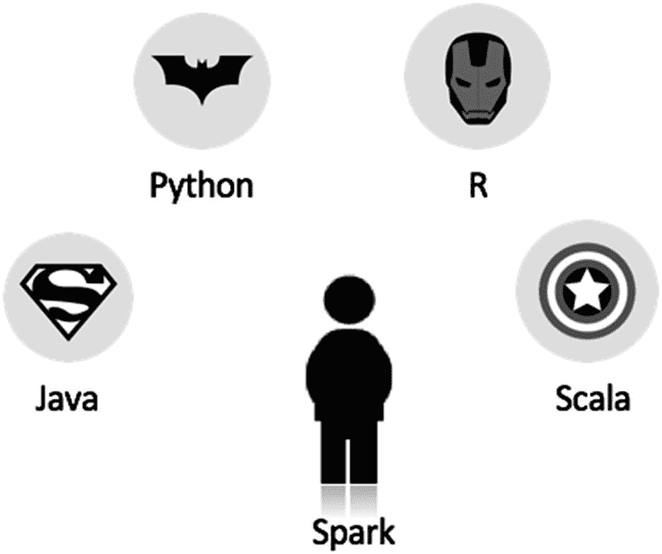

图 1-5 语言 `API`

## 搭建开发环境

在本章的最后部分，我将介绍如何在云端搭建 `Spark` 环境。使用 `Spark` 有多种方式：

- 本地搭建
- `Docker` 容器
- 云环境（`GCP`、`AWS`、`Azure`）
- `Databricks`

### 本地搭建

在本地系统上安装和使用 `Spark` 相对容易，但如果不部署在集群上，就违背了 `Spark` 本身的核心用途。`Spark` 的核心价值在于分布式数据处理，若仅在本地系统运行，其能力将始终受限于单机性能；而将 `Spark` 部署在多台机器上才能发挥更大优势。不过，在本地保留 `Spark` 环境，并用样本数据测试代码仍是不错的做法。请按以下步骤操作：

1. 确保已安装 Java，否则请安装 Java。

2. 从 [`https://spark.apache.org/downloads.html`](https://spark.apache.org/downloads.html) 下载最新版 Apache Spark。

3. 解压压缩包中的文件。

4. 将所有 Spark 相关文件复制到对应目录。

5. 配置环境变量以运行 Spark。

6. 验证安装并运行 Spark。

### Docker 容器

另一种本地使用 Spark 的方式是通过 Docker 容器化技术。这允许用户将所有依赖和 Spark 文件打包成一个镜像，可在任何系统上运行。任务完成后可终止容器，需要时再重新运行。要使用 Docker 运行 Spark，需先在系统上安装 Docker，然后执行以下命令：`docker run -it -p 8888:8888 jupyter/pyspark-notebook`。

### 云环境

如本章前文所述，由于多种原因，本地环境在处理大数据时作用有限，而基于云的环境则能在短时间内完成海量数据的摄取和处理。在处理超过 100TB 的大数据集时，Spark 的真正威力才能充分展现。大多数云基础设施提供商都允许安装 Spark，有时甚至预配置了 Spark。用户可根据需求轻松启动符合规格的集群。Databricks 就是其中一种云环境。

#### Databricks

Databricks 由 Spark 的创始团队创立，旨在为企业提供 Spark 企业版及全面支持。为提升 Spark 在社区和用户中的普及度，Databricks 还提供了免费的社区版 Spark，配备 6GB 集群（单节点）。如需扩大集群规模，可注册 Databricks 企业版账户，步骤如下：

1. 搜索 Databricks 网站，选择 Databricks 社区版，如图 1-6 所示。

   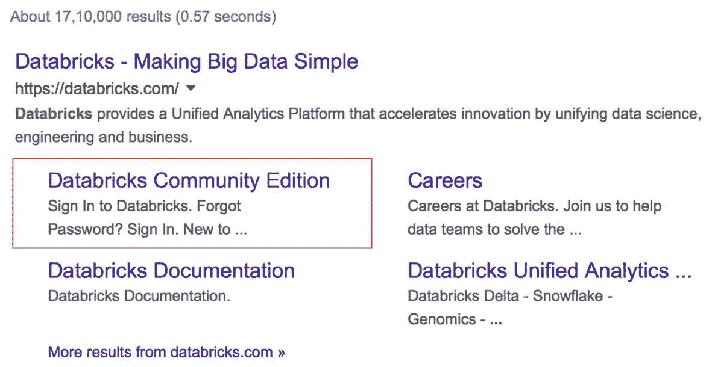

   图 1-6 Databricks 网页

2. 若已有 Databricks 账户，可直接登录。若无账户，需先创建账户才能使用 Databricks，如图 1-7 所示。

   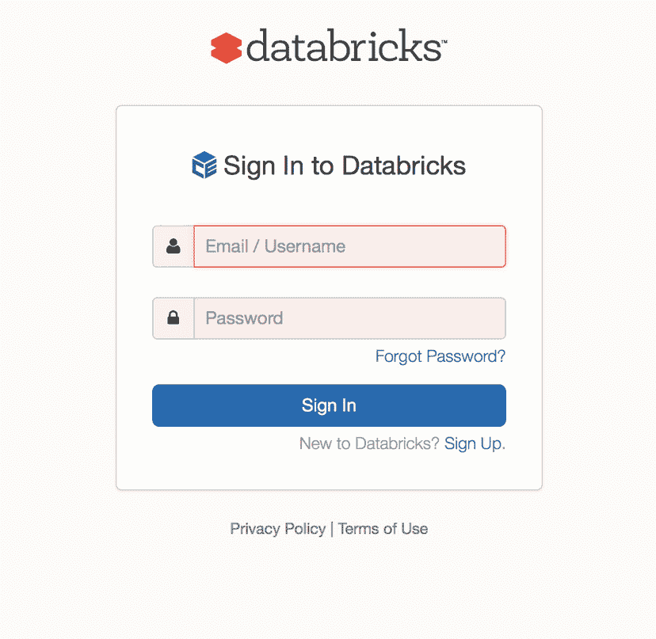

   图 1-7 Databricks 登录页面

3. 进入主页后，可选择加载新数据源或从头创建笔记本，如图 1-8 所示。若选择创建笔记本，需确保集群已启动运行。因此需点击"新建集群"来启动集群（Databricks 提供 6GB 的 AWS EMR 集群）。

   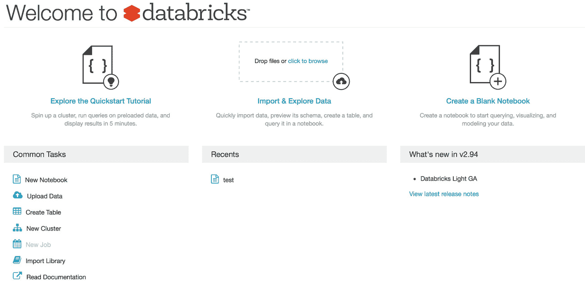

   图 1-8 创建 Databricks 笔记本

4. 配置集群时，需为集群命名，并选择与 Python 版本匹配的 Spark 版本，如图 1-9 所示。填写完所有信息后，点击"创建集群"，等待数分钟直至集群启动。

   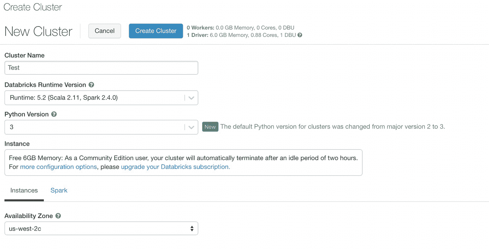

   图 1-9 创建 Databricks 集群

5. 可通过左侧面板的"集群"选项查看集群状态，如图 1-10 所示。该页面显示特定集群的所有相关信息及其当前状态。

   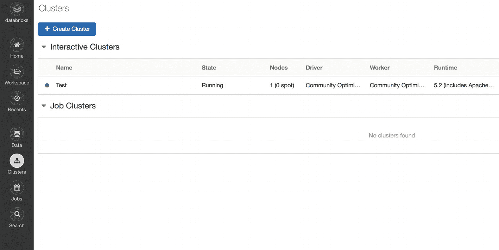

   图 1-10 Databricks 集群列表

6. 最后一步是打开笔记本并将其连接到刚创建的集群（图 1-11）。连接成功后即可开始编写 PySpark 代码。

   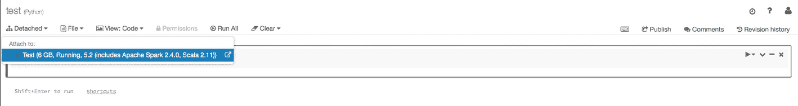

   图 1-11 Databricks 笔记本

总体而言，自 2010 年 Spark 成为开源平台以来，其用户数量持续增长，社区规模与日俱增。Spark 的贡献者数量已超过 Hadoop，这并不令人意外。一项调查揭示了 Spark 受欢迎的部分原因，结果如图 1-12 所示。

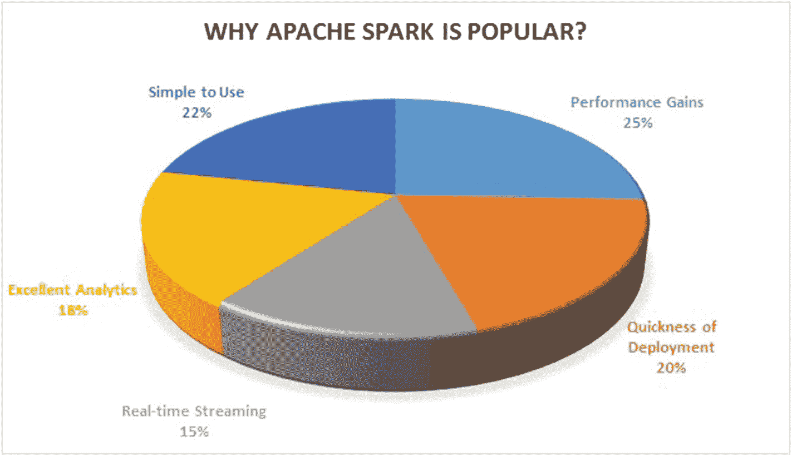

图 1-12 Spark 采用情况调查结果

## 本章小结

本章简要介绍了 Spark 的发展历史、核心组件以及在云环境中访问 Spark 的方法。在后续章节中，我将深入探讨 Spark 的各个方面，以及如何用它构建不同的应用程序。