# 2. 数据处理

本章涵盖在 PySpark 中预处理和处理数据的不同步骤。预处理技术因场景而异，有多种方法可将数据塑造成所需形式。本章旨在介绍 Spark 中处理大数据的一些常用技术。我们将学习数据预处理涉及的不同步骤，包括处理缺失值、合并数据集、应用函数、聚合和排序。数据预处理的一个重要部分是将数值列转换为分类列（反之亦然），这将在后续几章中结合机器学习进行讲解。本章使用的数据集基于一项原始研究数据集，包含原始数据集中的部分属性，并添加了包含虚构数据点的额外列。

### 注意

以下所有步骤均在 Jupyter Notebook 中编写，Spark 运行在 Docker 镜像上（详见第 1 章）。后续所有代码也可在 Databricks 中运行。

## 创建 SparkSession 对象

第一步是创建 `SparkSession` 对象以使用 Spark。同时从 `spark.sql` 导入所有必要的函数和数据类型：

```python
from pyspark.sql import SparkSession
spark=SparkSession.builder.appName('data_processing').getOrCreate()
import pyspark.sql.functions as F
from pyspark.sql.types import *
```

现在，我们不直接读取文件创建数据框，而是通过传递键值来演示创建数据框的过程。在 Spark 中创建数据框的方式是声明其模式并传递列值。

### 创建数据框

在以下示例中，我们创建了一个新的数据框，其中包含五种特定数据类型（`string` 和 `integer`）的列。如您所见，当我们在新数据框上调用 `show` 时，它会创建三行五列，包含我们传入的值。

```python
schema=StructType().add("user_id","string").add("country","string").add("browser", "string").add("OS",'string').add("age", "integer")
df=spark.createDataFrame([("A203",'India',"Chrome","WIN",33),("A201",'China',"Safari","MacOS",35),("A205",'UK',"Mozilla","Linux",25)],schema=schema)
df.printSchema()
```

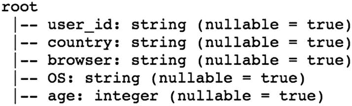

```python
df.show()
```

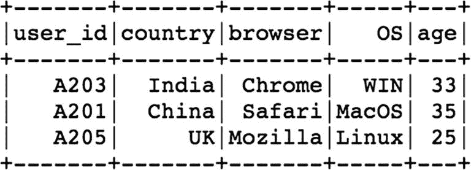

### 空值

空值是整体数据中非常常见的组成部分。因此，在数据处理流程中添加一个步骤来处理空值变得至关重要。在 Spark 中，我们可以通过将空值替换为特定值，或者删除包含空值的行/列来处理空值。

首先，我们创建一个新的数据框（`df_na`），其中两列包含空值（其模式与之前的数据框相同）。处理空值的第一种方法是，将当前数据框中的所有空值填充为 `0`，这提供了一种快速修复方案。我们使用 `fillna` 函数将数据框中的所有空值替换为 `0`。第二种方法是，将特定列（`country`、`browser`）中的空值分别替换为 `'USA'` 和 `'Safari'`。

```python
df_na=spark.createDataFrame([("A203",None,"Chrome","WIN",33),("A201",'China',None,"MacOS",35),("A205",'UK',"Mozilla","Linux",25)],schema=schema)
df_na.show()
```

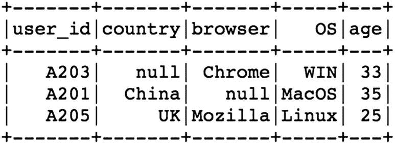

```python
df_na.fillna('0').show()
```

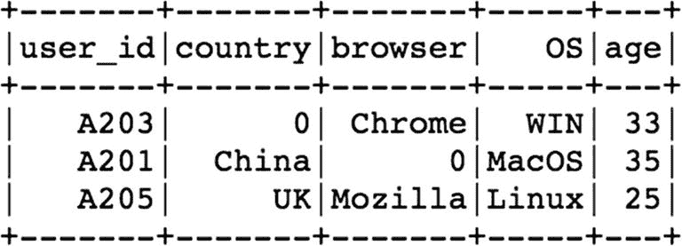

```python
df_na.fillna( { 'country':'USA', 'browser':'Safari' } ).show()
```

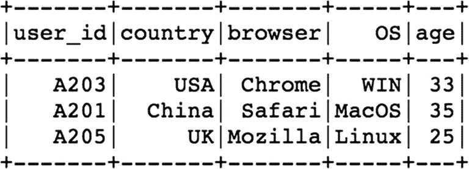

为了删除包含任何空值的行，我们可以简单地使用 PySpark 中的 `na.drop` 功能。而如果需要针对特定列执行此操作，我们也可以传入列名集合，如下例所示：

```python
df_na.na.drop().show()
```

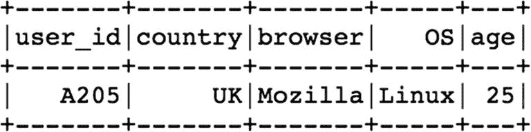

```python
df_na.na.drop(subset='country').show()
```

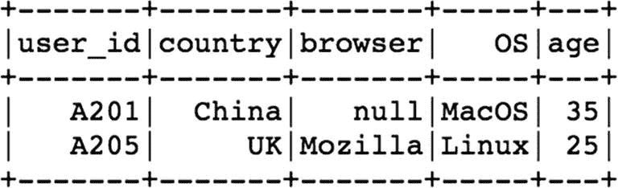

数据处理中另一个非常常见的步骤是将某些数据点替换为特定值。我们可以使用 `replace` 函数来实现，如下例所示。要删除数据框的某一列，我们可以使用 PySpark 的 `drop` 功能。

```python
df_na.replace("Chrome","Google Chrome").show()
```

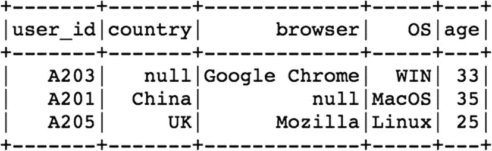

```python
df_na.drop('user_id').show()
```

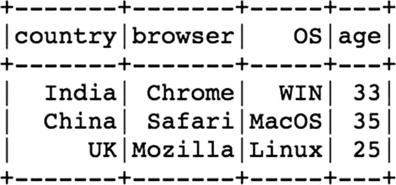

现在我们已经了解了如何通过传入值创建数据框以及如何处理缺失值，我们可以通过读取文件（`.csv`、`parquet` 等）来创建一个 Spark 数据框。该数据集总共包含七列和 2000 行。`summary` 函数允许我们查看数据集的统计度量，例如数据框中数值数据的最小值、最大值和平均值。

```python
df=spark.read.csv("customer_data.csv",header=True,inferSchema=True)
df.count()
```

输出: `2000`

```python
len(df.columns)
```

输出: `7`

```python
df.printSchema()
```

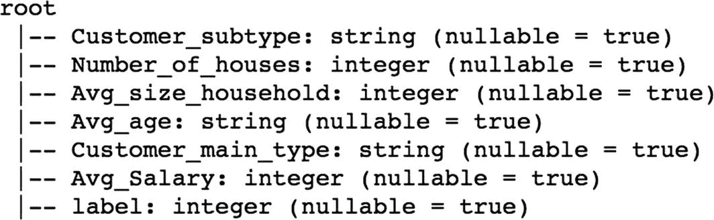

```python
df.show(3)
```

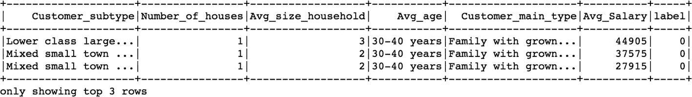

```python
df.summary().show()
```

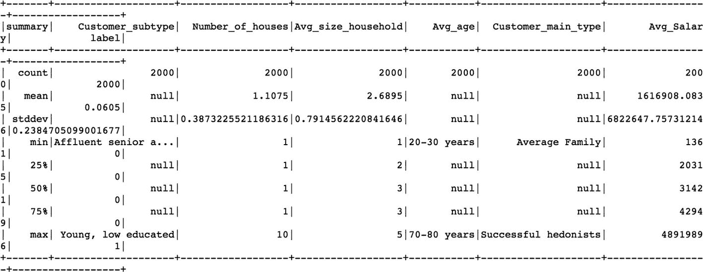

大多数情况下，我们不会使用数据框中存在的所有列，因为有些列可能是冗余的，并且在提供有用信息方面价值很小。因此，对数据框进行子集划分对于获得适合分析的正确数据变得至关重要。我将在下一节中介绍这一点。

## 数据框的子集

可以根据多个条件创建数据框的子集，在这些条件中，我们选择几行、几列或应用了某些过滤器的数据。在以下示例中，您将看到如何根据特定条件创建原始数据框的子集，以演示过滤记录的过程。

*   `Select`

*   `Filter`

*   `Where`

### Select

在此示例中，我们选取数据框的一列 `'Avg_Salary'`，并使用 `select` 创建原始数据框的一个子集。我们可以传入子集中必须存在的任意数量的列。然后，我们对数据框应用过滤器，根据某个阈值（`Avg_Salary > 1000000`）提取记录。过滤后，我们可以获取子集中存在的记录总数，或者将其用于进一步处理。

```
[In]: df.select(['Customer_subtype','Avg_Salary']).show()
[Out]:
```

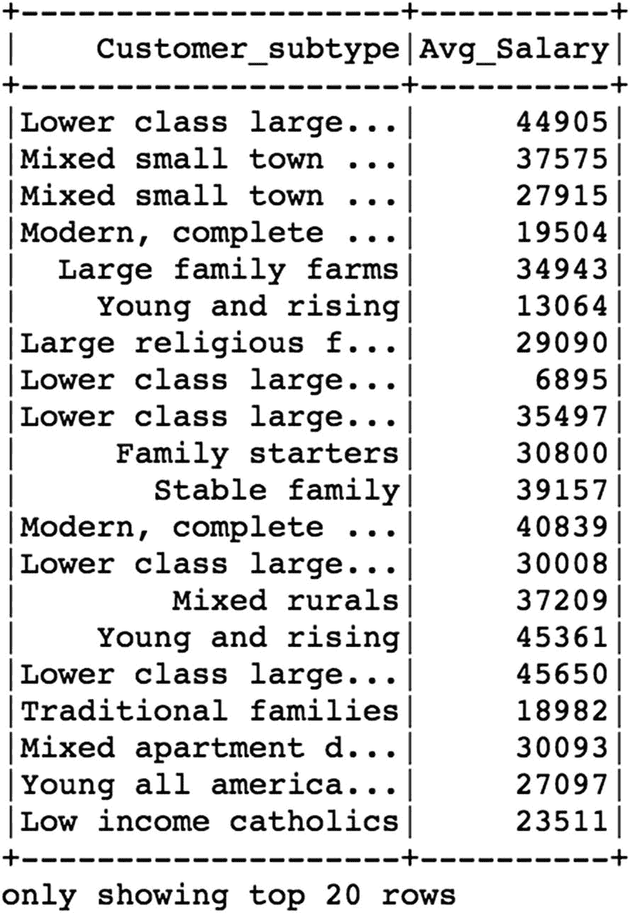

```
[In]: df.filter(df['Avg_Salary'] > 1000000).count()
[In]: 128
[In]: df.filter(df['Avg_Salary'] > 1000000).show()
```

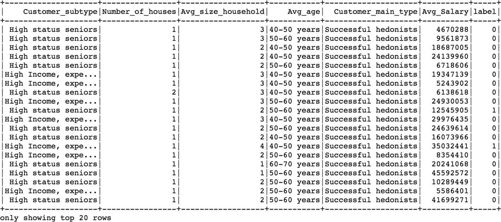

### Filter

我们还可以通过包含更多条件，对数据框应用多个过滤器，如下所示。这可以通过两种方式完成：首先，应用连续的过滤器；然后，在 `where` 语句中使用（`&`、`or`）操作符。


```
[In]: df.filter(df['Avg_Salary'] > 500000).filter(df['Number_of_houses'] > 2).show()
[Out]:
```

### Where

```
[In]: df.where((df['Avg_Salary'] > 500000) & (df['Number_of_houses'] > 2)).show()
[Out]:
```

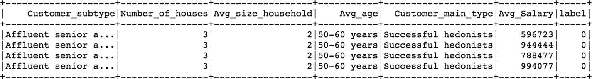

现在我们已经了解了如何从数据框创建子集，接下来可以继续学习 PySpark 中的聚合操作。

## 聚合操作

任何类型的聚合都可以简单地分解为以下三个步骤，按顺序执行：

- 拆分

- 应用

- 合并

第一步是根据某一列或一组列来拆分数据，然后对这些小的独立分组执行操作（如 `count`、`max`、`avg` 等）。一旦每个分组集合的结果都计算完毕，最后一步就是将所有结果合并起来。

在下面的示例中，我们根据 `'Customer subtype'` 对数据进行聚合，并简单地统计每个类别中的记录数量。我们使用了 PySpark 中的 `groupBy` 函数。由于没有对结果应用任何排序，因此输出没有特定的顺序。因此，我们还将了解如何对最终结果应用任意类型的排序。由于数据框中有七列——除了 `Avg_Salary` 之外，其他都是分类列——我们可以遍历每一列并应用聚合，如下例所示：

```
[In]: df.groupBy('Customer_subtype').count().show()
[Out]:
```

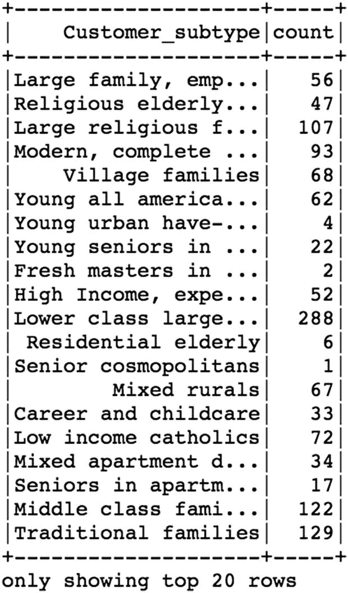

```
[In]:
for col in df.columns:
    if col !='Avg_Salary':
        print(f" Aggregation for  {col}")
        df.groupBy(col).count().orderBy('count',ascending=False).show(truncate=False)
[Out]:
```

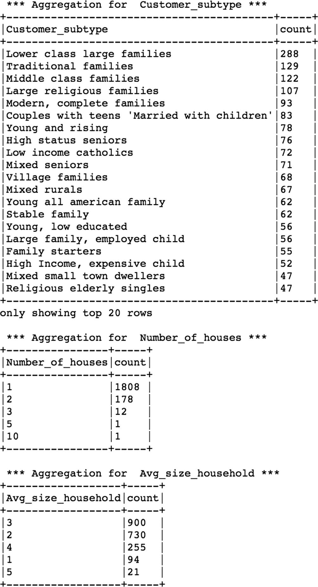

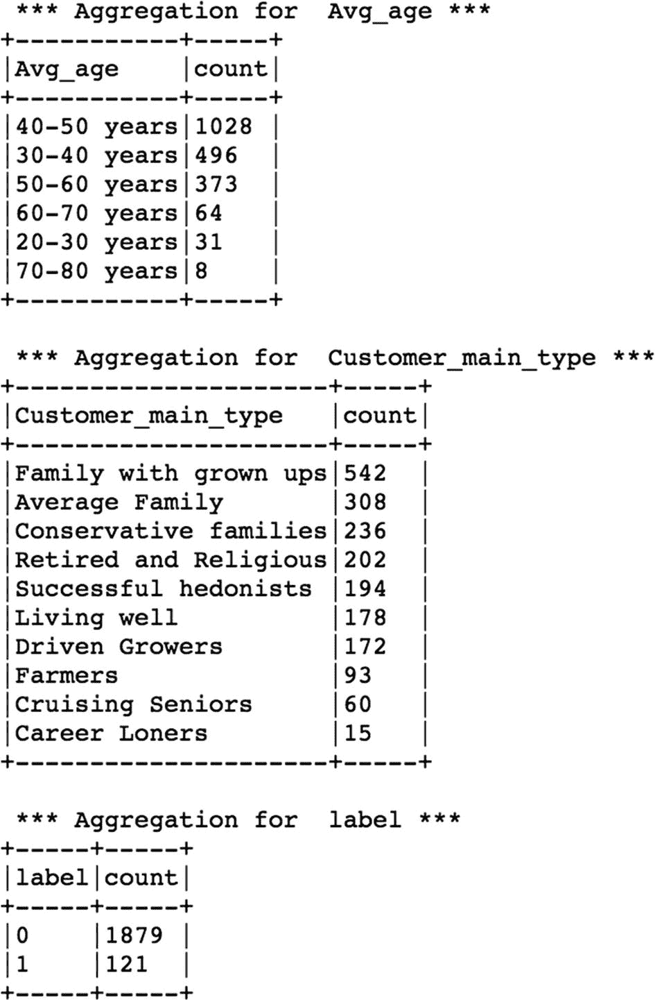

如前所述，我们可以对记录分组执行不同类型的操作，例如：

- 平均值

- 最大值

- 最小值

- 求和

以下示例基于不同的分组涵盖了其中一些操作。这里的 `F` 指的是 Spark 的 `sql` 函数。

```
[In]: df.groupBy('Customer_main_type').agg(F.mean('Avg_Salary')).show()
[Out]:
```

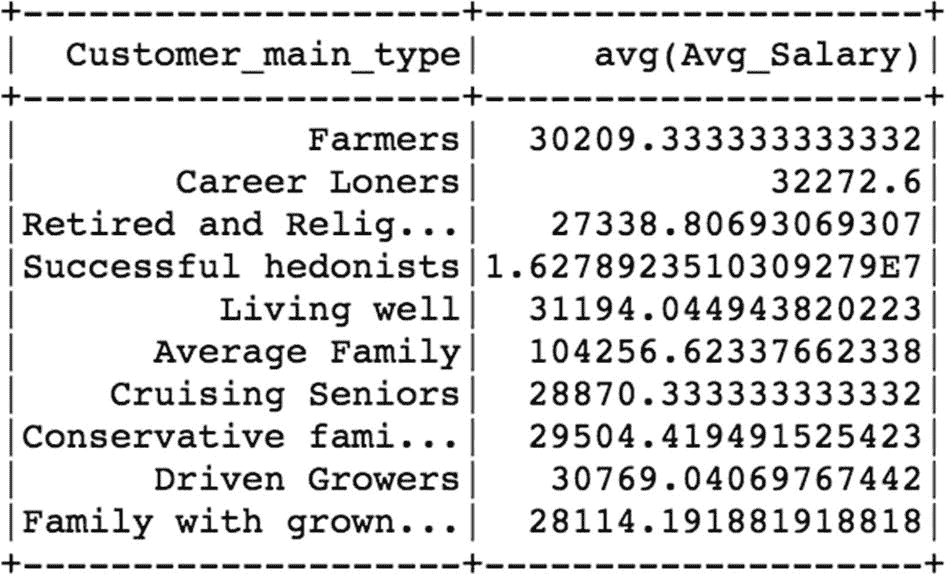

```
[In]: df.groupBy('Customer_main_type').agg(F.max('Avg_Salary')).show()
[Out]:
```

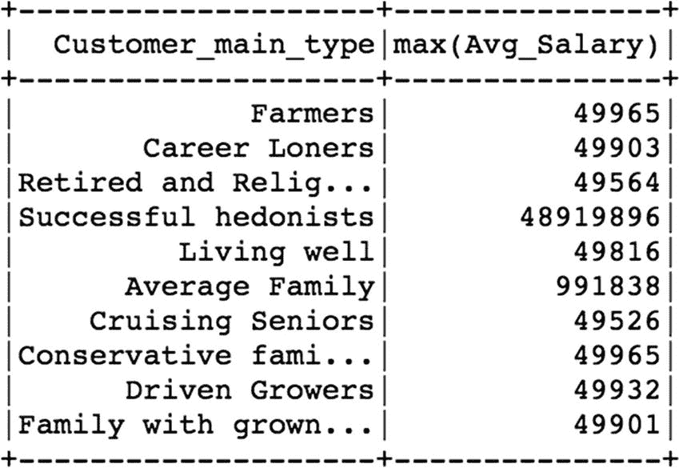

```
[In]: df.groupBy('Customer_main_type').agg(F.min('Avg_Salary')).show()
[Out]:
```

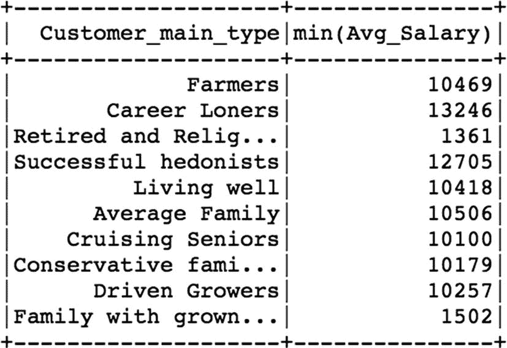

```
[In]: df.groupBy('Customer_main_type').agg(F.sum('Avg_Salary')).show()
[Out]:
```

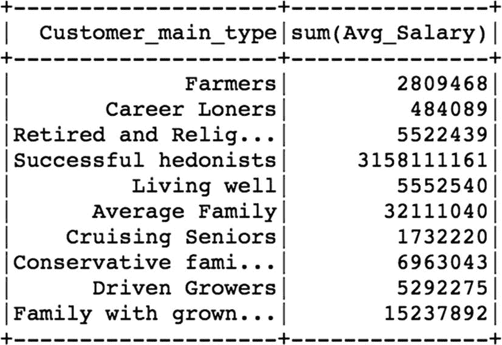

有时，我们只需要对数据进行排序，无论是否带有聚合操作。这时，我们可以利用 PySpark 的 `sort` 和 `orderBy` 功能，将数据按特定顺序重新排列，如下例所示：

```
[In]: df.sort("Avg_Salary", ascending=False).show()
[Out]:
```

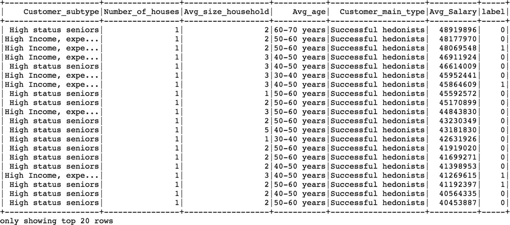

```
[In]: df.groupBy('Customer_subtype').agg(F.avg('Avg_Salary').alias('mean_salary')).orderBy('mean_salary',ascending=False).show(50,False)
[Out]:
```

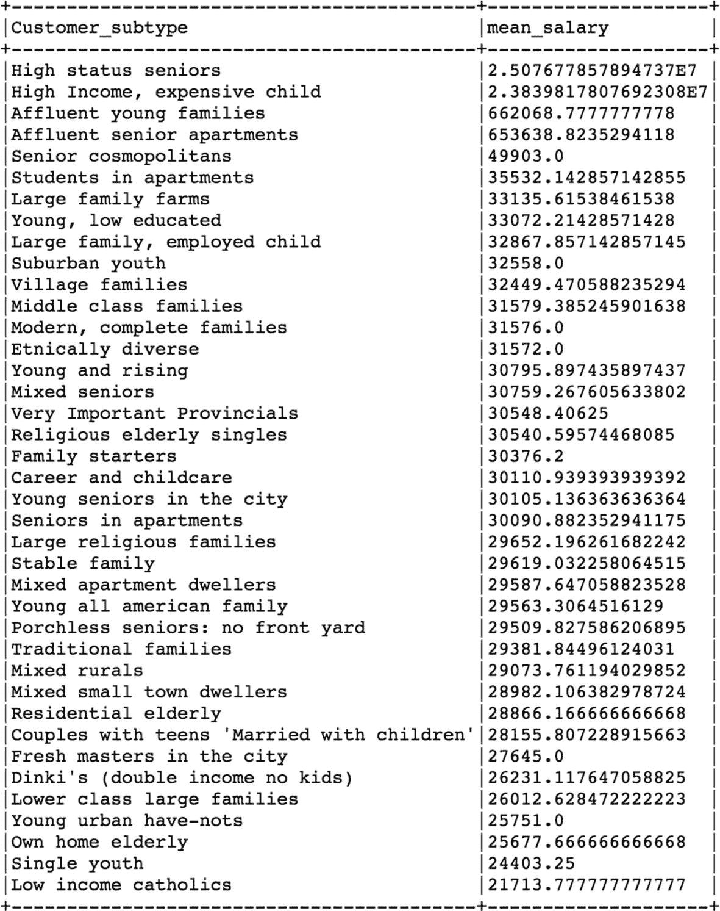

```
[In]: df.groupBy('Customer_subtype').agg(F.max('Avg_Salary').alias('max_salary')).orderBy('max_salary',ascending=False).show()
[Out]:
```

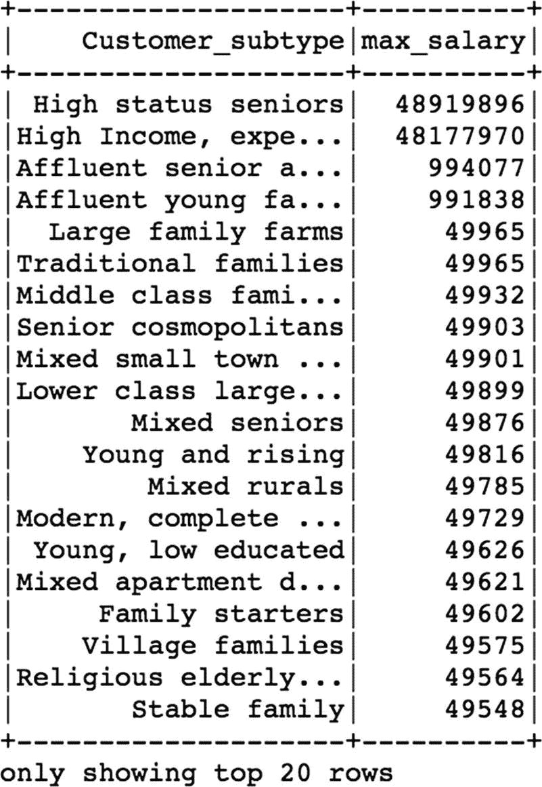

在某些情况下，我们还必须收集特定分组或单个类别的值列表。例如，假设一个客户访问在线商店，并浏览了商店网站上的不同页面。如果我们需要将客户的所有活动收集到一个列表中，可以使用 PySpark 中的 `collect` 功能。我们可以通过两种不同的方式收集值：

- 收集列表

- 收集集合

### 收集

`Collect list` 提供按原始出现顺序排列的所有值（也可以反转顺序），而 `collect set` 仅提供唯一值，如下例所示。我们考虑按 `Customer subtype` 分组，并分别使用 `list` 和 `set` 将 `Numberof houses` 的值收集到一个新列中。

# PySpark 数据操作：聚合、UDF 与连接

下面的示例展示了如何在 PySpark 中使用聚合函数、创建常量列、应用用户自定义函数（UDFs）以及合并数据框。

## 基础聚合

首先，我们使用 `agg` 与 `collect_set` 和 `collect_list` 函数进行聚合操作。

```python
[In]: df.groupby("Customer_subtype").agg(F.collect_set("Number_of_houses")).show()
[Out]:
```
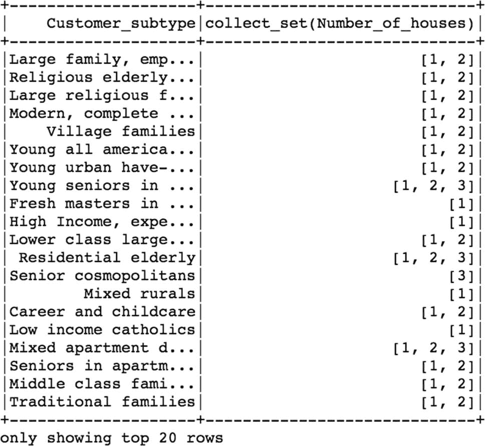

```python
[In]:
df.groupby("Customer_subtype").agg(F.collect_list("Number_of_houses")).show()
[Out]:
```
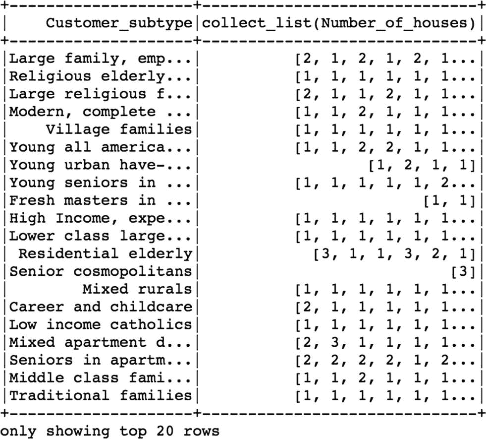

## 创建常量列

创建一个包含常量值的新列的需求非常普遍。因此，我们可以在 PySpark 中使用 `lit` 函数来实现。在下面的示例中，我们创建了一个包含常量值的新列：

```python
[In]: df=df.withColumn('constant',F.lit('finance'))
[In]: df.select('Customer_subtype','constant').show()
[Out]:
```
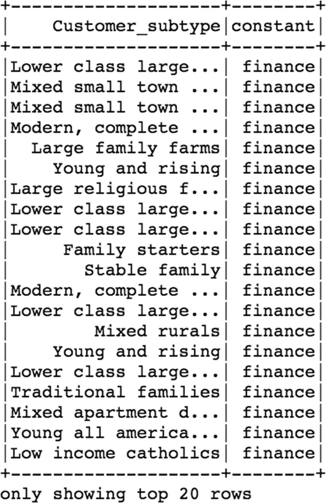

由于我们处理的是数据框，因此对特定列应用某些自定义函数并获取输出是一个常见需求。因此，我们利用 `UDF`（用户自定义函数）来对一列或多列应用 Python 函数。

## 用户自定义函数 (`UDFs`)

在这个示例中，我们尝试对年龄类别进行命名，并为此创建一个标准的 Python 函数 (`age_category`)。为了将其应用于 Spark 数据框，我们使用这个 Python 函数创建一个 `UDF` 对象。唯一的要求是指定函数的返回类型。在这个例子中，它只是一个字符串值。

```python
[In]: from pyspark.sql.functions import udf
[In]: df.groupby("Avg_age").count().show()
[Out]:
```
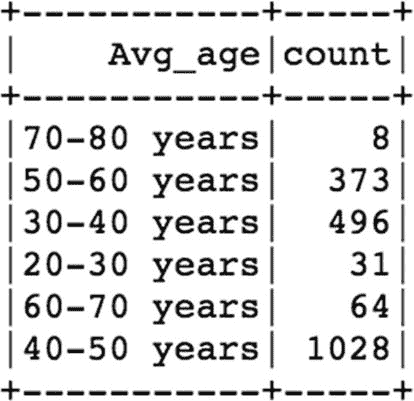

```python
[In]: def age_category(age):
if age  == "20-30 years":
return "Young"
elif age== "30-40 years":
return "Mid Aged"
elif ((age== "40-50 years") or (age== "50-60 years")) :
return "Old"
else:
return "Very Old"
[In]: age_udf=udf(age_category,StringType())
[In]: df=df.withColumn('age_category',age_udf(df['Avg_age']))
[In]: df.select('Avg_age','age_category').show()
[Out]:
```
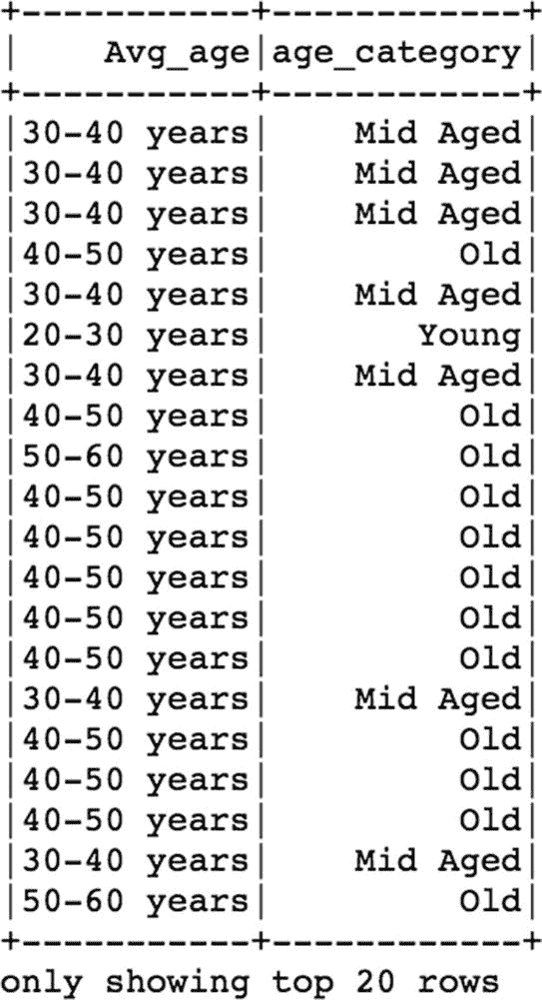

```python
[In]: df.groupby("age_category").count().show()
[Out]:
```
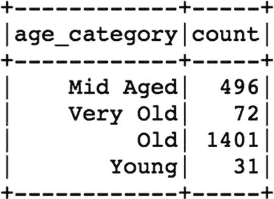

### Pandas UDF

`Pandas UDF` 是另一项近期进展，现在让我们来了解一下它们。

与标准的 Python `UDF` 相比，`Pandas UDF` 在处理和执行时间方面要快得多，效率也更高。普通 Python `UDF` 与 `Pandas UDF` 的主要区别在于，Python `UDF` 是逐行执行的，因此实际上并不能发挥分布式框架的优势。与 `Pandas UDF` 相比，它可能需要更长的时间，而 `Pandas UDF` 是逐块执行的，结果更快。`Pandas UDF` 有三种不同的类型：标量（scalar）、分组映射（grouped map）和分组聚合（grouped agg）。使用 `Pandas UDF` 与传统 `UDF` 的唯一区别在于声明方式。在下面的示例中，我们尝试通过应用缩放来缩放 `Avg_Salary` 值。我们首先获取 `Avg_Salary` 的 `min` 和 `max` 值，从每个值中减去最小值，然后除以 `max` 和 `min` 之间的差值。

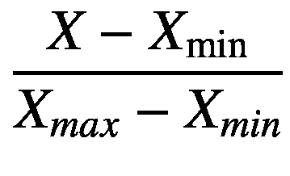

```python
[In]: df.select('Avg_Salary').summary().show()
[Out]:
```
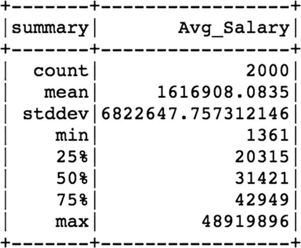

```python
[In]: min_sal=1361
[In]: max_sal=48919896
[In]: from pyspark.sql.functions import pandas_udf, PandasUDFType
[In]: def scaled_salary(salary):
scaled_sal=(salary-min_sal)/(max_sal-min_sal)
return scaled_sal
[In]: scaling_udf = pandas_udf(scaled_salary, DoubleType())
[In]:df.withColumn("scaled_salary",scaling_udf(df['Avg_Salary'])).show(10,False)
[Out]:
```
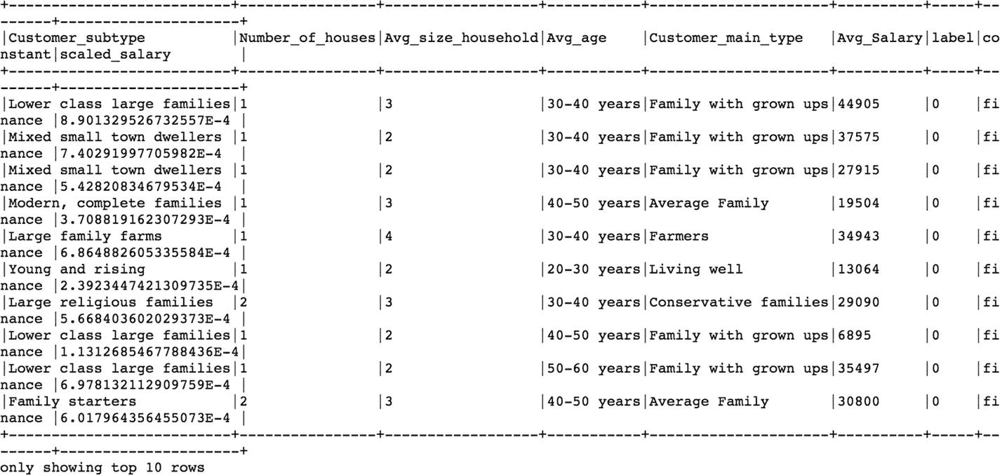

这就是我们如何根据需要使用传统 `UDF` 和 `Pandas UDF` 对数据框应用不同条件的方法。

### 连接（Joins）

合并不同的数据集是大数据世界中大多数数据处理管道中非常普遍的需求。`PySpark` 提供了一种非常便捷的方式来根据需要合并和透视数据框的值。在下面的示例中，我们创建了一个虚构的数据框，其中包含所有 `Customer` 类型的一些虚拟 `Region Code` 值。其想法是将此数据框与原始数据框合并，以便将这些区域代码作为一列包含在原始数据框中。

```python
[In]: region_data = spark.createDataFrame([('Family with grown ups','PN'),
('Driven Growers','GJ'),
('Conservative families','DD'),
('Cruising Seniors','DL'),
('Average Family ','MN'),
('Living well','KA'),
('Successful hedonists','JH'),
('Retired and Religious','AX'),
('Career Loners','HY'),('Farmers','JH')],schema=StructType().add("Customer_main_type","string").add("Region Code","string"))
[In]: region_data.show()
[Out]:
```
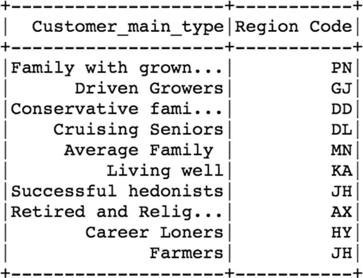

```python
[In]: new_df=df.join(region_data,on='Customer_main_type')
[In]: new_df.groupby("Region Code").count().show()
[Out]:
```
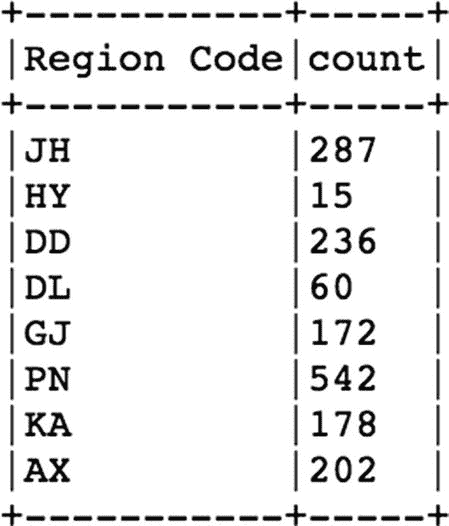

我们在将原始数据框（`df`）与新创建的 `region_data` 数据框在 `Customer_main_type` 列上进行连接后，获取了区域计数。

### 数据透视（Pivoting）

我们可以使用 PySpark 中的 `pivot` 函数来简单地创建数据框针对特定列的透视视图，如下例所示。在这里，我们根据客户类型对数据进行分组。列代表不同的年龄段。透视表中的值是每个客户类型类别在特定年龄段的 `Avg Salary` 之和。我们还通过将所有空值填充为 0 来确保没有空值。在接下来的示例中，我们使用 `label` 列创建了另一个透视表，并将 `Avg Salary` 的总和作为其内部的值。

```
[In]:df.groupBy('Customer_main_type').pivot('Avg_age').sum('Avg_Salary').fillna(0).show()
[Out]:
```

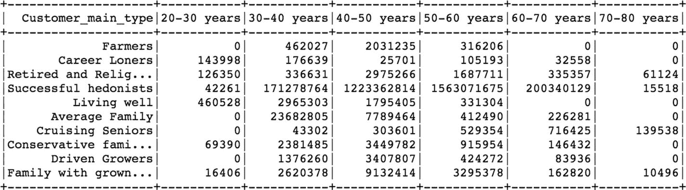

```
[In]:df.groupBy('Customer_main_type').pivot('label').sum('Avg_Salary').fillna(0).show()
[Out]:
```

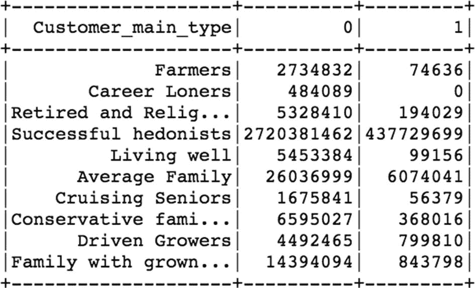

我们根据 `Customer_main_type` 列拆分数据，并使用 `pivot` 函数获取每个 `label` 值（`0,1`）的 `Avg_Salary` 的累积和。

### 窗口函数或窗口聚合

PySpark 中的此功能允许您对称为“窗口内”的记录组执行某些操作。它计算窗口内每一行的结果。使用 `window` 的一个经典示例是用户在不同会话期间的各种聚合。一个访问者可能在某个特定网站上有多个会话，因此可以使用 `window` 来计算用户在每个会话期间的总活动量。PySpark 支持三种类型的 `window` 函数：

*   聚合（Aggregations）

*   排名（Ranking）

*   分析（Analytics）

在下面的示例中，我们导入了 `window` 函数，以及其他函数，例如 `row_number`。下一步是定义窗口。有时它只是一个排序列，有时它可以基于列中的特定类别。我们将看到每种情况的示例。在第一个示例中，我们定义了窗口，它仅基于排序后的 `Avg Salary` 列，并且我们对这些薪水进行排名。我们创建一个新列 `'rank'`，并为每个 `Avg Salary` 值分配排名。

```
[In]: from pyspark.sql.window import Window
[In]: from pyspark.sql.functions import col,row_number
[In]: win = Window.orderBy(df['Avg_Salary'].desc())
[In]: df=df.withColumn('rank', row_number().over(win).alias('rank'))
[In]: df.show()
[Out]:
```

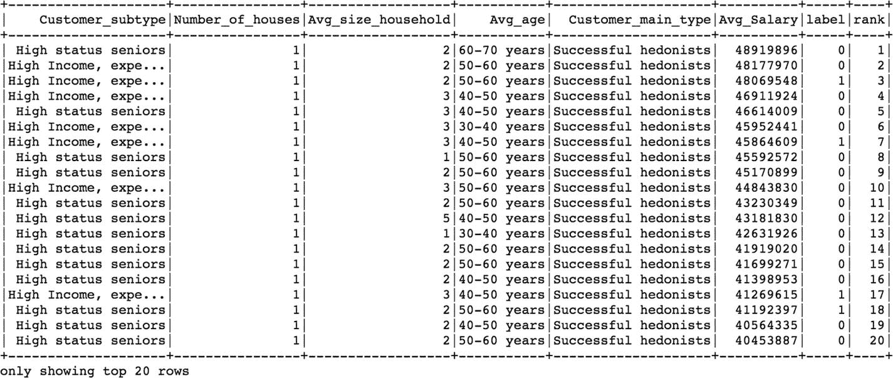

一个常见的需求是从一个类别中找出前三个值。在这种情况下，可以使用 `window` 来获取结果。在下面的示例中，我们定义了窗口，并按 `Customer subtype` 列进行分区。它基本上是对每个 `Customer subtype` 类别的 `Avg Salary` 进行排序，这样我们现在就可以使用 `filter` 来获取每个组的前三个薪水值。

```
[In]:win_1=Window.partitionBy("Customer_subtype").orderBy(df['Avg_Salary'].desc())
[In]: df=df.withColumn('rank', row_number().over(win_1).alias('rank'))
```

现在我们有了一个新列 rank，它包含了 `Customer_subtype` 每个类别的排名，我们可以轻松地过滤出每个类别的前三名。

```
[In]:
df.groupBy('rank').count().orderBy('rank').show()
[Out]:
```

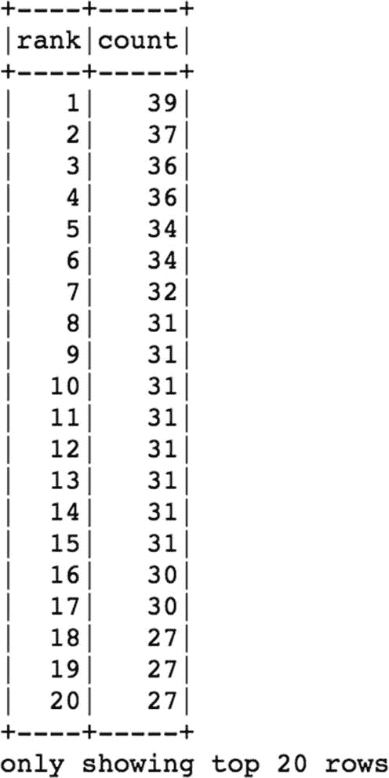

```
[In]: df.filter(col('rank') < 4).show()
[Out]:
```

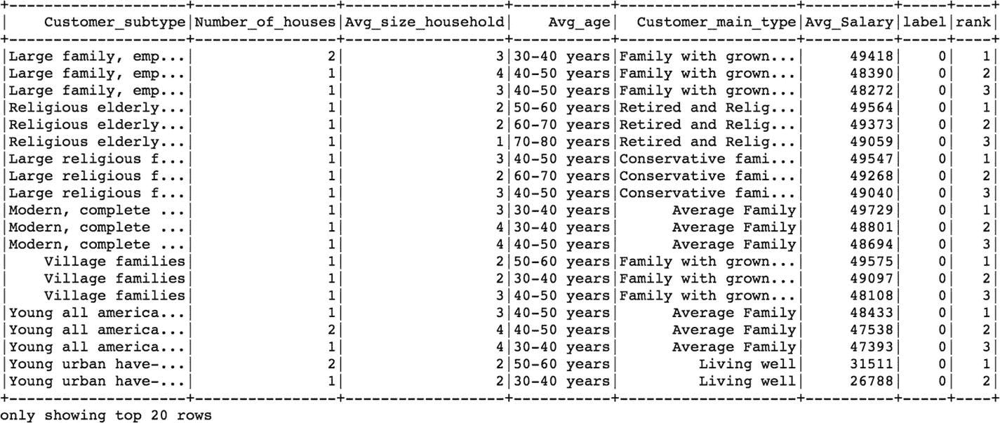

## 结论

在本章中，我讨论了在 PySpark 中读取、清理和预处理数据的不同技术。您了解了连接数据框并从中创建透视表的方法。本章的最后部分涵盖了 PySpark 中的 UDF 和基于窗口的操作。接下来的章节将重点介绍使用 PySpark 处理流数据以及使用 MLlib 进行机器学习。