# 3. Spark Structured Streaming

本章讨论如何使用 Spark 的流式 API 处理实时数据。第一部分重点介绍流式数据与批处理数据的主要区别及其具体应用。第二部分详细阐述 Structured Streaming API 及其相较于之前基于 RDD 的 Spark 流式 API 的多项改进。最后一部分包含对传入数据使用 Structured Streaming 的代码，并讨论如何将输出结果保存在内存中。我们还将探讨 Structured Streaming 的替代方案。

## 批处理 vs. 流处理

或许本书的大多数读者已经熟悉批处理与流式数据处理之间的关键区别。尽管如此，我们仍可以从这一点入手，因为它强调了当今流处理的重要性。如果我们将数据视为浩瀚的海洋，那么批处理数据可以比作一桶水，我们可以拥有多个不同大小的桶；而流式数据则可以视为一根从海洋中持续抽水的水管。

### 批处理数据

顾名思义，*批处理*指的是在一段时间内收集的一组记录，随后用于处理和分析。由于这些记录是在一段时间内收集的，从规模上看，批处理数据通常比流式数据更大（但在某些情况下，流式数据也可能大于批处理数据），并且常用于进行事后分析，以满足各种分析目的。传统系统、SQL 数据库和大型机都属于批处理数据的范畴。与流式数据的关键区别在于，批处理数据不会在成为早期批处理数据集的一部分后立即被处理。

### 流处理

流处理指的是实时或近实时地处理记录。人们无需等到一天结束才去处理或分析数据。相反，数据集中的记录一旦可用，就会逐个进行处理，或者基于一个窗口期进行处理，如图 3-1 所示。因此，这创建了一种无限表，随着数据从流中流入，记录被持续添加。

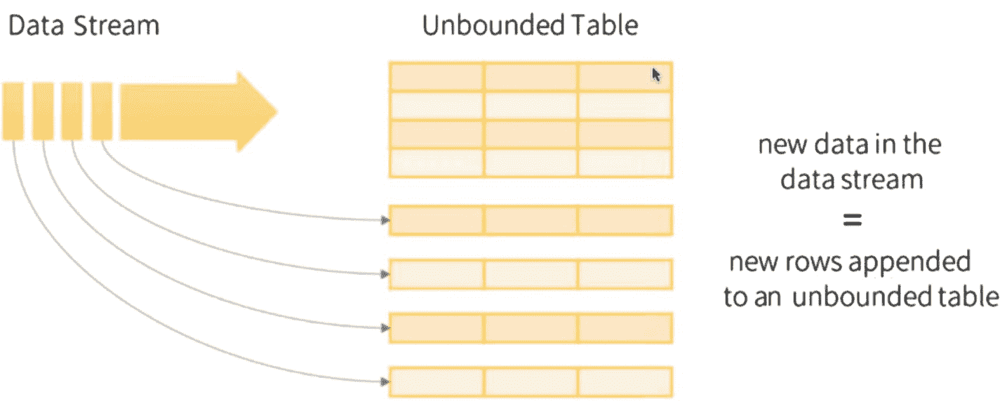

图 3-1 流式数据

如今，企业为了保持竞争优势，非常积极地使用来自各种来源（如平台、设备、应用程序和系统日志）的实时数据。因此，流处理已成为整个流程中的关键部分。企业希望利用最新或最新的数据来生成有助于决策的有用见解。批处理无法提供即时分析，因为它不基于实时工作，而流式数据处理在欺诈检测等情况下可以更有效地提供帮助。

### Spark Streaming

在上一章中，你已经了解了 Spark 的核心架构。Spark 框架的组件之一是 `Spark Streaming`（Structured Streaming），如图 3-2 所示。

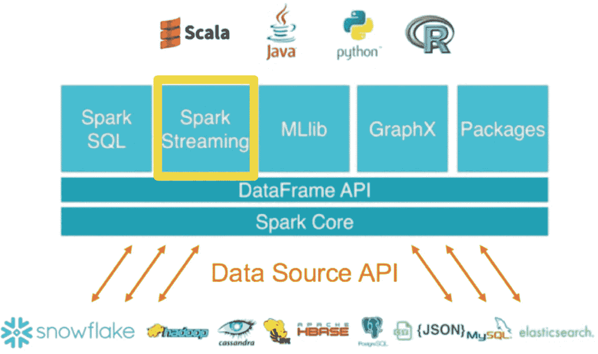

图 3-2 Spark Streaming

早期版本的 Spark 提供了一个称为 `Spark Streaming` (`Dstream`) 的流式 API。`Spark Streaming` 基于 `RDD`（`DataFrame`/数据集之前的早期 Spark 抽象）构建，并且有一些局限性。如图 3-3 所示，它能够从各种来源（如 Kafka、Flume 等）接收输入数据，将传入的数据转换为微批次，并使用 Spark 引擎进行处理。

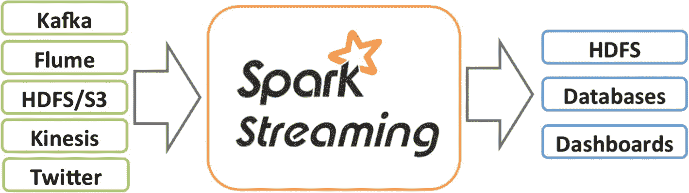

图 3-3 Spark Streaming 数据流

每个批次的结果将作为仅流式数据生成，并保存到输出位置。每个微批次都是一个 `RDD`，基于特定的时间间隔，如图 3-4 所示。

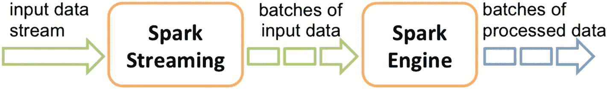

图 3-4 Spark Streaming 批处理

尽管早期的 Spark 流式组件在处理流式数据方面相当强大，但在某些方面仍存在不足。

1. 一个核心缺点是批处理和流式数据处理作业使用了不同的 API。将批处理作业转换为 `Dstream` 作业需要进行大量更改（转换）。

2. 它无法基于事件时间处理批处理数据，只能基于批处理时间。处理延迟到达的数据很困难。

3. 其容错能力有限，无法提供端到端的一致数据处理保证。

## Structured Streaming

Spark 中流式组件的最新版本称为 `Structured Streaming`，它是对之前基于 `RDD` 的 Spark 流式 API 的巨大改进。与之前版本相比，第一个重大变化是 `Structured Streaming` 为批处理和流式数据处理作业提供了相同的 API。因此，它处理静态、有界的批处理数据的方式与处理流式、无界数据的方式类似，如图 3-5 所示。

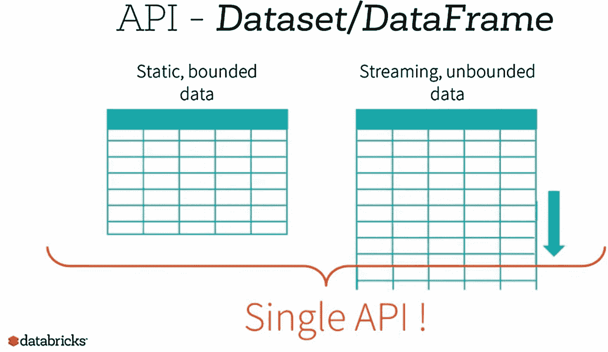

图 3-5 静态 `DataFrame` 与流式 `DataFrame`

与早期版本相比的另一个重大转变是，`Structured Streaming` 现在构建在 Spark SQL 引擎之上，并使用 `DataFrame` 进行多种操作，例如聚合、过滤等。它还在将结果写入输出位置时提供端到端的数据一致性保证。为了理解 `Structured Streaming` 的工作原理，让我们了解一下数据如何流经其编程模型，如图 3-6 所示。

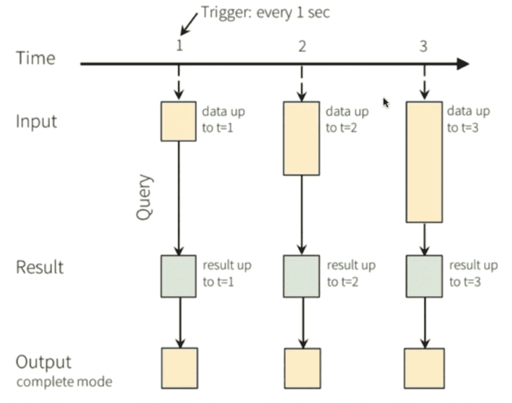

图 3-6 `Structured Streaming` 处理流程

当数据在时间间隔 1（基于所选的窗口期）到达时，输入 `DataFrame` 包含截至该时间间隔 (t=1) 的所有记录。下一步是对该特定 `DataFrame` (t=1) 执行查询（处理、转换、连接、聚合）。查询完成后，结果可用，并保存到相关的输出（控制台、内存、位置）。现在，新数据在时间间隔 2 到达，并被添加到之前的 `DataFrame` (t=1) 中，从而形成一个更大的 `DataFrame` (t=2)。再次执行查询，但这次是在新的 `DataFrame` (t=2) 上，并将结果保存到选定的输出模式。此过程对传入的记录流持续进行，每条记录都被追加到输入 `DataFrame` 中以供数据处理。

既然我们了解了使用 `Structured Streaming` 进行数据处理的基本过程，我们可以考虑基于流式处理的应用的核心组成部分。我们可以将这个流式框架分为三个主要领域：

1. 数据输入

2. 数据处理（实时或近实时）

3. 最终输出

### 数据输入

任何流式应用程序都需要数据，以便能够持续地摄取和处理数据。因此，有多种方式可以为 `Structured Streaming` 平台提供数据输入。

- **消息系统**：`Apache Kafka`、`Flume` 和 `Logstash` 可用于摄取实时数据，因此可以轻松成为构建流式管道的一部分。使用这些工具的思路是，在源应用程序（Web 应用、移动应用、物联网设备）生成数据时捕获所有数据点，并将其传递给 `Structured Streaming` 平台，以便以容错和可扩展的方式进行进一步处理和分析。

- **文件文件夹/目录**：文件作为数据流从目录中持续读取。可以使用调度程序将新文件放入该目录。文件可以是文本、`Parquet` 或 `JSON` 格式。唯一的条件是所有文件必须采用相同的格式。

### 数据处理

这是利用流式数据创造商业价值的核心，因为它可以对传入的数据应用某些操作来获得结果。可以应用诸如聚合、过滤、连接、排序等操作。

### 最终输出

`Structured Streaming` 为用户提供了多种选项，以便根据需要保存输出结果，结果可以是 `Append` 或 `Complete` 模式。`Append` 模式指仅将新结果添加到最终输出表中，而 `Complete` 模式则在最终输出位置更新整个结果表。

1. 文件目录接收器

2. 控制台

3. 内存接收器

## 构建一个结构化应用程序

在本章的最后一节中，我们将构建一个 `Structured Streaming` 应用程序，该应用程序可以从本地系统文件夹读取文件（当新文件作为流数据添加到文件夹时），对新数据应用所有操作，最后将结果写入输出目录。第一步是创建 `SparkSession` 对象，以便使用 Spark。

```python
from pyspark.sql import SparkSession
spark=SparkSession.builder.appName('structured_streaming').getOrCreate()
import pyspark.sql.functions as F
from pyspark.sql.types import *
```

然后，我们创建一些自生成数据，这些数据可以被推送到相应的本地目录（`"csv_folder"`），以供 Structured Streaming 读取。我们将生成的数据包含四列，格式为 CSV。如果需要，我们也可以生成 Parquet 格式。

1.  用户 ID

2.  应用程序

3.  花费时间（秒）

4.  年龄

```
[In]: df_1=spark.createDataFrame([("XN203",'FB',300,30),("XN201",'Twitter',10,19),("XN202",'Insta',500,45)],["user_id","app","time_in_secs","age"]).write.csv("csv_folder",mode='append')
```

创建这些数据框后，我们可以定义这些文件的模式，以便使用流处理读取它们。

```
[In]: schema=StructType().add("user_id","string").add("app","string").add("time_in_secs", "integer").add("age", "integer")
```

现在，本地文件夹（`"csv_folder"`）中已有一个文件，我们可以继续将其作为流数据框读取。读取静态数据框的 API 与读取流数据框的 API 类似，唯一的区别是我们使用 `readStream`。

```
[In]: data=spark.readStream.option("sep", ",").schema(schema).csv("csv_folder")
```

为了验证数据框的模式，我们可以使用 `printSchema` 命令。

```
[In]: data.printSchema()
[Out]:
```

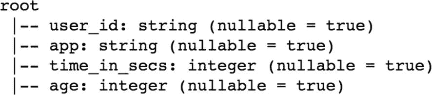

### 操作

一旦我们有了流数据框，就可以应用多种转换，以便根据特定需求获得不同的结果。在本例中，我们将看到聚合、排序、过滤等操作。首先，简单地统计数据框中每个应用程序的记录数。我们可以像在静态数据框上应用转换一样编写命令。

```
[In]: app_count=data.groupBy('app').count()
```

为了查看结果，除了指定目标位置外，我们还必须指定输出模式。在本例中，我们将结果写入内存，但也可以写入控制台、特定云存储或任何其他位置。我们还指定输出模式为 `complete`，以便每次都将结果写入整个数据框。最后，我们使用一个简单的 Spark SQL 命令，通过将流数据框上的查询结果转换为 Pandas 数据框来查看输出。

```
[In]: query=(app_count.writeStream.queryName('count_query').outputMode('complete').format('memory').start())
[In]: spark.sql("select * from count_query ").toPandas().head(5)
[Out]:
```

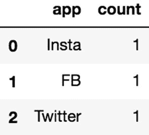

在本例中，编写了一个查询来仅过滤 Facebook（FB）应用程序的记录。然后计算每个用户在 FB 应用程序上花费的平均时间。

```
[In]: fb_data=data.filter(data['app']=='FB')
[In]: fb_avg_time=fb_data.groupBy('user_id').agg(F.avg("time_in_secs"))
[In]: fb_query=(fb_avg_time.writeStream.queryName('fb_query').outputMode('complete').format('memory').start())
[In]: spark.sql("select * from fb_query ").toPandas().head(5)
[Out]:
```

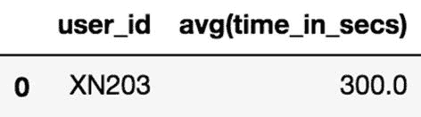

由于本地文件夹中当前只有一个数据框，我们得到了一个用户访问 FB 以及花费时间的输出。为了查看更多相关结果，让我们向文件夹中推送更多自生成数据。

```
[In]: df_2=spark.createDataFrame([("XN203",'FB',100,30),("XN201",'FB',10,19),("XN202",'FB',2000,45)],["user_id","app","time_in_secs","age"]).write.csv("csv_folder",mode='append')
```

现在我们可以有把握地假设，Spark Structured Streaming 已经读取了新记录并将其追加到流数据框中，因此，相同查询的新结果将与上次不同。

```
[In]: spark.sql("select * from fb_query ").toPandas().head(5)
[Out]:
```

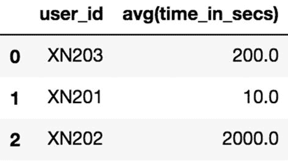

现在，我们得到了所有用户使用 FB 应用程序的平均时间。让我们再向文件夹中添加一些记录。

```
[In]: df_3=spark.createDataFrame([("XN203",'FB',500,30),("XN201",'Insta',30,19),("XN202",'Twitter',100,45)],["user_id","app","time_in_secs","age"]).write.csv("csv_folder",mode='append')
[In]: spark.sql("select * from fb_query ").toPandas().head(5)
[Out]:
```

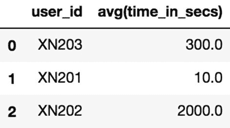

在本例中，我们看到了对本地文件夹中现有数据框的查询进行聚合和排序。我们按应用程序对所有记录进行分组，并计算每个应用程序的总花费时间，按降序排列。

```
[In]: app_df=data.groupBy('app').agg(F.sum('time_in_secs').alias('total_time')).orderBy('total_time',ascending=False)
[In]: app_query=(app_df.writeStream.queryName('app_wise_query').outputMode('complete').format('memory').start())
[In]: spark.sql("select * from app_wise_query ").toPandas().head(5)
[Out]:
```

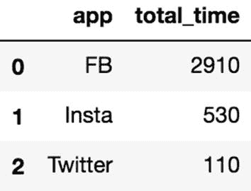

现在，我们使用流数据框得到了每个应用程序以及所有用户在该应用程序上花费的总时间的结果。让我们再添加一次新记录，并查看相同查询的修订结果。

```python
[In]: df_4 = spark.createDataFrame([("XN203",'FB',500,30),("XN201",'Insta',30,19),("XN202",'Twitter',100,45)], ["user_id","app","time_in_secs","age"]).write.csv("csv_folder", mode='append')
[In]: spark.sql("select * from app_wise_query ").toPandas().head(5)
[Out]:
```


在此示例中，我们尝试找出数据中每个应用程序的用户平均年龄。我们只需按 `app` 对数据进行分组，计算所有用户的平均年龄，并按降序对结果进行排序。

```python
[In]: age_df = data.groupBy('app').agg(F.avg('age').alias('mean_age')).orderBy('mean_age', ascending=False)
[In]: age_query = (age_df.writeStream.queryName('age_query').outputMode('complete').format('memory').start())
[In]: df_5 = spark.createDataFrame([("XN210",'FB',500,50),("XN255",'Insta',30,23),("XN222",'Twitter',100,30)], ["user_id","app","time_in_secs","age"]).write.csv("csv_folder", mode='append')
[In]: spark.sql("select * from age_query ").toPandas().head(5)
[Out]:
```

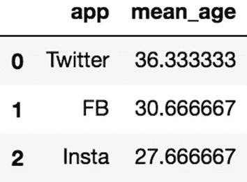

因此，在前面的示例中，我们了解了如何使用 Spark Structured Streaming 读取传入数据并创建流式数据帧，以应用各种转换并将结果写入特定位置。流式数据的另一个常见需求是连接。

### 连接

有时，我们需要将传入数据与批处理数据合并，以使其更全面。在下面的示例中，我们将了解如何将传入数据（流数据帧）与包含应用程序全名的静态数据帧合并。让我们创建一个包含两列（`app` 和 `full_name`）的新静态数据帧。

```python
[In]: app_df = spark.createDataFrame([('FB','FACEBOOK'),('Insta','INSTAGRAM'),('Twitter','TWITTER')], ["app", "full_name"])
[In]: app_df.show()
[Out]:
```

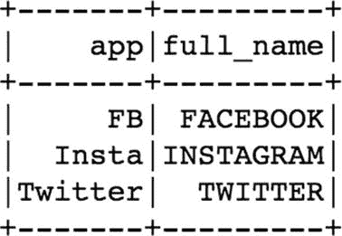

现在我们有了一个可用的静态数据帧，我们可以简单地编写一个新查询，将我们一直在处理的流式数据帧（`data`）与它进行连接，并将两者在 `app` 列上合并。

```python
[In]: app_stream_df = data.join(app_df, 'app')
[In]: join_query = (app_stream_df.writeStream.queryName('join_query').outputMode('append').format('memory').start())
[In]: spark.sql("select * from join_query ").toPandas().head(50)
[Out]:
```

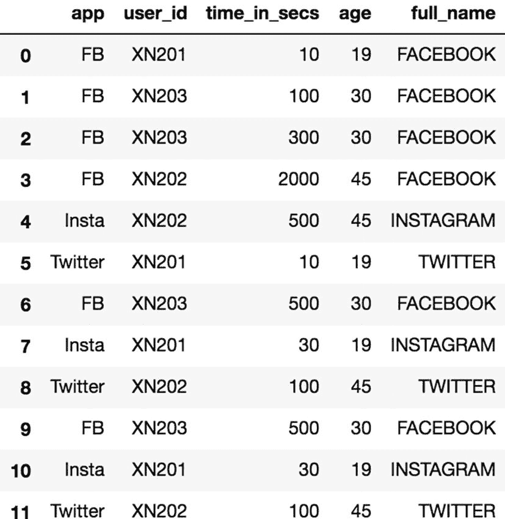

如您所见，现在流式数据帧中也多了额外的列（`full_name`）。

## Structured Streaming 的替代方案

自 2016 年 Spark Structured Streaming 问世以来，它迅速获得了开发者社区的关注。然而，话虽如此，Spark 的 Structured Streaming 还有其他几个强大的替代方案。其中之一是 Flink，它在流式数据处理方面提供了类似的能力，并且具有出色的延迟率。另一个替代方案是 Google 的 Beam，它适用于有限的情况。

Spark 的 Structured Streaming 相对于替代方案的核心优势在于 Spark 作为一个整体提供的完整框架，包括批处理（批处理或流式处理的代码没有重大差异）和机器学习库。Structured Streaming 的另一个巨大优势是其 Spark SQL API，这对许多用户来说非常舒适。希望新版本的 Spark 能为 Structured Streaming 包含更多功能，例如流式连接。选择取决于应用程序的具体需求，并找到最佳的可能替代方案，使其具有可扩展性、容错性和健壮性。

## 结论

本章明确了批处理和流式数据之间的基本区别。然后讨论了 Spark 的流式 API 在过去几年中如何演变为构建流式数据应用程序的默认框架。最后提供了如何使用 Spark 的 Structured Streaming API 读取流式数据（本地文件夹）以及如何保存聚合结果的示例。