# 4. Airflow

本章重点介绍 Airflow 以及如何使用它来处理复杂的数据工作流。Airflow 由 Airbnb 工程师内部开发，旨在高效管理内部工作流。Airflow 后来于 2016 年成为 Apache 的一部分，并以开源形式提供给用户。基本上，Airflow 是一个用于执行、调度、分发和监控各种作业的框架，这些作业中可以包含多个相互依赖或独立的任务。每个使用 Airflow 运行的作业都必须通过一个有向无环图（DAG）定义文件来定义，该文件包含您想要运行的集合，并按关系和依赖关系进行分组。

本章主要关注三个主题。我将首先探讨工作流，然后介绍 Airflow 的基本构建块：DAG。接着，您将了解 Airflow 的用户界面方面。在最后一节中，我将介绍为作业定义 DAG 的代码，以及如何使用 Airflow 来执行和监控它。

## 工作流

我们周围看到的大多数事物都遵循一个流程。火车按设定的时间间隔运行，飞机按固定时间飞行，道路上的信号灯按固定周期变化。如果需要一致性，流程至关重要，尤其是在不同任务之间存在依赖关系时。在软件或技术领域，在构建或执行项目时也遵循一套流程。如果我们深入几个层次，我们可以将这些流程称为工作流。为了达到期望的结果，必须设计和执行适当的工作流。很少有开发人员或工程师在构建解决方案或应用程序时不遵循标准流程。例如，在数据处理工作流的典型场景中，开发人员会在执行任务之前定义步骤，如图 4-1 所示。这些步骤通常被称为管道，由必须完成的系列任务组成。

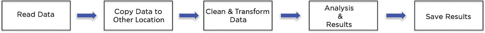
*图 4-1 示例工作流*

第一个任务是从源文件读取数据，然后将其复制到您的平台或所需位置。数据可用后，您将其摄取，并通过多个步骤进行清洗和转换。然后执行分析并计算结果。最后，将输出保存到所需位置。传统上，这些步骤的执行方式是借助 cron 作业（由 cron 守护进程按计划时间间隔运行的命令）。因此，所有任务都是作为 cron 作业运行的脚本的一部分。尽管它满足了按特定顺序执行事物的目的，但仍然面临许多实际挑战。最常见的是脚本执行中断。没有明确的方法来重新尝试运行脚本。另一个挑战是监控正在运行的作业的状态。在执行过程中，很难确定每个阶段及其耗时。还有其他挑战，例如通过集中式调度器运行多个 cron 作业，以处理更大、更复杂的管道，并适应工作流中的持续变化。由于上述所有困难，Airflow 应运而生，成为一个用于调度和监控此类作业、平稳运行管道以获得一致输出的框架。要真正理解 Airflow 和 DAG 如何运作，您首先需要理解图的一般概念。

## 图概述

典型的图数据结构由两个实体组成，如图 4-2 所示。

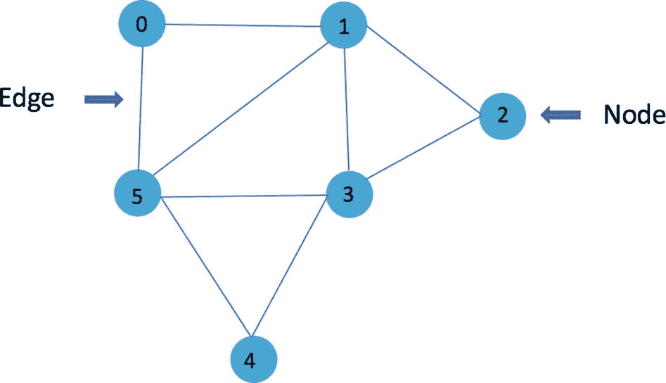
*图 4-2 图的结构*

1. 边
2. 节点/顶点

边本质上是节点/顶点之间的连接，而节点则是实际数据所在的位置。我们可以将基于图的网络分为两大类：

1. 无向图
2. 有向图

### 无向图

在这种图结构中，边或连接没有方向，如图 4-2 所示。关系在两端都存在。例如，如果节点 1 中的第一个人是节点 2 中第二个人的朋友，那么第二个人也是第一个人的朋友。

### 有向图

有向图可以是循环图或无环图。边的方向起着重要作用，因为图中的所有边都只朝一个方向，如图 4-3 所示。

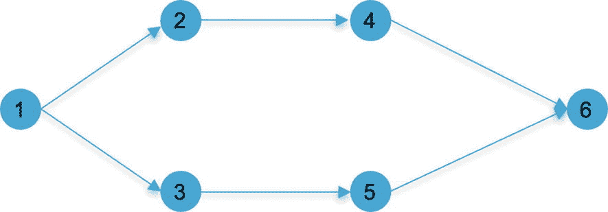
*图 4-3 有向图*

循环图包含一个或多个环。环是一条起始和结束于同一节点的路径，如图 4-4 所示。信息从节点 1 流向节点 2，但存在另一条从节点 2 返回节点 1 的路径。这被称为环图或循环图。

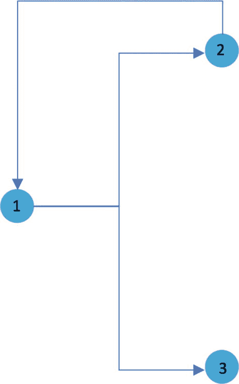
*图 4-4 循环图*

DAG（有向无环图）中没有环，因此其优势包括：

*   动态框架（配置即代码）
*   可扩展性——支持不同类型的任务执行。
*   可伸缩性——可以执行无限数量的任务（工作节点）。

现在让我们将注意力转向 DAG。

## DAG 概述

由于 DAG 是一种有向图，信息只能朝一个方向流动，即向前，如图 4-5 所示。因此，如果要到达节点 4，路径是 1 ➤ 2 ➤ 4。在 DAG 中，没有返回起始节点的反向路径。

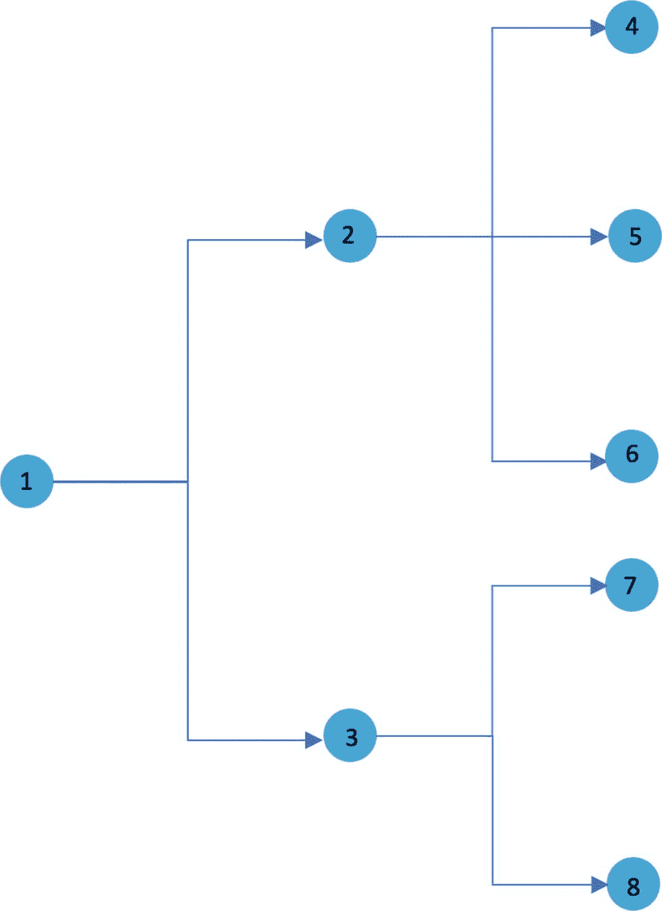
*图 4-5 DAG 中的信息流*

Airflow 中所有作业的任务都必须在 DAG 中定义。因此，执行顺序以 DAG 形式定义。例如，如果要执行任务 8，则必须先完成任务 1 和任务 3；而要完成任务 7，除了任务 3 之外，不需要依赖其他任务。因此，一些独立的任务（2、3）可以彼此状态无关地执行，如图 4-5 所示。任务的执行顺序和相互依赖关系可以在使用 Airflow 执行之前很好地定义。

所有与 DAG 相关的配置都在 DAG 定义文件中定义，该文件是一个 Python 扩展文件。它包含所有依赖关系和配置参数，例如失败时发送的电子邮件、开始时间、结束时间和重试次数。除了任务的依赖关系或顺序之外，我们还必须定义 DAG 中包含的所有任务。

### 运算符

如前所述，一个 DAG 可以包含多个任务。这些任务可能完全不同。其中一个任务可以是简单的 Python 脚本；另一个可以是 Shell 脚本或 SQL 查询；另一个可以是基于云的 Spark 作业。这些任务使用运算符在 DAG 定义文件中定义。Airflow 为不同类型的任务提供了一系列运算符。最常见的有以下几种：

1.  Python 运算符（Python 脚本）
2.  Bash 运算符（Shell 脚本）
3.  SQL 运算符
4.  Docker 运算符
5.  云运算符（S3、Azure、Google）

与其他调度器相比，Airflow 能够运行任何类型任务的这种灵活性使其非常强大。

DAG 文件本质上是一个 Python 脚本，其中包含运行 DAG 所需的所有配置参数。创建 DAG 需要遵循几个标准步骤，如下所示：

1.  导入所需模块
2.  声明默认参数
3.  实例化 DAG 对象
4.  定义所有任务
5.  声明执行顺序/任务依赖关系

在某些方面，Airflow 相较于替代方案表现突出，例如更智能地处理上游和下游依赖关系，以及运行历史数据加载的能力。它还能以完全透明的方式处理故障和阻塞。

## 安装 Airflow

使用 Airflow 有多种方式，因为它被设计为易于与不同环境集成。如果我们想在本地使用 Airflow，可以在本地安装和配置 Airflow 环境。另一种选择是利用 Docker 将 Airflow 应用程序容器化，并在任何平台上运行，与环境无关。使用 Docker 的核心优势在于，它自身承担了管理依赖关系和部署的额外负担。

### 使用 Docker 运行 Airflow

运行 Airflow 的一种方法是创建自己的 Docker 镜像，包含所有依赖关系和组件，但 Docker Hub 上已经提供了一个非常易于运行的 Airflow Docker 镜像。运行 Airflow 的步骤如下：

```bash
[In]: docker pull puckel/docker-airflow
[In]: docker run -d -p 8080:8080 puckel/docker-airflow webserver
```

在终端中运行上述命令后，您可以通过访问 `http://127.0.0.1:8080` 来访问 8080 端口，如图 4-6 所示。

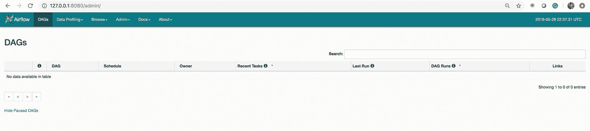
*图 4-6 Airflow 用户界面*

这就是 Airflow UI 的外观。它当前不包含任何 DAG，是一个原始版本。如果您想查看 Airflow 默认附带的示例 DAG，只需在运行 Docker 时添加一个额外的参数。要查看哪些容器正在运行，我们可以使用以下代码：

```bash
[In]: docker ps
```

列出所有容器后，您可以使用以下命令停止/终止之前运行 Airflow 的容器：

```bash
[In]: docker kill <container_id>
```

现在我们运行以下命令，并添加 `LOAD_EX=y` 作为额外参数，如下所示：

```bash
[In]: docker run -d -p 8080:8080 -e LOAD_EX=y puckel/docker-airflow webserver
```

## Airflow 设置（Mac）

第一步是确保机器上安装了 Python，我们可以使用 `brew install` 命令来安装 `python3`。安装 Python 后，我们就可以安装 Airflow。它需要一个主目录。`~/airflow` 是默认目录，但也可以根据偏好选择其他位置。

```
[In]: brew install python python3
[In]: pip install airflow
[In]: mkdir ~/airflow
[In]: export AIRFLOW_HOME=~/airflow
[In]: cd ~/airflow
[In]: airflow initdb
[In]: airflow webserver -p 8080
```

最后两步是使用 `initdb` 初始化 Airflow，并在首选端口上访问 UI。

如果我们现在访问 Airflow UI，会看到所有默认 DAG 的列表，如图 4-7 所示。

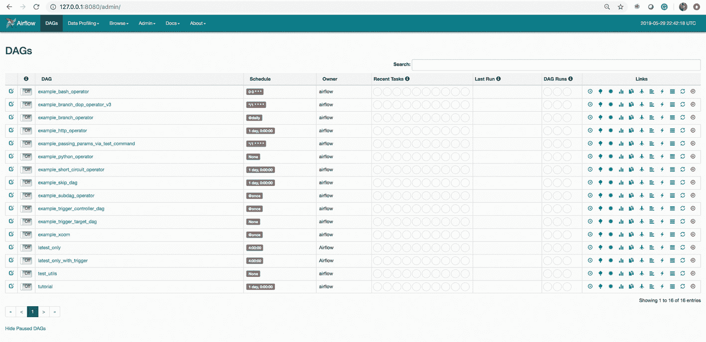

# 创建你的第一个 DAG

如本章前面部分所述，DAG 由按特定顺序排列的多个任务组成，如图 4-8 所示。

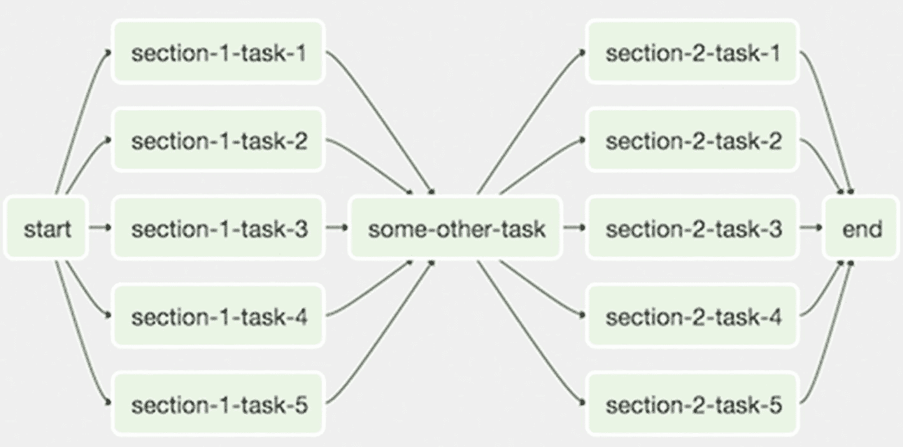

为了创建 DAG，你必须定义一个 DAG 文件，该文件包含与 DAG 任务相关的所有细节，并且依赖关系必须在一个文件（Python 脚本）中定义。这是一个配置文件，将 DAG 的结构指定为代码。运行 DAG 必须执行的五个步骤如图 4-9 所示。

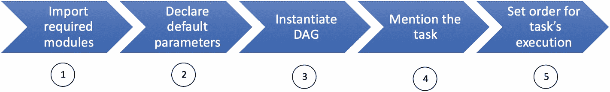

让我们详细了解每个步骤，以便更好地理解内部机制。

### 步骤 1：导入所需库

第一步是导入运行 Airflow 所需的所有库。一些常见的库包括 `datetime`、不同的运算符（`Bash`/`Python`）以及 Airflow 本身。

```
[In]: from datetime import timedelta
[In]: import airflow
[In]: from airflow import DAG
[In]: from airflow.operators.bash_operator import BashOperator
```

### 步骤 2：定义默认参数

下一步是定义一些重要参数，以确保 Airflow 在指定的时间间隔并以适当的次数执行 DAG。

```
[In]: args = {
    'owner': 'Pramod',
    'start_date': airflow.utils.dates.days_ago(3),
    'end_date': datetime(2018, 12, 30),
    'depends_on_past': False,
    'email': ['airflow@example.com'],
    'email_on_failure': False,
    'email_on_retry': False,
    'retries': 1,
    'retry_delay': timedelta(minutes=5),
}
```

### 步骤 3：创建 DAG

第三步是创建 DAG 本身，其中包括 DAG 的名称和调度间隔，如下所示。你可以根据需求决定何时运行作业。

```
[In]: dag = DAG(
    'pramod_airflow_dag',
    default_args=args,
    description='A simple DAG',
    # Continue to run DAG once per day
    schedule_interval=timedelta(days=1)
)
```

### 步骤 4：声明任务

下一步是声明要执行的任务（实际作业）。所有任务都可以声明，并成为上一步创建的同一 DAG 的一部分。

```
[In]: t1 = BashOperator(
    task_id='print_date',
    bash_command='date',
    dag=dag,
)
t2 = BashOperator(
    task_id='sleep',
    depends_on_past=False,
    bash_command='sleep 5',
    dag=dag,
)
```

### 步骤 5：指定依赖关系

最后一步是设置任务执行的顺序。它们可以是并行任务，也可以是顺序任务。有多种方式可以定义任务。

```
[In]: t1 >> t2
```

一旦完成上述所有步骤，我们就可以启动 Airflow 并访问 Web UI。图 4-10 所示的界面中包含了刚刚创建的 DAG 文件。

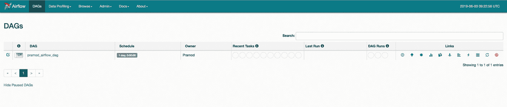

目前，它处于关闭状态，我们可以手动触发它，或者通过命令行界面（CLI）触发。如果我们点击 DAG 本身，它会带我们进入 DAG 的默认树状视图，其中列出了 DAG 内的所有任务，如图 4-11 所示。

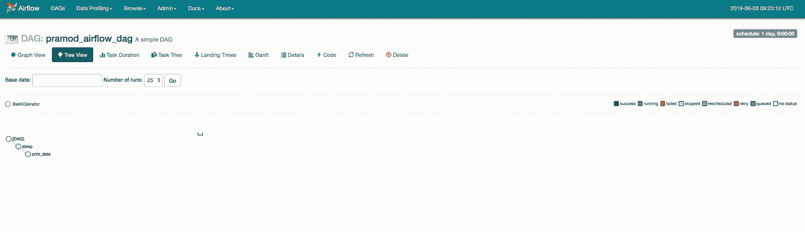

现在打开 DAG 开关，以启动任务，如图 4-12 所示。

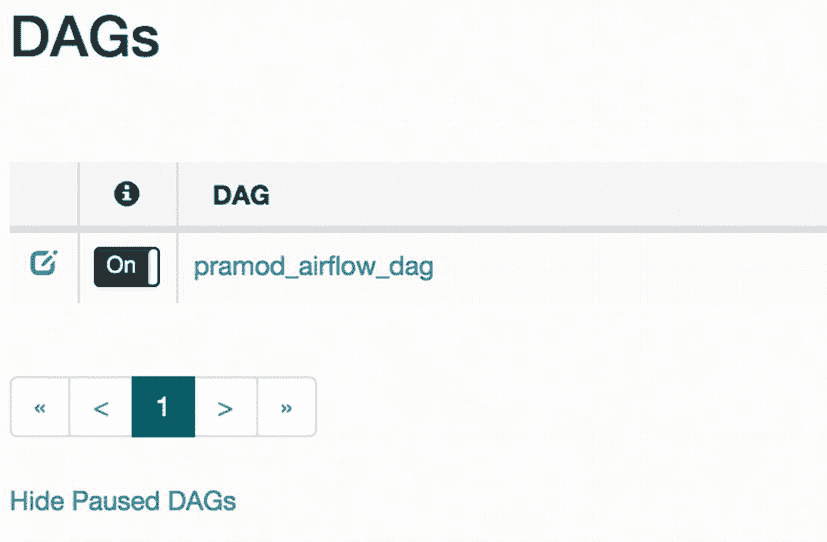

然后点击“触发 DAG”图标并开始执行，如图 4-13 所示。

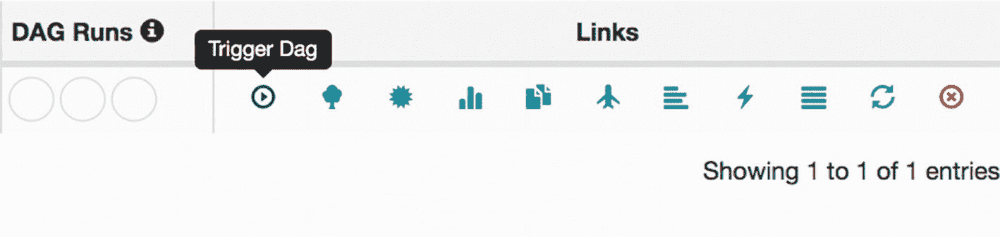

一旦 DAG 被触发，我们可以在“最近任务”选项卡下看到变化，并且 DAG 开始运行，如图 4-14 所示。

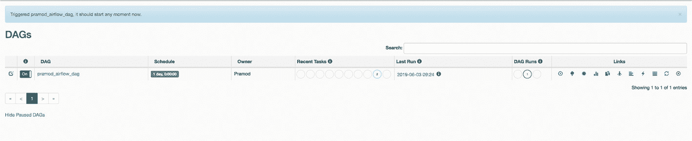

一旦 DAG 开始运行，我们可以通过不同方式查看它，第一种形式是树状视图，如图 4-15 所示。

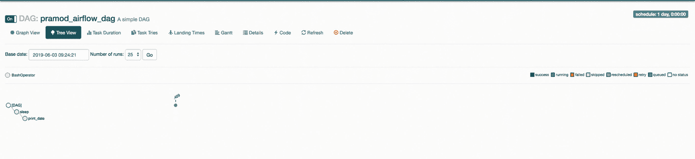

另一种视图是图形视图，它以略微不同的方式显示任务执行顺序，并且任务的颜色指示其进度（成功/运行中/失败等），如图 4-16 所示。

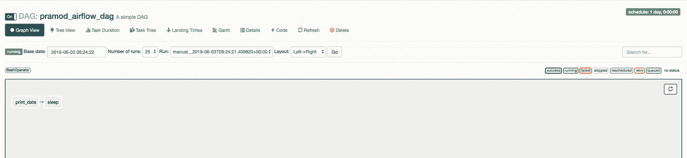

我们还可以通过进入 DAG 详细信息选项卡，深入查看 DAG 的其他细节，如图 4-17 所示。

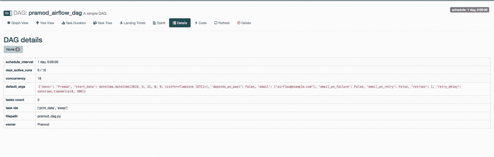

最后，在“代码”选项卡下，我们可以查看最初在运行 DAG 之前创建的 DAG Python 脚本，如图 4-18 所示。

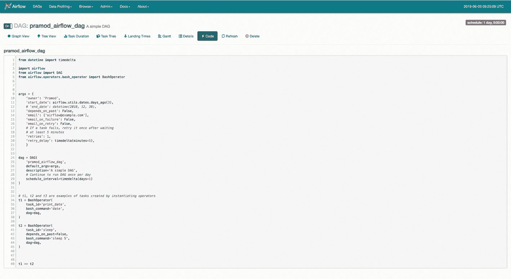

如果我们稍等片刻并重新检查图形视图，我们会观察到两个任务都已成功完成，如图 4-19 所示。从树状视图选项卡中，我们可以看到所有三天的任务（过去两天和今天）都已完成，如图 4-20 所示。

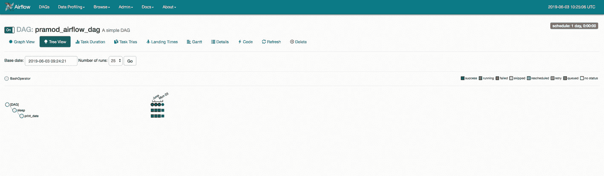

图 4-20 树状视图

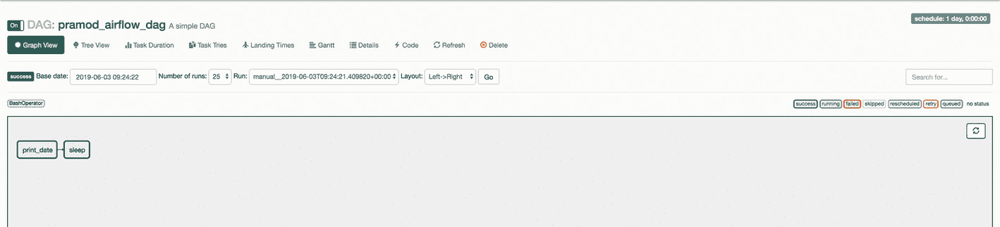

图 4-19 图形视图

## 结论

在本章中，你学习了如何定义 DAG 并使用 Airflow 运行不同的作业。还涵盖了实施 Airflow 和监控不同任务状态的步骤。除了界面中的不同组件外，你还了解了 Airflow 的 Web UI。