# MLlib：机器学习库

根据你的需求，有多种方法可以使用预先存在的库（例如 Python 的 `scikit-learn`、`R` 和 `TensorFlow`）来构建机器学习模型。然而，Spark 的机器学习库（`MLlib`）真正有用的地方在于它能够大规模训练模型并提供分布式训练。这使得用户能够在庞大的数据集上快速构建模型，此外还能使用 Spark 框架本身进行预处理和准备工作流。

本章重点介绍如何利用 `MLlib` 来构建和应用各种机器学习模型。第一部分重点介绍使用 `MLlib` 进行基本统计，接着是构建管道以创建特征和其他转换。本章的最后部分讨论使用 `MLlib` 构建机器学习分类模型。

让我们首先回顾如何使用 Spark 的 `MLlib` 来计算一些用于数据分析的基本统计度量。你将看到如何计算两个数值变量之间的相关性，以及如何使用卡方检验来确定两个分类变量之间是否存在显著关系。


## 计算相关性

相关性是一个重要指标，用于判断两个连续变量之间是否存在某种关系。相关性可以是正相关或负相关，如图 5-1 所示。两个变量之间也可能不存在相关性。

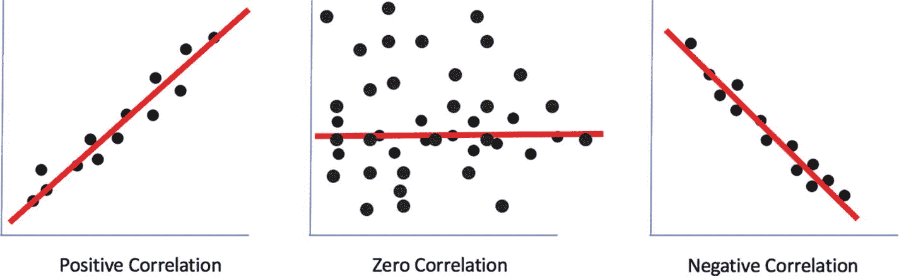

图 5-1

相关类型

使用 Spark MLlib 计算相关性非常简单。它提供了计算两种相关系数的选项：

1. 皮尔逊相关系数
2. 斯皮尔曼相关系数

让我们使用 Spark 创建一个示例数据框来计算相关系数。该数据集仅包含两个数值列（`Years Experience` 和 `Salary`）。第一步是创建 Spark 上下文，以便使用 Spark。

```
[In]: from pyspark.sql import SparkSession
[In]: spark=SparkSession.builder.appName('basic_stats').getOrCreate()
[In]: df=spark.read.csv('corr_data.csv',header=True,inferSchema=True)
[In]: df.count()
[Out]: 30
[In]: df.show()
[Out]:
```

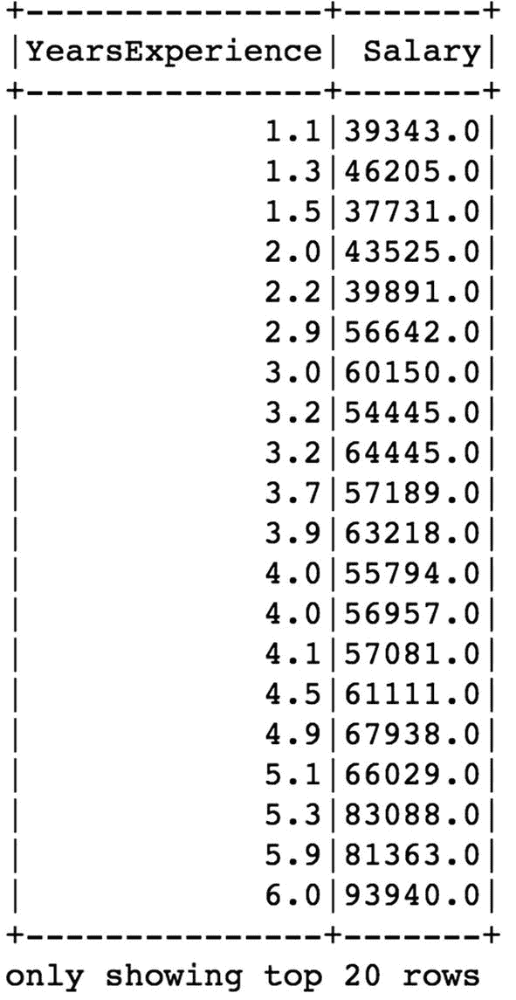

如您所见，该数据框中只有 30 条记录。接下来，我们使用 `VectorAssembler` 将这两列合并成一个密集向量表示，以便计算相关系数。我们将这个新的密集向量命名为 `"features"`。

```
[In]: from pyspark.ml.feature import VectorAssembler
[In]: assembler = VectorAssembler(inputCols=df.columns, outputCol="features")
[In]: df_new=assembler.transform(df)
[In]: df_new.show()
[Out]:
```

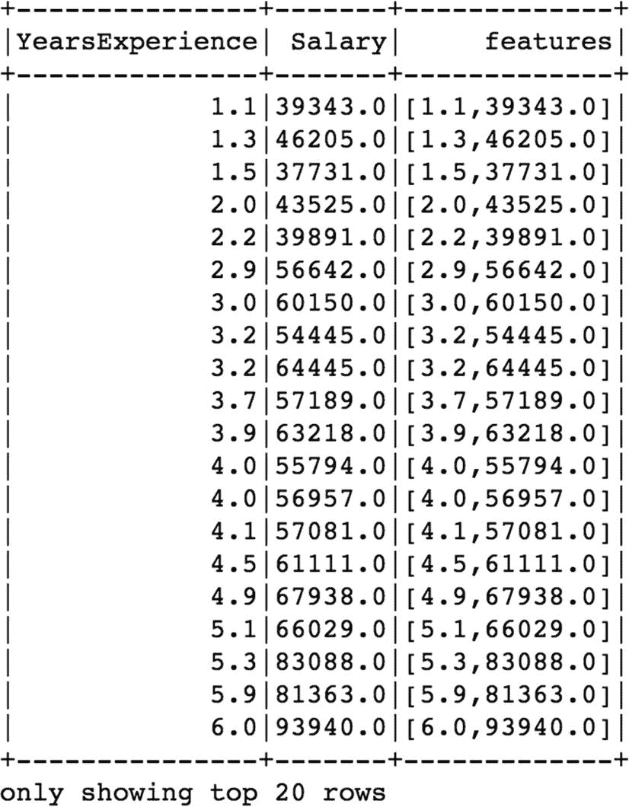

```
皮尔逊相关系数
[In]: from pyspark.ml.stat import Correlation
[In]: pearson_corr = Correlation.corr(df_new,'features')
[in]: pearson_corr.show(2,False)
[Out]:
```

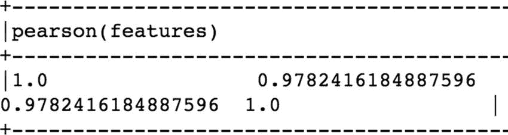

```
斯皮尔曼相关系数
[In]: spearman_corr=Correlation.corr(df_new,'features',"spearman")
[In]: spearman_corr.show(2,False)
[Out]:
```

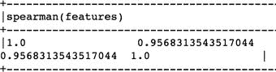

### 卡方检验

相关性关注的是数值特征之间的关系，而其他类型的变量也可能是分类变量。验证两个分类变量之间关系的方法之一是卡方检验。让我们通过一个例子来理解它的工作原理。表 5-1 总结了一些虚构数据。

表 5-1

样本数据

| | 吸烟者 | 非吸烟者 |
| --- | --- | --- |
| 青少年 | 32 | 12 |
| 青年 | 14 | 22 |
| 老年 | 6 | 9 |

它包含三类人群（`青少年`、`青年` 和 `老年`），并分为两个组别（`吸烟者` 和 `非吸烟者`）。下一步，我们计算每个类别和组别的总人数，如表 5-2 所示。这也被称为列联表。

表 5-2

列联表

| | 吸烟者 | 非吸烟者 | 总计 |
| --- | --- | --- | --- |
| 青少年 | 32 | 12 | 44 |
| 青年 | 14 | 22 | 36 |
| 老年 | 6 | 9 | 15 |
| | 52 | 43 | 95 |

下一步是根据表中的实际值计算期望值。期望值通过以下公式计算：

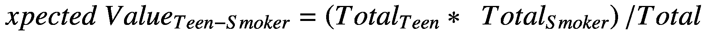

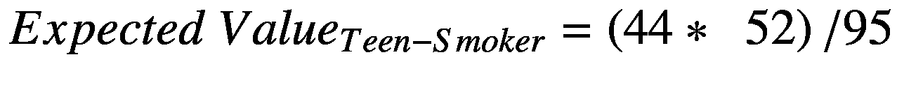

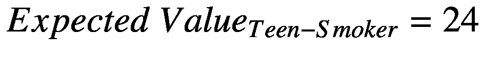

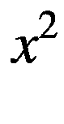

类似地，我们针对两个组别计算每个类别的所有期望值，如表 5-3 所示。

表 5-3

期望值

| | 吸烟者 | 非吸烟者 |
| --- | --- | --- |
| 青少年 | 24 | 20 |
| 青年 | 20 | 16 |
| 老年 | 8 | 7 |

下一步是通过比较实际值与期望值得出卡方表。卡方表的值通过以下公式计算：

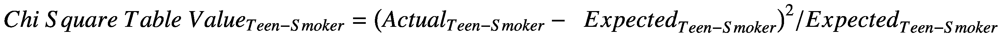

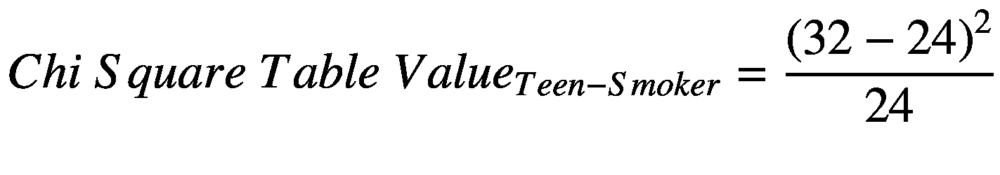

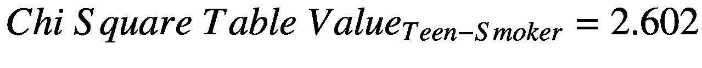

现在我们有了卡方值，我们计算每个组别（`吸烟者` 和 `非吸烟者`）的总和，如表 5-4 所示。

表 5-4

卡方总计

| | 吸烟者 | 非吸烟者 |
| --- | --- | --- |
| 青少年 | 2.602 | 3.146 |
| 青年 | 1.652 | 1.998 |
| 老年 | 0.595 | 0.720 |
| 卡方值 | 4.849 | 5.864 |

总的卡方值为 10.7（4.84 + 5.86）。然后我们在自由度为 (3-1)∗(2-1) = 2 的卡方分布表中查找 10.7 对应的 p 值。如果 p 值小于 0.05，则表明这两个变量之间存在统计上显著的关系。让我们尝试使用 Spark 运行卡方检验。这里我们有一个包含三列的样本数据集，但我们将尝试判断 `marital` 和 `housing` 列之间是否存在任何关系（两者本质上都是分类变量）。

```
[In]: df=spark.read.csv('chi_sq.csv',inferSchema=True,header=True)
[In]: df.count()
[Out]: 9501
[In]: df.show()
[Out]:
```

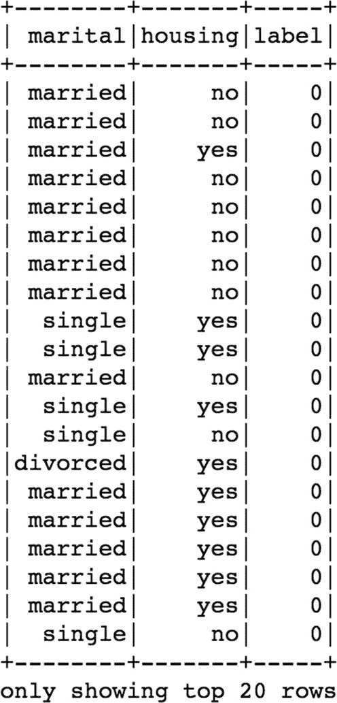

```
[In]: from pyspark.ml.feature import StringIndexer
[In]: marital_indexer = StringIndexer(inputCol="marital", outputCol="marital_num").fit(df)
[In]: df = marital_indexer.transform(df)
[In]: from pyspark.ml.feature import OneHotEncoder
[In]: marital_encoder = OneHotEncoder(inputCol="marital_num", outputCol="marital_vector")
[In]: df = marital_encoder.transform(df)
[In]: housing_indexer = StringIndexer(inputCol="housing", outputCol="housing_num").fit(df)
[In]: df = housing_indexer.transform(df)
[In]: housing_encoder = OneHotEncoder(inputCol="housing_num", outputCol="housing_vector")
[In]: df = housing_encoder.transform(df)
[In]: df.show()
[Out]:
```

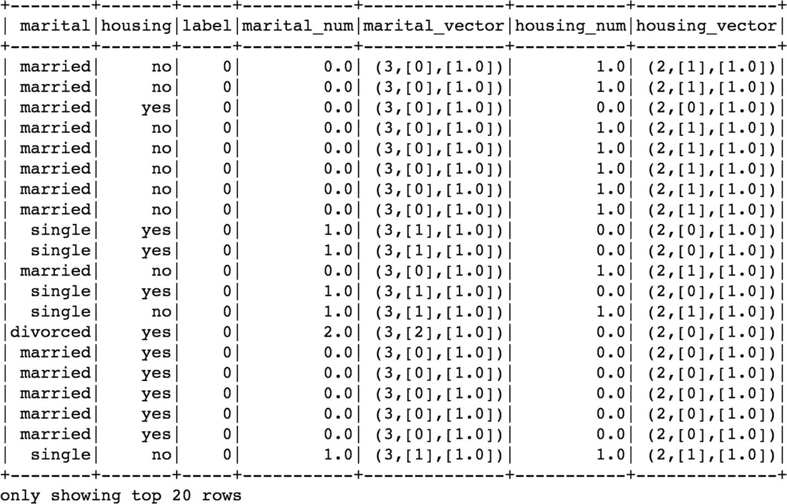

```
[In]: df_assembler = VectorAssembler(inputCols=['marital_vector','housing_vector'], outputCol="features")
[In]: df = df_assembler.transform(df)
[In]: df.show()
[Out]:
```

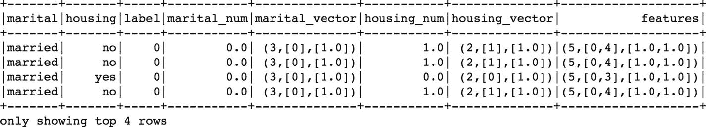

```
[In]: chi_sq = ChiSquareTest.test(df, "features", "label").head()
[In]: print("pValues: " + str(chi_sq.pValues))
[Out]:
pValues: [0.0,0.0,0.06036632491,0.0,3.56381590905e-14]
```

## 数据变换

在本节中，我将介绍数据预处理和特征工程中一些常见的变换。这些变换有助于以正确的方式准备数据，以便应用机器学习。


### 二值化器

我们可以通过 MLlib 中的 `Binarizer` 将数值/连续变量转换为分类特征（0/1）。必须声明阈值，才能将数值特征转换为二值特征。任何高于阈值的值都将转换为 1，低于或等于阈值的值将变为 0。让我们对转换样本数据集的标签列应用 `Binarizer`。

```
[In]: df=spark.read.csv('transformations.csv',header=True,inferSchema=True)
[In]: df.count()
[Out]: 6366
[In]: df.show()
[Out]:
```

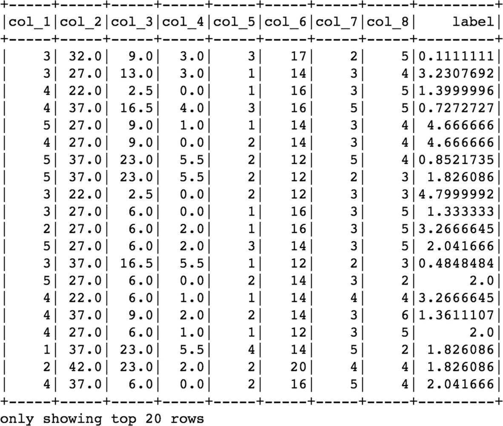

现在我们从 Spark 库中导入 `Binarizer` 函数。

```
[In]: from pyspark.ml.feature import Binarizer
[In]: binarizer = Binarizer(threshold=0.99, inputCol="label", outputCol="binarized_label")
[In]: new_df=binarizer.transform(df)
[In]: new_df.show()
[Out]:
```

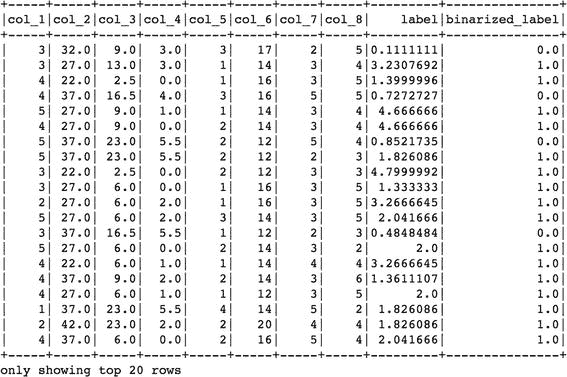

### 主成分分析

大多数时候，我们处理的是多维数据，有时在不进行数据可视化的情况下，很难理解其潜在模式。主成分分析（PCA）是一种转换技术，它允许你在尽可能保持数据变异性的同时，降低数据的维度。让我们回顾一下对之前使用的相同数据应用 PCA 的步骤。

```
[In]: from pyspark.ml.feature import PCA
[In]: assembler = VectorAssembler(inputCols=[col for col in df.columns if col !='label'], outputCol="features")
[In]: df_new=assembler.transform(df)
[In]: df_new.show()
[Out]:
```

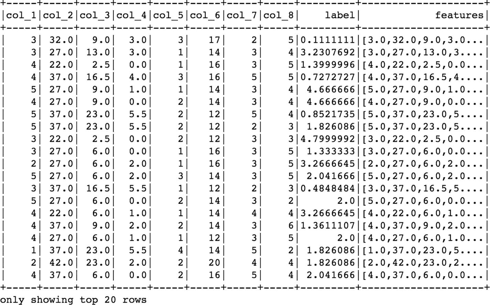

`k` 表示 PCA 后数据降维后的维度数量。

```
[In]: pca = PCA(k=2, inputCol="features", outputCol="pca_features")
[In]: pca_model=pca.fit(df_new)
[In]: pca_comp = pca_model.transform(df_new).select("pca_features")
[In]: pca_comp.show(truncate=False)
[out]:
```

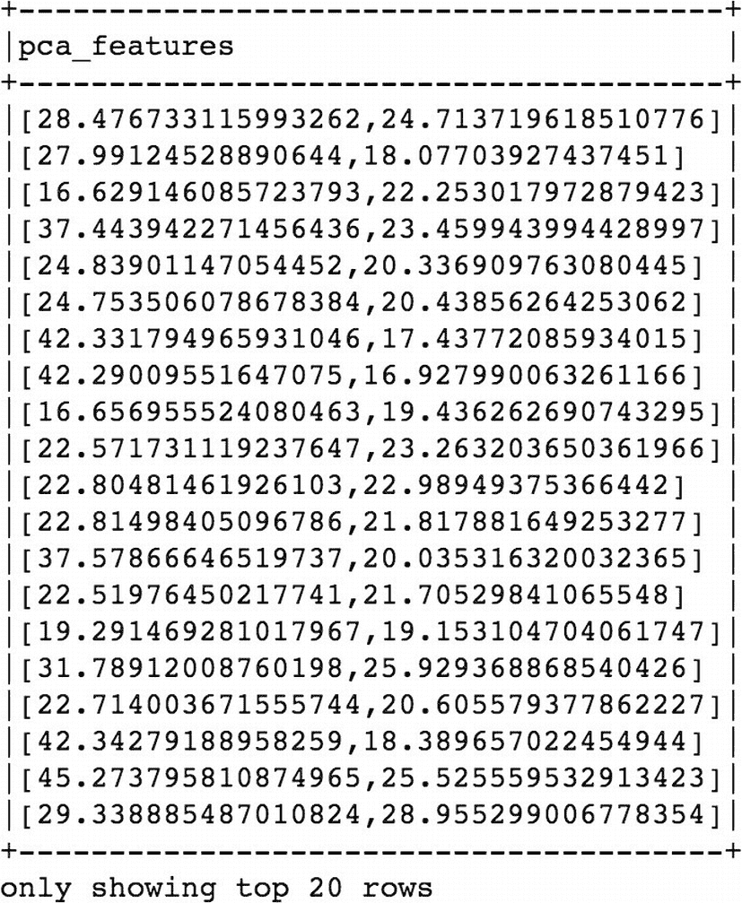

如你所见，我们对数据（除了“label”列）应用了 PCA，并将维度数量减少到了两个。

### 归一化器

归一化是指以新归一化数据的均值为 0、标准差为 1 的方式对数据进行转换。归一化使用以下公式完成：

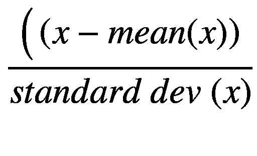

要在 Spark 中使用 `Normalizer`，我们只需将其应用于所需的列即可。这里，我们将其应用于“features”列。

```
[In]: from pyspark.ml.feature import Normalizer
[In]: normalizer = Normalizer(inputCol="features", outputCol="norm_features", p=1.0)
[In]: normalised_l1_data = normalizer.transform(df_new)
[In]: normalised_l1_data.select('norm_features').show(truncate=False)
[Out]:
```

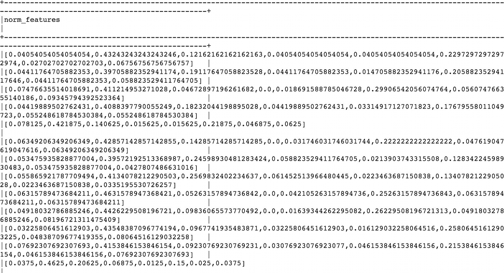

归一化有助于标准化输入数据，有时还能提高机器学习模型的性能。

### 标准缩放

缩放是另一种归一化数据的技术，它使数值处于特定范围内，例如 [0, 1]。许多机器学习算法对输入数据的尺度很敏感，因此应用缩放变得至关重要。缩放可以通过不同方式应用，但最基本的方法是使用以下公式：

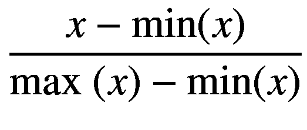

```
[In]: from pyspark.ml.feature import StandardScaler
[In]: scaler = StandardScaler(inputCol="features", outputCol="scaled_features",
withStd=False, withMean=True)
[In]: scaler_model = scaler.fit(df_new)
[In]: scaled_data = scaler_model.transform(df_new)
[In]: scaled_data.select('scaled_features').show(truncate=False)
[Out]:
```

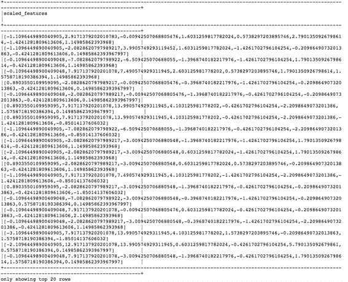

### 最小-最大缩放

最小-最大缩放是标准缩放的另一个版本，因为它允许你将特征值重新缩放到特定限制之间（通常是在 0 和 1 之间）。你也可以使用最小-最大缩放将值重新缩放到 0 和 1 之间。

```
[In]: from pyspark.ml.feature import MinMaxScaler
[In]: mm_scaler = MinMaxScaler(inputCol="features", outputCol="mm_scaled_features")
[In]: mm_scaler_model = mm_scaler.fit(df_new)
[In]: rescaled_df = mm_scaler_model.transform(df_new)
[In]: rescaled_df.select("features", "mm_scaled_features").show()
[Out]:
```

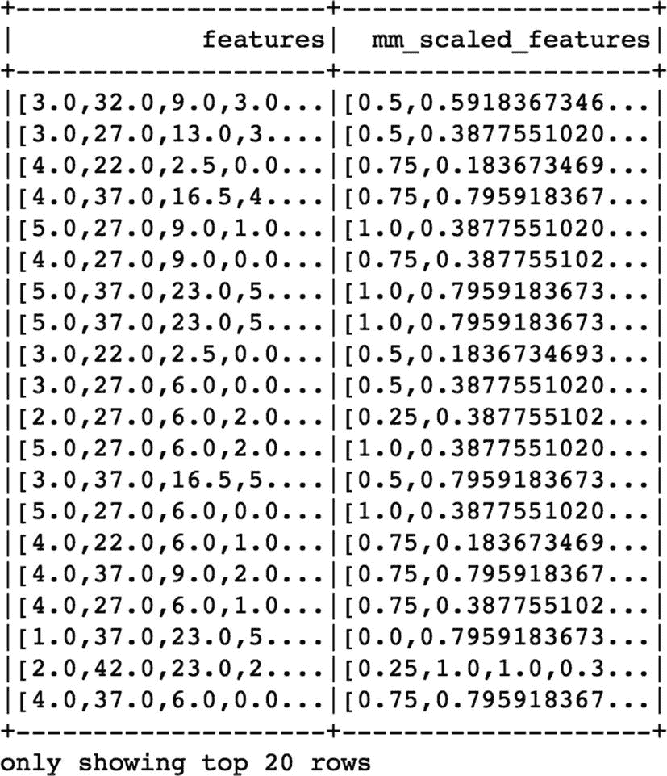

要访问最小值和最大值，我们可以使用 `getMin` 和 `getMax` 函数。为了改变范围，我们可以通过创建一个缩放器对象来定义新的最小值和最大值。这里我们将值重新缩放到 -1 和 1 之间。

```
[In]: mm_scaler.getMin()
[Out]: 0.0
[In]: mm_scaler.getMax()
[Out]: 1.0
修改最小最大值
[In]: mm_scaler = MinMaxScaler(inputCol="features", outputCol="mm_scaled_features”, min=-1,max=1)
[In]: mm_scaler_model = mm_scaler.fit(df_new)
[In]: rescaled_df = mm_scaler_model.transform(df_new)
[In]: rescaled_df.select("features", "mm_scaled_features").show()
[Out]:
```

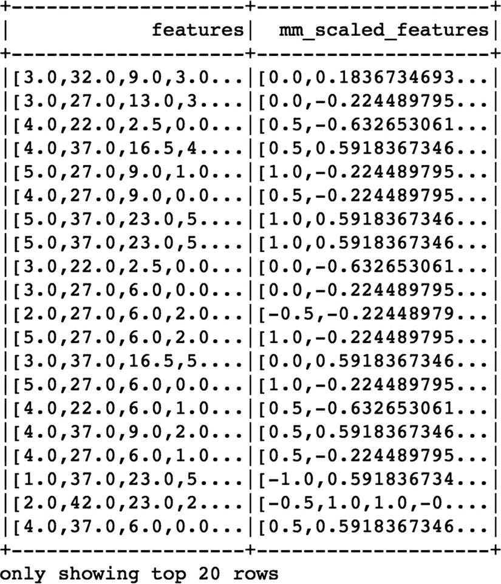

### 最大绝对值缩放器

`MaxAbsScaler` 与标准缩放工具有点不同，因为它将每个特征值重新缩放到 -1 和 1 之间。然而，它不会移动数据的中心，因此不会影响任何稀疏性。

```
[In]: from pyspark.ml.feature import MaxAbsScaler
[In]: mxabs_scaler = MaxAbsScaler(inputCol="features", outputCol="mxabs_features")
[In]: mxabs_scaler_model = mxabs_scaler.fit(df_new)
[In]: rescaled_df = mxabs_scaler_model.transform(df_new)
[In]: rescaled_df.select("features", "mxabs_features").show()
[Out]:
```

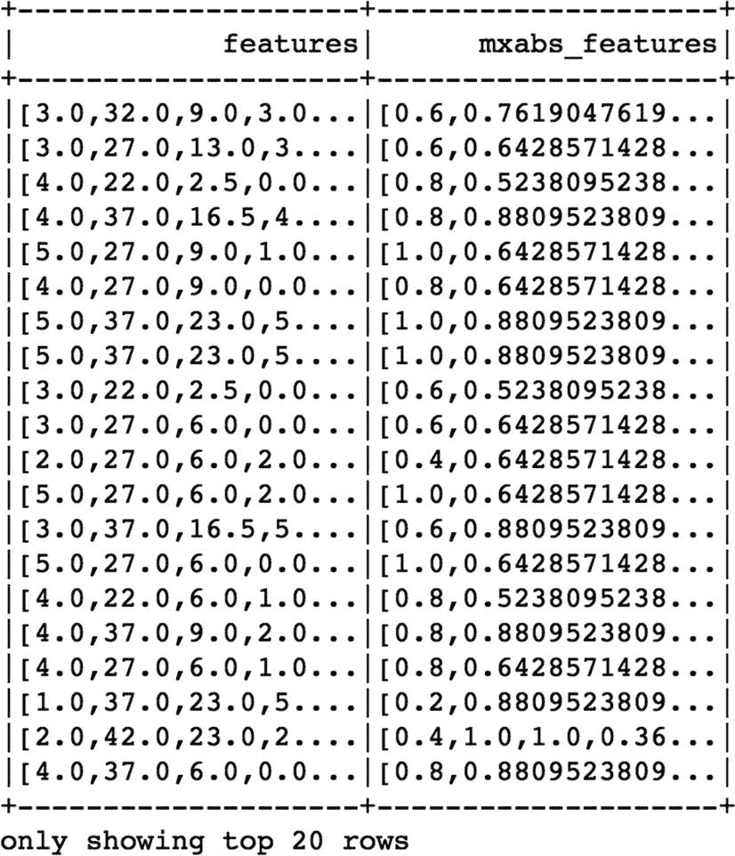


### 分箱

分箱（或称桶化）在需要将连续特征分组为类别时非常有用。你可以借助 Spark 中的 `Bucketizer` 进行分箱。让我们尝试将目标（标签）列分箱。可以相应地设置分割点，但始终建议将分割点的起点和终点设为负无穷到正无穷，以避免越界错误（尤其是在特征的最大值和最小值未知的情况下）。

```
[In]: from pyspark.ml.feature import Bucketizer
[In]: df.show(10,False)
[Out]:
```

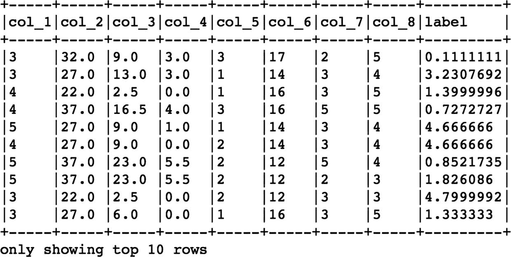

现在我们定义分割的端点，并创建一个包含分箱结果的新列。

```
[In]: splits = [0.0,1.0,2.0,3.0,4.0,5.0,float("inf")]
[In]: bucketizer = Bucketizer(splits=splits, inputCol="label", outputCol="label_bins")
[In]: binned_df = bucketizer.transform(df)
[In]: binned_df.select(['label','label_bins']).show(10,False)
[Out]:
```

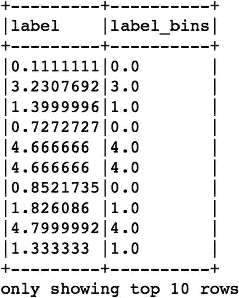

如你所见，所有值都被归入某个分箱，我们可以使用 `groupby` 来验证总共有 6 个分箱。我们也可以使用 `getSplit` 函数获取分箱的值。

```
[In]: binned_df.groupBy('label_bins').count().show()
[Out]:
```

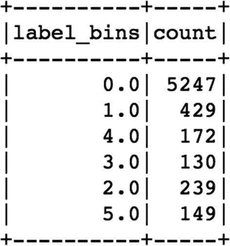

```
[In]: print(bucketizer.getSplits())-1
[Out]: 6
```

## 构建分类模型

在本节中，你将看到如何使用 Spark 的机器学习库（MLlib）来构建分类模型。由于本书后续有专门章节介绍监督和无监督机器学习模型，因此本节不会深入探讨细节，而是侧重于使用 MLlib 构建模型的整体流程。在我们的示例中，将使用 Giulio Palombo 在其著作 *A Collection of Data Science Take-Home Challenges* 中提供的数据集所启发的数据。该数据集包含一些申请新银行贷款的客户信息以及他们是否会违约。我们将构建一个二分类模型，根据从模型中获取的知识来预测特定客户是否应获得贷款。以下是构建分类模型的核心步骤：

1.  加载数据集。
2.  执行探索性数据分析。
3.  执行所需的数据转换。
4.  将数据拆分为训练集和测试集。
5.  在训练数据上训练并评估基线模型。
6.  执行超参数调优。
7.  使用最佳参数构建最终模型。

### 步骤 1：加载数据集

第一步，我们初始化 Spark 对象以使用 Spark，并加载数据集以创建 Spark 数据框。

```
[In]: from pyspark.sql import SparkSession
[In]: spark=SparkSession.builder.appName('binary_class').getOrCreate()
[In]: df=spark.read.csv('classification_data.csv',inferSchema=True,header=True)
```

### 步骤 2：探索数据框

在此步骤中，我们探索数据的不同方面以及数据框中的各个列。

```
[In]: print((df.count(),len(df.columns)))
[Out]: (46751, 12)
```

该数据框包含 12 列和超过 46,000 条记录。我们可以使用 `printSchema` 函数查看所有列及其数据类型。

```
[In]: df.printSchema()
[Out]:
```

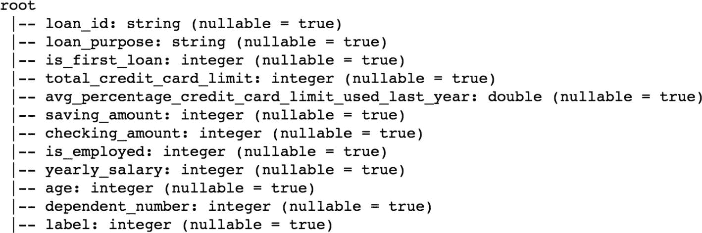

我们可以使用 `show` 或 `display` 函数查看数据框的前几行。

```
[In]: df.show(5)
[Out]:
```

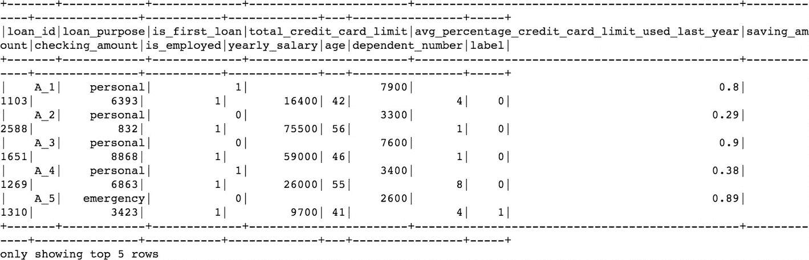

我们可以使用 `groupby` 统计目标列（标签）中正负事件的数量。

```
[In]: df.groupBy('loan_label').count().show()
[Out]:
```

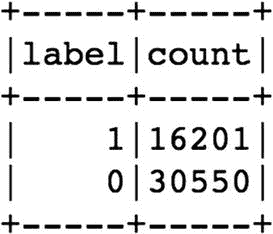

如你所见，超过三分之一的客户已经贷款违约。为了更好地理解数据，我们继续进行探索性数据分析。在以下结果中，我们可以看到人们申请贷款的主要目的是房产、经营和个人原因。

```
[In]: df.groupBy('loan_purpose').count().show()
[Out]:
```

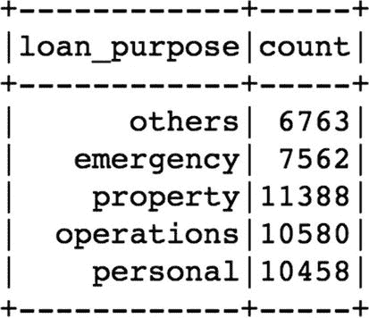

客户申请房产贷款的数量似乎超过了其他任何类别的贷款。

### 步骤 3：数据转换

由于数据框中的所有变量（除了贷款用途）都是数值型的，我们必须使用 `OneHotEncoder` 将它们转换为数值形式。

```
[In]: from pyspark.ml.feature import OneHotEncoder, StringIndexer, VectorAssembler
[In]: loan_purpose_indexer = StringIndexer(inputCol="loan_purpose", outputCol="loan_index").fit(df)
[In]: df = loan_purpose_indexer.transform(df)
[In]: loan_encoder = OneHotEncoder(inputCol="loan_index", outputCol="loan_purpose_vec")
[In]: df = loan_encoder.transform(df)
[In]: df.select(['loan_purpose','loan_index','loan_purpose_vec']).show(3,False)
```

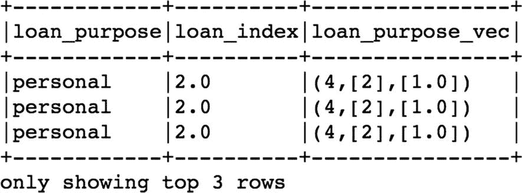

现在我们已经将原始的贷款用途特征转换为向量化形式，可以使用 `VectorAssembler` 创建一个用于模型训练的单一特征向量。

```
[In]: from pyspark.ml.feature import VectorAssembler
[In]: df_assembler = VectorAssembler(inputCols=['is_first_loan',
'total_credit_card_limit',
'avg_percentage_credit_card_limit_used_last_year',
'saving_amount',
'checking_amount',
'is_employed',
'yearly_salary',
'age',
'dependent_number',
'loan_purpose_vec'], outputCol="features")
[In]: df = df_assembler.transform(df)
[In]: df.select(['features','label']).show(10,False)
[Out]:
```

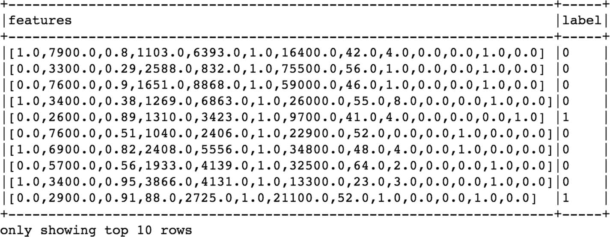

我们现在创建一个仅包含两列（特征和标签）的新数据框。

```
[In]: model_df=df.select(['features','label'])
```

### 步骤 4：拆分为训练数据和测试数据

我们现在将整体数据随机拆分为训练集和测试集，以避免训练中的任何偏差。

```
[In]: training_df,test_df=model_df.randomSplit([0.75,0.25])
```

### 步骤 5：模型训练

现在训练数据和测试数据已准备就绪，我们可以继续使用默认参数训练一个基线模型（例如逻辑回归），并检查其在训练数据和测试数据上的性能。

```
[In]: from pyspark.ml.classification import LogisticRegression
[In]: log_reg=LogisticRegression().fit(training_df)
[In]: lr_summary=log_reg.summary
[In]: lr_summary.accuracy
[Out]: 0.8939298586875679
[In]: lr_summary.areaUnderROC
0.9587456481363935
[In]: print(lr_summary.precisionByLabel)
[Out]: [0.9233245149911816, 0.8396318618667535]
[In]: print(lr_summary.recallByLabel)
[Out]: [0.914054997817547, 0.8556606905710491]
[In]: predictions = log_reg.transform(test_df)
[In]: predictions.show(10)
```

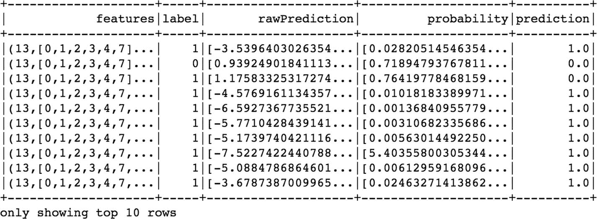

```
[In]: model_predictions = log_reg.transform(test_df)
[In]: model_predictions = log_reg.evaluate(test_df)
[In]: model_predictions.accuracy
[Out]: 0.8945984906300347
[In]: model_predictions.areaUnderROC
[Out]: 0.9594316478468224
[In]: print(model_predictions.recallByLabel)
[Out]: [0.9129581151832461, 0.8608235010835541]
[In]: print(model_predictions.precisionByLabel)
[Out]: [0.9234741162452006, 0.8431603773584906]
```


### 步骤 6：超参数调优

使用基线模型，我们在测试数据上获得了近 89% 的准确率，召回率为 0.86。既然已经构建了基线模型，我们就可以构建更复杂的模型，例如随机森林模型，这是一种集成方法，可以提高预测的准确性。接下来你将看到如何调整此模型，以找到最佳的超参数。

```
[In]: from pyspark.ml.classification import RandomForestClassifier
```

首先，我们使用默认超参数构建一个随机森林模型，然后在训练数据上对其进行训练，以便对测试数据进行预测。

```
[In]: rf = RandomForestClassifier()
[In]: rf_model = rf.fit(training_df)
[In]: model_predictions = rf_model.transform(test_df)
```

现在，我们尝试使用交叉验证技术，为这个模型找出最佳超参数。

```
[In]: from pyspark.ml.tuning import ParamGridBuilder, CrossValidator
[In]: from pyspark.ml.evaluation import BinaryClassificationEvaluator
[In]: evaluator = BinaryClassificationEvaluator()
[In]: rf = RandomForestClassifier()
[In]: paramGrid = (ParamGridBuilder()
.addGrid(rf.maxDepth, [5,10,20,25,30])
.addGrid(rf.maxBins, [20,30,40 ])
.addGrid(rf.numTrees, [5, 20,50])
.build())
```

我们定义了参数网格，其中包含不同超参数（`maxDepth`、`maxBins`、`numTrees`）的所有可能值，并应用交叉验证来确定最佳模型。本例中我们使用五折交叉验证（四份用于训练，一份用于测试）。

```
[In]: cv = CrossValidator(estimator=rf, estimatorParamMaps=paramGrid, evaluator=evaluator, numFolds=5)
[In]: cv_model = cv.fit(training_df)
```

然后，我们访问最佳模型参数，并将其应用于测试数据集以进行预测。

### 步骤 7：最佳模型

```
[In]: best_rf_model = cv_model.bestModel
[In]: model_predictions = best_rf_model.transform(test_df)
[In]: true_pos=model_predictions.filter(model_predictions['label']==1).filter(model_predictions['prediction']==1).count()
[In]: actual_pos=model_predictions.filter(model_predictions['label']==1).count()
[In]: pred_pos=model_predictions.filter(model_predictions['prediction']==1).count()
[In]: recall_rate=float(true_pos)/(actual_pos)
[In]: print(recall_rate)
[Out]: 0.912426614481409
```

从上述结果可以看出，与基线方法（逻辑回归）相比，使用最佳超参数的随机森林模型，其召回率得到了提升。

## 结论

本章回顾了使用 PySpark 进行数据转换的一些技术以及计算汇总统计量的方法。你学习了如何从头开始构建机器学习模型，以及如何调整超参数，为模型选择最佳参数。

