# 6. 监督式机器学习

机器学习大致可以分为四类：监督式机器学习、无监督式机器学习，以及程度较轻的半监督式机器学习和强化机器学习。由于监督式机器学习驱动着众多商业应用，并对我们的日常生活产生重大影响，因此它被认为是最重要的类别之一。

本章将使用多种算法来回顾监督式机器学习。在第 7 章中，我们将探讨无监督式机器学习。我将首先概述监督式机器学习的不同类别。在第二部分，我将介绍各种回归方法，并使用 PySpark 的 MLlib 库构建机器学习模型。本章的第三部分也是最后一部分，将重点介绍使用多种机器学习算法进行分类。

## 监督式机器学习入门

顾名思义，在监督式机器学习中，学习过程是受监督的，因为所使用的机器学习算法会根据实际输出来修正其预测。在监督式机器学习中，正确的标签或输出在模型训练阶段就已经是已知的，因此可以相应地减少误差。简而言之，我们试图以这样一种方式映射输入数据和输出标签之间的关系：从训练数据中捕捉信号，并对未见过的数据进行泛化。模型的训练包括将实际输出与预测输出进行比较，然后对预测进行更改，以减少实际值与预测值之间的总误差。所遵循的监督式机器学习过程如图 6-1 所示。

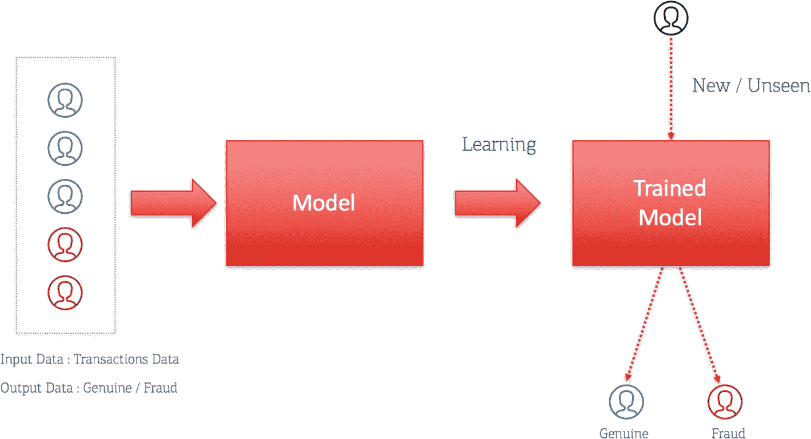

图 6-1 监督式学习方法

用于训练模型的数据经过预处理，并相应地创建特征。一旦机器学习模型训练完成，它就可以用于对未见过的数据进行预测。因此，在上图中，我们可以看到模型是如何使用输入数据进行训练的，以及训练好的模型现在如何用于预测新交易是否真实。这种学习方式主要适用于有历史数据可用，并且需要对未来数据进行预测的情况。监督式学习的进一步分类基于用于预测的输出或目标变量的类型：

- 回归
- 分类

当预测的目标值是连续或数值型时，使用回归。例如，根据给定的工作年限或教育程度预测薪资，就属于回归范畴。

### 注意

尽管回归有多种类型，但在本章中，我将重点介绍线性回归及其一些相关算法，稍后你将看到。

如果目标变量是离散值或分类型，则使用分类。例如，预测客户是否会流失就是一种分类问题，如图 6-2 所示。

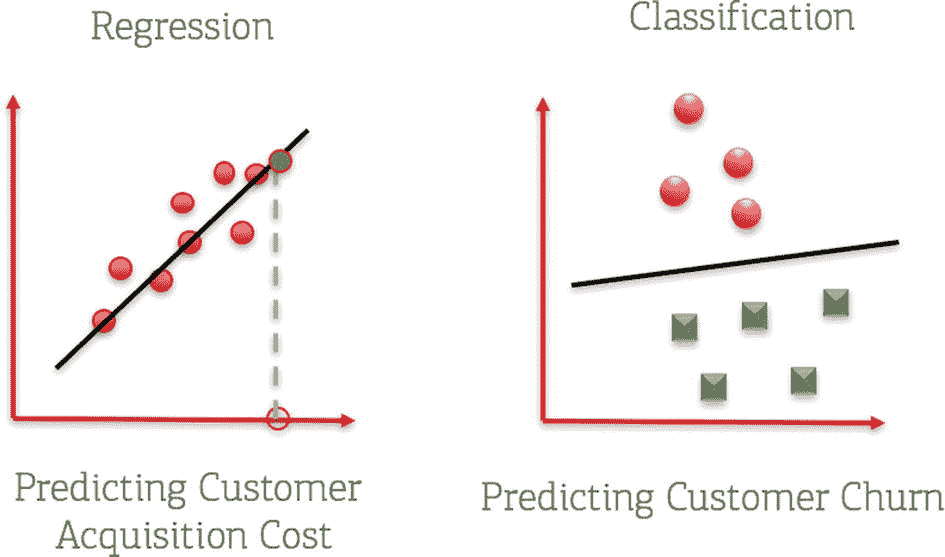

图 6-2 监督式任务的类型

分类任务可以进一步细分为两类：二分类和多分类，如图 6-3 所示。

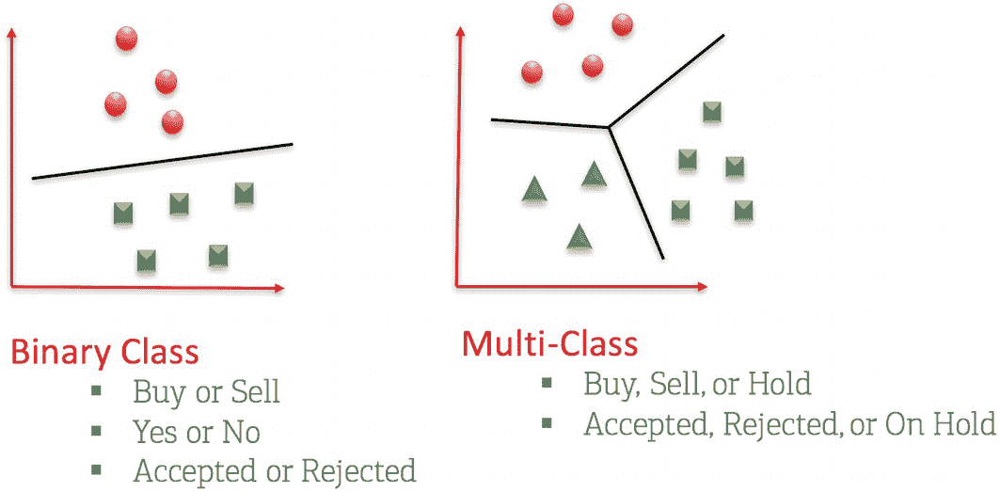

图 6-3 类别类型

### 二分类

当目标或输出变量最多只包含两个类别时，称为二分类。因此，数据中的每条记录只能属于这两组中的一组。例如：

- 是或否
- A 组或 B 组
- 卖出或不卖出
- 阳性或阴性
- 接受或拒绝

### 多分类

当目标或输出变量包含两个以上类别时，称为多分类。因此，数据中可能存在多个组，每条记录可以属于其中任何一个组。例如：

- 是、否或可能
- A 组、B 组或 C 组
- 类别 1、类别 2、类别 3 或其他
- 排名 1、排名 2、排名 3、排名 4 或排名 5

监督式学习的另一个有用特性是，可以在训练数据和测试数据上评估模型的性能。根据模型类型（分类或回归），可以应用相应的评估指标并衡量性能结果。在本章中，我将介绍如何构建机器学习模型来执行回归和二分类任务。


## 构建线性回归模型

线性回归是指对一组自变量与输出或依赖（数值）变量之间的关系进行建模。如果输入变量包含多个变量，则称为多变量线性回归。简而言之，它假设因变量是其他自变量的线性组合。

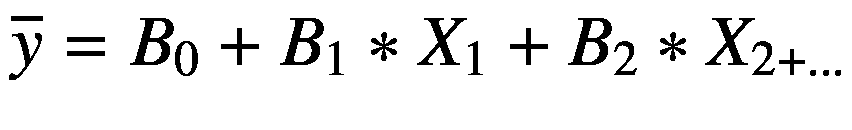

这里的 `X[1]`、`X[2]`……是用于预测输出变量的自变量。线性回归的输出是一条直线，它能使实际值与预测值之间的差异最小化。线性回归模型无法处理非线性数据，因为它只能对线性可分的数据进行建模，因此对于非线性数据会使用多项式回归，其输出通常是一条曲线，而不是直线，如图 6-4 所示。

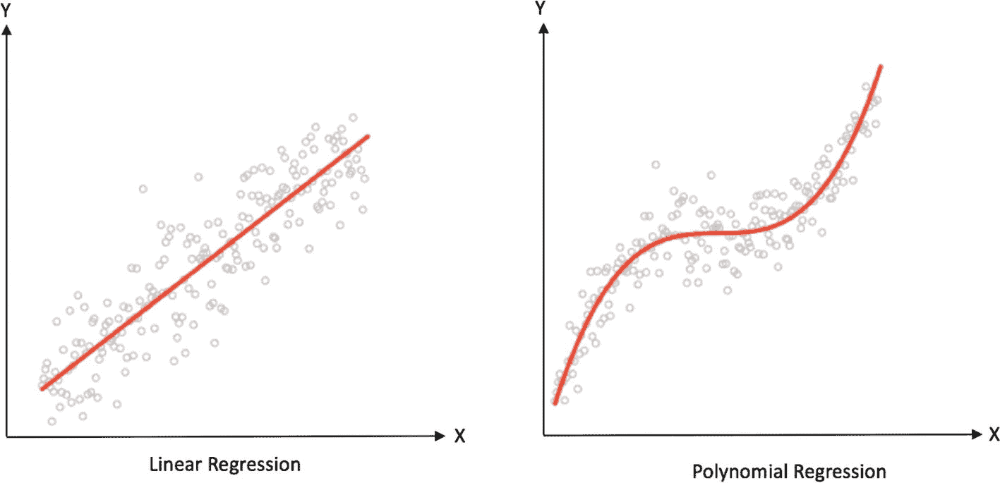

图 6-4

回归的类型

为了提高预测效果，线性回归还假设数据呈正态分布。线性回归是预测连续值的方法之一，接下来你将看到如何使用其他替代方法来预测数值输出。

以下各节将重点介绍如何使用多种机器学习算法来解决回归任务。我将从数据摄取和探索性数据分析开始，然后构建模型。步骤 1 到 4 对于所有回归模型都是相同的。

### 注意

完整的数据集以及相关代码可在本书的 GitHub 仓库中查阅参考，并且在 Spark 2.3 及更高版本上运行效果最佳。

现在，让我们使用 Spark 的 MLlib 库构建一个线性回归模型，并利用输入特征来预测目标变量。

### 查看数据信息

我们在此示例中使用的数据集是一个样本数据集，总共包含 1,232 行和 6 列。我们需要使用 5 个输入变量，通过线性回归模型来预测目标变量。

#### 步骤 1：创建 Spark 会话对象

我们启动 Jupyter notebook，导入 `SparkSession`，并创建一个新的 `SparkSession` 对象以在 Spark 中使用。

```
[In]: from pyspark.sql import SparkSession
[In]: spark=SparkSession.builder.appName('supervised_ml').getOrCreate()
```

#### 步骤 2：读取数据集

然后，我们使用 DataFrame 在 Spark 中加载并读取数据集。我们必须确保从数据集所在的同一目录文件夹中打开 PySpark，否则必须指明数据文件夹的目录路径。

```
[In]: df=spark.read.csv('Linear_regression_dataset.csv',inferSchema=True,header=True)
[In]:print((df.count(), len(df.columns)))
[Out]: (1232, 6)
```

上述输出确认了我们数据集的大小，然后我们可以验证输入值的数据类型，以检查是否需要更改/转换任何列的数据类型。在此示例中，所有列都包含 `integer` 或 `double` 类型的值，这些值已经符合我们的要求。

```
[In]: df.printSchema()
[Out]: root
|-- var_1: integer (nullable = true)
|-- var_2: integer (nullable = true)
|-- var_3: integer (nullable = true)
|-- var_4: double (nullable = true)
|-- var_5: double (nullable = true)
|-- output: double (nullable = true)
```

总共有六列，其中五列是输入列（`var_1` 到 `var_5`），一列是目标列（标签）。现在我们可以使用 `describe` 函数来查看数据集的统计指标。

```
[In]: df.show(10)
[Out]:
```

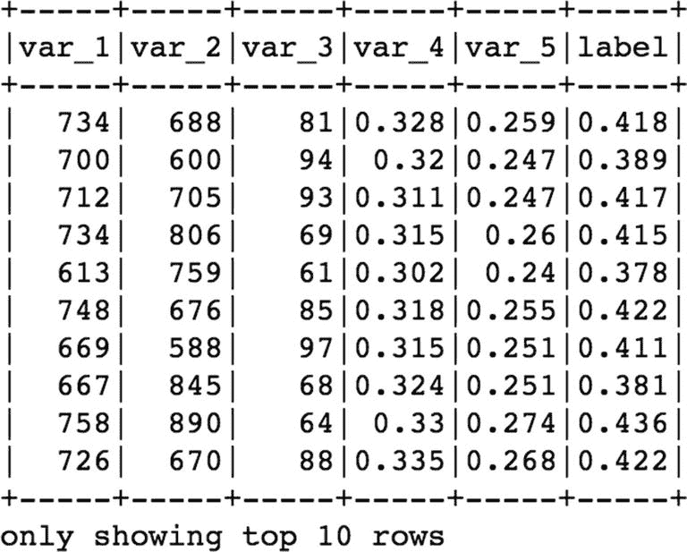

#### 步骤 3：特征工程

在这一步中，我们使用 Spark 的 `VectorAssembler` 创建一个包含所有输入特征的单一向量。它只创建一个单一特征，用于捕获该特定行的输入值。因此，引擎实际上将五个输入列转换为一个包含五个输入值的单一列，形式为一个列表。

```
[In]: from pyspark.ml.linalg import Vector
[In]: from pyspark.ml.feature import VectorAssembler
```

我们将传入所有五个输入列，以创建一个单一的特征列。

```
[In]: df.columns
[Out]: ['var_1', 'var_2', 'var_3', 'var_4', 'var_5', 'label']
[In]: vec_assmebler=VectorAssembler(inputCols=['var_1', 'var_2', 'var_3', 'var_4', 'var_5'],outputCol='features')
[In]: features_df=vec_assmebler.transform(df)
[In]: features_df.printSchema()
[Out]: root
|-- var_1: integer (nullable = true)
|-- var_2: integer (nullable = true)
|-- var_3: integer (nullable = true)
|-- var_4: double (nullable = true)
|-- var_5: double (nullable = true)
|-- label: double (nullable = true)
|-- features: vector (nullable = true)
```

如你所见，我们多了一个额外的列（features），其中包含所有输入的单一密集向量。然后，我们取 DataFrame 的一个子集，只选择特征列和标签列，来构建线性回归模型。

```
[In]: df.select(['features','label']).show()
[Out]:
```

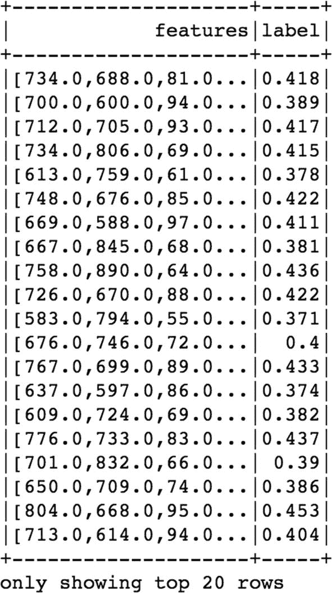

#### 步骤 4：拆分数据集

我们将数据集拆分为训练集和测试集，以便训练和评估线性回归模型的性能。我们按照 70/30 的比例进行拆分，并在 70% 的数据集上训练模型。我们可以打印训练数据和测试数据的形状，以验证其大小。

```
[In]: train, test = df.randomSplit([0.75, 0.25])
[In]:print(f"Size of train Dataset : {train.count()}" )
[Out]: Size of train Dataset : 911
[In]: print(f"Size of test Dataset : {test.count()}" )
[Out]:  Size of test Dataset : 321
```

#### 步骤 5：构建并训练线性回归模型

现在，我们使用特征、输入和标签列来构建并训练线性回归模型。我们首先从 MLlib 中导入线性回归，如下所示：

```
[In]: from pyspark.ml.regression import LinearRegression
[In]: lr = LinearRegression()
```

### 注意

为简单起见，本章中构建的所有机器学习模型均使用默认超参数。读者可以使用自己的一套超参数。

```
[In]:lr_model = lr.fit(train)
[In]: predictions_df=lr_model.transform(test)
[In]: predictions_df.show()
[Out]:
```

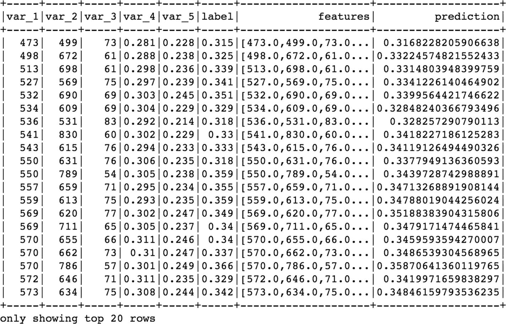

#### 步骤 6：在测试数据上评估线性回归模型

为了检查模型在未见数据或测试数据上的性能，我们使用 `evaluate` 方法。

```
[In]: model_predictions=lr_model.evaluate(test)
[In]: model_predictions.r2
[Out]: 0.8855561089304634
[In]: print(model_predictions.meanSquaredError)
[Out]:0.00013305453514672318
```


### 广义线性模型回归

广义线性模型（GLM）是线性回归的进阶版本，它允许目标变量的误差分布不局限于正态分布。GLM 通过使用链接函数对线性回归进行泛化，使得方差成为预测值本身的函数。让我们尝试在相同数据集上构建 GLM，看看它是否比简单线性回归模型表现更好。首先，我们需要从 MLlib 中导入 GLM。

```
[In]: from pyspark.ml.regression import GeneralizedLinearRegression
```

#### 步骤 1：构建并训练广义线性回归模型

```
[In]: glr = GeneralizedLinearRegression()
[In]: glr_model = glr.fit(train)
[In]: glr_model.coefficients
[Out]: DenseVector([0.0003, 0.0001, 0.0001, -0.6374, 0.4822])
```

我们可以使用该模型的系数函数来获取系数值。这里可以看到其中一个特征的系数值为负。通过使用 `summary` 函数，我们可以获取关于 GLM 模型的更多信息。它会返回所有细节，例如系数值、标准误差、AIC（赤池信息准则）值和 p 值。

```
[In]: glr_model.summary
[Out]:
```

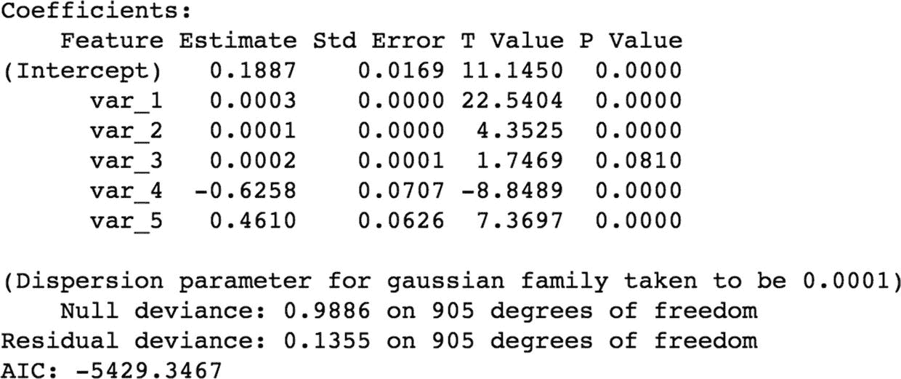

#### 步骤 2：在测试数据上评估模型性能

```
[In]: model_predictions=glr_model.evaluate(test)
[In]: model_predictions.predictions.show()
[Out]:
```

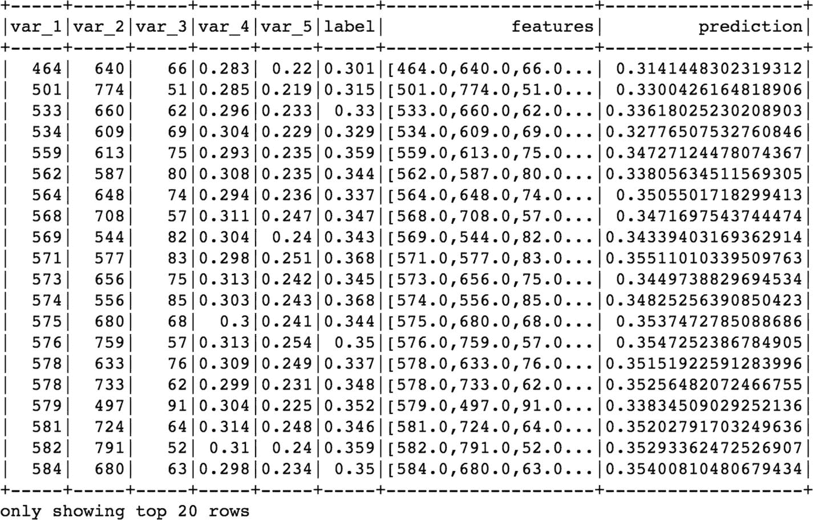

赤池信息准则（AIC）是一个评估参数，用于比较同一数据集上多个模型的相对性能质量。AIC 主要用于在给定数据集上从多个模型中进行选择。AIC 值越小，表明模型质量越好。AIC 试图在模型的方差和偏差之间取得平衡。因此，它同时处理了过拟合和欠拟合的可能性。AIC 分数最低的模型优于其他模型。

```
[In]: model_predictions.aic
[Out]: -1939.88
```

我们可以针对多种分布运行 GLM，例如：

1.  二项分布
2.  泊松分布
3.  伽马分布
4.  Tweedie 分布

```
[In]: glr = GeneralizedLinearRegression(family='Binomial')
[In]: glr_model = glr.fit(train)
[In]: model_predictions=glr_model.evaluate(test)
[In]: model_predictions.aic
[Out]: 336.991
[In]: glr = GeneralizedLinearRegression(family='Poisson')
[In]: glr_model = glr.fit(train)
[In]: predictions=glr_model.evaluate(test)
[In]: predictions.aic
[Out]: 266.53
[In]: glr = GeneralizedLinearRegression(family='Gamma')
[In]: glr_model = glr.fit(train)
[In]:model_predictions=glr_model.evaluate(test)
[In]: model_predictions.aic
[Out]: -1903.81
```

这里我们可以看到，与其他分布相比，我们默认使用高斯分布的 GLM 模型具有最低的 AIC 值。

### 决策树回归

决策树回归算法可用于回归和分类。它在良好拟合数据方面功能强大，但有时也存在过拟合数据的高风险。决策树包含基于熵或基尼指数的多个分裂。树越深，过拟合数据的可能性就越高。在我们的示例中，我们将使用参数的默认值（`maxdepth = 5`）构建一个决策树来预测目标值。

#### 步骤 1：构建并训练决策树回归器模型

```
[In]: from pyspark.ml.regression import DecisionTreeRegressor
[In]: dec_tree = DecisionTreeRegressor()
[In]: dec_tree_model = dec_tree.fit(train)
[In]: dec_tree_model.featureImportances
[Out]: SparseVector(5, {0: 0.9641, 1: 0.0193, 2: 0.0029, 3: 0.0053, 4: 0.0084})
```

#### 步骤 2：在测试数据上评估模型性能

```
[In]: model_predictions = dec_tree_model.transform(test)
[In]: model_predictions.show()
[Out]:
```

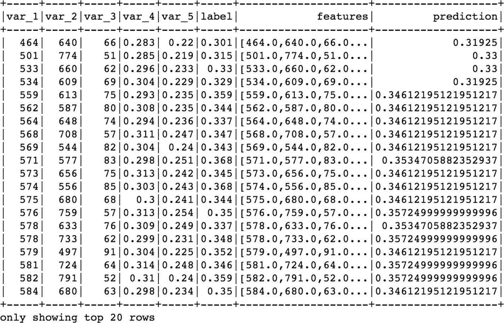

我们从 MLlib 导入 `RegressionEvaluation`，以评估决策树在测试数据上的性能。目前，有两个可用的评估指标：`r2` 和 RMSE（均方根误差）。`r2` 主要表明数据集中有多少变异可以归因于回归。因此，`r2` 越高，模型性能越好。另一方面，RMSE 表明模型产生的总误差，即实际值与预测值之间的差异。

```
[In]: from pyspark.ml.evaluation import RegressionEvaluator
[In]: dt_evaluator = RegressionEvaluator(metricName='r2')
[In]: dt_r2 = dt_evaluator.evaluate(model_predictions)
[In]: print(f'DecisionTreeRegressor 的 r 平方值为 {dt_r2}')
[Out]: DecisionTreeRegressor 的 r 平方值为 0.8093834699203476
[In]: dt_evaluator = RegressionEvaluator(metricName='rmse')
[In]: dt_rmse = dt_evaluator.evaluate(model_predictions)
[In]: print(f'DecisionTreeRegressor 的 rmse 值为 {dt_rmse}')
[Out]: DecisionTreeRegressor 的 rmse 值为 0.014111932287681688
```

该特定模型的 `r2` 值接近 0.81，略低于简单线性回归模型。

### 随机森林回归器

随机森林回归器是使用不同数据样本构建的多个独立决策树的集合。组合这些独立树的核心理念是通过多数投票或取平均值（在回归情况下）来有效泛化。因此，随机森林是一种采用装袋方法的集成学习技术。它可用于回归和分类任务。由于决策树容易过拟合数据，随机森林通过取各个树预测值的平均值来消除高方差元素。在我们的示例中，我们将使用默认参数（`numTrees = 20`）构建一个用于回归的随机森林模型。

#### 步骤 1：构建并训练随机森林回归器模型

```
[In]: from pyspark.ml.regression import RandomForestRegressor
[In]: rf = RandomForestRegressor()
[In]: rf_model = rf.fit(train)
[In]:  rf_model.featureImportances
[Out]: SparseVector(5, {0: 0.4395, 1: 0.045, 2: 0.0243, 3: 0.2725, 4: 0.2188})
```

如您所见，随机森林中的树的数量等于 20。这个数字可以增加。

```
[In]: rf_model.getNumTrees
[Out]: 20
[In]: model_predictions = rf_model.transform(test)
[In]: model_predictions.show()
[Out]:
```

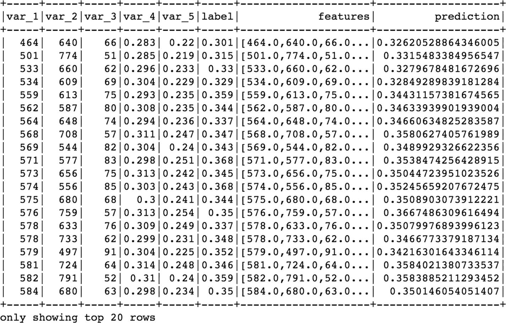

#### 步骤 2：在测试数据上评估模型性能

我们可以再次使用 `r2` 和 RMSE 作为随机森林模型的评估参数。

```
[In]:rf_evaluator = RegressionEvaluator(metricName='r2')
[In]: rf_r2 = rf_evaluator.evaluate(model_predictions)
[In]: print(f'RandomForestRegressor 的 r 平方值为 {rf_r2}')
[Out]: RandomForestRegressor 的 r 平方值为 0.8215863293044671
[In]: rf_evaluator = RegressionEvaluator(metricName='rmse')
[In]: rf_rmse = rf_evaluator.evaluate(model_predictions)
[In]: print(f'RandomForestRegressor 的 rmse 值为 {rf_rmse}')
[Out]: RandomForestRegressor 的 rmse 值为 0.01365275410722947
```

如您所见，它明显优于决策树回归器，并且具有更高的 `r2`。该模型的性能可以通过超参数调优进一步增强。


## 梯度提升树回归器

梯度提升树（GBT）回归器也是一种集成学习技术，其底层采用提升方法。提升是指利用多个弱学习器来提升整体模型的性能。装袋与提升的主要区别在于：装袋中构建的各个模型本质上是并行的，即可以相互独立地构建；而提升中各个模型是按顺序构建的。在梯度提升方法中，第二个模型会重点关注第一个模型产生的误差，并尝试减少这些数据点的整体误差。类似地，后续模型会尝试减少前一个模型产生的误差。通过这种方式，预测的整体误差得以降低。在下面的示例中，我们将使用默认参数构建一个 GBT 回归器。

### 步骤 1：构建并训练 GBT 回归器模型

```
[In]: from pyspark.ml.regression import GBTRegressor
[In]: gbt = GBTRegressor()
[In]: gbt_model=gbt.fit(train)
[In]: gbt_model.featureImportances
[Out]: SparseVector(5, {0: 0.2325, 1: 0.2011, 2: 0.1645, 3: 0.2268, 4: 0.1751})
[In]: model_predictions = gbt_model.transform(test)
[In]: model_predictions.show()
[Out]:
```

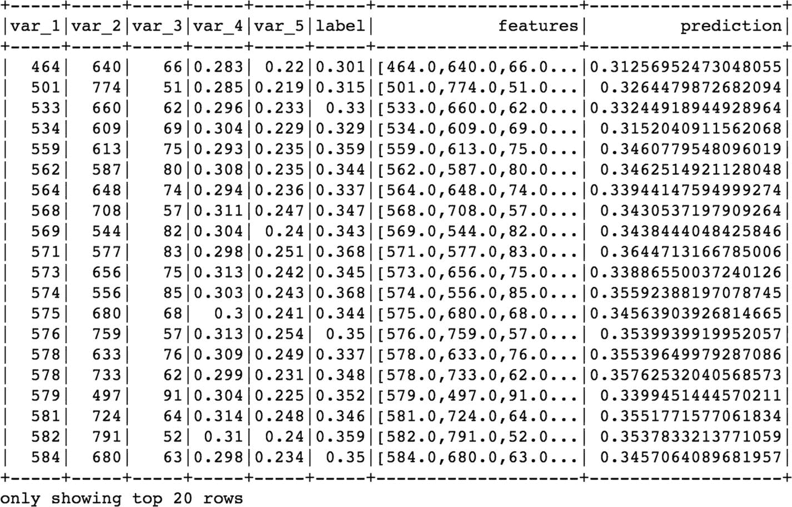

### 步骤 2：评估模型在测试数据上的性能

```
[In]: gbt_evaluator = RegressionEvaluator(metricName='r2')
[In]: gbt_r2 = gbt_evaluator.evaluate(model_predictions)
[In]: print(f'The r-square value of GradientBoostedRegressor is {gbt_r2}')
[Out]: The r-square value of GradientBoostedRegressor is 0.8477273892307596
[In]: gbt_evaluator = RegressionEvaluator(metricName='rmse')
[In]: gbt_rmse = gbt_evaluator.evaluate(model_predictions)
[In]: print(f'The rmse value of GradientBoostedRegressor is {gbt_rmse}')
[Out]: The rmse value of GradientBoostedRegressor is 0.013305445803592103
```

如您所见，GBT 回归器的性能优于随机森林模型。其 r² 接近 0.85，经过适当调优后，可将其视为最终模型。

## 为二分类任务构建多个模型

在本章的第三部分也是最后一部分，您将学习如何为二分类任务构建多个机器学习模型。我们将使用的数据来自 UCI 机器学习库中开源银行营销数据集的一个子集，该数据集可在 `https://archive.ics.uci.edu/ml/datasets/Bank+Marketing` 获取。

仅选择该数据子集有两个原因。首先是为了保持分类任务的类别平衡，避免使其成为异常检测类任务。其次，仅选择部分特征是为了限制数据中的信号量，因为数据集中某些特征对输出影响强烈，因此在本练习中将其忽略。

该数据集包含 9,500 行和 8 列。目标是基于年龄、工作、贷款等其他属性，预测用户是否会订阅另一项产品或服务（定期存款）。这是一个典型需求，即利用机器学习来寻找业务可用于交叉销售或追加销售的目标顶级用户。

我将从逻辑回归模型开始。

### 逻辑回归

逻辑回归因其简单性和可解释性而被视为基线模型之一。其底层原理与线性回归非常相似。它也假设输出是因变量的线性组合，但为了将输出限制在 0 到 1 之间（因为其输出概率），它使用了一个非线性函数（`sigmoid`），该函数生成的是 S 形曲线而非直线（线性回归）。

我们将从步骤 1-3 构建基线开始，然后在步骤 4-6 中使用默认超参数完成逻辑回归模型。

#### 步骤 1：读取数据集

```
[In]: df=spark.read.csv('bank_data.csv',inferSchema=True,header=True)
[In]: df.count()
[Out]: 9501
[In]: df.columns
[Out]: ['age', 'job', 'marital', 'education', 'default', 'housing','loan', 'target_class']
[In]: df.printSchema()
[Out]:
```

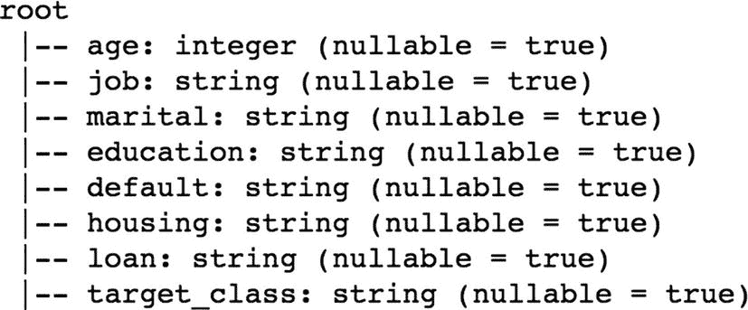

如您所见，输入列是除目标类列之外的所有列。目标类在 yes 和 no 标签的数量上也保持良好平衡。我们需要将 yes 和 no 转换为 1 和 0，并将 `target_class` 列重命名为 "label"，这是机器学习模型参数中默认接受的列名。

```
[In]: df.groupBy('target_class').count().show()
[Out]:
```

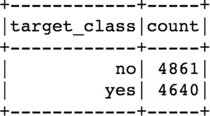

#### 步骤 2：为模型进行特征工程

```
[In]: from pyspark.sql import functions as F
[In]: from pyspark.sql import ∗
[In]: df=df.withColumn("label", F.when(df.target_class =='no', F.lit(0)).otherwise(F.lit(1)))
[In]: df.groupBy('label').count().show()
[Out]:
```

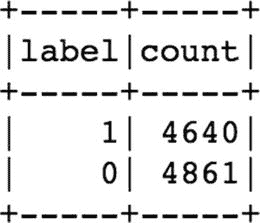

现在我们已经将输出列重命名为 "label" 并将目标类转换为 1 和 0，下一步是为模型创建特征。由于存在分类列（如 job 和 edu），我们需要使用 `StringIndexer` 和 `OneHotEncoder` 将其转换为数值格式。我们创建一个 Python 函数 `cat_to_num`，将所有分类特征转换为数值特征。

```
[In]: from pyspark.ml.feature import OneHotEncoder, StringIndexer, VectorAssembler
[In]: def cat_to_num(df):
for col in df.columns:
stringIndexer = StringIndexer(inputCol=col, outputCol=col+"_index")
model = stringIndexer.fit(df)
indexed = model.transform(df)
encoder = OneHotEncoder(inputCol=col+"_index", outputCol=col+"_vec")
df = encoder.transform(indexed)
df_assembler = VectorAssembler(inputCols=['age','marital_vec','education_vec','default_vec','housing_vec','loan_vec'], outputCol="features")
df = df_assembler.transform(df)
return df.select(['features','label'])
```

我们只选择新的特征列和目标标签列，因为模型训练不再需要之前的原始列。

```
[In]: df_new=cat_to_num(df)
[In]: df_new.show()
[Out]:
```

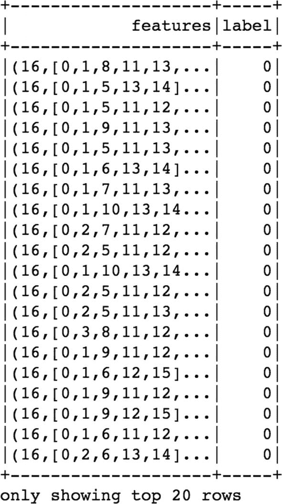

现在，所有输入特征已合并为一个密集向量（`'features'`），并附带输出列标签，可用于训练机器学习模型。仅使用两列（features, label）创建的新数据框现在称为 `df_new`，并将用于每个模型。我们现在可以将这个新数据框拆分为训练集和测试集。我们可以使用 `randomSplit` 函数将数据按 75%/25% 的比例拆分。

#### 步骤 3：将数据拆分为训练集和测试集

```
[In]: train, test = df_new.randomSplit([0.75, 0.25])
[In]: print(f"Size of train Dataset : {train.count()}" )
[Out]: 7121
[In]: print(f"Size of test Dataset : {test.count()}" )
[Out]: 2380
```


#### 第 4 步：构建并训练逻辑回归模型

```
[In]: from pyspark.ml.classification import LogisticRegression
[In]: lr = LogisticRegression()
[In]: lr_model = lr.fit(train)
[In]: print(lr_model.coefficients)
[Out]:
[0.0272019114172,-0.647672064875,0.229030508111,-0.77074788287,-12.36869511,-12.8865599132,-13.2257790609,-12.6705131313,-13.0023164274,-13.0747662586,-12.6985757761,1.42220523957,0.301582233094,-0.0127231892838,0.218471149577,0.332362933568]
```

模型构建完成后，我们可以利用内部函数 `summary`，该函数提供了关于模型的重要细节，例如 ROC 曲线、精确率、召回率、AUC（曲线下面积）等。

#### 第 5 步：评估训练数据上的性能

```
[In]: lr_summary = lr_model.summary
[In]: lr_summary.accuracy
[Out]: 0.673079623648364
[In]: lr_summary.areaUnderROC
[Out]: 0.7186044694483512
[In]: lr_summary.weightedRecall
[Out]: 0.673079623648364
[In]: lr_summary.weightedPrecision
[Out]: 0.6750967624018298
```

在这里，使用 `summary` 函数，我们可以查看模型在训练数据上的性能，例如其准确率、AUC、加权召回率和精确率。我们还可以查看其他细节——例如不同阈值下精确率的变化、精确率与召回率之间的关系，以及召回率随不同阈值的变化情况——以便为模型选择正确的阈值。这些关系也可以通过绘图来直观查看。

```
[In]: lr_summary.precisionByThreshold.show()
[Out]:
```

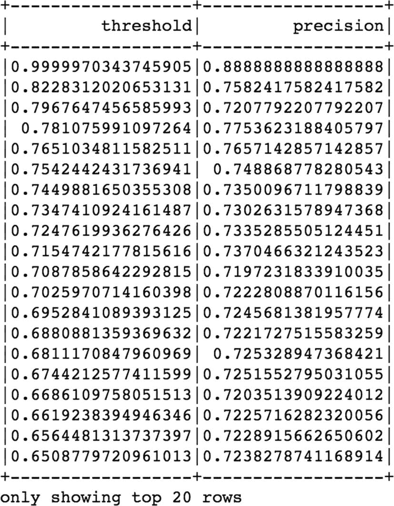

```
[In]: lr_summary.roc.show()
[Out]:
```

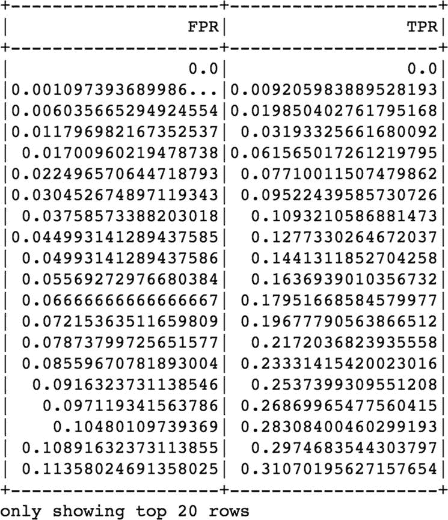

```
[In]: lr_summary.recallByThreshold.show()
[Out]:
```

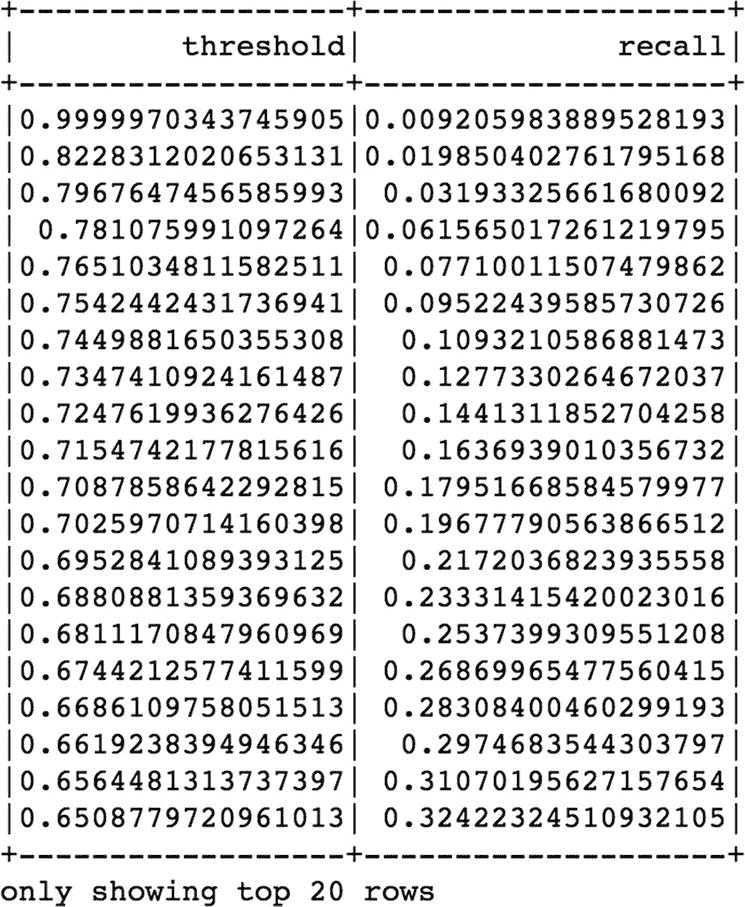

```
[In]: lr_summary.pr.show()
[Out]:
```

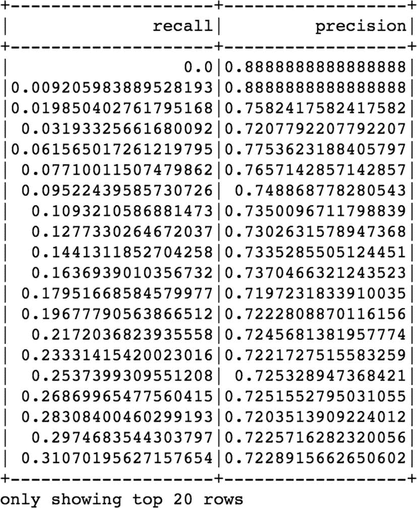

#### 第 6 步：评估测试数据上的性能

```
[In]: model_predictions = lr_model.transform(test)
[In]: model_predictions.columns
[Out]: ['features', 'label', 'rawPrediction', 'probability', 'prediction']
[In]: model_predictions.select(['label','probability','prediction']).show(10,False)
[Out]:
```

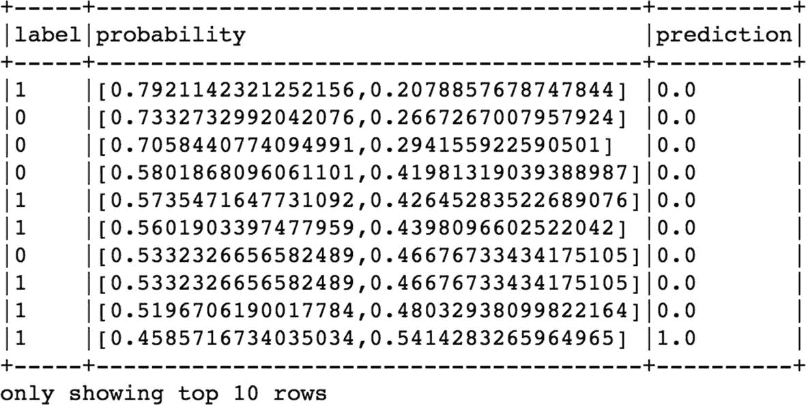

如您所见，`prediction` 列显示了模型对测试数据中每条记录的预测结果。`probability` 列则显示了两个类别（0 和 1）的概率值。索引 0 处的概率对应类别 0，另一个则对应类别 1 的预测。对测试数据上的逻辑回归模型进行评估，可以使用 `BinaryClassEvaluator`。我们可以获取 ROC 曲线下面积和 PR 曲线下面积，如下所示：

```
[In]: from pyspark.ml.evaluation import BinaryClassificationEvaluator
[In]: lr_evaluator = BinaryClassificationEvaluator(metricName='areaUnderROC')
[In]: lr_auroc = lr_evaluator.evaluate(model_predictions)
[In]: print(f'逻辑回归模型的 auroc 值为 {lr_auroc}')
[Out]: 逻辑回归模型的 auroc 值为 0.7092938229110143
[In]: lr_evaluator = BinaryClassificationEvaluator(metricName='areaUnderPR')
[In]: lr_aupr = lr_evaluator.evaluate(model_predictions)
[In]: print(f'逻辑回归模型的 aupr 值为 {lr_aupr}')
[Out]: 逻辑回归模型的 aupr 值为 0.6630743130940658
[In]: true_pos = model_predictions.filter(model_predictions['label'] == 1).filter(model_predictions['prediction'] == 1).count()
[In]: actual_pos = model_predictions.filter(model_predictions['label'] == 1).count()
[In]: pred_pos = model_predictions.filter(model_predictions['prediction'] == 1).count()
召回率
[In]: float(true_pos) / (actual_pos)
[Out]: 0.6701030927835051
精确率
[In]: float(true_pos) / (pred_pos)
[Out]: 0.6478405315614618
```

### 决策树分类器

如前所述，决策树可用于分类和回归。这里，我们将使用默认超参数构建一个决策树，并用它来预测用户是否会选择新的定期存款计划。

#### 第 1 步：构建并训练决策树分类器模型

```
[In]: from pyspark.ml.classification import DecisionTreeClassifier
[In]: dt = DecisionTreeClassifier()
[In]: dt_model = dt.fit(train)
[In]: model_predictions = dt_model.transform(test)
[Out]: model_predictions.select(['label','probability','prediction']).show(10,False)
```

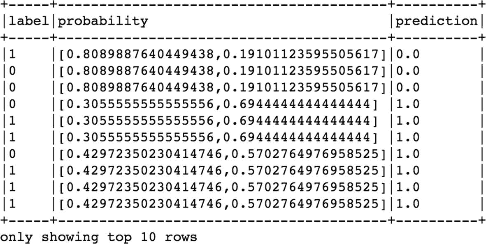

#### 第 2 步：评估测试数据上的性能

```
[In]: dt_evaluator = BinaryClassificationEvaluator(metricName='areaUnderROC')
[In]: dt_auroc = dt_evaluator.evaluate(model_predictions)
[In]: print(f'决策树分类器模型的 auc 值为 {dt_auroc}')
[Out]: 决策树分类器模型的 auc 值为 0.516199386190993
[In]: dt_evaluator = BinaryClassificationEvaluator(metricName='areaUnderPR')
[In]: dt_aupr = dt_evaluator.evaluate(model_predictions)
[In]: print(f'决策树模型的 aupr 值为 {dt_aupr}')
[Out]: 决策树模型的 aupr 值为 0.46771834172588167
[In]: true_pos = model_predictions.filter(model_predictions['label'] == 1).filter(model_predictions['prediction'] == 1).count()
[In]: actual_pos = model_predictions.filter(model_predictions['label'] == 1).count()
[In]: pred_pos = model_predictions.filter(model_predictions['prediction'] == 1).count()
[In]: float(true_pos) / (actual_pos)
[Out]: 0.6907216494845361
[In]: float(true_pos) / (pred_pos)
[Out]: 0.6661143330571665
```


### 支持向量机分类器

支持向量机（SVM）用于分类任务，它通过寻找能够最大化两个类别之间间隔（垂直距离）的超平面来实现分类。所有实例和目标类别都被表示为高维空间中的向量，SVM 会从两个类别中找出距离最近的两个点，这两个点支撑起最佳的分隔线或超平面，如图 6-5 所示。

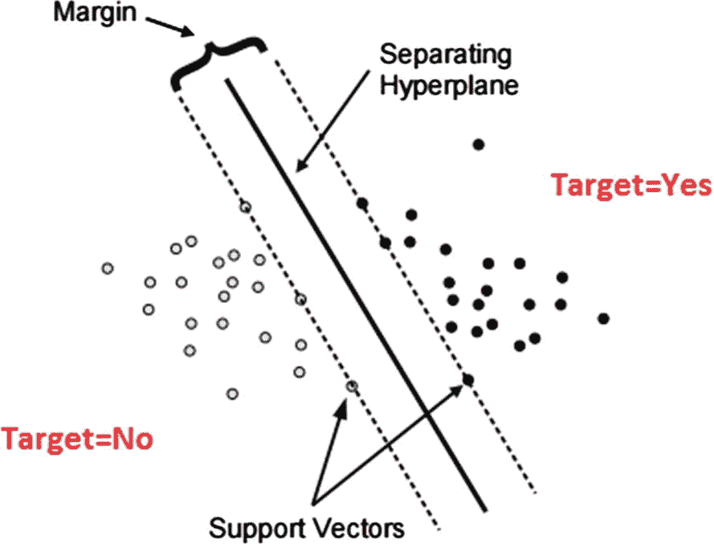

图 6-5

支持向量机

对于非线性可分的数据，有多种核技巧可用于分离类别。在我们的示例中，我们将使用默认超参数构建一个线性可分的支持向量分类器。

#### 步骤 1：构建并训练 SVM 模型

```
[In]: from pyspark.ml.classification import LinearSVC
[In]: lsvc = LinearSVC()
[In]: lsvc_model = lsvc.fit(train)
[In]: model_predictions = lsvc_model.transform(test)
[In]: model_predictions.columns
[Out]: ['features', 'label', 'rawPrediction', 'prediction']
[In]: model_predictions.select(['label','prediction']).show(10,False)
[Out]:
```

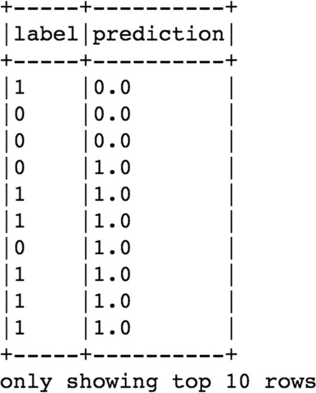

#### 步骤 2：在测试数据上评估性能

```
[In]: svc_evaluator = BinaryClassificationEvaluator(metricName='areaUnderROC')
[In]: svc_auroc = svc_evaluator.evaluate(model_predictions)
[In]: print(f'The auc value of SupportVectorClassifier  is {svc_auroc}')
[Out]: The auc value of SupportVectorClassifier  is 0.7043772749366973
[In]: svc_evaluator = BinaryClassificationEvaluator(metricName='areaUnderPR')
[In]: svc_aupr = svc_evaluator.evaluate(model_predictions)
[In]: print(f'The aupr value of SupportVectorClassifier Model is {svc_aupr}')
[Out]: The aupr value of SupportVectorClassifier Model is 0.6567277377856992
[In]: true_pos = model_predictions.filter(model_predictions['label']==1).filter(model_predictions['prediction']==1).count()
[In]: actual_pos = model_predictions.filter(model_predictions['label']==1).count()
[In]: pred_pos = model_predictions.filter(model_predictions['prediction']==1).count()
[In]: float(true_pos)/(actual_pos)
[Out]: 0.7774914089347079
[In]: float(true_pos)/(pred_pos)
[Out]: 0.600132625994695
```

### 朴素贝叶斯分类器

朴素贝叶斯（NB）分类器基于条件概率原理，并假设预测变量之间绝对独立。NB 分类器没有太多超参数，并且其性能可能超越一些最复杂的算法。在下面的示例中，我们将构建一个 NB 分类器，并在测试数据上评估其性能。

#### 步骤 1：构建并训练 SVM 模型

```
[In]: from pyspark.ml.classification import NaiveBayes
[In]: nb = NaiveBayes()
[In]: nb_model = nb.fit(train)
[In]: model_predictions = nb_model.transform(test)
[In]: model_predictions.select(['label','probability','prediction']).show(10,False)
[Out]:
```

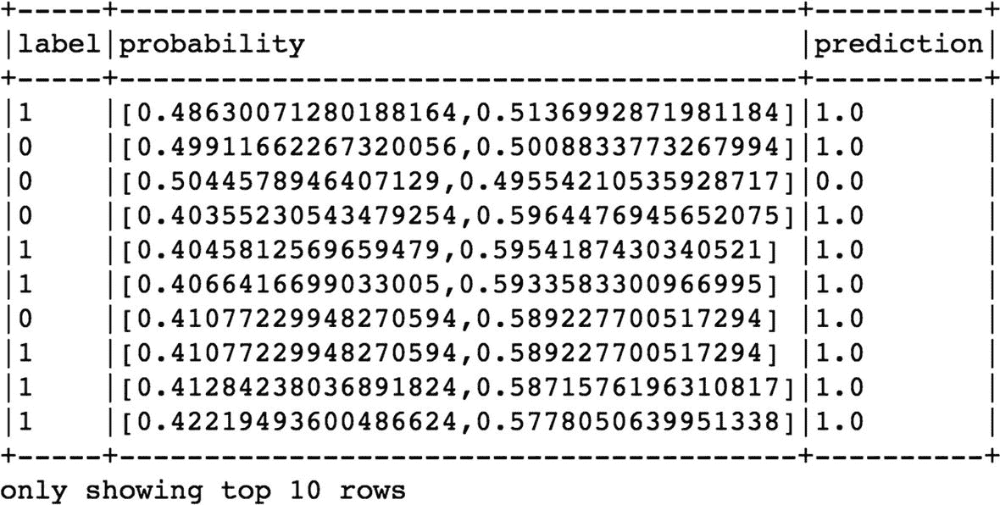

#### 步骤 2：在测试数据上评估性能

```
[In]: nb_evaluator = BinaryClassificationEvaluator(metricName='areaUnderROC')
[In]: nb_auroc = nb_evaluator.evaluate(model_predictions)
[In]: print(f'The auc value of NB Classifier is {nb_auroc}')
[Out]: The auc value of NB Classifier is 0.43543736717760884
[In]: nb_evaluator = BinaryClassificationEvaluator(metricName='areaUnderPR')
[In]: nb_aupr = nb_evaluator.evaluate(model_predictions)
[In]: print(f'The aupr value of NB Classifier Model is {nb_aupr}')
[Out]: The aupr value of NB Classifier Model is 0.4321001351769349
[In]: true_pos = model_predictions.filter(model_predictions['label']==1).filter(model_predictions['prediction']==1).count()
[In]: actual_pos = model_predictions.filter(model_predictions['label']==1).count()
[In]: pred_pos = model_predictions.filter(model_predictions['prediction']==1).count()
[In]: float(true_pos)/(actual_pos)
[Out]: 0.586
[In]: float(true_pos)/(pred_pos)
[Out]: 0.625
```

### 梯度提升树分类器

到目前为止，我们一直使用单一算法进行分类。现在，我们转向使用集成方法，如 GBT 和随机森林，进行分类。用于分类的 Bagging 和 Boosting 遵循与回归相似的原理。

#### 步骤 1：构建并训练 GBT 模型

```
[In]: from pyspark.ml.classification import GBTClassifier
[In]: gbt = GBTClassifier()
[In]: gbt_model = gbt.fit(train)
[In]: model_predictions = gbt_model.transform(test)
[In]: model_predictions.select(['label','probability','prediction']).show(10,False)
[Out]:
```

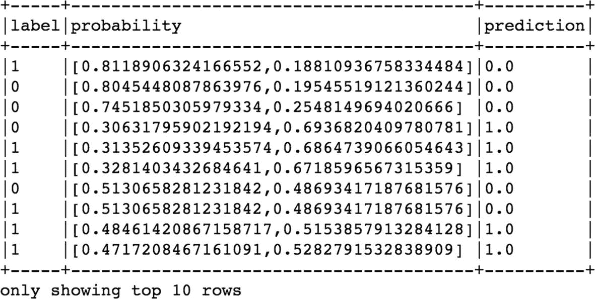

#### 步骤 2：在测试数据上评估性能

```
[In]: gbt_evaluator = BinaryClassificationEvaluator(metricName='areaUnderROC')
[In]: gbt_auroc = gbt_evaluator.evaluate(model_predictions)
[In]: print(f'The auc value of GradientBoostedTreesClassifier is {gbt_auroc}')
[Out]: The auc value of GradientBoostedTreesClassifier is 0.7392410330756018
[In]: gbt_evaluator = BinaryClassificationEvaluator(metricName='areaUnderPR')
[In]: gbt_aupr = gbt_evaluator.evaluate(model_predictions)
[In]: print(f'The aupr value of GradientBoostedTreesClassifier Model is {gbt_aupr}')
[Out]: The aupr value of GradientBoostedTreesClassifier Model is 0.7345982892755392
[In]: true_pos = model_predictions.filter(model_predictions['label']==1).filter(model_predictions['prediction']==1).count()
[In]: actual_pos = model_predictions.filter(model_predictions['label']==1).count()
[In]: pred_pos = model_predictions.filter(model_predictions['prediction']==1).count()
[In]: float(true_pos)/(actual_pos)
[Out]: 0.668
[In]: float(true_pos)/(pred_pos)
[Out]: 0.674
```

### 随机森林分类器

同样，随机森林分类器是多个决策树分类器的集合。它基于投票机制运作，预测所有单个决策树中获得最多投票的输出类别。让我们使用相同的数据构建一个随机森林分类器。

#### 步骤 1：构建并训练随机森林模型

```
[In]: from pyspark.ml.classification import RandomForestClassifier
[In]: rf = RandomForestClassifier(numTrees=50, maxDepth=30)
[In]: rf_model = rf.fit(train)
[In]: model_predictions = rf_model.transform(test)
[In]: model_predictions.select(['label','probability','prediction']).show(10,False)
[Out]:
```

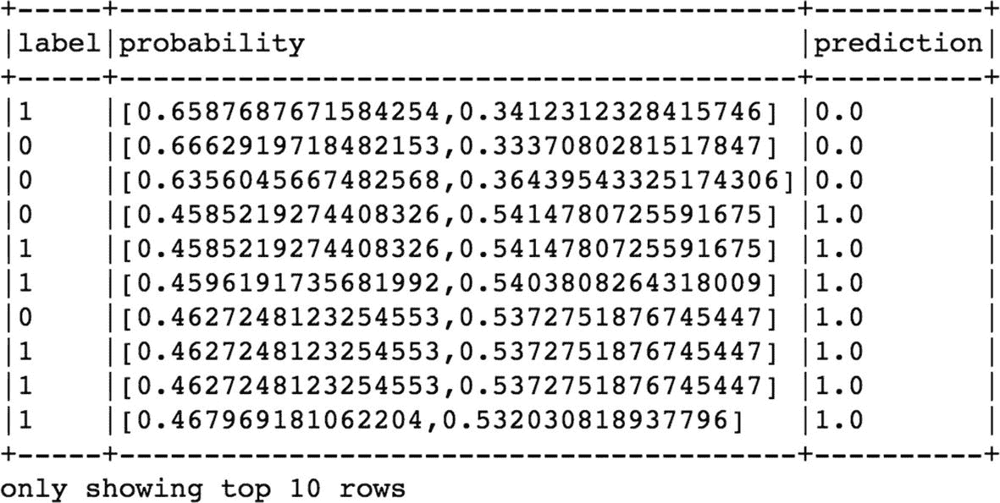

#### 步骤 2：在测试数据上评估性能

```
[In]: rf_evaluator = BinaryClassificationEvaluator(metricName='areaUnderROC')
[In]: rf_auroc = rf_evaluator.evaluate(model_predictions)
[In]: print(f'The auc value of RandomForestClassifier Model is {rf_auroc}')
[Out]: The auc value of RandomForestClassifier Model is 0.7326433634020617
[In]: rf_evaluator = BinaryClassificationEvaluator(metricName='areaUnderPR')
[In]: rf_aupr = rf_evaluator.evaluate(model_predictions)
[In]: print(f'The aupr value of RandomForestClassifier Model is {rf_aupr}')
[Out]: The aupr value of RandomForestClassifier Model is 0.7277253895494864
[In]: true_pos = model_predictions.filter(model_predictions['label']==1).filter(model_predictions['prediction']==1).count()
[In]: actual_pos = model_predictions.filter(model_predictions['label']==1).count()
[In]: pred_pos = model_predictions.filter(model_predictions['prediction']==1).count()
[In]: float(true_pos)/(actual_pos)
[Out]: 0.67
[In]: float(true_pos)/(pred_pos)
[Out]: 0.67
```

到目前为止，我们一直对所有模型使用默认超参数，但模型在默认设置下很少能发挥出最佳性能。因此，对模型进行调优以找到正确的超参数组合是至关重要的。


## 超参数调优与交叉验证

在接下来的示例中，我们将以刚构建的随机森林模型为基础，尝试找到其超参数的最佳组合，以提升模型性能。我们可以使用`ParamgridBuilder`和`CrossValidator`进行超参数调优。我们将为三个超参数（`maxDepth`、`maxBins`和`numTrees`）在参数网格中传入不同的值。由于需要为所有这些组合构建随机森林模型，然后返回针对该训练数据集的最佳组合，整个过程可能需要几分钟才能完成。

```
[In]: from pyspark.ml.tuning import ParamGridBuilder, CrossValidator
[In]: rf = RandomForestClassifier()
[In]: paramGrid = (ParamGridBuilder()
.addGrid(rf.maxDepth, [5,10,20,25,30])
.addGrid(rf.maxBins, [20, 60])
.addGrid(rf.numTrees, [5, 20,50,100])
.build())
[In]: cv = CrossValidator(estimator=rf, estimatorParamMaps=paramGrid, evaluator=rf_evaluator, numFolds=5)
[In]: cv_model = cv.fit(train)
[In]: best_rf_model = cv_model.bestModel
best_rf_model 包含了用于在该数据集上训练模型的最佳超参数。
[In]: model_predictions = best_rf_model.transform(test)
[In]: rf_evaluator = BinaryClassificationEvaluator(metricName='areaUnderROC')
[In]: rf_auroc = rf_evaluator.evaluate(model_predictions)
[In]: print(rf_auroc)
[Out]:  0.7425990374615659
```

如您所见，通过为随机森林模型使用最佳超参数，AUC 分数得到了提升。

## 结论

本章详细介绍了不同类型的监督学习，以及使用多种机器学习算法解决二分类问题的方法。此外，还解释了如何为模型选择最佳超参数，以及如何利用交叉验证技术在给定数据集上构建尽可能最优的模型。

