# 7. 无监督机器学习

顾名思义，无监督机器学习并不涉及寻找输入与输出之间的关系。坦白说，在无监督学习中，我们并没有需要预测的输出。它主要用于将那些在某种意义下彼此相似的特征归组在一起。这些相似性可以是特征之间的距离，也可以是某种相似性度量。在本章中，我将介绍一些无监督机器学习技术，并使用 PySpark 构建一个机器学习模型，将用户划分为不同的群体，随后还将对这些群体进行可视化。

## 无监督机器学习入门

如前所述，无监督学习的目标并非映射输入与输出之间的关系，而是尝试将彼此相似的值归组。它并不对输入数据进行训练，而是通过寻找数据中的潜在信号和模式来形成内部的分组。无监督学习可以进一步分为两个不同的类别：

1. 聚类
2. 关联规则

聚类是指根据数据中存在的属性，寻找数据点的潜在分组，如图 7-1 所示。

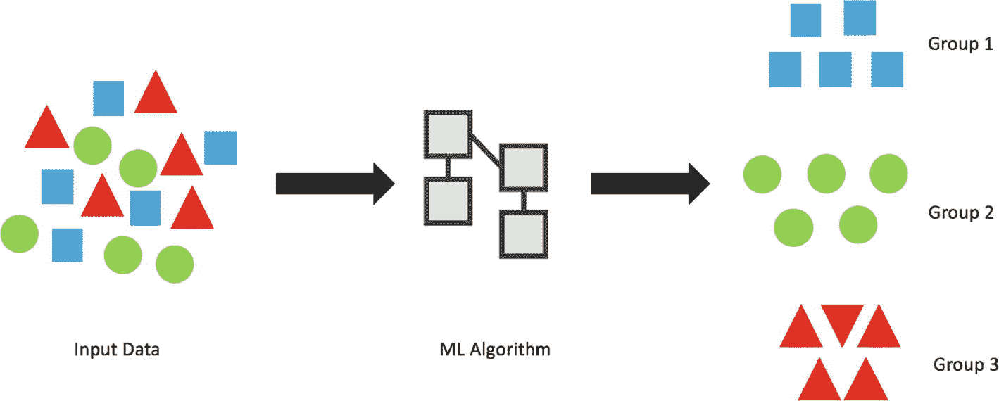
*图 7-1 无监督机器学习*

关联则指代共现的概率。例如，如果有人购买了商品 X，那么他/她同时购买商品 Y 的概率是多少？在本章中，我将只关注聚类技术。我们可以轻松地利用聚类来理解数据中的不同群体。例如，如果我们有一些关于足球运动员的数据，我们可以轻松预测他们在场上的位置——他们是前锋还是后卫。表 7-1 展示了一场足球锦标赛中部分球员的样本数据。捕获的两个值是：

1. 总射门次数
2. 总抢断次数

*表 7-1 射门次数 vs. 进球数*

| 序号 | 射门次数 | 抢断次数 |
| --- | --- | --- |
| 1 | 8 | 2 |
| 2 | 2 | 10 |
| 3 | 9 | 1 |
| 4 | 15 | 1 |
| 5 | 2 | 17 |
| 6 | 4 | 6 |
| 7 | 8 | 2 |
| 8 | 0 | 25 |
| 9 | 1 | 17 |
| 10 | 0 | 15 |

如果我们尝试将上述数值绘制在散点图上，会得到类似于图 7-2 所示的结果。x 轴表示球员的抢断次数，y 轴表示射门次数。

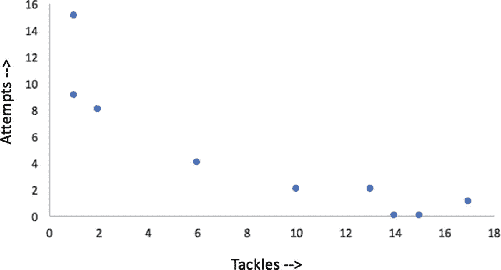
*图 7-2 射门次数 vs. 进球数的散点图*

到目前为止，我们并不知道哪些球员是前锋、中场或后卫，但如果我们在这些数据上使用某种聚类技术，就会得到如图 7-3 所示的分组。该图清晰地显示这些数据中存在三个分组。图表的左上角聚集了所有前锋，而右下角的聚类则代表了抢断次数最多、射门次数最少的后卫。在这两组之间还有一名球员，他可能属于中场类别，拥有合理的抢断次数和射门次数。

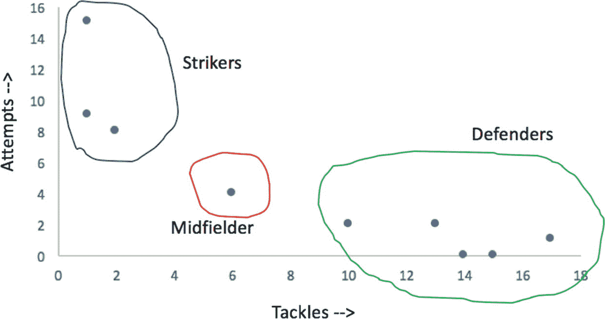
*图 7-3 数据中的分组*

在这个例子中，我们看到了如何在不进行任何监督训练的情况下，仍然能够预测数据中存在的分组。

聚类有多种应用，包括以下几种：

1. 异常检测
2. 预测性维护
3. 客户细分

根据可用的数据和特定需求，可以使用多种聚类算法。在本章中，我将重点介绍 k-means 算法，用于为在线收听不同音乐流派的用户群体创建聚类。K-means 是进行这种分组练习的最强大算法之一。*K* 代表需要从数据中形成的聚类或组的数量。K-means 的工作原理是计算每个数据点与其他数据点的距离，并尝试将最近的点归组，直到达到所需的 K 值数量。我们将尝试使用 k-means 算法将用户划分为有意义的群体，以便能够根据他们对特定音乐流派的品味进行推荐。

## 查看数据集

我们将用于此示例的数据集是一个采样数据集，仅包含两列：用户 ID 和音乐类别。该数据集中有近五十万条记录。

### 导入 `SparkSession` 并创建对象

第一步是导入 `SparkSession` 并创建一个 Spark 对象，以便使用 PySpark。

```
[In]: from pyspark.sql import SparkSession
[In]: spark=SparkSession.builder.appName('unsupervised_learning').getOrCreate()
```

我们还将导入其他几个库，例如 Pandas 和 NumPy，以备后续使用。

```
[In]: import pyspark
[In]: import pandas as pd
[In]: import numpy as np
[In]: import matplotlib.pyplot as plt
[In]: from pyspark.sql.functions import *
[In]: from pyspark.sql.types import *
[In]: from pyspark.ml.clustering import KMeans
[In]: df=spark.read.csv('music_data.csv',inferSchema=True,header=True)
[In]: df.count()
[Out]: 429023
[In]: df.printSchema()
[Out]:
```

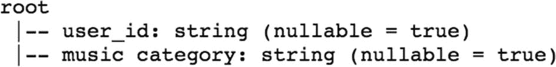

上述结果确认了数据集中仅包含两列。我们可以通过执行一些聚合操作来进一步探索这个数据框。可以使用 `distinct` 函数确定不同音乐类别的总数。通过按音乐类别列分组并对计数进行排序，可以找到用户最偏好的音乐类别，如下所示：

```
[In]: df.select('music category').distinct().count()
[Out]: 21
[In]:df.groupBy('music category').count().orderBy('count',ascending=False).show(100,False)
[Out]:
```

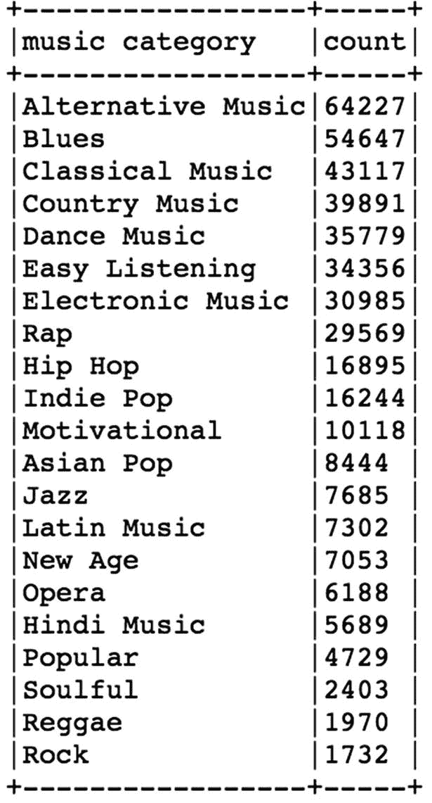

另类音乐和蓝调似乎是用户最偏好的音乐类型。我们还可以用类似的方法找出系统中唯一用户的总数。

```
[In]: df.select('user_id').distinct().count()
[Out]: 775
[In]:df.groupBy('user_id').count().orderBy('count',ascending=False).show(20,False)
[Out]:
```

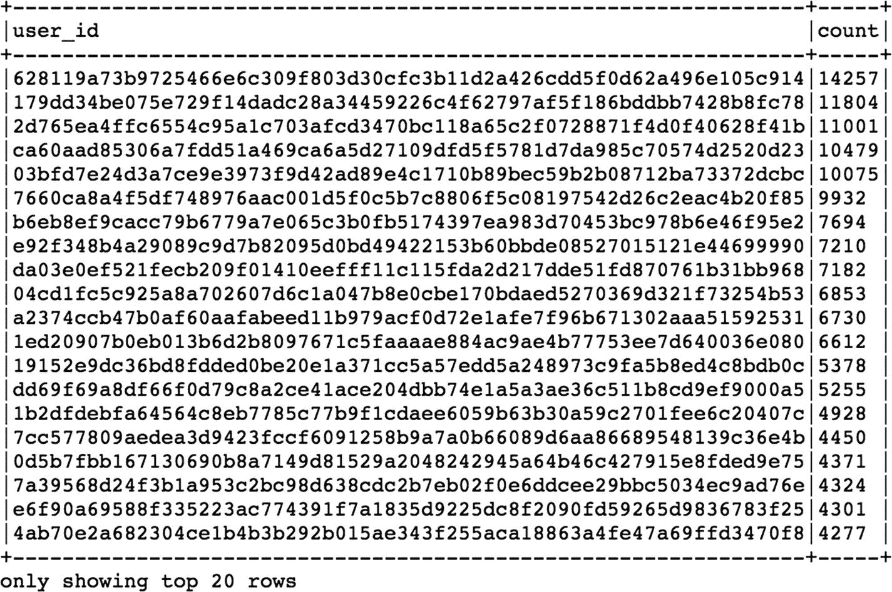

```
[In]:df.groupBy('user_id').count().orderBy('count',ascending=True).show(20,False)
[Out]:
```

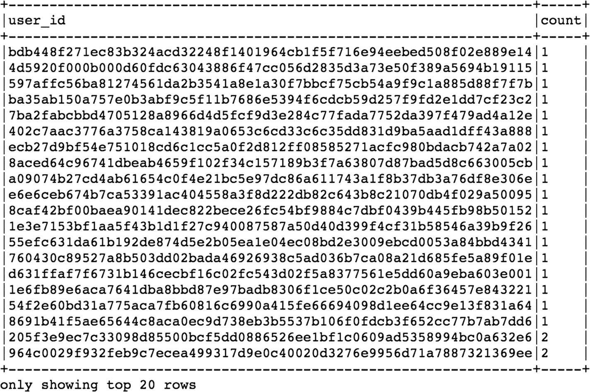

在这个数据框中，用户类型混杂。有些用户听歌次数多达 14,000 次，而有些用户只听过一次。下一步任务是重塑这个数据框，以便在其上应用聚类。

## 为聚类重塑数据框

我们以用户 ID 和音乐类别为基准对数据进行透视，并用用户听过的歌曲总数填充数值。我们使用 `crosstab` 函数来透视数据。

```
[In]: feature_df=df.stat.crosstab("user_id", "music category")
[In]: feature_df.printSchema()
[Out]:
```

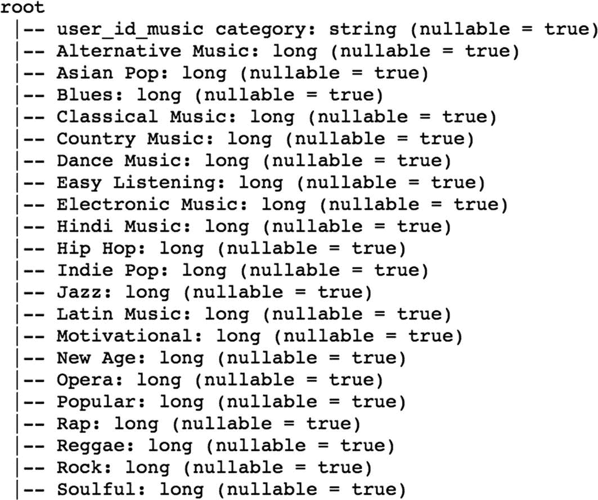

```
[In]: feature_df.show(3,False)
[Out]:
```

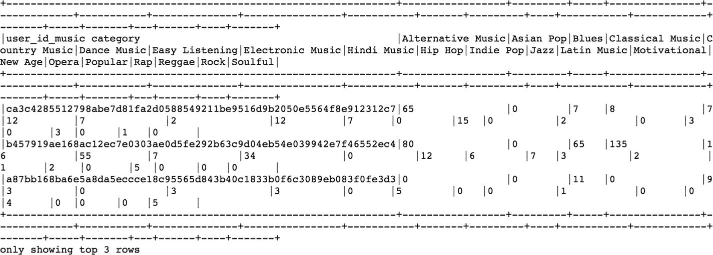

```
[In]: from pyspark.ml.linalg import Vectors
[In]: from pyspark.ml.feature import VectorAssembler
```

现在，新数据框中已包含所需的属性，我们必须使用 `VectorAssembler` 将它们组装起来，以创建一个单一的特征向量。这里需要记住的关键一点是，我们不会使用数据框中本质上包含用户 ID 的索引来用于 `VectorAssembler`。

```
[In]: print(feature_df.columns)
[Out]:
```

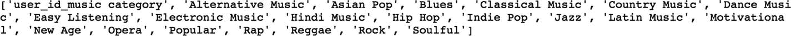

```
[In]: feat_cols=[col for col in feature_df.columns if col != 'user_id_music category']
[In]: print(feat_cols)
[Out]:
```

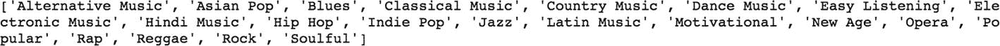

```
[In]: vec_assembler = VectorAssembler(inputCols = feat_cols, outputCol="features")
[In]: final_data = vec_assembler.transform(feature_df)
[In]: final_data.printSchema()
[Out]:
```

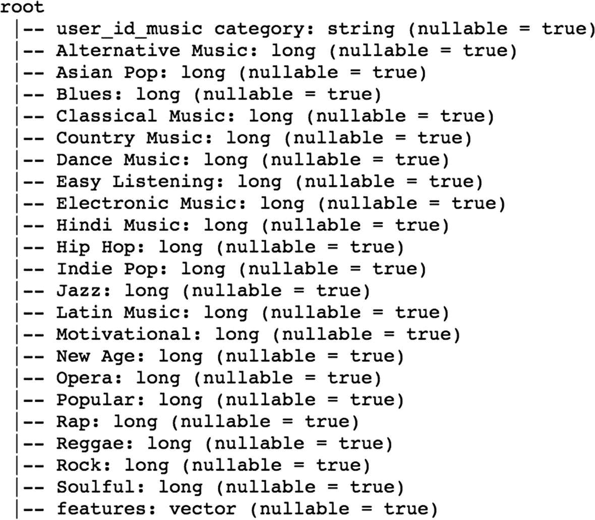

## 注意

需要记住的一点是，聚类可能对数据的尺度敏感，原因很简单，因为它使用距离度量来比较两个值（多维）之间的相似性。因此，在应用聚类之前对数据进行缩放总是一个好主意。

接下来，我们导入 Spark 库中的 `StandardScaler`，并将其应用于特征向量。

```
[In]: from pyspark.ml.feature import StandardScaler
[In]:scaler = StandardScaler(inputCol="features", outputCol="scaledFeatures", withStd=True, withMean=False)
[In]: scalerModel = scaler.fit(final_data)
[In]: cluster_final_data.columns
[Out]:
```

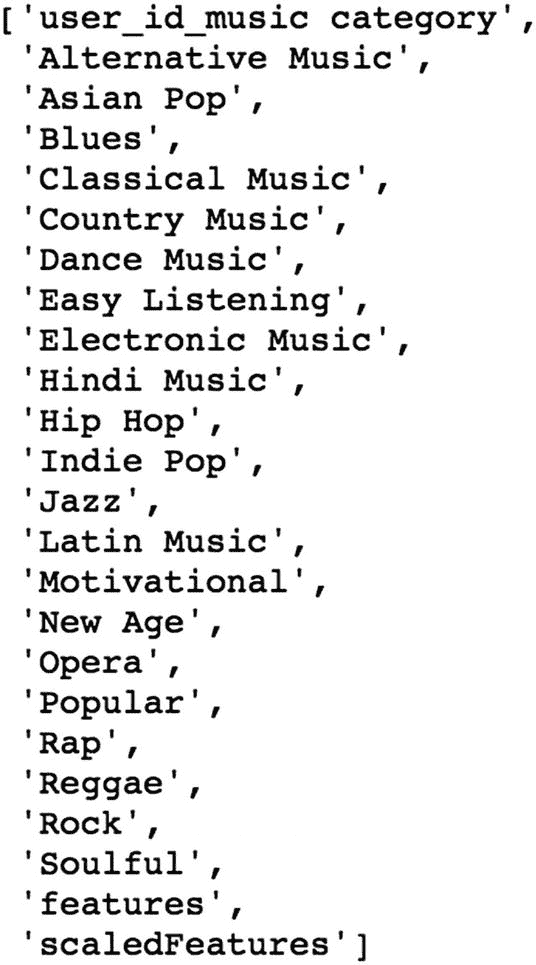

下一步是使用 k-means 聚类算法实际构建聚类。

## 使用 K-Means 构建聚类

在执行聚类分析之前，需要提出的一个关键问题是：“数据应该形成多少个聚类？”解决这个问题的一种方法是使用肘部法则，通过绘制聚类内总平方误差与聚类数量的关系图。这能让我们了解从给定数据中可以形成多少个合适的组。基本上，我们对一组预先确定数量的聚类（2-10）应用 k-means 算法，并可视化其对应的误差。图表中形成肘部形状的位置，就是选择 `k` 值的最佳数量。

```
[In]: errors=[]
for k in range(2,10):
kmeans = KMeans(featuresCol='scaledFeatures',k=k)
model = kmeans.fit(cluster_final_data)
wssse = model.computeCost(cluster_final_data)
errors.append(wssse)
print("With K={}".format(k))
print("Within Set Sum of Squared Errors = " + str(wssse))
print('--'*30)
[Out]:
```

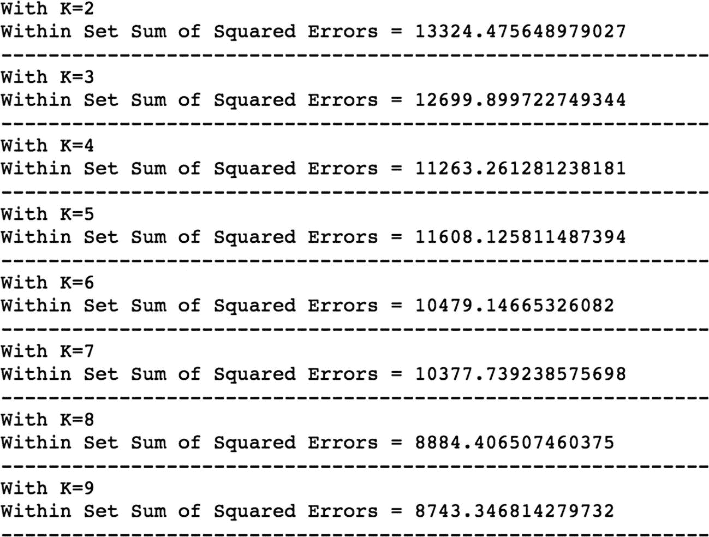

```
[In]: cluster_number = range(2,10)
[In]: plt.scatter(cluster_number,errors)
[In]: plt.xlabel('clusters')
[In]: plt.ylabel('WSSE')
[In]: plt.show()
[Out]:
```

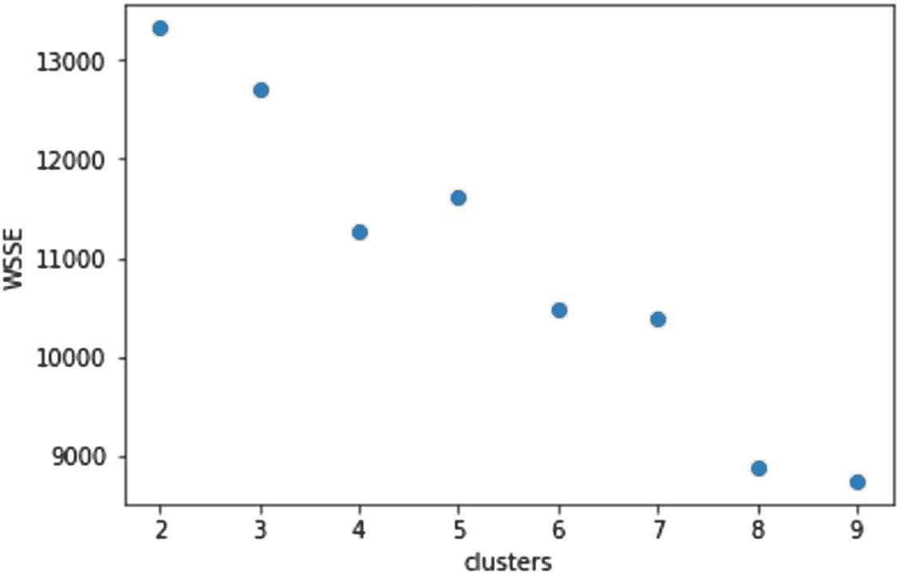

**图 7-4** 肘部图

在我们的案例中，图表中形成了多个肘部。因此，我们可以选择 `4`、`6` 或 `8` 作为 `k` 的值。需要记住的一点是，聚类没有唯一正确的答案。基于所使用的技术，同一数据可以产生不同的聚类，因为每种技术的初始化点都不同。我们继续选择 `k` 的值为 `6`。

```
[In]: kmeans6 = KMeans(featuresCol='scaledFeatures',k=6)
[In]: model_k6 = kmeans6.fit(cluster_final_data)
[In]: model_k6.transform(cluster_final_data).groupBy('prediction').count().show()
[Out]:
```

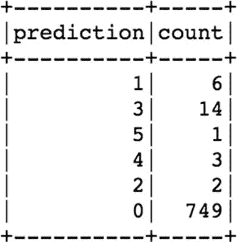

从我们的数据中，我们看到有一个聚类包含了大多数用户。除此之外，还有五个数值较小的聚类。现在，我们将这个预测结果添加到现有的数据框中，以便能够可视化这些聚类。

```
[In]: model_k6.transform(cluster_final_data).show()
[Out]:
```

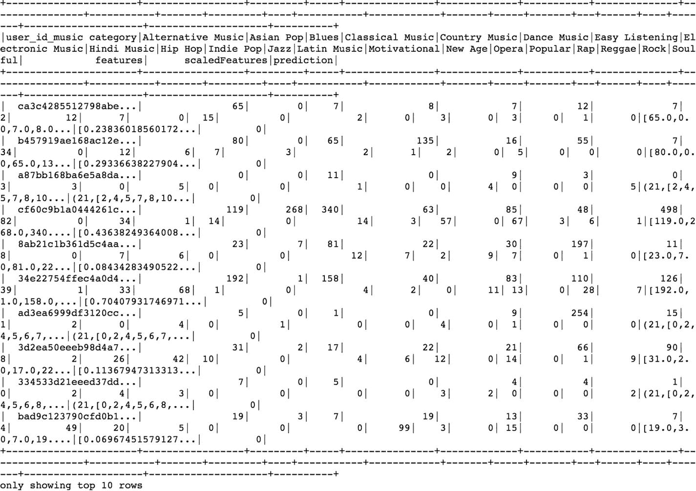

```
[In]: cluser_prediction=model_k6.transform(cluster_final_data)
[In]: cluser_prediction.printSchema()
[Out]:
```

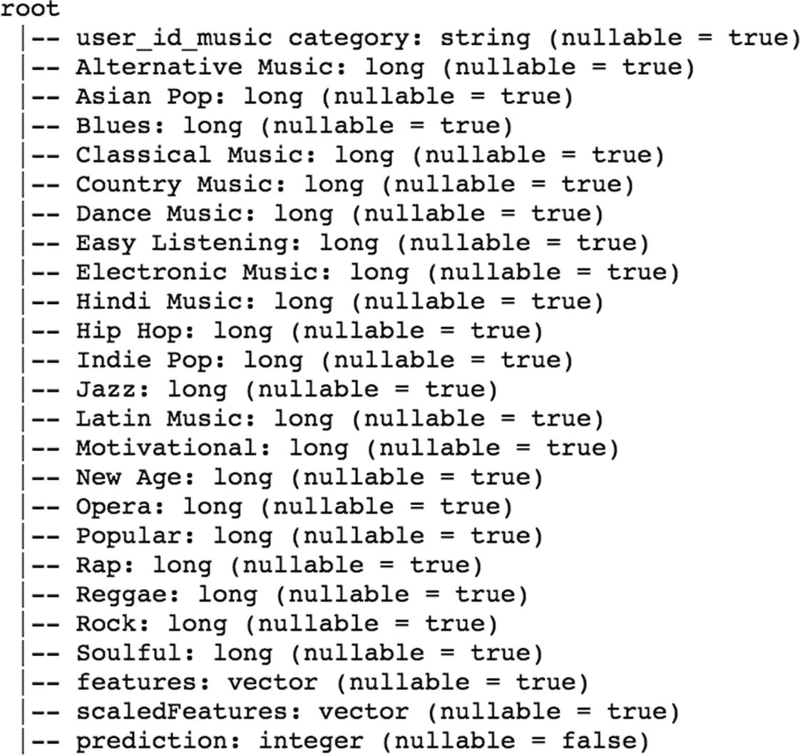

由于我们处理的是多维数据，用聚类编号来可视化数据会变得困难。因此，我们使用 PCA（主成分分析）技术来减少总维度数。在前面的章节中，你已经了解了如何使用 PCA。现在，我们使用 PCA 将原始特征的数量从 21 个减少到仅 3 个，如下所示。

```
[In]: from pyspark.ml.feature import PCA
[In]: from pyspark.ml.linalg import Vectors
[In]: pca = PCA(k=3, inputCol="scaledFeatures", outputCol="pca_features")
[In]: pca_model = pca.fit(cluser_prediction)
[In]: result = pca_model.transform(cluser_prediction).select('user_id_music category',"pca_features",'prediction')
[In]: result.show(truncate=False)
[Out]:
```

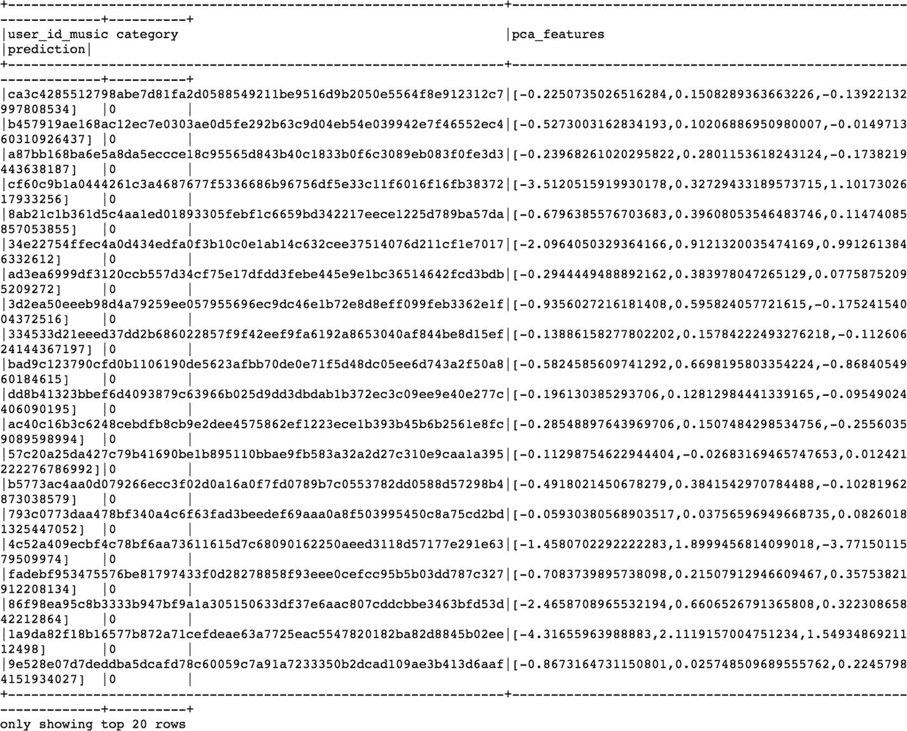

最后，我们将 PCA 数据框转换为 Pandas 数据框，并通过从列表中创建单独的列，从 PCA 特征列中分离出独立的列（`x`、`y`、`z`）。

```
[In]: clusters = result.toPandas().set_index('user_id_music category')
[In]: clusters.head(10)
[Out]:
```

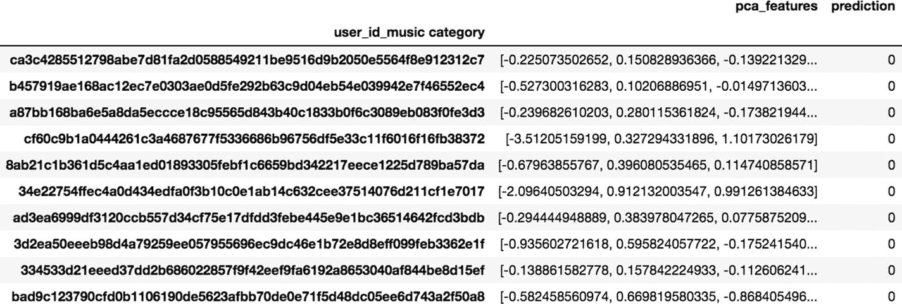

## 特征转换与聚类结果预览

```python
[In]: clusters[['x','y','z']]=pd.DataFrame(clusters.pca_features.values.tolist(), index= clusters.index)
[In]: del clusters['pca_features']
[In]: clusters.head(10)
[Out]:
```

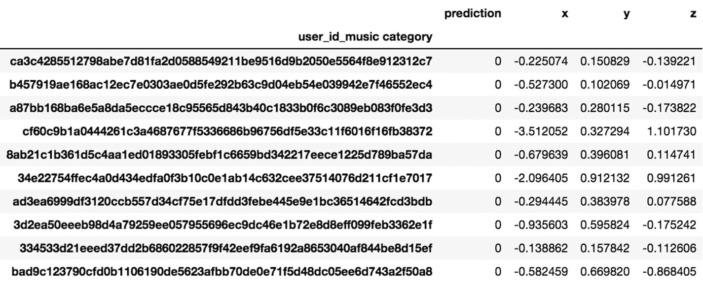

现在我们有了代表原始特征的三维（3D）数据，以及 k-means 的聚类预测结果，我们可以使用 3D 绘图技术，在三维图上可视化这些聚类。

## 聚类可视化

```python
[In]: from mpl_toolkits.mplot3d import Axes3D
[In]: cluster_vis= plt.figure(figsize=(10,10)).gca(projection='3d')
[In]: cluster_vis.scatter(clusters.x, clusters.y, clusters.z, c=clusters.prediction)
[In]: cluster_vis.set_xlabel('x')
[In]: cluster_vis.set_ylabel('y')
[In]: cluster_vis.set_zlabel('z')
[In]: plt.show()
[Out]:
```

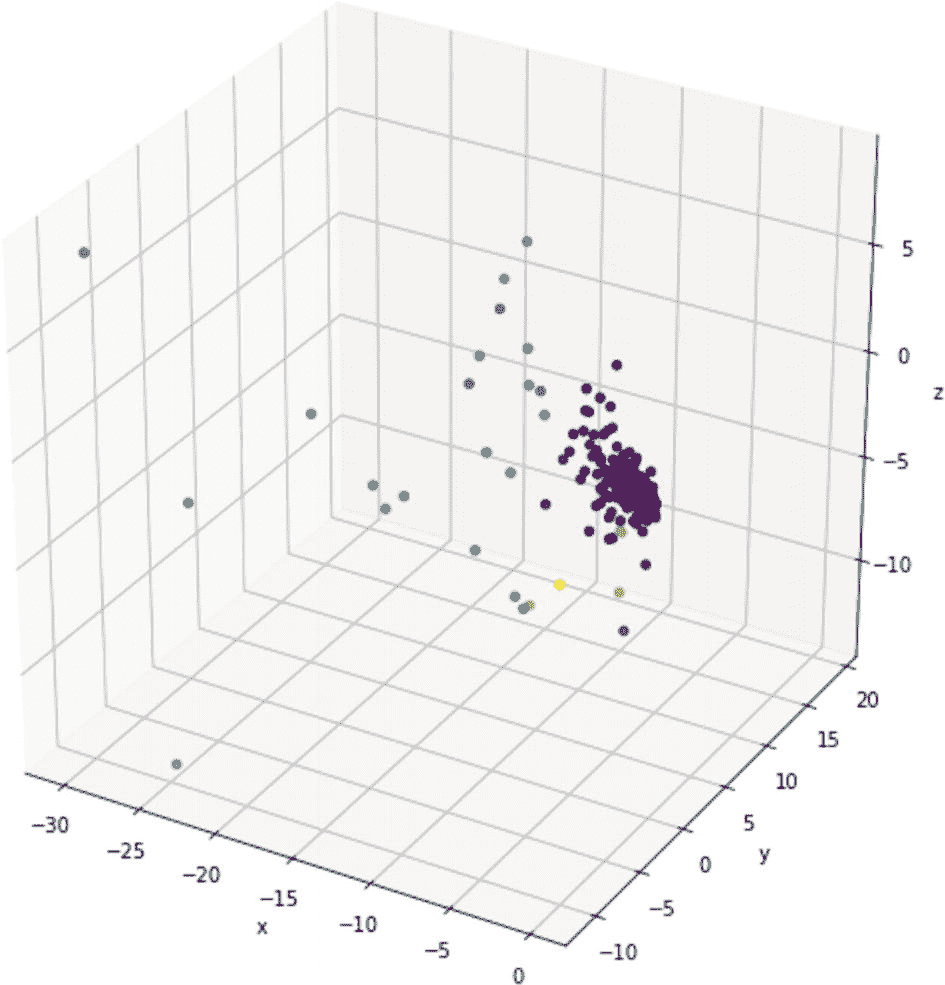

**图 7-5** 聚类可视化

完成此次聚类分析后的后续工作之一，可以是根据属性值为不同的组分配不同的用户画像。这可能是一项手动工作，并且需要一些时间来构思有意义的用户画像。一旦创建完成，企业可以通过多种方式利用这些画像来营销和定位特定用户。

## 结论

在本章中，你学习了监督式和无监督式机器学习技术之间的区别。你还了解了如何使用 k-means 聚类从原始数据构建聚类。随后，我们解释了寻找 `k` 最优值的方法，以及如何可视化由 k-means 算法形成的最终聚类。