# 8. 使用 PySpark 进行深度学习

深度学习近年来一直备受瞩目，并在解决各种业务挑战方面取得了长足进步。从图像语言翻译到自动驾驶汽车，深度学习已成为更大格局中的重要组成部分。不可否认，如今许多公司都在深度学习上大力投入，因为它们的大部分应用程序都在后台使用深度学习运行。例如，谷歌的 Gmail、YouTube、搜索、地图和助手都在以某种形式使用深度学习。原因在于，与其他一些机器学习算法相比，深度学习具有提供更出色结果的惊人能力。

本章分为三个部分。第一部分侧重于理解深度学习的基础知识和底层运行原理。第二部分涵盖深度学习模型的训练过程。最后，在第三部分也是最后一部分中，你将看到如何使用 Spark 构建多层感知器。

## 深度学习基础

在深入探讨深度学习之前，我们必须先理解什么是神经网络，因为深度学习是神经网络的一种延伸。神经网络并非新鲜事物；事实上，其历史可以追溯到 20 世纪 50 年代，当时研究人员就开始着手研究。不幸的是，由于当时计算能力有限，它们遇到了重大障碍。近年来，得益于处理能力的巨大进步和大数据的可及性，神经网络变得日益流行。超级强大的处理设备（如 GPU 和 TPU）的出现，使得运行性能更优的大型神经网络成为可能。从数据方面来看，过去几年中标记数据的可用性也提供了巨大帮助。但比上述所有原因更重要的是，深度学习模型具有超越其他机器学习算法的显著性能，这使其成为首选的主流方法。图 8-1 展示了人工智能、机器学习和深度学习的发展时间线。

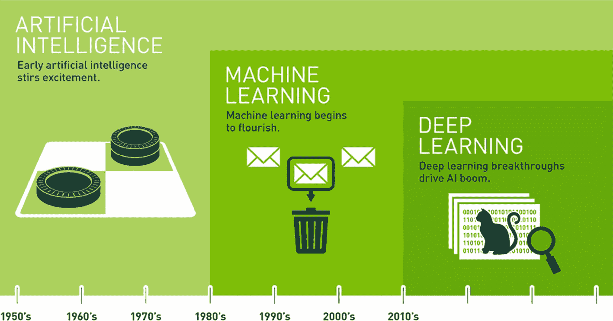

图 8-1 深度学习时间线

在监督学习场景中，存在特定的输入和对应的输出。机器学习算法的目标是利用这些数据来近似输入变量和输出变量之间的关系。在某些情况下，这种关系可能非常明显且易于捕捉，但在现实场景中，输入和输出变量之间的关系通常非常复杂且本质上是非线性的。举例来说，在一辆自动驾驶汽车中，输入变量可能如下：

- 地形
- 与最近物体的距离
- 交通信号灯
- 路牌

输出则必须是转向、快速或慢速行驶、刹车等。可以想象，输入变量和输出变量之间的关系本质上是相当复杂的。因此，传统的机器学习算法很难映射这种关系。然而，深度学习在这种情况下优于其他机器学习算法，因为它也能够学习非线性特征。

### 人脑神经元 vs. 人工神经元

如前所述，深度学习仅仅是神经网络的延伸，也被称为深度神经网络。神经网络与其他机器学习算法略有不同。神经网络大致受到人脑中神经元的启发。神经网络由人工神经元组成。虽然我并非神经科学或大脑功能方面的专家，但请允许我尝试为您提供一个关于人脑如何运作的高层概述。您可能已经知道，人脑由数十亿个神经元组成，它们之间有着数量惊人的连接。每个神经元都以某种方式与多个其他神经元相连，并反复交换信息（信号）。我们进行的每一项身体或精神活动都会激活大脑中特定的神经元群。每个神经元由三个基本部分组成：

- 树突
- 细胞体
- 轴突末梢

如图 8-2 所示，在人脑神经元中，树突负责接收来自其他神经元的信号。它们充当特定神经元的接收器，并将信息传递给细胞体，在那里进行特定信息的处理。然后，根据信息水平，它要么被激活（触发），要么不被触发。这种活动取决于神经元的特定阈值。如果传入的信号值低于该阈值，它就不会触发；否则，它就会被激活。最后，第三个部分是轴突末梢，它们与其他神经元的树突相连。轴突末梢负责将特定神经元的输出传递给其他相关的连接器。

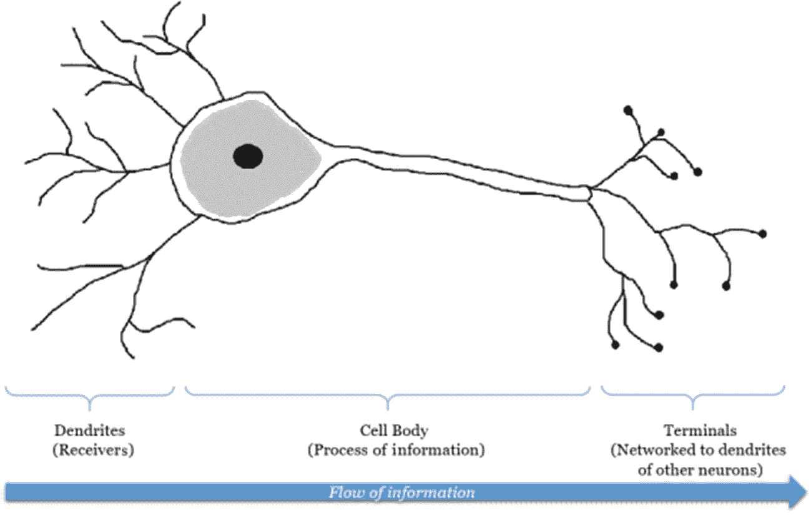

图 8-2 人脑神经元

另一方面，人工神经元主要由两部分组成：一个是求和，另一个是激活，如图 8-3 所示。这也被称为感知器。求和是指将所有输入信号相加，而激活是指根据阈值决定神经元是否触发。

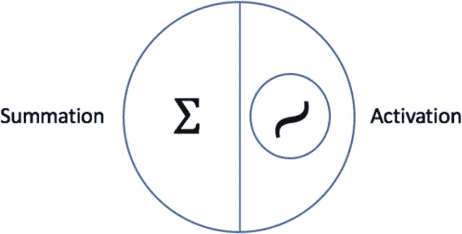

图 8-3 人工神经元的组成部分

假设我们有两个二进制输入（`X1`，`X2`）以及它们各自连接的权重（`W1`，`W2`），如图 8-4 所示。这些权重可以类比于传统机器学习中输入变量的系数。这些权重表明了特定输入特征在模型中的重要性。求和函数计算输入的总和。

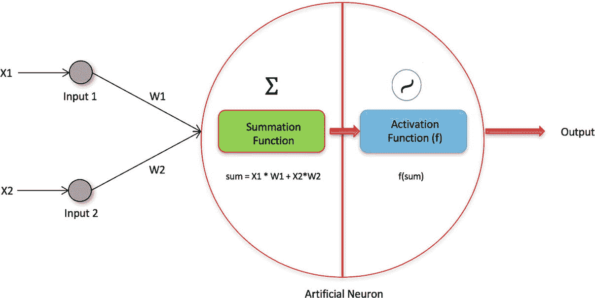

图 8-4 人工神经元中的输入和权重

然后，激活函数使用这个总和值并给出特定的输出。激活是一种决策函数。根据所使用的激活函数类型，它会相应地给出输出。在神经网络层中可以使用不同类型的激活函数。

### 激活函数

激活函数在神经网络中扮演着关键角色，因为输出会根据所使用的激活函数类型而变化。通常有三种广泛使用的主要激活函数：`Sigmoid`、`双曲正切`和`修正线性单元`。

#### Sigmoid

这种激活函数确保输出始终在 0 和 1 之间，无论输入如何，如图 8-5 所示。这就是为什么它也被用于逻辑回归中，以预测事件发生的概率。

```
f(x) = 1 / (1 + e^(-x))
```

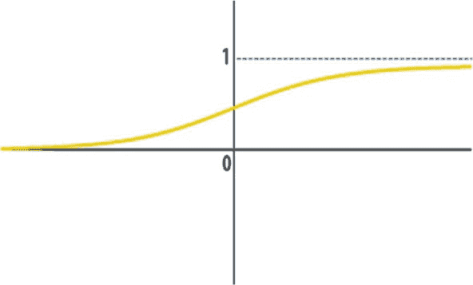

图 8-5 Sigmoid 激活函数

#### 双曲正切

双曲正切激活函数（`tanh`）确保输出值始终保持在-1 到 1 之间，无论输入如何，如图 8-6 所示。以下是`tanh`的公式：

```
f(x) = (e^(2x) - 1) / (e^(2x) + 1)
```

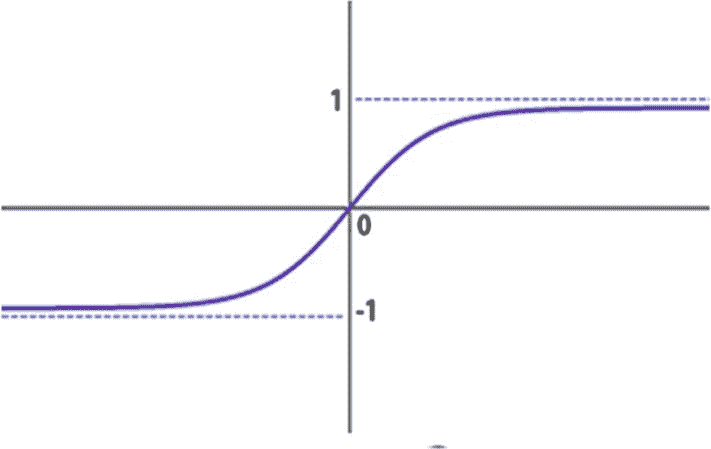

图 8-6 Tanh 激活函数

#### 修正线性单元

修正线性单元（ReLU）在过去几年中越来越受欢迎，并已成为默认的激活函数。ReLU 非常强大，因为它产生的值在 0 到∞之间。如果输入为 0 或小于 0，输出始终为 0，但对于任何大于 0 的值，输出与输入相同，如图 8-7 所示。ReLU 的公式为：

```
f(x) = max(0, x)
```

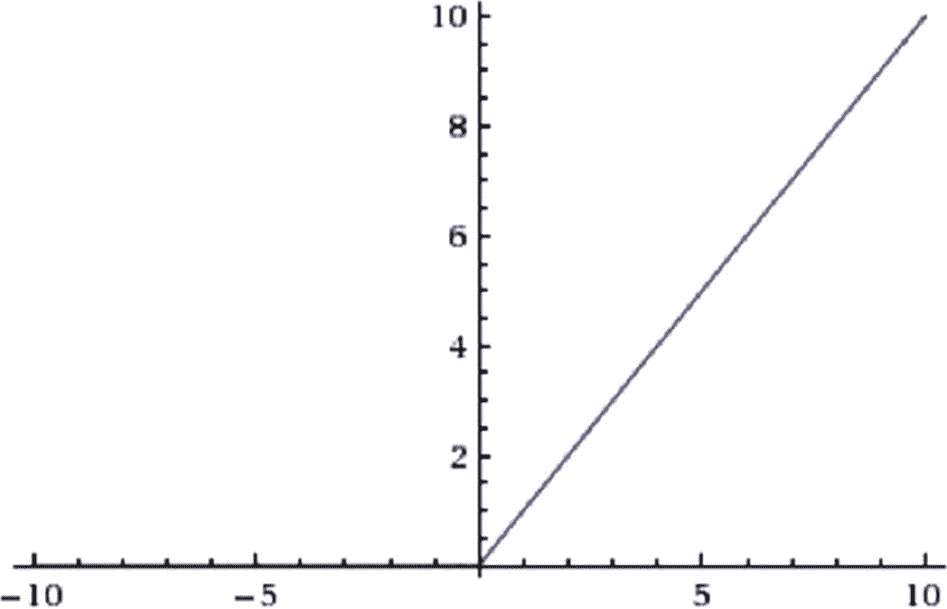

图 8-7 修正线性单元

#### 神经元计算

现在我们已经对不同激活函数有了基本了解，让我们通过一个例子来理解神经元内部实际输出的计算过程。假设我们有两个输入，`X1` 和 `X2`，其值分别为 `0.2` 和 `0.7`，权重分别为 `0.05` 和 `0.03`。求和函数计算输入信号的总和，如图 8-8 和 8-9 所示。

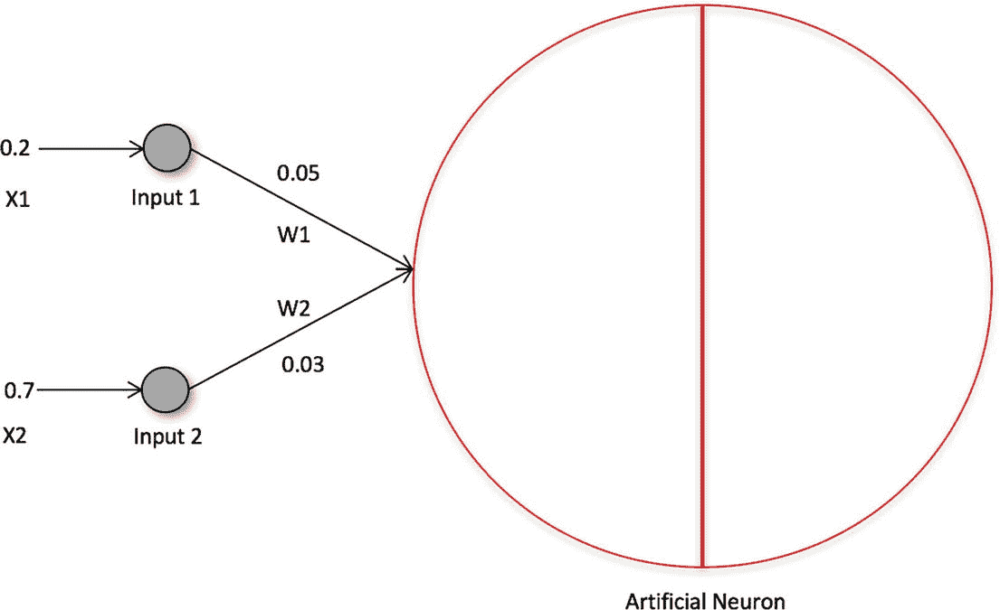

图 8-8 神经元计算

求和过程如下：

```
sum = X1 * W1 + X2 * W2
```

```
sum = 0.2 * 0.05 + 0.7 * 0.03
```

```
sum = 0.01 + 0.021
```

```
sum = 0.031
```

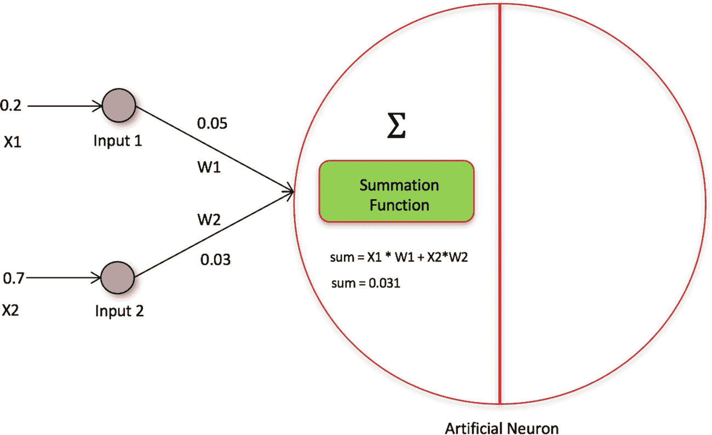

图 8-9 求和

下一步是将这个总和传递给激活函数。我们考虑使用 `sigmoid` 函数，无论输入如何，它都会返回 0 到 1 之间的值。`sigmoid` 函数将按如下方式计算该值：

```
f(x) = 1 / (1 + e^(-x))
```

```
f(sum) = 1 / (1 + e^(-sum))
```

```
f(0.031) = 1 / (1 + e^(-0.031))
```

```
f(0.031) = 0.5077
```

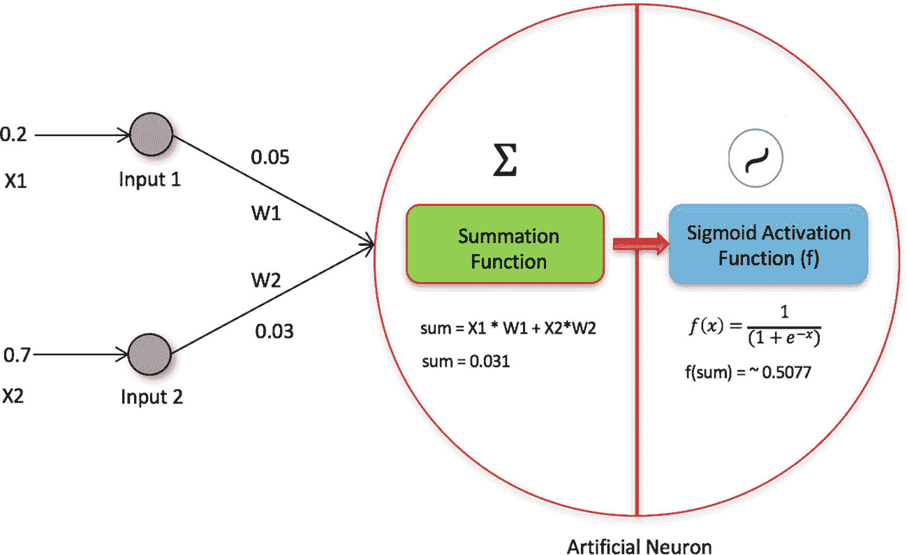

图 8-10 神经元激活

因此，这个单个神经元的输出等于 `0.5077`。现在我们已经了解了单个神经元如何运作，接下来快速了解一下多个连接的神经元如何协同工作来计算输出。

## 训练过程：神经网络

当我们组合多个神经元时，就构成了一个神经网络。大多数简单基础的神经网络可以仅使用输入和输出神经元构建，如图 8-11 所示。

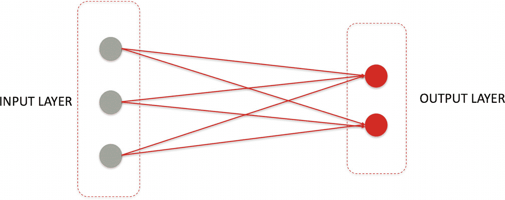

图 8-11

## 基础神经网络

使用此类神经网络的挑战在于，它只能学习线性关系，在输入与输出关系为非线性的情况下表现不佳。正如我们所知，在现实场景中，关系很少是简单线性的。因此，我们必须在输入层和输出层之间引入额外的神经元层，以增强网络学习不同类型非线性关系的能力。这个额外的神经元层被称为隐藏层，如图 8-12 所示。它负责将非线性引入网络的学习过程。神经网络也被称为通用逼近器，因为它们能够逼近输入和输出变量之间的任何关系，无论其本质多么复杂和非线性。这在很大程度上取决于网络中隐藏层的数量以及每个隐藏层中的神经元总数。只要有足够数量的隐藏层，网络就能在映射这种关系方面表现出色。

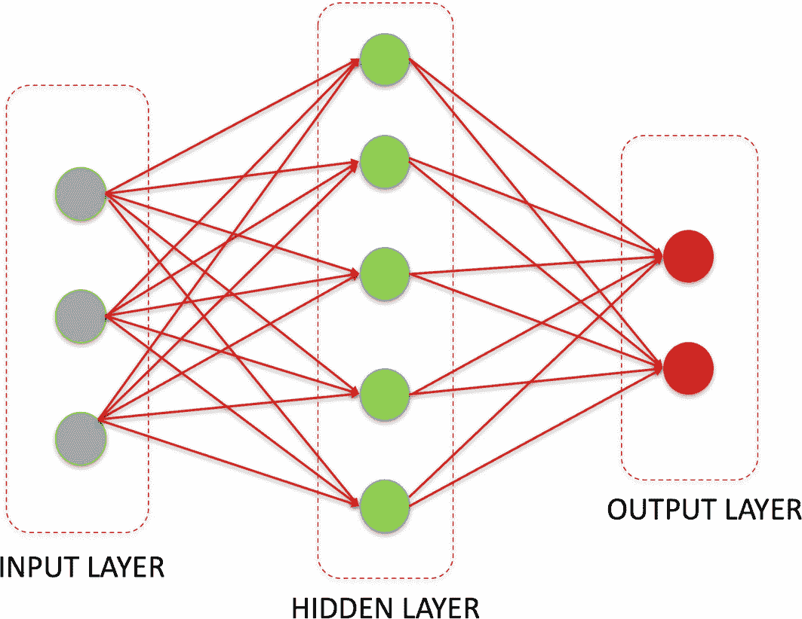

图 8-12

## 多层神经网络

神经网络的核心在于各种连接（红线）以及与这些连接相关的不同权重。神经网络的训练主要包括调整这些权重，使模型能够以更高的准确度进行预测。为了理解神经网络是如何训练的，让我们分解一下网络训练的步骤。

### 步骤 1

获取输入值，并计算传递给隐藏神经元的输出值，如图 8-13 所示。用于第一次求和迭代的权重是随机生成的。

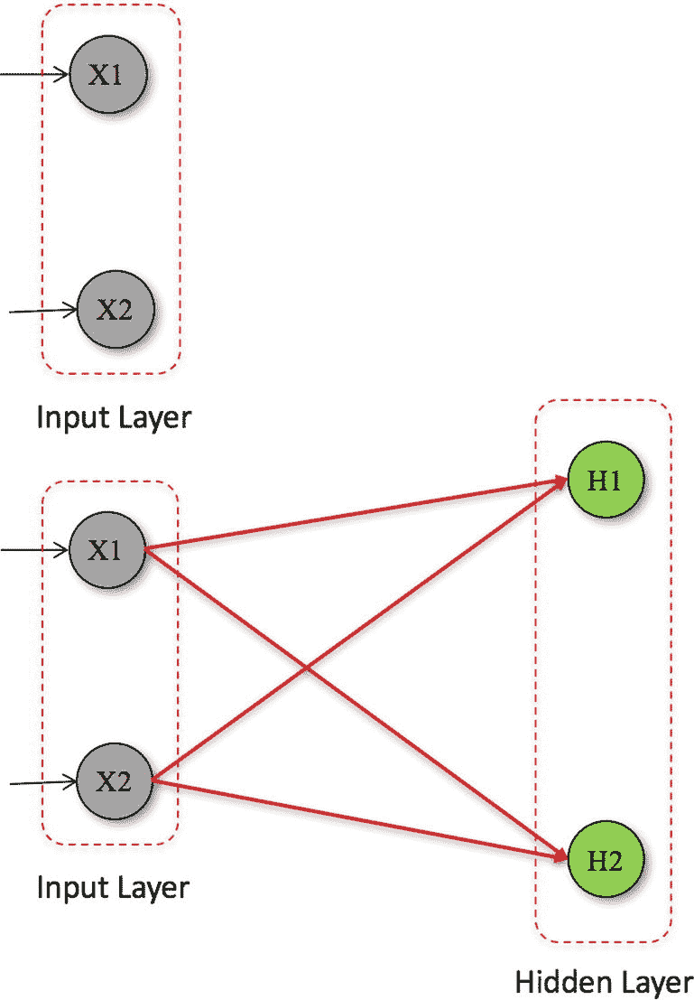

图 8-13

### 神经网络训练过程

另一个传递的额外组件是偏置神经元输入，如图 8-14 所示。这主要用于当您希望即使输入值为零也能获得非零输出的情况。

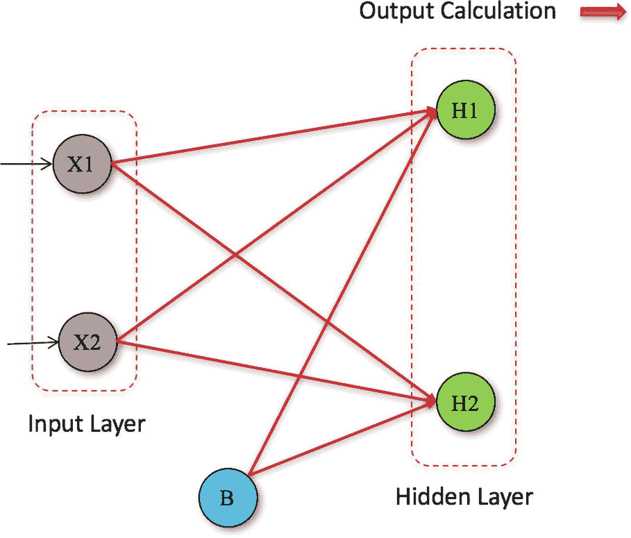

图 8-14

### 偏置组件

### 步骤 2

隐藏层神经元现在使用来自上一层（输入层）的输入，经历相同的过程来计算输出。这个隐藏层输出作为最终输出神经元（红色）计算的输入，如图 8-15 所示。

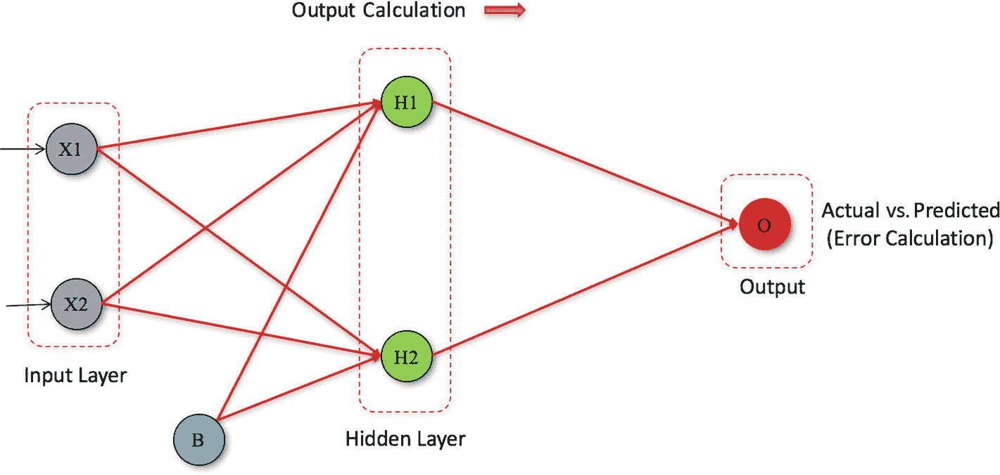

图 8-15

### 输出计算

### 步骤 3

一旦我们得到最终输出，就将其与实际输出进行比较，并将误差反向传播到网络中，以调整连接的权重，从而减少训练数据上的整体误差，如图 8-16 所示。这个过程被称为反向传播。

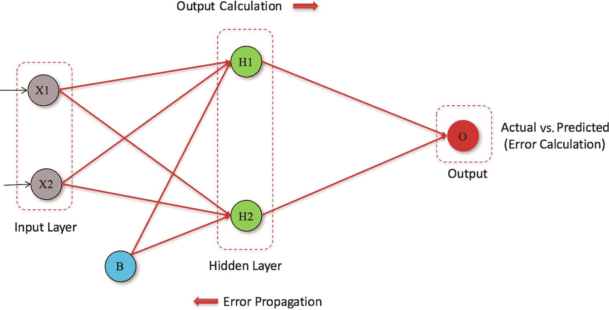

图 8-16

### 反向传播

### 步骤 4

根据输出重新调整连接的权重，以最小化网络产生的整体误差，直到训练数据上的误差不再减少为止。

### 步骤 5

现在我们有了权重的最终版本，网络根据更新后的权重计算新的输出值，如图 8-17 所示。

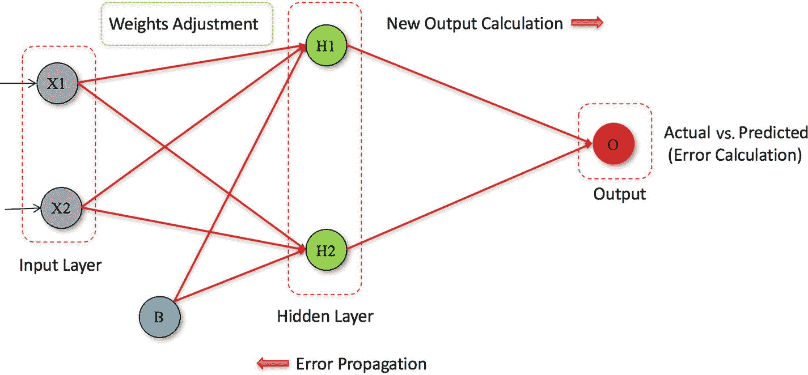

图 8-17

### 最终输出

## 构建多层感知机模型

在 Spark 中使用深度学习有多种选择。根据具体需求和可用基础设施，可以采用相应的方法。从宏观层面来看，有近 4 个重要的深度学习库可以与 Spark 配合使用。

1.  Spark 的 MLlib
2.  TensorflowOnSpark
3.  Deep Learning Pipelines
4.  DeepLearning4J

为简单起见，我们将使用 Spark 构建一个多层感知机。本练习使用的数据集包含近 7.5 万条记录，其中包含某个零售网站上的一些客户旅程样本数据。有 16 个输入特征用于预测访问者是否可能转化。该数据集中的目标类别是平衡的。我们将使用 Spark 机器学习库中的 `MultilayerPerceptronClassifier`。首先，我们导入一些重要的依赖项。

```
from pyspark.sql import SparkSession
spark = SparkSession.builder.appName('deep_learning').getOrCreate()
import os
import numpy as np
import pandas as pd
from pyspark.sql.types import *
```

现在，我们将数据集加载到 Spark 中，用于特征工程和模型训练。如前所述，有 16 个输入特征和 1 个输出列（`'Orders_Normalized'`）。

```
data = spark.read.csv('dl_data.csv', header=True, inferSchema=True)
data.printSchema()
```

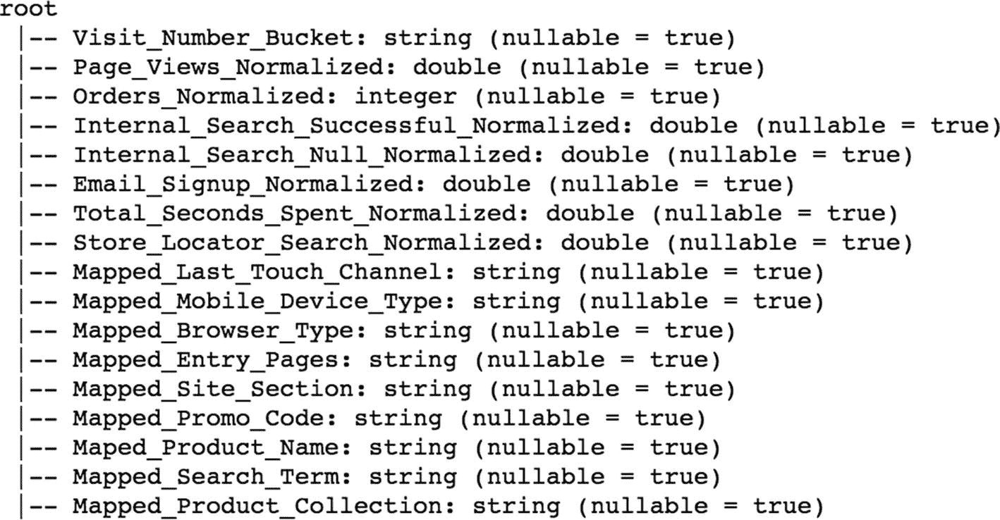

我们将标签列的名称从 `'Orders_Normalized'` 更改为 `'label'`，以便能够训练模型。

```
data = data.withColumnRenamed('Orders_Normalized', 'label')
data.printSchema()
```

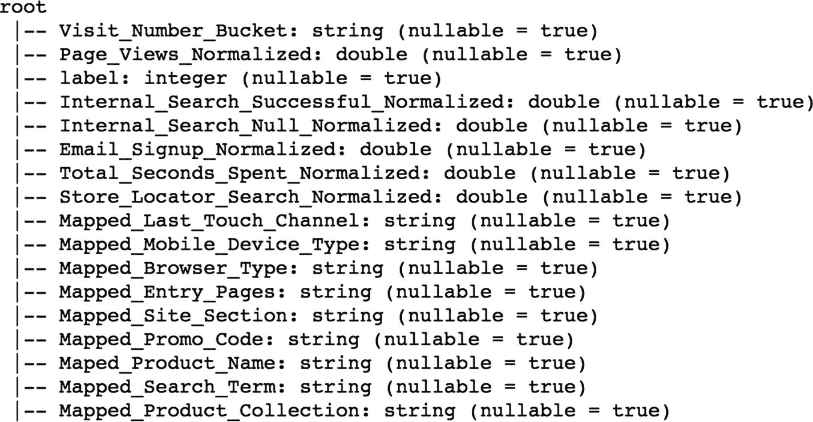

由于我们同时处理数值列和类别列，因此必须编写一个管道来创建结合两者的特征，用于模型训练。因此，我们导入 `Pipeline`、`VectorAssembler` 和 `OneHotEncoder` 来创建特征向量。我们还将导入 `MultiClassificationEvaluator` 和 `MultilayerPerceptron` 来检查模型的性能。

```
from pyspark.ml.feature import OneHotEncoder, VectorAssembler, StringIndexer
from pyspark.ml import Pipeline
from pyspark.sql.functions import udf, StringType
from pyspark.ml.evaluation import MulticlassClassificationEvaluator
from pyspark.ml.classification import MultilayerPerceptronClassifier
```

现在，我们将数据拆分为训练集、测试集和验证集，用于模型训练。

```
train, validation, test = data.randomSplit([0.7, 0.2, 0.1], 1234)
```

我们根据数据类型创建类别列和数值列的单独列表。

```
categorical_columns = [item[0] for item in data.dtypes if item[1].startswith('string')]
numeric_columns = [item[0] for item in data.dtypes if item[1].startswith('double')]
indexers = [StringIndexer(inputCol=column, outputCol='{0}_index'.format(column)) for column in categorical_columns]
```

现在，我们使用 `VectorAssembler` 创建合并后的特征向量。

```
featuresCreator = VectorAssembler(inputCols=[indexer.getOutputCol() for indexer in indexers] + numeric_columns, outputCol="features")
layers = [len(featuresCreator.getInputCols()), 4, 2, 2]
```

下一步是构建 `MultilayerPerceptron` 模型。可以调整不同的超参数，例如层数和最大迭代次数，以提高模型性能。

### 初始化分类器
```python
[In]: classifier = MultilayerPerceptronClassifier(labelCol='label', featuresCol="features", maxIter=100, layers=layers, blockSize=128, seed=1234)
```

### 定义并运行管道
现在我们已经定义了每个阶段，我们将所有这些步骤添加到管道中，并在训练数据上运行它。

```python
[In]: pipeline = Pipeline(stages=indexers + [featuresCreator, classifier])
[In]: model = pipeline.fit(train)
```

### 生成预测结果
我们现在计算模型在训练集、测试集和验证集上的预测结果。

```python
[In]: train_output_df = model.transform(train)
[In]: validation_output_df = model.transform(validation)
[In]: test_output_df = model.transform(test)
[In]: train_predictionAndLabels = train_output_df.select("prediction", "label")
[In]: validation_predictionAndLabels = validation_output_df.select("prediction", "label")
[In]: test_predictionAndLabels = test_output_df.select("prediction", "label")
```

### 评估模型性能
我们定义三个不同的指标来评估模型的性能。

```python
metrics = ['weightedPrecision', 'weightedRecall', 'accuracy']
[In]: for metric in metrics:
    evaluator = MulticlassClassificationEvaluator(metricName=metric)
    print('Train ' + metric + ' = ' + str(evaluator.evaluate(train_predictionAndLabels)))
    print('Validation ' + metric + ' = ' + str(evaluator.evaluate(validation_predictionAndLabels)))
    print('Test ' + metric + ' = ' + str(evaluator.evaluate(test_predictionAndLabels)))
```

如您所见，基于输入信号，深度学习模型在测试数据上表现相当不错。

```
[Out]:
```

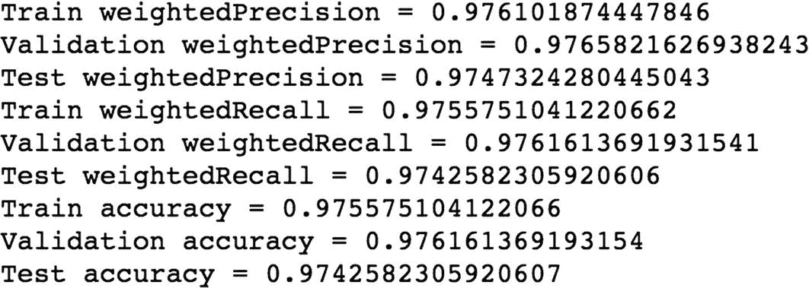

## 结论
本章涵盖了神经网络基本构建模块（人工神经元）的内部结构，以及神经网络的整个训练过程。提到了构建深度学习模型的不同方法，并使用 Spark 构建了一个 `MultilayerPerceptron` 模型。