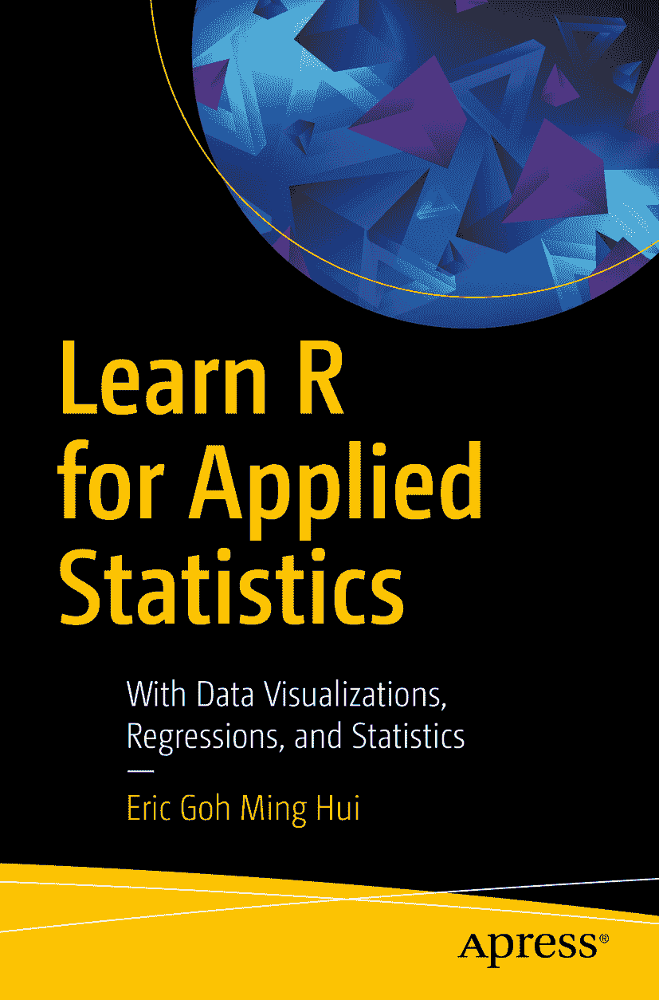

ISBN 978-1-4842-4199-8 e-ISBN 978-1-4842-4200-1 [`doi.org/10.1007/978-1-4842-4200-1`](https://doi.org/10.1007/978-1-4842-4200-1) 美国国会图书馆控制号：2018965216 © Eric Goh Ming Hui 2019 Apress 标准测试 本书中可能包含商标名称、徽标和图像。为避免在每次出现商标名称、徽标或图像时使用商标符号，我们仅在编辑风格下使用这些名称、徽标和图像，以维护商标所有者的利益，且无意侵犯商标权。本出版物中使用的商品名称、商标、服务标记及类似术语，即使未明确标识，也不应被视为对其是否受专有权利保护的立场表达。尽管本书中的建议和信息在出版时被认为是真实准确的，但作者、编辑和出版商均不对可能存在的任何错误或遗漏承担法律责任。出版商对本书内容不作任何明示或暗示的保证。本书通过 Springer Science+Business Media New York 在全球图书贸易中发行，地址：233 Spring Street, 6th Floor, New York, NY 10013。电话：1-800-SPRINGER，传真：(201) 348-4505，电子邮件：orders-ny@springer-sbm.com，或访问 www.springeronline.com。Apress Media, LLC 是一家加利福尼亚有限责任公司，其唯一成员（所有者）是 Springer Science + Business Media Finance Inc (SSBM Finance Inc)。SSBM Finance Inc 是一家特拉华州公司。

