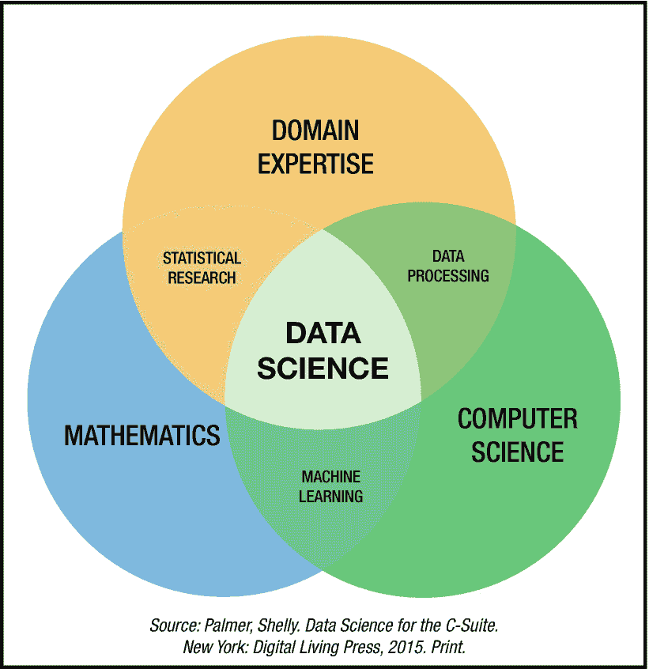
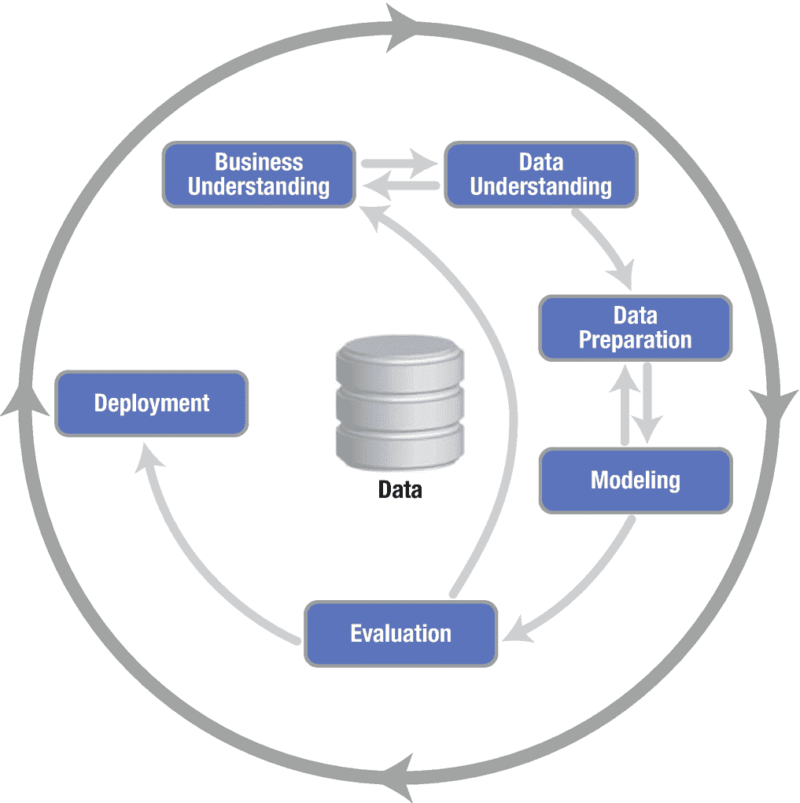
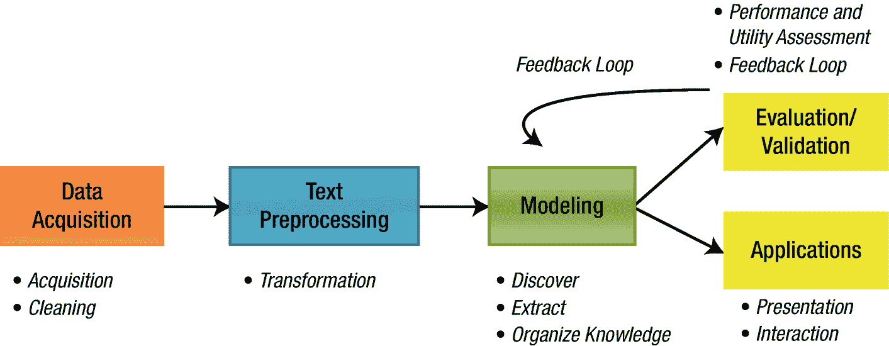

# 第 1 章 引言

在本书中，您将使用 R 语言进行应用统计，这可用于 CRISP DM（数据挖掘）模型中的数据理解和建模阶段。数据挖掘是从数据中挖掘洞察和知识的过程。R 编程语言是为统计而创建的，并广泛应用于学术和研究领域。R 编程语言随着时间的推移不断发展，许多用于数据挖掘、文本挖掘和数据可视化任务的包已被创建出来。R 在统计领域非常成熟，因此非常适合在 CRISP DM 模型的数据探索、数据理解或建模阶段使用。

## 什么是 R？

根据维基百科，R 编程语言用于统计计算，并得到 R 统计计算基金会的支持。R 编程语言被学者和研究人员用于数据分析和统计分析，并且其受欢迎程度随着时间的推移而上升。截至 2018 年 6 月，R 在 TIOBE 指数中排名第 10 位。TIOBE 公司创建并维护 TIOBE 编程社区指数，该指数用于衡量编程语言的流行程度。TIOBE 是“The Importance of Being Earnest”（认真的重要性）的缩写。

R 是一个 GNU 软件包，在 GNU 通用公共许可证下免费提供。这意味着 R 附带源代码，您可以自由使用 R，但必须遵守许可证。R 可在命令行中使用，但也有许多适用于 R 的集成开发环境（IDE）。IDE 是一种软件，它包含代码编辑器、编译器和调试器工具等综合功能，以帮助开发人员编写 R 脚本。一个著名的 IDE 是 RStudio，它通过在一个软件包中提供所有必需的工具来帮助开发人员编写 R 脚本。

R 是 S 编程语言的一种实现，由奥克兰大学的 Ross Ihahka 和 Robert Gentlemen 创建。R 及其库由统计和图形技术组成，包括描述性统计、推断性统计和回归分析。R 的另一个优势是它能够生成可出版质量的图形和图表，并且可以使用像 `ggplot` 这样的包来实现高级图形。

根据 CRISP DM 模型，要执行一个数据挖掘项目，您必须理解业务，然后理解和准备数据。接下来是建模和评估，最后是部署。R 在统计和数据可视化方面实力强大，因此非常适合用于数据理解和建模。

与 Python 一样，R 被广泛应用于数据科学领域，该领域包括统计学、机器学习以及领域专业知识或知识。

## 高级语言与低级语言

高级编程语言（HLL）是为人类使用而设计的，更接近人类语言。其编程风格比低级编程语言（LLL）更容易理解和实现。高级编程语言在执行前需要转换为机器语言，因此高级编程语言可能较慢。

另一方面，低级编程语言更接近机器和计算机语言。低级编程语言可以直接在计算机上执行，无需在执行前进行语言转换。因此，低级编程语言可能比高级编程语言更快。像汇编语言这样的低级编程语言更倾向于处理比特 0 和 1 的机器语言。

R 是一种高级编程语言，因为它与人类语言有许多相似之处。例如，在 R 编程代码中：

```
> var1 <- 1
> var2 <- 2
> result <- var1 + var2
> print(result)
[1] 3
>
```

R 编程代码更像人类语言。像汇编语言这样的低级编程语言则更偏向机器语言，例如 `0011 0110`：

```
0x52ac87:      movl7303445 (%ebx), %eax
0x52ac78:      calll         0x6bfb03
```


## 什么是统计学？

统计学是一门处理数据的组织、分析和解释的数学学科。数据分析中主要使用三种统计方法：描述性统计、推断性统计和回归分析。

描述性统计对数据进行汇总，通常关注数据的分布、集中趋势和离散程度。分布可以是正态分布或二项分布，而集中趋势则是描述数据相对于数据中心的情况。集中趋势可以是数据的均值、中位数和众数。离散程度描述数据的分散情况，可以是方差、标准差和四分位距。

推断性统计检验两个数据集或两个样本之间的关系，通常会对它们之间的统计关系提出假设。假设可以是零假设或备择假设，通过 T 检验、卡方检验和方差分析等检验方法来拒绝零假设。卡方检验更适用于分类变量，T 检验更适用于连续变量，而方差分析则用于更复杂的应用场景。

回归分析用于识别两个变量之间的关系。回归可以是线性回归或非线性回归。回归也可以是简单线性回归或多元线性回归，用于识别更多变量之间的关系。

数据可视化是一种使用图形、图表和仪表盘来传达或展示数据的技术。数据可视化可以帮助我们更轻松地理解数据。

## 什么是数据科学？

数据科学是一个多学科领域，融合了统计学、计算机科学、机器学习和领域专业知识，旨在从数据中获取知识和洞察。数据科学通常最终会开发出一个数据产品。数据产品是将公司的数据转化为解决问题的产品。

例如，数据产品可以是亚马逊和 Lazada 使用的产品推荐系统。这些公司拥有大量基于购物者购买行为的数据。利用这些数据，亚马逊和 Lazada 可以识别购物者的购物模式，并创建一个推荐系统或数据产品，以便在购物者购买产品时推荐其他产品。

“数据科学”一词已成为一个流行语，现在被用来代表许多领域，如数据分析、数据挖掘、文本挖掘、数据可视化、预测建模等。

数据科学的历史始于 1997 年 11 月，当时 C. F. Jeff Wu 将统计工作描述为数据收集、分析和决策，并发表了题为“统计学=数据科学？”的演讲。2001 年，William S. Cleveland 在其文章“数据科学：扩展统计学技术领域的一项行动计划”中，将数据科学定义为一个包含统计学和某些计算领域的学科。

DJ Patil 声称与 Jeff Hammerbacher 共同创造了“数据科学”一词，并在《哈佛商业评论》上发表了题为“数据科学家：21 世纪最性感的职业”的文章。他指出，许多行业都面临数据科学家短缺的问题，而数据科学在许多公司中至关重要，因为数据分析可以帮助公司做出众多决策。每家公司都需要在战略方向上做出决策。

统计学在数据科学中非常重要，因为它可以帮助分析师或数据科学家分析和理解数据。描述性统计有助于汇总数据，推断性统计检验两个数据集或样本之间的关系，回归分析则探索多个变量之间的关系。数据可视化可以通过图表、图形和仪表盘来探索数据。回归和机器学习算法可用于预测分析，以训练模型并预测变量。

线性回归的公式为`y = mx + c`。你使用历史数据来训练公式，以得到`m`和`c`。`Y`是输出变量，`x`是输入变量。机器学习算法和回归或统计学习算法都采用类似的方法来预测变量。

领域专业知识是指对数据集的了解。如果数据集是商业数据，那么领域专业知识应该是商业；如果是大学数据，那么领域专业知识是教育；如果数据集是医疗数据，那么领域专业知识是医疗。我认为商业是最重要的知识，因为几乎所有公司都利用数据分析来做出重要的战略商业决策。

加入产品设计和工程知识，我们就进入了物联网和智慧城市领域，因为数据科学和预测分析可以应用于传感器数据。由于数据科学是一个多学科领域，如果你能掌握统计学、机器学习和商业知识，就很难被替代。你也可以与统计学家、机器学习工程师或商业专家合作，共同完成数据科学项目。

图 1-1 展示了一个数据科学示意图。



图 1-1

数据科学是一个交叉领域

## 什么是数据挖掘？

数据挖掘与数据科学密切相关。数据挖掘是利用统计学、机器学习以及数据仓库或数据库从数据中识别模式的过程。

从数据中提取模式并非全新概念，早期方法包括使用贝叶斯定理和回归。技术的发展提高了数据收集的能力。技术的发展也使得统计学习和机器学习算法（如神经网络、模糊逻辑、决策树、遗传算法和支持向量机）能够用于揭示数据中隐藏的模式。数据挖掘结合了统计学和机器学习，通常会产生基于历史数据进行预测的模型。

跨行业数据挖掘标准流程，也称为`CRISP-DM`，是数据挖掘专家使用的一种流程，也是最流行的数据挖掘模型之一。见图 1-2。



图 1-2

跨行业数据挖掘标准流程

`CRISP-DM`模型创建于 1996 年，涉及 SPSS、Teradata、戴姆勒股份公司、NCR 公司和 OHRA。第一个版本于 1999 年在布鲁塞尔举行的第四届`CRISP-DM` SIG 研讨会上展示。许多从业者使用`CRISP-DM`模型，但 IBM 是专注于`CRISP-DM`模型并将其纳入 SPSS Modeler 的公司。

然而，`CRISP-DM`模型实际上是应用中立的。以下部分将解释其组成部分。

### 业务理解

业务理解是指你了解公司对项目的需求和期望。最好让关键人员参与讨论和文档编写，以制定项目计划。

### 数据理解

数据理解涉及对数据的探索，包括使用统计学和数据可视化。描述性统计可用于汇总数据，推断性统计可用于检验两个数据集和样本，回归可用于探索多个变量之间的关系。数据可视化使用图表、图形和仪表盘来理解数据。这个阶段可以让你了解数据的质量。


#### 数据准备

数据准备是最重要且最耗时的阶段之一，可能包括选择样本子集或变量选择、填补缺失值、转换属性或变量（包括对数变换和特征缩放变换）以及去除重复项。变量选择可以通过数据可视化中的相关性矩阵来完成。

### 建模

建模通常指开发一个预测模型来预测数据中的某个变量。预测模型可以使用回归算法、统计学习算法以及机器学习算法（如神经网络、支持向量机、朴素贝叶斯、多元线性回归、决策树等）来开发。你也可以构建规范性模型和描述性模型。

#### 评估

评估是其中一个阶段，你可能会使用十折交叉验证技术来评估模型的精确率和召回率。你可以通过返回上一阶段来改进或进一步准备数据，从而提高模型准确率。你也可以根据需求选择最准确的模型。此外，还可以使用在初始阶段（即业务理解阶段）确定的业务成功标准来评估模型。

#### 部署

部署是利用新的见解和知识来改进组织或进行变革以提升组织的过程。你可以使用预测模型来创建数据产品，或根据模型生成最终报告。

## 什么是文本挖掘？

数据挖掘通常用于从数值数据中挖掘模式，而文本挖掘则用于从文本数据（如推特推文、博客文章和反馈）中挖掘模式。文本挖掘，也称为文本数据挖掘，是从文本数据中提取高质量语义和知识的过程。

文本挖掘任务可能包括文本分类、文本聚类和实体提取；文本分析可能包括情感分析、`TF-IDF`、词性标注、命名实体识别和文本链接分析。

文本挖掘使用的流程与数据挖掘的 `CRISP-DM` 模型相同，但略有差异，如图 1-3 所示。



图 1-3

文本挖掘

### 数据获取

数据获取是收集文本数据、整合文本数据并进行一些文本清洗的过程。业务理解阶段也可能包含在此处。

### 文本预处理

文本预处理包括波特词干提取、停用词移除、大小写和专有名词转换、基于命名实体或正则表达式的单词或词元提取，以及将文本转换为向量或数值形式。文本预处理类似于 `CRISP-DM` 中的数据准备阶段。

### 建模

文本分析或文本发现是利用词性标注或命名实体识别来理解每个文档。它通过实施情感分析来理解文档的情感倾向，并通过文本链接分析来总结所有文档中的文本链接。有些书可能将文本分析称为文本挖掘；我认为文本分析类似于数据理解。

建模也可以是创建预测模型（如文本分类）的过程。有些书可能在文本预处理阶段将文本转换为向量后，在此阶段进行数据挖掘过程，以创建预测模型、描述性模型和规范性模型。

### 评估/验证

评估或验证是评估所创建模型准确性的过程。你可以将其视为 `CRISP-DM` 模型的评估阶段。

### 应用

应用阶段是 `CRISP-DM` 模型中的部署阶段，在此阶段会生成演示文稿或完整报告。你也可以将模型开发成推荐和分类系统，作为数据产品。

## 自然语言处理

自然语言处理（`NLP`）是机器学习和计算机科学的一个领域，用于帮助计算机处理和理解自然语言。`NLP` 可包括词性标注、句法分析、波特词干提取、命名实体识别、光学字符识别、情感分析、语音识别等。`NLP` 与文本分析和文本挖掘紧密配合。

`NLP` 的历史始于 20 世纪 50 年代，当时艾伦·图灵发表了一篇题为《计算机器与智能》的文章。20 世纪 60 年代开发出了一些著名的自然语言处理软件，例如提供类人交互的 `ELIZA`。20 世纪 70 年代，开发了用于编写本体的软件。20 世纪 80 年代，开发者引入了马尔可夫模型，并开始了对统计模型进行 `POS` 标注的研究。最近的研究则集中在监督和半监督算法以及深度学习算法上。

## 三种分析类型

选择分析类型可能既困难又具有挑战性；幸运的是，分析可以分为描述性分析、预测性分析和规范性分析。没有哪种分析类型绝对优于其他类型，但它们可以相互结合。

*   **描述性分析**：使用数据分析来了解发生了什么。

*   **预测性分析**：使用统计学习和机器学习来预测未来。

*   **规范性分析**：使用模拟算法来确定应该做什么。

### 描述性分析

描述性分析使用统计学来总结数据，包括使用描述性统计、使用推断性统计来检验两个数据集和样本，以及使用回归分析来研究多个变量之间的关系。

### 预测性分析

预测性分析通过实施机器学习和统计学习算法来预测某个变量。在统计学中，回归可用于预测变量。例如，`y = mx + c`。你可以通过使用历史数据训练线性回归模型来确定 `m` 和 `c`。`Y` 是要预测的变量，`x` 是输入变量。如果你输入 `x` 值，就可以预测 `y`。

### 规范性分析

这是一个允许用户找到获得特定结果所需输入数量的领域。简单来说，这种分析用于提供建议。例如，`y = mx + c`。你已知 `m` 和 `c` 的值。你想要一个 `y` 结果，那么应该在 `x` 中输入什么值？为了得到 `x` 值，你的公司需要做什么，或者你需要给公司提供什么样的建议？如果你有多个线性回归，会有许多 `x` 变量，因此你需要一些模拟或进化搜索算法来获取 `x` 值。

## 大数据

大数据是指那些非常大且复杂以至于计算机难以处理的数据集。大数据面临的挑战可能包括数据捕获、数据存储、数据分析和数据可视化。大数据具有三个属性或特征。

### 容量

如今人们联系更加紧密，因此数据源更多，数据量也随之呈指数级增长。数据量的增加需要更强的计算能力来处理和分析。传统的计算能力无法处理和分析这些数据。

### 速度

数据产生的速度正在加快，数据流入的速度如此之快，以至于很难进行处理和分析。传统的计算方法无法跟上数据流入的速度。


### 多样性

更多的数据源意味着更多不同格式和类型的数据，例如图像、视频、语音、文本数据和数值数据，既有非结构化的也有结构化的。各种数据格式需要不同的方法来从中提取数据。这意味着数据难以处理和分析，传统的计算方法无法处理此类数据。

由于物联网设备（如移动设备、无线传感器网络和 RFID 读取器）的普及，数据增长非常迅速。根据 IDC 的报告，从 2013 年到 2020 年，全球数据将从 4.4 泽字节增长到 44 泽字节。

关系型数据库以及桌面统计和数据科学软件在处理和分析大数据方面面临挑战。因此，大数据需要像`Hadoop`和`Apache Spark`这样的并行和分布式系统来处理和分析数据。

两种流行的大数据系统或框架是`Apache Spark`和`Hadoop`。`Hadoop`是一个分布式数据系统，用于跨不同集群和计算机存储大数据。一个集群可以包含多台计算机。`Hadoop`的存储系统被称为`Hadoop 分布式系统（HDFS）`。`Hadoop`拥有许多生态系统，例如用于执行机器学习处理的`mahout`。`Hadoop`也有处理系统，例如`MapReduce`。

`Apache Spark`是一个数据处理系统，用于处理分布式数据上的数据。`Apache Spark`没有文件存储系统，因此需要集成到像`Hadoop`这样的系统中。`Apache Spark`速度更快，并能完成完整的数据分析、数据处理和数据预测。

`R`、`Python`和`Java`可以与这些`Hadoop`和`Apache Spark`系统进行交互。

## 为什么选择 R？

在学习数据科学时，许多人在选择学习哪种编程语言和数据科学工具上感到纠结。有许多可用于数据科学的编程语言，例如`R`、`Python`、`SAS`、`Java`等。还有许多数据科学软件包需要学习，例如`SPSS Statistics`、`SPSS Modeler`、`SAS Enterprise Miner`、`Tableau`、`RapidMiner`、`Weka`、`GATE`等。

我推荐学习用于统计的`R`，因为它最初就是为统计而开发的。`Python`是一种真正的编程语言，因此你可以通过`Python`编程开发真正的应用程序和软件。因此，如果你想开发数据产品或数据应用，`Python`可能是更好的选择。`R`编程在统计方面非常强大，因此非常适合使用描述性统计、推断性统计、回归分析和数据可视化进行数据探索或数据理解。`R`也非常适合建模，因为你可以使用像回归这样的统计学习来进行预测分析。`R`也有一些用于数据挖掘、文本挖掘和机器学习的包，例如`Rattle`、`CARET`和`TM`。`R`编程还可以通过`Sparklyr`与像`Apache Spark`这样的大数据系统进行交互。`SAS`编程是商业软件，而`Java`可以直接与`GATE`、`Stanford NLP`和`Weka`交互。`SPSS Statistics`、`SPSS Modeler`、`SAS Enterprise Miner`和`Tableau`是带有图形用户界面的商业数据科学软件包。`RapidMiner`、`Weka`和`GATE`是用于数据科学的开源软件包。

`R`在众多招聘数据科学家的公司中也得到了广泛应用。谷歌和 Facebook 都有使用`R`的数据科学家。`R`也被用于美国银行、福特、优步、Trulia 等公司。

`R`在学术界也广泛使用，并且在学术研究人员中非常受欢迎，他们可以使用`R`的图形功能进行出版。

用`R`编写的脚本可以在不同的操作系统上运行，包括 Linux、苹果和 Windows，只要安装了`R`解释器即可。这对于像`C#`这样的语言来说是不可能的。

## 结论

在本章中，你了解了`R`编程。现在你知道`R`编程是一种用于统计计算的编程语言，并得到`R 统计计算基金会`的支持。`R`语言被研究人员用于统计分析，并且`R`的受欢迎程度逐年上升。

我还讨论了高级编程语言和低级编程语言。高级语言是为人类使用而设计的，更接近人类语言。另一方面，低级语言更接近机器和计算机语言。低级语言可以直接在计算机上执行，无需在语言之间进行转换，因此它们可能更快。

我还讨论了统计学。统计学是一套处理数据组织、分析和解释的数学方法。数据分析中使用的三种主要统计方法是：描述性统计、推断性统计和回归分析。

我还讨论了数据科学。数据科学是一个多学科领域，包括统计学、计算机科学、机器学习和领域专业知识，旨在从数据中获取知识和见解。数据科学通常最终会开发出一个数据产品。数据产品是将公司的数据转化为产品以解决问题。

数据挖掘与数据科学密切相关。数据挖掘是使用统计学、机器学习以及数据仓库或数据库从数据中识别模式的过程。数据挖掘包含许多模型；`CRISP-DM`是数据挖掘中最流行的模型。在`CRISP-DM`中，数据挖掘包括业务理解、数据理解、数据准备、建模、评估和部署。

虽然数据挖掘通常用于从数值数据中挖掘模式，但文本挖掘用于从文本数据（如推特推文、博客文章和反馈）中挖掘模式。文本挖掘，也称为文本数据挖掘，是从文本数据中推导出高质量语义和知识的过程。文本挖掘包括文本分类、文本聚类和实体提取；文本分析可能包括情感分析、`TF-IDF`、词性标注、命名实体识别和文本链接分析。文本挖掘使用与数据挖掘`CRISP-DM`模型相同的过程，但略有不同。

自然语言处理是机器学习和计算机科学的一个领域，用于帮助计算机处理和理解自然语言。`NLP`可以包括词性标注、句法分析、波特词干提取、命名实体识别、光学字符识别、情感分析、语音识别等。`NLP`与文本分析和文本挖掘紧密配合。

选择分析类型可能很困难且具有挑战性。幸运的是，分析可以分为描述性分析、预测性分析和规范性分析。没有哪一种分析类型绝对优于其他类型，但它们可以相互结合。

大数据是指那些非常大且复杂以至于计算机难以处理的数据集。大数据面临的挑战可能包括数据捕获、数据存储、数据分析和数据可视化。大数据有三个特性：容量、速度和多样性。两种流行的大数据系统或框架是`Hadoop`和`Apache Spark`。

在学习数据科学时，有许多编程语言，如`R`、`Python`、`SAS`和`Java`。还有许多数据科学软件包，例如`SPSS Statistics`、`SPSS Modeler`、`SAS Enterprise Miner`、`RapidMiner`和`Weka`。`R`是专门为统计而开发的，因此它最适合数据挖掘中的统计部分，例如数据理解、使用统计学习算法进行建模以及数据可视化。`R`拥有用于机器学习、自然语言处理和文本挖掘的包，以及用于大数据的`Apache Spark`。`Python`是一种完整的编程语言，最适合开发数据产品或软件。`SAS`编程语言是商业软件，不是免费的。根据`TIOBE`排名，`R`已经变得非常流行，许多公司如 Facebook 和谷歌都有使用`R`的数据科学家。`R`在学术研究人员中也非常受欢迎。只要安装了`R`解释器，`R`脚本或代码就可以在不同的操作系统上运行。


