# 基本语法

你将使用 R 进行应用统计，这可用于 CRISP-DM 数据挖掘模型的数据理解和建模阶段。R 编程是一种具有面向对象编程特性的编程语言。R 编程是为统计而创建的，并用于学术和研究领域。然而，在进入统计之前，你需要学习如何编写 R 脚本。

在本章中，你将探索 R 编程的语法。我将讨论 RStudio 中的 R 控制台和代码编辑器，以及 R 对象和 R 编程的数据结构，从变量和数据类型到列表、向量、矩阵和数据框。我还将讨论条件语句、循环和函数。然后，在学习基础知识后，你将创建一个简单的计算器。

## 在 R 控制台中编写

如第 2 章所述，`R` 控制台提供了一种快速简便的方法来进行统计计算和一些数据可视化。`R` 控制台也像一个计算器，因此你可以随时使用 `R` 控制台计算一些数学方程。

要进行数学计算，你只需输入一些数学方程，例如：

```
1 + 1
> 1 + 1
[1] 2
1 – 3
> 1 - 3
[1] -2
1 * 5
> 1 * 5
[1] 5
1 / 6
> 1 / 6
[1] 0.1666667
tan(2)
> tan(2)
[1] -2.18504
```

要进行一些简单的统计计算，你可以执行以下操作：

标准差

```
sd(c(1, 2, 3, 4, 5, 6))
>sd(c(1, 2, 3, 4, 5, 6))
[1] 1.870829
```

平均值

```
mean(c(1, 2, 3, 4, 5, 6))
> mean(c(1, 2, 3, 4, 5, 6))
[1] 3.5
```

最小值

```
min(c(1, 2, 3, 4, 5,6 ))
> min(c(1, 2, 3, 4, 5, 6))
[1] 1
```

要绘制图表或图形，请输入：

```
plot(c(1, 2, 3, 4, 5, 6), c(2, 3, 4, 5, 6, 7))
> plot(c(1, 2, 3, 4, 5, 6), c(2, 3, 4, 5, 6, 7))
```

如图 3-1 所示。

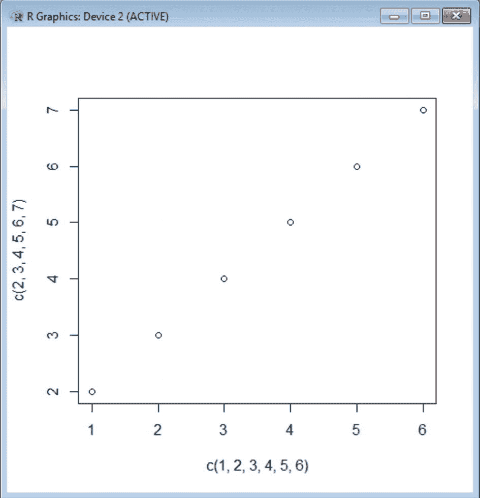

图 3-1：散点图

总而言之，`R` 控制台虽然基础，但具有以下优点：
* 高性能
* 在进一步操作（例如开发 Windows 窗体应用程序）之前，可以快速对想法和逻辑进行原型设计和测试
* 就我个人而言，在开发复杂 `R` 脚本的过程中，我会使用 `R` 控制台应用程序来测试算法和其他代码片段。

## 使用代码编辑器

`RStudio IDE` 提供了代码编辑器、调试器和编译器等功能，这些工具可与 `R` 命令行应用程序或 `R` 控制台进行通信。`R` 代码编辑器提供了智能代码补全和语法高亮等功能，分别如图 3-2 和图 3-3 所示。

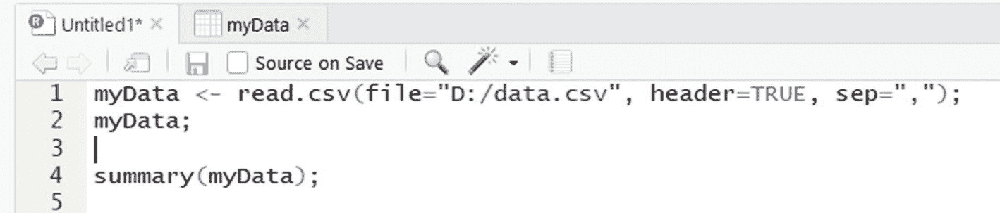

图 3-3

语法高亮示例

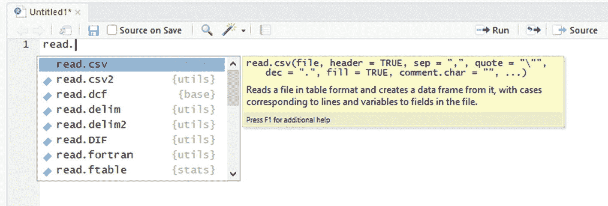

图 3-2

智能代码补全示例

要在 `RStudio` 中创建新脚本，请单击“文件”➤“新建”➤“`R` 脚本”，如图 3-4 所示。

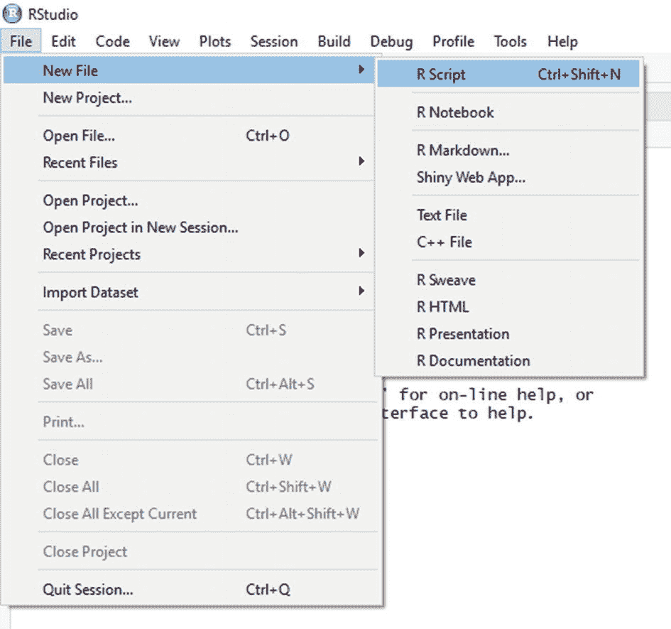

图 3-4

创建新脚本

然后，您就可以编写 `R` 脚本了。现在，请键入以下代码，如图 3-5 所示：

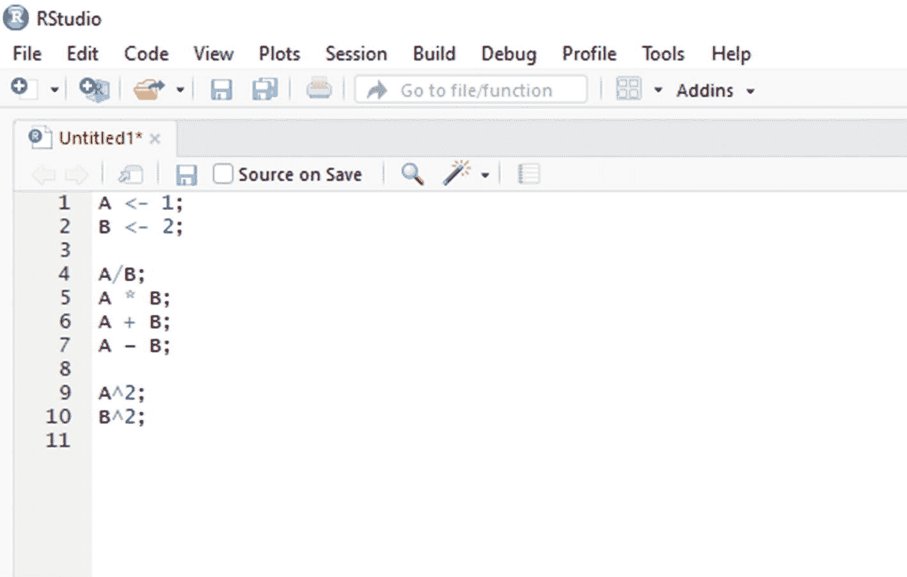

图 3-5

脚本中的代码

```
A <- 1;
B <- 2;
A/B;
A * B;
A + B;
A – B;
A²;
B²;
```

要运行 `R` 脚本，请在代码编辑器中高亮显示代码，然后单击“运行”，如图 3-6 所示。

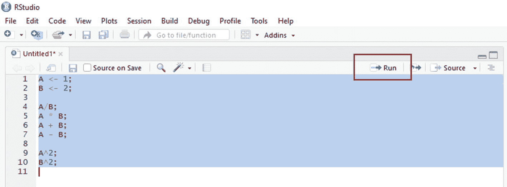

图 3-6

运行脚本

要查看 `R` 脚本的结果，请查看 `RStudio` 的 `R` 控制台，如图 3-7 所示。

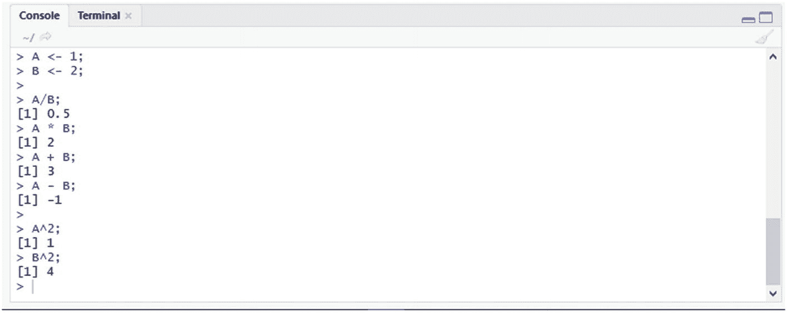

图 3-7

`RStudio IDE` 控制台结果

您还可以在“环境”选项卡中看到两个变量，如图 3-8 所示。

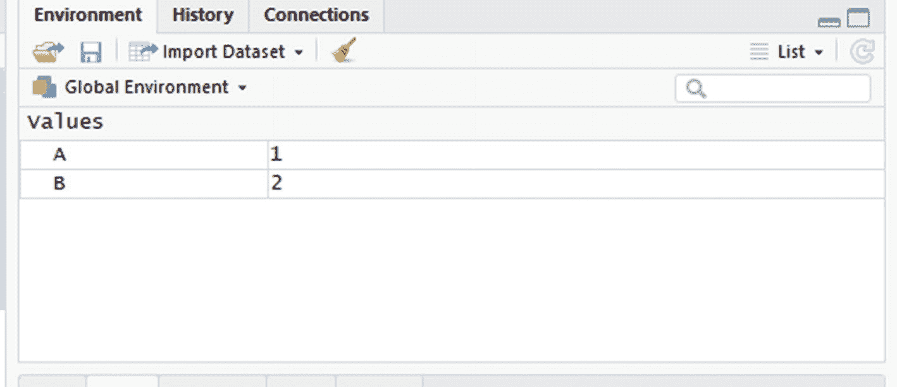

图 3-8

`RStudio IDE` 环境选项卡

## 为代码添加注释

您可以为代码添加注释。注释是不会被 `R` 控制台执行的文本。您可以通过在文本前加上 `#` 来添加注释。注释用于描述您的代码，以便任何人更容易阅读。

```
#创建变量 A，值为 1
A <- 1;
#创建变量 B，值为 2
B <- 2;
#计算 A 除以 B
A/B;
#计算 A 乘以 B
A * B;
#计算 A 加 B
A + B;
#计算 A 减 B
A - B;
#计算 A 的 2 次方
A²;
#计算 B 的 2 次方
B²;
```

您可以重新运行代码，应该会得到如图 3-9 所示的结果。

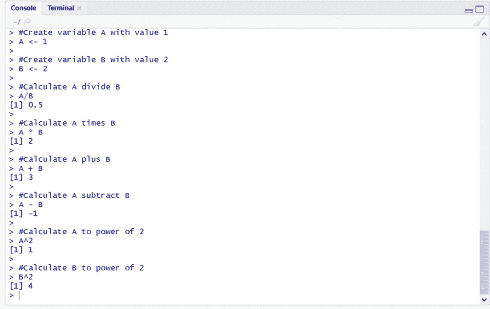

图 3-9

`RStudio IDE` 重新运行带注释的代码

## 变量

让我们看看您之前使用的代码和脚本。您实际上创建了两个变量 `A` 和 `B`，并为这两个变量赋值。

```
A <- 1
B <- 2
```

在这段代码中，`A` 是一个变量，`B` 也是一个变量。`<-` 表示赋值。`A <- 1` 表示变量 `A` 被赋值为 `1`。`1` 是数值类型。`B <- 2` 表示变量 `B` 被赋值为 `2`。`2` 是数值类型。

如果您想赋值文本或字符值，需要添加引号，例如：

```
A <- "Hello World"
```

变量 `A` 被赋值为文本值 `"Hello World"`。字符和数值都是数据类型。

### 数据类型

数据类型是指变量所持有的信息或数据的类型或种类。数据类型可以是数值型和字符型。

例如：

```
A <- "abc"
B <- 1.2
```

在 `R` 中，数据类型是自动确定的。由于值被引号包围，变量 `A` 是字符数据类型，而变量 `B` 是数值数据类型。

`R` 也能够存储其他数据类型，如表 3-1 所示。

表 3-1

数据类型

| 数据类型 | 值 |
| --- | --- |
| 逻辑型 | TRUEFALSE |
| 数值型 | 12.32.551.0 |
| 字符型 | “a”“abc”“this is a bat” |

更多信息，请参阅 [`www.tutorialspoint.com/r/r_data_types.htm`](http://www.tutorialspoint.com/r/r_data_types.htm)。

您还可以使用 `class()` 方法来确定变量的数据类型。例如：

```
> A <- "abc"
> print(class(A));
[1] "character"
> A <- 12.3
> print(class(A));
[1] "numeric"
> A <- TRUE
> print(class(A));
[1] "logical"
```

为什么数据类型很重要？如果您在 `R` 中进行数学计算，而一个变量的数据类型是数值型，另一个变量的数据类型是非数值型，您将得到以下错误：

```
> A <- 12
> B <- "56"
> A + B;
Error in A + B : non-numeric argument to binary operator
```

您也可以使用 `is.datatype()` 来判断一个变量是否属于某种数据类型：

```
> A <- 12
> print(is.numeric(A));
[1] TRUE
> print(is.character(A));
[1] FALSE
```

您还可以使用 `as.datatype()` 在数据类型之间进行转换：

# R语言基本数据结构

## 类型转换示例

以下代码展示了R中基本的类型转换操作：

```r
> A <- 12
> B <- "56"
> A + B;
Error in A + B : non-numeric argument to binary operator
> B <- as.numeric(B)
> A + B;
[1] 68
```

`A <- 12` 表示 `A` 是数值数据类型。`B <- "56"` 表示 `B` 是字符数据类型。当 `A` 和 `B` 相加时，您会得到一个错误，因为您正在将一个数值数据类型与一个字符数据类型相加。

如果您尝试使用 `B <- as.numeric(B)` 将 `B` 转换为数值数据类型，那么您就可以将 `A` 和 `B` 相加，因为 `A` 是数值数据类型，`B` 也变成了数值数据类型。

## 向量

向量是一种基本的数据结构或R对象，用于存储一组相同数据类型的值。向量是R中最基本、最常见的数据结构。当您想要存储和修改一组值时，就会使用向量。数据类型可以是逻辑型、整型、双精度型和字符型。整型数据类型用于存储不带小数的数值，双精度型数据类型用于存储带小数的数值。可以使用 `c()` 函数创建向量，如下所示：

```r
variable = c(..., ..., ...)
> A <- c(1, 2, 3, 4, 5, 6)
> print(A);
[1] 1 2 3 4 5 6
```

您可以使用 `typeof()` 和 `class()` 检查向量的数据类型：

```r
> typeof(A);
[1] "double"
> class(A);
[1] "numeric"
```

您可以使用 `length()` 函数检查向量中元素或值的数量：

```r
> A <- c(1, 2, 3, 4, 5, 6)
> print(A);
[1] 1 2 3 4 5 6
> length(A);
[1] 6
```

您也可以使用运算符 `:` 来创建向量：

```r
> A <- 1:8
> print(A);
[1] 1 2 3 4 5 6 7 8
```

要检索向量的第二个元素或值，请使用 `[]` 括号并输入要检索的元素编号：

```r
> A <- 1:8
> print(A);
[1] 1 2 3 4 5 6 7 8
> A[2];
[1] 2
```

您也可以使用另一个向量来检索向量中的元素，例如，检索第二个和第五个元素：

```r
> A <- 1:8
> print(A);
[1] 1 2 3 4 5 6 7 8
> A[c(2, 5)];
[1] 2 5
```

要检索除第二个元素之外的所有元素，请执行以下操作：

```r
> A <- 1:8
> print(A);
[1] 1 2 3 4 5 6 7 8
> A[-2];
[1] 1 3 4 5 6 7 8
```

您还可以使用逻辑向量来检索向量的元素：

```r
> A <- 1:8
> print(A);
[1] 1 2 3 4 5 6 7 8
> A[c(FALSE, TRUE, FALSE, TRUE, FALSE, TRUE, FALSE, TRUE)];
[1] 2 4 6 8
```

您也可以使用大于或小于符号来检索元素：

```r
> A <- 1:8
> print(A);
[1] 1 2 3 4 5 6 7 8
> A[A > 5];
[1] 6 7 8
```

您可以使用赋值符号 `<-` 来修改向量，如下所示：

```r
> A <- 1:8
> print(A);
[1] 1 2 3 4 5 6 7 8
> A[3] <- 9
> print(A);
[1] 1 2 9 4 5 6 7 8
```

## 列表

列表类似于向量。它是一种R对象，可以存储一组值或元素，但列表可以存储不同数据类型的数据。列表也是R中另一种常见的数据结构。当你想要修改和存储一组不同数据类型的数据时，可以使用列表。向量只能存储相同数据类型的数据。创建列表的语法如下：

```r
variable = list(..., ..., ...)
```

要创建一个列表，请执行以下操作：

```r
> A <- list("a", "b", 1, 2)
> print(A);
[[1]]
[1] "a"
[[2]]
[1] "b"
[[3]]
[1] 1
[[4]]
[1] 2
```

要查看列表的元素数据类型或数据结构类型，可以使用 `str()` 和 `typeof()` 函数：

```r
> str(A);
List of 4
$ : chr "a"
$ : chr "b"
$ : num 1
$ : num 2
> typeof(A);
[1] "list"
```

你可以使用 `length()` 函数获取列表的长度或元素数量：

```r
> A <- list("a", "b", 1, 2)
> length(A);
[1] 4
```

你可以使用整数检索列表中的值：

```r
> A[1];
[[1]]
[1] "a"
```

你可以使用整数向量检索列表中的值：

```r
> A[c(1:2)];
[[1]]
[1] "a"
[[2]]
[1] "b"
```

你可以使用负整数检索值：

```r
> print(A);
[[1]]
[1] "a"
[[2]]
[1] "b"
[[3]]
[1] 1
[[4]]
[1] 2
> A[-1];
[[1]]
[1] "b"
[[2]]
[1] 1
[[3]]
[1] 2
```

你也可以使用逻辑向量检索值：

```r
> print(A);
[[1]]
[1] "a"
[[2]]
[1] "b"
[[3]]
[1] 1
[[4]]
[1] 2
> A[c(TRUE, FALSE, FALSE, FALSE)];
[[1]]
[1] "a"
```

当你只使用 `[]` 检索值时，它会返回子列表。如果你想获取子列表中的内容，则需要使用 `[[]]`。

```r
> A[1];
[[1]]
[1] "a"
> A[[1]];
[1] "a"
```

你可以使用以下方法修改列表中的值或元素：

```r
> print(A);
[[1]]
[1] "a"
[[2]]
[1] "b"
[[3]]
[1] 1
[[4]]
[1] 2
> A[[2]] <- "n"
> print(A);
[[1]]
[1] "a"
[[2]]
[1] "n"
[[3]]
[1] 1
[[4]]
[1] 2
```

要删除列表中的元素或值：

```r
> print(A);
[[1]]
[1] "a"
[[2]]
[1] "n"
[[3]]
[1] 1
[[4]]
[1] 2
> A[[2]] <- NULL
> print(A);
[[1]]
[1] "a"
[[2]]
[1] 1
[[3]]
[1] 2
```

## 矩阵

矩阵类似于向量，但它有两个维度。你通常使用矩阵来修改和存储数据集中的值，因为矩阵有两个维度。当你计划进行线性代数类型或数学运算时，矩阵非常有用。对于包含不同类型的数据集，你需要使用数据框。

要创建矩阵，可以使用以下语法：

```r
variable <- matrix(data, nrow = number, ncol = number)
> A <- matrix(c(1, 2, 3, 4, 6, 7, 8, 9, 0), nrow = 3, ncol = 3)
> print(A);
     [,1] [,2] [,3]
[1,]    1    4    8
[2,]    2    6    9
[3,]    3    7    0
```

你可以使用 `dimnames` 重命名行和列：

```r
> A <- matrix(c(1, 2, 3, 4, 6, 7, 8, 9, 0), nrow = 3, ncol = 3)
> print(A);
     [,1] [,2] [,3]
[1,]    1    4    8
[2,]    2    6    9
[3,]    3    7    0
> A <- matrix(c(1, 2, 3, 4, 6, 7, 8, 9, 0), nrow = 3, ncol = 3, dimnames = list(c("X", "Y", "Z"), c("A", "S", "D")))
> print(A);
  A S D
X 1 4 8
Y 2 6 9
Z 3 7 0
```

你可以使用 `attributes()` 函数检查矩阵的维度，并使用 `class()` 函数检查变量是否为矩阵：

```r
> class(A);
[1] "matrix"
> attributes(A);
$`dim`
[1] 3 3

$dimnames
$dimnames[[1]]
[1] "X" "Y" "Z"

$dimnames[[2]]
[1] "A" "S" "D"
```

你可以使用 `colnames()` 和 `rownames()` 函数获取列名和行名：

```r
> colnames(A);
[1] "A" "S" "D"
> rownames(A);
[1] "X" "Y" "Z"
```

你也可以通过使用列绑定和行绑定函数来创建矩阵。

# R语言数据结构与操作

## 矩阵操作

### 创建与查看矩阵

```r
> B <- cbind(c(1, 2, 3), c(4, 5, 6))
> print(B);
     [,1] [,2]
[1,]    1    4
[2,]    2    5
[3,]    3    6
> C <- rbind(c(1, 2, 3), c(4, 5, 6))
> print(C);
     [,1] [,2] [,3]
[1,]    1    2    3
[2,]    4    5    6
```

### 选择操作

#### 选择第一行

```r
> print(A);
  A S D
X 1 4 8
Y 2 6 9
Z 3 7 0
> A[1,];
A S D
1 4 8
```

#### 选择第一列

```r
> print(A);
  A S D
X 1 4 8
Y 2 6 9
Z 3 7 0
> A[,1];
X Y Z
1 2 3
```

#### 选择除最后一行外的所有行

```r
> print(A);
  A S D
X 1 4 8
Y 2 6 9
Z 3 7 0
> A[-3,];
  A S D
X 1 4 8
Y 2 6 9
```

#### 选择第二行和第二列

```r
> print(A);
  A S D
X 1 4 8
Y 2 6 9
Z 3 7 0
> A[2, 2];
[1] 6
```

#### 使用逻辑向量选择第一行和最后一行

```r
> print(A);
  A S D
X 1 4 8
Y 2 6 9
Z 3 7 0
> A[c(TRUE, FALSE, FALSE),];
  A S D
X 1 4 8
```

#### 基于大于和小于条件选择元素和值

```r
> print(A);
  A S D
X 1 4 8
Y 2 6 9
Z 3 7 0
> A[A>4];
[1] 6 7 8 9
```

### 修改与添加

#### 修改第二行和第二列

```r
> print(A);
  A S D
X 1 4 8
Y 2 6 9
Z 3 7 0
> A[2, 2] <- 100
> print(A);
  A   S D
X 1   4 8
Y 2 100 9
Z 3   7 0
```

#### 添加一行

使用 `rbind()` 函数。

```r
> print(A);
  A   S D
X 1   4 8
Y 2 100 9
Z 3   7 0
> B <- rbind(A, c(1, 2, 3))
> print(B);
  A   S D
X 1   4 8
Y 2 100 9
Z 3   7 0
1 1   2 3
```

#### 添加一列

使用 `cbind()` 函数。

```r
> print(A);
  A   S D
X 1   4 8
Y 2 100 9
Z 3   7 0
> C <- cbind(A, c(1, 2, 3))
> print(C);
  A   S D
X 1   4 8 1
Y 2 100 9 2
Z 3   7 0 3
```

### 转置矩阵

使用 `t()` 函数。

```r
> print(A);
  A   S D
X 1   4 8
Y 2 100 9
Z 3   7 0
> A <- t(A)
> print(A);
  X   Y Z
A 1   2 3
S 4 100 7
D 8   9 0
```

## 数据框

数据框是一种特殊的列表或 R 对象，它是多维的，通常用于存储从 Excel 或 `.csv` 文件中读取的数据。矩阵只能存储相同类型的值，但数据框可以存储不同类型的值。

### 创建数据框

要声明一个数据框，请使用以下语法：

`variable = data.frame(colName1 = c(..., ..., ...), colName2 = c(..., ..., ...), ...)`

```r
> A <- data.frame(emp_id = c(1, 2, 3), names = c("John", "James", "Mary"), salary = c(111.1, 222.2, 333.3))
> print(A);
  emp_id names salary
1      1  John  111.1
2      2 James  222.2
3      3  Mary  333.3
```

你可以使用 `typeof()` 和 `class()` 函数检查变量是否为数据框类型：

```r
> typeof(A);
[1] "list"
> class(A);
[1] "data.frame"
```

### 查看结构

要获取列数和行数，可以使用 `ncol()` 和 `nrow()` 函数：

```r
> ncol(A);
[1] 3
> nrow(A);
[1] 3
```

要获取数据框的结构，可以使用 `str()` 函数：

```r
> str(A);
'data.frame': 3 obs. of  3 variables:
$ emp_id: num  1 2 3
$ names : Factor w/ 3 levels "James","John",..: 2 1 3
$ salary: num  111 222 333
```

你也可以使用 `read.csv()` 函数将 `.csv` 文件读取为数据框：

```r
> myData <- read.csv("myData.csv")
> ncol(myData);
[1] 4
> nrow(myData);
[1] 100
> str(myData);
'data.frame': 100 obs. of  4 variables:
$ x : num  2.216 -0.181 1.697 1.655 1.068 ...
$ x2: num  4.77 4.1 2.33 2.46 1.05 ...
$ x3: num  -4.87 6.98 3.92 0.75 3.35 ...
$ y : int  0 1 0 0 1 1 1 1 1 1 ...
```

### 选择列

要选择一列，可以使用 `[]`、`[[]]` 或 `$` 进行选择：

```r
> print(A);
  emp_id names salary
1      1  John  111.1
2      2 James  222.2
3      3  Mary  333.3
> A["names"];
  names
1  John
2 James
3  Mary
> A$names;
[1] John  James Mary
Levels: James John Mary
> A[[2]];
[1] John  James Mary
Levels: James John Mary
```

### 修改元素

修改第一行和第二列：

```r
> print(A);
  emp_id names salary
1      1  John  111.1
2      2 James  222.2
3      3  Mary  333.3
> A[1, 2] <- "James"
> print(A);
  emp_id names salary
1      1 James  111.1
2      2 James  222.2
3      3  Mary  333.3
```

### 添加与删除

#### 添加一行

使用 `rbind()` 函数。

```r
> print(A);
  emp_id names salary
1      1 James  111.1
2      2 James  222.2
3      3  Mary  333.3
> B <- rbind(A, c(4, "John", 444.4))
> print(B);
  emp_id names salary
1      1 James  111.1
2      2 James  222.2
3      3  Mary  333.3
4      4  John  444.4
```

#### 添加一列

使用 `cbind()` 函数。

```r
> print(A);
  emp_id names salary
1      1 James  111.1
2      2 James  222.2
3      3  Mary  333.3
> B <- cbind(A, state = c("NY", "NY", "NY"))
> print(B);
  emp_id names salary state
1      1 James  111.1    NY
2      2 James  222.2    NY
3      3  Mary  333.3    NY
```

#### 删除一列

```r
> print(A);
  emp_id names salary
1      1 James  111.1
2      2 James  222.2
3      3  Mary  333.3
> A$salary <- NULL
> print(A);
  emp_id names
1      1 James
2      2 James
3      3  Mary
```

## 逻辑语句

`if...else` 语句通常是 R 语言代码中的逻辑片段。它们通过指定 `if` 规则，为程序赋予一定的智能和决策能力。

# R 语言控制流与函数

## 条件语句

```r
if (布尔表达式) {
  # 如果布尔表达式为真，则执行的代码
} else {
  # 如果布尔表达式为假，则执行的代码
}
```

表 3-2 展示了在编写 `if...else` 语句的布尔表达式时可以使用的布尔运算符。

**表 3-2** 布尔运算符

| 布尔运算符 | 定义 |
| --- | --- |
| `==` | 等于 |
| `>=` | 大于或等于 |
| `<=` | 小于或等于 |
| `>` | 大于 |
| `<` | 小于 |
| `!=` | 不等于 |

你可以使用 `else if` 嵌入更多的 `if...else` 语句，从而在程序代码中增加更多规则和智能：

```r
if (布尔表达式 1) {
  # 如果布尔表达式 1 为真，则执行的代码
} else if (布尔表达式 2) {
  # 如果布尔表达式 2 为真且布尔表达式 1 为假，则执行的代码
} else if (布尔表达式 3) {
  # 如果布尔表达式 3 为真且布尔表达式 1 和 2 为假，则执行的代码
} else {
  # 如果所有布尔表达式都为假，则执行的代码
}
```

以下是使用 `else if` 的示例：

```r
> A <- 1 + 2
> B <- 1 + 2
> if(B >= 5) {
+   print("B 大于或等于 5");
+ } else if(B >= 3) {
+   print("B 大于或等于 3");
+ } else {
+   print("B 小于 3");
+ }
[1] "B 大于或等于 3"
```

如果 `B` 大于或等于 `5`，R 控制台将打印 “B 大于或等于 5”。否则，如果 `B` 大于或等于 `3` 但小于 `5`，R 控制台将打印 “B 大于或等于 3”。否则，R 控制台将打印 “B 小于 5”。由于 `B` 是 `1 + 2 = 3`，R 控制台打印了 “B 大于或等于 3”。

## 循环

循环用于重复执行某些代码片段。例如，如果你想打印 “This is R.” 这条消息 100 次，那么输入 `print("This is R.");` 100 次会非常繁琐。你可以使用循环更轻松地打印该消息 100 次。循环通常用于遍历一组向量、列表或数据框。在 R 中，有几种循环选项：`while` 循环、`for` 循环和 `repeat` 循环。

### For 循环

我们先从 `for` 循环的语法开始：

```r
for (值 in 向量) {
  # 语句
}
```

示例：

```r
> A <- c(1, 2, 3, 4, 5)
> for(e in A) { # 对于向量 A 中的每个元素和值
+   print(e); # 打印该元素和值
+ }
[1] 1
[1] 2
[1] 3
[1] 4
[1] 5
```

在此示例中，你创建了向量 `A`，其值为 `1` 到 `5`。对于向量中的每个元素，你在控制台中打印该元素。逻辑流程见图 3-10。


**图 3-10** R 语言的 For 循环

### While 循环

你也可以使用 `while` 循环进行循环，直到满足特定的布尔表达式：

```r
while (布尔表达式) {
  # 在布尔表达式为假之前要运行或重复的代码
}
```

示例：

```r
> i <- 1
> while(i <= 10) {
+   print(i);
+   i <- i + 1;
+ }
[1] 1
[1] 2
[1] 3
[1] 4
[1] 5
[1] 6
[1] 7
[1] 8
[1] 9
[1] 10
```

在此示例中，你使用 `while` 循环打印从 1 到 10 的文本。`i` 被赋值为 `1`。当 `i` 小于或等于 `10` 时，R 控制台将打印 `i` 的值。打印后，`i` 将增加 `1`。它会重复打印，直到 `i` 大于 10。逻辑流程见图 3-11。


**图 3-11** R 语言的 While 循环

### Break 和 Next 关键字

在循环语句中，你可以使用 `break` 关键字和 `next` 关键字。`break` 关键字用于停止循环的迭代。`next` 关键字用于跳过循环的当前迭代。

`break` 关键字的示例：

```r
> A <- c(1, 2, 3, 4, 5, 6, 7, 8, 9, 10)
> for(e in A) {
+   if(e == 5) {
+     break;
+   }
+   print(e);
+ }
[1] 1
[1] 2
[1] 3
[1] 4
```

在此示例中，你创建了向量 `A`，其值为 `1` 到 `10`。对于 `A` 中的每个元素，你打印元素值。如果元素值为 `5`，则退出循环。

`next` 关键字的示例：

```r
> A <- c(1, 2, 3, 4, 5, 6, 7, 8, 9, 10)
> for(e in A) {
+   if(e == 5) {
+     next;
+   }
+   print(e);
+ }
[1] 1
[1] 2
[1] 3
[1] 4
[1] 6
[1] 7
[1] 8
[1] 9
[1] 10
```

在此示例中，你创建了向量 `A`，其值为 `1` 到 `10`。对于 `A` 中的每个元素，你打印元素值。如果元素值为 `5`，则跳过当前迭代并进入下一次迭代。因此，你没有打印值 `5`。当你使用循环语句遍历一组值，并且找到所需的值时，可以使用 `break` 语句跳出循环。

### Repeat 循环

`repeat` 循环会多次重复代码，并且没有需要满足的布尔表达式。要停止循环，你必须使用 `break` 关键字。

```r
repeat {
  # 要重复的代码
}
```

示例：

```r
> i <- 1
> repeat {
+   if(i > 10)
+     break;
+   print(i);
+   i <- i + 1;
+ }
[1] 1
[1] 2
[1] 3
[1] 4
[1] 5
[1] 6
[1] 7
[1] 8
[1] 9
[1] 10
```

在此示例中，你创建了变量 `i`，其值为 `1`。你重复打印 `i` 并将 `i` 增加 `1`，直到 `i` 大于 `10`，然后跳出循环。如果你忘记或没有添加条件语句和 `break` 关键字，你可能会陷入无限循环。无限循环很危险，因为它会消耗系统资源，并导致程序在同一个地方持续循环。`for` 循环是首选的循环，因为条件在第一条语句中定义：

```r
for(e in A) ....
```

`while` 循环是次优选的循环。条件语句也在第一条语句中声明：

```r
while(i <= ...) ...
```

如果你忘记递增 `i`，即 `i <- i + 1;`，你也会陷入无限循环。

## 函数

函数有助于组织代码，并允许你在需要时重复使用代码片段。要创建函数，请使用以下语法：

```r
函数名 <- function(参数 1, 参数 2, ...) {
## 代码片段
函数名 = # 要返回的值
}
```

示例：

```r
> A 
> productVect 
> print(productVect(A));
[1] 120
```

在此示例中，你创建了 `productVect()` 函数。该函数与 R 编程中的 `prod()` 函数相同。

`productVect()` 函数接受一个参数。对于参数（应为向量）中的每个元素，`res` 将等于 `res` 乘以该元素。循环完成后，`productVect()` 函数将返回 `res` 值。

你可以使用 `productVect(A)` 调用该函数。在上述代码中，你使用以下方式调用函数：

```r
A <- c(1:5);
print(productVect(A));
```

`A` 是一个包含从 `1` 到 `5` 的值的向量。你通过 `productVect(A)` 调用函数。函数声明中的参数 `a` 是形式参数。在调用 `productVect()` 函数时传递给函数的参数 `A` 称为实际参数。当你使用 `productVect(A)` 调用函数时，形式参数 `a` 被赋值为实际参数 `A`。

你可以在代码中多次调用 `productVect()` 函数：

```r
>productVect
> A  print(productVect(A));
[1] 120
>
> B  print(productVect(B));
[1] 3628800
```

你也可以为函数中的参数创建默认值：

```
productVect<- function(a=c(1:5)) {
res <- 1;
for(e in a) {
res <- res * e;
}
productVect = res;
}
print(productVect());
A <- c(1:5);
print(productVect(A));
B <- c(1:10);
print(productVect(B));
```

当你调用不带参数的函数 `print(productVect())` 时，你仍然可以得到结果：

```
>productVect
> print(productVect());
[1] 120
>
> A  print(productVect(A));
[1] 120
>
> B  print(productVect(B));
[1] 3628800
```

除了使用 `productVect = res`，你还可以使用 `return()` 函数来返回结果：

```
>productVect
> print(productVect());
[1] 120
>
> A  print(productVect(A));
[1] 120
>
> B  print(productVect(B));
[1] 3628800
```

### 创建你自己的计算器

在本章中，你学习了许多 R 编程语法。你了解了变量、数据类型、矩阵、向量、列表、数据框、循环和函数。在本节中，你将把刚学到的许多内容整合到一个计算器脚本中：

```
add  "));
firstNum<- as.integer(readline(prompt="输入第一个数字: "));
secondNum<- as.integer(readline(prompt="输入第二个数字: "));
res <- 0;
if(opt == 1) {
res <- add(firstNum, secondNum);
} else if(opt == 2) {
res <- subtract(firstNum, secondNum);
} else if(opt == 3) {
res <- product(firstNum, secondNum);
} else if(opt == 4) {
res <- division(firstNum, secondNum);
} else {
print("错误。");
}
print(res);
```

在这段代码中，你创建了 `add()`、`subtract()`、`product()` 和 `division()` 函数。然后你打印了“选择你的选项：”等消息。你将 `opt` 变量赋值为用户输入。你使用 `readline()` 函数获取用户输入，并使用 `as.integer()` 将用户输入转换为整数类型。你使用 `if` 语句根据用户输入调用相应的函数。然后你打印结果。

要运行代码，请转到“代码” ➤ “运行区域” ➤ “全部运行”，如图 3-12 所示。

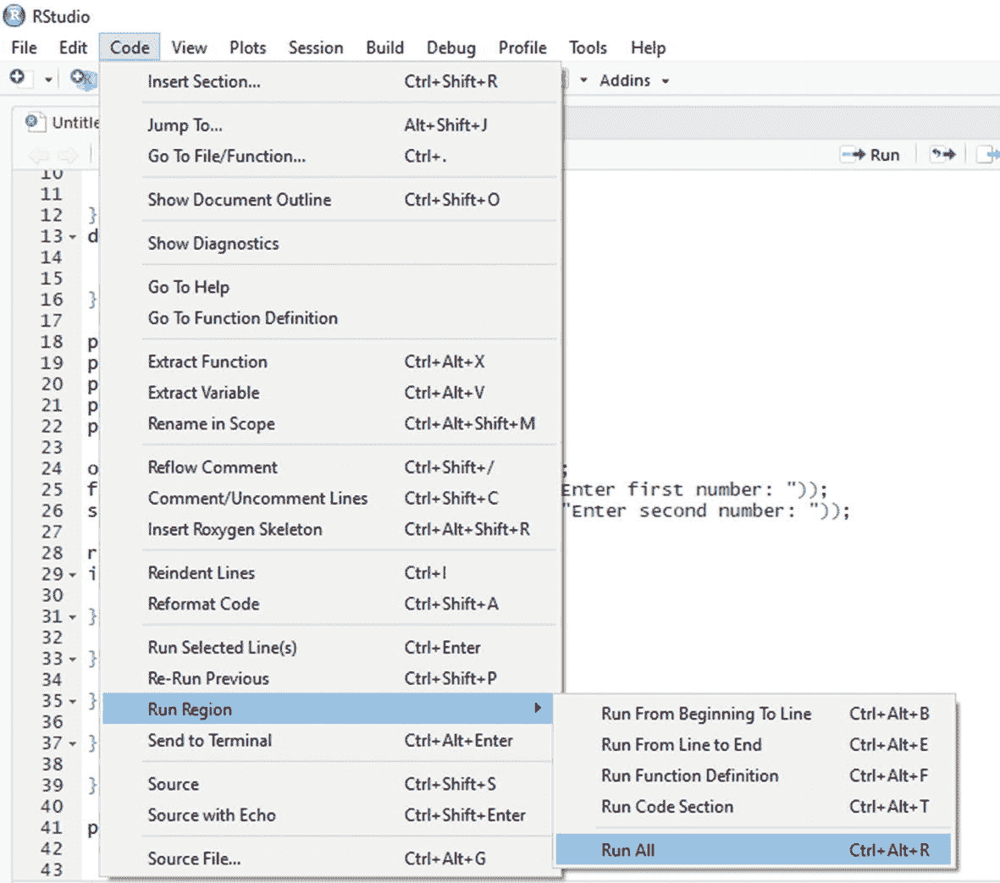

图 3-12 在 RStudio IDE 中运行计算器 R 脚本

输出如图 3-13 所示。

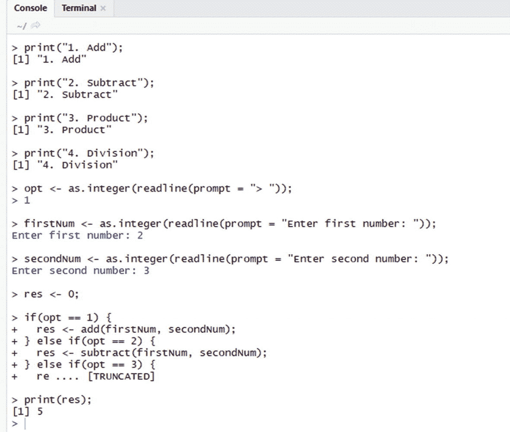

图 3-13 在 RStudio IDE 中运行计算器 R 脚本的结果

## 结论

在本章中，你学习了 R 编程。你探索了 R 控制台和 RStudio 代码编辑器。R 控制台适用于较短的代码，而 RStudio 代码编辑器适用于较长的 R 代码或脚本。

你了解了变量。变量是用于存储某些值的容器。变量可以有名称，称为变量名。数据类型是变量所持有的信息或数据的类型或种类。

你还学习了向量。向量是一种基本的数据结构或 R 对象，用于存储一组相同数据类型的值。数据类型可以是逻辑型、整型、双精度型、字符型等。可以使用 `c()` 函数创建向量。

你还学习了列表。列表类似于向量：它们都是可以存储一组值或元素的 R 对象，但列表可以存储不同数据类型的值。

你还学习了矩阵。矩阵是一种 R 对象或二维数据结构，类似于向量，但具有两个维度。

你还学习了数据框。数据框是一种特殊的列表或 R 对象，它是多维的，通常用于存储从 Excel 或 `.csv` 文件中读取的数据。

你还学习了条件语句。`if...else` 语句通常是 R 代码中的逻辑片段。它们通过指定 `if` 规则，为程序提供了一些智能和决策能力。

你还学习了循环。循环用于重复执行某些代码片段。例如，如果你想打印“这是 R。”消息 100 次，那么输入 `print("这是 R。");` 100 次会非常繁琐。你可以使用循环更轻松地打印该消息 100 次。R 有 while 循环、for 循环和 repeat 循环。

你还学习了函数。函数有助于组织代码，并允许你在需要时重复使用代码片段。

最后，你根据所学内容创建了自己的计算器。