# 4. 描述性统计

描述性统计是一组用于总结数据的数学方法。描述性统计可以包括数据的分布、集中趋势和离散程度。分布可以是正态分布或二项分布。集中趋势可以是均值、中位数和众数。离散程度或分散程度可以是极差、四分位距、方差和标准差。

在本章中，你将导入一个 CSV 文件、Excel 文件和 SPSS 文件，并执行基本的数据处理。我将解释描述性统计、集中趋势度量、离散程度度量和分布。你将了解如何使用 R 编程计算所有这些值，以及如何检验并查看数据是否呈正态分布。


## 什么是描述性统计？

描述性统计对数据进行汇总，通常关注数据的分布、集中趋势和离散程度。分布可以是正态分布、二项分布以及其他分布，如伯努利分布。二项分布和正态分布是更流行和重要的分布，尤其是正态分布。在探索数据和进行许多统计检验时，你通常会检查数据的正态性，即数据符合正态分布的程度或可能性。中心极限定理指出，无论样本是否来自正态分布，当样本量增加时，样本或子集的均值将等于正态分布的均值。用于描述数据中心特征的是集中趋势，而非中心极限定理。集中趋势可以是数据的均值、中位数和众数。离散程度描述了数据的分散情况，可以是方差、标准差和四分位距。

描述性统计汇总了数据集，让我们对数据和变量有所感知和理解，并使我们能够决定或判断是应该使用推断统计来识别数据集之间的关系，还是使用回归分析来识别变量之间的关系。

## 读取数据文件

R 编程允许你导入数据集，数据集可以是逗号分隔值（CSV）文件、Excel 文件、制表符分隔文件、JSON 文件或其他格式。将数据读入 R 控制台或 R 环境非常重要，因为在进行统计计算和理解数据之前，你必须先拥有一些数据。

在考虑将数据导入 R 控制台之前，你必须首先确定你的工作空间或工作目录。你应该始终设置当前工作空间目录，以告知 R 你当前项目文件夹的位置。这有助于更方便地引用数据文件和脚本。

要打印当前工作目录，可以使用 `getwd()` 函数：

```
### 获取当前工作空间位置
print(getwd());
> print(getwd());
[1] "C:/Users/gohmi/Documents"
```

你可以使用 `setwd()` 函数设置工作目录：

```
### 设置当前工作空间位置
setwd("D:/R");   # 输入你自己的文件目录，此处我们使用 "D:/R"
> setwd("D:/R");
```

要获取新的工作目录位置，可以使用 `getwd()` 函数：

```
### 获取新的工作空间
print(getwd());
> print(getwd());
[1] "D:/R"
```

你可以将 `data.csv` 数据集放入 `D:/R` 文件夹中。

### 读取 CSV 文件

你可以使用 `read.csv()` 函数将数据 CSV 文件读入 R 控制台：

```
> data <- read.csv(file="data.csv", header=TRUE, sep=",");
```

你可以通过点击 RStudio IDE 中全局环境部分的数据来查看数据。数据将以表格形式显示。你可以使用 `data.csv` 读取文件，因为你已将工作目录设置为 `D:/R`，所以 `file="data.csv"` 指的是 `D:/R/data.csv`。见图 4-1。

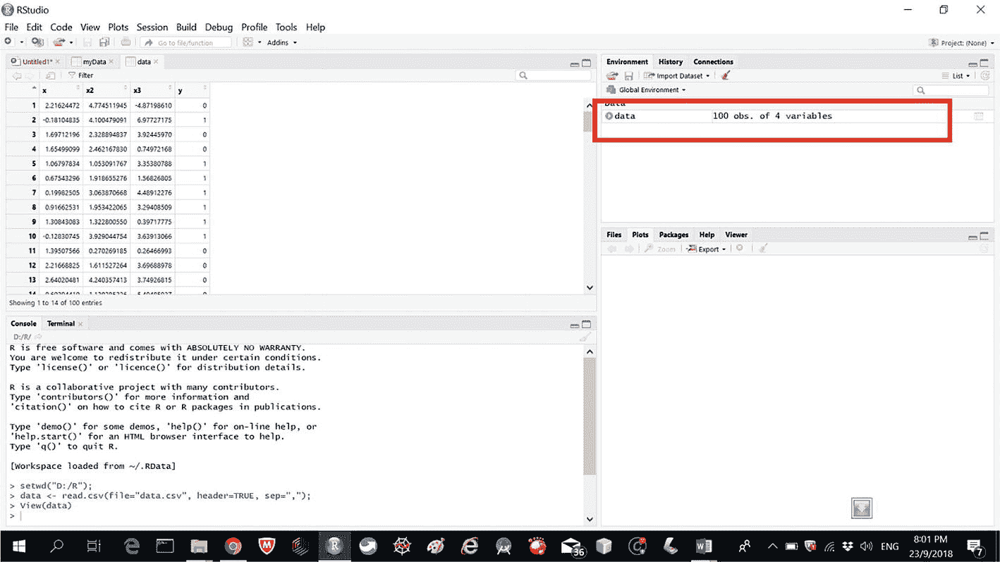

图 4-1

在 RStudio 中以表格形式查看数据

数据变量的数据类型是数据框。你可以使用 `class()` 函数判断数据类型是否为数据框：

```
> class(data);
[1] "data.frame"
```

用于读取 .csv 文件的函数是：

```
> data <- read.csv(file="data.csv", header=TRUE, sep=",");
```

`file` 是你要读取的文件名或数据文件路径。`header` 是一个逻辑值，用于确定变量名称是否在第一行。`sep` 是分隔符，`quote` 是引用字符，其中 `"\"` 表示双引号，`\'` 表示单引号。你可以按如下方式添加双引号的引用：

```
> data  View(data);
```

### 写入 CSV 文件

要写入 CSV 文件，可以使用 `write.csv()` 函数：

```
> write.csv(data, file="data2.csv", quote=TRUE, na="na", row.names=FALSE);
```

导出的文件如图 4-2 所示。

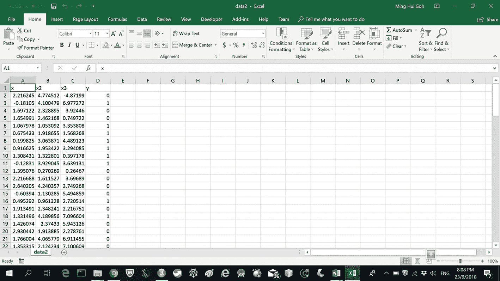

图 4-2

在 Microsoft Excel 中打开的导出 CSV 文件

在你之前用于导出 CSV 文件的 `write.csv()` 函数中：

```
> write.csv(data, file="data2.csv", quote=TRUE, na="na", row.names=FALSE);
```

`data` 是你要导出的数据框类型变量，`file` 是导出的文件路径或位置，`quote` 是一个逻辑值，用于说明是否添加引号，`na` 是用于缺失值的字符串值，`row.names` 是一个逻辑值，用于指示是否写入行名。

### 读取 Excel 文件

数据集也可以是 Excel 格式或 .xlsx 格式。要读取 Excel 文件，你需要使用 xlsx 包。xlsx 包需要 Java 运行时环境，因此你必须在计算机上安装它。要安装 xlsx 包，请转到 R 控制台并输入以下内容，如图 4-3 所示：

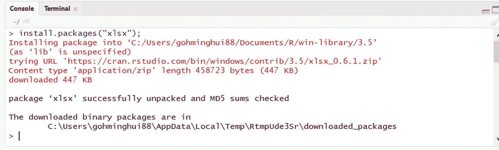

图 4-3

在 RStudio 中安装 xlsx 包

```
> install.packages("xlsx");
```

要使用 xlsx 包，请使用 `require()` 函数：

```
> require("xlsx");
Loading required package: xlsx
```

要读取 Excel 文件，可以使用 `read.xlsx()` 函数：

```
> data <- read.xlsx(file="data.xlsx", 1);
```

`file` 是 Excel 文件的位置。`1` 指的是工作表编号 1。

要查看 `data` 变量，可以使用 `View()` 函数或点击 RStudio 环境部分中的 `data` 变量，如图 4-4 所示。

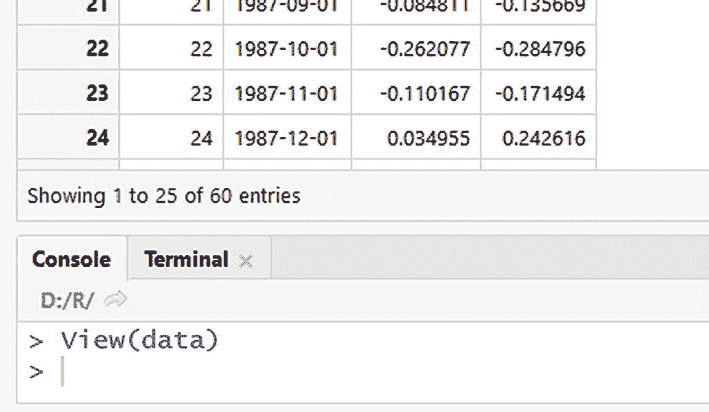

图 4-4

在 RStudio 中查看数据

要查找 `read.xlsx()` 的文档，可以使用以下代码，如图 4-5 所示：

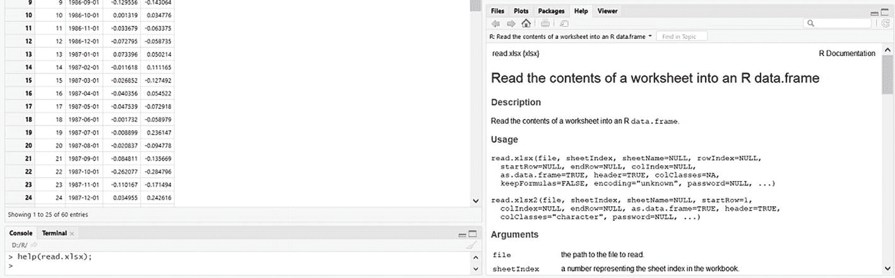

图 4-5

read.xlsx() 的文档

```
> help(read.xlsx);
```

数据变量的数据类型是数据框：

```
> class(data);
[1] "data.frame"
```

### 写入 Excel 文件

要写入 Excel 文件，可以使用 `write.xlsx()` 函数：

```
> write.xlsx(data, file="data2.xlsx", sheetName="sheet1", col.names=TRUE, row.names=FALSE);
```

`data` 是要导出到 Excel 文件的数据框类型变量，`file` 是文件位置或路径，`sheetName` 是工作表名称，`col.names` 和 `row.names` 是逻辑值，用于说明是否导出列名或行名。

要查看 `write.xlsx()` 函数或任何 R 函数的文档，可以使用 `help()` 函数。

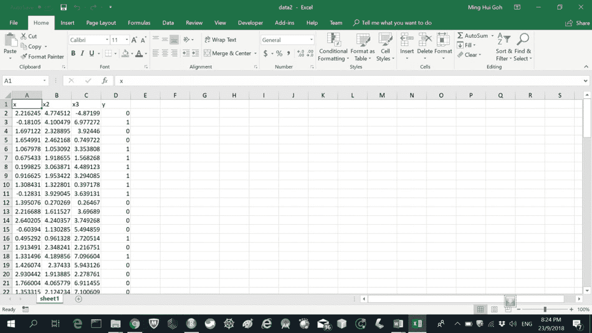

图 4-6

导出的 xlsx 文件


#### 读取 SPSS 文件

要读取 SPSS 文件，你需要使用 `foreign` 包。你可以使用 `install.packages()` 函数安装 `foreign` 包：

```
> install.packages("foreign");
Installing package into 'C:/Users/gohmi/Documents/R/win-library/3.5'
(as 'lib' is unspecified)
trying URL 'https://cran.rstudio.com/bin/windows/contrib/3.5/foreign_0.8-71.zip'
Content type 'application/zip' length 324526 bytes (316 KB)
downloaded 316 KB
package 'foreign' successfully unpacked and MD5 sums checked
The downloaded binary packages are in
C:\Users\gohmi\AppData\Local\Temp\RtmpET26Hv\downloaded_packages
```

要使用 `foreign` 包，请使用 `require()` 函数：

```
> require(foreign);
Loading required package: foreign
```

要将 SPSS 文件读取为数据框类型，请使用 `read.spss()` 函数：

```
> data <- read.spss(file="data.spss", to.data.frame=TRUE);
```

`file` 是要读取的 SPSS 文件的路径或位置。`to.data.frame` 是一个逻辑值，用于指定是否将 SPSS 文件读取为数据框类型。

你可以使用 `help()` 函数获取 `read.spss()` 函数的文档，如图 4-7 所示。

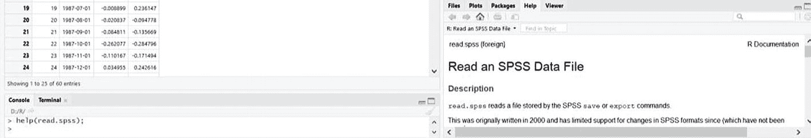

图 4-7

`read.spss()` 的文档

#### 写入 SPSS 文件

你可以使用 `write.foreign()` 函数写入 SPSS 文件：

```
> write.foreign(data, "mydata.txt", "mydata.sps", package="SPSS");
```

`data` 是要导出到 SPSS 数据文件的变量，`mydata.txt` 是逗号分隔格式的数据，`mydata.sps` 是将数据文件读入 SPSS 的基本语法文件，`package` 决定输出或导出为 SPSS 格式。

#### 读取 JSON 文件

JSON，即 JavaScript 对象表示法，是一种非常流行的数据交换格式，易于人类编写或阅读。可以使用 `rjson` 包读取 JSON 文件。要安装 `rjson` 包，请使用 `install.packages()` 函数：

```
> install.packages("rjson");
Installing package into 'C:/Users/gohmi/Documents/R/win-library/3.5'
(as 'lib' is unspecified)
trying URL 'https://cran.rstudio.com/bin/windows/contrib/3.5/rjson_0.2.20.zip'
Content type 'application/zip' length 577826 bytes (564 KB)
downloaded 564 KB
package 'rjson' successfully unpacked and MD5 sums checked
The downloaded binary packages are in
C:\Users\gohmi\AppData\Local\Temp\RtmpET26Hv\downloaded_packages
```

你可以使用 `require()` 函数加载 `rjson` 包：

```
> require(rjson);
Loading required package: rjson
```

你可以使用 `fromJSON()` 函数读取 JSON 文件：

```
> data <- fromJSON(file="data.json");
```

要将数据转换为数据框类型，可以使用以下代码：

```
> data2 <- as.data.frame(data);
```

## 基本数据处理

导入数据后，你可能需要进行一些简单的数据处理，例如选择数据、排序数据、筛选数据、获取唯一值和删除缺失值。

### 选择数据

你可以使用向量从数据中选择几列：

```
> data;
x           x2          x3 y
1    2.21624472  4.774511945 -4.87198610 0
2   -0.18104835  4.100479091  6.97727175 1
3    1.69712196  2.328894837  3.92445970 0
4    1.65499099  2.462167830  0.74972168 0
5    1.06797834  1.053091767  3.35380788 1
6    0.67543296  1.918655276  1.56826805 1
7    0.19982505  3.063870668  4.48912276 1
8    0.91662531  1.953422065  3.29408509 1
9    1.30843083  1.322800550  0.39717775 1
> data[, c("x", "x3")];
x          x3
1    2.21624472 -4.87198610
2   -0.18104835  6.97727175
3    1.69712196  3.92445970
4    1.65499099  0.74972168
5    1.06797834  3.35380788
6    0.67543296  1.56826805
7    0.19982505  4.48912276
8    0.91662531  3.29408509
9    1.30843083  0.39717775
10  -0.12830745  3.63913066
11   1.39507566  0.26466993
12   2.21668825  3.69688978
13   2.64020481  3.74926815
14  -0.60394410  5.49485937
15   0.49529219  2.72051420
16   1.91349092  2.21675086
17   1.33149648  7.09660419
18   1.42607352  5.94312583
19   2.93044162  2.27876092
20   1.76600446  6.91145502
```

你可以使用 `$` 符号选择一个变量，如前一章所述：

```
> data$x3;
[1] -4.87198610  6.97727175  3.92445970  0.74972168  3.35380788  1.56826805  4.48912276
[8]  3.29408509  0.39717775  3.63913066  0.26466993  3.69688978  3.74926815  5.49485937
[15]  2.72051420  2.21675086  7.09660419  5.94312583  2.27876092  6.91145502  7.10060931
[22]  4.62416860  3.12633172  5.63667497  0.37028080 -0.11370995  2.27488863  0.43562110
[29]  0.46417756  3.44465146  4.14409404  3.78561287  1.86181693  8.10920939  0.87207093
[36]  0.55297962  4.26909037  1.01777720 12.85624593  4.79384178 -1.10646203  4.48442125
[43] -3.56106951  1.71246170  9.74478236  3.15799853  0.97278927  2.35670484  3.08804548
[50]  1.52772318 -5.02155267  5.64303286 -1.24622282  0.59864199  1.11359605  4.38302156
[57]  2.54163230  1.19193935 -0.57096625  7.49237946  6.88838713  5.37947543  0.72886289
[64]  2.20441458 -0.04416262  6.98441537  5.25116254 -0.15175665 -0.28652257  2.97419481
[71]  1.57454520  1.74898024  3.78645063  1.02328701  1.51030662 -1.46386054  5.65843587
[78]  1.71775236  2.77004224 -0.13805983  6.51654242 -0.80982223  6.55297343  3.65082015
[85]  5.55579403  3.03684846  6.85138858  2.09051225  2.79632315  5.21544351  2.63005598
[92] -0.04795488  8.79812379  0.92166450  2.97840367  1.89262722  2.23928744  2.46465216
[99] -0.18871437 -0.14146813
```

### 排序

你可以使用以下方法按升序对 `x3` 中的数据进行排序：

```
> data[order(data$x3), ];
x           x2          x3 y
51   0.95505576  1.796297183 -5.02155267 1
1    2.21624472  4.774511945 -4.87198610 0
43   0.77142379  6.000455870 -3.56106951 0
76   1.43188297  2.758027392 -1.46386054 0
53   1.91399240  2.334445518 -1.24622282 0
41   0.69012311  5.527698064 -1.10646203 1
82   0.85499504  3.623854599 -0.80982223 1
59  -0.14645562 -0.629264301 -0.57096625 1
69   2.02211069  1.366558932 -0.28652257 0
99   0.44030641 -0.513103067 -0.18871437 1
68  -0.96007693  1.705067556 -0.15175665 0
100  2.34219633  3.314183829 -0.14146813 0
80   1.06881756  4.485035396 -0.13805983 1
```

你可以使用以下方法按降序对 `x3` 中的数据进行排序：

```
> data[order(data$x3, decreasing=TRUE), ];
x           x2          x3 y
39   0.44100266  0.041863046 12.85624593 1
45   0.45732586  3.706789430  9.74478236 1
93   2.48013836 -0.078239681  8.79812379 0
34   1.72284823  1.990169758  8.10920939 0
60   2.24529387  3.486295802  7.49237946 0
21   1.35331484  2.124233637  7.10060931 0
17   1.33149648  4.189856264  7.09660419 1
66   1.56980022  0.379400632  6.98441537 1
2   -0.18104835  4.100479091  6.97727175 1
20   1.76600446  4.065779075  6.91145502 0
61  -1.07591095  2.522409241  6.88838713 0
87   0.29924083  2.892653658  6.85138858 1
83   1.20403393  3.934698897  6.55297343 1
81  -0.09110412  0.745501714  6.51654242 1
```

你可以按多个变量对数据进行排序：

```
> data[order(data$x3, data$x2), ];
x           x2          x3 y
51   0.95505576  1.796297183 -5.02155267 1
1    2.21624472  4.774511945 -4.87198610 0
43   0.77142379  6.000455870 -3.56106951 0
76   1.43188297  2.758027392 -1.46386054 0
53   1.91399240  2.334445518 -1.24622282 0
41   0.69012311  5.527698064 -1.10646203 1
82   0.85499504  3.623854599 -0.80982223 1
59  -0.14645562 -0.629264301 -0.57096625 1
69   2.02211069  1.366558932 -0.28652257 0
99   0.44030641 -0.513103067 -0.18871437 1
68  -0.96007693  1.705067556 -0.15175665 0
```


### 筛选

你可以使用布尔表达式和语句来筛选数据：

```
> data[data$x > 0, ];
x           x2          x3 y
1   2.21624472  4.774511945 -4.87198610 0
3   1.69712196  2.328894837  3.92445970 0
4   1.65499099  2.462167830  0.74972168 0
5   1.06797834  1.053091767  3.35380788 1
6   0.67543296  1.918655276  1.56826805 1
7   0.19982505  3.063870668  4.48912276 1
8   0.91662531  1.953422065  3.29408509 1
9   1.30843083  1.322800550  0.39717775 1
11  1.39507566  0.270269185  0.26466993 0
12  2.21668825  1.611527264  3.69688978 0
13  2.64020481  4.240357413  3.74926815 0
```

你也可以使用更复杂的表达式来筛选数据：

```
> data[data$x > 0 & data$x < 1, ];
x           x2         x3 y
6  0.67543296  1.918655276  1.5682681 1
7  0.19982505  3.063870668  4.4891228 1
8  0.91662531  1.953422065  3.2940851 1
15 0.49529219  0.961328129  2.7205142 1
22 0.96711785 -1.656336500  4.6241686 0
24 0.22931395  4.513268166  5.6366750 1
29 0.92245691  3.066787671  0.4641776 1
32 0.26530020  2.407519006  3.7856129 1
35 0.74641160  0.007386508  0.8720709 1
```

### 移除缺失值

你可以移除任何变量中包含 NA 值的行：

```
> na.omit(data);
x           x2          x3 y
1    2.21624472  4.774511945 -4.87198610 0
2   -0.18104835  4.100479091  6.97727175 1
3    1.69712196  2.328894837  3.92445970 0
4    1.65499099  2.462167830  0.74972168 0
5    1.06797834  1.053091767  3.35380788 1
6    0.67543296  1.918655276  1.56826805 1
7    0.19982505  3.063870668  4.48912276 1
```

### 移除重复值

你可以使用以下方法基于 `x` 变量移除重复值：

```
> data[!duplicated(data$x), ];
x           x2          x3 y
1    2.21624472  4.774511945 -4.87198610 0
2   -0.18104835  4.100479091  6.97727175 1
3    1.69712196  2.328894837  3.92445970 0
4    1.65499099  2.462167830  0.74972168 0
5    1.06797834  1.053091767  3.35380788 1
6    0.67543296  1.918655276  1.56826805 1
7    0.19982505  3.063870668  4.48912276 1
8    0.91662531  1.953422065  3.29408509 1
9    1.30843083  1.322800550  0.39717775 1
10  -0.12830745  3.929044754  3.63913066 1
11   1.39507566  0.270269185  0.26466993 0
12   2.21668825  1.611527264  3.69688978 0
13   2.64020481  4.240357413  3.74926815 0
14  -0.60394410  1.130285226  5.49485937 0
15   0.49529219  0.961328129  2.72051420 1
```

对于文本数据更高级的重复值移除，你可以使用莱文斯坦相似度算法等。本书不涉及相似度重复值移除的详细内容。对于每一行数据，你可以计算当前行与数据中所有其他行的莱文斯坦相似度，并返回相似度低于指定值的结果。然后你可以检查它们是否真的相似且重复，并根据需要将其移除。

## 一些基础统计术语

以下是统计学中最常用的一些术语。

- **总体**：总体是观测值的总集合。总体是一个整体，包含每一个成员或观测值。
- **样本**：样本是总体的一部分。可以通过随机抽样技术等方法从总体中抽取样本。
- **观测值**：观测值是在研究或实验中测量或计数得到的内容。观测值通常指数据中的行。
- **变量**：变量是可以计数的特征或数量，也可称为数据项。变量通常指数据中的列。

### 数据类型

数据可以是数值型数据或分类型数据。

- 数值型数据可以是离散数据或连续数据。离散变量通常取整数值。离散变量有间隔。连续变量可以是任意实数值。
- 分类型数据是类别或非数值型数据。分类型数据可以包含无序类别的名义变量。有序变量可以包含有序类别。

### 众数、中位数、平均数

平均数、中位数和众数是衡量集中趋势最常用的指标。集中趋势是一种最能概括数据的度量，是与数据集中心相关的度量。


#### 众数

`众数`是数据中出现频率最高的值，当数据差异非数值化且很少出现时，它非常有用。

要在 R 中获取众数，首先从数据开始：

```
> A <- c(1, 2, 3, 4, 5, 5, 5, 6, 7, 8);
```

要获取向量中的众数，你需要创建一个频率表：

```
> y <- table(A)
> y;
A
1 2 3 4 5 6 7 8
1 1 1 1 3 1 1 1
```

你想要获取最高频率，因此使用以下方法获取众数：

```
> names(y)[which(y==max(y))];
[1] "5"
```

让我们为一个数据集获取众数。首先，你有数据：

```
> y <- table(data$x2)
> print(y);
-1.10380693563466   -1.07591095084206   -1.03307520058884   0.960076927640974
1                   1                   1                   1
-0.681376413558189   -0.60394409792254  -0.576961817793324  -0.531319073429502
1                   1                   1                   1
-0.393748947329461   -0.36317756860052  -0.181048347962983  -0.146455623720039
1                   1                   1                   1
-0.128307452033018  -0.123388723621058  -0.101546995549492 -0.0911041245433437
1                   1                   1                   1
-0.04988355797068   0.072199258362634   0.194009711645882   0.199825048055373
1                   1                   1                   1
0.229313954917265   0.265300204243802   0.278608090170949   0.299240831235205
1                   1                   1                   1
0.375685875108926   0.375886351624522   0.431165605395961   0.440306411318609
1                   1                   1                   1
0.441002661190442   0.457325864971707   0.495292193747488   0.536273330307632
1                   1                   1                   1
0.675432957349429   0.690123106678726   0.736279647441046   0.746411596302334
1                   1                   1                   1
0.760336369473898   0.771423785187196   0.817889767078534   0.854995040060911
```

要获取数据集中的众数，你必须获取最高频率的值。由于所有值的频率都是 1，你的众数是：

```
> names(y) [which(y==max(y))];
[1] "-1.10380693563466"   "-1.07591095084206"   "-1.03307520058884"   "-0.960076927640974"
[5] "-0.681376413558189"  "-0.60394409792254"   "-0.576961817793324"  "-0.531319073429502"
[9] "-0.393748947329461"  "-0.363177568600528"  "-0.181048347962983"  "-0.146455623720039"
[13] "-0.128307452033018"  "-0.123388723621058"  "-0.101546995549492"  "-0.0911041245433437"
[17] "-0.04988355797068"   "0.072199258362634"   "0.194009711645882"   "0.199825048055373"
[21] "0.229313954917265"   "0.265300204243802"   "0.278608090170949"   "0.299240831235205"
[25] "0.375685875108926"   "0.375886351624522"   "0.431165605395961"   "0.440306411318609"
[29] "0.441002661190442"   "0.457325864971707"   "0.495292193747488"   "0.536273330307632"
[33] "0.675432957349429"   "0.690123106678726"   "0.736279647441046"   "0.746411596302334"
[37] "0.760336369473898"   "0.771423785187196"   "0.817889767078534"   "0.854995040060911"
[41] "0.913440165921528"   "0.916625307876996"   "0.922456906688953"   "0.955055760366265"
[45] "0.967117849282085"   "0.971724620868089"   "0.981039549396608"   "1.00606498603125"
[49] "1.06718039898877"    "1.06797833714856"    "1.06881756289549"    "1.08718603297871"
[53] "1.10356948706272"    "1.11925179073556"    "1.2040339292453"     "1.25502822371368"
[57] "1.28679297901113"    "1.30790288496801"    "1.30843083022333"    "1.33149647893459"
[61] "1.35331484423307"    "1.39507565734447"    "1.40212267908162"    "1.42607352487406"
[65] "1.43188296915663"    "1.52346751351768"    "1.55472504319324"    "1.56980021618683"
[69] "1.65307570138401"    "1.65499098668696"    "1.69712196084468"    "1.72284823029622"
[73] "1.72661763645561"    "1.75109907720939"    "1.76600446229059"    "1.88048596823981"
[77] "1.91349091681916"    "1.91399240309242"    "1.92524009507999"    "2.02211068696315"
[81] "2.03853797041063"    "2.04518626417935"    "2.12978282462908"    "2.21624471542922"
[85] "2.21668824966669"    "2.24529386752873"    "2.33237405387913"    "2.34219633417921"
[89] "2.48013835527471"    "2.50480340549357"    "2.62246164503412"    "2.62566065094827"
[93] "2.64020480708033"    "2.68169620257743"    "2.72668117335907"    "2.77811502414916"
[97] "2.93044161969506"    "3.0710000206091"     "3.12515738750874"    "3.16181857813796"
```

#### 中位数

中位数是数据的中间值或中点，也是数据的第 50 百分位数。中位数受数据中的异常值和偏态影响。如果数据存在偏态，中位数比均值更能衡量数据的集中趋势。均值是平均值，容易受异常值影响，因此当数据存在偏态时，中位数是更好的衡量指标。

在 R 中，要获取中位数，你可以使用 `median()` 函数：

```
> A <- c(1, 2, 3, 4, 5, 5, 5, 6, 7, 8)
> median(A);
[1] 5
```

要获取数据集的中位数：

```
> median(data$x2);
[1] 2.380852
```

#### 均值

均值是数据的平均值。它是所有数据之和除以数据点的个数。当数据呈正态分布或均匀分布时，均值效果最佳。如果分布是随机的，均值代表期望值。

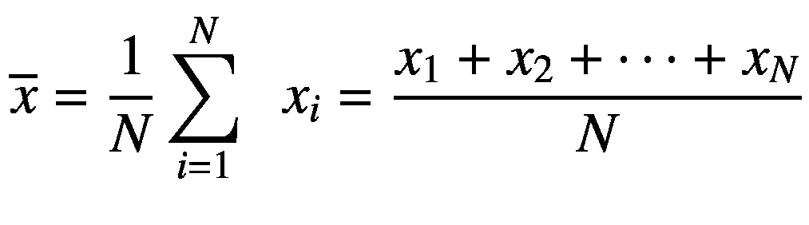

在 R 中，要获取均值，你可以使用 `mean()` 函数：

```
> A <- c(1, 2, 3, 4, 5, 5, 5, 6, 7, 8)
> mean(A);
[1] 4.6
```

要获取数据集的均值：

```
> mean(data$x2);
[1] 2.46451
```

### 四分位距、方差、标准差

变异性度量是衡量数据分散程度的指标。变异性度量可以是极差、四分位距、方差、标准差等。

#### 极差

极差是数据中最大值与最小值之间的差值。

要在 R 中查找极差，你可以使用 `range()` 函数：

```
> A <- c(1, 2, 3, 4, 5, 5, 5, 6, 7, 8)
> range(A);
[1] 1 8
```

要获取最大值与最小值之间的差值，你可以使用：

```
> A <- c(1, 2, 3, 4, 5, 5, 5, 6, 7, 8)
> res <- range(A)
> diff(res);
[1] 7
```

你也可以使用 `min()` 和 `max()` 函数来查找极差：

```
> A <- c(1, 2, 3, 4, 5, 5, 5, 6, 7, 8)
> min(A);
[1] 1
> max(A);
[1] 8
> max(A) - min(A);
[1] 7
```

要获取数据集的极差：

```
> res <- range(data$x2)
> diff(res);
[1] 10.65222
> res <- range(data$x2, na.rm=TRUE)
> diff(res);
[1] 10.65222
```

`na.rm` 是一个逻辑值，用于指明是否移除 NA 值。

#### 四分位距

四分位距是衡量第 75 百分位数（即第三个四分位数）与第 25 百分位数（即第一个四分位数）之间差值的指标。

要获取四分位距，你可以使用 `IQR()` 函数：

```
> A <- c(1, 2, 3, 4, 5, 5, 5, 6, 7, 8)
> IQR(A);
[1] 2.5
```

你可以通过使用 `quantile()` 函数来获取四分位数：

```
> quantile(A);
0%  25%  50%  75% 100%
1.00 3.25 5.00 5.75 8.00
```

你可以获取第 25 和第 75 百分位数：

```
> quantile(A, 0.25);
25%
3.25
> quantile(A, 0.75);
75%
5.75
```

你可以使用以下方法获取数据集的四分位距和四分位数：

```
> quantile(data$x2);
0%       25%       50%       75%
-2.298551  1.274672  2.380852  3.750422
100%
8.353669
> IQR(data$x2);
[1] 2.47575
> IQR(data$x2, na.rm=TRUE);
[1] 2.47575
> help(IQR);
```

`IQR()` 和 `quantile()` 函数可以通过 `na.rm = TRUE` 移除 NA 值。

极差衡量数据的最大值和最小值，而四分位距衡量大多数数值所在的范围。


#### 方差

方差是数据与均值之差的平方的平均值，用于衡量数据的离散程度。

总体方差的计算公式为：

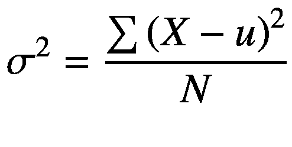

其中 μ 是总体均值，`N` 是数据点的数量。

样本方差的计算公式为：

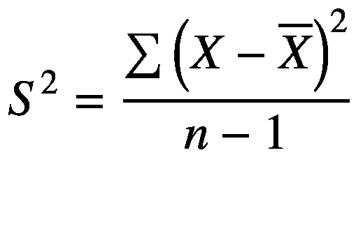

其中 `n` 是数据点的数量。在计算样本方差和样本标准差时使用 `n-1`，这是基于贝塞尔校正，旨在部分修正对总体方差和标准差估计中的偏差。

要计算总体方差，可以使用 `var()` 函数并乘以 `(N - 1)/N`：

```
> A <- c(1,2,3,4,5,6,7,8,9,10);
> N <- length(A);
[1] 10
> var(A) * (N - 1) / N;
[1] 4.24
```

要获取样本方差，可以直接使用 `var()` 函数：

```
> A <- c(1,2,3,4,5,6,7,8,9,10);
> var(A);
[1] 4.711111
```

要计算数据集的总体方差：

```
> N <- length(data$x);
[1] 100
> var(data$x) * (N - 1) / N;
[1] 1.062619
```

要计算数据集的样本方差：

```
> var(data$x);
[1] 1.073352
```

#### 标准差

标准差是方差的平方根，用于衡量数据的离散程度。由于方差是平方后的结果，当数据变异较大时方差会变大，变异较小时方差会变小。而标准差是方差的平方根，因此更易于理解和应用。方差是平方后的结果，其单位与原始数据不同，而标准差则与原始数据单位相同。

总体标准差的计算公式为：

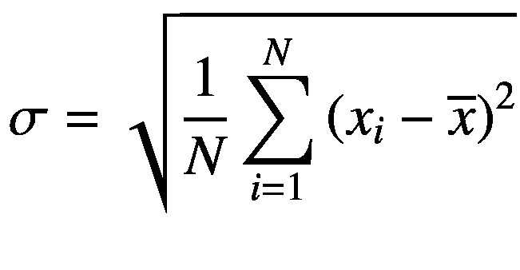

对于样本标准差，在计算样本方差和样本标准差时使用 `n - 1`，这是基于贝塞尔校正，旨在部分修正对总体方差和标准差估计中的偏差。

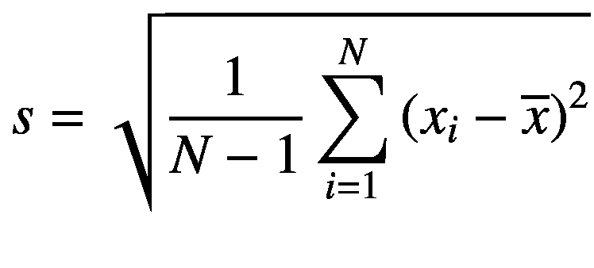

要计算总体标准差：

```
> A <- c(1,2,3,4,5,6,7,8,9,10);
> N <- length(A);
> variance <- var(A) * (N - 1) / N;
> sqrt(variance);
[1] 2.059126
```

要计算数据集的总体标准差：

```
> N <- length(data$x);
> variance <- var(data$x) * (N - 1) / N;
> sqrt(variance);
[1] 1.908994
```

要计算样本标准差，可以使用 `sd()` 函数：

```
> A <- c(1,2,3,4,5,6,7,8,9,10);
> sd(A);
[1] 2.170509
```

要计算数据集的样本标准差，可以使用 `sd()` 函数：

```
> sd(data$x2);
[1] 1.918611
```

### 正态分布

正态分布是较为重要的理论之一，因为几乎所有统计检验都要求数据服从正态分布。它描述了数据在绘图时的形态。正态分布也称为钟形曲线，如图 4-8 所示。

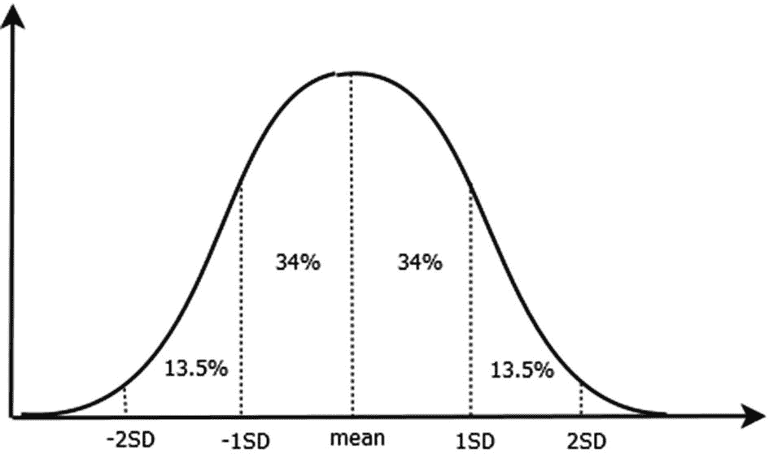

图 4-8

正态分布或钟形曲线

在 R 中，可以使用 `hist()` 函数绘制分布图：

```
> hist(data$x, breaks=15);
```

在 R 中，`breaks` 表示直方图中条形的数量。`bins` 是用于对数据进行分组的类区间。例如，在成绩数据中，分组区间可以是 83-88、89-94、95-100，且每个区间的大小应相同。参见图 4-9。

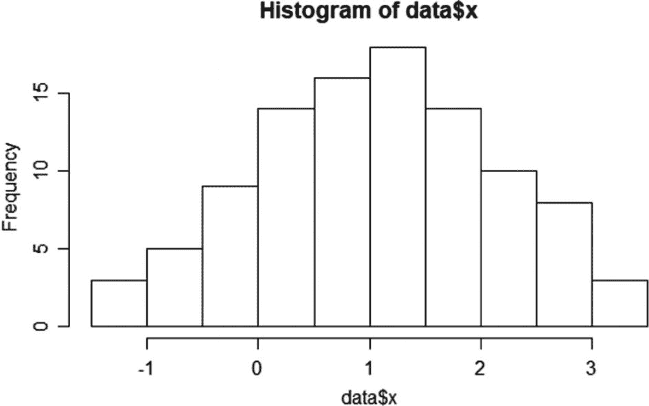

图 4-9

x 的直方图

要判断数据是否服从正态分布，可以使用 `qqnorm()` 和 `qqline()` 函数：

```
> qqnorm(data$x);
> qqline(data$x);
```

在图 4-10 所示的 Q-Q 图中，如果数据点没有偏离参考线，则表明数据服从正态分布。

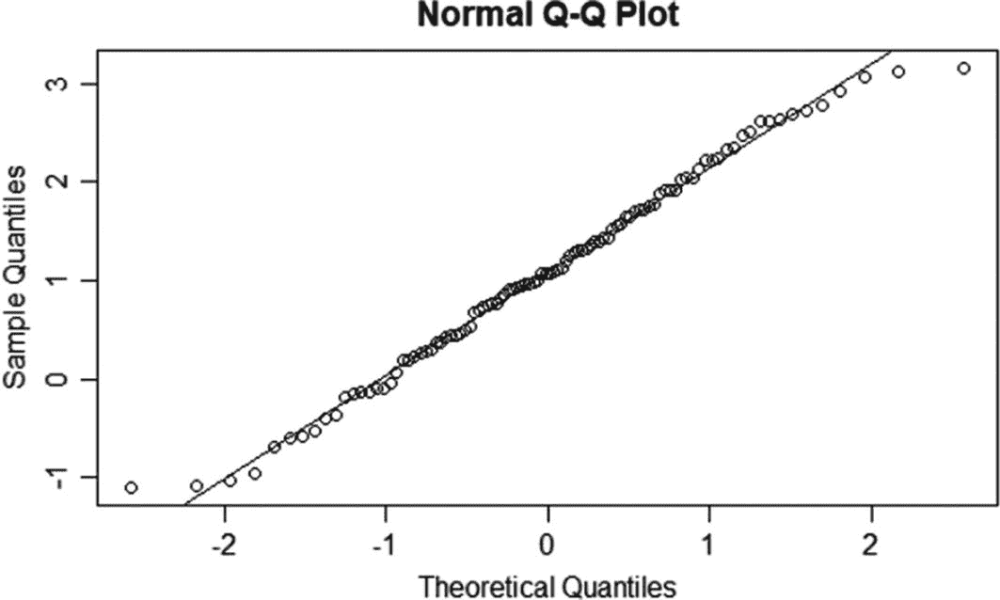

图 4-10

x 的 Q-Q 图

也可以使用夏皮罗检验来测试数据是否服从正态分布：

```
> shapiro.test(data$x);
Shapiro-Wilk normality test
data:  data$x
W = 0.98698, p-value = 0.4363
```

如果 `p-value` 大于 0.05，则可以认为数据未偏离正态分布。

在 R 中，要生成服从正态分布的随机数，可以使用 `rnorm()` 函数：

```
> set.seed(123);
> A <- rnorm(50, 3, 0.5);
> hist(A, breaks=15);
```

其中 3 是均值，0.5 是标准差。上述函数从正态分布中生成了 50 个随机值。参见图 4-11。

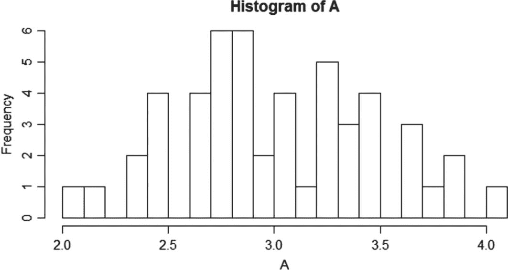

图 4-11

A 的直方图

在 R 中，要计算累积分布函数 (CDF)，即 F(x) = P(X <= x)，其中 X 服从正态分布，可以使用 `pnorm()` 函数：

```
> pnorm(1.9, 3, 0.5);
[1] 0.01390345
```

上述代码直接查找概率 P(X < 1.9)，其中 X 是均值为 3、标准差为 0.5 的正态分布。如果需要计算 P(X > 1.9)，则使用 `1 - pnorm(1.9, 3, 0.5)`。

在 R 中，如果要计算逆 CDF 并查找正态分布的第 p 个分位数，可以使用：

```
> qnorm(0.95, 3, 0.5);
[1] 3.822427
```

此代码查找标准差为 0.5、均值为 3 的正态分布的第 95 百分位数。返回的值是一个 x 值，而非概率。

#### 模态

分布的模态可以通过绘制直方图时峰值的数量来观察（见图 4-12）：

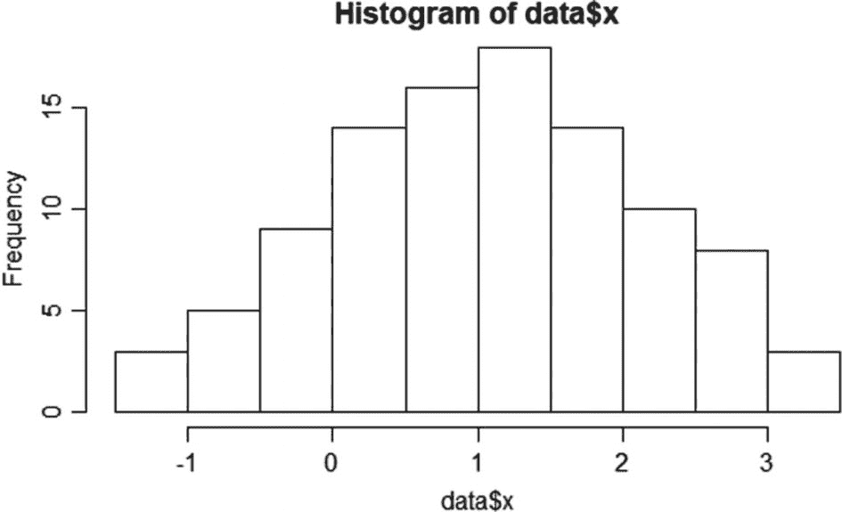

图 4-12

x 的直方图

```
> hist(data$x, breaks=15);
```

图 4-13 展示了模态类型。市场变量的分布可以认为是单峰类型。该图展示了单峰、双峰和多峰类型。

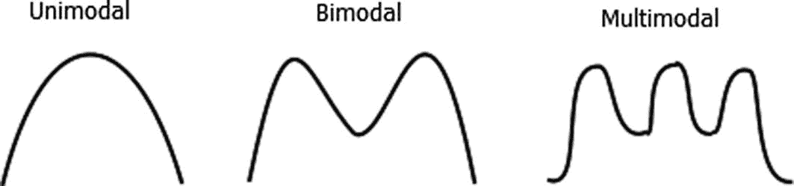

图 4-13

直方图或分布的模态类型


### 偏度

偏度是衡量分布对称性以及分布与正态分布差异程度的指标。图 4-14 展示了偏度的类型。

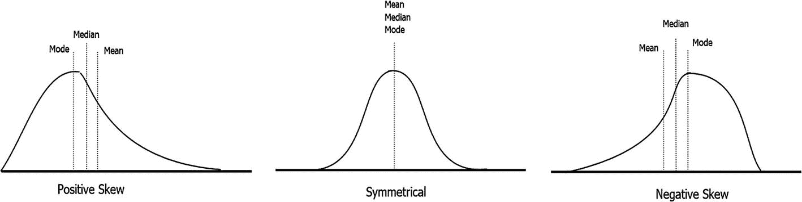

图 4-14

偏度的类型

负偏态也称为左偏态，正偏态也称为右偏态。上一节的直方图呈现负偏态。

峰度指标用于判断数据集是厚尾还是薄尾。高峰度意味着厚尾，即数据中存在更多异常值。参见图 4-15。

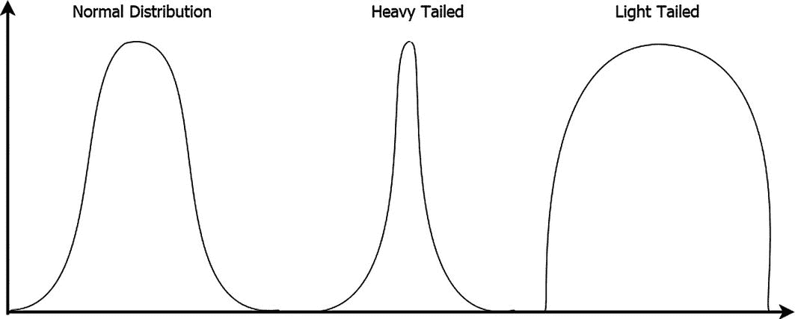

图 4-15

峰度类型：厚尾或薄尾分布

要在 R 中计算峰度和偏度，必须安装 `moments` 包：

```
> install.packages("moments");
Installing package into 'C:/Users/gohmi/Documents/R/win-library/3.5'
(as 'lib' is unspecified)
trying URL 'https://cran.rstudio.com/bin/windows/contrib/3.5/moments_0.14.zip'
Content type 'application/zip' length 55827 bytes (54 KB)
downloaded 54 KB
package 'moments' successfully unpacked and MD5 sums checked
The downloaded binary packages are in
C:\Users\gohmi\AppData\Local\Temp\RtmpET26Hv\downloaded_packages
```

你还需要加载 `moments` 包：

```
> require(moments);
Loading required package: moments
```

然后使用 `skewness()` 和 `kurtosis()` 函数来获取偏度和峰度：

```
> skewness(data$x);
[1] -0.06331548
> kurtosis(data$x);
[1] 2.401046
```

### 二项分布

二项分布有两种结果：成功或失败，可以将其视为在重复多次的调查中成功或失败的概率。观测次数是固定的，每次观测或概率是独立的，并且所有观测的成功概率相同。

要获取二项分布的概率质量函数 `Pr(X=x)`，可以使用 `dbinom()` 函数：

```
> dbinom(32, 100, 0.5);
[1] 0.000112817
```

这段代码查询的是 `P(X=30)`，其中 `X` 是大小为 100、成功概率为 0.5 的二项分布。

要获取二项分布的累积分布函数 `P(X <= x)`，可以使用 `pbinom()` 函数：

```
> pbinom(32, 100, 0.5);
[1] 0.0002043886
```

上述代码查询的是 `p(X <= 30)`，其中 `X` 是大小为 100、成功概率为 0.5 的二项分布。

要获取二项分布的第 p 个分位数，可以使用 `qbinom()` 函数：

```
> qbinom(0.3, 100, 0.5);
[1] 47
```

上述代码查询的是大小为 100、成功概率为 0.5 的二项分布的第 30 个分位数。该值是一个累积值。

要从二项分布生成随机变量，可以使用 `rbinom()` 函数：

```
> set.seed(123);
> A  hist(A, breaks=20);
```

你可以使用 `rbinom()` 或 `rnorm()` 生成随机变量来模拟新的数据集。

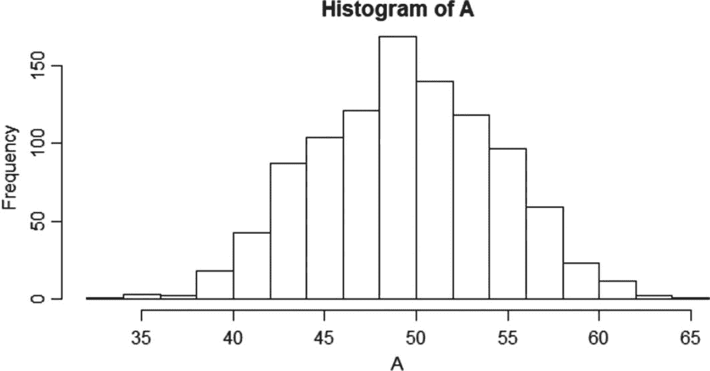

图 4-16

A 的直方图

#### `summary()` 和 `str()` 函数

`summary()` 和 `str()` 函数是获取数据描述性统计信息的最快方法。`summary()` 函数提供数据的基本描述性统计信息。`str()` 函数，如前一章所述，提供变量的结构。

你可以使用 `summary()` 函数获取基本描述性统计信息：

```
> summary(data);
x                 x2               x3                 y
Min.   :-1.1038   Min.   :-2.299   Min.   :-5.0216   Min.   :0.00
1st Qu.: 0.3758   1st Qu.: 1.275   1st Qu.: 0.8415   1st Qu.:0.00
Median : 1.0684   Median : 2.381   Median : 2.5858   Median :0.00
Mean   : 1.0904   Mean   : 2.465   Mean   : 2.8314   Mean   :0.49
3rd Qu.: 1.7946   3rd Qu.: 3.750   3rd Qu.: 4.5229   3rd Qu.:1.00
Max.   : 3.1618   Max.   : 8.354   Max.   :12.8562   Max.   :1.00
```

你可以使用 `str()` 函数获取数据的结构：

```
> str(data);
'data.frame':    100 obs. of  4 variables:
$ x : num  2.216 -0.181 1.697 1.655 1.068 ...
$ x2: num  4.77 4.1 2.33 2.46 1.05 ...
$ x3: num  -4.87 6.98 3.92 0.75 3.35 ...
$ y : num  0 1 0 0 1 1 1 1 1 1 ...
```

## 总结

在本章中，你学习了 R 编程。现在你理解了描述性统计。描述性统计对数据进行汇总，通常关注数据的分布、集中趋势和离散程度。

你还了解了 R 编程如何允许你导入数据集，这些数据集可以是 CSV 文件、Excel 文件、制表符分隔文件、JSON 文件等。将数据读入 R 控制台或 R 环境非常重要，因为在进行统计计算和理解数据之前，你必须拥有一些数据。

你执行了简单的数据处理，例如选择数据、排序数据、筛选数据、获取唯一值和删除缺失值。

你还学习了一些基本的统计术语，例如总体、样本、观测值和变量。你还学习了统计学中的数据类型，包括数值数据和分类变量。数值数据可以是离散数据和连续数据，分类数据可以是名义变量和有序变量。

你还学习了均值、中位数和众数，它们是衡量集中趋势最常用的指标。集中趋势是一个最能概括数据且与数据集中心相关的度量。

你还学习了变异性度量，即数据分散程度的度量。变异性度量可以是极差、四分位距、方差、标准差等。

你还学习了正态分布，这是最重要的理论之一，因为几乎所有统计检验都要求数据呈正态分布。你学习了如何检验数据的正态分布，以及分布的偏度和峰度。

你还学习了 `summary()` 和 `str()` 函数，它们是获取数据描述性统计信息的最快方法。`summary()` 函数提供数据的基本描述性统计信息。`str()` 函数，如前一章所述，提供变量的结构。

你进一步了解了两种非常流行的分布，其中正态分布也称为钟形曲线，是一种在许多数据集中自然出现的分布。二项分布有两种结果：成功或失败，可以将其视为在重复多次的调查中成功或失败的概率。

