# 5. 数据可视化

描述性统计是一组用于汇总数据的数学方法。数据可视化相当于视觉沟通，因为从数据创建图形有助于我们理解数据。人类无需太多处理努力就能区分线条、形状和颜色的差异，数据可视化可以利用这一点创建图表和图形，帮助我们更轻松地理解数据。

在本章中，你将使用 R 绘制条形图、直方图、折线图、饼图、散点图、箱线图和散点图矩阵。然后，你将学习绘制决策树和社交网络分析图。你还将使用 `ggplot2` 通过图形语法创建更高级的图表，接着你将学习使用 Plotly JS 创建交互式图表。


## 什么是数据可视化？

描述性统计对数据进行汇总，通常关注数据的分布、集中趋势和离散程度。而数据可视化则通过数据创建图形来帮助我们理解数据。这些图形或图表也有助于我们以视觉方式向客户传达信息。一图胜千言。

数据可视化可以涉及条形图、直方图、散点图、箱线图、折线图、时间序列图和散点图矩阵图的绘制，以帮助我们分析和推理数据，理解变量之间的因果关系和关联性。对某些人来说，数据可视化也可以被视为描述性统计。人类无需太多处理就能区分线条、形状和颜色的差异，数据可视化可以利用这一点来创建图表和图形，帮助用户更轻松地理解数据。

## 条形图和直方图

R 语言允许我们绘制条形图和直方图。条形图使用条形表示数据，y 值为变量的值。R 语言使用 `barplot()` 函数创建条形图，并且 R 可以绘制水平和垂直条形图。而直方图则表示变量内数值的频率，并将其绘制成条形。

要在 R 中绘制条形图，可以使用 `barplot()` 函数：

```
> data <- c(3, 4, 5, 6, 7, 8);
> barplot(data, xlab="X 轴", ylab="Y 轴", main="条形图 1", col="green");
```

`data` 是要绘制的数据，`xlab` 是 x 轴名称，`ylab` 是 y 轴名称，`main` 是主标题，`col` 是图表的颜色。见图 5-1。

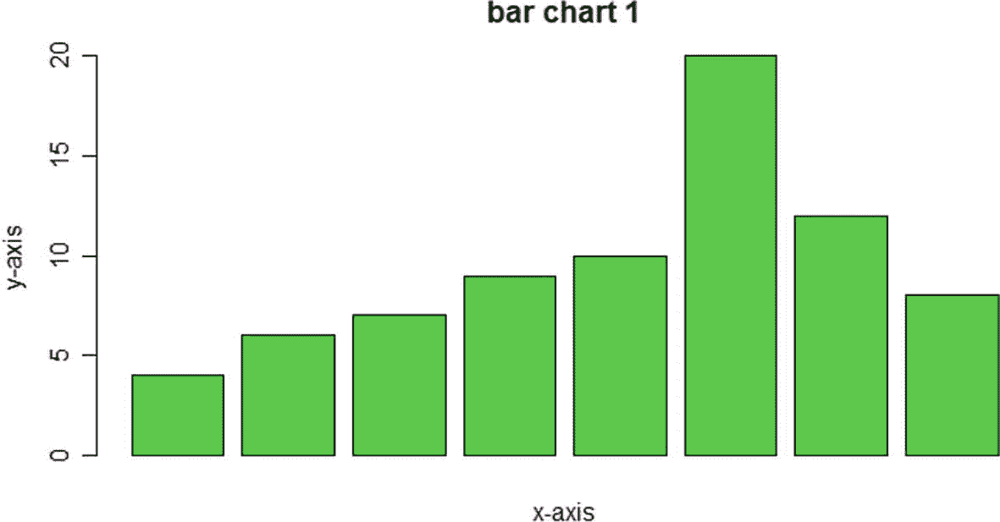

图 5-1

数据的条形图

要将条形图导出为图像文件（见图 5-2），可以添加以下代码：

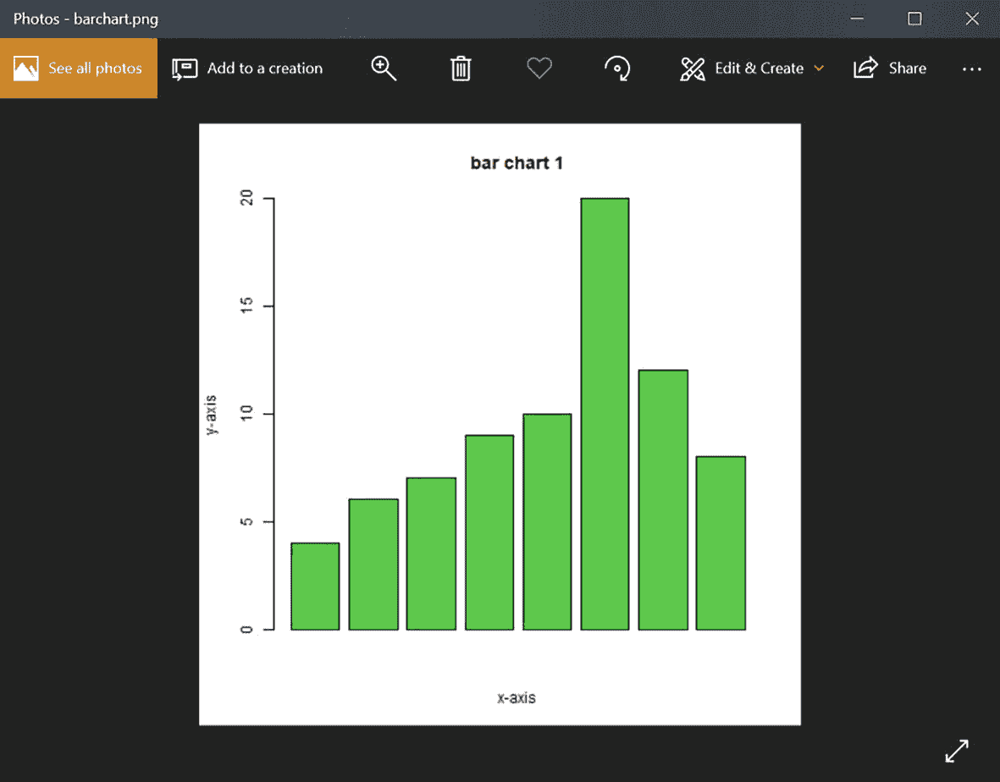

图 5-2

使用 Microsoft 照片打开的条形图 PNG 文件

```
> data <- c(3, 4, 5, 6, 7, 8);
> png(file="D:/barchart.png");
> barplot(data, xlab="x 轴", ylab="y 轴", main="条形图 1", col="green");
> dev.off();
RStudioGD
```

要绘制水平条形图（见图 5-3），可以使用 `horiz=TRUE`：

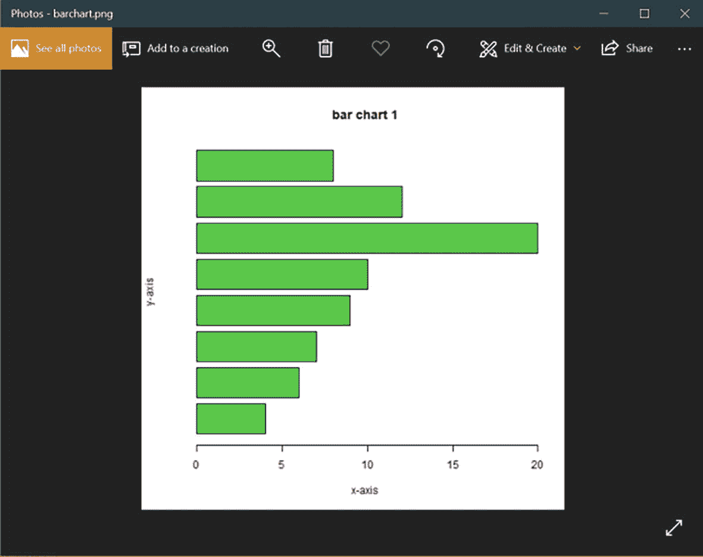

图 5-3

数据变量的水平条形图

```
> data <- c(3, 4, 5, 6, 7, 8);
> png(file="D:/barchart.png");
> barplot(data, xlab="x 轴", ylab="y 轴", main="条形图 1", col="green", horiz=TRUE);
> dev.off();
RStudioGD
```

要绘制堆叠条形图，可以创建以下数据集：

```
> data(mtcars);
> data <- table(mtcars$cyl, mtcars$gear);
> data;
1 2 3 4 6 8
3 3 4 3 5 0 0
4 4 4 0 4 0 0
5 0 2 0 1 1 1
```

要绘制堆叠条形图：

```
> png(file="D:/barchart.png");
> barplot(data3, xlab="x 轴", ylab="y 轴", main="条形图 1", col=c("grey", "blue", "yellow"));
> dev.off();
RStudioGD
```

在数据中，3 是灰色，4 是蓝色，5 是黄色。当 x 轴或 x 为 1 时，灰色为 3 步，蓝色为 4 步，黄色为 0 步。见图 5-4。

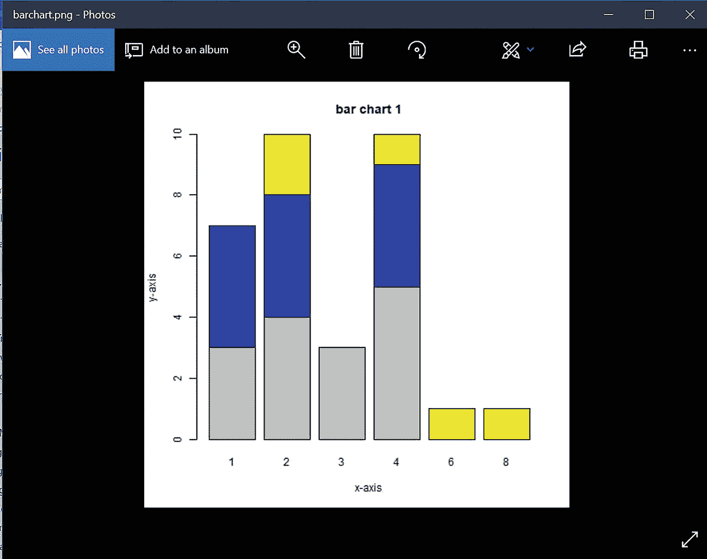

图 5-4

数据的堆叠条形图

```
> data;
1 2 3 4 6 8
3 3 4 3 5 0 0
4 4 4 0 4 0 0
5 0 2 0 1 1 1
```

要绘制分组条形图，可以使用 `beside=TRUE`：

```
> data(mtcars);
> data <- table(mtcars$cyl, mtcars$gear);
> data;
1 2 3 4 6 8
3 3 4 3 5 0 0
4 4 4 0 4 0 0
5 0 2 0 1 1 1
> png(file="D:/barchart.png");
> barplot(data3, xlab="x 轴", ylab="y 轴", main="条形图 1", col=c("grey", "blue", "yellow"), beside=TRUE);
> dev.off();
RStudioGD
```

在数据中，3 是灰色，4 是蓝色，5 是黄色。当 x 轴或 x 为 1 时，灰色为 3 步，蓝色为 4 步，黄色为 0 步。见图 5-5。

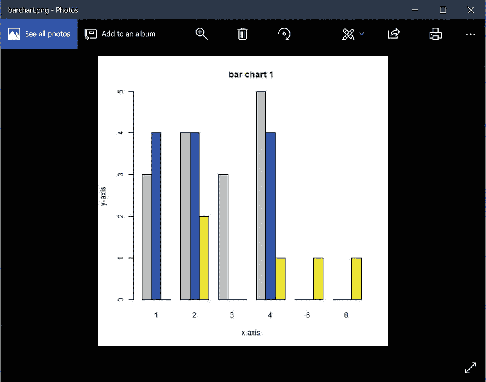

图 5-5

数据的分组条形图

```
> data;
1 2 3 4 6 8
3 3 4 3 5 0 0
4 4 4 0 4 0 0
5 0 2 0 1 1 1
```

要绘制直方图，可以使用 `hist()` 函数（见图 5-6）：

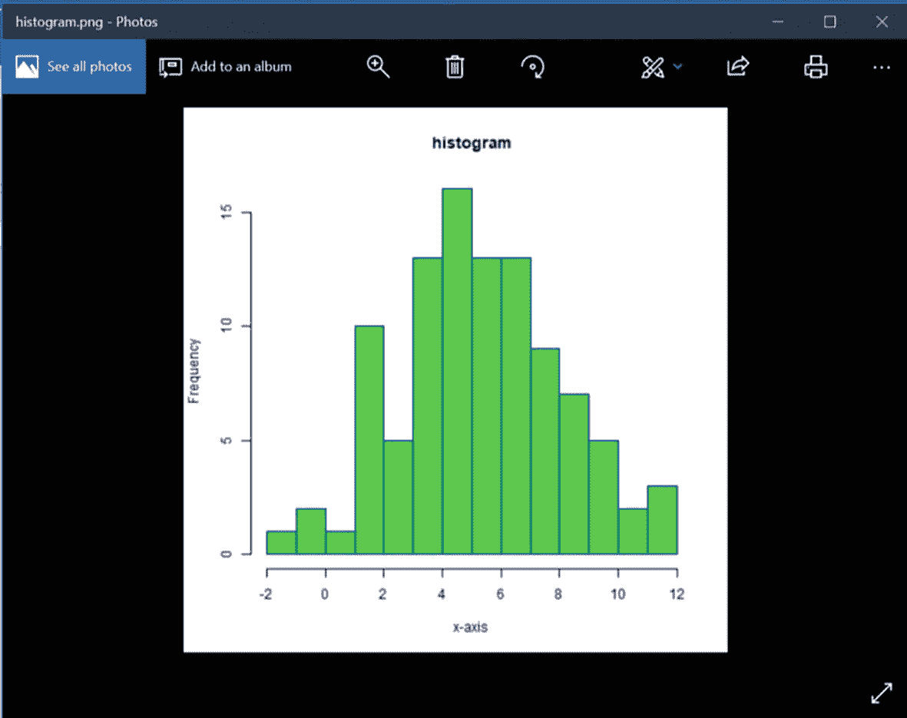

图 5-6

data1 的直方图

```
> set.seed(123);
> data1 <- rnorm(100);
> png(file="D:/histogram.png");
> hist(data1, main="直方图", xlab="x 轴", col="green", border="blue", breaks=10);
> dev.off();
RStudioGD
```

`data1` 是数据，`main` 是主标题，`col` 是颜色，`border` 是边框颜色，`xlab` 是 x 轴名称，`breaks` 是每个条形的宽度。

要绘制带有密度线的直方图，可以将 `freq=FALSE` 设置为基于概率绘制直方图，并使用 `lines()` 函数添加密度线（见图 5-7）：

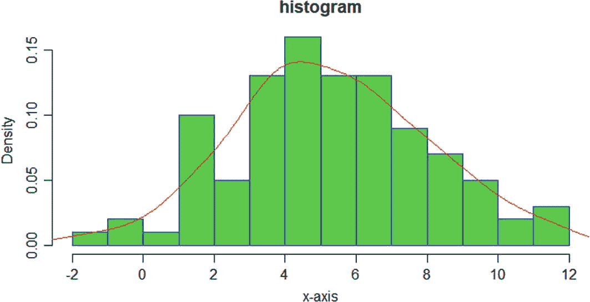

图 5-7

data1 带有密度线的直方图

```
> set.seed(123);
> data1 <- rnorm(100);
> hist(data1, main="直方图", xlab="x 轴", col="green", border="blue", breaks=10, freq=FALSE);
> lines(density(data1), col="red");
```


## 折线图与饼图

折线图是一种通过线条连接所有数据点而形成的图形。折线图对于趋势分析和时间序列分析非常有用。而饼图则是将数据表示为带有不同颜色的圆形切片。

你可以使用 `plot()` 函数绘制折线图（见图 5-8）：

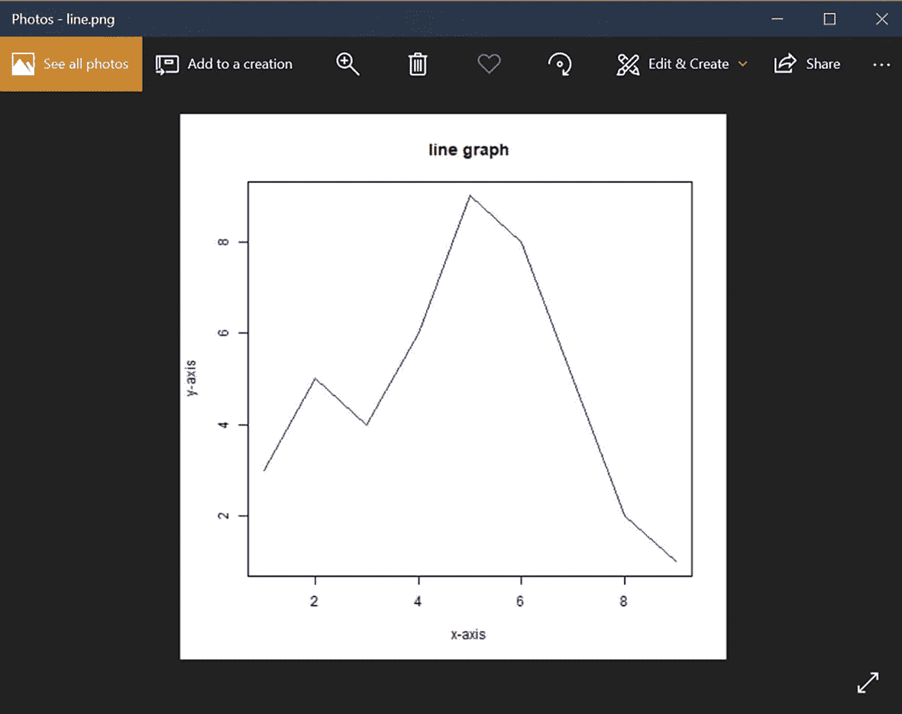

图 5-8
折线图

```
> x <- c(1,2,3,4,5,6,7,8,9,10);
> y <- c(2,4,6,8,10,12,14,16,18,20);
> png(file="D:/line.png");
> plot(x, y, type="l", xlab="x-axis", ylab="y-axis", main="line graph", col="blue");
> dev.off();
RStudioGD
```

当你想要绘制折线图时，使用 `type="l"`；当你想要绘制点图或散点图时，使用 `type="p"`。`xlab` 是 x 轴名称，`ylab` 是 y 轴名称，`main` 是主标题，`col` 是图表的颜色。

要绘制多条折线图，可以添加 `lines()` 函数：

```
> x <- c(1,2,3,4,5,6,7,8,9,10);
> y <- c(2,4,6,8,10,12,14,16,18,20);
> x.1 <- c(1,2,3,4,5,6,7,8,9,10);
> y.1 <- c(1,3,5,7,9,11,13,15,17,19);
> png(file="D:/line.png");
> plot(x, y, type="l", xlab="x-axis", ylab="y-axis", main="line graph", col="blue");
> lines(x.1, y.1, type="o", col="green");
> dev.off();
RStudioGD
```

`type="o"` 会生成一个带数据点的折线图（见图 5-9）。


图 5-9
多条折线图

要绘制饼图，你可以使用 `pie()` 函数（见图 5-10）：

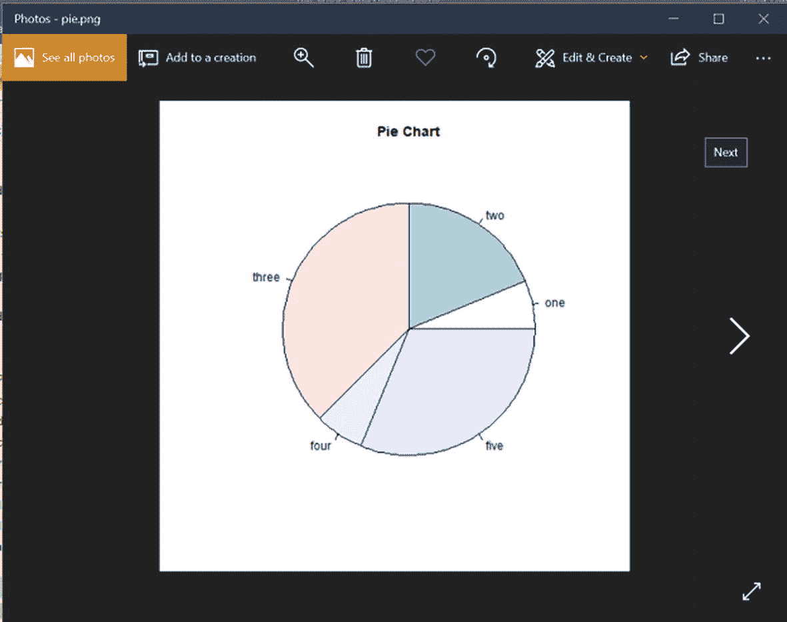

图 5-10
饼图

```
> x <- c(10,20,30,40);
> labels <- c("A","B","C","D");
> png(file="D:/pie.png");
> pie(x, labels, main="Pie Chart");
> dev.off();
RStudioGD
```

要绘制 3D 饼图，你必须安装 `plotrix` 库：

```
> install.packages("plotrix");
Installing package into 'C:/Users/gohmi/Documents/R/win-library/3.5'
(as 'lib' is unspecified)
trying URL 'https://cran.rstudio.com/bin/windows/contrib/3.5/plotrix_3.7-3.zip'
Content type 'application/zip' length 1055537 bytes (1.0 MB)
downloaded 1.0 MB
package 'plotrix ' successfully unpacked and MD5 sums checked
The downloaded binary packages are in
C:\Users\gohmi\AppData\Local\Temp\RtmpET26Hv\downloaded_packages
```

你可以使用 `require()` 函数或 `library()` 函数来调用 `plotrix` 库：

```
> library(plotrix);
```

你可以使用 `pie3D()` 函数绘制如图 5-11 所示的 3D 饼图：

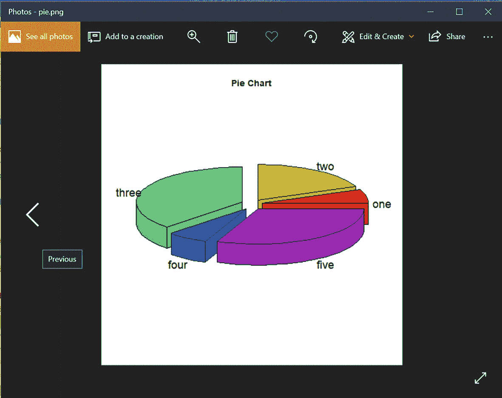

图 5-11
3D 饼图

```
> x <- c(10,20,30,40);
> labels <- c("A","B","C","D");
> png(file="D:/pie.png");
> pie3D(x, labels=labels, explode=0.1, main="Pie Chart");
> dev.off();
RStudioGD
```

## 散点图与箱线图

散点图是一种使用笛卡尔平面上的点来表示数据的图表。每个点代表两个变量的值。箱线图则展示了数据的统计信息。

你可以使用 `plot()` 函数绘制散点图：

```
> x <- c(1,2,3,4,5,6,7,8,9,10);
> y <- c(2,4,6,8,10,12,14,16,18,20);
> png(file="D:/scatter.png");
> plot(x, y, xlab="x-axis", ylab="y-axis", main="scatterplot");
> dev.off();
RStudioGD
```

`xlab` 是 x 轴名称，`ylab` 是 y 轴名称，`main` 是主标题。见图 5-12。

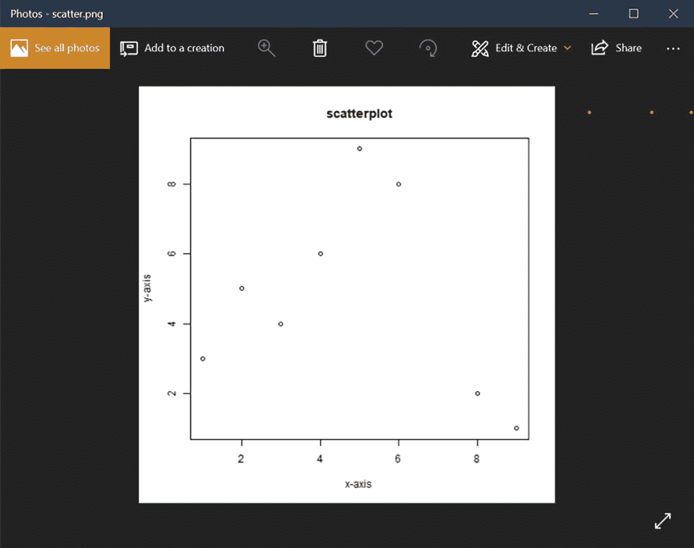

图 5-12
散点图

箱线图展示了数据集中数据的分布情况，描绘了最小值、最大值、中位数、第一四分位数和第三四分位数。图 5-13 解释了箱线图。

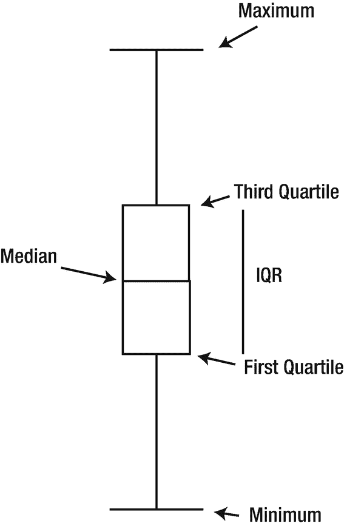

图 5-13
箱线图及其说明

要创建图 5-14 中的箱线图，你可以使用 `boxplot()` 函数：

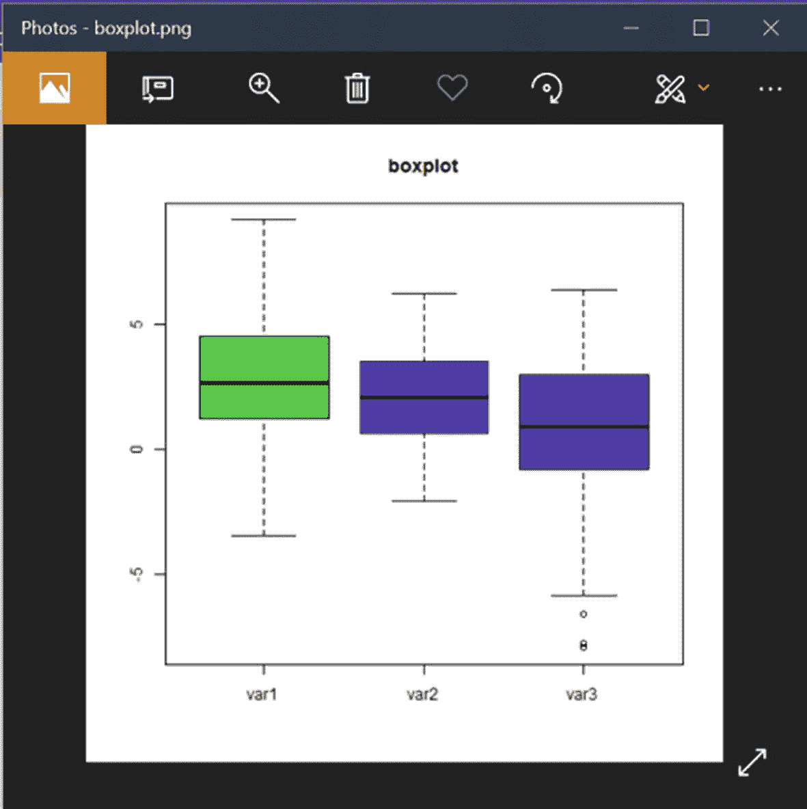

图 5-14
箱线图

```
> set.seed(12);
> var1 <- rnorm(100, mean=5, sd=2);
> var2 <- rnorm(100, mean=8, sd=3);
> var3 <- rnorm(100, mean=12, sd=4);
> data <- data.frame(var1, var2, var3);
> png(file="D:/boxplot.png");
> boxplot(data, main="boxplot", notch=FALSE, varwidth=TRUE, col=c("green", "purple", "blue"));
> dev.off();
RStudioGD
```

`data` 是数据，`main` 是主标题，`notch` 是一个逻辑值，用于说明不同组的中位数如何相互匹配，`varwidth` 是一个逻辑值，用于说明是否绘制与样本量成比例的箱线图宽度，`col` 是箱线图的颜色。

你可以通过设置 `notch=TRUE` 来绘制带凹口的箱线图（见图 5-15）：


图 5-15
带凹口的箱线图

```
> set.seed(12);
> var1 <- rnorm(100, mean=5, sd=2);
> var2 <- rnorm(100, mean=8, sd=3);
> var3 <- rnorm(100, mean=12, sd=4);
> data <- data.frame(var1, var2, var3);
> png(file="D:/boxplot.png");
> boxplot(data, main="boxplot", notch=TRUE, varwidth=TRUE, col=c("green", "purple", "blue"));
> dev.off();
RStudioGD
```

## 散点图矩阵

散点图矩阵用于寻找一个变量与其他变量之间的相关性，通常用于选择重要变量，这也被称为变量选择。

要绘制图 5-16 中的散点图矩阵，你可以使用 `pairs()` 函数：

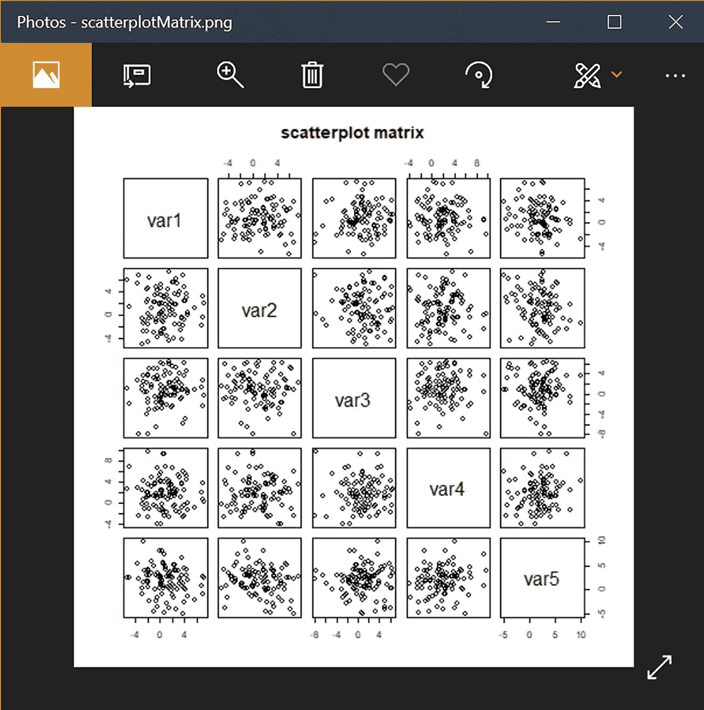

图 5-16
散点图矩阵

```
> set.seed(12);
> var1 <- rnorm(100, mean=5, sd=2);
> var2 <- rnorm(100, mean=8, sd=3);
> var3 <- rnorm(100, mean=12, sd=4);
> var4 <- rnorm(100, mean=15, sd=5);
> var5 <- rnorm(100, mean=20, sd=6);
> data <- data.frame(var1, var2, var3, var4, var5);
> png(file="D:/scatterplotMatrix.png");
> pairs(~var1+var2+var3+var4+var5, data=data, main="scatterplot matrix");
> dev.off();
RStudioGD
```

## 社交网络分析图基础

社交网络分析图是一种高级数据可视化；它与统计学无关，但可作为很好的参考。以下是对社交网络分析图的快速介绍。社交网络分析图可以帮助你理解个体或节点之间的关系。社交网络分析通常用于 Facebook 和微博等社交网络数据。每个节点是一个个体，社交网络图向我们展示了每个个体如何与其他个体连接。

要绘制社交网络分析图，你必须安装 `igraph` 包：

```
> install.packages("igraph");
Installing package into 'C:/Users/gohmi/Documents/R/win-library/3.5'
(as 'lib' is unspecified)
trying URL 'https://cran.rstudio.com/bin/windows/contrib/3.5/igraph_1.2.2.zip'
Content type 'application/zip' length 9148505 bytes (8.7 MB)
downloaded 8.7 MB
package 'igraph' successfully unpacked and MD5 sums checked
The downloaded binary packages are in
C:\Users\gohmi\AppData\Local\Temp\RtmpET26Hv\downloaded_packages
```

要使用 `igraph` 包，你必须使用 `library()` 函数：

```
> library(igraph);
Attaching package: 'igraph'
The following objects are masked from 'package:stats':
decompose, spectrum
The following object is masked from 'package:base':
union
```

要绘制图 5-17 中所示的 John ➤ James ➤ Mary ➤ John 的网络图，你可以使用

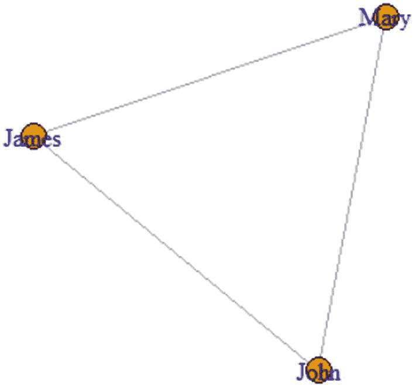

图 5-17
使用无向网络图的社交网络分析

```
> g <- graph.formula(John-James, James-Mary, Mary-John);
> plot(g);
```

要绘制图 5-18 中所示的有向网络图，将 `directed=FALSE` 改为 `directed=TRUE`：

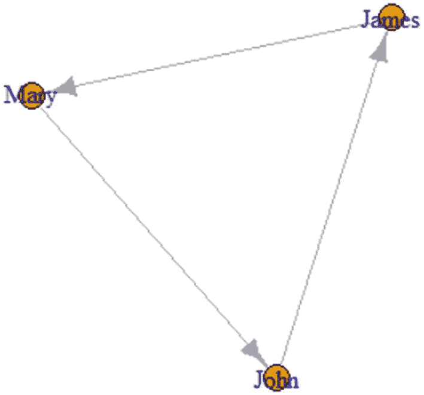

图 5-18
使用有向网络图的社交网络分析

```
> g <- graph.formula(John-+James, James-+Mary, Mary-+John);
> plot(g);
```


## 使用 ggplot2

`ggplot2` 是由 Hadley Wickham 创建的一个包，它提供了一种强大的图形语言，用于创建高级图表。`ggplot2` 在 R 社区中非常流行且著名，它允许我们以直观的方式创建表示单变量、多变量和分类数据的图表。R 的内置功能提供了图表绘制能力，但 `ggplot` 允许我们使用图形语法绘制更高级的图表。

要使用 `ggplot2`，你必须安装该包：

```
> install.packages("ggplot2");
Installing package into 'C:/Users/gohmi/Documents/R/win-library/3.5'
(as 'lib' is unspecified)
also installing the dependencies 'stringi', 'colorspace', 'stringr', 'labeling', 'munsell', 'RColorBrewer', 'digest', 'gtable', 'lazyeval', 'plyr', 'reshape2', 'scales', 'viridisLite', 'withr'
There is a binary version available but
the source version is later:
binary source needs_compilation
stringi  1.1.7  1.2.4              TRUE
Binaries will be installed
trying URL 'https://cran.rstudio.com/bin/windows/contrib/3.5/stringi_1.1.7.zip'
Content type 'application/zip' length 14368013 bytes (13.7 MB)
downloaded 13.7 MB
trying URL 'https://cran.rstudio.com/bin/windows/contrib/3.5/colorspace_1.3-2.zip'
Content type 'application/zip' length 527776 bytes (515 KB)
downloaded 515 KB
The downloaded binary packages are in
C:\Users\gohmi\AppData\Local\Temp\RtmpET26Hv\downloaded_packages
```

### 什么是图形语法？

`ggplot2` 专注于图形语法，即图表的构建块，例如：

*   数据
*   美学映射
*   几何对象
*   统计变换
*   标度
*   坐标系
*   位置调整
*   分面

在本书中，你将了解其中一部分。本书无法涵盖 `ggplot2` 的所有内容。

### ggplot2 的设置

要使用 `ggplot2`，你必须使用 `library()` 或 `require()` 函数调用该库。你还需要让 `ggplot` 知道使用哪个数据集，你可以使用 `ggplot()` 函数：

```
> library(ggplot2);
> set.seed(12);
> var1  var2  var3  data  ggplot(data);
```

`ggplot()` 只能接受数据框变量。

### ggplot2 中的美学映射

在 `ggplot2` 中，美学是我们能看到的东西，例如：

*   位置
*   颜色
*   填充
*   形状
*   线型
*   大小

你可以通过 `aes()` 函数在 `ggplot2` 中使用美学：

```
> ggplot(data, aes(x=var1, y=var2));
```

### ggplot2 中的几何对象

几何对象是你想要放入图表中的图形或图表。你可以使用 `geom_point()` 创建散点图，使用 `geom_line()` 创建线图，以及使用 `geom_boxplot()` 在图表中创建箱线图。

你可以使用以下命令查看可用的几何对象（也如图 5-19 所示）：

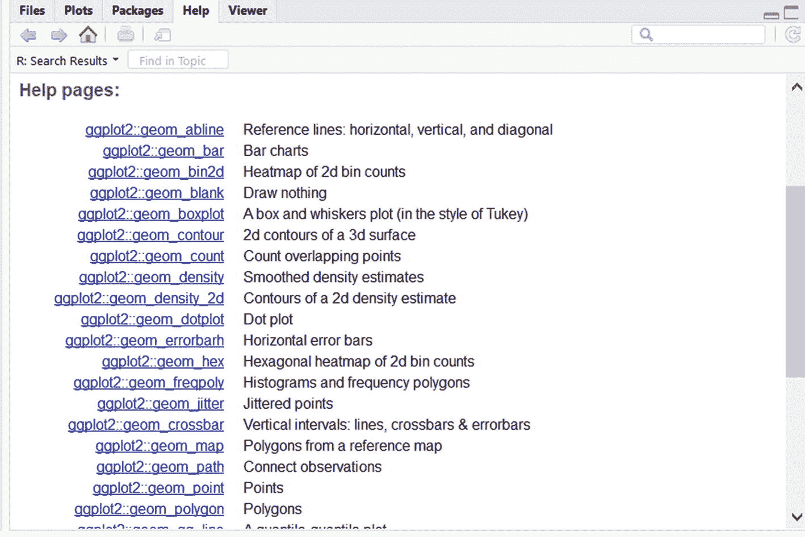

图 5-19

可用的几何对象

```
> help.search("geom_", package="ggplot2");
```

在 `ggplot2` 中，`geom` 也是图表的图层。你可以一个接一个地添加 `geom` 对象，就像一层一层地添加图层一样。

你可以使用 `geom_point()` 函数添加一个散点图（图 5-20）：

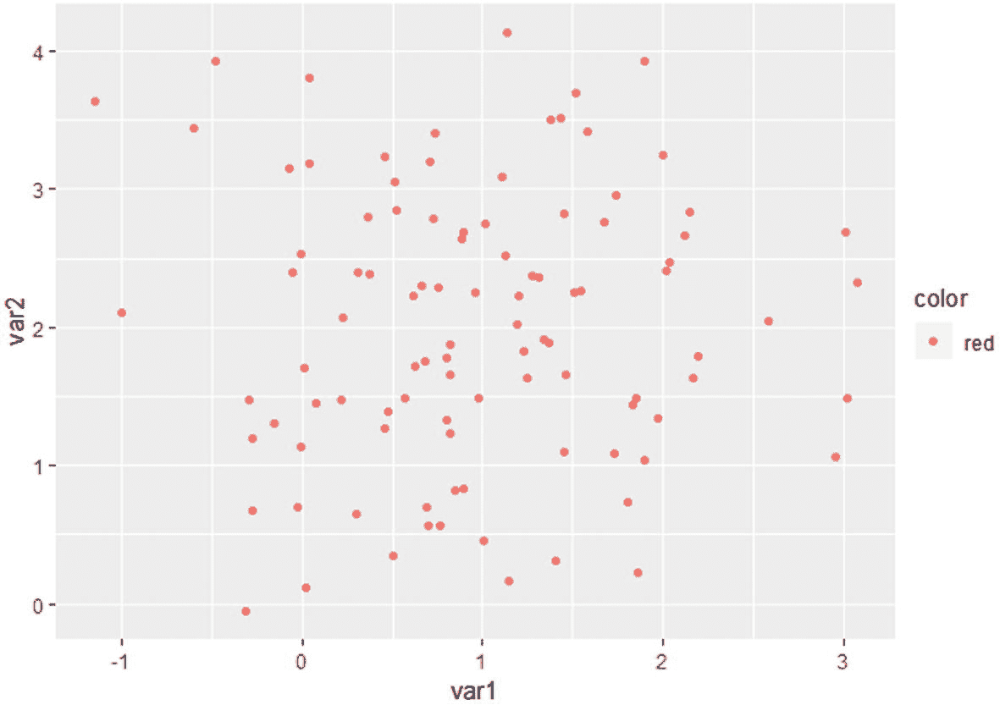

图 5-20

散点图

```
> ggplot(data, aes(x=var1, y=var2)) + geom_point(aes(color="red"));
```

你可以使用另一个图层为散点图添加一个包含线条和色带的平滑器（图 5-21）：

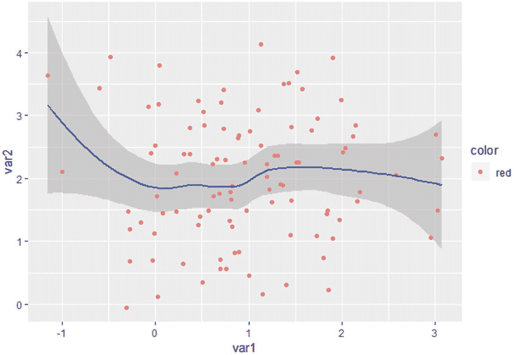

图 5-21

带平滑器的散点图

```
> ggplot(data, aes(x=var1, y=var2)) + geom_point(aes(color="red")) + geom_smooth();
`geom_smooth()` using method = 'loess' and formula 'y ~ x'
```

### ggplot2 中的标签

你已经绘制了图表中的图形，现在让我们添加主标题以及 x 轴和 y 轴标题。你可以使用 `labs()` 图层来指定标签。

要为图 5-22 添加 x 轴标题、y 轴标题和主标题，你可以使用 `labs()` 函数：

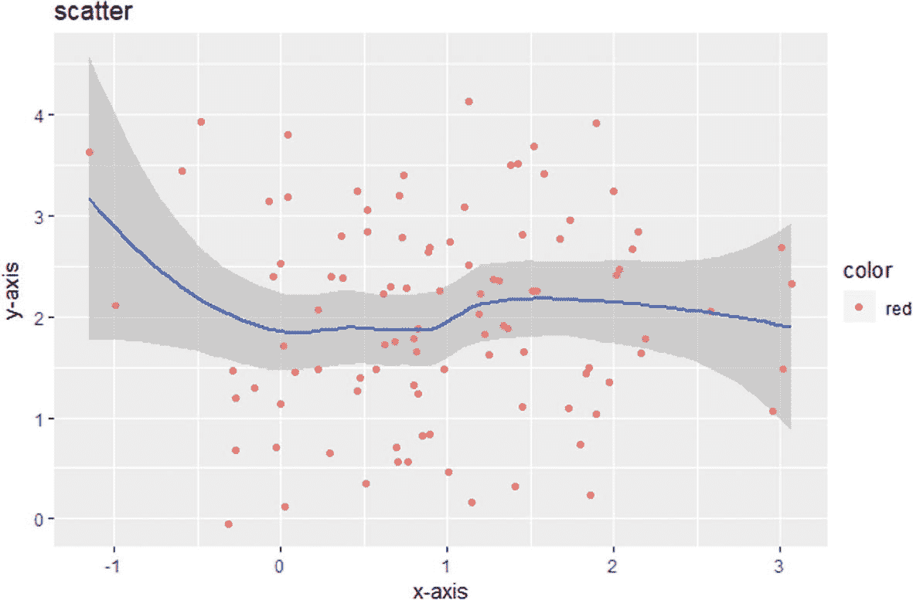

图 5-22

带平滑器和标签的散点图

```
> ggplot(data, aes(x=var1, y=var2)) + geom_point(aes(color="red")) + geom_smooth() + labs(title="Scatter", x = "Xaxis", y = "Y-axis", color="Color");
`geom_smooth()` using method = 'loess' and formula 'y ~ x'
```

### ggplot2 中的主题

如果你想更改标签和图例的大小和样式，`theme()` 函数可以提供帮助。`ggplot` 中的 `theme()` 函数处理诸如以下元素：

*   轴标签
*   绘图背景
*   分面背景
*   图例外观

有一些内置主题，例如 `theme_light()` 和 `theme_bw()`。

你可以通过使用 `theme_light()` 添加图 5-23 中所示的内置主题：

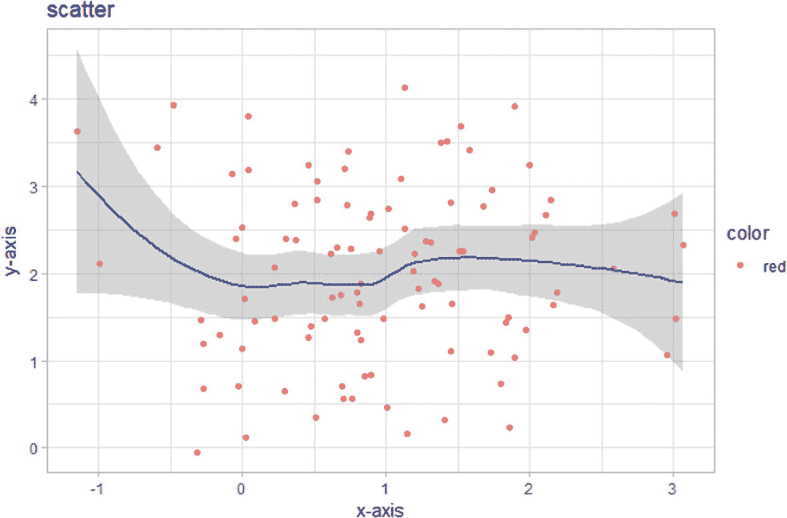

图 5-23

带平滑器、标签和主题的散点图

```
> ggplot(data, aes(x=var1, y=var2)) + geom_point(aes(color="red")) + geom_smooth() + labs(title="scatter", x="x-axis", y="y-axis") + theme_light();
`geom_smooth()` using method = 'loess' and formula 'y ~ x'
```

你可以添加自己的主题，如图 5-24 所示，使用：

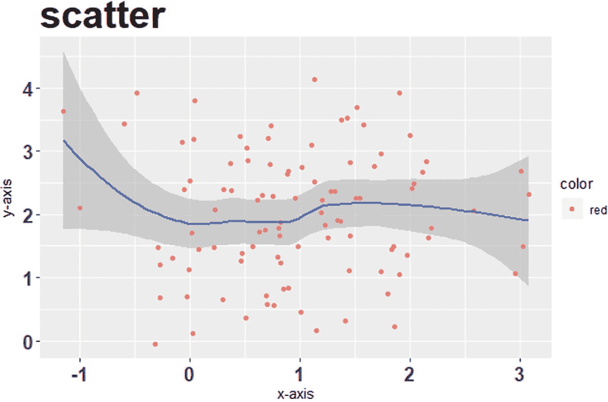

图 5-24

带平滑器和自定义主题的散点图

```
> ggplot(data , aes(x=var1, y=var2)) + geom_point(aes(color="red")) + geom_smooth() + labs(title="scatter", x="x-axis", y="y-axis") + theme(plot.title=element_text(size=30, face="bold"), axis.text.x=element_text(size=15, face="bold"), axis.text.y=element_text(size=15, face="bold"));
`geom_smooth()` using method = 'loess' and formula 'y ~ x'
```

`plot.title` 是图表的标题，`axis.text.x` 是 x 轴标签，`axis.text.y` 是 y 轴标签，`axis.title.x` 是 x 轴的标题，`axis.title.y` 是 y 轴的标题。要更改文本的大小，请使用 `element_text()` 函数。要移除标签，你可以使用 `element_blank()`。

## ggplot2 常用图表

学习了 `ggplot` 的基础知识和图形语法后，以下部分将介绍一些可以使用 `ggplot` 绘制的常用图表。代码也是可用的。

### 条形图

当你想要比较不同组之间的数据时，会使用条形图（图 5-25）：

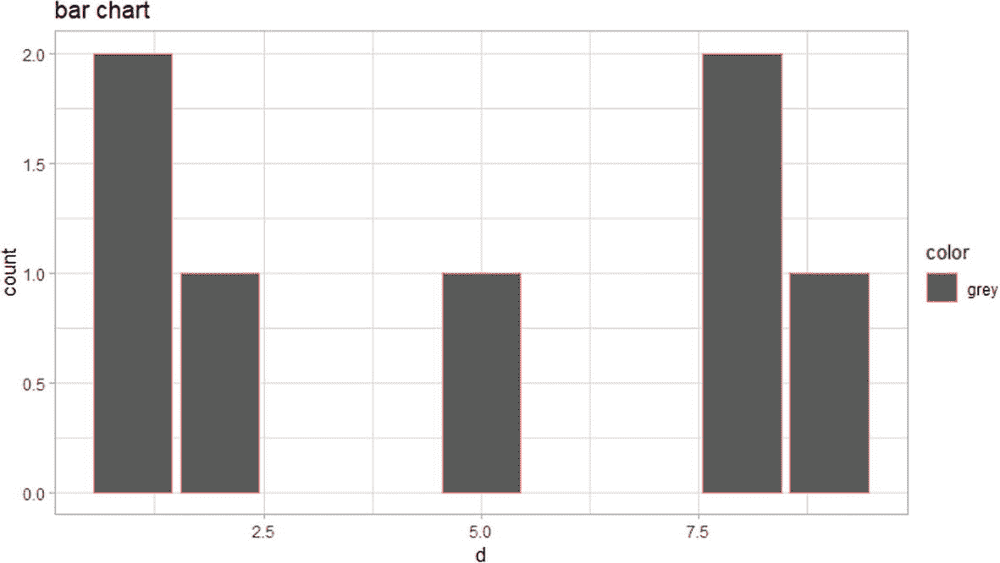

图 5-25

条形图

```
> d  df  ggplot(df) + geom_bar(aes(color="grey", x=d)) + labs(title="bar chart") + theme_light();
```

要绘制水平条形图（图 5-26），你可以使用 `coord_flip()` 函数：

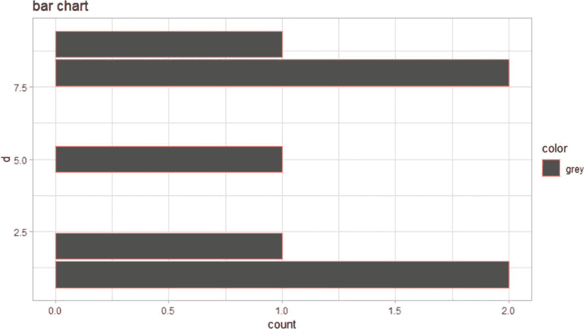

图 5-26

水平条形图

```
> ggplot(df) + geom_bar(aes(color="grey", x=d)) + coord_flip() + labs(title="bar chart") + theme_light();
```

### 直方图

直方图（图 5-27）允许你查看数据是否呈正态分布。

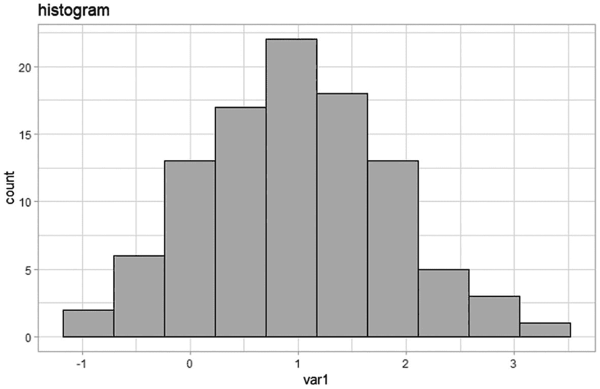

图 5-27

直方图

```
> set.seed(12);
> var1  var2  var3  data  ggplot(data, aes(x=var1)) + geom_histogram(bins=10, color="black", fill="grey") + labs(title="histogram") + theme_light();
```


#### 密度图

密度图（图 5-28）同样可以展示数据是否符合正态分布。

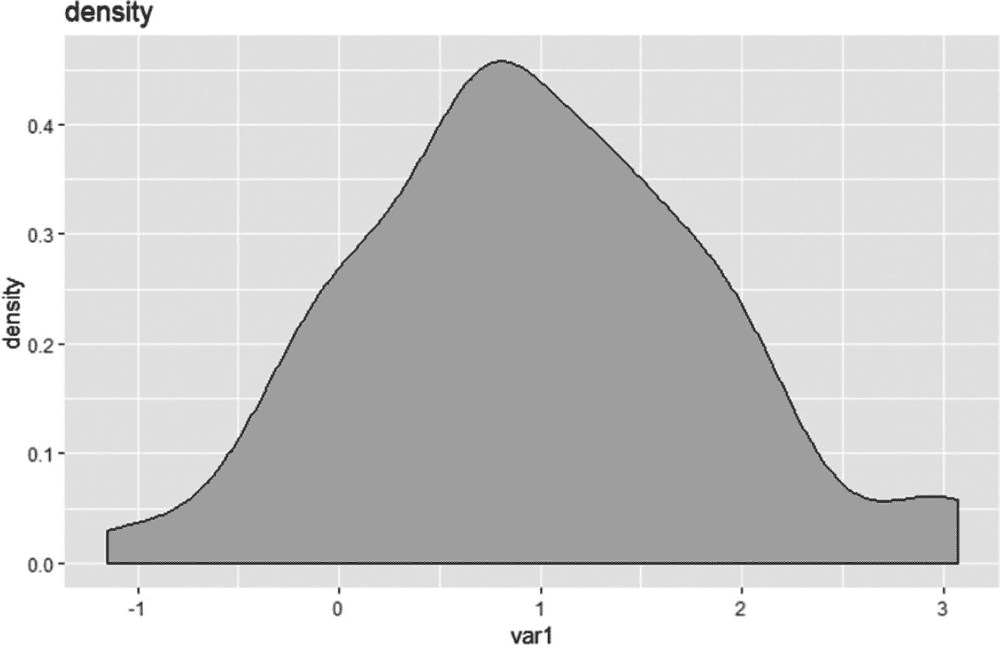

图 5-28

密度图

```
> ggplot(data, aes(x=var1)) + geom_density(fill="grey") + labs(title="density");
```

#### 散点图

散点图（图 5-29）展示了两个变量之间的关系。

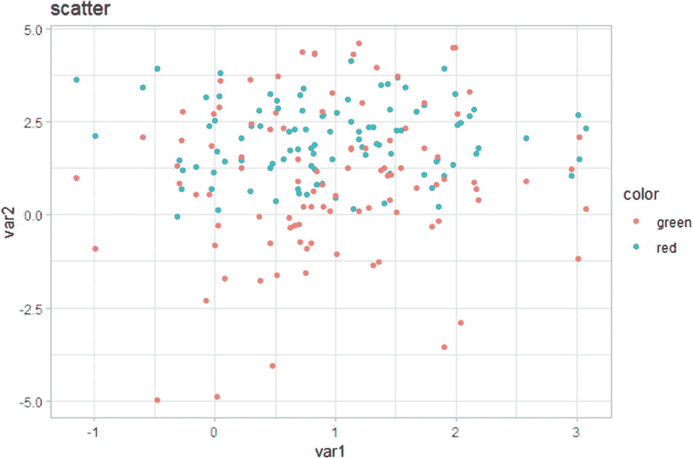

图 5-29

散点图

```
> ggplot(data) + geom_point(aes(color="red", x=var1, y=var2)) + geom_point(aes(color="green", x=var1, y=var3)) + labs(title="scatter") + theme_light();
```

#### 折线图

折线图（图 5-30）同样展示了两个变量之间的关系，也可用于趋势分析。

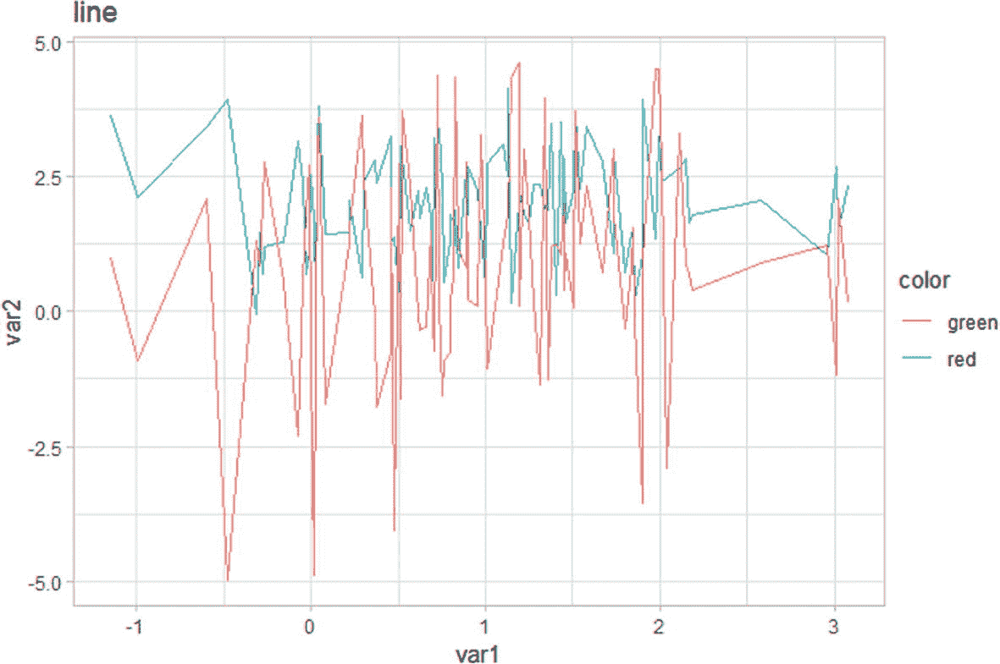

图 5-30

折线图

```
> ggplot(data) + geom_line(aes(color="red", x=var1, y=var2)) + geom_line(aes(color="green", x=var1, y=var3)) + labs(title="scatter") + theme_light();
```

#### 箱线图

箱线图（图 5-31）展示了数据的统计信息。

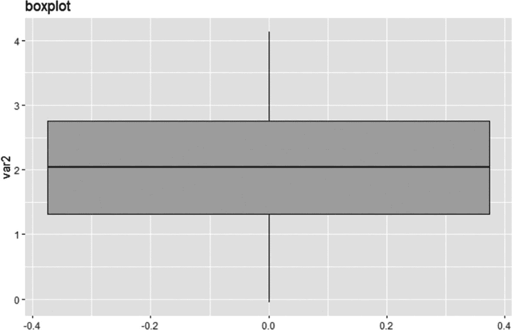

图 5-31

箱线图

```
> ggplot(data, aes(y=var2)) + geom_boxplot(fill="grey") + labs(title="boxplot");
```

你可以使用以下方法更改网格（图 5-32）：

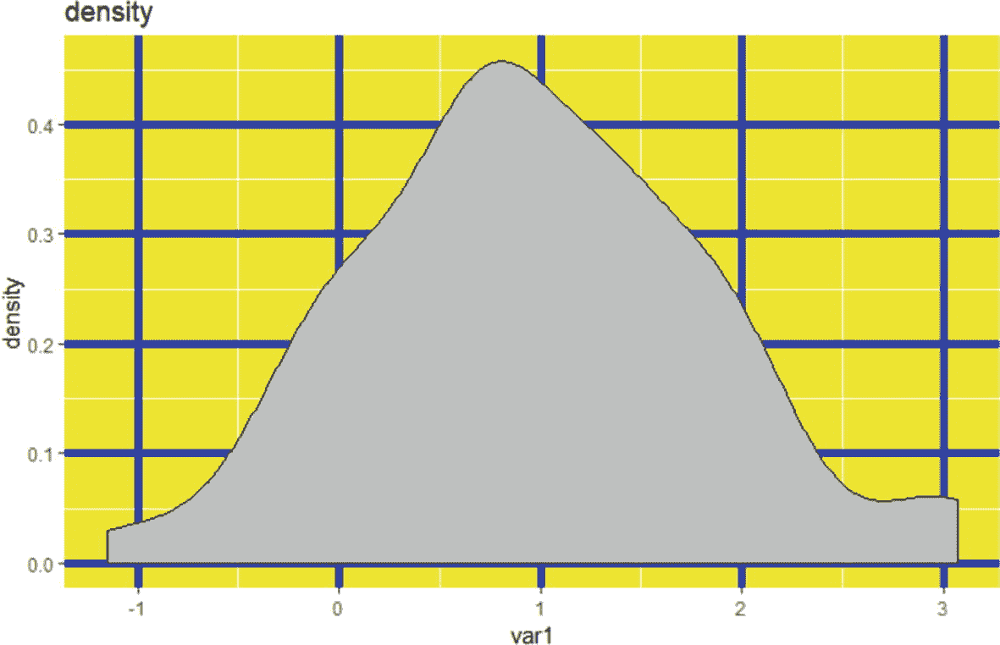

图 5-32

自定义主题

```
> ggplot(data, aes(x=var1)) + geom_density(fill="grey") + labs(title="density") + theme(panel.background=element_rect(fill="yellow"), panel.grid.major=element_line(color="blue", size=2));
```

你可以使用 `panel.background` 和 `element_rect()` 更改背景颜色，并使用 `panel.grid.major`、`panel.grid.minor` 和 `element_line()` 更改网格。

要保存图表，可以使用 `ggsave()` 函数（图 5-33）：

```
> ggsave("D:/density.png");
Saving 3.95 x 3.3 in image
```

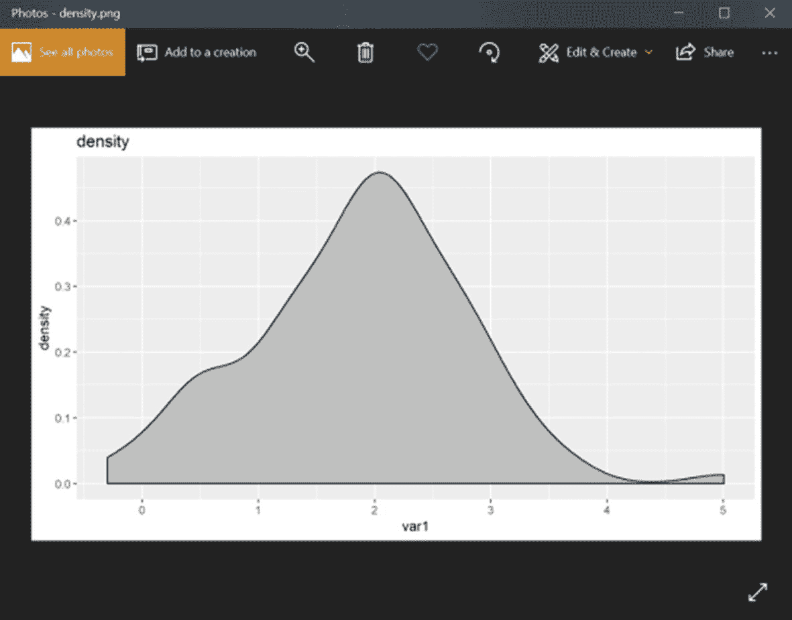

图 5-33

导出为 PNG 文件的图表

### 使用 Plotly 和 ggplot2 创建交互式图表

Plotly JS 允许您创建交互式、出版级的图表。您可以使用 ggplot 创建 Plotly 图表。要使用 Plotly 或创建 Plotly 图表，您必须按如下方式下载 plotly 包：

```
> install.packages("plotly");
Installing package into 'C:/Users/gohmi/Documents/R/win-library/3.5'
(as 'lib' is unspecified)
also installing the dependencies 'httpuv', 'xtable', 'sourcetools', 'mime', 'openssl', 'yaml', 'shiny', 'later', 'httr', 'jsonlite', 'base64enc', 'htmltools', 'htmlwidgets', 'tidyr', 'hexbin', 'crosstalk', 'data.table', 'promises'
There is a binary version available but
the source version is later:
binary source needs_compilation
htmlwidgets    1.2    1.3             FALSE
trying URL 'https://cran.rstudio .com/bin/windows/contrib/3.5/httpuv_1.4.5.zip'
Content type 'application/zip' length 1182084 bytes (1.1 MB)
downloaded 1.1 MB
trying URL 'https://cran.rstudio.com/bin/windows/contrib/3.5/xtable_1.8-3.zip'
Content type 'application/zip' length 755944 bytes (738 KB)
downloaded 738 KB
trying URL 'https://cran.rstudio.com/bin/windows/contrib/3.5/sourcetools_0.1.7.zip'
Content type 'application/zip' length 530521 bytes (518 KB)
downloaded 518 KB
trying URL 'https://cran.rstudio.com/bin/windows/contrib/3.5/mime_0.5.zip'
Content type 'application/zip' length 46959 bytes (45 KB)
downloaded 45 KB
trying URL 'https://cran.rstudio.com/bin/windows/contrib/3.5/openssl_1.0.2.zip'
Content type 'application/zip' length 3628608 bytes (3.5 MB)
downloaded 3.5 MB
trying URL 'https://cran.rstudio.com/bin/windows/contrib/3.5/yaml_2.2.0.zip'
Content type 'application/zip' length 203553 bytes (198 KB)
downloaded 198 KB
```

要使用 Plotly，您必须使用 `library()` 或 `require()` 函数调用该库：

```
> library(plotly);
Attaching package: 'plotly'
The following object is masked from 'package:ggplot2':
last_plot
The following object is masked from 'package:igraph':
groups
The following object is masked from 'package:stats':
filter
The following object is masked from 'package:graphics':
layout
```

要创建 Plotly 图表（图 5-34），您可以使用 `ggplotly()` 函数：

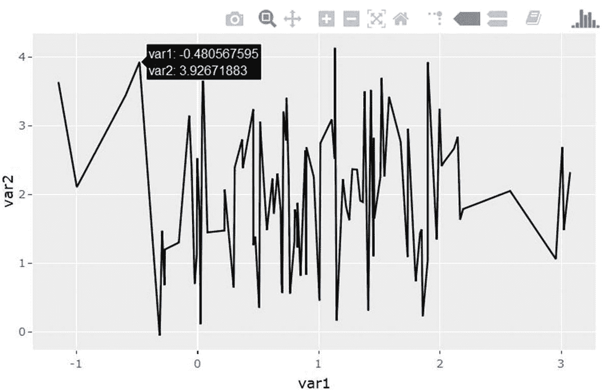

图 5-34

使用 R 创建的 Plotly 图表

```
> set.seed(12);
> var1  var2  var3  data  gg  g  g;
```

要保存 Plotly 图表，您必须创建一个免费的 Plotly 账户。然后您可以使用以下代码保存 R 会话：

```
Sys.setenv("plotly_username"="your plotly username");
Sys.setenv("plotly_api_key"="your api key");
```

要发布图形，您可以使用

```
api_create(g, filename="");
```

## 结论

在本章中，您学习了 R 编程。您现在了解到描述性统计对数据进行汇总，通常关注数据的分布、集中趋势和离散程度。另一方面，数据可视化则根据数据创建图形，帮助我们理解数据。

您学习了如何使用 R 编程绘制折线图、条形图、直方图、散点图、散点图矩阵、饼图和箱线图。

您还学习了决策树，这是一种机器学习算法，可以执行分类和回归任务。它们可以是一种用树形结构表示选择和结果的图形。

您还学习了社交网络分析图，它可以帮助我们理解个体或节点之间的关系。社交网络分析通常用于 Facebook 和微博等社交网络数据。每个节点都是一个个体，社交网络图向我们展示了每个个体如何与其他个体连接。

您还探索了 ggplot2，这是一个由 Hadley Wickham 创建的包，它提供了一种强大的图形语言，用于创建高级图表。ggplot2 在 R 社区中非常流行和著名，它允许我们以直接的方式创建表示单变量、多变量和分类数据的图表。

您还学习了图形语法。ggplot2 专注于图形语法。图形语法是图表的构建块。

您还探索了 Plotly JS。Plotly JS 允许我们创建交互式、出版级的图表。您使用 ggplot 创建了一个 Plotly 图表。

