# 6. 推断统计与回归

推断统计和描述性统计是统计学的主要分支。描述性统计从数据集中得出摘要，并使用集中趋势、离散程度和偏度。推断统计则根据样本数据描述并对总体进行推断。在推断统计中，您会用到假设检验和参数估计。回归分析是一组用于估计所有变量之间关系的统计过程。

在本章中，您将了解 `apply()`、`lapply()` 和 `sapply()` 函数，然后对数据进行抽样，执行相关性和协方差分析，以及 p 值检验、t 检验、卡方检验和方差分析等检验。接着，您将了解非参数检验，包括 Wilcoxon 符号秩检验、Wilcoxon-Mann-Whitney 检验、Kruskal-Wallis 检验，以及简单线性回归和多元线性回归分析。

## 什么是推断统计与回归分析？

推断统计与描述统计是统计学的两大分支。描述统计通过均值、中位数等集中趋势，方差、标准差等离散程度，以及偏度和峰度来概括数据特征。

推断统计则对总体和样本数据进行描述和推断。在推断统计中，你会用到假设检验和参数估计。通过参数估计，你试图回答总体参数的问题；通过假设检验，你试图回答一个研究问题。在假设检验中，研究问题是以疑问句形式提出的假设。例如，研究问题可以是：*一班和二班的工程数学考试成绩是否存在显著差异？* 而假设可以是：*一班和二班的工程数学考试成绩存在显著差异。* 研究问题以“是否存在”开头，假设以“存在”开头。根据研究问题，假设可分为原假设 `H[0]` 和备择假设 `H[a]`。原假设 `H[0]` 可以是 `μ[1] = u[2]`，备择假设 `H[a]` 可以是 `μ[1] ≠ u[2]`。其中 `μ[1]` 是一班成绩的均值，`μ[2]` 是二班成绩的均值。随后你可以使用推断检验来获取 p 值。如果 p 值小于或等于显著性水平 `alpha`（通常为 0.05），则拒绝原假设，并认为在 95% 置信区间下备择假设成立。如果 p 值大于 0.05，则无法拒绝原假设。

对于参数估计，参数可以是均值、方差、标准差等。如果你想估计整个人群的身高均值（顺便提一句，测量所有人是不可能的），你可以采用抽样方法从人群中选取一部分人。接着计算样本的身高均值，然后推断总体身高的均值。之后你可以构建置信区间，即总体身高均值可能落入的范围。之所以构建一个范围，是因为样本无法精确推导出总体身高的均值。

回归分析是一套用于估计变量之间关系的统计过程。更具体地说，回归分析用于理解自变量与因变量之间的关系，并探索这些关系的形式。

### `apply()`、`lapply()`、`sapply()`

`apply()` 函数可以执行循环来遍历数据并应用一个函数。该函数可以是 R 语言中的 `mean()` 函数，也可以是自定义函数。使用 `apply()` 函数是为了避免使用循环。`apply()` 函数可以处理列表、矩阵或数组。

要使用 `apply()` 函数，先创建随机数据：

```
> set.seed(123);
> var1  var2  var3  data  data;
var1      var2        var3
1    1.43952435 2.2895934  7.39762070
2    1.76982251 3.2568837  5.62482595
3    3.55870831 2.7533081  2.46970989
4    2.07050839 2.6524574  4.08638812
5    2.12928774 2.0483814  2.17132010
6    3.71506499 2.9549723  2.04750621
7    2.46091621 2.2150955  1.42279432
8    0.73493877 1.3320581  1.81076547
9    1.31314715 2.6197735  6.30181493
10   1.55433803 3.9189966  2.89194375
```

你可以将 `apply()` 函数与 `mean()` 函数结合使用：

```
> apply(data, 1, mean);
[1] 3.708913 3.550511 2.927242 2.936451 2.116330 2.905848 2.032935 1.292587 3.411579 2.788426
[11] 2.962408 3.151718 3.082613 2.340998 1.992851 4.479820 2.573733 1.315515 1.793035 1.311216
[21] 1.967292 2.690174 2.901045 2.810064 2.830503 1.926952 2.554660 2.265633 2.556436 2.383774
[31] 4.593868 2.658598 3.121812 2.326194 1.873185 2.395315 2.242476 3.172000 3.417250 1.537521
[41] 2.143278 2.175163 2.718194 2.126560 2.416108 3.383570 1.977803 1.833860 3.183512 2.533507
[51] 2.763284 2.538914 2.533833 2.847073 3.617265 3.019648 3.058612 3.157894 2.957849 1.591852
[61] 2.796705 1.822920 2.166982 4.274287 3.699170 3.898973 2.939493 1.352056 2.887190 3.532488
[71] 2.994538 2.560393 3.446763 2.209567 2.756647 2.345487 2.700874 2.412955 3.158053 2.484031
[81] 1.202496 3.707153 2.683914 2.415853 2.593174 2.800894 3.549599 3.933870 2.663340 2.995215
[91] 3.848239 3.444024 3.541280 1.773932 4.018272 3.176785 4.840582 1.859845 2.398367 2.762643
```

以上数据是每行均值的结果。`data` 是数据，`1` 是边际参数，`mean` 是函数。边际参数表示当值为 2 时函数应用于列，当值为 1 时应用于行。

你可以通过使用 `margin=2` 来获取每列的均值：

```
> apply(data, 2, mean);
var1     var2     var3
2.090406 2.892453 3.240930
```

`apply()` 和 `lapply()` 非常相似，区别仅在于 `lapply()` 的输出是一个列表。你可以如下使用 `lapply()`：

```
> lapply(data$var1, mean);
[[1]]
[1] 1.439524
[[2]]
[1] 1.769823
[[3]]
[1] 3.558708
[[4]]
[1] 2.070508
[[5]]
[1] 2.129288
```

`sapply()` 与 `lapply()` 非常相似，区别仅在于输出是一个向量。

## 抽样

抽样是从总体中选取一个子集的过程。总体包含所有成员的数据。有时样本可以是完整数据集的一个子集。抽样的优势在于成本更低，且数据收集效率高于收集总体中每个成员的数据。

```
> sapply(data$var1, mean);
[1]  1.43952435  1.76982251  3.55870831  2.07050839  2.12928774  3.71506499  2.46091621
[8]  0.73493877  1.31314715  1.55433803  3.22408180  2.35981383  2.40077145  2.11068272
[15]  1.44415887  3.78691314  2.49785048  0.03338284  2.70135590  1.52720859  0.93217629
[22]  1.78202509  0.97399555  1.27110877  1.37496073  0.31330669  2.83778704  2.15337312
[29]  0.86186306  3.25381492  2.42646422  1.70492852  2.89512566  2.87813349  2.82158108
[36]  2.68864025  2.55391765  1.93808829  1.69403734  1.61952900  1.30529302  1.79208272
[43]  0.73460365  4.16895597  3.20796200  0.87689142  1.59711516  1.53334465  2.77996512
[50]  1.91663093  2.25331851  1.97145324  1.95712954  3.36860228  1.77422901  3.51647060
[57]  0.45124720  2.58461375  2.12385424  2.21594157  2.37963948  1.49767655  1.66679262
[64]  0.98142462  0.92820877  2.30352864  2.44820978  2.05300423  2.92226747  4.05008469
[71]  1.50896883 -0.30916888  3.00573852  1.29079924  1.31199138  3.02557137  1.71522699
[78]  0.77928229  2.18130348  1.86110864  2.00576419  2.38528040  1.62933997  2.64437655
[85]  1.77951344  2.33178196  3.09683901  2.43518149  1.67406841  3.14880762  2.99350386
[92]  2.54839696  2.23873174  1.37209392  3.36065245  1.39974041  4.18733299  3.53261063
[99]  1.76429964  0.97357910
```

### 简单随机抽样

简单随机抽样（`SRS`）是从完整数据集中随机选取元素。每个元素被选中的概率相同，且每个子集被选中的概率也与其他子集相同。

### 分层抽样

分层抽样是根据一个因素、特征或多个因素将总体划分为若干组。这些组称为层（`strata`），单个组称为一个层（`stratum`）。在分层抽样中，执行以下步骤：

1.  将总体划分为若干组。
2.  对每组使用简单随机抽样。
3.  从每个抽样单元收集数据。

当异质性总体被划分为同质性组别时，分层抽样效果良好。

### 整群抽样

整群抽样与分层抽样不同。应按照以下步骤进行：

1.  将总体划分为若干群。
2.  对所有可能的群进行随机抽样。
3.  从抽样单元中收集数据。

与分层抽样不同，整群抽样中，所选群中的所有成员构成一个样本；而在分层抽样中，样本是基于从所有层中随机选取的成员。例如，假设 13 所学院既是层也是群。在分层抽样中，从每所学院或层中随机抽取 30 名学生。在整群抽样中，从 13 所学院中随机抽取 5 所学院的所有学生。

你可以使用 `sample()` 函数进行随机抽样：

```
> set.seed(123);
> var1  var2  var3  data  sample(data$var1, 5, replace=TRUE);
[1] 1.27110877 2.92226747 0.97399555 1.70492852 0.03338284
```

`data$var1` 是数据，`5` 是要选取的项目数量，`replace=TRUE` 表示所选项目可以重复。如果 `replace=FALSE`，则所选项目不能重复。

你可以使用 `dplyr` 库进行分层抽样。使用前必须先安装 `dplyr` 库：

```
> install.packages("dplyr");
Installing package into 'C:/Users/gohmi/Documents/R/win-library/3.5'
(as 'lib' is unspecified)
also installing the dependencies 'fansi', 'utf8', 'bindr', 'cli', 'crayon', 'pillar', 'purrr', 'assertthat', 'bindrcpp', 'glue', 'magrittr', 'pkgconfig', 'R6', 'Rcpp', 'rlang', 'tibble', 'tidyselect', 'BH', 'plogr'
...
The downloaded binary packages are in
C:\Users\gohmi\AppData\Local\Temp\RtmpaizS1C\downloaded_packages
```

你可以使用以下命令加载 `iris` 数据：

```
> data(iris);
> summary(iris);
Sepal.Length    Sepal.Width     Petal.Length    Petal.Width     Species
Min. :4.300     Min. :2.000     Min. :1.000     Min. :0.100     setosa :50
1st Qu.:5.100   1st Qu.:2.800   1st Qu.:1.600   1st Qu.:0.300   versicolor:50
Median :5.800   Median :3.000   Median :4.350   Median :1.300   virginica :50
Mean :5.843     Mean :3.057     Mean :3.758     Mean   :1.199
3rd Qu.:6.400   3rd Qu.:3.300   3rd Qu.:5.100   3rd Qu.:1.800
Max. :7.900     Max. :4.400     Max. :6.900     Max. :2.500
```

这里有 50 个 `setosa` 数据、50 个 `versicolor` 数据和 50 个 `virginica` 数据。

你可以使用以下命令加载 `dplyr` 库：

```
> library(dplyr);
Attaching package: 'dplyr'
The following objects are masked from 'package:stats':
filter, lag
The following objects are masked from 'package:base':
intersect, setdiff, setequal, union
```

你可以使用 `dplyr` 进行分层抽样：

# 相关性

相关性是一种统计关联，用于发现两个变量之间的接近程度，并推导它们之间的线性关系。在预测分析中，你可以使用相关性来找出哪些变量与目标变量更相关，并以此减少变量数量。相关性并不意味着因果关系。相关性可以发现两个变量之间的接近程度，但不能告诉你关系的“如何”和“为什么”。因果关系则告诉你一个变量的变化会导致另一个变量的变化。

相关性的公式为：

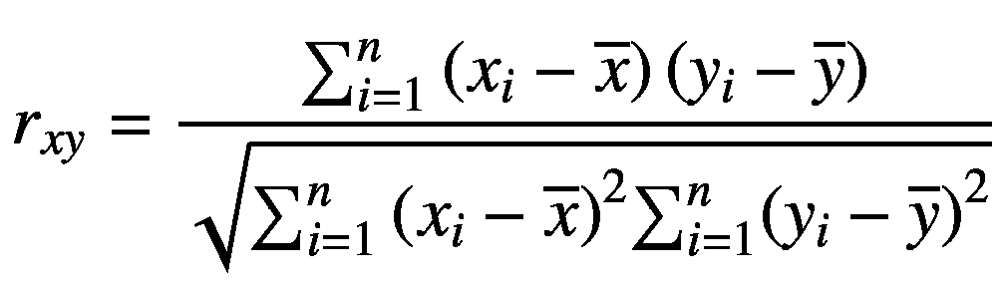

其中 $(x_i-\overline{x})^2$ 是 x 值减去均值后再平方，而 $(y_i-\overline{y})$ 与 $(y_i-\overline{y})^2$ 是 y 值减去均值后再平方。

要计算相关性，首先需要生成样本数据：

```
> iris_sample %>%
+ group_by(Species) %>%
+ sample_n(13)
> iris_sample;
# A tibble: 39 x 5
# Groups:   Species [3]
  Sepal.Length Sepal.Width Petal.Length Petal.Width Species
         <dbl>       <dbl>        <dbl>       <dbl> <fct>  
1          5           3.5          1.3         0.3 setosa 
2          5           3.4          1.5         0.2 setosa 
3          5.1         3.4          1.5         0.2 setosa 
4          5.7         4.4          1.5         0.4 setosa 
5          5.1         3.5          1.4         0.3 setosa 
6          5.2         3.4          1.4         0.2 setosa 
7          5           3.6          1.4         0.2 setosa 
8          5.1         3.5          1.4         0.2 setosa 
9          4.5         2.3          1.3         0.3 setosa 
10          5.1         3.3          1.7         0.5 setosa 
# ... with 29 more rows
> View(iris_sample);
> set.seed(123);
> var1 <- rnorm(100);
> var2 <- rnorm(100);
> var3 <- rnorm(100);
> data <- data.frame(var1, var2, var3);
```

`sample_n(13)` 从每个组中选取 13 个项目。`group_by(Species)` 表示你按物种变量对数据进行分组。参见图 6-1。

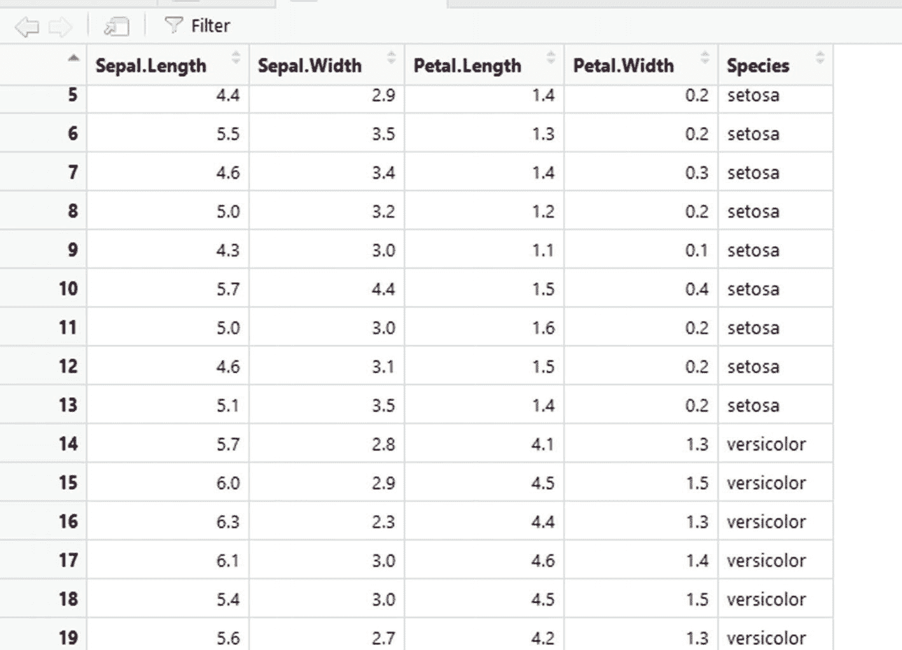

**图 6-1** 分层抽样——从每个组中选取 13 个样本

你可以使用 `cor()` 函数来计算相关性：

```
> cor(data$var1, data$var2);
[1] -0.04953215
```

相关性的取值范围是从 -1.0 到 1.0。当相关性为 0 时，表示没有相关关系。当相关性大于 0 时，表示正相关。正相关意味着当一个变量值增加时，另一个变量值也随之增加。当相关性小于 0 时，表示负相关。负相关意味着当一个变量增加时，其他变量的值会减少。1 是完全正相关，-1 是完全负相关。因此，数值越接近 1，或越接近 -1，关系就越好。

`-0.04953215` 表示 `var1` 和 `var2` 之间存在负相关关系。该相关性接近于零，因此关系并不理想。

# 协方差

协方差是衡量两个变量之间变异性的指标。当一个变量的值越大，另一个变量的值也越大时，协方差为正。当一个变量的值越大，另一个变量的值越小时，协方差为负。协方差显示两个变量之间的线性关系，但其大小难以解释。相关性是协方差的归一化版本，因此

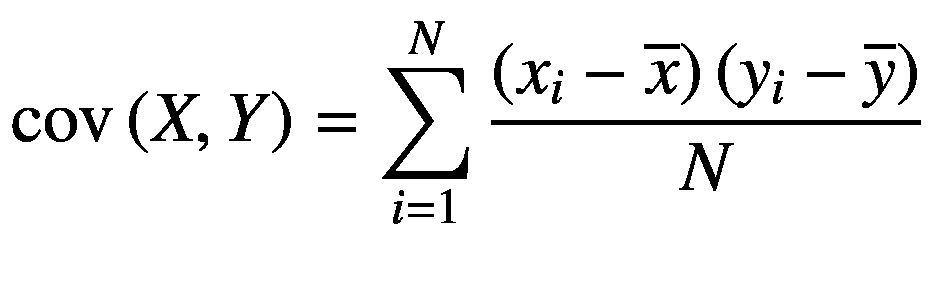

其中 $(x_i-\overline{x})$ 是 x 值减去均值，$(y_i-\overline{y})$ 是 y 值减去均值。

要计算协方差，请创建样本数据：

```
> set.seed(123);
> var1 <- rnorm(100);
> var2 <- rnorm(100);
> var3 <- rnorm(100);
> data <- data.frame(var1, var2, var3);
```

你可以使用 `cov()` 函数来计算协方差：

```
> cov(data$var1, data$var2);
[1] -0.04372107
```

相关性的取值范围是 -1 到 1。协方差没有取值范围。相关性更适合衡量两个变量之间关系的强弱。当两个变量具有正协方差时，一个变量增加，另一个变量也随之增加。当两个变量具有负协方差时，一个变量增加，另一个变量则减少。当两个变量相互独立时，协方差为零。`-0.04372107` 表示协方差为负，且非常接近零，因此这两个变量之间的关系并不强。

相关性和协方差通常属于描述性统计的范畴。

# 假设检验与 P 值

我之前提到过假设检验。在假设检验中，研究问题是以问题形式提出的假设。研究问题可以是：*某事物之间是否存在显著差异？* 假设可以是：*某事物之间存在显著差异*。研究问题以“是否存在”开头，假设以“存在”开头。假设也可以是零假设 `H[0]` 和备择假设 `H[a]`。你可以如下写出零假设和备择假设：

`H[0]`: `μ[1] = μ[2]`

`H[a]`: `μ[1] ≠ μ[2]`

其中 `μ[1]` 是一组数据的均值，`μ[2]` 是另一组数据的均值。

你可以使用统计检验来获取 p 值。对于连续变量或数据，使用 t 检验；对于分类变量或数据，使用卡方检验。对于更复杂的检验，使用方差分析。如果数据不服从正态分布，则使用非参数检验。P 值帮助你确定统计检验结果的显著性。你在检验中的主张称为零假设，而备择假设意味着你认为零假设不成立。

- 较小的 p 值（<= 通常为 0.05 的 `alpha` 值）表明观测数据与零假设不一致的程度足够大，因此可以拒绝零假设。在 95% 的置信区间下，备择假设成立。

- 较大的 p 值意味着你未能拒绝零假设。

# T 检验

T 检验是统计学中较为重要的检验之一。T 检验用于确定两个数据点或样本之间的均值是否相等。零假设意味着两个均值相等，备择假设意味着两个均值不同。

## T 检验的类型

图 6-2 展示了 T 检验的类型。

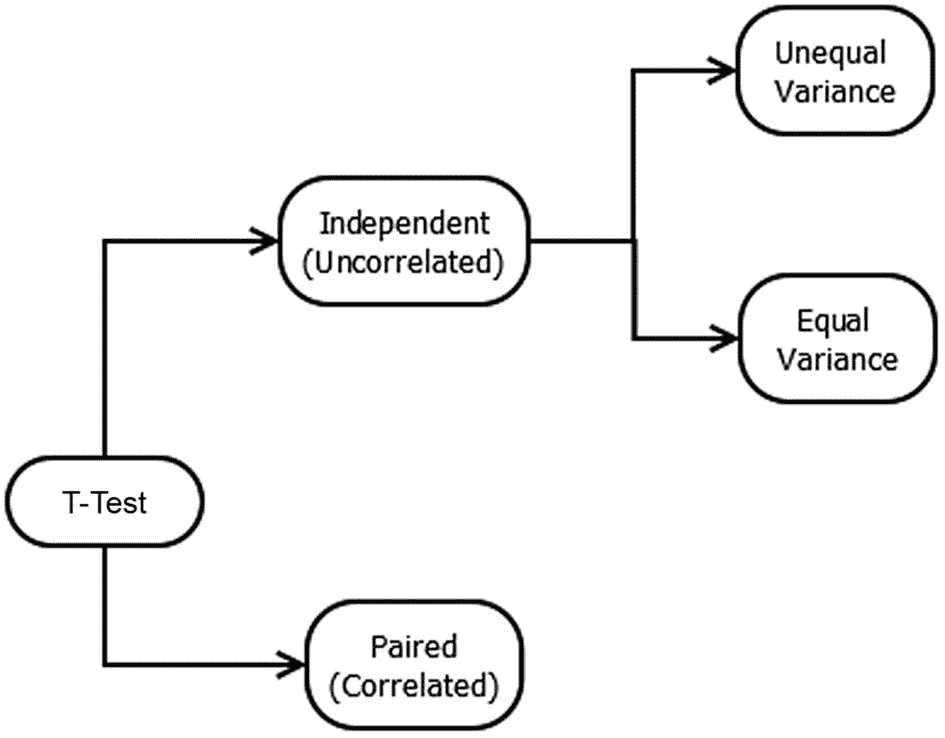

图 6-2 T 检验的类型

## T 检验的假设

以下是假设条件：

- 样本是从其总体中随机抽取的。

- 总体服从正态分布。

## 第一类错误与第二类错误

第一类错误是在零假设实际为真时拒绝了它。第二类错误是未能拒绝一个实际上为假的零假设。

## 单样本 T 检验

单样本 t 检验用于检验一个总体的均值是否等于指定的均值。

单样本 t 检验的公式为

```

# t 检验

其中`s`是样本的标准差，`n`是样本量，`m`是样本均值，`u`是指定的均值。自由度的公式为：
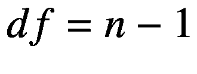
你可以使用 t 统计量和自由度，通过 t 分布表来估算 p 值。

要在 R 中使用单样本 t 检验，可以使用`t.test()`函数：
```
> set.seed(123);
> var1 <- rnorm(100, mean=2, sd=1);
> var2 <- rnorm(100, mean=3, sd=1);
> var3 <- rnorm(100, mean=4, sd=1);
> data <- data.frame(var1, var2, var3);
> t.test(data$var1, mu=0.6);

	One Sample t-test

data:  data$var1
t = 16.328, df = 99, p-value < 2.2e-16
alternative hypothesis: true mean is not equal to 0.6
95 percent confidence interval:
1.909283 2.271528
sample estimates:
mean of x 
2.090406 
```

在单样本 t 检验中，
`H[0]: μ = m`
`H[a]: μ ≠ m`
在上述 R 代码中，`m`为`0.6`。p 值为`2.2e-16`，小于 alpha 值`0.05`。因此，可以拒绝零假设。在 95% 的置信区间下，备择假设`μ ≠ 0.6`成立。

## 双样本独立 t 检验
双样本非配对 t 检验用于比较两个独立样本的均值。双样本独立 t 检验的公式如下：
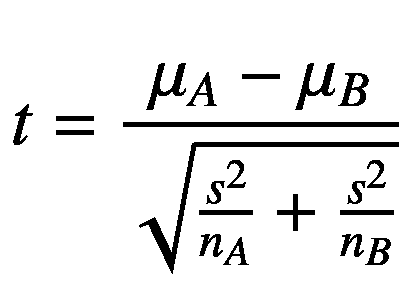
其中
`μ[A]`是一个样本的均值，
`μ[B]`是第二个样本的均值，
`n[A]`是样本 A 的大小，
`n[B]`是样本 B 的大小。
`s²`是两个样本共同方差的估计量，其公式为：
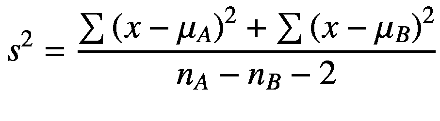
自由度公式为：
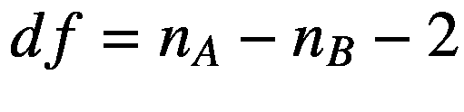

在 R 中对方差相等的两组样本使用双样本非配对 t 检验：
```
> set.seed(123);
> var1 <- rnorm(100, mean=2, sd=1);
> var2 <- rnorm(100, mean=3, sd=1);
> var3 <- rnorm(100, mean=4, sd=1);
> data <- data.frame(var1, var2, var3);
> t.test(data$var1, data$var2, var.equal=TRUE, paired=FALSE);

	Two Sample t-test

data:  data$var1 and data$var2
t = -6.0315, df = 198, p-value = 7.843e-09
alternative hypothesis: true difference in means is not equal to 0
95 percent confidence interval:
 -1.0642808 -0.5398138
sample estimates:
mean of x mean of y 
 2.090406  2.892453 
```

双样本独立 t 检验：
`H[0]: μ[A] − μ[B] = 0`
`H[a]: μ[A] − μ[B] ≠ 0`
p 值为`7.843e-09`，小于`0.05`（即 alpha 值）。因此，可以拒绝零假设。备择假设`μ[A] − μ[B] ≠ 0`在 95%置信区间下成立。

在双样本非配对 t 检验中，当方差不相等时，应使用韦尔奇 t 检验。你可以假设两组数据的方差不同，或者分别计算每组数据的方差。韦尔奇 t 检验的公式如下：
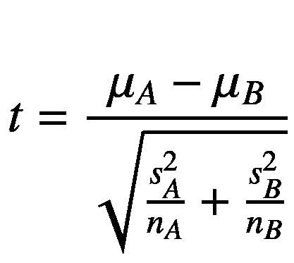
其中
`μ[A]`是样本 A 的均值，
`μ[B]`是样本 B 的均值，
`n[A]`是样本 A 的大小，
`n[B]`是样本 B 的大小，
`s[A]`是样本 A 的标准差，
`s[B]`是样本 B 的标准差。
与普通 t 检验公式不同，韦尔奇 t 检验公式涉及每个样本的方差。

韦尔奇 t 检验的自由度公式如下：
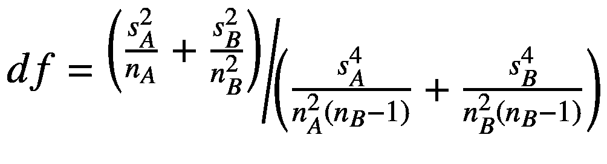

在 R 中对方差不等的两组样本使用双样本非配对 t 检验：
```
> set.seed(123);
> var1 <- rnorm(100, mean=2, sd=1);
> var2 <- rnorm(100, mean=3, sd=1.5);
> var3 <- rnorm(100, mean=4, sd=1);
> data <- data.frame(var1, var2, var3);
> t.test(data$var1, data$var2, var.equal=FALSE, paired=FALSE);

	Welch Two Sample t-test

data:  data$var1 and data$var2
t = -6.0315, df = 197.35, p-value = 7.88e-09
alternative hypothesis: true difference in means is not equal to 0
95 percent confidence interval:
 -1.0642862 -0.5398084
sample estimates:
mean of x mean of y 
 2.090406  2.892453 
```

双样本非配对 t 检验：
`H[0]: μ[A] − μ[B] = 0`
`H[a]: μ[A] − μ[B] ≠ 0`
p 值为`7.88e-09`，小于`0.05`（即 alpha 值）。因此，可以拒绝零假设。备择假设`μ[A] − μ[B] ≠ 0`在 95%置信区间下成立。

## 双样本配对 t 检验
双样本配对 t 检验用于检验两个相互依赖样本的均值。t 检验公式为：
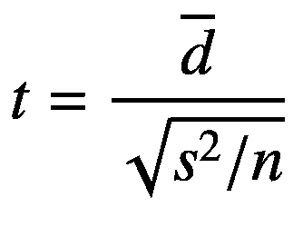
其中
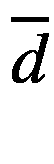是均值差，
`s²`是样本方差，
`n`是样本大小。
自由度公式为：


在 R 中使用双样本配对 t 检验：

```
> set.seed(123);
> var1 <- rnorm(100, mean=2, sd=1);
> var2 <- var1 + rnorm(100, mean=1, sd=0.5);
> var3 <- rnorm(100, mean=4, sd=1);
> data <- data.frame(var1, var2, var3);
> t.test(data$var1, data$var2, paired=TRUE);

	Paired t-test

data:  data$var1 and data$var2
t = -5.8876, df = 99, p-value = 5.379e-08
alternative hypothesis: true difference in means is not equal to 0
95 percent confidence interval:
 -1.0723482 -0.5317464
sample estimates:
mean of the differences 
             -0.8020473 
```

双样本配对 t 检验：

`H[0]`: `μ[A] − μ[B] = 0`

`H[a]`: `μ[A] − μ[B] ≠ 0`

p 值为 `5.379e-08`，小于 `0.05`（即 `alpha` 值）。因此，可以拒绝零假设。备择假设 `μ[A] − μ[B] ≠ 0` 在 `95%` 置信区间下成立。

## 卡方检验

卡方检验用于比较两个分类变量之间的关系。零假设意味着分类变量之间没有关系。

### 拟合优度检验

当你从总体中仅有一个分类变量，并希望比较样本是否与假设分布一致时，可以使用拟合优度检验。

零假设意味着数据遵循指定的分布，备择假设意味着数据不遵循指定的分布。

拟合优度公式为：

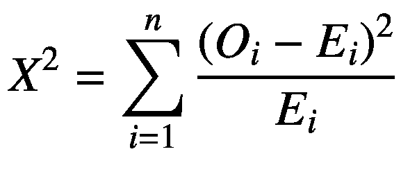

其中 `O[i]` 是第 `i` 组的观测频数，`E[i]` 是第 `i` 组的期望频数。

计算期望频数的公式为：

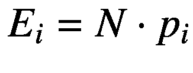

其中 `N` 是总样本量，`p[i]` 是第 `i` 组观测值的假设比例。

在 R 中使用拟合优度卡方检验，可以使用 `chisq.test()` 函数：

```
> data <- c(50, 30, 20);
> chisq.test(data);

	Chi-squared test for given probabilities

data:  data
X-squared = 66.667, df = 2, p-value = 3.338e-15
```

拟合优度卡方检验：

*   `H[0]`: 观测值与期望值之间无显著差异。

*   `H[a]`: 观测值与期望值之间存在显著差异。

p 值为 `3.338e-15`，小于 `0.05`（即 `alpha` 值）。因此，可以拒绝零假设。观测值与期望值之间存在显著差异的备择假设在 `95%` 置信区间下成立。

### 列联表检验

如果你有两个分类变量，并想比较它们之间是否存在关系，可以使用列联表检验。

原假设意味着两个分类变量之间没有关系。备择假设意味着两个分类变量之间存在关系。

要计算期望值，请使用

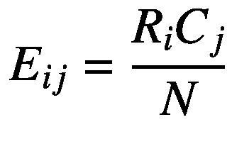

其中 `R` 代表行，`C` 代表列，`N` 代表总数，`ith` 代表第 `i` 行，`jth` 代表第 `j` 列。

`X²` 统计量的公式为

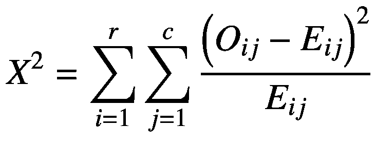

要在 R 中使用列联表检验，请先创建你的数据：

```
> var1  var2  data  data;
var1       var2
1    Male  chocolate
2  Female strawberry
3    Male strawberry
4  Female strawberry
5    Male  chocolate
6  Female  chocolate
7    Male  chocolate
8  Female strawberry
9    Male strawberry
10 Female strawberry
```

然后，你可以为要检验的变量创建一个表格或频数表：

```
> data.table  data.table;
chocolate strawberry
Female         1          4
Male           3          2
```

接着，你可以使用 `chisq.test()` 函数进行列联表检验：

```
> chisq.test(data.table);
Pearson's chi-squared test with Yates' continuity correction
data:  data.table
X-squared = 0.41667, df = 1, p-value = 0.5186
Warning message:
In chisq.test(data.table) : Chi-squared approximation may be incorrect
```

卡方检验：

*   `H[0]`: 两个变量相互独立。

*   `H[a]`: 两个变量不相互独立。

p 值为 `0.5186`，大于 `0.05`（即 `alpha` 值）。因此，无法拒绝原假设。在 `95%` 的置信区间下，可以认为两个变量相互独立。

## 方差分析

方差分析是检验两个或更多组均值的过程。方差分析也通过比较不同样本的均值来检查因素的影响。在 t 检验中，你检验两个样本的均值；在卡方检验中，你检验分类属性或变量；在方差分析中，你检验更多的样本。

### 总均值

在方差分析中，你使用两种均值：样本均值和总均值。总均值是所有样本均值的均值。

### 假设

在方差分析中，原假设意味着样本均值相等或没有显著差异。备择假设是样本均值不全相等。

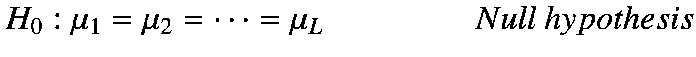

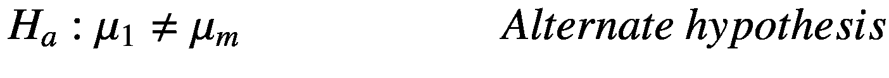

### 假设条件

你假设变量是抽样的、独立的，并且是从一个服从正态分布、方差未知但相等的总体中选择或抽样的。

### 组间变异性

当两个样本的分布重叠时，它们的均值没有显著差异。因此，它们各自的均值与总均值之间的差异也不显著。组和水平是同一个自变量下的不同分组。见图 6-3。

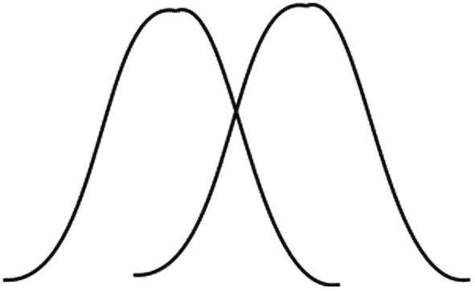

图 6-3

均值无显著差异

对于图 6-4 中所示的两个样本，它们的均值彼此显著不同。各自的均值与总均值之间的差异是显著的。

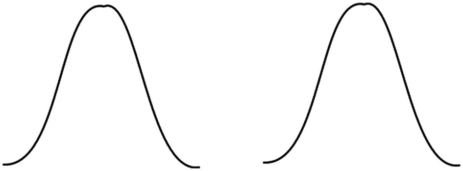

图 6-4

均值有显著差异

这种变异性称为组间变异性，它指的是各组或各水平分布之间的变异。图 6-5 描绘了不同组之间的区分。

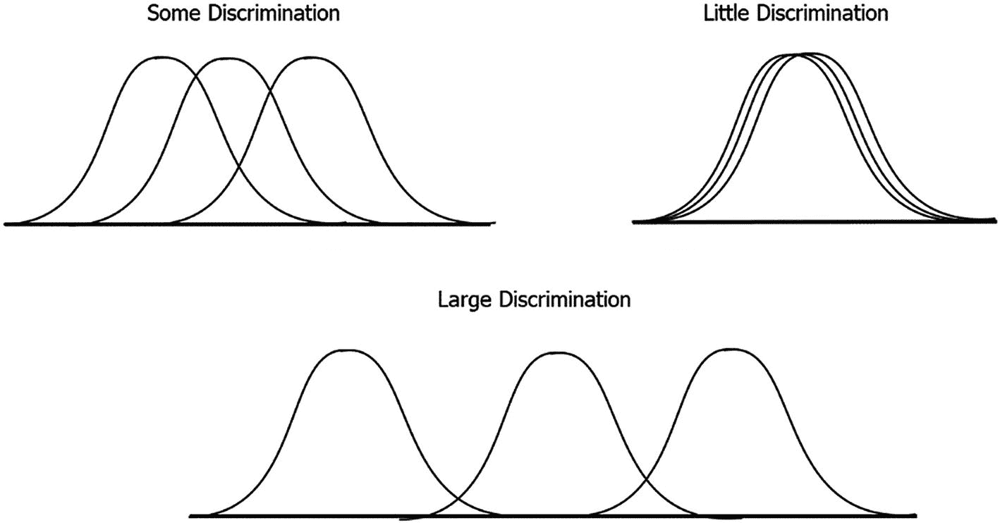

图 6-5

各水平组分布之间的变异

要计算组间变异性的平方和，请使用
```

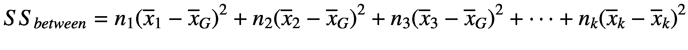

其中

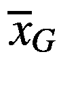 是总均值，

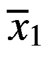…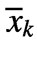 是每个样本的均值，并且

`n[1]`…`n[k]`… 是样本量。

要计算每个平方偏差的总和，即均方，请使用


你使用 `SS` 除以自由度，其中自由度是样本均值个数（`k`）减一。

### 组内变异性

对于以下样本分布，随着其方差增大，它们会相互重叠并成为总体的一部分，如图 6-6 所示。

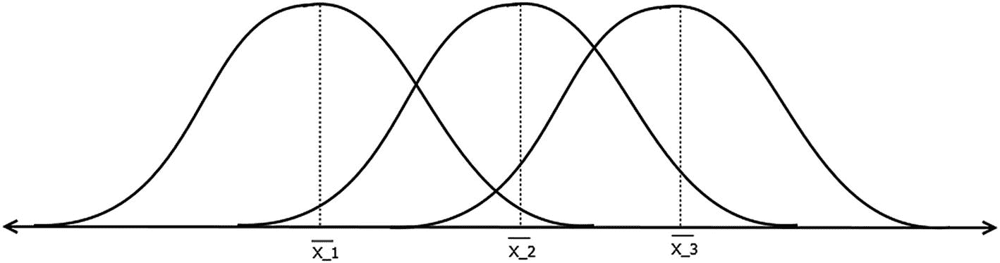

图 6-6：样本分布

图 6-7 展示了另外三个方差较小的样本，尽管它们的均值相似，但它们属于不同的总体。

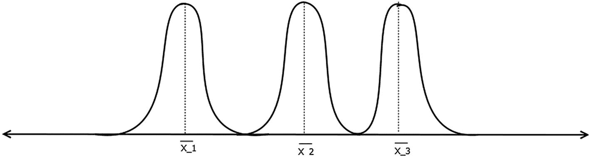

图 6-7：三个方差较小的样本

组内变异是指由单个组或层级内部的差异引起的变异。要计算组内变异的平方和，请使用以下公式：

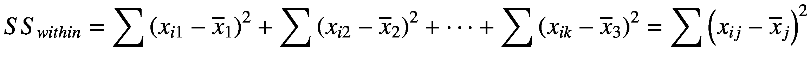

其中

- `x[i1]` 是第一个样本的第 `i` 个值，
- `x[i2]` 是第二个样本的第 `i` 个值，
- `x[ij]` 是第 `j` 个样本的第 `j` 个值。

自由度为：

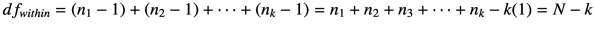

要得到组内变异性的均方，你需要将组间变异性的平方和除以组内自由度：

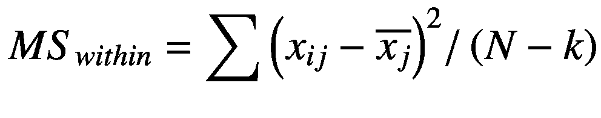

F 统计量用于衡量样本均值是否存在显著差异。F 统计量越低，均值越相等，因此你不能拒绝原假设。

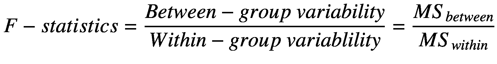

如果 F 临界值小于 F 值，则拒绝原假设。F 临界值可以通过 F 统计量和 F 分布上的自由度来查找。

### 单因素方差分析

当你只有一个自变量时，使用单因素方差分析。

在 R 中，你可以使用以下代码计算单因素方差分析：

```
> set.seed(123);
> var1 <- c(1.2, 2.3, 3.4, 4.5, 5.6)
> var2 <- c(2.1, 3.2, 4.3, 5.4, 6.5)
> data <- data.frame(var1, var2)
> fit <- aov(data$var1 ~ data$var2, data = data)
> fit;
Call:
aov(formula = data$var1 ~ data$var2, data = data)
Terms:
data$var2 Residuals
Sum of Squares   0.162695  9.255706
Deg. of Freedom         2         9
Residual standard error: 1.014106
Estimated effects may be unbalanced
```

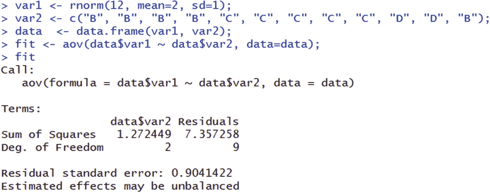

要获取 p 值，请使用 `summary()` 函数：

```
> summary(fit);
Df Sum Sq Mean Sq F value Pr(>F)
data$var2    2  0.163  0.0813   0.079  0.925
Residuals    9  9.256  1.0284
```

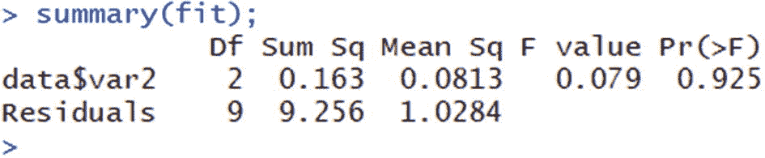

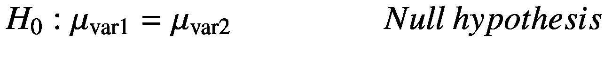

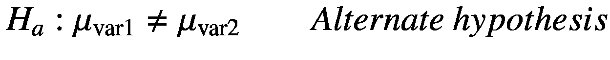

p 值大于 0.05，因此你无法拒绝原假设，即 `var1` 的均值与 `var2` 的均值相同。在 95% 的置信区间下，原假设成立。

### 双因素方差分析

当你有两个自变量时，使用双因素方差分析。

在 R 中，你可以使用以下代码计算双因素方差分析：

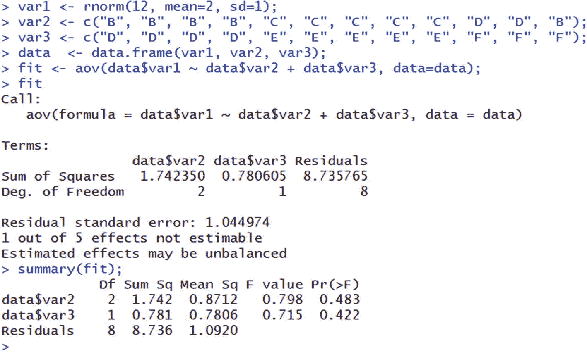

```
> set.seed(123);
> var1 <- c(1.2, 2.3, 3.4, 4.5, 5.6)
> var2 <- c(2.1, 3.2, 4.3, 5.4, 6.5)
> var3 <- c(1.5, 2.6, 3.7, 4.8, 5.9)
> data <- data.frame(var1, var2, var3)
> fit <- aov(data$var1 ~ data$var2 + data$var3, data = data)
> fit;
Call:
aov(formula = data$var1 ~ data$var2 + data$var3, data = data)
Terms:
data$var2 data$var3 Residuals
Sum of Squares   0.162695  0.018042  9.237664
Deg. of Freedom         2         1         8
Residual standard error: 1.074573
1 out of 5 effects not estimable
Estimated effects may be unbalanced
> summary(fit);
Df Sum Sq Mean Sq F value Pr(>F)
data$var2    2  0.163  0.0813   0.070  0.933
data$var3    1  0.018  0.0180   0.016  0.904
Residuals    8  9.238  1.1547
```

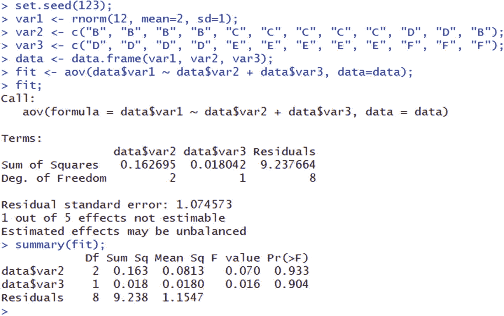

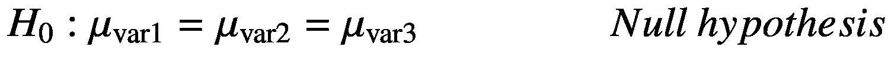

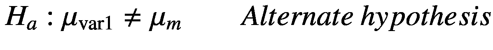

`var1` 不依赖于 `var2` 的均值和 `var3` 的均值。`var1` 均值和 `var2` 均值的 p 值为 0.483，大于 0.05。因此，你无法拒绝原假设，即 `var1` 均值与 `var2` 均值相同。在 95% 的置信区间下，原假设成立。`var1` 均值和 `var3` 均值的 p 值为 0.422，大于 0.05。因此，你无法拒绝原假设，即 `var1` 均值与 `var3` 均值相同。在 95% 的置信区间下，原假设成立。

### 多元方差分析

当存在多个需要检验的响应变量时，使用多元方差分析。

要在 R 中使用多元方差分析，可以加载 `iris` 数据集：

```
> data(iris);
> str(iris);
'data.frame':    150 obs. of  5 variables:
$ Sepal.Length: num  5.1 4.9 4.7 4.6 5 5.4 4.6 5 4.4 4.9 ...
$ Sepal.Width : num  3.5 3 3.2 3.1 3.6 3.9 3.4 3.4 2.9 3.1 ...
$ Petal.Length: num  1.4 1.4 1.3 1.5 1.4 1.7 1.4 1.5 1.4 1.5 ...
$ Petal.Width : num  0.2 0.2 0.2 0.2 0.2 0.4 0.3 0.2 0.2 0.1 ...
$ Species     : Factor w/ 3 levels "setosa","versicolor",..: 1 1 1 1 1 1 1 1 1 1 ...
> summary(iris);
Sepal.Length    Sepal.Width     Petal.Length    Petal.Width     Species
Min. :4.300     Min. :2.000     Min. :1.000     Min. :0.100     setosa :50
1st Qu.:5.100   1st Qu.:2.800   1st Qu.:1.600   1st Qu.:0.300   versicolor:50
Median :5.800   Median :3.000   Median :4.350   Median :1.300   virginica :50
Mean   :5.843   Mean   :3.057   Mean   :3.758   Mean   :1.199
3rd Qu.:6.400   3rd Qu.:3.300   3rd Qu.:5.100   3rd Qu.:1.800
Max.   :7.900   Max.   :4.400   Max.   :6.900   Max.   :2.500
> res <- manova(cbind(iris$Sepal.Length, iris$Petal.Length) ~ iris$Species, data = iris)
> summary(res);
Df Pillai approx F num Df den Df    Pr(>F)
iris$Species   2 0.9885   71.829      4    294 < 2.2e-16 ***
---
Signif. codes:  0 ‘***’ 0.001 ‘**’ 0.01 ‘*’ 0.05 ‘.’ 0.1 ‘ ’ 1
> summary.aov(res);
Response 1 :
Df Sum Sq Mean Sq F value    Pr(>F)
iris$Species   2 63.212  31.606  119.26 < 2.2e-16 ***
Residuals    147  38.87   0.264
---
Signif. codes:  0 ‘***’ 0.001 ‘**’ 0.01 ‘*’ 0.05 ‘.’ 0.1 ‘ ’ 1

Response 2 :
Df Sum Sq Mean Sq F value    Pr(>F)
iris$Species   2 437.10 218.551  1180.2 < 2.2e-16 ***
Residuals    147  27.22   0.185
---
Signif. codes:  0 ‘***’ 0.001 ‘**’ 0.01 ‘*’ 0.05 ‘.’ 0.1 ‘ ’ 1
```

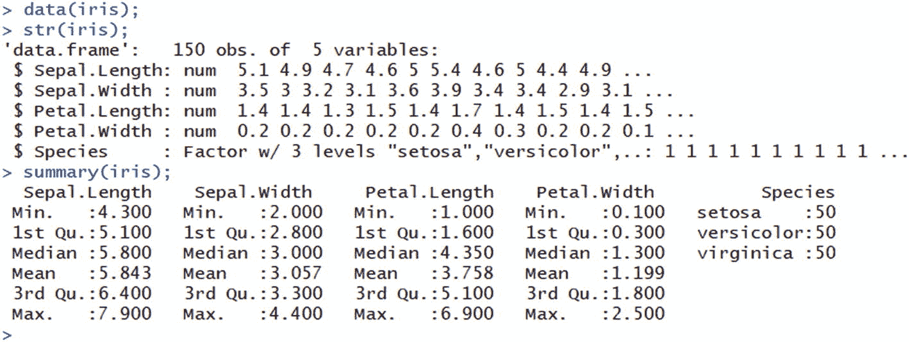

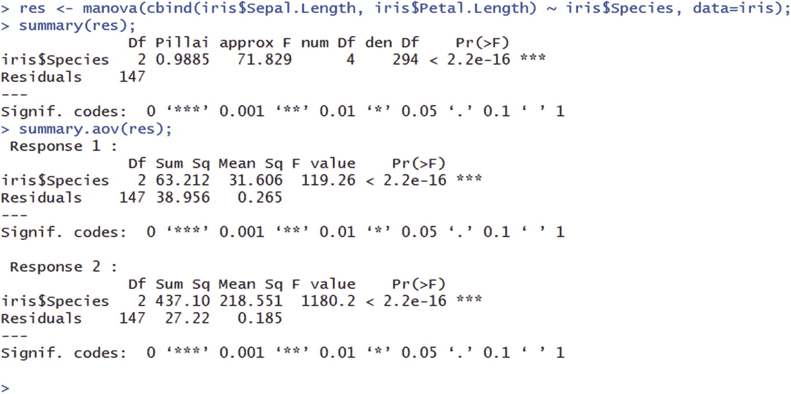

`cbind(iris$Sepal.Length, iris$Petal.Length) ~ iris$Species` 是公式，类似于 `cbind(Sepal.Length, Petal.Length) = Species`。因此，你有两个响应变量：`Sepal.Length` 和 `Petal.Length`。

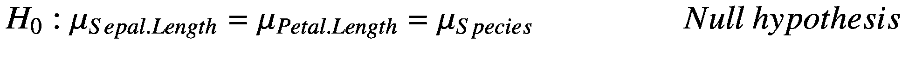

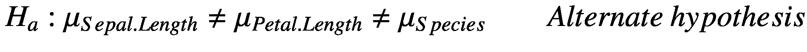

p 值为 `2.2e-16`，小于 `0.05`。因此，你拒绝零假设。在 95% 的置信区间内，备择假设成立。均值存在显著差异。响应变量 `Sepal.Length` 的均值与 `Species` 的均值的 p 值为 `2.2e-16`，小于 `0.05`。因此，你拒绝 `Sepal.Length` 均值与 `Species` 均值相等的零假设。在 95% 的置信区间内，备择假设成立。响应变量 `Petal.Length` 的均值与 `Species` 的均值的 p 值为 `2.2e-16`，小于 `0.05`。因此，你拒绝 `Petal.Length` 均值与 `Species` 均值相等的零假设。在 95% 的置信区间内，备择假设成立。

## 非参数检验

非参数检验是一种不要求变量和样本服从正态分布的检验方法。大多数情况下，你应该使用参数检验，如 t 检验、卡方检验和方差分析，因为它们更准确。当你的数据不服从正态分布且样本量较大时，可以使用非参数检验。

### Wilcoxon 符号秩检验

Wilcoxon 符号秩检验用于替代单样本 t 检验。

1. 对于每个 `x[i]`，其中 `i = 1, 2, …., n`，符号差为 `d[i] = x[i] - u[0]`，这里 `u[0]` 是给定的中位数。

### 步骤

1.  忽略 `d[i] = 0`，并对剩余的 `|d[i]|` 进行排序，使用 `r[i]` 作为秩。当存在相同值时，分配这些相同秩的平均值。例如，`|d[i]|` 的秩为 3、4、5 且相同，则秩应为 `(3+4+5)/3 = 4`。

2.  找出非零 `d[i]` 的个数。

3.  对于 `d[i]` 的每个秩，令 `s[i] = sign(d[i]) * r[i]`。

4.  正符号秩的和使用 `W = sum(s_i)` 计算，其中 `s_i > 0`。

计算出的检验统计量为 `W`，并计算出非零 `d[i]` 的个数 `n[1]`。

零假设是总体中位数具有指定的值 `μ[0]`。

-   零假设：`H[0] : μ = μ[0]`
-   备择假设：`H[a] : μ ≠ μ[0]`

正态检验统计量公式为 `z = (W - n1(n1+1)/4 - 0.5 * sign(W - n1(n1+1)/4)) / sqrt(0.25 * sum(S_i²))`。

当 `|z| > Z_{α/2}` 时，你拒绝零假设，其中 `Z ~ N(0,1)`。

常见的 alpha 值 `α` 为 `0.05`。

要在 R 中使用 Wilcoxon 符号秩检验，你可以首先使用 `random.org` 包生成数据集，这样变量就不服从正态分布。要使用 `random.org` 生成随机数，你必须安装 `random` 包：

```
> install.packages("random");
Installing package into 'C:/Users/gohmi/Documents/R/win-library/3.5'
(as 'lib' is unspecified)
also installing the dependency 'curl'
trying URL 'https://cran.rstudio.com/bin/windows/contrib/3.5/curl_3.2.zip'
Content type 'application/zip' length 2986409 bytes (2.8 MB)
downloaded 2.8 MB
trying URL 'https://cran.rstudio.com/bin/windows/contrib/3.5/random_0.2.6.zip'
Content type 'application/zip' length 466978 bytes (456 KB)
downloaded 456 KB
package 'curl' successfully unpacked and MD5 sums checked
package 'random' successfully unpacked and MD5 sums checked
The downloaded binary packages are in
C:\Users\gohmi\AppData\Local\Temp\RtmpaizS1C\downloaded_packages
```

要使用 `random` 包，你必须使用 `library()` 函数加载该包：

```
> library(random);
```

要从 `random.org` 创建随机数，你可以使用：

```
> library(random);
> var1  var2  var3 <- randomNumbers(n=100, min=1, max=1000, col=1);
```

`n` 是随机数的数量，`min` 是最小值，`max` 是最大值，`col` 是所有数字的列数。这是在 R 中生成真随机数的方法。你的数据可能不同，因为数据是随机生成的。

然后你可以使用以下方法创建数据：

```
> data  data;
var1...1\. var2...1\. var3...1.
1         680         9       871
2         547       589       768
3         750       733       611
4         840       494        16
5         529       373       680
6          94       509       493
7         106        89       195
8         956       992       570
9         853       330       425
10        295       485       504
11        633       924       523
```

要使用 Wilcoxon 符号秩检验，你可以使用 `wilcox.test()` 函数：

`H[0] : μ = μ[0]`

`H[a] : μ ≠ μ[0]`

```
> wilcox.test(data[,1], mu=0, alternatives="two.sided");
Wilcoxon signed rank test with continuity correction
data:  data[, 1]
V = 5050, p-value < 2.2e-16
alternative hypothesis: true location is not equal to 0
```

p 值为 `2.2e-16`，小于 `0.05`。因此，你拒绝零假设。第一个变量的中位数与中位数 `0` 之间存在显著差异。在 95% 的置信区间内，备择假设成立。

### 威尔科克森-曼-惠特尼检验

威尔科克森-曼-惠特尼检验是一种用于比较两个样本的非参数检验。它是双样本 t 检验的一个有力替代方法。

对于两个独立样本，`F(x)` 和 `G(y)`，其样本量分别为 `n[1]` 和 `n[2]`，样本数据可表示为 $ {x}_1,{x}_2,\dots, {x}_{n_1} $ 和 $ {y}_1,{y}_2,\dots, {y}_{n_2} $，其假设为：

$ {H}_0:F(x)=G(y) $

$ {H}_a:F(x)\ne G(y) $

检验这两个样本的步骤如下：

1.  将 `x[i]` 和 `y[j]` 合并为一组。

2.  对该组数据按升序排列，其中结（相同值）的秩取它们排名的平均值。令 `r[1i]` 为 `x[i]` 的秩，其中 `i` = 1,2,…,`n[1]`；令 `r[2j]` 为 `y[j]` 的秩，其中 `j` = 1,2,…,`n[2]`。

3.  计算秩和：

$ {S}_1=\sum \limits_{I=1}^{n_1}{r}_{1i} $

$ {S}_2=\sum \limits_{I=1}^{n_2}{r}_{2j} $

检验统计量 `U` 的计算公式如下：

$ U={S}_1-\frac{n_1\left({n}_1+1\right)}{2} $

近似正态统计量 `z` 为：

$ z=\frac{U-M(U)\pm \frac{1}{2}}{\sqrt{\operatorname{var}(U)}} $

其中

$ M(U)=\frac{n_1{n}_2}{2} $

并且 `U` 的方差为：

$ Var(U)=\frac{n_1{n}_2\left({n}_1+{n}_2+1\right)}{12}-\frac{n_1{n}_2}{\left({n}_1+{n}_2\right)\left({n}_1+{n}_2-1\right)}\times TS $

其中

$ TS=\sum \limits_{j=1}^{\tau}\frac{\left({t}_j\right)\left({t}_j-1\right)\left({t}_j+1\right)}{12} $

`τ` 是样本中结的组数，`t[j]` 是第 j 组中结的个数。

如果没有结，`U` 的方差为：

## 威尔科克森-曼-惠特尼检验

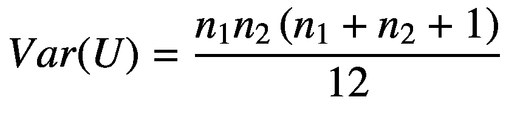

要在 R 中使用威尔科克森-曼-惠特尼检验（或威尔科克森秩和检验或曼-惠特尼检验），可以使用 `wilcox.test()` 函数：

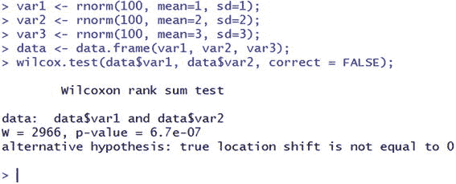

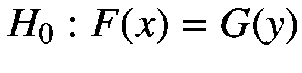

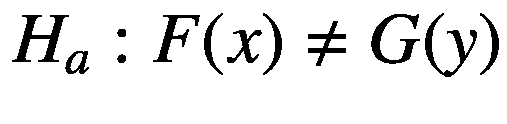

```
> var1  var2  var3  data  wilcox.test(data[,1], data[,2], correct=FALSE);
Wilcoxon rank sum test
data:  data[, 1] and data[, 2]
W = 5697.5, p-value = 0.08833
alternative hypothesis: true location shift is not equal to 0
```

p 值为 0.3351，大于 0.05。因此，无法拒绝原假设。第一个变量的中位数与第二个变量的中位数之间没有显著差异。在 95% 的置信区间下，原假设成立。

## 克鲁斯卡尔-沃利斯检验

克鲁斯卡尔-沃利斯检验是一种非参数检验，是曼-惠特尼 U 检验在三个或更多样本情况下的扩展。该检验要求样本具有相同的分布。克鲁斯卡尔-沃利斯检验是单因素方差分析的一种替代方法。它用于检验 *k* 个大小不等的独立样本的得分差异，其中第 *i* 个样本包含 `l[i]` 行。其假设为：


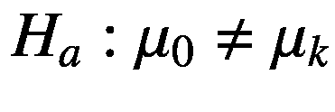

其中 `μ` 是中位数。备择假设是至少有一个中位数不同。

算法如下：

1. 将所有行按升序排列。得分相同时取平均秩。

2. 计算每个样本中所有行的秩和，得到秩和 `R[i]`，其中 *i* = 1,2,…,*k*。

3. 克鲁斯卡尔-沃利斯检验统计量计算公式为：

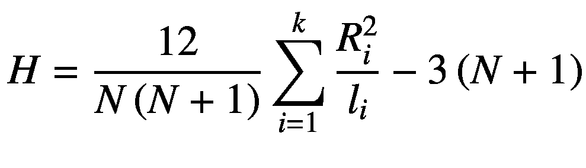

其中

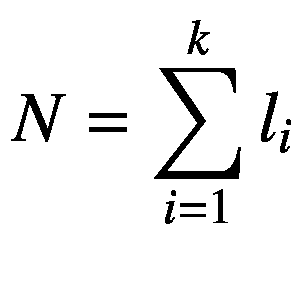

`N` 是总行数。如果存在得分相同的情况，则 `H` 需要除以


其中 `t` 是一组中相同得分的个数。

在 R 中使用克鲁斯卡尔-沃利斯检验：


```
> data("airquality");
> str(airquality);
'data.frame':    153 obs. of  6 variables:
$ Ozone  : int  41 36 12 18 NA 28 23 19 8 NA ...
$ Solar.R: int  190 118 149 313 NA NA 299 99 19 194 ...
$ Wind   : num  7.4 8 12.6 11.5 14.3 14.9 8.6 13.8 20.1 8.6 ...
$ Temp   : int  67 72 74 62 56 66 65 59 61 69 ...
$ Month  : int  5 5 5 5 5 5 5 5 5 5 ...
$ Day    : int  1 2 3 4 5 6 7 8 9 10 ...
> summary(airquality);
Ozone               Solar.R              Wind               Temp                Month                Day
Min. :  1.00        Min. :  7.0          Min. : 1.700      Min. :56.00         Min. :5.000          Min. : 1.0
1st Qu.: 18.00      1st Qu.:115.8        1st Qu.: 7.400      1st Qu.:72.00       1st Qu.:6.000        1st Qu.: 8.0
Median : 31.50      Median :205.0        Median : 9.700     Median :79.00       Median :7.000        Median :16.0
Mean : 42.13        Mean :185.9          Mean : 9.958       Mean   :77.88       Mean :6.993          Mean   :15.8
3rd Qu.: 63.25      3rd Qu.:258.8        3rd Qu.:11.500      3rd Qu.:85.00       3rd Qu.:8.000        3rd Qu.:23.0
Max. :168.00        Max. :334.0          Max. :20.700      Max. :97.00         Max. :9.000          Max.   :31.0
NA's :37            NA's   :7
> kruskal.test(airquality$Ozone ~ airquality$Month);
Kruskal-Wallis rank sum test
data:  airquality$Ozone by airquality$Month
Kruskal-Wallis chi-squared = 29.267, df = 4, p-value = 6.901e-06
```

p 值为 6.901e-06，小于 0.05。因此，拒绝原假设。第一个变量的中位数与第二个变量的中位数之间存在显著差异。在 95% 的置信区间下，备择假设成立。

## 线性回归

回归分析是一种预测建模技术，用于识别因变量与自变量之间的关系。该技术旨在发现变量之间的因果效应关系。

使用回归分析的好处在于，它能识别因变量与自变量之间的显著关系，以及多个自变量对因变量的影响强度。

线性回归通过一条回归线来寻找一个因变量与一个自变量之间的关系。

线性回归方程为 `y = b[0] + b[1] * x`

其中 `y` 是因变量，`x` 是自变量，`b[0]` 是截距，`b[1]` 是斜率。参见图 6-8。


图 6-8

线性回归

要计算斜率，可以使用


要计算截距，可以使用


如果 `b[1] > 0`，则 `x` 和 `y` 呈正相关关系。

如果 `b[1] < 0`，则 `x` 和 `y` 呈负相关关系。

要在 R 中使用线性回归，可以使用 `lm()` 函数：


```
> set.seed(123);
> x <- rnorm(100);
> y <- rnorm(100);
> data <- data.frame(x, y);
> mod <- lm(data$y ~ data$x, data = data);
> mod;

Call:
lm(formula = data$y ~ data$x, data = data)

Coefficients:
(Intercept)       data$x
    1.8993      -0.1049

> summary(mod);

Call:
lm(formula = data$y ~ data$x, data = data)

Residuals:
    Min      1Q  Median      3Q     Max
-3.815  -1.367  -0.175   1.161   6.581

Coefficients:
            Estimate Std. Error t value Pr(>|t|)
(Intercept)   1.8993     0.3033   6.261 1.01e-08 ***
data$x       -0.1049     0.2138  -0.491    0.625

Signif. codes:  0 '***' 0.001 '**' 0.01 '*' 0.05 '.' 0.1 ' ' 1

Residual standard error: 1.941 on 98 degrees of freedom
Multiple R-squared:  0.002453,    Adjusted R-squared:  -0.007726
F-statistic: 0.241 on 1 and 98 DF,  p-value: 0.6246
```

输出结果显示线性方程为


p 值分别为 `1.01e-08`、`0.625` 和 `0.6246`，这些值表明了线性模型的显著性。当 p 值小于 `0.05` 时，模型是显著的。

- `H[0]`：与变量相关的系数等于零

- `H[a]`：系数不等于零（存在关系）

截距的 p 值为 `1.01e-08`，小于 `0.05`，因此与 `y` 变量存在显著关系。显著性由 `*` 的数量表示。`x` 的 p 值为 `0.625`，大于 `0.05`，因此与 `y` 变量不存在显著关系。在 95% 的置信区间内，原假设成立。

R 方表示因变量变异中被解释的比例，其公式为


其中 `SSE` 是误差平方和


而 `SST` 是总平方和


`ŷ` 是拟合值，这意味着在 `y = -0.1049x + 1.8993` 中，代入 `x` 即可得到 `y`。这个 `y` 就是 `ŷ`。`(y - ŷ)` 表示用原始的 `y` 值减去预测的 `ŷ` 值，这就是误差。因此，`Σ(y_i - ŷ_i)²` 就是误差平方和 (`SSE`)。为了使 `SSE / SST` 较小，`SSE` 必须很小。然而，当 `SSE / SST` 很小时，`1 - SSE / SST` 就会很大。

因此，R 方和调整后的 R 方越高，线性模型越好。标准误差越低，模型越好。

## 多元线性回归

简单线性回归适用于单个响应变量 `y` 和单个自变量 `x`。简单线性回归的方程如下：


多元线性回归建立在简单线性回归的基础上。当你有多个自变量时，使用多元线性回归。多元线性回归的方程如下：


当数据集中有 `n` 个观测值或行时，模型如下：


使用矩阵，可以将这些方程表示为


其中

![$$ y=\left[\begin{array}{c}{y}_1\\ {}{y}_2\\ {}.\\ {}.\\ {}.\\ {}{y}_n\end{array}\right]\kern0.75em X=\left[\begin{array}{ccccccc}1&amp; {x}_{11}&amp; {x}_{12}&amp; .&amp; .&amp; .&amp; {x}_{1k}\\ {}1&amp; {x}_{21}&amp; {x}_{22}&amp; .&amp; .&amp; .&amp; {x}_{2k}\\ {}.&amp; .&amp; .&amp; &amp; &amp; &amp; .\\ {}.&amp; .&amp; .&amp; &amp; &amp; &amp; .\\ {}.&amp; .&amp; .&amp; &amp; &amp; &amp; .\\ {}1&amp; {x}_{n1}&amp; {x}_{n2}&amp; .&amp; .&amp; .&amp; {x}_{nk}\end{array}\right] $$](images/471585_1_En_6_Chapter/471585_1_En_6_Chapter_TeX_Equbp.png)

![$$ b=\left[\begin{array}{c}{b}_1\\ {}{b}_2\\ {}.\\ {}.\\ {}.\\ {}{b}_n\end{array}\right]\kern1.12em and\kern1.12em \epsilon =\left[\begin{array}{c}{\epsilon}_1\\ {}{\epsilon}_2\\ {}.\\ {}.\\ {}.\\ {}{\epsilon}_n\end{array}\right] $$](images/471585_1_En_6_Chapter/471585_1_En_6_Chapter_TeX_Equbq.png)

# 系数计算

要计算系数：


你可以在 R 中使用多元线性回归：


```
> set.seed(123);
> x <- rnorm(100);
> x2 <- rnorm(100);
> y <- 2.5 + 0.5 * x + 0.3 * x2 + rnorm(100, 0, 0.5);
> data <- data.frame(x, x2, y);
> mod <- lm(data$y ~ data$x + data$x2, data = data);
> mod;
Call:
lm(formula = data$y ~ data$x + data$x2, data = data)
Coefficients:
(Intercept)       data$x      data$x2
2.517425    -0.266343     0.009525
> summary(mod);
Call:
lm(formula = data$y ~ data$x + data$x2, data = data)
Residuals:
Min      1Q  Median      3Q     Max
-3.7460 -1.3215 -0.2489  1.2427  4.1597
Coefficients:
Estimate Std. Error t value Pr(>|t|)
(Intercept)  2.517425   0.305233   8.248 7.97e-13 ***
data$x      -0.266343   0.209739  -1.270    0.207
data$x2      0.009525   0.039598   0.241    0.810

Signif. codes:  0 '***' 0.001 '**' 0.01 '*' 0.05 '.' 0.1 ' ' 1
Residual standard error: 1.903 on 97 degrees of freedom
Multiple R-squared:  0.01727,    Adjusted R-squared:  -0.00299
F-statistic: 0.8524 on 2 and 97 DF,  p-value: 0.4295
```

# 在R中实现多元线性回归

要在 R 中创建多元线性回归，首先必须创建数据：

```
> set.seed(123);
> x <- rnorm(100);
> x2 <- rnorm(100);
> y <- 2.5 + 0.5 * x + 0.3 * x2 + rnorm(100, 0, 0.5);
> data <- data.frame(x, x2, y);
```

使用 `lm()` 函数创建多元线性回归模型：

```
> mod <- lm(data$y ~ data$x + data$x2, data = data);
> mod;
Call:
lm(formula = data$y ~ data$x + data$x2, data = data)
Coefficients:
(Intercept)       data$x      data$x2
2.517425    -0.266343     0.009525
data$y ~ data$x + data$x2 is y = x + x2
```

要获取模型的摘要，可以使用 `summary()` 函数：

```
> summary(mod);
Call:
lm(formula = data$y ~ data$x + data$x2, data = data)
Residuals:
Min      1Q  Median      3Q     Max
-3.7460 -1.3215 -0.2489  1.2427  4.1597
Coefficients:
Estimate Std. Error t value Pr(>|t|)
(Intercept)  2.517425   0.305233   8.248 7.97e-13 ***
data$x      -0.266343   0.209739  -1.270    0.207
data$x2      0.009525   0.039598   0.241    0.810

Signif. codes:  0 '***' 0.001 '**' 0.01 '*' 0.05 '.' 0.1 ' ' 1
Residual standard error: 1.903 on 97 degrees of freedom
Multiple R-squared:  0.01727,    Adjusted R-squared:  -0.00299
F-statistic: 0.8524 on 2 and 97 DF,  p-value: 0.4295
```

## 模型摘要与R方解释

从输出中得到的线性模型是

```
Y = -0.266343x + 0.009525x2 + 2.517425
```

p 值分别为 `7.97e-13`、`0.207`、`0.810`、`0.4295`。截距项是显著的，因为其 p 值为 `7.97e-13`，小于 `0.05`。


 是拟合值，这意味着在 `y = -0.266343x + 0.009525x2 + 2.517425` 中，代入 `x` 和 `x2` 得到 `y`。这个 `y` 就是 。 表示用原始的 `y` 值减去  预测值，即误差。因此， 就是 SSE。为了使  变小，SSE 必须很小。尽管如此，当  很小时， 会很大。R 方为 `0.01727`，调整后的 R 方为 `-0.00299`。R 方值越高越好，因为这意味着 SSE 更小。

## 结论

在本章中，你深入了解了 R 语言编程。现在你知道了推断统计和描述统计是统计学的主要分支。描述统计从数据集中得出摘要，并使用集中趋势、离散程度和偏度。推断统计则描述并推断总体和样本数据。在推断统计中，你会用到假设检验和参数估计。

你学到了 `apply()` 函数可以执行循环来遍历数据并应用一个函数。这个函数可以是 R 语言中的 `mean()` 函数，也可以是一个自定义函数。

你还了解到，抽样是从总体中选择一个子集的过程。总体是来自所有人的数据。有时，样本可以是完整数据集的一个子集。与收集总体中所有人的数据相比，抽样的优点是成本更低，数据收集效率更高。

你还学到了相关性是一种统计关联，用于发现两个变量之间的接近程度，并推导出它们之间的线性关系。

你还学到了协方差是衡量两个变量之间变异性的指标。一个变量的值越大，另一个变量的值也越大，意味着或会导致协方差为正。一个变量的值越大，而另一个变量的值越小，则会导致协方差为负。

你还学到了 p 值如何帮助你确定统计检验结果的重要性。你在检验中的主张被称为零假设，而备择假设意味着你认为零假设是不真实的。

你还学到了 t 检验是统计学中比较重要的检验之一。t 检验用于确定两个数据点或样本之间的均值是否相等。零假设意味着两个均值相等，而备择假设意味着两个均值不同。

你还学到了卡方检验用于比较两个分类变量之间的关系。零假设意味着分类变量之间没有关系。

你还学到了方差分析是检验两个或更多组均值的过程。方差分析还通过比较不同样本的均值来检查因素的影响。在 t 检验中，你检验两个样本的均值；在卡方检验中，你检验分类属性或变量；而在方差分析中，你检验更多的样本。

你还学到了非参数检验是不要求变量和样本服从正态分布的检验。大多数情况下，你应该使用参数检验，如 t 检验、卡方检验和方差分析，因为它们更准确。当你没有正态分布的数据，且样本数据量较大时，你会使用非参数检验。

你还学到了回归分析是一种预测建模技术，用于识别因变量和自变量之间的关系。该技术用于寻找变量之间的因果效应关系。