# 1. 安装 RStudio

RStudio 是一个集成开发环境（IDE），它为 R 语言添加了语法高亮和代码重构等现代功能。RStudio 的优势在于，它将你所需的所有功能集中在一个地方。在安装 RStudio 之前，我们需要先为操作系统安装最新版本的 R 语言，以及另一个名为`git`的程序。这两个软件包都会集成到 RStudio 中，但它们并不随 RStudio IDE 一起提供。

R 是一种统计编程语言，我们需要通过它来使用 RStudio。Git 是一个流行的版本控制系统，它将被集成到 RStudio 中。像`git`这样的版本控制系统用于管理你正在处理的代码副本。Git 能帮助你查看文件不同版本之间的差异，从而深入了解为什么某个版本的代码行为与其他版本不同。Git 也是使用 Github 所必需的，Github 是一个程序员分享代码和项目的在线社区。

## 安装 R

R 是一款用于统计编程和图形的免费开源软件。你可以从 CRAN（综合 R 档案网络）获取最新版本的 R。这是一个镜像服务器网络，上面存有 R 及其扩展包的副本。R 扩展包是对核心 R 编程语言的扩展，由社区中的 R 用户贡献。

要安装 R，请访问此网址：[`https://cran.r-project.org/mirrors.html`](https://cran.r-project.org/mirrors.html)，你将看到一个如图 1-1 所示的列表。

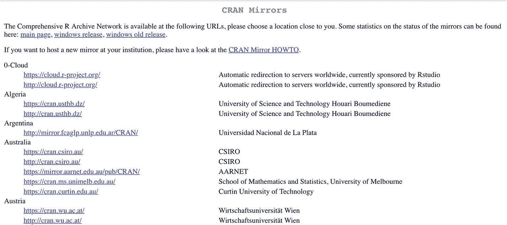

**图 1-1** CRAN 镜像

向下滚动服务器列表，找到离你地理位置最近的一个，然后点击链接。不必过于纠结要选绝对最近的服务器，从你所在国家任意选一个通常都可以。如果发现链接失效，只需返回并尝试其他服务器。你将进入一个新页面，上面列出了适用于 Windows 和 Mac 的 R 版本，如图 1-2 所示。

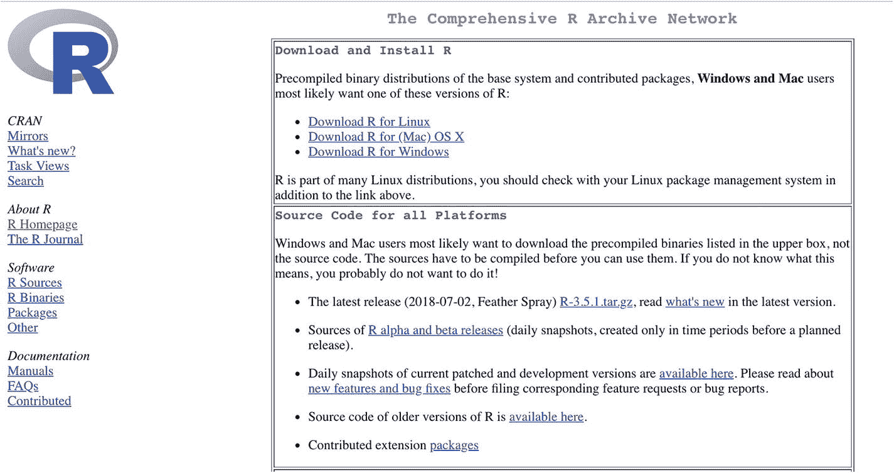

**图 1-2** 在 CRAN 安装 R

点击适用于你操作系统的链接。每个操作系统都有不同的 R 安装说明。

### 在 Mac 上安装 R

如果你在 Mac 上安装 R，你会看到许多关于不同 R 版本的详细信息。大多数人只需直接前往页面中间“最新发布”标题下的区域，如图 1-3 所示，然后点击以 `.pkg` 文件扩展名结尾的文件。该文件的确切名称会因安装程序的最新版本而有所不同。

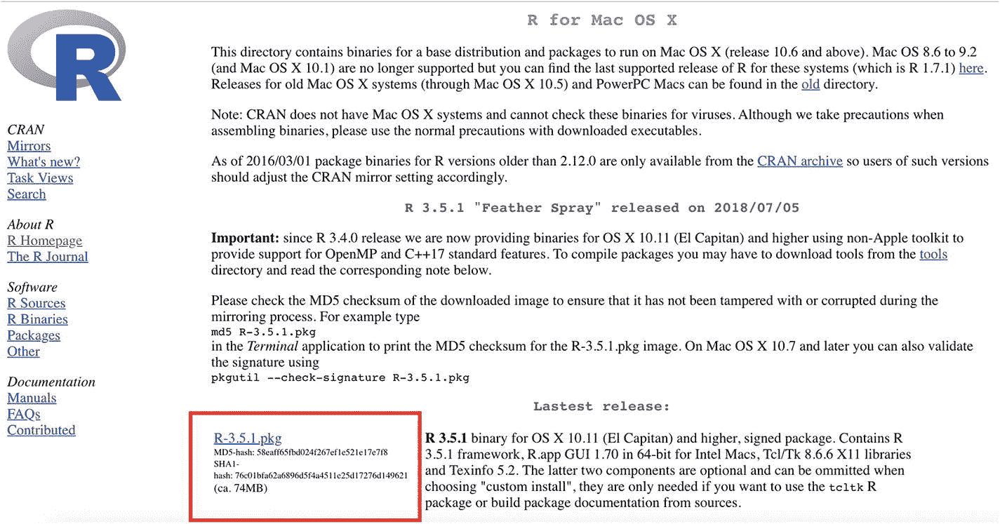

**图 1-3** Mac R 安装程序

点击`pkg`链接安装最新版本的 R。请注意，如果你有特殊需求需要安装旧版 R，可以向下滚动查看安装先前版本的选项。`pkg`文件将出现在你的“下载”文件夹中。进入“下载”文件夹，点击`pkg`文件安装 R。将出现如图 1-4 所示的界面。

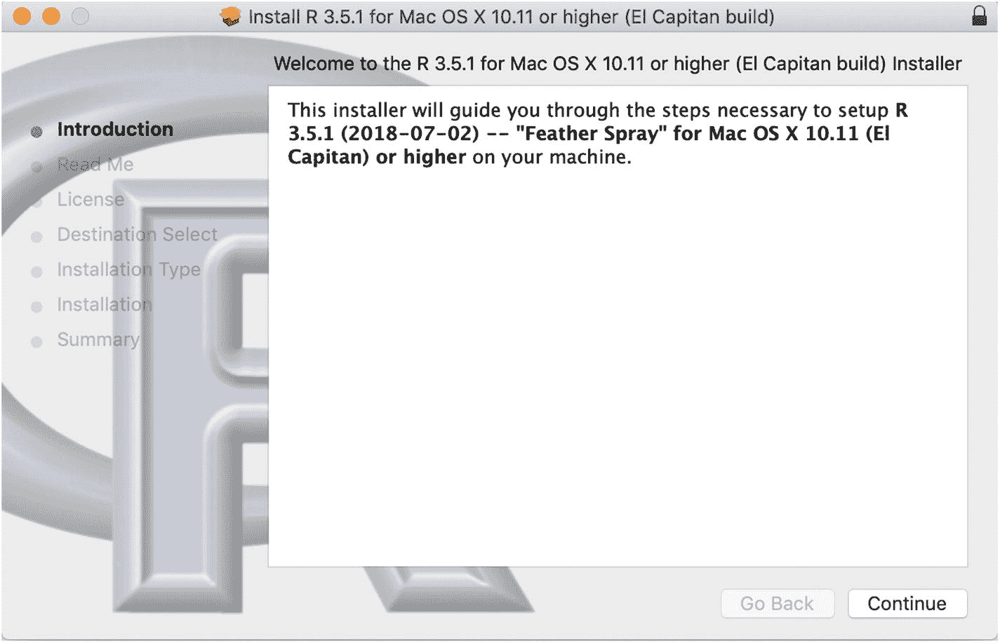

**图 1-4** 在 Mac 上安装 R

你会看到一系列类似图 1-4 的界面。每个界面都点击“继续”。在此过程中，会弹出一个模态对话框要求你同意软件许可协议。点击“同意”继续。接下来，你会看到选择特定磁盘进行安装的选项，如图 1-5 所示。

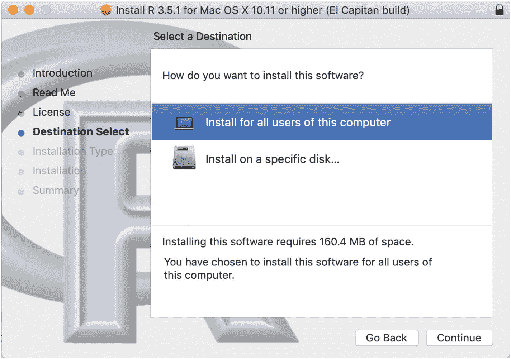

**图 1-5** 选择 R 安装位置

大多数人只需选择“为所有用户安装”选项。选择第一个选项，然后点击“继续”按钮。在下一个界面，点击“安装”按钮。系统会提示你输入 Mac 密码，因为 R 安装程序会修改你的 Mac 系统。输入密码继续。R 将开始安装，当所有操作完成后，你应该会看到如图 1-6 所示的界面。

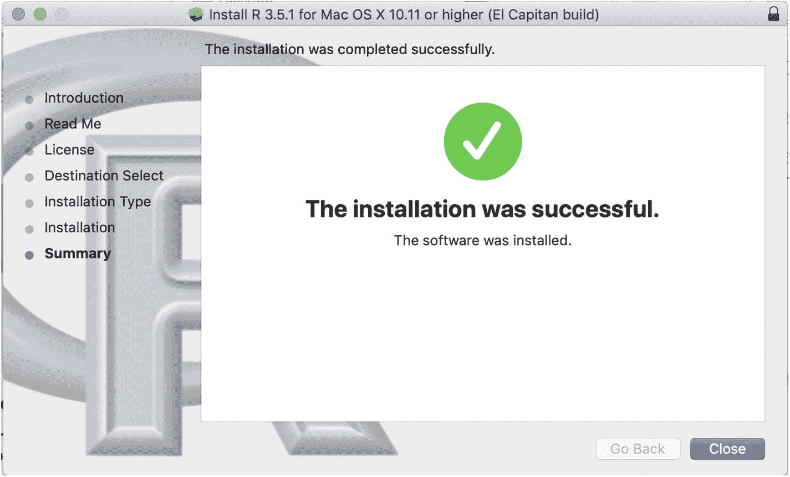

**图 1-6** R 安装成功

点击“关闭”按钮，R 即安装到你的 Mac 上。你会在“应用程序”文件夹中找到 R。双击“应用程序”文件夹中的`R.app`程序，以验证 R 已安装并可正常运行。将出现原生的 R 控制台界面。如果你已经了解一些 R 知识，可以在这里进行尝试，或者直接退出程序。待 RStudio 安装完成后，我们将重新使用 R。

### 在 Windows 上安装 R

点击“R for Windows”链接后，你会看到一个说明页面。点击“首次安装 R”，如图 1-7 所示。

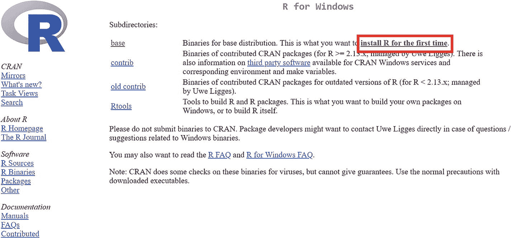

**图 1-7** 在 Windows 上安装 R

在下一页，会有一个下载 R 安装程序的链接。点击该链接以获取 Windows 安装程序。它将被命名为“Download R for Windows”。点击它以下载 R 安装程序。稍后，你会在“下载”文件夹中找到 R 安装可执行文件。

双击该安装程序文件，然后按照提示点击下一步。选择默认设置，让安装程序完成即可。

### 在 Linux 上安装 R

每种 Linux 版本都有不同的安装说明来安装 R。通常，你会使用包管理器通过命令行来安装 R。可以执行如下操作：

```
sudo apt-get update
sudo apt-get install r-base r-base-dev
```

不过，这里每种 Linux 版本可能会略有不同，你应该再次查看 CRAN 网站，了解针对你的 Linux 版本可能需要执行哪些操作。点击 [`https://cran.r-project.org`](https://cran.r-project.org) 页面上的“Download R for Linux”链接，然后选择你的 Linux 版本，以获取更多指导。

## 安装 Git

Git 是一种流行的版本控制系统，用于管理代码文件的不同版本。RStudio 会将 Git 集成到你的工作流程中，并帮助你可视化你的工作。

### 在 Mac 上安装 Git

要在 Mac 上安装 Git，请访问此 URL：[`https://git-scm.com/download/mac`](https://git-scm.com/download/mac)；如果你的下载没有立即开始，请点击“click here to download manually”文本，下载 Git 安装程序。双击出现在“下载”文件夹中的文件。在出现的文件夹中，点击`pkg`文件，开始安装过程。你可能会看到类似图 1-8 所示的安全通知对话框。

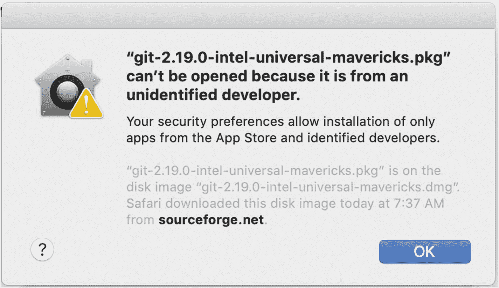

**图 1-8** Mac 上的安全警告

你可以通过进入 Mac 的“安全性与隐私”设置的“通用”标签页，然后在你下载的文件旁边选择“仍要打开”来覆盖此安全功能。示例如图 1-9 所示。

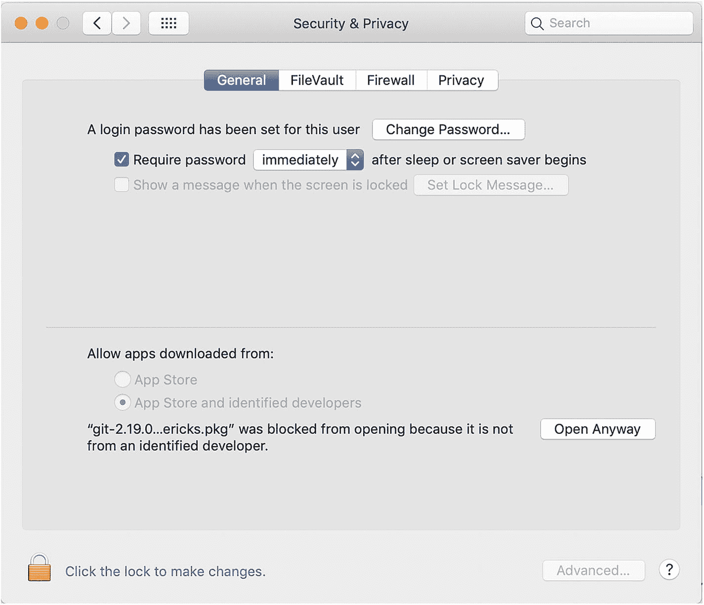

**图 1-9** 在 Mac 上覆盖安全设置以安装 Git

现在只需点击安装界面，直到收到安装完成的通知。你可以使用 Mac 的“终端”应用程序，在终端窗口中输入`git --version`来验证 Git 是否安装成功。

### 在 Windows 上安装 Git

要在 Windows 上安装 Git，请访问此 URL：[`https://git-scm.com/download/win`](https://git-scm.com/download/win)；如果你的下载没有立即开始，请点击“click here to download manually”文本，下载 Git 安装程序。

双击出现在“下载”目录中的文件。对于随后出现的每个界面点击“下一步”，并选择默认设置。安装程序完成后，点击“完成”。

通过进入 Windows 命令提示符并输入`git --version`，验证 Git 是否安装成功。你应会看到一条响应信息，显示 Git 的最新版本。

### 在 Linux 上安装 Git

如果你使用 Linux 且尚未安装 Git，可以使用包管理器通过命令行安装 Git：

```
sudo apt install git-all
```

这里我们使用了`apt`，但请注意，你需要根据你的发行版使用相应的包管理器。

### 安装 RStudio

现在我们已经安装了 Git 和 R，可以开始安装 RStudio 本身了。

访问 RStudio 下载页面：[www.rstudio.com/products/rstudio/download/](http://www.rstudio.com/products/rstudio/download/)。你将看到一个显示所有可用 RStudio 选项的界面。RStudio 的桌面版和服务器版均提供开源许可证和商业许可证。我们感兴趣的是开源（免费）桌面版 RStudio。其他版本面向需要商业许可证和高级技术支持的企业。如图 1-10 所示。

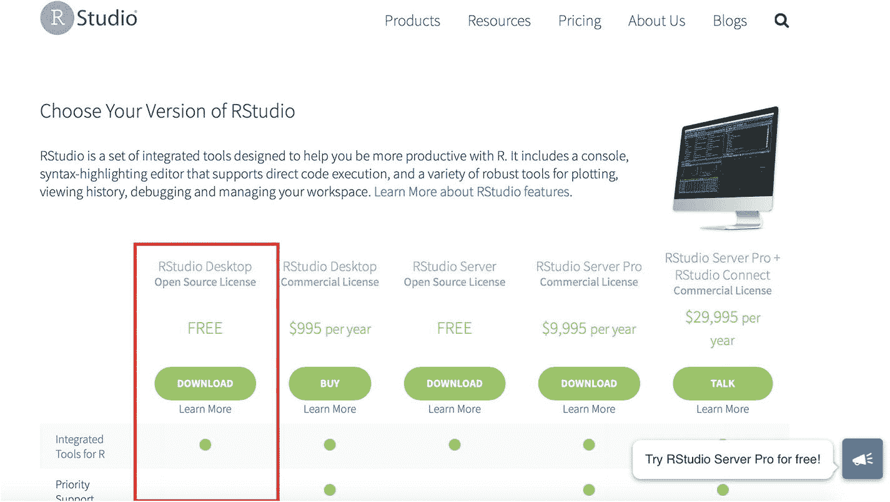
图 1-10 RStudio 下载页面

点击绿色的“Download”按钮，页面将向下滚动，显示 Windows 和 Mac 的安装程序列表。点击适用于你操作系统的安装程序，等待下载完成。转到“下载”文件夹，找到安装程序；它的名称会类似`RStudio-1.1.463`，Mac 版本的文件扩展名为`dmg`，Windows 版本的文件扩展名为`exe`。

双击安装程序并按照提示操作。在 Mac 上，会弹出一个界面，其中包含 RStudio 图标和“应用程序”目录的快捷方式。只需将 RStudio 图标拖到“应用程序”文件夹快捷方式上即可。

在 Windows 上，你可以按照提示选择默认位置。安装完成后，点击“完成”按钮。

#### 验证 RStudio

在继续之前，让我们确保 RStudio 已安装并可正常工作。在你的系统上搜索 RStudio 应用图标，然后双击打开应用。如果找不到该图标，请转到 Mac 屏幕右上角或 Windows 屏幕左下角的搜索图标。输入“RStudio”，应该可以看到 RStudio 应用的快捷方式出现。双击此图标。

如果你使用的是 Mac，会出现一个安全弹出窗口，如图 1-11 所示。

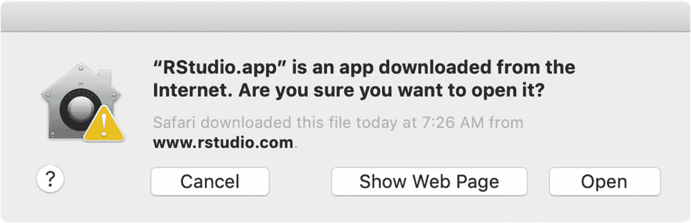
图 1-11 RStudio 安全弹出窗口

点击“打开”进入 RStudio。现在你应该会看到 RStudio 应用出现在桌面上。它看起来类似这样。

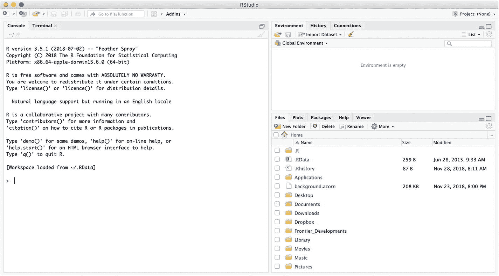
图 1-12 RStudio IDE 初始界面

恭喜，你现在已经安装好 RStudio IDE，可以开始使用了！