# 2. Hello World

既然大家已经配置好了 RStudio，让我们开始使用这个程序来帮助我们成为更好的 R 语言程序员。我们首先要做的是打开 RStudio，直接在控制台中与 R 进行交互。这就是我们的 Hello World 时刻。

## 交互式 R 控制台

第一次打开 RStudio 时，你应该会看到一个占据整个屏幕左侧的窗口。这就是你的控制台屏幕，应该类似于图 2-1 所示。

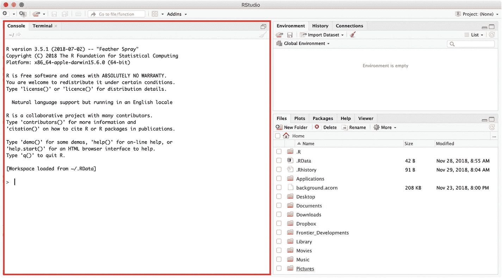
图 2-1 控制台界面

你应该会看到关于你正在使用的 R 版本的信息。最底部有一个光标 `>`。光标右侧的区域就是你可以直接在控制台中输入 R 命令的地方。

尝试输入 `1 + 1`，然后按回车键。你应该会看到下一行出现 `[1] 2`。2 是 `1 + 1` 的答案，而括号中的 1 `[1]` 是向量中对应答案 2 的位置。

### 向量

R 中的一个核心概念是向量数据结构。向量是相同数据类型对象的列表。R 中的许多操作即使对于像 `1 + 1` 这样只返回一个值的问题，也会以向量的形式返回答案。`[1] 2` 是一个包含一个数值型数据类型的向量，该数据类型在第一个位置上的值为 2。

### Hello World

现在，让我们通过传统的 Hello World 示例，在控制台中看看另一种类型的向量。请在控制台屏幕中准确输入以下字符集：

```
"Hello World"
```

别忘了带上引号！然后按 Enter 键，你会看到另一个向量出现，但这次显示的是 `[1] "Hello World"`。和之前一样，这个向量在第一个位置有一个项，但这次的对象是一个字符串，显示了这句著名的语句。

让我们借助一个函数，用另一种方式尝试 Hello World。这个函数可以用于创建长度超过一个项的向量。我们可以使用字母 `c`，并在其后添加一个用逗号分隔的对象列表来创建一个向量。向量中的所有对象必须是同一类型（不能混合数字和字符）。如果我们的对象类型不同，R 会简单地将它们转换为能够容纳你提供数据的最通用类型。在控制台窗口中输入 `c("Hello", "World")`，然后按 Enter 键。这次你会看到 `[1] "Hello" "World"` 打印到控制台。

虽然这看起来与我们之前看到的非常相似，但有一点不同。这个向量有两个项，尽管控制台只显示了 `[1]` 这一行。然而，你可以看到上面有两个对象，因为每个对象都有自己的引号。R 只是通过在输出屏幕上仅显示每行输出的项目编号来节省空间。让我们看一个更大的向量，了解其工作方式。

在控制台中输入 `1:100` 并按 Enter 键。你应该会看到类似图 2-2 中显示的图像。

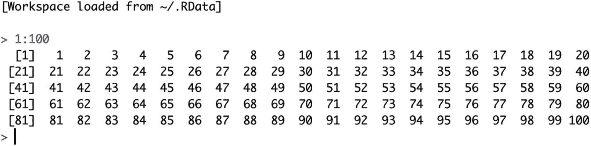
图 2-2 100 项向量打印输出

`:` 是一个快捷方式，可用于定义范围。输入 `1:100` 会给出 1 到 100 之间的每个数字。结果是一个向量，你可以清楚地看到每一行如何在第一列报告数据值的项目位置。

让我们回到 RStudio IDE 的探索之旅。随着我们深入学习如何使用这些工具，我们将了解更多关于 R 编程和向量的内容。

### 终端

我们刚刚介绍的控制台屏幕，是如果你只下载了 R 并开始编码时所能拥有的界面。虽然这对于交互式使用 R 来说很棒，但 RStudio 提供了比简单控制台更多的功能。让我们来了解一些使 RStudio 成为集成开发环境的功能。

在控制台屏幕顶部的控制台选项卡旁边，有一个名为“终端”的选项卡。如果你点击它，你会看到另一个与控制台类似的屏幕，但它是你操作系统的命令行。当你需要以这种方式工作时，这在某些场景下会非常方便。

这个功能对于命令行高手来说会很受欢迎，而对于我们这些有时需要深入操作系统的其他人来说，也值得记住。点击终端选项卡，输入一个你可能使用的命令。例如，你也许想查看文件和文件夹的列表，因此可以在你的命令行中输入 `ls`，就像我们在图 2-3 中所做的那样。

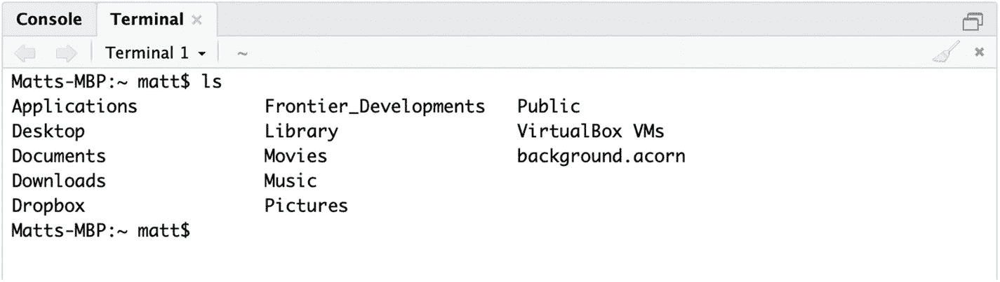
图 2-3 终端命令行

你可以使用的实际命令取决于你的操作系统。如果你使用图 2-4 中终端选项卡正下方的下拉菜单，还可以访问一系列辅助操作。

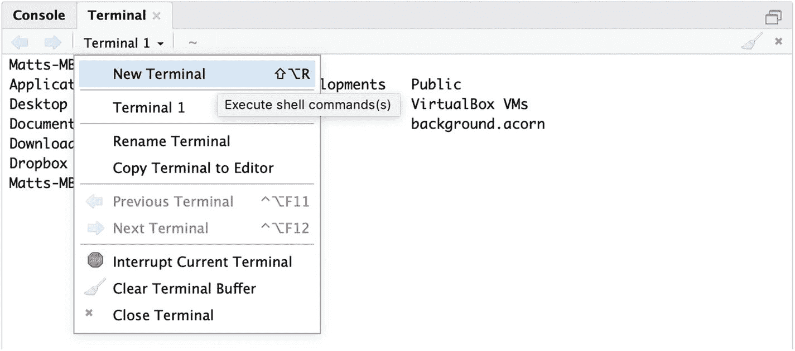
图 2-4 命令快捷方式

### 环境

RStudio 的环境选项卡是一个方便的功能，位于控制台屏幕的右侧。有三个选项卡：环境、历史和连接。环境选项卡如图 2-5 所示。

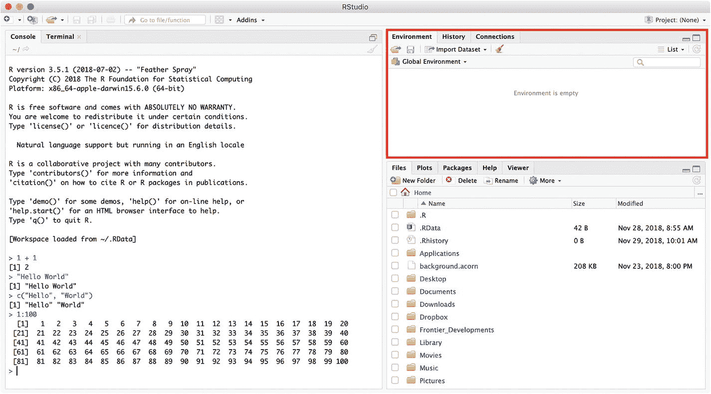
图 2-5 环境选项卡

在 R 中，环境是一个工作区。你可以在环境中存储对象和数据。在我们的示例中，我们将只使用全局环境，但你应该知道，R 中的环境可以是一个丰富的话题，并用于高级 R 编程技术。例如，每个 R 函数（可重用代码单元）都会拥有自己的环境，程序员可以为各种目的分配自己的环境。但大多数人不需要过多担心环境的这些细微差别。

现在，你的环境应该是完全空的，因为我们还没有创建任何对象或加载任何数据。让我们通过创建一些变量来改变这一点。点击进入你的控制台，通过将“Hello World”字符串分配给一个名为 `greeting` 的对象来创建一个对象。

```
greeting <- "Hello World"
```

在我们查看环境窗口中发生了什么之前，我们应该先讨论一下这个我试图悄悄塞给你的新语法。让我们从最右边开始分解上面的语句。

`"Hello World"` 是我们一开始输入的同样字符串。字符串是一组用引号括起来的字符。和数字一样，字符串是一种数据类型。字符串左侧的那组奇怪符号 `<-` 被称为赋值运算符。赋值运算符的工作是将一个数据值赋给一个对象。

这里的对象位于赋值运算符的左侧，它被标记为 `greeting`。通过输入上述代码并按 Enter 键，你将 `"Hello World"` 的值赋给了对象 `greeting`，并将其放入了全局环境。现在，你可以在屏幕右侧的区域查看全局环境的内容，如图 2-6 所示。

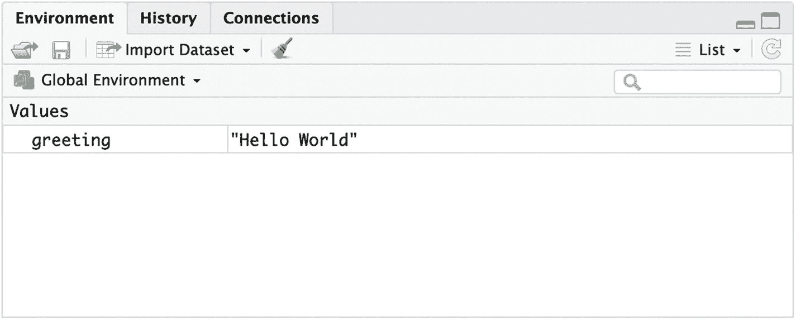
图 2-6 在环境选项卡中查看对象

这非常棒，因为在执行数据分析时，你将能够看到工作的当前状态。你可以一目了然地看到结果，并可以验证你期望的变量是否正确。仅此一项功能就使 RStudio 成为你数据编程工具包中的必备工具。但还有更多功能。

环境小部件还能够保存你的工作并打开其他环境。因此，如果你整天都在破解某个数据问题，并希望保存所有数据和变量，可以使用软盘图标来完成。要打开一个环境，只需使用文件夹图标，然后导航到你已保存的环境文件。

### 导入数据

另一个改变游戏规则的功能，能帮助许多人，是从其他数据分析工具（如 SAS 和 Excel）导入数据的能力。点击“导入数据集”按钮，你将看到在分析中导入数据的选项，如图 2-7 所示。

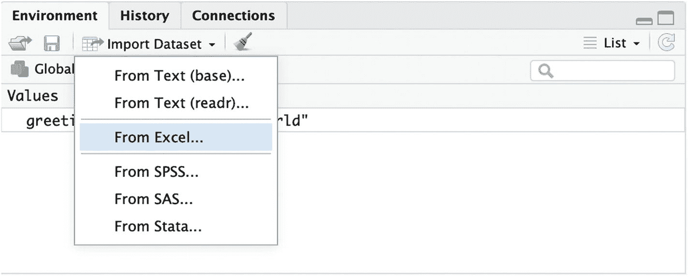
图 2-7 导入数据集

点击这些选项将启动一个导入向导，你可以使用它轻松地从这些来源中的任何一个将数据导入 RStudio。最后，在这个屏幕上，你还有一个友好的扫帚图标，可以用来擦除环境中的所有内容。

### 数据集

为了演示导入功能，我们从 [data.gov](http://data.gov) 网站用于食物金字塔的一个数据集中下载了一个数据集 [`https://catalog.data.gov/dataset/mypyramid-food-raw-data-f9ed6`](https://catalog.data.gov/dataset/mypyramid-food-raw-data-f9ed6)。食物金字塔网站如图 2-8 所示。

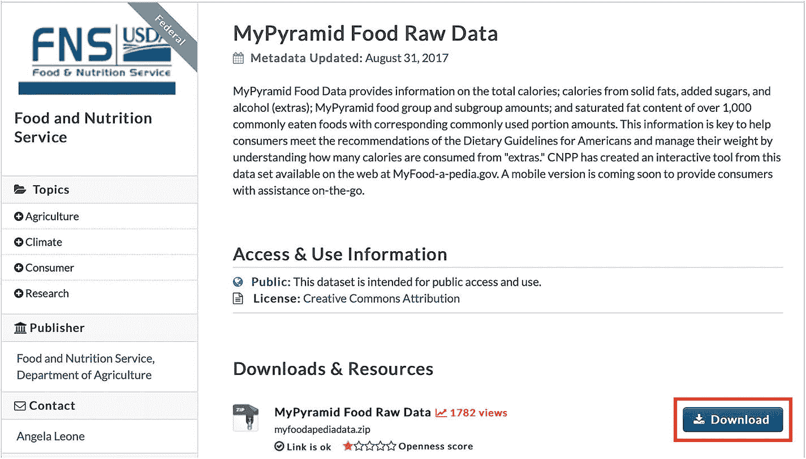
图 2-8 食物金字塔数据下载页面

该数据以 Excel 格式存储，我们可以直接使用“导入数据集”工具将其导入到 R 中并进行查看。如果你想跟随此示例操作，请访问上述网址，并从网页中下载 zip 文件。

# 第2章 RStudio IDE 概览

打开 zip 文件，找到名为 `Food_Display_Table.xlsx` 的文件。这就是我们将要查看的 Excel 格式数据集。现在，在 RStudio 中，点击“Import Dataset”按钮，并选择“From Excel...”。然后点击“Browse”按钮。此界面的示例见图 2-9。

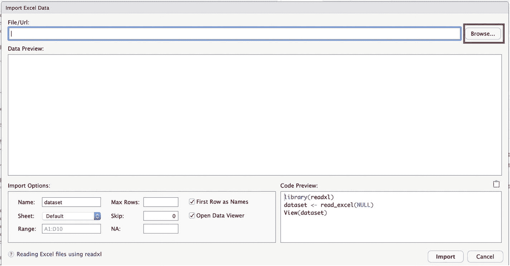

图 2-9

导入 Excel 数据

接下来，导航到存放名为 `Food_Display_Table.xlsx` 的 Excel 文件的位置。屏幕将显示数据的前几行，以及一些可复制的代码，这些代码可用于后续在不使用界面的情况下重新导入此数据集，如图 2-10 所示。

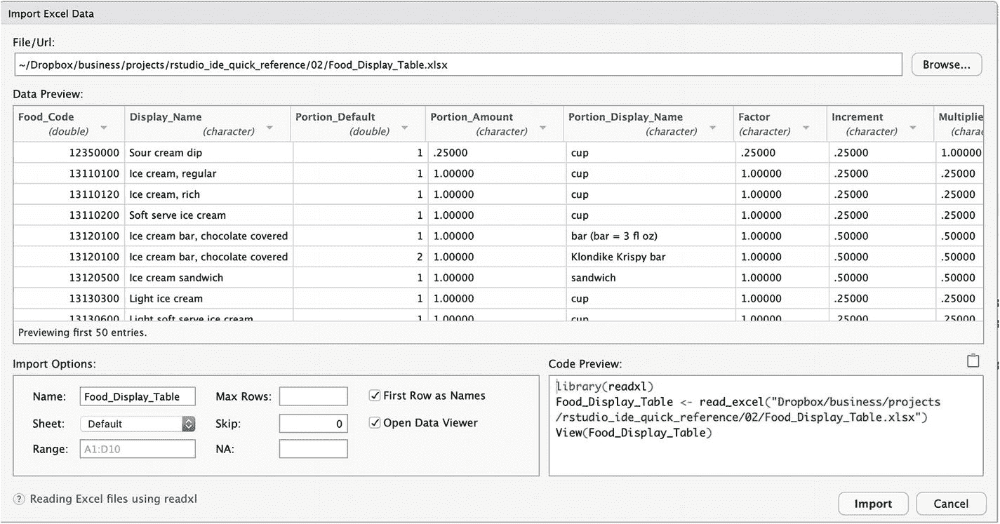

图 2-10

导入数据预览

点击“Import”，导入数据集窗口将消失，你将返回到主 RStudio IDE 屏幕。然而，很多内容已经发生了变化，如图 2-11 所示。

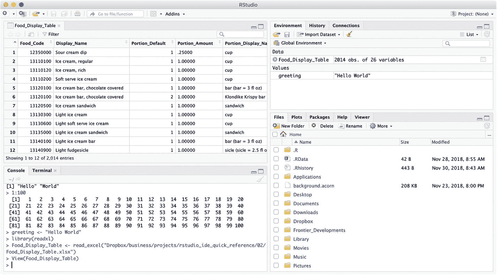

图 2-11

数据集在 R 中打开

你可以看到数据已经显示在屏幕上。我们可以使用这个新屏幕上的控件来筛选数据和搜索数据集。该数据集也出现在全局环境中，并被自动命名为 `Food_Display_Table`。这是在 R 代码中引用此数据集的名称。例如，我们可以在控制台中使用 R 的 `head` 函数来查看数据的前几行。

图 2-12 中显示的输出为我们提供了关于此数据集的更多信息。当我们更多地了解数据和 R 之后，我们就可以使用数据集的名称作为分析中的输入数据。

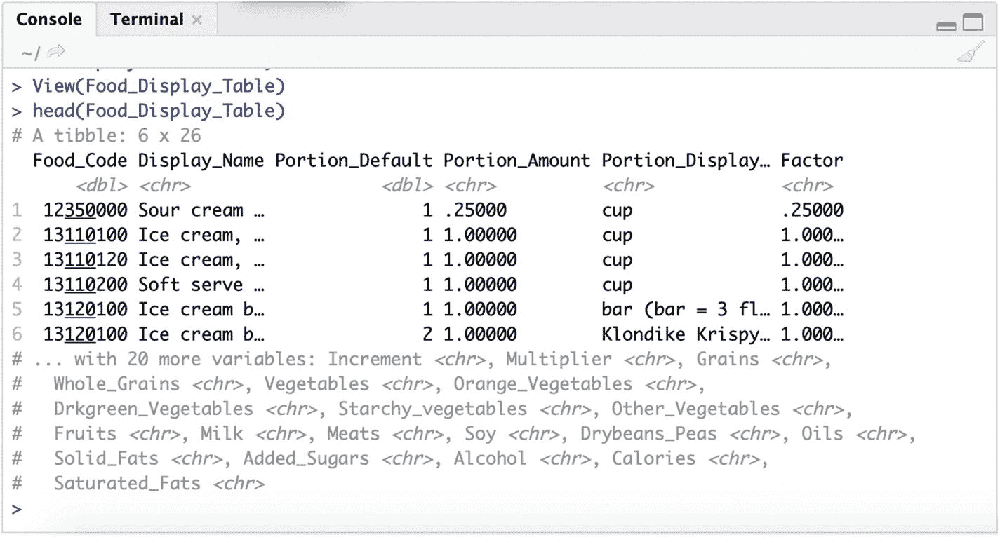

图 2-12

R 的 `head` 函数

## 历史记录

切换到下一个标签页，可以查看你在此次 R 会话中输入的所有命令的日志。当你已经找到结果，但记不清是如何达到某个特定点时，这会有很大帮助。你只需查看日志，就能看到你执行的步骤列表。

图 2-13 所示的历史记录标签页还提供了一些便捷功能，你可以用它们将历史记录中的某行代码重新放入 R 控制台。你也可以使用带有搜索图标的文本区域搜索特定的代码行。当你知道已经对某个对象进行了更改，但又难以在可能很长的命令列表中准确定位到更改位置时，这个功能会非常方便。

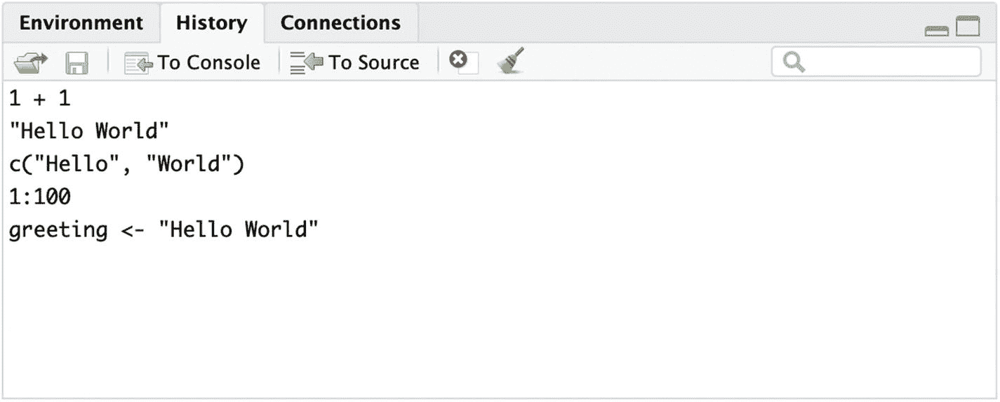

图 2-13

历史记录标签页

## 连接

最后，“连接”标签页提供了一种连接到数据源（如本地数据库或 Spark 集群）的方式。当数据集太大，无法简单地存储在本地计算机上时，就会使用这类数据存储解决方案。如果你点击进入“连接”标签页，你会看到一个空列表，但那里有连接到 ODBC（数据库）或 Spark 的选项。

如果你有项目所需数据库的连接信息，可以使用此界面进行连接。RStudio 会引导你完成连接过程，并安装处理该数据源所需的任何包。此窗口还会显示你使用 R 代码自己创建的任何数据源连接。

## 总结

在本章中，我们介绍了 R 向量，这是一种重要的 R 数据结构。此外，我们已经接触了 RStudio IDE 的许多基本功能。最后，我们简要介绍了 R 中的数据集。在我们继续探索 RStudio IDE 的旅程中，我们会再次遇到这些对象，并进行更详细的讨论，这样你就能开始了解这将如何帮助你进行数据分析。


