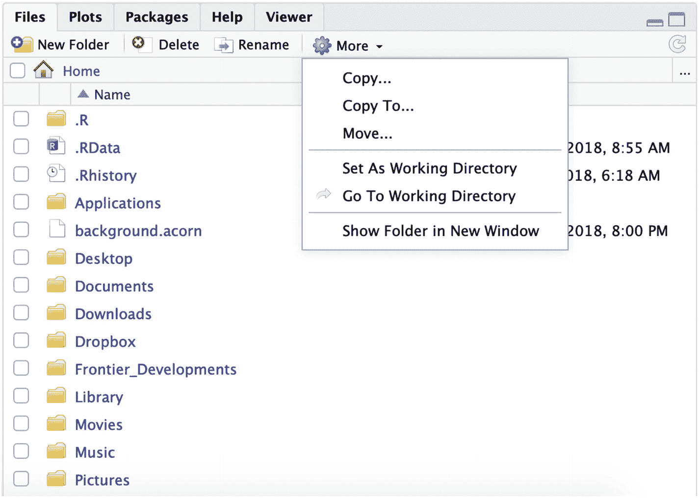
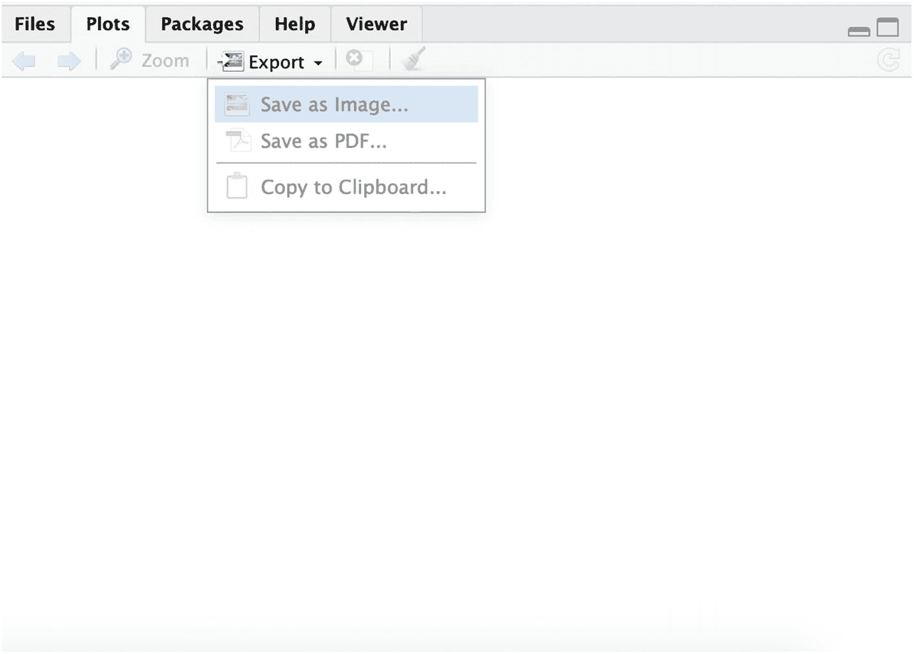
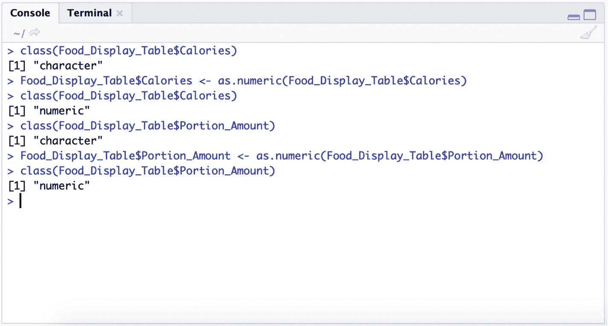
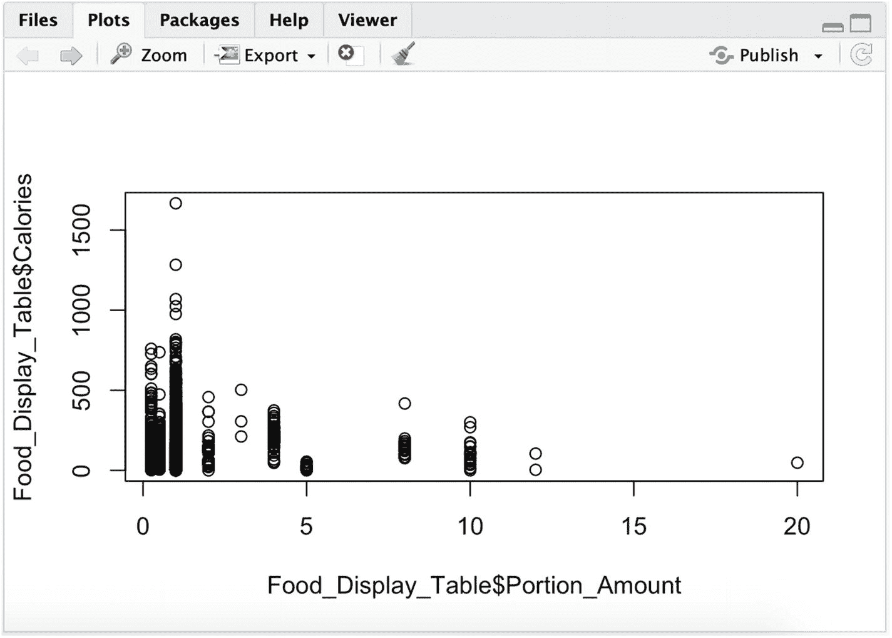
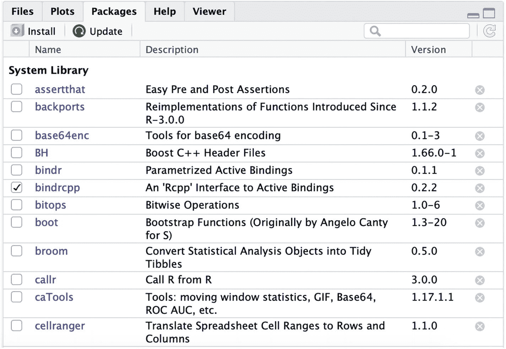
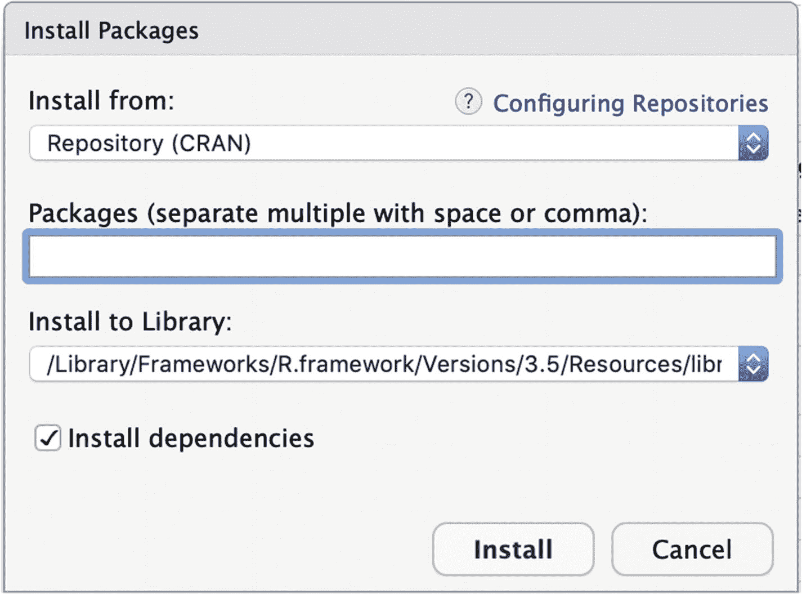
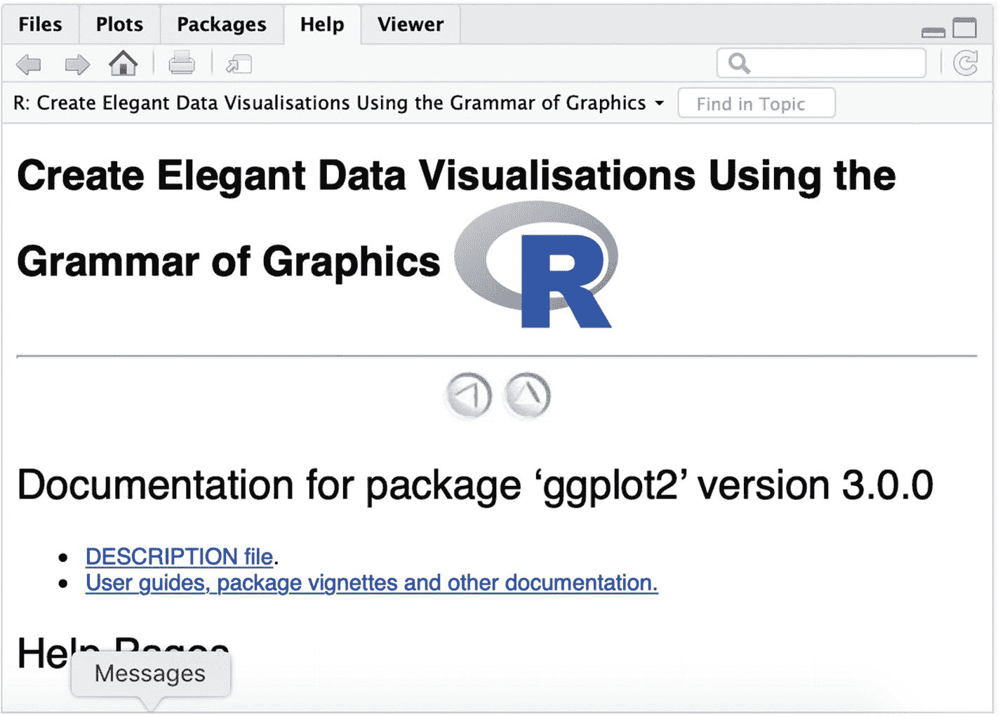

# 3. RStudio 视图

让我们继续探索 RStudio IDE。RStudio 有一个四窗格窗口布局，上一章我们已经仔细研究了其中的两个窗格。我们看到了控制台屏幕，您可以在其中编写交互式 R 代码；我们还看到了环境和历史记录屏幕，您可以在其中查看 R 环境的状态。我们的数据框也在第三个窗格中打开了，但我们还可以对 RStudio 界面的这部分做更多操作。现在让我们来看看我们将要使用的剩余屏幕。

## 文件、绘图、包、帮助和查看器窗格

默认情况下，右下角的窗格将包含标记为“文件”、“绘图”、“包”、“帮助”和“查看器”的标签页。“文件”标签页将显示当前工作文件夹中的文件。工作文件夹是 R 将保存您工作的文件夹。此窗格本质上是集成到 RStudio 中的 Windows 资源管理器或 Mac 访达应用程序。

### 文件

“文件”标签页包含一些便捷功能，您可以使用这些功能打开和处理文件，而无需离开 RStudio。这包括删除和重命名文件等任务。您还可以设置 R 的工作文件夹，如图 3-1 所示。



图 3-1

文件标签页

### 绘图

您可以使用“绘图”标签页来查看在 R 分析过程中创建的图形。如果切换到该标签页，您将看到一个空屏幕，上面有几个功能按钮，如图 3-2 所示。



图 3-2

图形视图功能

您可以查看图形、将图形导出到文件，也可以在您创建的多组图形之间导航。这个小工具可以帮助您在研究和探索数据时保持井井有条。为了更详细地演示此功能，我们需要切换到控制台屏幕，进行一些数据整理，并创建一个图形。

#### 数据整理简介

我们可以使用上一章导入的数据。如果您一直按步骤操作，该数据被命名为 `Food_Display_Table`。在使用这些数据创建图形之前，我们需要进行一些“数据整理”。数据整理是重组数据以使其适用于分析的过程。

#### 注意

我们在上文中交替使用了“数据集”和“数据框”这两个术语；然而，在 R 中我们操作的对象的技术名称是“数据框”。术语“数据集”是一个通用术语，适用于任何分析环境中的任何数据集合。

对于这个图表，我们想要查看 `Food_Display_Table` 数据框中的两列：`Calories` 和 `Portion_Amount`。这两项之间似乎可能存在某种关系，因此，通过图表来观察是否存在有助于我们理解数据含义的模式，是合理的做法。

我首先要做的是检查我感兴趣的列的数据类型。你可以使用 R 的 `class` 函数来做到这一点：

```r
class(Food_Display_Table$Calories)
```

你有了函数名 `class`，在括号中，包含你想要检查的对象。我们已经看到了数据框名称（`Food_Display_Table`），但现在我们还有一个美元符号 `$` 和变量名 `Calories`。在 R 中，美元符号用于在数据框中引用某一列。`Food_Display_Table` 数据框中的每一列都可以用这种方式引用。上面我们使用了 `class` 函数来检查 `Calories` 列的数据类型。它返回了“character”。

对于我们的图表，我们需要数据是数值型的。幸运的是，更改起来非常容易；通过使用 `as.numeric` 函数并将结果重新赋值给数据框，即可将一列数据变为数值型：

```r
Food_Display_Table$Calories <- as.numeric(Food_Display_Table$Calories)
```

这段代码将 `Calories` 数据的字符版本替换为相同数据的数值版本。你可以通过再次使用相同的 `class` 函数来双重检查数据类型，如下所示：

```r
class(Food_Display_Table$Calories)
```

这次控制台应该返回“numeric”。在继续绘制图表之前，我们仍然需要对 `Portion_Amount` 列进行同样的操作。按照上面处理 `Calories` 的相同流程进行操作。一切完成后，你的控制台屏幕上应该会看到类似图 3-3 的内容。



图 3-3

更改数据类型

### 绘图

现在我们准备好绘图了。在你的控制台窗口中输入以下代码：

```r
plot(Food_Display_Table$Calories, Food_Display_Table$Portion_Amount)
```

现在，你“图表”选项卡中会出现一个图表，看起来像图 3-4。



图 3-4

R 中的图表

图 3-4 显示的是图表中 Y 轴上的卡路里和 X 轴上的 `Portion_Amount`。这是一个非常基础的图表，但足以暗示这些数据点之间可能存在关系。在某个时候，你会了解到一些扩展基础 R 并实现更好可视化效果的包，但它们在“图表”选项卡中的工作方式基本上都是相同的。

### 包

下一个标记为“包”的选项卡将显示你拥有的 R 包列表。请参见图 3-5 查看包列表的样子。



图 3-5

包查看器

R 包是对你在第 1 章安装 R 时获得的 R 基础系统的扩展。R 包由社区贡献者编写，并且可供任何人使用。包也由 CRAN 网络管理，你可以从“包”选项卡中管理所有这些内容。

你在图 3-5 的截图中看到的是你计算机上已安装的所有包的列表。复选标记表示该包已加载到你的 R 环境中并可供使用。如果勾选某个包，控制台屏幕中会出现加载该包的代码。

例如，要使用 `broom` 包，我们只需单击复选框，控制台屏幕中就会出现以下内容：

```r
library("broom", lib.loc="/Library/Frameworks/R.framework/Versions/3.5/Resources/library")
```

确切的位置取决于你使用的 R 版本和操作系统。一旦以这种方式加载了某个包，该包的所有数据集和函数都将像我们之前使用的基础 R 函数一样对你可用。

#### 注意

`broom` 包是 R 包 `tidyverse` 系列的一部分。`broom` 用于将复杂分析函数（如线性回归）的输出转换为一个简单的数据框，该数据框可以轻松地作为其他函数的输入。我们将在本书后面更详细地讨论像这样必备的包。

你也可以使用“包”选项卡中的这个界面来安装包。如果你知道想要安装的包的名字，只需单击“安装”按钮，就会弹出图 3-6 所示的对话框。



图 3-6

R 包选项卡

然后输入你想要的包的名称，并单击“安装”按钮。保持默认设置不变，因为这将为你提供 CRAN 网络上所有可用的包。

最后，每个显示的包名都是一个超链接，你可以用它来获取该包的文档。当你安装包时，该文档也会被安装。只需单击包名即可了解如何使用该包。这将自动带你到显示在“包”选项卡右侧的“帮助”小部件。

### 帮助

“帮助”选项卡的设置类似于 Web 浏览器，并包含帮助你搜索主题的元素。你可以像浏览网页一样浏览显示的内容，如图 3-7 所示。



图 3-7

帮助选项卡

在图 3-7 所示的屏幕中，你可以看到名为 `ggplot2` 的 `tidyverse` 包的文档。这个包可以帮助你创建比仅使用基础 `plot` 函数更丰富的数据可视化。你可以使用“帮助”屏幕来了解更多关于此类包的信息，或者通过使用搜索功能来获取特定函数的帮助。

### 查看器

右下角区域中的最后一个选项卡是“查看器”选项卡。这是 RStudio 一些更高级功能（如 R Markdown 文档）的输出会出现的区域。R Markdown 文档用于以可重复的方式同时呈现代码和结果，并用于共享结果。我们将在本书后面介绍 R Markdown。

## 结论

到此为止，你已经为使用 RStudio IDE 的基础知识打下了相当坚实的基础。你应该了解如何在所有窗格和界面之间导航，以便利用 RStudio 默认状态下四个面板中可用的所有功能进行快速分析。

在此过程中，我们还介绍了如何使用基础 R 进行一些数据清洗、数据探索和数据可视化。

接下来，我们将继续探索 RStudio 如何帮助我们保持条理清晰，并构建清晰、有洞察力且可重复的分析。


