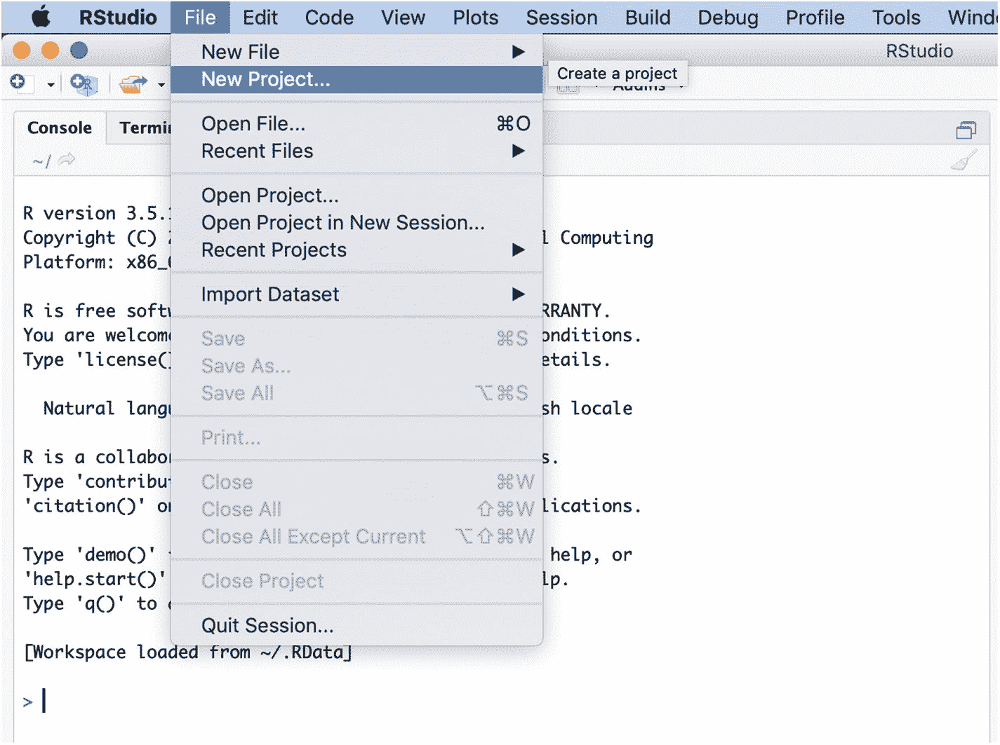
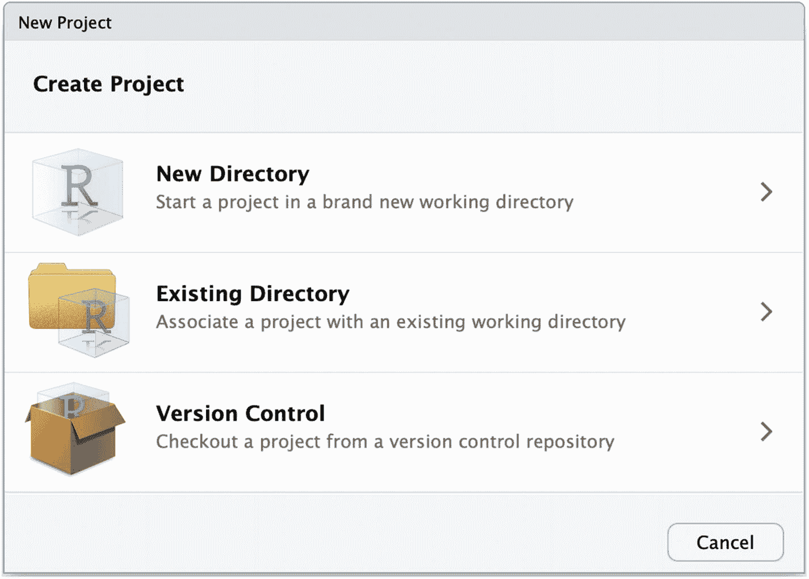
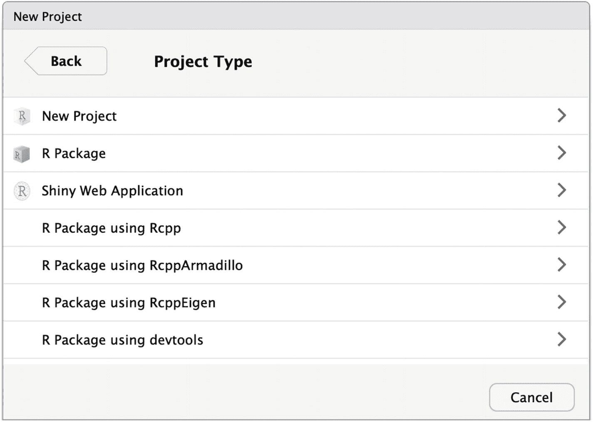
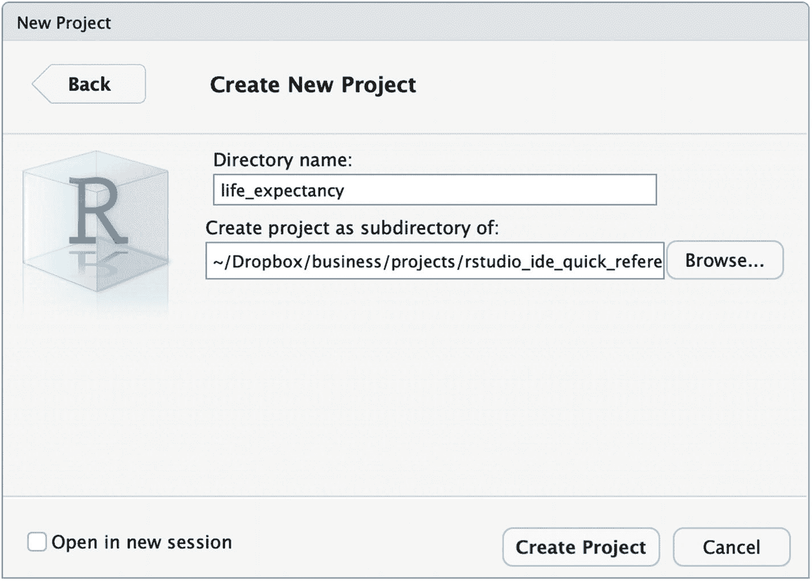
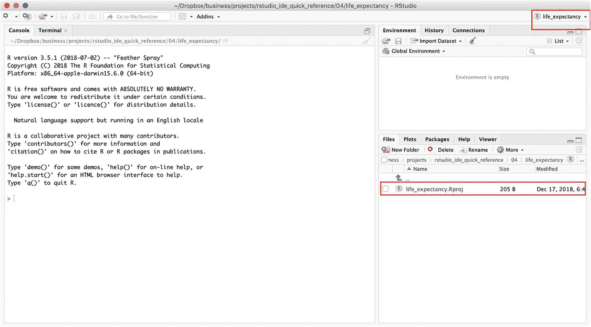
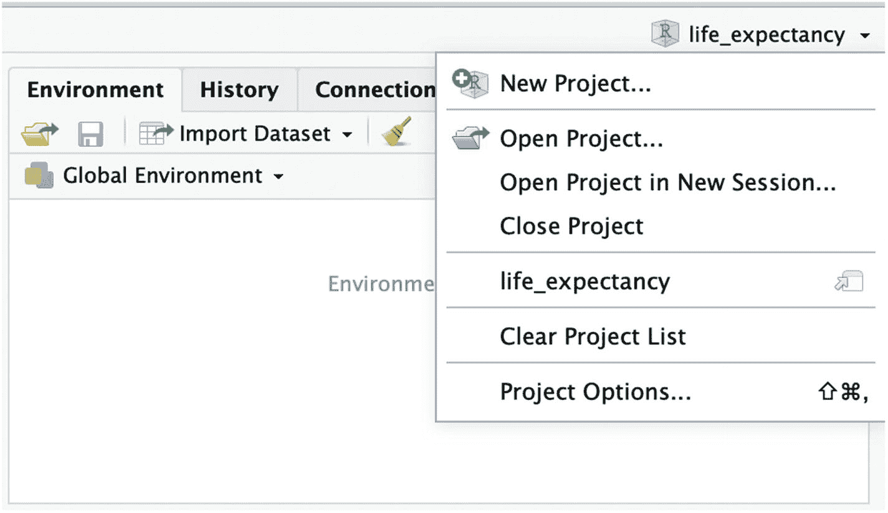
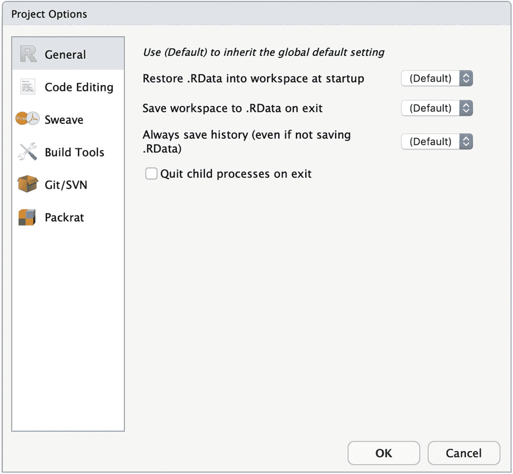
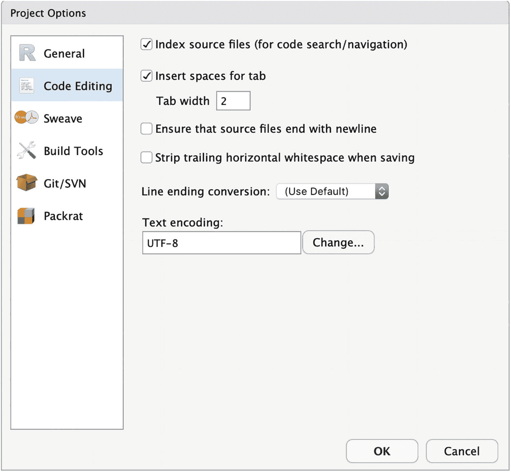

# RStudio 项目

到目前为止，我们已经学习了大量与 R 编程集成的知识，但我们还缺少一种方式，能够将所有内容整合到一个可重复使用的格式中。这正是 RStudio 项目发挥作用的地方。

RStudio 项目用于组织分析中使用的所有代码、报告以及其他任何资源。当我们创建一个项目时，RStudio 会提供项目类型所需的文件以及其他一切必要内容。

## 创建新的 RStudio 项目

要创建一个新的 RStudio 项目，请选择 RStudio 屏幕顶部菜单栏中的“文件”，然后选择“新建项目...”，如图 4-1 所示。

`图 4-1：创建新的 RStudio 项目`

现在，将弹出一个如图 4-2 所示的对话框，其中提供了一些用于创建新 RStudio 项目的选项。

`图 4-2：RStudio 项目选项`

通常，您只需选择第一个选项“新目录”，这将创建一个您可以命名的新文件夹。您的所有配置文件都将出现在这个新文件夹中。但是，如果您已有想要使用的代码文件，则可以选择第二个选项“现有目录”。最后，如果您已经为现有项目设置了像 `git` 这样的版本控制系统，那么您可以选择第三个选项“版本控制”。

### 项目类型

在本示例中，我们单击了“新目录”来创建一个全新的项目。随后出现的屏幕将向您显示 RStudio 项目类型列表，如图 4-3 所示。

`图 4-3：RStudio 项目类型`

前三种项目类型是您最常使用的。前三种之后的项目都包含用于特殊用例的专业代码。描述中包含 `Rcpp` 的项目均用于与 C++ 代码库集成。带有 `devtools` 的项目用于使用 `devtools` 库创建 R 包，而 `sparklyr` 项目则会创建一个能与 `Spark` 协同工作的包。

“包”项目用于创建一组可重复使用的 R 对象。这比本章讨论的内容稍微高级一些，我们稍后会再回到这个话题。只需要知道，当您拥有可以在不同项目中重复使用的代码时，可以创建 RStudio 项目包。

对于本例，请选择“新建项目”，如图 4-4 所示，以创建一个最适合分析的项目。

`图 4-4：预期寿命 RStudio 项目`

我们将项目命名为 `life_expectancy`，因为我们打算从显示预期寿命率的 [data.gov](http://data.gov) 网站进行一些数据探索。现在，选择您想要保存项目的目录（在 Mac 上称为文件夹），然后单击“创建项目”按钮来创建这个 RStudio 项目。

### RStudio 项目漫游

现在，我们为项目创建了一个新的空间。这个新的 RStudio 项目将存储在您在如图 4-4 所示的对话框中输入的文件夹中。RStudio 项目拥有各自独立的环境，因此如果您切换项目，您的工作将被保存并组织好。这对于代码文件和您分析所需的任何其他文件都是如此。让我们来看看为我们设置了什么。

在图 4-5 中，您可以看到 RStudio 项目的界面与我们之前章节看到的非常相似。

`图 4-5：新项目屏幕`

然而，在图 4-5 中，您可以看到与正常启动屏幕相比有两个变化。右下角的屏幕中出现了一个新文件，其文件名是您的项目名称，扩展名为 `Rproj`。此文件包含项目的所有设置。如果您仔细查看文件资源管理器，您会发现此文件位于您选择的目录下与项目同名的子目录中。

如果您单击屏幕右上角的项目名称，您将找到一系列有用的快捷方式，如图 4-6 所示。

`图 4-6：项目快捷方式`

您可以打开和关闭项目，快速导航到最近打开过的项目，并为这个项目专门设置 RStudio 选项。

项目选项保存在为您的项目创建的文件夹中扩展名为 `Rproj` 的文件中。您可以单击该文件打开项目选项，或者在如图 4-6 所示的快捷方式列表中选择该选项。执行此操作后，您将看到一个如图 4-7 所示的屏幕，其中列出了您可以为此项目设置的选项。

`图 4-7：项目选项`

这些项目选项继承自为 RStudio 设置的全局选项，大多数情况下，您可以保留它们不变。前两个屏幕是最直接有用的。“常规”选项卡提供了关于保存分析状态的选项。默认设置是同时保存您的数据环境和 R 历史记录。有时，如果您的项目需要加载大型数据集，您可能想要关闭这些选项，因为它们会延长项目的打开时间。通常，最好保留默认设置。

下一个选项卡是“代码编辑”，如图 4-8 所示；它允许您控制代码编辑器的工作方式。

`图 4-8：代码编辑选项`

通常，您应该保留这些默认设置。确保第一个选项“索引源文件”保持选中状态，因为这将确保我们稍后要讨论的一些代码工具能够正常工作。

其余四个选项选项卡包含一些功能的设置，我们将在本书后面重新审视它们。这些选项通常用于报告、构建包以及其他我们还未完全准备好集成到工作流程中的专业化功能。

## 结论

在本章中，我们学习了如何设置 RStudio 项目。这将帮助我们在开始处理多个分析时保持组织性和效率。每个 RStudio 项目都有自己的文件夹、文件集、数据集和环境。在下一章中，我们将通过一个示例来了解在 RStudio 项目中组织代码如何帮助您建立一个高效的工作流程。