# 可复现分析

让我们来看看如何使用 RStudio 项目创建可复现的分析。在本例中，我们将使用上一章创建的项目，其名称为“life_expectancy”。数据集将来自美国国家卫生统计中心，描述自 1900 年以来美国的预期寿命。

如果您一直在同步操作，那么您的 RStudio 中应该已经设置好了这个项目。如果没有，请按照上一章的步骤创建一个名为“life_expectancy”的新 RStudio 项目。

## 组织数据集

我们要做的第一件事，就是将数据读入项目。为了保持条理清晰，创建一个文件夹来存储数据会很有帮助。使用文件查看器创建一个新文件夹，如图 5-1 所示。

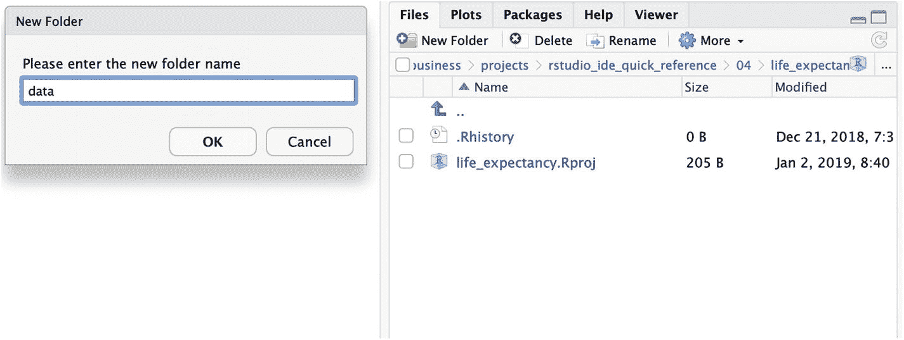

图 5-1 创建新文件夹

转到 `Files`，然后点击“New Folder”，输入“data”，再点击“Ok”。现在，你就拥有了一个关联到这个项目的新文件夹。

### 下载预期寿命数据

接下来，点击此链接进入数据集所在页面：

```
https://catalog.data.gov/dataset/age-adjusted-death-rates-and-life-expectancy-at-birth-all-races-both-sexes-united-sta-1900
```

该页面包含数据的详细描述。我们要将 csv 文件下载到刚才创建的“data”文件夹中。向下滚动到页面中如图 5-2 所示的区域。

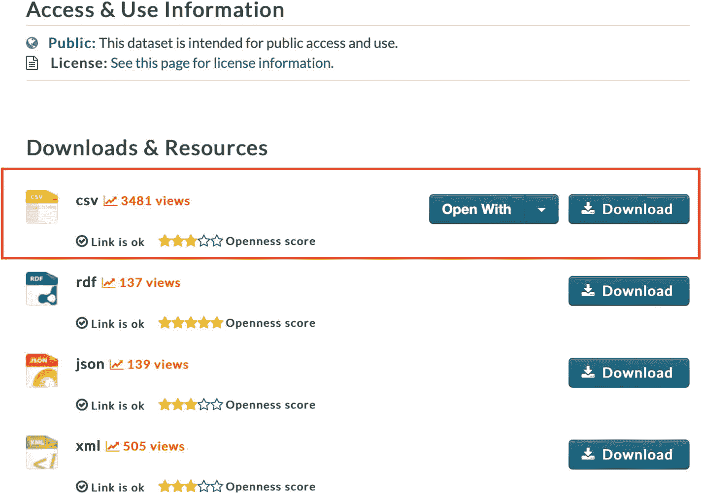

图 5-2 预期寿命 CSV 下载链接

点击“Download”按钮。csv 文件会出现在你的下载文件夹中。将 csv 文件从下载文件夹移动到你在项目中创建的数据文件夹。请注意，你需要使用电脑的 Finder 或资源管理器应用程序来移动此文件。

### 将数据集添加到 R 项目

虽然我们已经将原始的 csv 文件保存在 `data` 文件夹中，但为了在分析中使用，我们需要将数据转换为数据框格式。读取这种格式数据的最简单方法是使用“环境”视图中的“Import Dataset”功能，如图 5-3 所示。

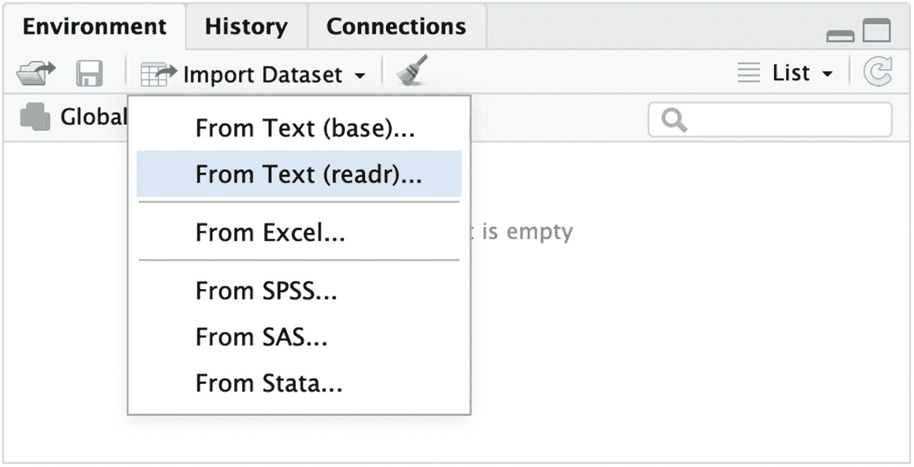

图 5-3 导入数据集

转到“Environment”视图，点击“Import Dataset”，然后选择“From Text (readr)...”。随后会出现一个类似于图 5-4 的窗口。

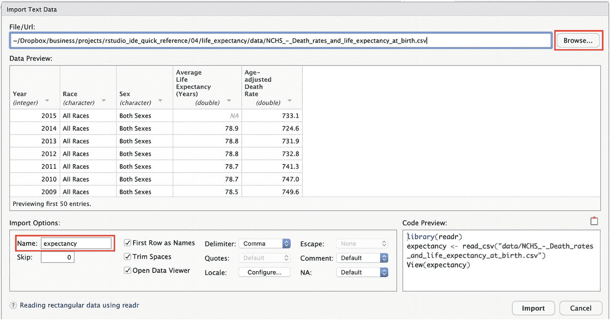

图 5-4 数据导入控件

使用“Browse”按钮导航到 csv 文件。这在图 5-4 的屏幕右上角区域进行了高亮显示。数据框的默认名称与文件名相同，但由于文件名可能很长，你可以在此控件屏幕中更改它，如控件左下角“Name”旁边的高亮区域所示。我们简单地将数据框命名为 `expectancy`。

完成此过程后，数据框将出现在你的 R Studio 项目中，如图 5-5 所示。

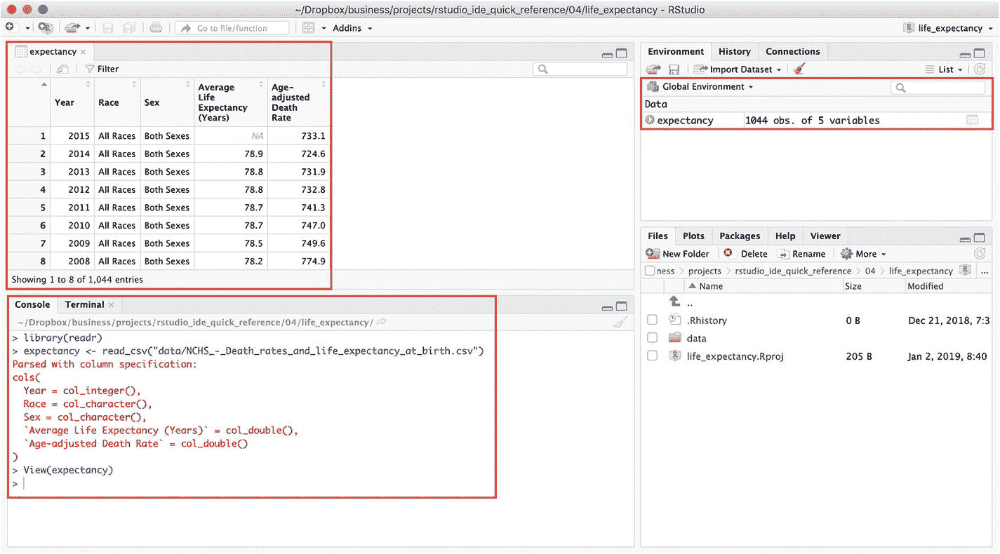

图 5-5 R Studio 项目中的数据框

在图 5-5 中，你可以在左上角看到数据框的一个样本。用于读取数据的代码将出现在左下角的控制台中，并且这些代码也会保留在历史记录视图中。最后，你会在右上角的“Environment”窗口中看到一个名为 `expectancy` 的对象。如果某个时候你关闭了窗口，可以点击此对象再次显示数据。

这是设置项目的第一步。如果你关闭 RStudio，请务必保存项目的状态。否则，如果你想再次使用你的数据框，就需要重复此过程。

### R 代码文件

虽然一开始使用提供的控件和交互式控制台屏幕很容易，但如果我们想重做分析或请同事运行我们的分析，回溯步骤将会很困难。我们的分析实际上是不可重复的。

为了使我们的工作具有可重复性，我们可以向项目添加 R 脚本文件。我们现在要做的是添加一个 R 脚本文件，然后将自动生成的代码添加到此文件中，以便我们可以在图中重复使用它。

转到 RStudio 菜单栏，选择“File” ➤ “New File” ➤ “R Script”。一个如图 5-6 所示的新选项卡会出现在你的数据框旁边，标签为“Untitled1”。

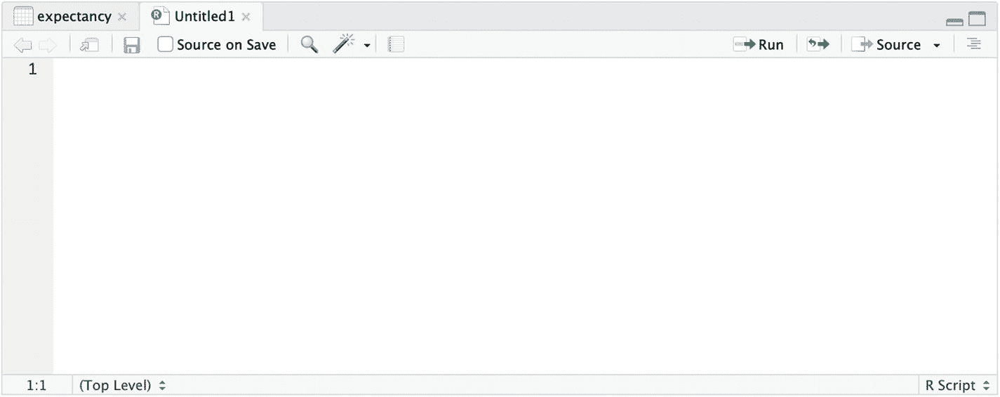

图 5-6 R 脚本编辑器

此脚本编辑器带有非常有用的内置功能，以及顶部的一栏可视化快捷方式。首先，点击软盘图标将此文件保存到你的项目中，并使用一个易记的名称。点击软盘图标，在出现的对话框中输入文件名 `process_data.R`。该文件现在将出现在你的文件资源管理器中，你可以随时点击其名称打开该文件。

我们将在讨论代码工具时介绍这里的其他功能，但现在只需知道，我们可以在此处保存工作，并使用上方的“Run”和“Source”按钮运行代码。现在，我们要找回自动生成的、用于读取 csv 文件的代码，然后对这个数据框进行一些清理工作。

打开右侧的“History”选项卡，你应该会看到用于读取 csv 文件的代码行，如图 5-7 所示。按住 Command 键并点击以高亮显示前两行代码。

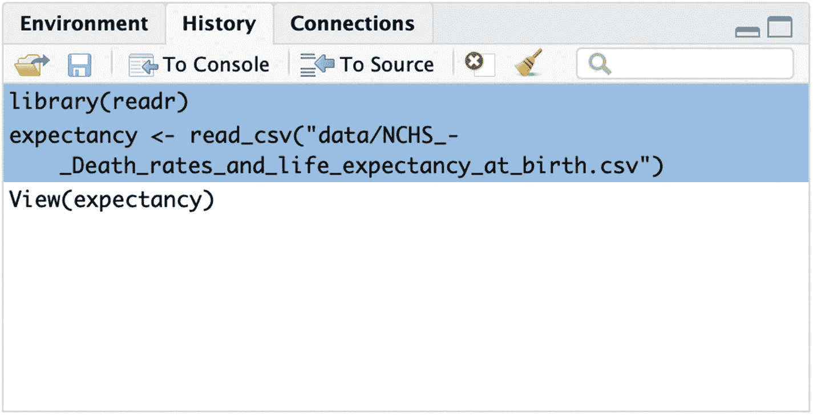

图 5-7 从历史记录选项卡中检索代码

点击“To Source”按钮，将这些代码移至你的 R 脚本文件中。然后点击软盘图标保存文件，如图 5-8 所示。

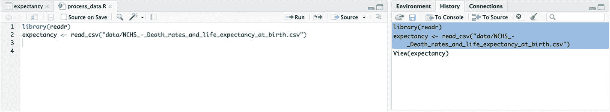

图 5-8 包含检索代码的 R 脚本文件

现在，每当我们需要时，可以点击顶部的“Source”按钮重新运行此步骤。此外，我们可以将此项目发送给同事，她也能以相同的方式重现我们的工作，这样我们的分析就具备了可重复性。

在我们继续之前，我们应该为代码添加一些注释，并清理数据框，以便于后续使用。下面的代码展示了如何实现这一点：

```
# Import NCHS Dataset
# File download from:
#   https://catalog.data.gov
# Contains life expectancy data from 1900 in the US
library(readr)
expectancy <- read_csv("data/NCHS_-_Death_rates_and_life_expectancy_at_birth.csv")
# Clean up dataframe
# Use shorter column names
names(expectancy)[1] <- "year"
names(expectancy)[2] <- "race"
names(expectancy)[3] <- "sex"
names(expectancy)[4] <- "life_expectancy"
names(expectancy)[5] <- "death_rate"
```

`#` 后面的内容是注释，而 R 代码的最后五行将列名替换为更短、更容易使用的名称。别忘了点击软盘图标保存此文件中的代码。

### 数据探索

当你启动一个新项目时，你可能想做的一件事情是进行探索性数据分析。虽然我们已经可以直观地检查数据集，但拥有更全面的了解会更好。我们可能还想开始可视化更重要的数据点。

#### 汇总数据框

现在，让我们创建一个新的 R 脚本文件：在 RStudio 菜单栏中选择“文件” ➤ “新建文件” ➤ “R 脚本”。和之前一样，会打开一个新文件。点击软盘图标，将此文件保存为`data_exploration.R`。

接下来，我们想要查看`expectancy`数据框的汇总信息，因此可以使用`summary`函数，并将数据框作为参数传入。

```
summary(expectancy)
```

将这段代码输入到你的 R 脚本文件中，然后点击“运行”按钮执行这段代码。你将看到输出结果描述了每个变量（即数据框的每一列），如图 5-9 所示。

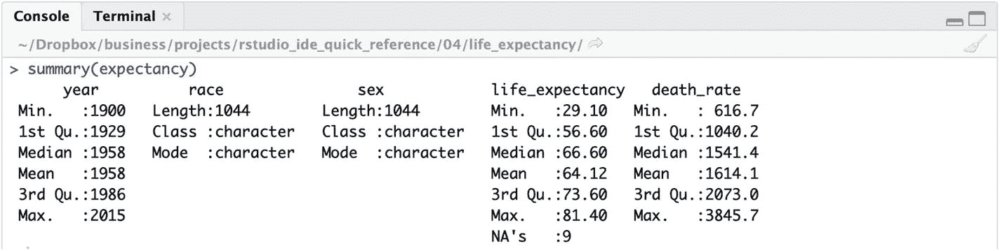

图 5-9 数据框汇总

图 5-9 中的信息向我们展示了该数据集的许多信息。我们可以看到每一列包含的数据类型，以及一些关于数值数据的信息。例如，我们知道数据集涵盖了 1900 年到 2015 年，并且某些年份的预期寿命为 29.10，而其他年份则为 81.4。我们还可以看到有两个字符类型 `race` 和 `sex`，但关于它们的信息很少。这些是分类变量，将揭示该数据集的组织方式。

要查看 `race` 和 `sex` 分类，我们可以使用 R 的 `unique` 函数，并将数据列作为参数传入，如下所示：

```r
unique(expectancy$race)
```

如果点击“运行”按钮，你将看到以下输出：

```
[1] "All Races" "Black"     "White"
```

当你对 `sex` 分类进行同样的操作时，可以看到也有三个分类：“Both Sexes”、“Female”和“Male”。

从所有这些信息中我们可以推断，我们的数据将按三个类别组织：年份、种族和性别。而且，很可能每一年都会有所有种族和性别组合的行。你可以使用数据框视图来验证这一点。

导航到项目中的第一个标签页，再次查看 `expectancy` 数据框。点击筛选按钮查看数据的子集。使用年份列中的滑块，仅查看标识为 1900 年的行，如图 5-10 所示。

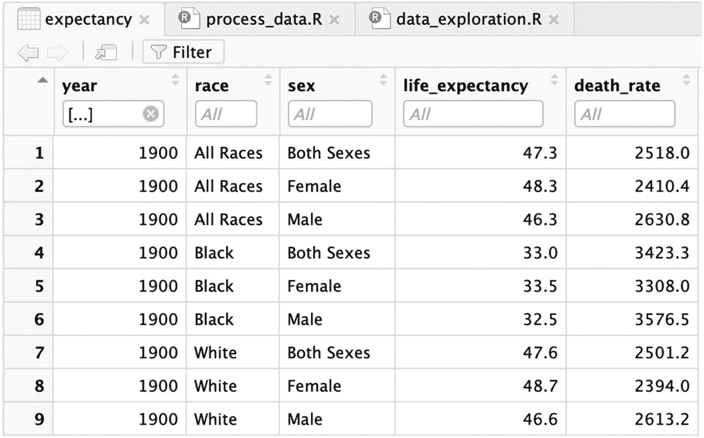

图 5-10 筛选后的数据框

既然我们知道了数据是如何组织的，我们就需要小心处理这个数据框。例如，我们不应简单地按年份聚合数据点，因为它包含重叠的类别；在提出研究问题时，我们需要根据这些类别进行筛选。

你可能还想做一些初步的可视化，以便开始了解我们正在查看的数值变量。例如，你可能猜测自 1900 年以来预期寿命有所增加。为了检验这个理论，你可以只查看数据框中 `race` 和 `sex` 类别值分别为“All Races”和“Both Sexes”的行。

```r
trend <- expectancy
trend <- trend[trend$race == "All Races", ]
trend <- trend[trend$sex == "Both Sexes", ]
```

首先，我们将 `expectancy` 数据框赋值给一个名为 `trend` 的新数据框。然后，我们对数据取两个子集。第二行将返回所有 `race` 等于“All Races”的行，而第三行将返回所有 `sex` 等于“Both Sexes”的行。接下来，我们可以删除除我们特别关注的那些变量之外的所有变量。

```r
trend$race <- NULL
trend$sex <- NULL
trend$death_rate <- NULL
```

在 R 中将对象设置为 `NULL` 会将其从环境中移除。现在，我们可以使用基础 R 的 `plot` 函数来绘制每年预期寿命的图表。

```r
plot(trend)
```

这将自动绘制这两个变量，你的绘图查看器中会显示如图 5-11 所示的图形。

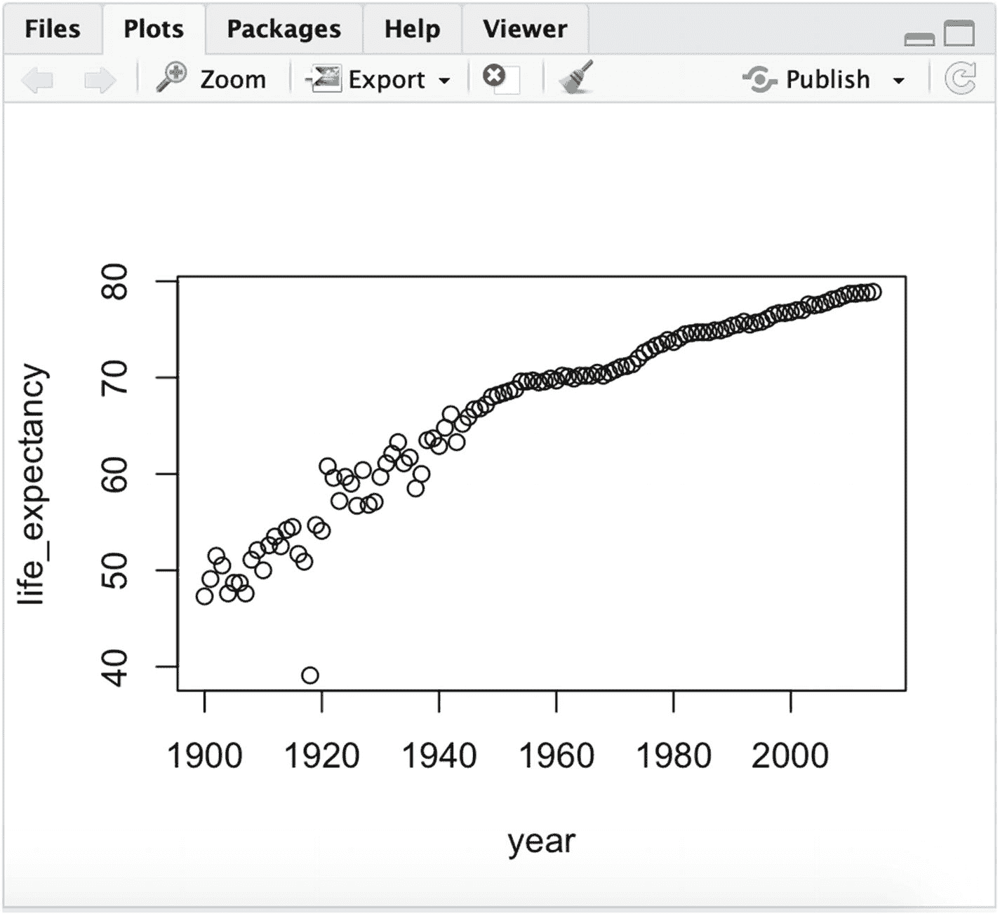

图 5-11 按年份统计的预期寿命

如你所见，这个图表支持了我们最初的猜测，即预期寿命会随着时间的推移而增加。图表还显示，早年间的观测值不如晚年间的一致。

## 结论

本章提供了一个示例，说明如何使用 RStudio 项目来组织您的工作并使其可复现。RStudio 项目使您能够轻松地追溯步骤，并在完善分析时基于早期工作继续构建。此外，RStudio 项目使与同事共享工作变得更加容易。

在完成此类项目后关闭 RStudio 时，请确保在 IDE 提示您时点击“保存”。这将保存您的工作和历史记录，并在后续项目中更容易地从中断处继续。