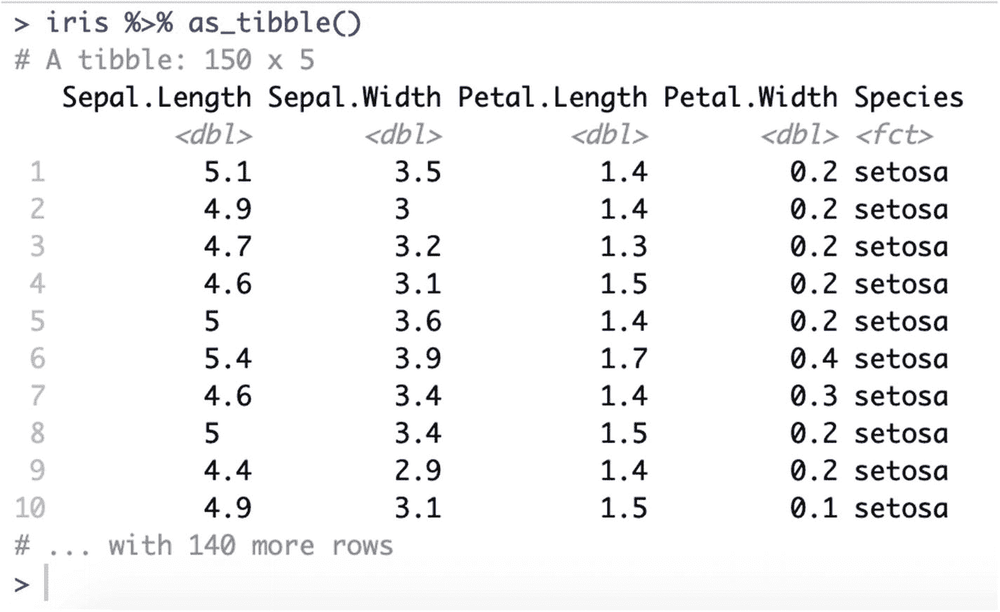

# 6. 必备 R 包：Tidyverse

既然你已经掌握了基本的 RStudio 工作流程，我们准备开始重点介绍一些能够真正加速数据分析的工具。并非所有这些工具都是 RStudio 独有的，你也可能在其它 R 环境中见到它们，但它们与 RStudio IDE 的契合度非常出色。

这里的首要任务是向你介绍那些必须拥有的、将成为你 R 工具箱基石的包。这些包中的许多会简化 R 中已有的函数，而另一些则会为基础系统增加功能。RStudio 与这些包共同将 R 转变为数据从业者的专业工具。

## R 包

R 包是一种可以安装到 RStudio 中，以扩展 R 内置基本功能的东西。R 变得如此流行的原因之一，就是它拥有这个丰富的包生态系统，它真正使 R 成为一个全面的数据科学平台。

你可以使用 RStudio 来加载、浏览、安装和移除包，或者使用 R 代码来管理 R 包。RStudio 的包支持功能在第 3 章中有详细讨论。

## Tidyverse

我们将要讨论的包实际上是一个名为“`tidyverse`”的包集合。`Tidyverse`主要由哈德利·威克姆开发，他也在 RStudio 工作。`tidyverse`网站[`https://www.tidyverse.org`](https://www.tidyverse.org)对这套包的描述最为贴切：*“tidyverse 是一个为数据科学设计的、有鲜明观点的 R 包集合。所有包共享底层设计理念、语法和数据结构。”*

注意，作者将`tidyverse`描述为“有鲜明观点的”。这意味着`tidyverse`不仅仅是一组函数；它也是一种规定好的进行数据科学的方式。有一套`tidyverse`式的做事方法。这就是他们所说`tidyverse`是“有鲜明观点的”含义。

`tidyverse`擅长做的事情之一，是平滑基础 R 中的粗糙边缘。`tidyverse`为基础 R 中已经存在的函数提供了一致的包装器，使其更易于使用和记忆。这些包还为基础 R 增加了更多功能。例如，`ggplot2`（一个`tidyverse`包）扩展了基础 R 的`plot`函数的功能，并增加了更多的图表类型。让我们进入核心的`tidyverse`包。

要跟随下面的示例操作，你必须先安装`tidyverse`，然后将该库导入到你的项目中。你可以使用第三章中关于包的说明来操作，或者在你的 R 控制台中输入以下代码。

```
install.packages("tidyverse")
library(tidyverse)
```

### magrittr

`magrittr`包通过引入管道操作符`%>%`改变了 R 编码的流程。`%>%`操作符将左侧的值管道传输到右侧的表达式。这使我们能够创建“管道”，从而可以立即且清晰地看到代码块的功能。

在像 R 这样高度依赖函数的编程语言中，你最终会写出难以阅读的代码，例如：

```
round(mean(subset(expectancy, race == "All Races")$death_rate), 1)
```

这一行代码将返回我们在上一章中处理过的`expectancy`数据框中的平均死亡率。但是，它执行了三个任务：过滤数据集、计算平均分数，然后对结果进行四舍五入。像这样的代码很难阅读，而且随着问题变得复杂，这种代码会变得越来越难以理解。

`magrittr`包的管道操作符`%>%`将通过消除嵌套函数调用的需求来帮助我们整理代码。以下是编写此代码的另一种方式：

```
expectancy %>%
subset(race == "All Races") %>%
.$death_rate %>%
mean() %>%
round(1)
```

这段代码稍长一些，但清晰得多。你可以从上到下阅读，每个`%>%`都将其上方的对象作为第一个参数传递到下一个函数。在最上方，我们使用`%>%`将`expectancy`数据框作为其右侧参数传递给`subset`。

现在我们可以清楚地说明，我们从数据框开始，获取了一个行子集，选择了`death_rate`，使用`mean`得到平均值，然后对值进行了四舍五入。

#### 注意

上面第三行代码中使用的点`·`用于引用由`magrittr`管道传输的对象，因此在上面的例子中，它指的是`subset`函数输出的数据框。

`magrittr`包是一个核心包，用于所有`tidyverse`包，并帮助塑造`tidyverse`中使用的风格化分析方式。

### tibble

`tibble`包是另一个`tidyverse`基础包。`tibble`是基础 R 数据框的 tidyverse 版本。你不一定会直接使用这个包，但`tidyverse`函数会返回`tibble`而不是数据框。

在实践中，这不会对你产生太大影响，你可以将`tibble`视为数据框。然而，`tibble`的行为方式会有所不同。例如，如果我们在 R 控制台中输入单词`iris`，我们只会得到`iris`数据框中所有内容的列表。但是，如果你将`iris`数据框转换为`tibble`并检查输出，如下所示：

```
iris %>% as_tibble()
```

你将得到整洁的数据打印输出，如图 6-1 所示。



图 6-1

`tibble`整洁输出

这仅显示一个屏幕的数据，但提供了更有用的信息。我们可以看到数据本身的样本，并获得每列的数据类型和数据集的维度。

### dplyr

`dplyr`是一个用于数据操作的`tidyverse`包。这个包使得过滤行、选择变量和修改内容变得更加容易。`dplyr`与`magrittr`紧密合作，提供了一套用于数据操作的“语法”。

在`dplyr`和整个`tidyverse`中，“语法”一词指的是在 R 中工作的风格化方式。在`tidyverse`语法中，函数被称为动词。动词的编写方式使其非常具有描述性，这样当你使用`tidyverse`语法时，你编写的代码就能非常清晰地讲述你的分析故事。

例如，你可以使用`dplyr`和`magrittr`像这样编写上一个查找平均死亡率的例子：

```
expectancy %>%
filter(race == "All Races") %>%
summarize(avg = mean(death_rate)) %>%
mutate(avg = round(avg, 1))
```

在上面的代码中，我们将`expectancy`数据框通过管道传递给一组描述我们正在做什么的动词。我们在进行过滤、汇总和修改。这描述了我们的操作。它还使得对此管道进行更改变得容易，因为我们可以简单地更改或在此管道中的任何位置添加新的动词。

上面的代码将输出一个作为`tibble`返回的值。

```
# A tibble: 1 x 1
avg

1 1489.
```

如果我们想要进行相同的分析，但还想按性别查看平均死亡率，我们可以简单地向管道添加一个`group_by`动词。

```
expectancy %>%
filter(race == "All Races") %>%
group_by(sex) %>%
summarize(avg = mean(death_rate)) %>%
mutate(avg = round(avg, 1))
```

这次我们将得到三个值：一个针对双性，一个针对男性，一个针对女性。

```
# A tibble: 3 x 2
sex          avg

1 Both Sexes 1478.
2 Female     1305.
3 Male       1683.
```

#### 类似 SQL 的连接

使用`inner_join`、`left_join`和`right_join`动词来组合两个相关数据集。这些`dplyr`动词大致相当于名称相似的 SQL 语句 INNER JOIN、LEFT JOIN 和 RIGHT JOIN。

为了说明`dplyr`连接，假设我们想要在我们的数据框（抱歉，`tibble`！）中使用新标签，并且我们还有一个包含更好标签的`tibble`。你可以像这样创建一个标签`tibble`来进行跟进：

```
labels <- tribble(
~key, ~new_label,
"Both Sexes",   "All Genders",
"Female",   "Identifies Female",
"Male",   "Identifies Male"
)
```

如果你运行这段代码，一个名为“`labels`”的新`tibble`将出现在环境窗口的“Data”下。你可以像之前查看数据框一样查看它，只需在视图中单击对象名称即可。

我们现在可以使用`dplyr`动词`inner_join`轻松地将这些标签添加到我们的管道中。


