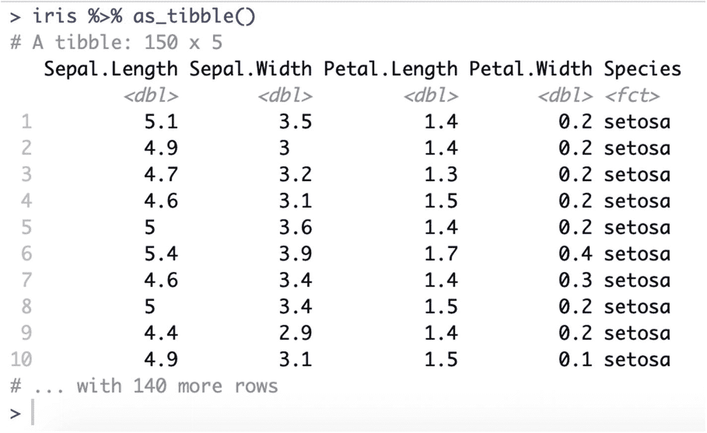
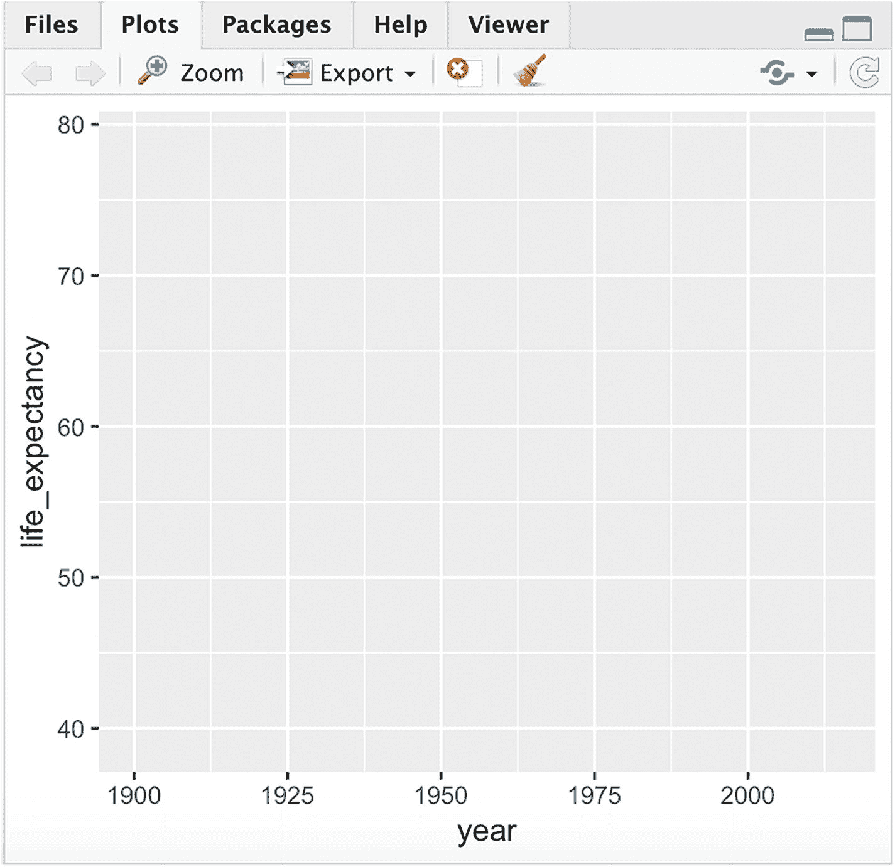
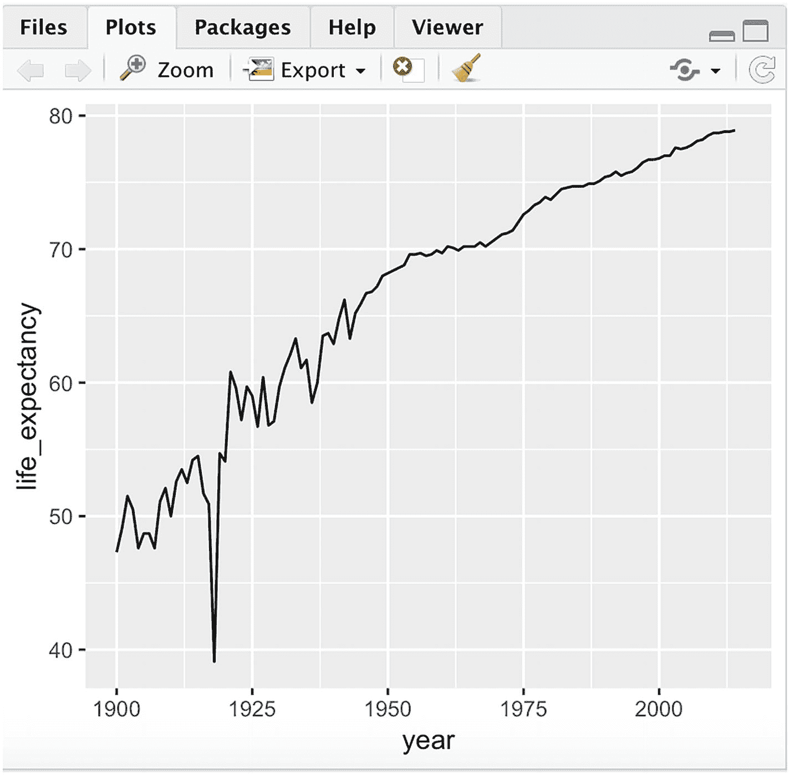
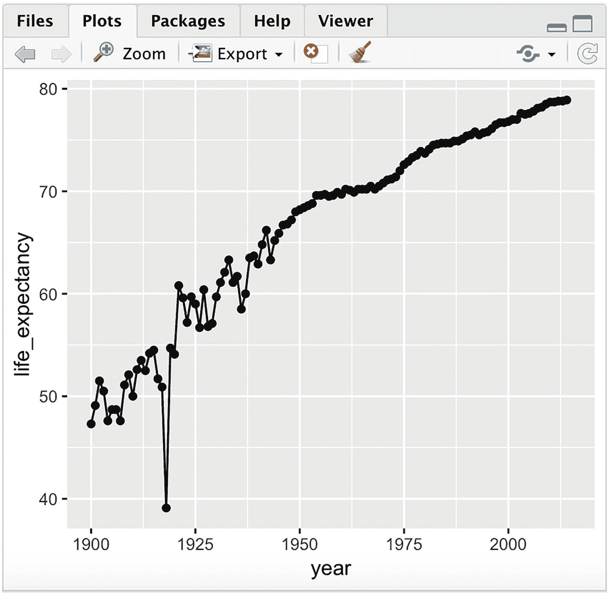
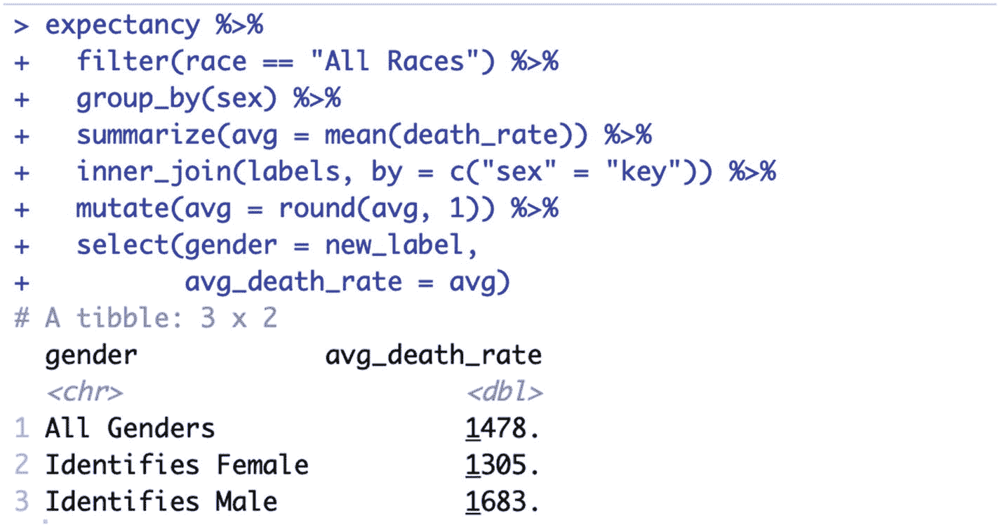
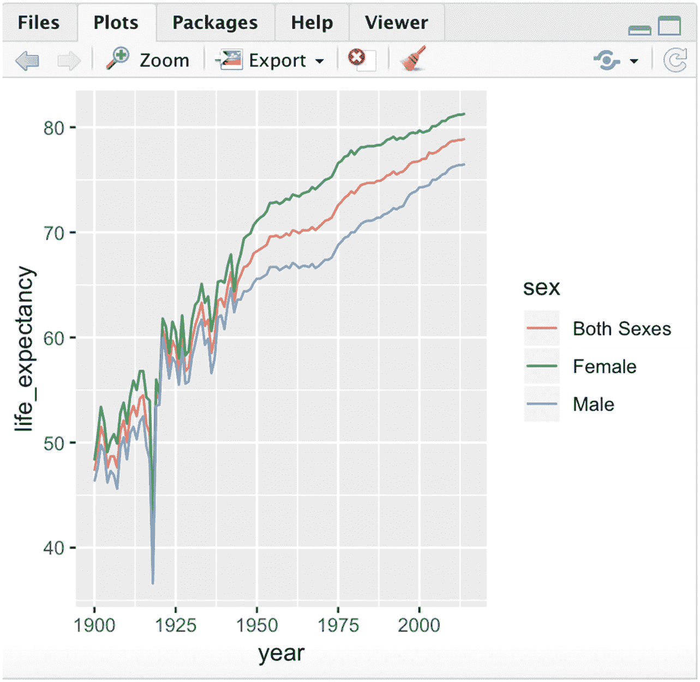
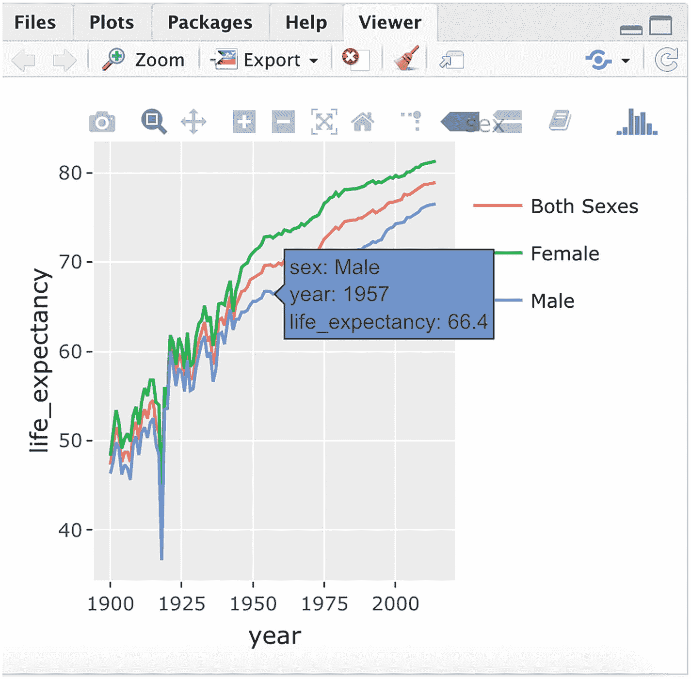
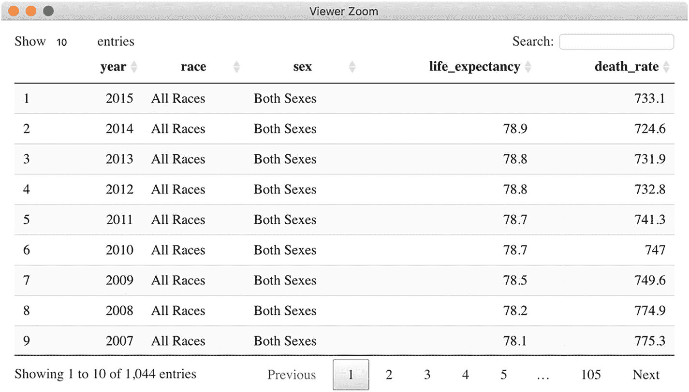
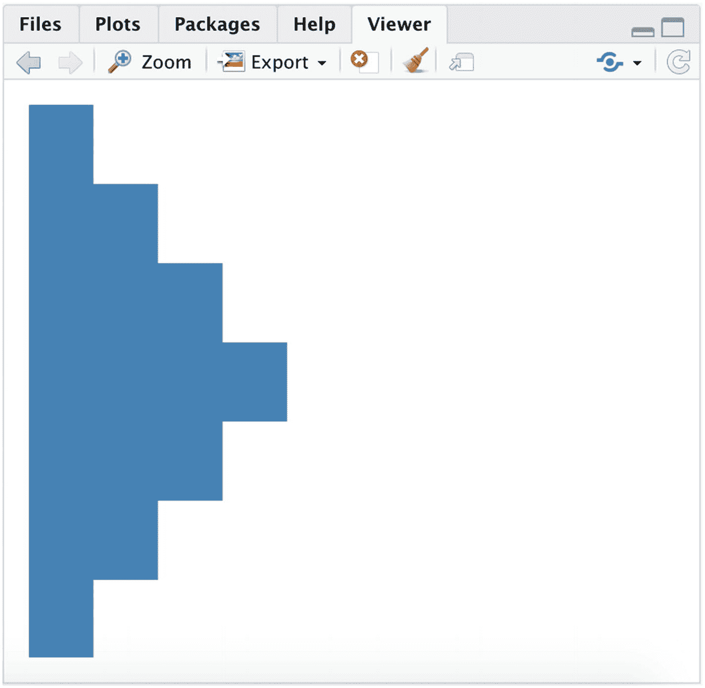

# 6. 必备 R 包：Tidyverse

既然你已经掌握了基本的 RStudio 工作流程，我们准备开始重点介绍一些能够真正加速数据分析的工具。并非所有这些工具都是 RStudio 独有的，你也可能在其它 R 环境中见到它们，但它们与 RStudio IDE 的契合度非常出色。

这里的首要任务是向你介绍那些必须拥有的、将成为你 R 工具箱基石的包。这些包中的许多会简化 R 中已有的函数，而另一些则会为基础系统增加功能。RStudio 与这些包共同将 R 转变为数据从业者的专业工具。

## R 包

R 包是一种可以安装到 RStudio 中，以扩展 R 内置基本功能的东西。R 变得如此流行的原因之一，就是它拥有这个丰富的包生态系统，它真正使 R 成为一个全面的数据科学平台。

你可以使用 RStudio 来加载、浏览、安装和移除包，或者使用 R 代码来管理 R 包。RStudio 的包支持功能在第 3 章中有详细讨论。

## Tidyverse

我们将要讨论的包实际上是一个名为“`tidyverse`”的包集合。`Tidyverse`主要由哈德利·威克姆开发，他也在 RStudio 工作。`tidyverse`网站[`https://www.tidyverse.org`](https://www.tidyverse.org)对这套包的描述最为贴切：*“tidyverse 是一个为数据科学设计的、有鲜明观点的 R 包集合。所有包共享底层设计理念、语法和数据结构。”*

注意，作者将`tidyverse`描述为“有鲜明观点的”。这意味着`tidyverse`不仅仅是一组函数；它也是一种规定好的进行数据科学的方式。有一套`tidyverse`式的做事方法。这就是他们所说`tidyverse`是“有鲜明观点的”含义。

`tidyverse`擅长做的事情之一，是平滑基础 R 中的粗糙边缘。`tidyverse`为基础 R 中已经存在的函数提供了一致的包装器，使其更易于使用和记忆。这些包还为基础 R 增加了更多功能。例如，`ggplot2`（一个`tidyverse`包）扩展了基础 R 的`plot`函数的功能，并增加了更多的图表类型。让我们进入核心的`tidyverse`包。

要跟随下面的示例操作，你必须先安装`tidyverse`，然后将该库导入到你的项目中。你可以使用第三章中关于包的说明来操作，或者在你的 R 控制台中输入以下代码。

```
install.packages("tidyverse")
library(tidyverse)
```

### magrittr

`magrittr`包通过引入管道操作符`%>%`改变了 R 编码的流程。`%>%`操作符将左侧的值管道传输到右侧的表达式。这使我们能够创建“管道”，从而可以立即且清晰地看到代码块的功能。

在像 R 这样高度依赖函数的编程语言中，你最终会写出难以阅读的代码，例如：

```
round(mean(subset(expectancy, race == "All Races")$death_rate), 1)
```

这一行代码将返回我们在上一章中处理过的`expectancy`数据框中的平均死亡率。但是，它执行了三个任务：过滤数据集、计算平均分数，然后对结果进行四舍五入。像这样的代码很难阅读，而且随着问题变得复杂，这种代码会变得越来越难以理解。

`magrittr`包的管道操作符`%>%`将通过消除嵌套函数调用的需求来帮助我们整理代码。以下是编写此代码的另一种方式：

```
expectancy %>%
subset(race == "All Races") %>%
.$death_rate %>%
mean() %>%
round(1)
```

这段代码稍长一些，但清晰得多。你可以从上到下阅读，每个`%>%`都将其上方的对象作为第一个参数传递到下一个函数。在最上方，我们使用`%>%`将`expectancy`数据框作为其右侧参数传递给`subset`。

现在我们可以清楚地说明，我们从数据框开始，获取了一个行子集，选择了`death_rate`，使用`mean`得到平均值，然后对值进行了四舍五入。

#### 注意

上面第三行代码中使用的点`·`用于引用由`magrittr`管道传输的对象，因此在上面的例子中，它指的是`subset`函数输出的数据框。

`magrittr`包是一个核心包，用于所有`tidyverse`包，并帮助塑造`tidyverse`中使用的风格化分析方式。

### tibble

`tibble`包是另一个`tidyverse`基础包。`tibble`是基础 R 数据框的 tidyverse 版本。你不一定会直接使用这个包，但`tidyverse`函数会返回`tibble`而不是数据框。

在实践中，这不会对你产生太大影响，你可以将`tibble`视为数据框。然而，`tibble`的行为方式会有所不同。例如，如果我们在 R 控制台中输入单词`iris`，我们只会得到`iris`数据框中所有内容的列表。但是，如果你将`iris`数据框转换为`tibble`并检查输出，如下所示：

```
iris %>% as_tibble()
```

你将得到整洁的数据打印输出，如图 6-1 所示。



图 6-1

`tibble`整洁输出

这仅显示一个屏幕的数据，但提供了更有用的信息。我们可以看到数据本身的样本，并获得每列的数据类型和数据集的维度。

### dplyr

`dplyr`是一个用于数据操作的`tidyverse`包。这个包使得过滤行、选择变量和修改内容变得更加容易。`dplyr`与`magrittr`紧密合作，提供了一套用于数据操作的“语法”。

在`dplyr`和整个`tidyverse`中，“语法”一词指的是在 R 中工作的风格化方式。在`tidyverse`语法中，函数被称为动词。动词的编写方式使其非常具有描述性，这样当你使用`tidyverse`语法时，你编写的代码就能非常清晰地讲述你的分析故事。

例如，你可以使用`dplyr`和`magrittr`像这样编写上一个查找平均死亡率的例子：

```
expectancy %>%
filter(race == "All Races") %>%
summarize(avg = mean(death_rate)) %>%
mutate(avg = round(avg, 1))
```

在上面的代码中，我们将`expectancy`数据框通过管道传递给一组描述我们正在做什么的动词。我们在进行过滤、汇总和修改。这描述了我们的操作。它还使得对此管道进行更改变得容易，因为我们可以简单地更改或在此管道中的任何位置添加新的动词。

上面的代码将输出一个作为`tibble`返回的值。

```
# A tibble: 1 x 1
avg

1 1489.
```

如果我们想要进行相同的分析，但还想按性别查看平均死亡率，我们可以简单地向管道添加一个`group_by`动词。

```
expectancy %>%
filter(race == "All Races") %>%
group_by(sex) %>%
summarize(avg = mean(death_rate)) %>%
mutate(avg = round(avg, 1))
```

这次我们将得到三个值：一个针对双性，一个针对男性，一个针对女性。

```
# A tibble: 3 x 2
sex          avg

1 Both Sexes 1478.
2 Female     1305.
3 Male       1683.
```

#### 类似 SQL 的连接

使用`inner_join`、`left_join`和`right_join`动词来组合两个相关数据集。这些`dplyr`动词大致相当于名称相似的 SQL 语句 INNER JOIN、LEFT JOIN 和 RIGHT JOIN。

为了说明`dplyr`连接，假设我们想要在我们的数据框（抱歉，`tibble`！）中使用新标签，并且我们还有一个包含更好标签的`tibble`。你可以像这样创建一个标签`tibble`来进行跟进：

```
labels <- tribble(
~key, ~new_label,
"Both Sexes",   "All Genders",
"Female",   "Identifies Female",
"Male",   "Identifies Male"
)
```

如果你运行这段代码，一个名为“`labels`”的新`tibble`将出现在环境窗口的“Data”下。你可以像之前查看数据框一样查看它，只需在视图中单击对象名称即可。

我们现在可以使用`dplyr`动词`inner_join`轻松地将这些标签添加到我们的管道中。

# 7. 数据可视化

对 RStudio 用户来说，最有吸引力的元素之一是可用的丰富数据可视化工具库。在本章中，我们将重点介绍最常使用的图形工具，这些工具将满足您大部分日常工作。当然，在 R 生态系统中，我们还有数以百计的其他库和专用包可用于可视化。

现在，我们将首先关注那些能立即对您产生最大影响的工具，从 `ggplot2`（一个`tidyverse`包）开始。然后，我们将继续介绍其他一些包，这些包能让您对可视化有更多控制，但代价是需要您投入更多精力来使用。

## `ggplot2`

`ggplot2` 是`tidyverse`中进行基本绘图的方式。它替换并增强了我们在前面章节中已经看到的基础 R 的数据绘图方法。正如您从上一章我们对 `dplyr` 的讨论中所期望的那样，`ggplot2` 提供了一种非常独特的数据可视化方式。您将使用 `ggplot2` 进行日常数据探索，也用于在可接受静态图形的报告中进行数据展示。

让我们看看如何使用 `ggplot2`。首先，与其他`tidyverse`包一样，我们需要使用 `library` 函数来加载`tidyverse`包 `library(tidyverse)`。

```r
library(tidyverse)

source("process_data.R")
```

在加载了 `tidyverse` 之后，在第二行代码中，我们使用 `source` 命令重新运行保存在 "process_data.R" 文件中的所有代码。这确保了我们就预期寿命数据集的结构达成了共识。

要使用 `ggplot2`，我们可以通过管道将一个数据集传递给 `ggplot` 函数。这个函数需要我们指定要绘制的变量。

```r
expectancy %>%
  filter(race == "All Races",
         sex == "Both Sexes") %>%
  ggplot(aes(year, life_expectancy))
```

当你运行这段代码时，你会看到一个空白画布，X 轴和 Y 轴已定义好，如图 7-1 所示。



图 7-1 空白 `ggplot` 画布

图 7-1 显示了一个画布，X 轴为年份，Y 轴为死亡率。现在我们已经定义了绘图的范畴，可以开始添加视觉元素来展示数据了。通过将 `ggplot` 函数通过管道传递给一组描述数据故事的“动词”来实现。

```r
expectancy %>%
  filter(race == "All Races",
         sex == "Both Sexes") %>%
  ggplot(aes(year, life_expectancy)) +
  geom_line()
```

我们使用了 `geom_line` 动词来声明我们想用一条线来表示数据。与您可能期望的使用 `magrittr` 管道操作符 `%>%` 不同，`ggplot2` 使用加号 `+` 来进行管道操作。请参见图 7-2 查看此折线图的示例。



图 7-2 按年份的死亡率折线图

图 7-2 中的图显示了一个有趣的趋势以及一个可能的异常值，这个异常值可能需要在以后进行解释。您可以通过管道操作符 `+` 继续添加可视化图层。如果您想在线条上添加点，可以使用 `geom_point` 动词。

```r
expectancy %>%
  filter(race == "All Races",
         sex == "Both Sexes") %>%
  ggplot(aes(year, life_expectancy)) +
  geom_line() +
  geom_point()
```

这将生成图 7-3 所示的图形。



图 7-3 向折线图添加点标记

如果我们想按性别细分查看这一趋势呢？要在 `ggplot` 折线图中查看这样的子组，您只需向您想要分类的 `geom_line` 动词添加一个新的美学参数。

```r
expectancy %>%
  filter(race == "All Races") %>%
  ggplot(aes(year, life_expectancy)) +
  geom_line(aes(color = sex))
```

在上面的代码中，你还可以看到我们使用了`dplyr`动词`select`来以更令人愉悦的方式排列和重命名标签。你可以在图 6-2 中看到结果。



图 6-2 应用于`tibble`的性别标签

当你运行上面的代码时，你会看到结果以`tibble`的形式返回。你可以使用赋值操作符`<-`存储结果，以便稍后使用，而不是在控制台中显示结果。

```r
avg_death_rates_by_gender <-
  expectancy %>%
  filter(race == "All Races") %>%
  group_by(sex) %>%
  summarize(avg = mean(death_rate)) %>%
  inner_join(labels, by = c("sex" = "key")) %>%
  mutate(avg = round(avg, 1)) %>%
  select(gender = new_label,
         avg_death_rate = avg)
```

### stringr

我们将详细研究的最后一个`tidyverse`包将帮助你处理字符串。处理字符串很棘手，因为这种数据类型可能比简单的数字更复杂。`stringr`包含用于检测模式、分割字符串和连接字符串的函数。

你可以单独使用`stringr`函数，也可以与`dplyr`动词（如`filter`和`mutate`）一起使用。例如，要过滤在`race`列中包含字符模式“All”的记录，你可以在`filter`动词中使用`str_detect`，如下所示：

```r
expectancy %>%
  filter(str_detect(race, "All"))
```

我们可以使用`str_replace`将一个字符模式替换为另一个。要将`race`列中的条目“All Races”更改为“Most Races”，你可以这样做：

```r
expectancy %>%
  mutate(race = str_replace(race, "All", "Most"))
```

有许多`stringr`函数可以帮助你处理字符串。其中许多只是与基础 R 函数一起工作的包装器。`stringr`的价值主要在于它提供了一致的接口。每个函数都会将输入字符串作为第一个参数，这样它们就可以与`magrittr`管道操作符一起工作。

## 结论

`tidyverse` 集合中还有许多其他包，但上面介绍的这些包将为您提供使用任何`tidyverse`包所需的知识。这些也是您最有可能日常使用的包，并且它们所涉及的概念对基础 R 的扩展程度足以让我们认为它们值得更详细的介绍。不过，让我们也花点时间提一下其他一些包，以便您了解还有哪些其他工具可用。

`ggplot2` 是一个`tidyverse`包，它真正为 R 语言中的数据可视化设定了标准。这个包将在数据可视化章节中得到详细讲解。`tidyr` 帮助将数据转换为整洁的`tibble`数据集，便于添加到您的分析流程中。`readr`、`readxl` 和 `haven` 帮助您导入文本数据、Excel 数据以及 SAS/Stata/SPSS 数据。`lubridate` 帮助您处理棘手的日期和日期时间。

请注意，我们在该可视化的第一部分不再过滤“Both Sexes”，因为我们希望查看所有三个组。此代码将生成图 7-4 所示的图形。



图 7-4

在`ggplot`中绘制子组

此图向我们展示了有所数据的两个性别之间的关系。线条显示为彩色，因为我们在`geom_line`中指定了颜色美学参数。

关于`ggplot`的内容远不止本章所能涵盖的。您有大量选项来显示不同类型的数据，以及标签和标题选项。这个包基本上是 RStudio 进行可视化的主力工具。请访问`ggplot2`的官方网站以获取更多关于如何使用此包的信息：[`https://ggplot2.tidyverse.org`](https://ggplot2.tidyverse.org)。

### htmlwidgets

虽然`ggplot2`提供了您进行基本绘图所需的大部分功能，但有时您可能希望为分析添加交互性或非常专业的图形。`htmlwidgets`是一系列软件包的集合，您可以使用它们将这种更高层次的可视化功能添加到您的 R 分析中。

`htmlwidgets`使您能够集成原本为网站开发的开源 Javascript 小组件。请访问 [`http://htmlwidgets.org`](http://htmlwidgets.org) 网站，获取所有可用小组件的完整列表。请注意，许多小组件对于您试图可视化的问题类型非常具体。您将找到用于地图、时间序列、网络图以及一些 D3 图形的小组件。

我们可以使用一个`htmlwidget` —— `plotly`，将我们在上一节中创建的图形转换为一个可用于网页的交互式小组件。`Plotly`的有趣之处在于它与`ggplot2`协同工作，并能真正将`ggplot2`提升到一个新的水平。以下是您为`ggplot2`图形添加交互性所需做的全部工作，使用`plotly`。

```
library(plotly)
i_plot <- expectancy %>%
  filter(race == "All Races") %>%
  ggplot(aes(year, life_expectancy)) +
  geom_line(aes(color = sex))
ggplotly(i_plot)
```

这段代码与我们使用`ggplot2`时所做的非常相似。然而，这次我们将结果赋值给一个对象，并使用该对象作为`ggplotly`的参数，来创建图 7-5 中所示的交互式图形。



图 7-5 带有弹出窗口的 Plotly HTML 小组件

现在，这个图形包含了详细信息的弹出窗口以及顶部带有导航图标的工具栏。在后面的章节中，当我们学习如何创建连贯的报告和仪表板时，我们将能包含像这样的小组件，为用户创造丰富的交互式体验。

在我们继续之前，让我们重点介绍 DT 包的数据表格组件。数据表格是一个非常有用的交互式 html 小组件，它将为您的数据集创建一个可搜索的 HTML 展示。例如，如果我们想直接向用户提供一个可搜索版本的数据集，我们可以简单地这样做：

```
library(DT)
datatable(expectancy,
          options = list(pageLength = 10))
```

这将创建图 7-6 所示的小组件，它是一个填充了我们的数据的可搜索交互式表格。



图 7-6 数据表格小组件

### r2d3

本章前两个部分讨论的软件包都提供了丰富的对象来可视化大多数类型的数据。然而，最终我们的图形看起来会像其他人设计的、所有 R 开发者都能使用的图形。

在某些用例中，我们希望绝对控制可视化的每一个方面。要么是因为没有现成的小组件能帮到我们，要么是我们需要做一些高度定制化的工作。这就是 D3 可以发挥作用的地方，而`r2d3`是一个我们可以用来将 D3 整合到 RStudio 项目中的软件包。

与`htmlwidgets`一样，D3 是一个基于网页的 Javascript 解决方案。然而，使用 D3 比我们使用`htmlwidgets`要复杂得多。D3 本质上是一种编程语言。

D3 的核心思想是，您可以将数据集与图形原语（如线条和圆形）绑定。这些图形将根据数据集中的值而增大或缩小。D3 图形可以变得非常复杂，因为您可以对其外观进行大量控制。

虽然教授 D3 远远超出了本书的范围，但我们可以向您展示一个快速入门的方法。

#### 注意

此处讨论的功能需要 RStudio 1.2，该版本应在您下载的当前 RStudio 版本中可用。但是，本章使用的版本来自 RStudio 的预览版，因此屏幕截图可能看起来略有不同。

要使用 D3，只需转到 RStudio 菜单，然后选择“File”、“New File”，再选择“D3 Script”。一个包含 D3 代码的文件将会出现。

```
// !preview r2d3 data=c(0.3, 0.6, 0.8, 0.95, 0.40)
//
// r2d3: https://rstudio.github.io/r2d3
//
var barHeight = Math.ceil(height / data.length);
svg.selectAll('rect')
  .data(data)
  .enter().append('rect')
  .attr('width', function(d) { return d * width; })
  .attr('height', barHeight)
  .attr('y', function(d, i) { return i * barHeight; })
  .attr('fill', 'steelblue');
```

此文件中的代码是 Javascript，您可以通过修改此代码来调整可视化效果。保存此文件并点击“Preview”按钮来查看 D3 可视化的效果。与我们前面强调的预打包解决方案相比，它看起来并不起眼，但这没关系，因为 D3 实际上更像是提供了一块供您绘制的画布，而不是一组绘图小组件。

预览功能仅使用了文件注释中的代码，但如果您更希望从 R 脚本文件中提供自己的数据，则可以使用`r2d3`库。

```
library(r2d3)
r2d3(data = c(.1,.2,.3,.4,.3,.2,.1),
     script = "d3_plot.js")
```

这段代码将生成图 7-7 中的图形。



图 7-7 基本的 D3 图形

显然，这是一个非常基础的可视化入门。请查看`r2d3`网站，了解您可以用 D3 完成的一整套令人惊叹的可视化效果 [`https://rstudio.github.io/r2d3/articles/gallery.html`](https://rstudio.github.io/r2d3/articles/gallery.html)。这些示例还包含了重现它们所需的代码，以便您可以将其作为自己定制 D3 可视化的起点。

### 结论

除了基础的 R 语言`plot`函数之外，您在 R 中进行数据可视化还有许多选择。`ggplot2`提供了一种非常强大且风格化的方式来满足大多数分析师大部分时间内的需求。像`r2d3`和`htmlwidgets`这样的软件包则为更专业化的用例提供支持。还有更多专门的可视化选项可用，所有这些功能都可以在我们将在后续章节讨论的仪表板和报告选项中加以利用。